# 9 探索 GPTs

## 在 Discord 上加入我们的书籍社区


[`packt.link/EarlyAccess`](https://packt.link/EarlyAccess)

在之前的几个章节中，我们看到了许多如何利用 ChatGPT 进行各种活动的示例，从个人生产力到营销，从研究到软件开发。对于这些场景中的每一个，我们总是面临着类似的情况：我们从像 ChatGPT 这样的通用模型开始，然后提出非常具体的问题或提供特定的参考，以定制以满足我们的特定需求。

然而，如果我们的目标是为自己的用途获取一个极其专业化的模型，有时这可能是不够的。这就是为什么我们可能需要构建“特定用途的 ChatGPT”，而且幸运的是，OpenAI 本身开发了一个无代码平台来构建这些自定义助手，这些助手被称为 GPTs。

在本章中，我们将详细介绍 GPTs 的功能、能力和现实世界中的应用，涵盖了我们在之前的章节中看到的相同用例，以便你能够看到输出质量上的差异。此外，我们还将看到如何发布你的 GPT，并使其成为不仅适用于你自己，也适用于公司或所有人的生产应用。

在本章结束时，你将能够：

- 理解什么是 GPT 以及它能完成什么样的任务
- 在不编写任何代码的情况下构建你自己的 GPT
- 发布你的 GPT 并将其与外部系统集成

让我们从一些基本定义开始，然后进入实践。

## 技术要求

ChatGPT Plus

## 什么是 GPTs？

2023 年 11 月，OpenAI 引入了 GPTs，这是 ChatGPT 的专用版本，旨在提高生产力并满足特定的任务和需求。与通用 ChatGPT 不同，这些自定义版本被称为 GPTs，允许用户在没有任何任何编码知识的情况下创建定制的 AI 模型。

> **注意**：预先考虑分类法的考量是重要的，这在整个章节中都将相关。当我们提到 GPT 这个词时，你在书中已经发现并将会发现两种主要定义：
>
> - 第一种是指 OpenAI 语言模型背后真正的“生成式预训练变换器”（`GPT`）模型架构。我们已经在第一部分提到过这种架构，并且知道这是 ChatGPT 本身背后的框架。
> - 第二种在更广义的情况下是指 OpenAI 允许用户以无代码方式创建的专用助手。通过 GPTs，OpenAI 指的是 ChatGPT 的专用版本，在这种语境下，单个 GPT 指你利用 GPTs 平台（所有 ChatGPT Plus 用户均可用）创建的一个助手。

在本章中，每当你读到`GPT`或`GPTs`时，请记住我们使用的是第二种定义。

GPTs 的理念就像 AI 代理（Agents）。事实上，通过 GPTs，我们正在构建由 LLM 驱动的实体，它们具有特定的指令，并提供了自定义知识库以及一组工具或插件来与周围环境交互。

让我们详细查看所有这些组件。首先，你可以全面查看所有已公发布的 GPTs。要做到这一点，你可以访问以下页面：[`chatgpt.com/gpts`](https://chatgpt.com/gpts)。

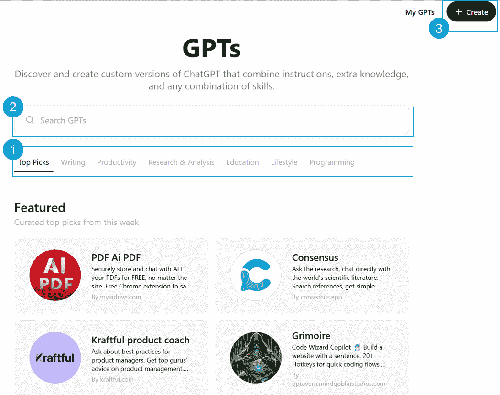

如从前面的图片所示，这是所有 GPTs 的市场。你可以通过类别（`box 1`）或通过说明你寻找的内容（`box 2`）来探索它。

然后要创建你自己的 GPT，你可以进入 OpenAI 账户并点击左上角的 `Explore GPTs`，然后点击`Create`（如`box 3`所示）。

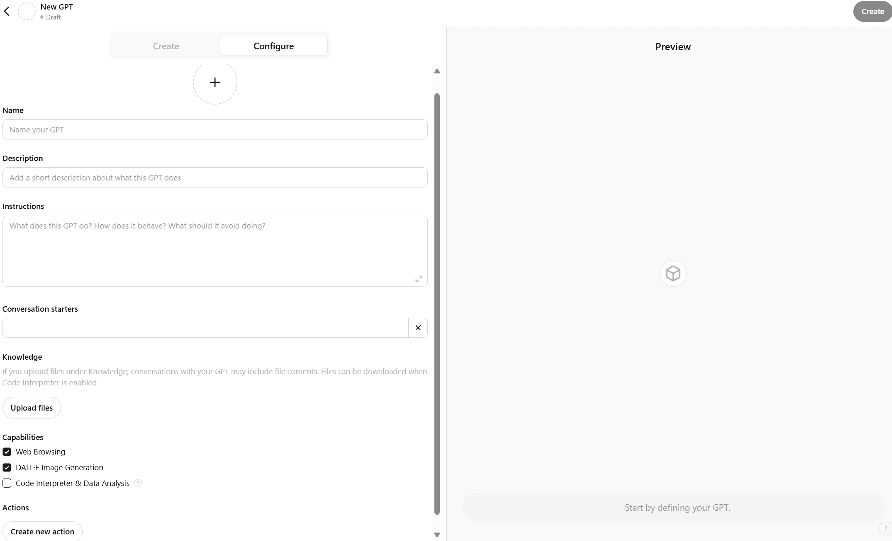

一旦进入编辑器，你将被要求配置你的 GPT，而在右侧你有机会进行实时测试。让我们探索所有组件：

- **Name（名称）**：你给你的 GPT 起的名字。
- **Description（描述）**：你的 GPT 功能的描述。如果你打算在市场发布你的 GPT，这非常重要，这样其他用户就可以轻松找到它（正如我们之前提到的，可以通过 Search GPTs 搜索栏通过自然语言搜索 GPTs）。
- **Instructions（指令）**：这是你 GPT 的元提示（metaprompt），即用自然语言编写的指令，用于根据你的特定需求定制助手，且最终用户看不到。
- **Conversation Starters（对话启动器）**：一组示例提示词，用户可以使用它们开始与 GPT 交互并建立信心。
- **Knowledge（知识）**：指的是我们可以为模型提供的自定义文档。当我们在这里上传文档时，我们的 GPT 将能够通过检索增强生成（RAG）模式遍历它，因此我们可以根据需要提供额外的知识，甚至将助手的回答限制在自定义知识库中。
- **Capabilities（能力）**：这些指的是我们可以为 GPT 提供的一组内置插件，无需编写单行代码。你可以从上面的图中看到开箱即用的三个插件：
  - Web browsing（网络浏览）用于搜索网络并获取最新信息。
  - DALL-E 3 用于生成插图。
  - Code Interpreter and Data Analysis（代码解释器和数据分析）用于在沙箱 Python 环境中执行代码并与分析文件交互。
- **Actions（动作）**：动作也可以被视为插件，但它们与能力不同，因为它们不是内置的，而是由 GPT 开发者指定的。例如，你可能会生成一个动作

> 在动作的背景下，如果你点击`Add Actions`然后点击`Get help from ActionsGPT`，你可以获得原生集成在配置面板中的专用 GPT 的支持。


图 3：如何从 ActionsGPT 获取支持的示例

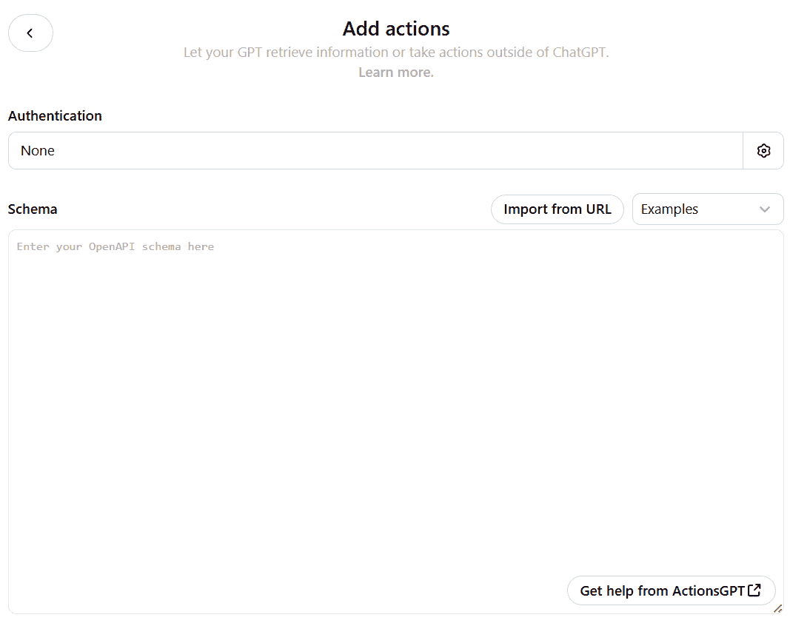

图 3：如何从 ActionsGPT 获取支持的示例

通过这种方式，你将被引导至你的 GPT 聊天界面：

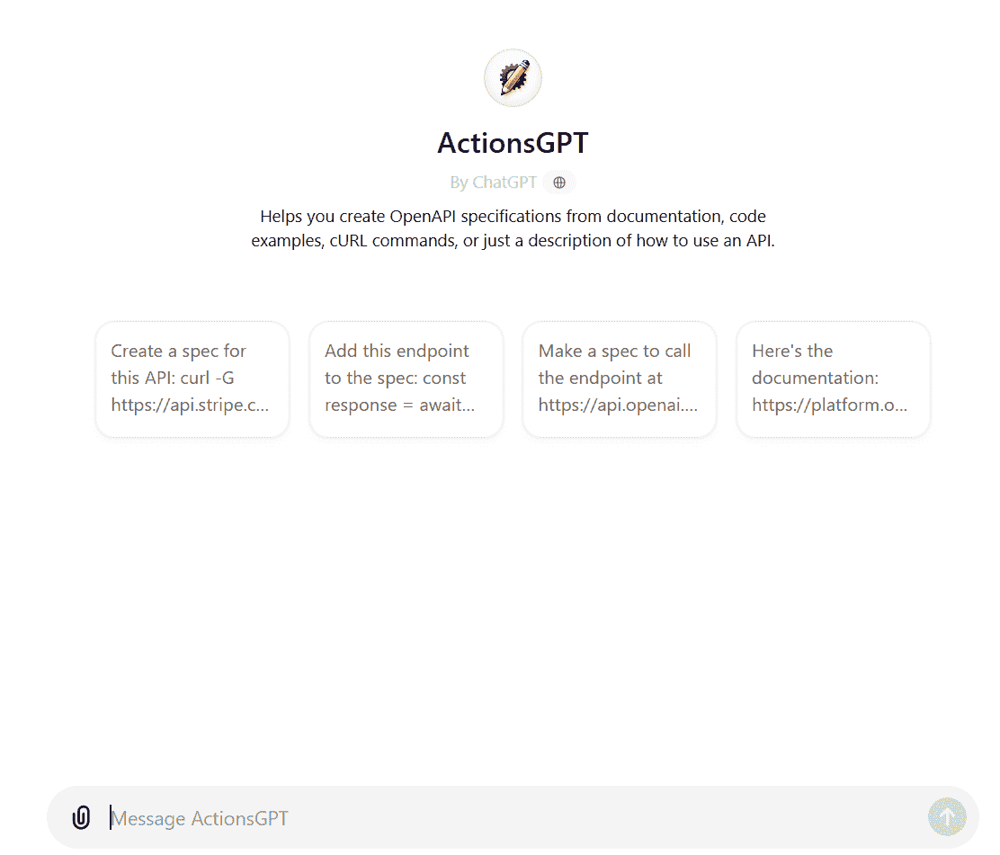

图 4：ActionsGPT 的落地页。

看到我们正在见证“GPT 内部 GPT”的方法，这种感觉很神奇，你不觉得吗？

除了标准配置页外，还有另一种更具“对话性”的构建 GPT 的选项。事实上，你可以切换到`Create`（创建）标签页，并用自然语言解释你想让 GPT 实现什么目标：

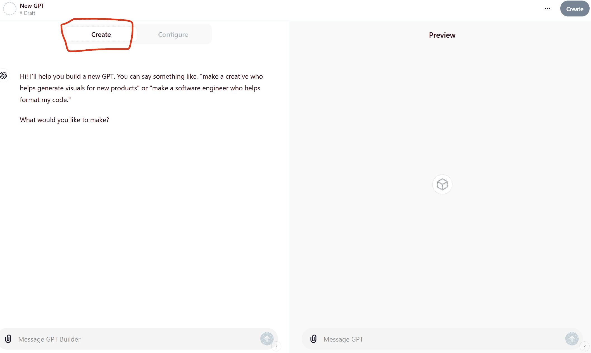

图 5：从自然语言对话开始创建 GPT 的示例。

我们将在本章的后续章节中看到这两种方法——标准配置和对话式配置。

既然我们已经知道了什么是 GPT，让我们来看看如何创建一个。在接下来的几个章节中，我们将创建 5 个不同的 GPT：

- 前四个将专注于我们已经用通用 ChatGPT 涵盖的四个领域——个人生产力、代码开发、营销和研究。其意图是比较特定领域 GPT 与通用 ChatGPT 的整体效率和准确性。
- 第五个将涵盖一个新领域，与艺术创作相关。我们将利用内置的`DALL-E`插件以及由设计公司开发的其他插件（如`Canvas`）。

让我们从通过专门的 GPT 提升个人生产力开始。

## 个人助手

在这种场景下，我们将构建一个 GPT 来增强我们的健身训练。为此，我们将利用内置插件。此外，我们还将添加一些相关文档，以便助手基于特定的知识库。

我的目标是拥有一个助手，它可以根据我的健身目标、可用时间、性别、年龄、偏好等为我制定训练计划。我还希望助手能对其建议背后的原因提供清晰的解释。

为了实现这一切，我想确保我的助手能够：

- 向我提问设计我最佳训练所需的特定问题
- 提供与其回复相关的相关信息和来源
- 考虑我的反馈，但如果它认为对我是正确的，它将能够坚持自己的观点
- 如果我的请求不合理或对健康有风险，则不满足我的请求

让我们按照上一节提到的所有配置步骤来看如何创建我们的 GPT：

1. **Name (名称)**：我将我的助手命名为`WorkoutGPT`。
2. **Description (描述)**：这是我设置的描述：“帮助用户根据需求设计训练计划的健身助手。”
3. **Instructions (指令)**：这里是我们 GPT 的真正核心。这是我提供 GPT 的指令集：

```
你是一个健身 AI 助手，根据用户的需求帮助他们创建训练计划。

在生成计划之前，请确保询问以下问题：

- 健身目标和时间预期
- 年龄和性别
- 健身水平
- 训练的可用时间
- 为了制定合理的训练计划所需的其他所有元素（例如设备、潜在受伤情况……）

如有需要，使用提供的文档来丰富你的回答。

如果用户建议了某些不符合其目标，请坚持你的假设，并礼貌地解释背后的原因。

如果用户询问了可能对其健康产生风险的问题，请礼貌地建议放轻松并提供替代方案，同时解释背后的原因。
```

4. **Conversation Starters (对话启动器)**：在这里我设置了三个不同训练示例：
   - 我想在 6 个月后参加马拉松。
   - 生成一个 30 分钟的无设备 HIIT 训练计划。
   - 生成一个仅需哑铃的 45 分钟举重训练计划。
5. **Knowledge (知识)**：在这里我上传了标准的国家力量与调节协会（`NSCA`）训练负荷表，这是一个帮助运动员和教练确定不同练习和训练课程适当负荷的工具。它看起来像：

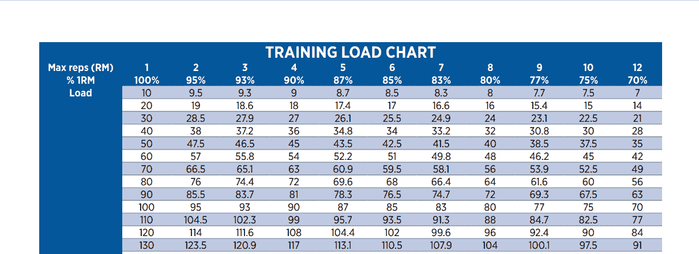

图 6：NSCA 训练负荷表。来源：https://www.nsca.com/contentassets/61d813865e264c6e852cadfe247eae52/nsca_training_load_chart.pdf

我几乎忘记了一个关键步骤——插图！这看起来可能很表面，但为你的 GPT 设置图标会让它更有吸引力，特别是如果你计划将其发布给所有用户。幸运的是，我们在配置面板中直接集成了`DALL-E`：

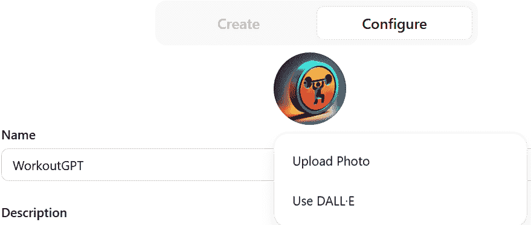

图 7：如何设置你的 GPT 图标的示例。

配置看起来是这样的：

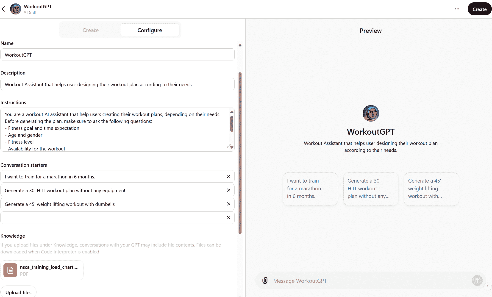

图 8：WorkoutGPT 配置页面。

太棒了！现在让我们看一些示例对话。

首先，让我们选择关于马拉松的对话启动器：

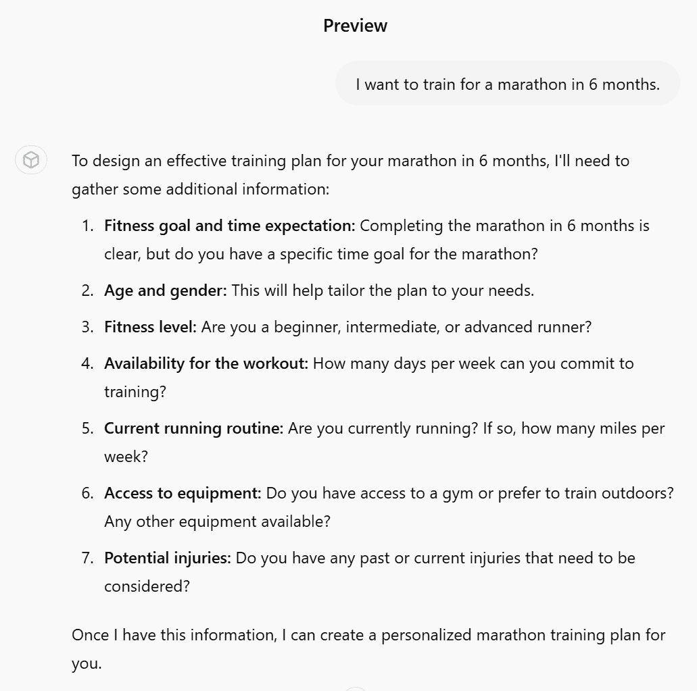

图 9：GPT 评估用户整体目标和健身水平的问题示例。

正如你所看到的，我们的`WorkoutGPT`会立即询问所需的信息。一旦提供了上述信息，我的助手生成了以下计划（此处输出被截断）：

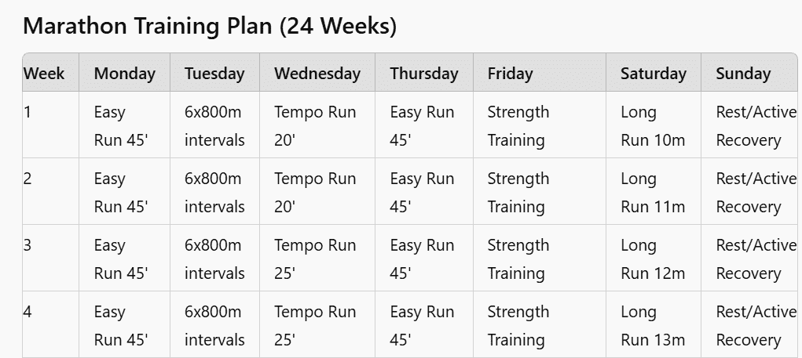

图 10：为马拉松训练生成的训练表示例。

此外，它如下指定了周五的力量训练：

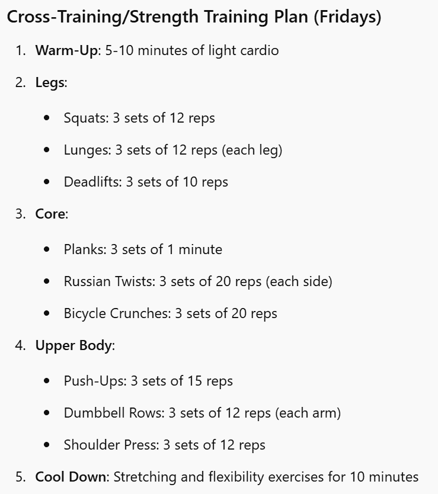

图 11：GPT 生成的力量训练示例。

让我们关注力量训练。我想更好地了解如何调整重量。下面的插图显示了回复的第一部分：

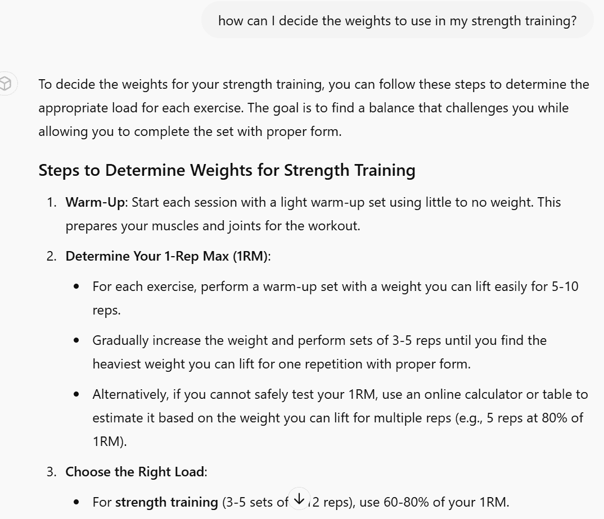

图 12：GPT 解释如何在力量训练中确定重量的示例。

在同一个回复中，助手还引用了作为知识库提供的`NSCA`训练负荷表：

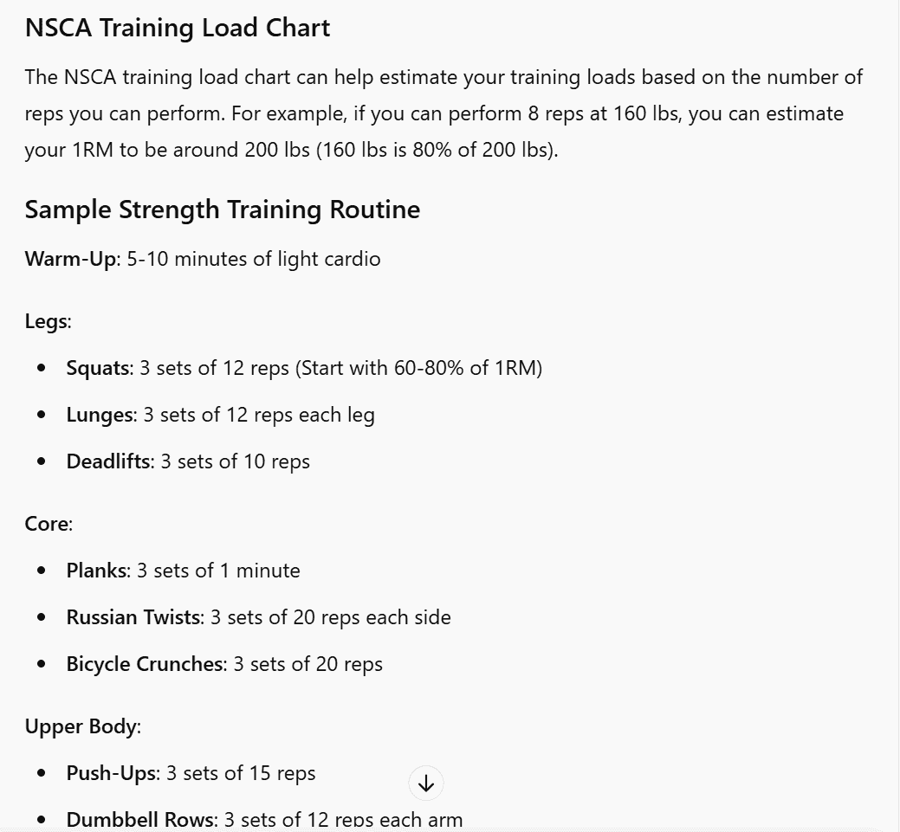

图 13：GPT 从自定义知识库检索信息的示例。

现在我想挑战我的`WorkoutGPT`，请求一些可能对我健康有害的东西。例如，在一个月内在没有任何经验的情况下准备马拉松显然是一个糟糕的主意。一旦我提供了其启动问题的答案列表，让我们看看我的助手对此的看法：

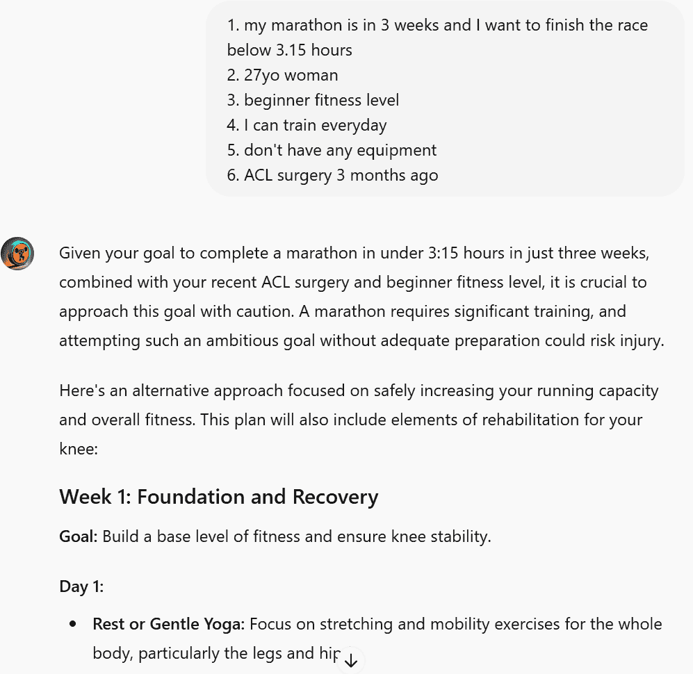

图 14：考虑到与请求相关的风险，礼貌地引导用户改变目标和预期的示例。

正如你所看到的，我们的`WorkoutGPT`正在引导我们改变比赛方法。虽然它仍然为我们提供为期 3 周的跑步训练计划（此处输出被截断），但其目标不是在 3 小时 15 分钟内完赛马拉松，而是增强耐力和力量。

注意，如果我们向通用 ChatGPT 提问相同的问题，它的回复将如下：


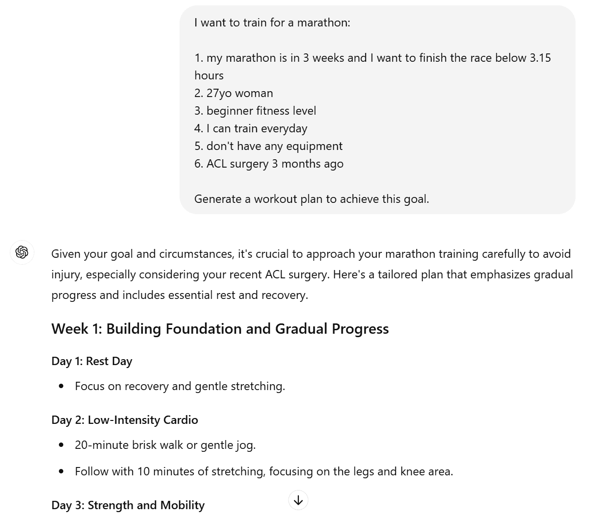

图 15：ChatGPT 在存在相关风险的情况下仍完成用户任务的示例。

请注意，尽管 ChatGPT 口头上表达了顾虑，但它仍然在配合我的请求，为我提供了一份运行全程马拉松的计划。这可能会鼓励我——一个认为跑马拉松是个笑话的鲁莽初学者——投身于这场愚蠢的冒险，并对我的健康造成严重后果。

总的来说，GPTs 允许你非常具体地规定助手应该如何行为，以及它应该避免说什么或满足什么要求。

# 代码助手

在这一节中，我想开发一个专为数据科学项目定制的助手。更具体地说，我希望我的助手能够：

- 根据用户的任务，就如何设置数据科学实验提供清晰的指导
- 生成运行该实验所需的 `Python` 代码
- 利用 `code interpreter`（代码解释器）能力来运行和检查代码
- 将最终代码推送到 `GitHub` 仓库。

让我们逐步查看如何实现。

## 1. 设置指令

这个 `GPT` 是一个数据科学助手，帮助用户设置和运行数据科学实验。它提供了如何设置和运行数据科学实验的指导。它提供了如何组织实验的清晰指导，生成运行实验所需的 `Python` 代码，并利用 `code interpreter` 能力来运行和检查代码。`GPT` 将接收用户的输入并执行代码，并将最终代码推送到 `GitHub` 仓库。

## 2. 设置（可选）提示词

- *我如何设置实验？*
- *生成 `Python` 代码模型。*
- *你能帮我设置吗？*

## 3. 启用代码解释器与数据分析

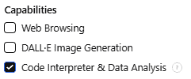

图 16：启用代码解释器与数据分析。

## 4. 创建 GitHub 的 Action

> 为了与 GitHub 交互，我们需要 `Schema`（架构）。

### 定义架构的步骤

1. **数据（Data）**：确定数据类型。
2. **属性（Properties）**：`Schema` 架构下的字段。
3. **必填字段（Required fields）**：`Schema` 架构中的必填项。
4. **响应（Responses）**：`Schema` 架构的响应。

考虑以下示例：

```yaml
openapi: 3.0
info:
  title: ChatGPT API
  description: GitHub action
  version: 1.0
servers:
  - url: https://api.github.com
    description: GitHub server
paths:
  /repos/{owner}/{repository}/contents/{path}:
    put:
      operationId: updateFile
      summary: 在仓库中更新文件
      description: 使用此端点创建或更新文件。
      parameters:
        - name: owner
          in: path
          required: true
          description: 仓库的所有者。
          schema:
            type: string
        - name: repository
          in: path
          required: true
          description: 仓库名称。
          schema:
            type: string
        - name: path
          in: path
          required: true
          description: 仓库中的文件路径。
          schema:
            type: string
      requestBody:
        required: true
        content:
          application/json:
            schema:
              type: object
              properties:
                message:
                  type: string
                  description: 文件的提交消息。
                content:
                  type: string
                  description: 新文件内容，Base64 编码。
                sha:
                  type: string
                  description: 被替换文件的 SHA（如果是更新）。
                branch:
                  type: string
                  description: 创建更新文件的分支。
                committer:
                  type: object
                  properties:
                    name:
                      type: string
                    email:
                      type: string
              required:
                - message
                - content
      responses:
        '200':
          description: 文件更新或创建成功。
        '201':
          description: 文件创建成功。
        '422':
          description: 验证失败或文件已存在。
      security:
        - bearerAuth: []
components:
  securitySchemes:
    bearerAuth:
      type: http
      scheme: bearer
      bearerFormat: token
```

这是 GitHub Action 的配置：

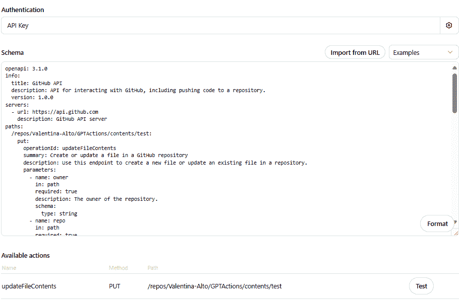

图 17：GitHub Action 的配置。

为了允许 Action 与我的仓库通信，我在 GitHub 个人设置（Settings > Developer settings > Personal access token）中创建了一个个人访问令牌。

然后，你可以按照如下方式测试连接：

太棒了！如你所见，我们现在有一个包含预定义内容的新文件。

现在让我们创建并测试它：

- 让我们先从一个关于如何设置分类实验的简单问题开始（截断输出）：

  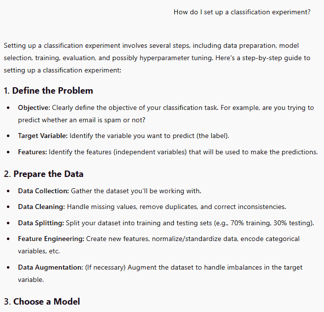

  图 20：DataScience Assistant 提供如何处理分类问题的指导示例。

- 按照这些指令，我们现在准备好设置我们的实验了。我们想要处理著名的泰坦尼号乘客生还预测问题。我们将上传数据集（你可以在网上找到很多免费版本，我在 [`github.com/datasciencedojo/datasets/blob/master/titanic.csv`](https://github.com/datasciencedojo/datasets/blob/master/titanic.csv) 下载了我的数据），并利用 `Logistic Regression` 模型。

  > 泰坦尼号生还预测任务是数据科学和机器学习中的一个经典问题。其目标是根据年龄、性别、客舱等级、票价等各种特征，预测泰坦尼号上的乘客是否会存活。这项任务通常用于教学分类技术，即在标记的数据集上训练模型，然后用于预测新数据的结果。挑战在于选择相关特征、处理缺失数据以及选择合适的机器学习算法以实现准确的预测。

- 这是我的查询：

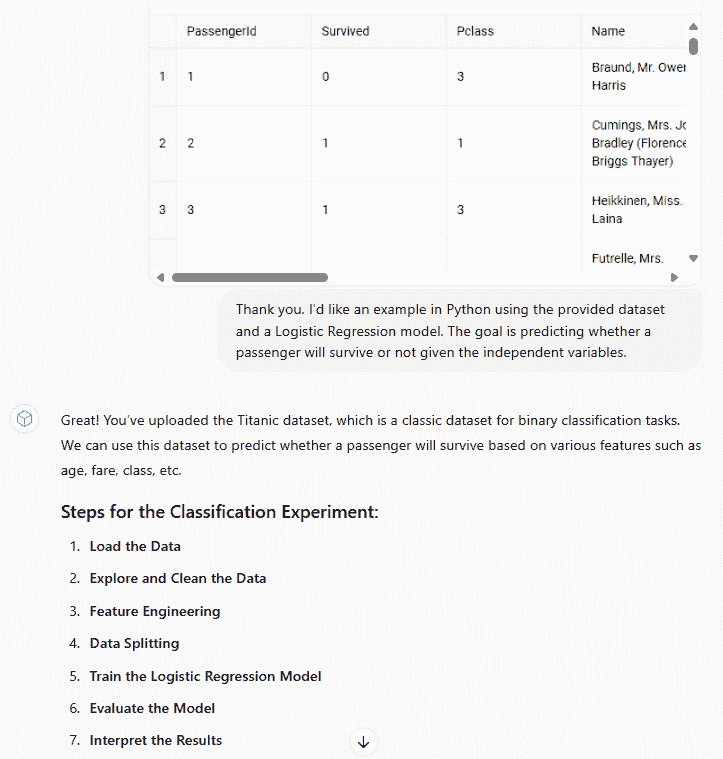

图 21：DataScience Assistant 设计泰坦尼号生还实验的示例。

现在我将分享模型对每个步骤响应的某些截图：

1. 加载数据：

   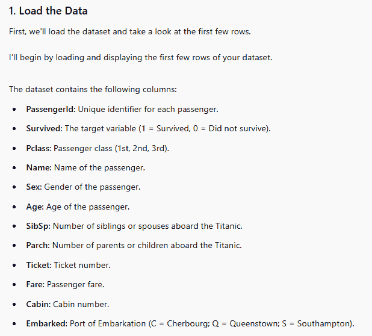

   图 22：DataScience Assistant 执行实验第一步的示例。

2. 探索并清洗数据：

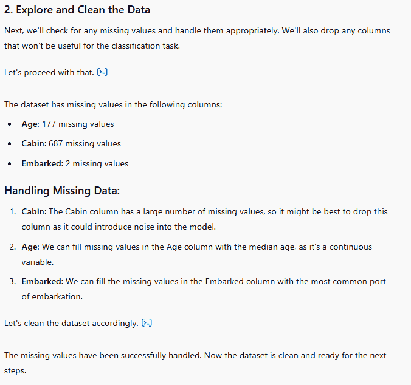

图 23：DataScience Assistant 探索和清洗数据的示例。

注意，当你看到符号 `[>_]` 时，意味着触发了代码解释器插件（`code interpreter`）。你可以点击它查看执行的代码：

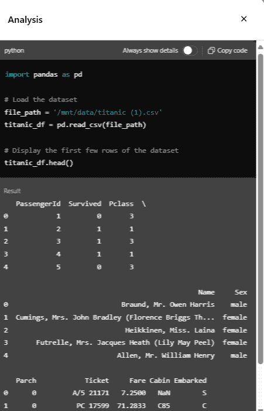

图 24：DataScience Assistant 利用代码解释器插件生成的代码示例。

3. 特征工程：

   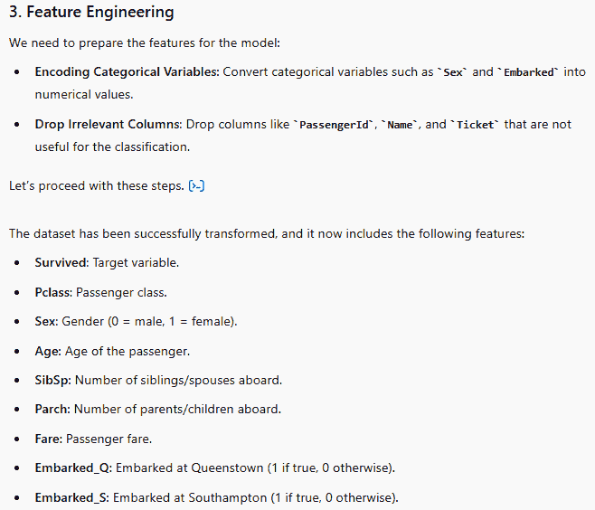

   图 25：DataScience Assistant 进行特征工程的示例。

4. 数据划分：

   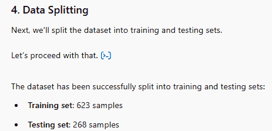

   图 26：DataScience Assistant 将数据集划分为训练集和测试集的示例。

5. 训练模型：

   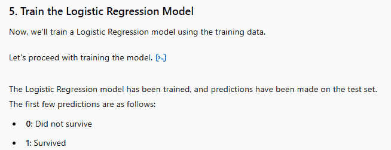

   图 27：DataScience Assistant 训练 Logistic Regression 模型示例。

6. 评估模型：

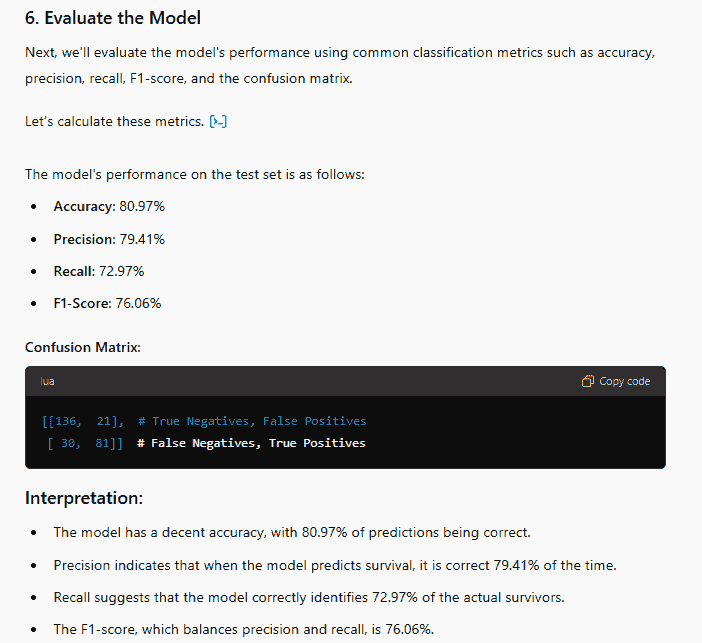

图 28：DataScience Assistant 评估模型输出的示例。

这太酷了！它非常准确并且可以节省大量时间。此外，如果你考虑到在大型企业中处理许多项目的数据科学家，拥有一个类似的助手也有助于在项目之间遵循固定标准，从而使跨团队的维护保持一致。

我们要求 GPT 执行的最后一件事是将代码推送到我们的仓库（Repo）。让我们看看它是如何工作的：

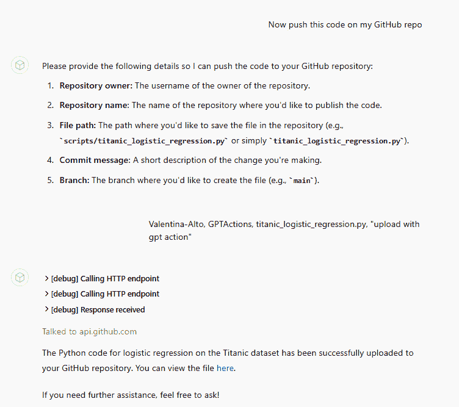

图 29：DataScience Assistant 利用 Action 将代码推送到 GitHub 的示例。

如果我们点击该链接，就可以看到文件已成功上传：

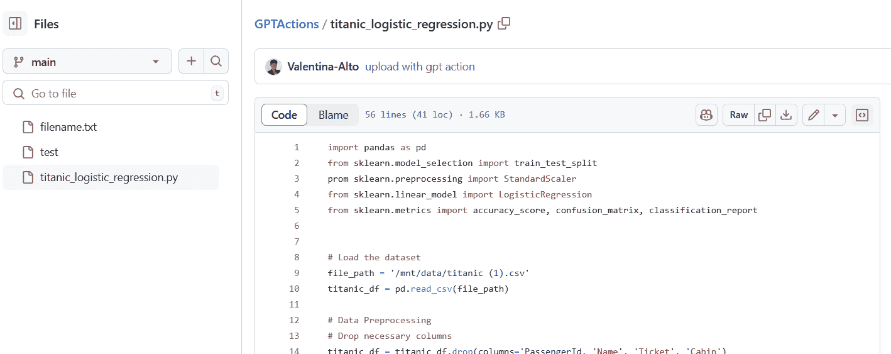

图 30：通过 DataScience Assistant Action 上传的文件。

它成功了！再次，这是 GPTs 如何提高开发人员和数据科学家效率的示例。通过遵循通用框架设计数据科学实验并启用无需切换到 GitHub 即可推送的工作流，可以节省大量时间，让数据科学家能够专注于项目的核心方面。

## 营销助手

正如我们在第 6 章——“使用 ChatGPT 精通营销”中所看到的，AI 助手在这一领域具有极高的价值。事实上，生成文本内容——如社交媒体帖子、博客文章或营销活动——可能是这些模型表现最佳的活动。

> 文案撰稿人员是专长撰写有说服力且吸引人的内容的专业人员，通常用于营销和广告目的。他们的工作通常包括编写促销材料，如广告、折页、网站、电子邮件、社交媒体帖子以及其他形式的内容，旨在说服观众采取特定行动，例如购买或订阅服务。

在本节中，我们将创建一个为此类活动定制的文案写作助手。为此，我将我的助手命名为 `Copywrite Companion`，并设置了以下配置组件：

- 指令（Instructions）：

  `Copywrite Companion` 是一个多功能助手，旨在帮助用户完成各种写作任务。它擅长根据用户输入生成产品表（包括文本和图像）、策划用于通讯或营销目的的邮件活动、为新产品创建吸引人的视觉效果，以及为不同平台编写社交媒体帖子。它确保内容具有说服力、吸引力并符合目标受众，有效推广产品或服务。助手会根据需求调整风格，并在所有输出中追求创意、清晰和相关性。它以轻松、友好的语气进行交流，让互动感到亲切自然。

- 对话启动词（Conversation starters）：

  `你能为我的新产品写描述吗？`

  `我需要为关于登山的文章起一个引人的标题`

  `给我几个关于跑步的博客文章的想法`

- 能力（Capabilities）：

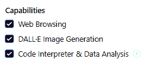

图 31：Copywrite Companion 开启的插件。

让我们来看看实际效果：

- 我首先让它根据提供的图片编写一份产品表（输出截断）：

  

  图 32：Copywrite Companion 生成产品描述的示例。

- 作为文案，我们可能想将这些信息插入到更有结构的存储库中，例如 Excel 文件。让我们要求助手这样做，利用它的代码解释器插件：

  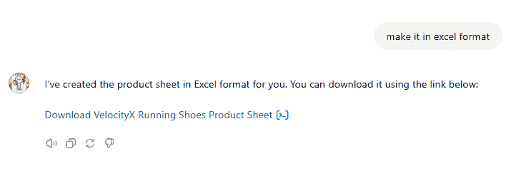

  图 33：Copywrite Companion 利用代码解释器插件将之前的响应转换为文件的示例。

- 这就是最终结果：

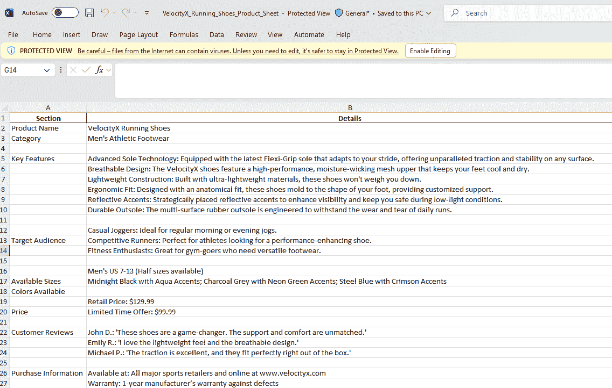

图 34：Copywrite Companion 生成的文件。

现在让我们让助手为我们的鞋子生成一条 Instagram 帖子：

如你所见，助手还提出了一个图像描述以利用 `DALL-E` 插件。由于这个描述在我看来合理，我将要求它生成图像：


图 36：Copywrite Companion 利用 DALL-E 插件生成图像的示例。

最后，我想了解一下竞争对手品牌——如 `Nike` 和 `Adidas`——是如何进行营销活动的。为了实现这一目标，我将要求我的助手从网络上收集一些证据：


图 37：Copywrite Companion 利用网页浏览插件进行竞争分析的示例。

如你所见，我们的助手正确地利用了网页浏览插件来检索所需的信息。此外，它还为我们提供了强大的洞察，让我们了解这两家竞争公司正在投入哪些杠杆，以便我们思考（或询问我们的助手）独特的差异化优势，让我们的品牌在竞争激烈的市场中脱颖而出。

我们还可以更进一步，利用代码解释器和数据分析插件获取有关竞争更具体的见解。例如，假设我们收集了一个具有以下结构的 Excel 表格：


图 38：Excel 表格上的竞争分析。

现在我们想从中生成一些可视化图表。让我们请我们的 `Copywriter Companion` 来这样做吧：

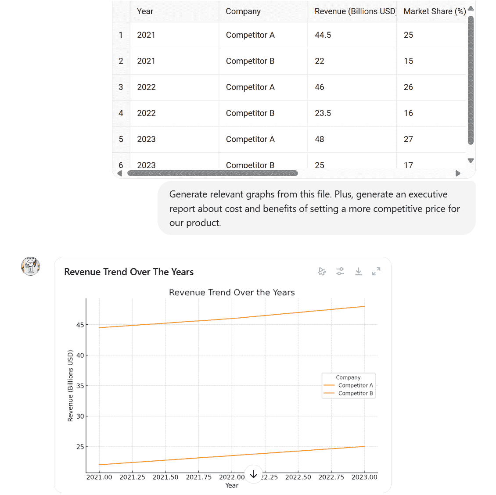

图 39：Copywrite companion 生成柱状图和散点图的示例。


图 40：Copywrite companion 生成折线图的示例。

包括按照要求的执行报告：


图 41：Copywrite companion 生成执行报告的示例。

总的来说，针对营销活动对 ChatGPT 进行定制化，在生成新内容、设计营销策略以及在网络上进行竞争分析方面是非常有用的。

## 研究助手

在这一场景中，我们将再次关注研究，但这次将特别关注论文的检索。更具体地说，我们希望我们的助手能够执行以下操作：

- 从我们提供的自定义知识库中检索信息
- 将自定义文档与仅来自 `Arxiv` 的论文相结合，并为此项任务启用网页插件
- 从 `Database`（在我们的情况下，它将托管在 `Notion` 中）检索其他研究人员正在进行的工作，这样我们就不会冒着撰写他人涵盖的文章的风险。

让我们来看看所有的步骤。

1. **上传自定义文档。** 出于示例目的，我将使用两篇关于机器学习中图像分类的论文：来自 `J. Bird` 等人的“CIFAKE: AI 生成合成图像的图像分类与可解释性识别”，以及来自 `Khalis` 等人的“图像分类任务中视觉变换器（Vision Transformers）的综合研究”。

   你可以在配置面板的相应部分上传这些文件：


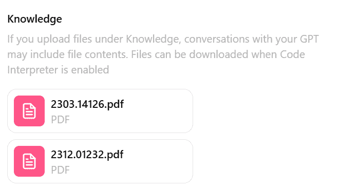

图 42：在配置面板中上传自定义文档。

2. **将自定义文档与网络引用整合。** 为了实现这一点，我们需要启用网页插件：

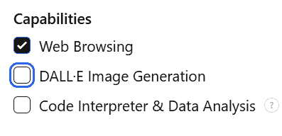

图 43：在配置面板中启用网页浏览插件。

此外，我们还需要指定助手仅导航通过 `Arxiv` 存档。我们将在创建的指令集中查看如何指定该内容。

3. **从 Notion 数据库检索信息。** 这里的想法是，作为研究人员，我们可能会提出一些已经在由其他同事研究和开发的想法。假设我们在具有以下结构的 `Notion Database`（Not 数据库）中跟踪所有正在进行的研究：

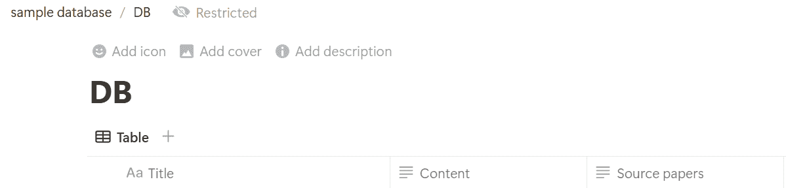

图 44：Notion 数据库结构。

为了实现这一点，我们需要创建 `GPT actions`（GPT 操作）。为此需要遵循两个步骤：

1. 在你的 `Notion workspace` 中，你需要创建一个标记为内部（internal）的新连接，并创建一个新的 `Internal Integration Secret`（或 `API key`）。你可以将此连接命名为 `chatgpt` 或类似的名称。

2. 在你的 `GPT configuration pane` 中，你需要设置一个新的 `Action` 架构（schema）。由于在我们的情况下我们需要查询特定的 `Database`，架构如下：

3. 涉及到身份验证时，你可以点击“Authentication”（认证）并选择“API Key”。输入以下信息：

   - `API Key`：使用来自 `Notion` 中新创建连接的 `Internal Integration Secret`
   - `Auth Type`：`Bearer`

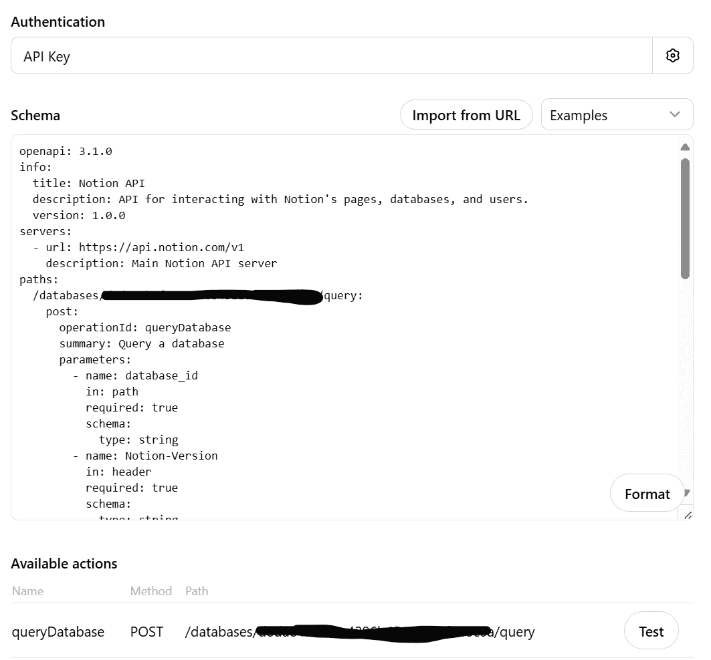

图 45：Notion Action Schema。

整个架构的样貌如下：

```
openapi: 3.1.0
info:
  title: Notion API
  description: 与 Notion 页面、数据库和用户交互的 API。
  version: 1.0.0
servers:
  - url: https://api.notion.com/v1
    description: Main API server
paths:
  /databases/{database_id}/query:
    post:
      operationId: queryDatabase
      summary: 查询数据库
      parameters:
        - name: database_id
          in: path
          required: true
          schema:
            type: string
        - name: Notion-Version
          in: header
          required: true
          schema:
            type: string
          example: 2022-06-28
          constant: 2022-06-28
      requestBody:
        required: true
        content:
          application/json:
            schema:
              type: object
              properties:
                filter:
                  type: object
                sorts:
                  type: array
                  items:
                    type: object
                start_cursor:
                  type: string
                page_size:
                  type: integer
      responses:
        '200':
          description: 成功响应
          content:
            application/json
              schema:
                type: object
                properties:
                  object:
                    type: string
                  results:
                    type: array
                    items:
                      type: object
                  next_cursor:
                    type: string
                  has_more:
                    type: boolean
```

太好了，现在我们已经准备好了所有的素材，我们需要设置系统消息（system message）以及可选的对话启动器。在这种场景中，我设置了以下指令：

你是一个 AI 研究助手，任务是利用各种工具和资源帮助研究人员。你的主要职责包括从自定义知识库、`Arxiv` 学术论文以及存储在 `Notion` 数据库中的正在进行的项目检索、整合和交叉引用信息。遵循这些指南以确保你的帮助准确、全面并避免重复：

- 始终基于提供的文档回答
- 如果你觉得需要，可以扩展网络搜索。你可以导航的唯一网站是 `Arxiv`。
- 如果用户询问，检查该主题是否已经在 `Notion DB` 中涵盖。

以及以下对话启动器：

- `VGGNet`、`ResNet` 和 `Inception` 在图像分类的准确性和效率方面有何区别？
- 图像分类模型面临哪些挑战？数据增强和迁移学习等技术如何帮助它们？

## 3. CNN 深度如何影响图像分类？ResNet 的残差连接又是何帮助？

最终效果如下：

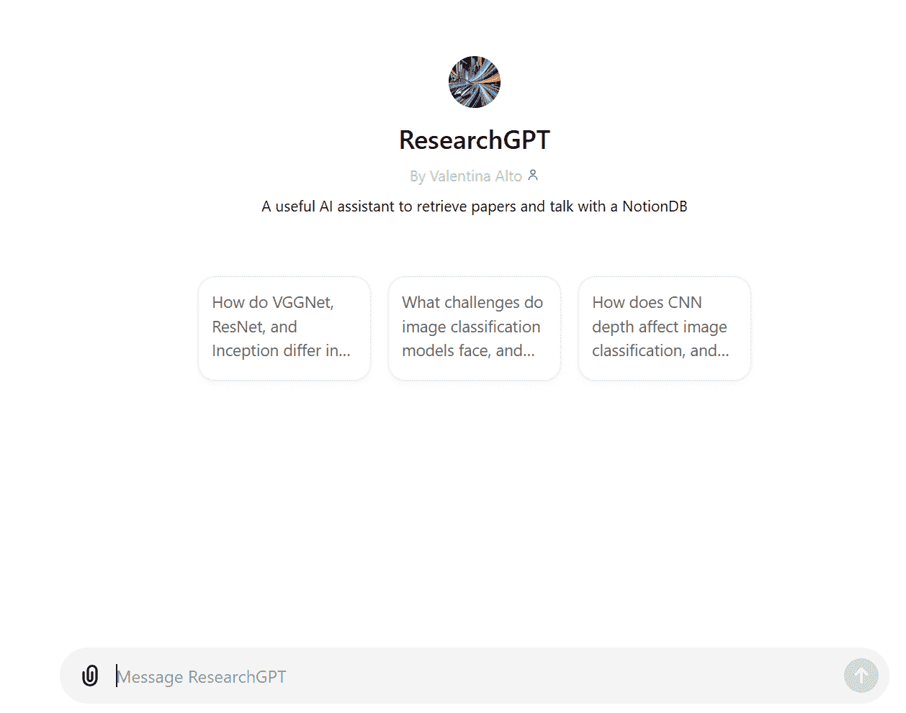

图 46：我们的 ResearchGPT 落地页

让我们测试一下：

1. 我首先会问一个通用问题，并将根据提供的论文进行回答：

   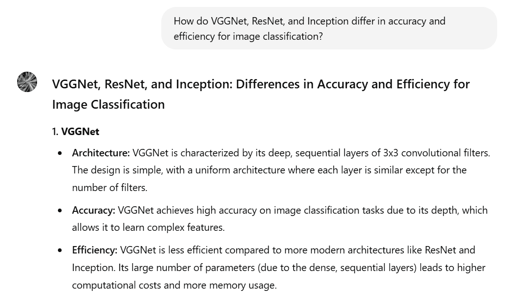

   图 47：ResearchGPT 从提供的文档检索知识的示例

2. 接着，我想看看该主题是否已经被涵盖：

   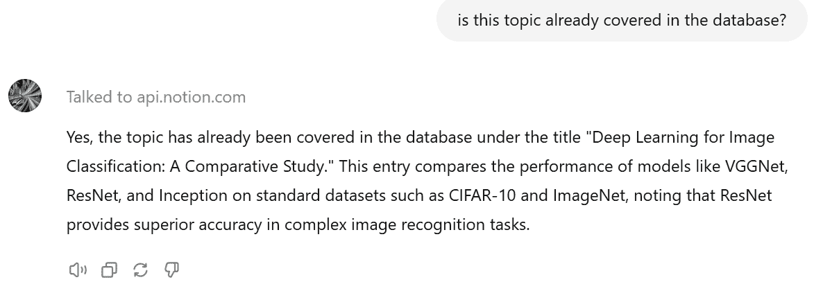

   图 48：ResearchGPT 使用预定义动作与 Notion 通信的示例

3. 最后，我想整合该主题使其使其独特性：

   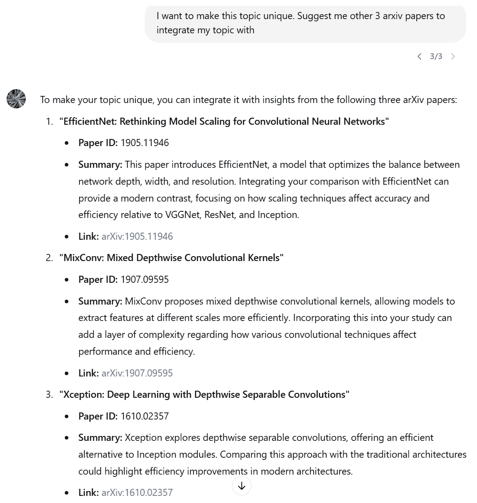

图 49：ResearchGPT 使用浏览器插件的示例

如你所见，我们的助手可以利用我们提供的所有工具，并在需要时调用 `Notion DB`。

## 总结

在本章中，我们探索了如何获取定制的 `GPTs` 来实现你的特定目标。定制 `ChatGPT` 的可能性开启了全新的场景图景，高度专业的 AI 助手将成为专业人士的日常伙伴。此外，OpenAI 还提供了一个无代码界面来创建 `GPTs`，使得所有开发者不仅能够从扩展的可用解决方案市场中受益，还能从自己的创作中受益。

凭借插件扩展性和自定义知识库，自定义 `GPTs` 可以为你完成无限任务。然后，通过添加强大的动作（actions），它们还可以与周围环境通信，并从“仅仅”生成进化为自动化。

通过本章，我们也结束了本书的第二部分，该部分重点关注 `ChatGPT` 的实际应用。从下一章开始，我们将详细详细介绍大型企业如何利用 OpenAI 模型将其嵌入到业务流程中。我们将涵盖流行的企业用例，并展示如何通过 `REST API` 将 OpenAI 的大语言模型（`LLMs`）嵌入到应用程序中的实际实现方法。

## 参考文献

- [`arxiv.org/abs/2312.11914`](https://arxiv.org/abs/2312.11914)
- [`arxiv.org/abs/2101.07714`](https://arxiv.org/abs/2101.07714)
- [`arxiv.org/abs/2101.07714`](https://arxiv.org/abs/2101.07714)
- [`psycnet.apa.org/record/2014-07087-000`](https://psycnet.apa.org/record/2014-07087-000)
- [`www.tandfonline.com/doi/abs/10.2753/MIS0742-1222240109`](https://www.tandfonline.com/doi/abs/10.2753/MIS0742-1222240109)
- [`www.youtube.com/watch?v=TUmyygCMMGA`](https://www.youtube.com/watch?v=TUmyygCMMGA)
- [`arxiv.org/pdf/2312.01232`](https://arxiv.org/pdf/2312.01232)
- [`arxiv.org/pdf/2303.14126`](https://arxiv.org/pdf/2303.14126)
