# ChatGPT 实用生成式AI


# 1 生成式 AI 简介

# 在 Discord 上加入我们的书籍社区


https://packt.link/EarlyAccess

你好！欢迎来到 ChatGPT 与 OpenAI 终极指南！在书中，我们将探索生成式人工智能（GAI）的迷人世界及其突破性的应用。生成式 AI 改变我们与机器交互的方式，使计算机能够在没有明确人类指令的情况下创作、预测和学习。自从2023年11月ChatGPT发布以来，我们见证了自然语言处理、图像视频合成以及许多领域以前所未有的速度。无论你是好奇的初学者还是丰富的从业者，本指南都将提供应对生成式 AI 精彩格局所需的知识和技能。现在，让我们深入浅，从一些定义开始了解我们所处的背景。

本章提供了生成式 AI 领域的概述，该领域涉及使用机器学习（ML）算法创建新且独特的数据或内容。

重点关注生成式 AI 在各个领域的应用，如图像合成、文本生成和音乐创作，突显了生成式 AI 变革各行业的潜力。本生成式 AI 简介将提供该技术所处的背景，以及在广阔的 AI、机器学习和深度学习（DL）世界中的知识。然后，我们将通过具体示例和最新进展探讨生成式 AI 的主要应用领域，以便你熟悉它对企业和整个社会可能产生。

此外，了解生成式 AI 向当前最先进水平的研究历程将帮助你更好地理解近期进展的基础。

我们将通过以下主题涵盖所有内容：

+   *理解生成式 AI*


在本章结束时，你将熟悉令人兴奋的生成式 AI 世界、其应用背后的研究历史以及当前的发展，这些发展可能已经并且正在对业务产生颠覆性的影响。

## 介绍生成式 AI

AI 在近年来取得了巨大进展，其中增长明显的领域之一就是生成式 AI。生成式 AI 是人工智能（AI）和深度学习（DL）的一个子领域，侧重于使用机器学习（ML）技术在现有数据上训练的算法和模型来生成新内容，如图像、文本、音乐和视频。

为了更好地理解 AI、ML、DL 和生成式 AI 之间的关系，可以将 AI 视为基础，而 ML、DL 和生成式 AI 代表了日益专业化和专注的研究与应用领域：

- AI 代表一个广泛的领域，即创建能够执行任务、表现出人类智能和能力并与生态系统交互的系统。
- ML 是一个分支，侧重于创建算法和模型，使这些系统能够随着时间和训练进行自我学习和改进。ML 模型从现有数据中学习，并随着其增长自动更新其参数。
- DL 是 ML 的一个子分支，从意义上说，它包含了深度 ML 模型。这些深度模型被称为神经网络，特别适用于计算机视觉或自然语言处理（NLP）等领域。当我们谈论 ML 和 DL 模型时，通常指的是判别式模型，其目标是在数据基础上进行预测或模式推理。
- 最后，我们得到了生成式 AI，它是 DL 的进一步子分支，它不使用深度人工神经网络对现有数据进行聚类、分类或预测：它利用那些强大的人工神经网络模型来生成全新的内容，从图像到自然语言，从音乐到视频。

下图展示了这些研究领域之间是如何相互关联的：

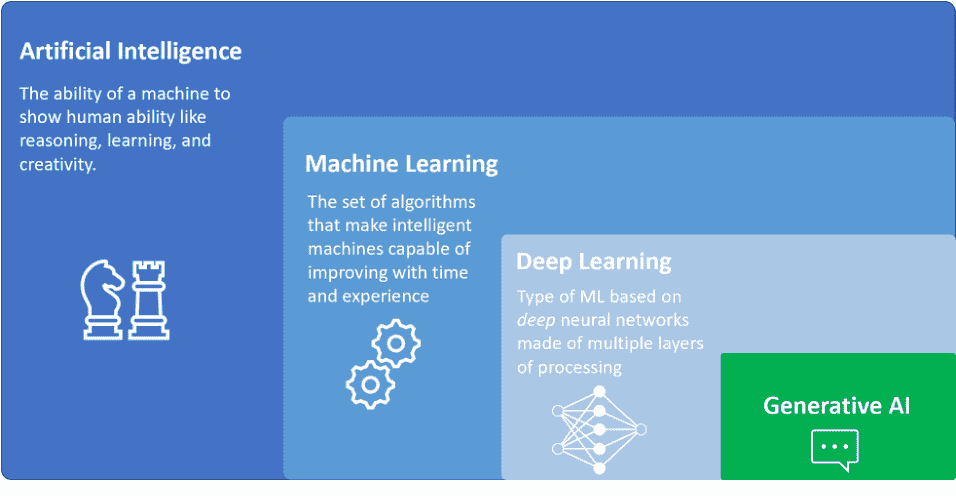

图 1.1 – AI、ML、DL 和生成式 AI 之间的关系

生成式 AI 模型可以在海量数据上进行训练，然后可以使用这些数据中的模式从零开始生成新示例。这种生成过程与判别式模型不同，后者被训练用于预测给定示例的类别或标签。

具有生成式 AI 特性的神经网络类型被称为大基础模型（LFMs），在 ChatGPT 等语言模型的情况下，我们称之为**大语言模型（LLMs）**。

大语言模型是一种以 Transformer 架构为特征的人工神经网络。它们的特点是海量的参数（数量以万亿计），并且在数十亿个单词上进行过训练。给定训练集，LLMs 能够根据用户的输入理解并生成自然语言。

尽管文本理解和生成可能是生成式 AI 最出特征之一，但该领域涵盖了许多领域。

## 生成式 AI 的领域

近年来，生成式 AI 取得了显著进展，并将其应用扩展到广泛的领域，如艺术、音乐、时尚、建筑等。在某些领域中，它确实在改变我们创造、设计和理解周围世界的方式。在另一些领域，它正在改进并使现有流程和操作更加高效。

生成式 AI 用于许多领域这一事实意味着它的模型可以处理各种数据，从自然语言到音频或图像。让我们了解生成式 AI 模型是如何处理不同类型的数据和领域的。

## 文本生成

生成式 AI 最大的应用之一（也是我们在本书中涵盖最多的）是它产生自然语言新内容的能力。事实上，生成式 AI 算法可以用于生成新文本，如文章、诗歌和产品描述。

例如，由 OpenAI 开发的 GPT-4o 等语言模型可以在大量文本数据上进行训练，然后用于用不同语言生成新的、连贯且语法正确的文本（无论是在输入还是输出方面），并从文本中提取相关特征，如关键词、主题或全文摘要。

这里有一个使用 GPT-3 的示例：

ChatGPT 4o

用一个简单的例子向一个 5 岁的孩子解释什么是质子。

想象你有一个非常小的乐木积木。这块乐木积木超级小，小到你用肉眼看不见。这个微小的乐木积木就像质子。

现在，想想你用乐木积木可以搭建的所有玩具。每个玩具都是由这些微小的乐木积木组合成的。同样，我们周围的一切，比如你的玩具、你的房子甚至是宇宙，都是由被称为原子的极小物体组成的。在每个原子内部，还有更小的部分，质质子。所以，质子就像那些帮助构成世界上一切的乐木积木之一！


图 1.2 – ChatGPT 响应用户提示的示例，同时也添加了引用

接下来，我们将转向图像生成。

## 图像生成

生成式 AI 在图像合成领域最早且最为人知的示例之一是由 I. Goodfellow 等人在 2014 年引入的生成对抗网络（GAN）架构。GAN 的目的是生成与真实图像无异的图像。这种能力具有许多有趣的业务应用，例如为计算机视觉模型生成合成数据集、生成真实的商品图像，以及用于虚拟现实和增强现实。

这是一个不存在的人脸示例，因为它们完全是由 AI 生成的：


图 1.3 – 生成 this-person-does-exist.com 的脸

随后，2021 年，OpenAI 在该领域引入了一种新的生成式 AI 模型——DALL-E。与 GAN 不同，DALL-E 设计用于根据自然语言生成图像（GAN 接收随机向量作为输入），并可以生成广泛的图像，这些图像可能看起来并不真实，但仍描述了所需的概念。

生成 AI 在广告、产品设计和时尚等创意行业具有巨大潜力，可以创建独特且创意的图像。

自首次发布（2024 年 12 月）以来，DALL-E 取得了巨大的改进，如下所示。让我们看看下面 DALL-E 在诞生之初创作的艺术作品：


图 1.4 – DALL-E 根据自然语言提示生成的图像

现在让我们看看 DALL-E3（本书编写时的最新版本）可以生成（这里我使用的是 DALL-E3 驱动的 Microsoft Image Creator，你可以在 https://copilot.microsoft.com/images/create 进行尝试）哲学家苏格拉底现在的照片。他骑着电动滑板一边在手机上发信息。

探索创意

创作


图 1.5 – DALL-E3 根据自然语言提示生成的图像

在不到 18 个月的时间里，看到这个模型的改进程度如此之，令人印象深刻。有趣的是，我们仅仅接触了过去几个月生成式 AI 领域发生的巨大改进的冰角。

## 音乐生成

音乐生成生成式 AI 的早期方法追溯到 50 年代，源自算法作曲领域的研究，这种技术


利用算法来生成音乐作品。事实上，1957年，Lejaren Hiller 和 Leonard Isaacson 创作了《弦乐四重奏伊利亚克套曲》（https://www.youtube.com/watch?v=n0pjBFLQSk8），这是第一部完全由 AI 创作的音乐。从那时起，音乐生成式 AI 领域几十年来一直是持续的研究课题。在近年的发展中，新的架构和框架在公众中变得流行，例如 Google 在2016年引入的 WaveNet 架构，它能够生成高质量的音频样本；或者由 Google 开发的 Magenta 项目，它使用循环神经网络（RNNs）和其他其他机器学习技术来生成音乐和其他艺术形式。随后，2020年，OpenAI 也宣布了 Jukebox，这是一种生成音乐的神经网络，并可以根据音乐和人声风格、流派、参考艺术家等对输出进行自定义。

这些以及其他框架成为了许多 AI 作曲师助手的基础。例如由 Sony CSL Research 开发的 Flow Machines。这个生成式 AI 系统在大型音乐作品数据库上进行了训练，以创建各种风格的新音乐。法国作曲家 Benoît Carré 使用它创作了专辑《Hello World》（https://www.helloworldalbum.net/），该专辑包含了与多位人类音乐家的合作。

在这里，你可以看到一个由 Music Transformer 生成的曲目示例，它是 Magenta 项目的模型之一：


图 1.6 – Music Transformer 允许用户收听 AI 生成的音乐表演

生成式 AI 在音乐领域的另一个惊人应用是语音合成。确实，可以找到许多 AI 工具，它们根据文本输入以知名歌手的声音创建音频。

例如，如果你一直好奇如果由 Kanye West 演唱你的歌曲听起来是什么样，那么你可以使用 FakeYou.com（https://fakeyou.com/）、Deep Fake Text to Speech 或 UberDuck.ai（https://uberduck.ai/）等工具来实现你的梦想。

## 选定声音


选择声音

| 说唱歌手 | Kanye West (说唱) |
| :--- | :--- |
| 输入文本进行合成 | hello hello! |
| 高级控制 | |

# 图 1.7 – 使用 UberDuck 进行文本转语音合成。

我必须说，结果真的令人印象深刻。如果你想玩玩，也可以尝试你所有喜爱的卡通片的配，例如小熊维……

让我们更进一步吧。如果我们能从零开始生成一首歌，只需用自然语言让 GenAI 为我们做到这一点呢？嗯，今天我们可以无缝地做到这一点，而不需要任何音乐知识。在当今音乐市场上兴起的 GenAI 产品中，Suno 是一个极佳的例子，它的使命是“[...] 正在建立一个任何人都能创作优秀音乐的未来。无论你是淋浴歌手还是上榜艺人，我们都打破了你与你梦想创作的歌曲之间的障碍。不需要乐器，只需要想象力。从你的脑海到音乐。”（来源：https://suno.com/about）。


你能相信它成了我 2024 年夏天的热门金曲吗？如果你也想创作你的夏季热门金曲，可以在 https://suno.com/create 免费尝试。

## 视频生成

视频生成的生成式 AI 与图像生成具有相似的发展时间线。事实上，视频生成领域的关键进展之一是 GANs（生成对抗网络）的发展。得益于它们在生成真实图像方面的准确性，研究人员开始将这些技术应用于视频生成。基于 GAN 的视频生成最著名的例子之一是 DeepMind 的 Motion to Video，它能从单张图像和动作序列生成高质量视频。另一个很好的例子是 NVIDIA 的基于 DL 的 Video-to-Video Synthesis（Vid2Vid）框架，它利用 GANs 从输入视频合成高质量视频。

Vid2Vid 系统可以生成时间上一致的视频，这意味着它们在时间推移过程中保持平滑且真实的动作。该技术可以执行各种视频合成任务，如下：

- 将视频从一个领域转换为另一个领域（例如，将白天的视频转换为夜间的视频，或将素描转换为真实的图像）
- 修改现有视频（例如，更改视频中对象的风格或外观）
- 从静态图像创建新视频（例如，让一系列静态图像动起来）

2022年9月，Meta 的研究人员宣布了 Make-A-Video（https://makeavideo.studio/）的开放，这是一个新的 AI 系统，允许用户将自然语言提示转换为视频片段。在这种技术背后，你可以识别出我们迄为止提到的其他领域的许多模型——用于提示的语言理解、带有图像生成的图像和动作生成，以及由 AI 作曲师制作背景音乐。

现在，我们上面提到的所有内容与最新的文本转视频模型相比都相形见绌。其中，OpenAI 在2024年2月宣布了一种名为 SORA 的新文本转视频模型，发布了一些早期实验：


提示：一位时尚的女性走在充满温暖发光霓虹灯牌的街道上。她穿着皮夹克、连衣裙和靴子。戴着墨镜和口红。


提示：一部电影预告片，主角是一个戴着头盔的30岁宇航员，天空，沙漠，电影风格，35mm胶片拍摄，色彩鲜艳。

# 图 1 – SORA 生成的视频

我必须说，结果真的令人印象深刻。如果你想玩玩，也可以尝试你所有喜爱的卡通片的配，例如小熊维……

总体而言，生成式 AI 多年来影响了许多领域，某些 AI 工具已经支持了艺术家、机构和普通用户。未来看起来非常有前景；然而，在跳转到现有的最先进模型之前，我们首先需要对生成式 AI 的根、历史和近期发展有更深入的理解。

之前的章节中，我们概述了生成式 AI 领域最新、最前沿的技术，这些都是近几年开发的。然而，该领域的研究可以追溯到几十年前。

我们将生成式 AI 研究的起点标记在20世纪 60年代，当时 Joseph Weizenbaum 开发了聊天机器人 ELIZA，这是 NLP 系统的早期示例之一。它是一个基于规则的交互系统，旨在根据文本输入的响应来娱乐用户，并为 NLP 和生成式 AI 的进一步发展铺平了道路。然而，我们知道现代生成式 AI 是 DL 的一个分支，尽管最早人工神经网络（ANNs）在20世纪40年代就已引入，但研究人员面临着许多挑战，包括计算能力有限以及对大脑生物基础缺乏了解。因此，ANNs 直到80年代才获得广泛关注，当时，除了新硬件和神经科学的发展外，反向传播算法的出现促进了 ANNs 的训练阶段。事实上，在反向传播出现之前，训练神经网络是困难的，因为无法高效计算误差相对于每个神经元的参数或权重的梯度，而反向传播使得自动化训练成为可能，并使 ANNs 的应用成为现实。


随后，在2000年代和2010年代，随着计算能力的提升，结合海量的可用训练数据，使得深度学习（DL）变得更加实用并向普通大众普及，并随之推动了研究的增长。

2013年，Kingma 和 Welling 在其论文《Auto-Encoding Variational Babies》中引入了一种新的模型架构，称为变分自编码器（VAEs）。VAE 是基于变分推理概念的生成式模型。它们提供了一种学习方法，通过将数据编码到名为**潜空间**（latent space）的低维表示空间中（通过编码器组件），然后将其解码回原始数据空间（通过解码器组件），来实现对数据的紧凑表示。

VAE 的核心创新在于引入了潜空间的概率解释。编码器不再是学习一个从输入到潜空间的确定性映射，而是将输入映射为潜空间上的一个概率分布。这使得 VAE 能够通过从潜空间中采样并将这些样本解码到输入空间，来生成新的样本。

例如，假设我们想要训练一个 VAE，它可以创建出看起来像真实的猫和狗的新图片。

为了做到这一点，VAE 首先接收一张猫或狗的照片，并将其压缩为潜空间中一组较小的数字，这些数字代表了图片中最重要的特征。这些数字被称为**潜变量**（latent variables）。

然后，VAE 获取潜变量并利用它们创建一张看起来可能像真实的猫或狗照片的新图片。这张新图片可能与原始图片存在某些差异，但它看起来仍然属于同一组图片。

随着时间的推移，VAE 通过将其生成的图片与真实图片进行比较，并调整其潜变量以使生成的图片看起来更真实，从而在创建真实图片方面变得更好。

VAE 为生成式 AI 领域的快速发展铺平了道路。事实上，仅在一年后，Ian Goodfellow 就引入了生成对抗网络（GANs）。与以编码器和解码器为主要元素的 VAE 架构不同，GANs 由两个神经网络组成——生成器（generator）和判别器（discriminator）——它们在零和和博弈中相互对抗。

生成器创建伪造数据（对于图像而言，就是创建一张新图像），其目的是使其看起来像真实数据（例如，一张猫的照片）。判别器接收真实和伪造数据，并试图区分它们——它在我们艺术伪造示例中扮演着评论的角色。

在训练过程中，生成器试图创建能够欺骗判别器使其认为是真实的数据，而判别器则试图更擅于区分真伪数据。这两个部分被一起训练，这一过程被称为**对抗训练**（adversarial training）。

随着时间的推移，生成器在创建看起来像真实的伪造数据方面变得更好，而判别器在区分真伪数据方面变得更好。最终，生成器创建伪造数据的能力变得非常精湛，以至于判别器都无法区分真伪数据的差异。

这是一个完全由 GAN 生成的人脸示例：


图 1.8 – GAN 生成的光真脸示例（取自《Progressive Growing of GANs for Improved Quality, Stability, and Variation》，2017: https://arxiv.org/pdf/1710.10196.pdf）

VAE 和 GANs 两种模型的目的都是生成与原始样本无法区分的新数据，而且自构想以来，它们的架构得到了改进，并与 Van den Oord 及其团队提出的 PixelCNNs 以及 Google DeepMind 开发的 WaveNet 等新模型的发展并进，导致了音频和语音生成领域的进展。

另一个伟大的里程碑出现在 2017 年，当时 Google 研究人员在论文《Attention Is All You Need》中引入了一种名为 **Transformer** 的新架构。它在语言生成领域具有革命性，因为它在保留语言上下文记忆的同时允许并行处理，性能优于此前基于 RNN 或长短期记忆（LSTM）框架的语言模型尝试。

Transformer 确实构成了由 Google 在 2018 年引入的名为 BERT（基于 Transformer 的双向编码器表示）的大型语言模型的基础，并很快成为了 NLP（自然语言处理）实验的基准。

Transformer 也是 OpenAI 引入的所有生成式预训练（GPT）模型的基础，包括 ChatGPT 背后的模型 GPT-3，以及大型基础模型（Large Foundation Models）。

尽管在这些年里已经有了大量的研究和成就，但直到 2022 年下半年，公众的注意力才转向生成式 AI 领域。

并非巧合，2022 年被称为“生成式 AI 之年”。这一年，强大的 AI 模型和工具在普通大众中普及：基于扩散的图像服务（MidJourney、DALL-E 2 和 Stable Diffusion）、OpenAI 的 ChatGPT、文本生成视频（Make-a-Video 和 Imagen Video）以及文本生成 3D（DreamFusion、Magic3D 和 Get3D）工具都向个人用户开放，有时甚至是免费的。

这产生了颠覆性的影响，主要原因有两点：

-   一旦生成式 AI 模型在公众中普及，每个个人用户或组织都有机会尝试并体会其潜力，即使他们不是数据科学家或机器学习工程师。
-   这些新模型的输出及其嵌入的创造力在客观上是令人惊叹的，而且往往令人担忧。一种紧迫的适应呼吁——针对个人和政府——应运而生。

从此起，在不久的将来，我们可能会见证 AI 系统在个人使用和企业级采用率的激增。

## 18 个月后：主要趋势与创新

回回到 2022 年 11 月到今天，我们在 GenAI 领域见证了大量的创新。这些创新许多与新发布的模型有关，例如 OpenAI 的 GPT-4o 和 DALL-E3，以及 Google 的 Gemini、Meta 的 Llama 3 以及微软的 Phi3 等。

然而，最显著的成就可能在于我们与模型交互以及构建应用的方式。在本节中，我们将探索标记了 GenAI 应用参考架构的三大主要进展。


# 男王+女人 ≈ 女王

RAG 由三个阶段组成：

- *检索*：给定用户查询及其对应的向量，检索出最相似的文档片段（即与用户查询向量接近的向量），并将其作为大语言模型（LLM）的底层上下文。

- *增强*：通过额外的指令、规则、安全护栏以及类似的提示词工程典型实践，对检索到的上下文进行丰富（我们将在第 3 章中介绍提示词工程主题）。

## 系统消息

你是一个帮助用户回答查询的 AI 助手。

## 上文

## 提示词工程

## 文档
回复中应使用以下文档：
(retrieved_docs)

## #安全
你**应该始终**根据检索到的文档搜索结果来引用事实性陈述。

- *生成*：基于增强后的上下文，LLM 对用户的查询生成回复。

## 系统消息 + 检索文档

你是一个帮助用户回答查询的 AI 助手。

## 文档
回复中应使用以下文档：
(retrieved_docs)

## 用户查询

## #安全
你**应该始终**根据检索到的文档搜索结果来引用事实性陈述。

整体流程如下：

RAG 结合了生成模型和信息检索系统的优势，以增强生成内容的质量和相关性。传统的生成模型完全依赖训练数据来产生响应，这有时会导致过时或无关的信息。RAG 通过在生成过程中整合外部知识库解决了这一局限性。

例如，OpenAI 的 ChatGPT 在 RAG 的增强下，可以从可靠来源获取当前数据，以回答关于近期事件的查询，而这超出了其训练截止日的范围。这种检索与生成的协同扩大了生成式 AI 的适用性，使其在动态、信息丰富的环境中更加健壮和实用用。

## 多模态性

在本章的第一节中，我们看到了生成式 AI 的各个领域，从文本到图像，从视频到音乐。通常，大型基础模型（Large Foundation Models）倾向于特定领域，正如我们在语言理解和生成方面的大语言模型，或在图像生成方面 DALL-E3 所示。

然而，生成式 AI 最近的进展使得大多模态模型（LMMs）的发展，它们能够处理和生成不同类型的数据，如文本、图像、音频和视频。

LMMs 与“标准”大语言模型（LLMs）共同拥有大型基础模型典型的泛化和适应能力。然而，LMMs 能够处理异构数据，其理念是模仿人类与周围生态系统交互的方式——即通过我们所有的感官。

多模态模型的绝佳例子是 OpenAI 的 GPT-4o，它能够通过文本、图像和音频与用户交互。让我们来看例子：

图片中的建筑是哈利法塔，位于阿拉伯酋联合长国的迪拜。它是目前世界上最高的建筑。

如你所见，模型能够分析并对其进行推理。现在让模型生成一张插图：

谢谢。你能为它生成一张卡通风格的插图吗？黑白的

LMMs 最有趣的的事实是，它们保留了自己的推理能力，使其适用于异构数据语境下的复杂推理。让我们考虑最后一个例子（仅显示响应的前几行）：

好的，让我们解决字谜游戏。以下是根据给定线索的答案：

## 横向：

- 2. 头胸（螯肢节肢动物中头部和胸部的融合）
- 3. 节肢类（蝎子所属的纲）
- 4. 变态（从幼态形态向成体的转变）

正如你所想象的，这在各个行业开启了应用蓝图，我们将在接下来的章节看到一些具体的例子。

## AI 代理（AI Agents）

在之前的章节中，我们揭示了基础模型（LFMs）在生成内容方面非常强大。然而，它们缺乏一种能力，即采取行动与周围生态系统交互的能力。例如，如果我们希望我们的 LLM 不仅能生成 LinkedIn 帖子，还能将其发布在我们的页面上怎么办？

为了克服这一局限性，AI 代理成为了关键角色。但它们究竟是什么？代理可以被看作是由大语言模型驱动的 AI 系统，给定用户查询，它们能够在允许的范围内与周围生态系统交互。生态系统的边界由我们为代理提供的工具（或插件）决定（在之前的例子中，我们为代理提供了一个 LinkedIn 插件，以便它可以发布生成的内容）：

- 作为 AI 系统推理引擎的 LLM
- 指导代理以特定方式行为和思考的系统消息。例如，你可以设计一个教学助手的代理，使用如下系统消息：“你是一个教学助手。给定学生的查询，永远不要提供最终答案，而是提供提示以引导他们到达答案。”
- 代理可以利用的与周围生态系统交互的工具集

AI 代理完美代表了“LLM 作为应用程序推理引擎”的含义。事实上，代理的魅力之处在于它们可以选择最合适的工具来完成用户的请求。例如，假设我们有一个制作 LinkedIn 内容的 AI 代理，并为它提供了两个工具：LinkedIn 插件和网络搜索插件（每个插件都有其功能的相应描述）。然后，让我们探索代理面对两个不同问题时的：

- 生成一个关于小狗在山间漫步的故事：代理将在不涉及任何插件的情况下生成故事。
- 生成一个关于米兰当前天气的故事：代理将调用网络搜索插件获取米兰天气。
- 生成一个关于米兰当前天气的 LinkedIn 帖子并发布到我的简介上：代理将调用网络搜索插件获取米兰天气，并调用 LinkedIn 插件将其发布到我的简介上。

而且不仅如此。

为什么只有一个代理呢，如果你可以创建一个相互通信和合作的代理团队呢？想象多个代理，每个代理都有特定的专业知识和目标，通过相互通信和交互来完成任务。这就是多代理


应用程序的外观，并且在过去的几个月里，这种模式开始显示出现涌行为。

让我们考虑以下示例。我们想生成一个关于气候变化的电梯演讲稿（elevator pitch）。为了做到这一点，我们需要最新的信息（最新的趋势和研究、未来展望等），以及基于学术论文的坚实研究。此外，我们需要保持简洁、敏锐且高效，在非常短的演讲中交付所有关键信息。

现在，我们可以向一个单一智能体（agent）提出所有这些要求，为它提供所有必需的工具和长长的指令来完成任务。然而，事实证明，当我们给大语言模型（LLMs）安排“过多的任务”时，它们的表现往往会变差。相反，让我们使用多智能体方法（multi-agent approach），创建一个由以下 AI 专家组成的团队：

- 一位市场分析师，可以在网络上搜索有关气候变化的最新新闻；这将是一个带有网络搜索插件和特定新闻搜索指令的智能体；
- 一位专家研究员，可以轻松地浏览有关气候变化的学术研究论文；这将是一个带有 Arxiv 插件以及如何检索相关信息的特定指令的智能体；
- 一位公共演讲专家，可以轻松地将所有信息整合成一个电梯演讲稿；这将是一个具有关于如何进行完美演讲的适当指令的智能体；
- 一位批评者，他将审查演讲稿并在需要时向公共演讲专家提出一些修改；这将是一个具有关于如何进行完美演讲的适当指令的智能体；

因此，当用户提出问题“生成一个关于当前气候变化问题的电梯演讲稿”时，所有智能体都可以开始处理该项目。

有许多框架可以帮助开发者构建多智能体应用（包括 AutoGen、LangGraph、CrewAI），特别是涉及到我们希望智能体遵循的“流”（flow）时。例如，我们可能希望强制特定的迭代次数，或者确保所有智能体至少被调用一次；或者甚至在每次迭代中都让我们作为用户参与进来，提供进一步的反馈，并整合到下一次迭代中。

在写作期间，多智能体框架正显示出广阔的进展，但它仍然处于实验阶段，可能远未达到企业级就绪。尽管如此，它是对大语言模型背后卓越推理能力的一种瞥，展示了它们如何开启解决问题和创造的新方法。

## 小语言模型

不出所意料，大语言模型确实很大。这意味着包含大语言模型的人工神经网络架构是由海量的参数组成的，数量级达到万亿级。理想情况下，参数数量越高，大语言模型的推理能力就越强。

然而，高参数量也意味着高昂的训练和托管成本，因为这需要强大的 AI 基础设施。此外，这些模型所需的能量消耗对大语言模型训练的环境影响以及从远来看的整体可持续性引发了严重的问题。为了让你有一个直观的概念，以下是与不同尺寸（以参数数量衡量）开源大语言模型相关的数字：

| | GPU 类型 | GPU 功耗 | GPU 小时 | 总功耗 | 碳排放 (CO2eq) |
| :--- | :--- | :--- | :--- | :--- | :--- |
| OPT-175B | A100-80GB | 400W | 809,472 | 356 MWh | 137 |
| BLOOM-175B | A100-80GB | 400W | 1,082,880 | 475 MWh | 183 |
| LLaMA-7B | A100-80GB | 400W | 82,432 | 36 MWh | 14 |
| LLaMA-13B | A100-80GB | 400W | 135,168 | 59 MWh | 23 |
| LLaMA-33B | A100-80GB | 400W | 530,432 | 233 MWh | 90 |
| LLaMA-65B | A100-80GB | 400W | 1,022,362 | 449 MWh | 173 |

> 图 2：在同一数据中心训练不同模型所需的碳足迹和计算算力。来源：https://arxiv.org/pdf/2302.13971

幸运的是，在过去的几个月里，我们看到人们对较小模型的研究兴趣和投资日益增长，目标是在减少参数数量的同时保持良好的推理能力。其想法是，较小的模型即使“智能程度较低”，如果能在更定制的活动中专业化，仍然可以达到预期要求。毕竟，我们真的需要万亿参数的巨大强大模型来解决我们脑海中的所有任务吗？

这些较小的模型被称为小语言模型（SMLs），除了在基础设施方面更轻量、需求更低外，它们还表现出惊人的性能。

例如，如果我们考虑 Phi-3 的较小版本（它是微软开发的流行的 SLM 家族的一部分），它“仅”有 70 亿参数，我们可以看到它在最流行的大语言模型基准测试中超过了 GPT-3.5-turbo。

| 类别 | 基准测试 | Phi-3-Small-8K-In | Phi-3-Small-128K-In | Gemma-7b | Mixtral-8x7 | Llama-3-8B-In | GPT3.5-Turbo-1106 |
| :--- | :--- | :--- | :--- | :--- | :--- | :--- | :--- |
| 类别 | MMLU (0-shot) | 75.7 | 75.5 | 63.6 | 70.5 | 71.4 | |
| 语言理解 | HellSwag (0-shot) | 77.0 | 69.6 | 49.8 | 70.4 | | |
| 理解 | WinoGrande (0-shot) | 81.5 | 80.1 | 55.6 | 62. | | |
| 推理 | Social IQA (0-shot) | 79.2 | 78.7 | 65.5 | 73.9 | | |
| 事实知识 | TruthfulQA (MC2) (0-shot) | 58.1 | 66.0 | 52.1 | 60.2 | | |
| 数学 | GSM8K CoT (0-shot) | 89.6 | 87.3 | 59.8 | 64.7 | | |
| 代码生成 | HumanEval (0-shot) | 61.0 | 59.1 | 34.1 | 37.8 | 60.4 | |
| 碳足迹 | MBFP (0-shot) | 71.7 | 70.3 | 51.5 | 60.2 | 67.7 | |

图 3：Phi-3 能力的基准表。来源：https://azure.microsoft.com/en-us/blog/introducing-phi-3-redefining-whats-possible-with-slms/


- 什么是 OpenAI？
- OpenAI 系列概述
- 通往 ChatGPT 之路：其背后的模型数学
- ChatGPT：顶尖水平

## 技术要求

为了能够测试本章中的示例，你需要以下内容：

- 一个 OpenAI 账户以访问 Playground 和 Models API (https://openai.com/api/login)
- 你最喜欢的 IDE 环境，例如 Jupyter 或 Visual Studio
- 安装了 Python 3.7.1 (https://www.python.org/downloads)
- 安装了 pip (https://pip.python.io/en/stable/installation/)
- OpenAI Python 库 (https://pypi.org/project/openai/)

## 什么是 OpenAI？

OpenAI 是一家由埃隆·马斯克（Elon Musk）、萨姆·奥特曼（Sam Altman）、格雷格·布洛克曼（Greg Brockman）、利亚·苏特凯斯基（Ilya Sutskever）、沃伊杰奇·扎伦巴（Wojciech Zaremba）和约翰·舒尔曼（John Schulman）于 2015 年创立的研究机构。正如 OpenAI 网页上所述，它的使命是“确保通用人工智能（AGI）造福全人类”。由于其具有通用性，AGI 旨在具备学习和执行广泛任务的能力，而无需针对特定任务进行编程。

自 2015 年以来，OpenAI 将其研究集中在**深度强化学习 (DRL)** 上，这是**机器学习 (ML)** 的一个子集，它将**强化学习 (RL)** 与深度神经网络相结合。该领域的首个贡献可以追溯到 2016 年，当时公司发布了 OpenAI Gym，这是一个供研究人员开发和测试 **RL** 算法的工具包。

## Gym 是强化学习的标准 API，以及多样化的参考环境集

Gym 接口简单、符合 Python 风格，并且能够表示通 RL 问题：

```python
import gym
env = gym.make("LunarLander-v2", render_mode="human")
observation, info = env.reset(seed=42)
for _ in range(1000):
    action = policy(observation) # 用户定义的策略函数
    observation, reward, terminated, truncated, info = env.step(action)
```

```python
if terminated or truncated:
    observation, info = env.reset()
env.close()
```

图 2.1 – Gym 文档的首页 (https://www.gymlibrary.dev/)

OpenAI 继续在该领域进行研究并做出贡献，但其最显著的成就与生成式模型有关——生成式预训练 Transformer (GPT)。

在他们的论文《通过生成式预训练改进语言理解》中引入了模型架构并将其命名为 GPT-1 后，OpenAI 的研究人员很快在 2019 年发布了其继者 GPT-2。这个版本的 GPT 是在一个名为 WebText 的语料库上训练的，该语料库当时包含超过 800 万份文档，来自 Reddit 提交中获得至少 3 个点赞的 URL，总计有 40 GB 的文本。它拥有 12 亿个参数，是其前者的十倍。

在这里，你可以看到由 HuggingFace 发布的 GPT-2 UI 首页 (https://transformer.huggingface.co/doc/distil-gpt2)：

图 2.2 – GPT-2 根据提示编写段落。来源：https://transformer.huggingface.co/doc/distil-gpt2

接着，2020 年，OpenAI 首次宣布并发布了 GPT-3，它拥有 1750 亿个参数，大幅提高了相对于 GPT-2 的基准结果。通过 GPT-3 模型——更准确地说，通过名为 GPT-3.5 的微调版本——我们了 ChatGPT 时代：事实上，ChatGPT 在首次发布时是由 GPT-3.5 驱动的。

从那时（2022年11月）至今，OpenAI 发布了 GPT 系列的许多新版本：GPT-4、GPT-4-turbo、GPT-4vision（第一个多模态模型）和 GPT-4o，“o”代表“omni”，指的是其多模态能力。

除了自然语言生成模型外，OpenAI 在生成式 AI 的其他领域也有开发，包括：

- DALL-E：一种文本到图像的模型，可根据文本描述生成详细且创意的图像。它可以产生各种图像，从现实场景到想象力丰富的抽象艺术。
- Whisper：一种语音识别模型，旨在将口语转录为文本。它擅长理解各种口音、方言和嘈杂环境，使其在实时转录和语音控制应用中非常有效。
- SORA：一种文本到视频的模型，可根据文本指令生成真实且富有想象力的视频。SORA 可以创建长达一分钟的视频，同时保持视觉质量并遵循用户的提示。在本文写作期间，SORA 尚未向公众开放。

尽管 OpenAI 已投资于生成式 AI 的许多领域，但它在文本理解和生成方面的贡献是卓越的，这归功于我们将在接几个段落中探索的基础 GPT 模型的发展。

## OpenAI Playground 概述

今天，OpenAI 提供了一系列预训练的、即即用的模型供大众使用。

- OpenAI Playground：一个友好的界面，你可以在其中与模型交互而无需编写代码。
- OpenAI APIs：提供 OpenAI 模型的高质量端点，可以整合到你的应用程序中。

在进入 Playground 之前，让我们先概述一下模型。

## OpenAI 系列

在过去的几年里，OpenAI 在该领域取得了巨大进展，发布了更新的版本。在本节中，我们将看到按领域划分的主要模型。

### 语言模型

OpenAI 的 GPT 是先进的语言模型，旨在根据提示生成类人类的文本。它们功能多变，可用于各种自然语言任务，如文本完成、翻译、摘要和编码。自 2022 年 11 月 ChatGPT 发布以来，OpenAI 发布了：

- GPT-3.5-turbo：ChatGPT 第一版本的模型
- GPT-4（第一个多模态模型）和 GPT-4-turbo：针对聊天和助手进行了优化
- GPT-4o：最先进的多模态模型
- GPT-4o mini：GPT-4o 的小型版本

除了这些最新模型，用户还可以访问一组所谓的“基础 GPT 模型”，例如 Babbage-002 或 davinci-002（GPT-2），它们代表补全 API（我们将在下一节介绍补全 API）。

### 图像模型

OpenAI 的图像模型（如 DALL-E）根据文本描述生成并处理图像。这些模型可以创建详细且富有想象力的视觉效果，使用户产生独特的艺术品、设计方案等。例如，DALL-E 3（模型的最新版本）能够根据复杂的提示创建复杂的且创意的图像，推了 AI 在视觉艺术领域的边界。这些模型在创意产业、数字营销以及任何受益于高质量自定义视觉效果的领域都特别有用。

### 文本转语音与语音转文本

在第 1 章中，我们已经了 OpenAI 开发的语音转文本 (STT) 模型 Whisper，它可以处理和分析音频输入。此外，OpenAI 还开发了文本转语音 (TTS) 模型，提供清晰且富有表现力的高质量输出，适用于从客户服务机器人到教育工具的广泛应用。由 OpenAI 开发的文本转语音 (TTS) 模型将文本转换为口语，产生逼真且自然的音频。这些模型对于创建语音助手、提高视障用户的无障碍性以及生成自动公告至关重要。

### 文本转视频

随着 SORA 的发布，OpenAI 展示了其尖端的文本到视频模型，该模型能够生成真实的


根据文本描述生成具有想象力的视频场景。通过采用 DALL-E 的技术并结合 Transformer，SORA 可以创建长达一分钟的高真视频。它在保持 3D 一致性、物体持久性以及模拟视频内交互方面表现出色。尽管在准确建模复杂物理和确保时间连贯性方面仍面临挑战，SORA 在创意产业具有巨大潜力，为视频制作和故事讲述提供了新的可能性。

- **Embeddings (嵌入)**：来自 OpenAI 的嵌入模型转换为向量（或嵌入）的数值表示，这些向量捕捉了语义并投影到多维向量空间中。

空间中不同实例之间的数学距离表示它们在语义上的相似性。例如，想象 queen（皇后）、woman（女性）、king（国王）和 man（男人）这些词。理想情况下，在我们词即向量的多维空间中，如果表示是正确的，我们希望实现以下效果：

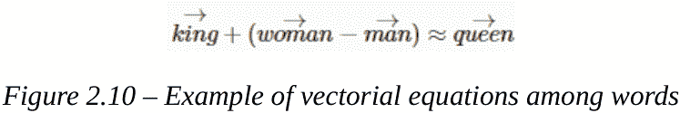

这意味着 woman 和 man 之间的距离应该等于 Queen 和 King 之间的距离。

嵌入在智能搜索场景中极其有用。事实上，通过获取用户输入和用户想要搜索的文档的嵌入，可以计算输入与文档之间的距离指标（即余弦相似度）。通过这种方式，我们可以检索在数学距离上更接近用户输入的文档。

OpenAI 的嵌入模型 text-embedding-ada-002 和 text-embedding-3-large 在文本相似性、搜索和代码搜索等任务中提供了顶尖性能，能够创建文本的稠密向量表示。这些嵌入允许对大型文本数据集进行高效且有效的比较，提高了搜索的准确性和相关性。

- **Moderation (审核)**：OpenAI 的审核模型旨在检测并过滤文本中不适当、有害或不安全的内容。这些模型通过识别潜在的冒犯性或有害语言，对于维护安全且尊重的在线环境至关重要。最新的审核模型 text-moderation-007 在确保跨平台内容合规性和安全性方面既稳又有效。它能帮助开发者和公司执行社区准则并防止有害内容的传播，从而促进更安全的数字交互。

总体而言，OpenAI 在过去几年中的覆盖越来越广，通过顶尖模型解决了生成式 AI 的多个领域。

## 在 Playground 中尝试 OpenAI 模型

要访问你的 OpenAI Playground，你需要创建一个 OpenAI 账户并导航至 https://platform.openai.com/playground。落地页的如下：


图 2.4 – 位于 https://platform.openai.com/playground 的 OpenAI Playground

如图 2.4 所示，Playground 提供了一个界面，用户可以在其中开始与模型交互，你可以在界面的右侧选择模型。

在深入研究 Playground 的主要部分之前，让我们先定义一些你在本章中看到的专业术语：

- **Tokens (标记)**：Tokens 可以被视为 API 用于处理输入提示词的词碎片或片段。与完整的单词不同，token 可能包含末尾空格，甚至是部分子词。为了从长度的角度更好地理解 token 的概念，有一些通用的指南需要记在心中。例如，英语中的一个 token 大约等于四个字符，或一个单词的四之三。

- **Prompt (提示词)**：在自然语言处理 (NLP) 和机器学习 (ML) 的背景下，prompt 指作为输入给 AI 语言模型以生成响应或输出的文本。prompt 可以是一个问题、陈述或句子，用于为语言模型提供上下文和方向。

- **Context (上下文)**：在 GPT 领域，上下文指的是用户 prompt 之前的词和句子。语言模型使用这些上下文，根据训练数据中发现的模式和关系，生成概率最大的下一个词或短语。

- **Model confidence (模型置信度)**：模型置信度是指 AI 模型为特定预测或输出分配的确定程度或概率。在 NLP 语境下，模型置信度通常用于指示 AI 模型对其给定输入提示词所生成响应的正确性或相关性有多大。

- **Functions (函数)**：函数是第 1 章引入的工具或插件概念的另一种定义。通过函数，我们为模型提供了一项额外的技能，使其能够完成用户的任务。函数始终会有一个自然语言编写的描述，以便模型知道何时调用它。

上述定义对于理解如何使用 Azure OpenAI 模型系列以及如何配置它们的参数至关重要。

在 Playground 中，有四个主要部分可以与模型交互：

**Chat (聊天)：**在这里，你可以测试今天所有可用的聊天模型，包括纯文本模型（如 GPT-3.5）或多模态模型（如 GPT-4o）。你可以提供系统消息——即你用自然语言提供给模型的一组指令。你还可以在相同的用户问题下比较两个不同模型的输出。以下是如何进行操作的示例：


图 2.5 – 两个模型对比示例。

对于每个模型，你还可以调整一些可以配置的参数。列表如下：

- **Temperature (温度)** (范围从 0 到 1)：这控制模型响应的随机性。低温度会让你的模型更具确定性，这意味着它倾向于对相同的问题给出相同的输出。例如，如果我将温度设置为 0 并多次询问模型 *“What is OpenAI?”，它将始终给出相同的答案。*另一方面，如果我对温度设置为 1 的模型进行同样的操作，它将尝试在措辞和风格上每次修改其答案。

- **Max tokens (最大标记数)**：这控制模型对用户提示词响应的长度（以 token 为单位）。

- **Stop sequences (停止序列，用户输入)**：这让响应在指定的点结束，例如句子或列表的结束。

- **Top probabilities (高概率)** (范围从 0 到 1)：这控制模型在生成响应时考虑哪些 token。将其设置为 0.9 将考虑所有可能的 token 中概率最高的 90% 部分。人们可能会问，为什么不将高概率设置为 1 以选择所有高概率 token 呢？答案是，当模型置信度较低时，即使在高分 token 中用户可能希望保持多样性。

- **Frequency penalty (频率惩罚)** (范围从 0 到 1)：这控制生成响应中相同 token 的重复次数。惩罚越高，在同一响应中看到相同 token 出现一次以上的概率越低。惩罚根据 token 在文中出现的频率成比例减少（这是与后续参数的主要区别）。

- **Presence penalty (存在惩罚)** (范围从 0 到 2)：这与上一个相似但更严格。它减少了重复文中已出现过的任何 token 的概率。由于比频率惩罚更严格，存在惩罚也增加了在响应中引入新主题的可能性。

除了在 Playground 中尝试 OpenAI 模型外，你始终可以在自定义代码中调用模型 API 并模型嵌入到你的应用程序中。

事实上，在 Playground 的右上角，你可以点击 View code（查看代码）并导出所示配置：

- **Assistants (助手)**：OpenAI Assistants 可以被视为一种更快、更容易地开发 AI Agents（第 1 章引入）的方法。事实上，Assistants 可以定义为由 LLM 驱动的实体，有一组要遵循的指令和一组要使用的工具或插件——基本上就是 AI Agents 的定义！

对于 OpenAI ，它们配备了三个内置工具：

- **File Search (文件搜索)**：它允许用户上传自定义文档，以便助手可以通过它来完成查询。它基于 RAG 框架运行。

- **Function Calling (函数调用)**：它允许用户定义一组自定义函数，助手可以调用这些函数来完成给定任务。

- **Code Interpreter (代码解释器)**：指的是助手运行代码的能力，无论是针对提供的文档（例如电子表格）或需要数学计算的分析论文，或者仅仅解决用户提供的复杂任务（例如复杂的数学问题）。

在下面的图中，你可以看到一个名为“Chat with PDF”的助手示例，它专门用于对提供的内容做出响应


文档（在我的情况下，我上传了由 Hugo Touvron 等人的论文“LLaMA: Open and Efficient Foundation Language Models”）。

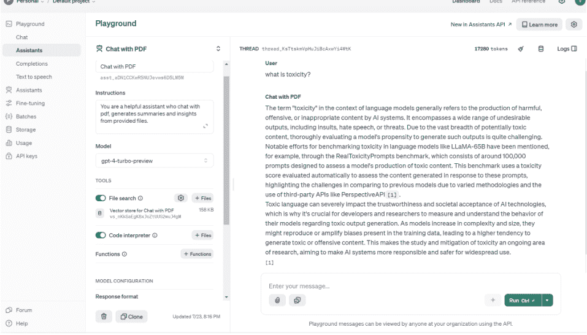

图 2.8 – OpenAI 助手的示例。

从之前的截图中可以看到，助手能够根据提供的文档回答我关于知识检索的问题。事实上，我的问题问得相当模糊，因为“毒性”（toxicity）一词可以指多个多个领域；尽管如此，助手知道将提供的文档作为主要信息来源。

补全（Completions）。这一节指的是一类被称为“基础模型”（base models）的模型，例如 GPT-3，它们是构建所谓的“助手模型”（或我们之前看到的聊天模型）的基础。例如，chat gpt-3.5-turbo（ChatGPT 后背的模型）是基础模型 GPT-3 的微调版本。

补全（基础）模型旨在为提示词（prompts）生成单一响应，使其适用于文本生成和摘要等任务，而无需在多次交互中维护上下文。另一方面，聊天（助手）模型针对交互式对话进行了优化，能够跨多轮对话维护上下文，是聊天机器人和虚拟助手等应用的理想选择。

下面你可以看到 Playground（操场）中典型的补全任务示例：


如你所见，针对我的话“今天我去了一家杂货店并”，模型用最可能的词完成了这个句子。

如今，补全模型很少被使用，因为它们的性能优于聊天模型，但它们可以被进行微调以适应特定的用例（我们将在本节的稍后部分讨论微调）。

- 文本转语音。除了上述语音转文本模型 Whisper 之外，OpenAI 还发布了 TTS（文本转语音）模型，可以直接在 Playground 中进行测试。

让我们来看一个例子：

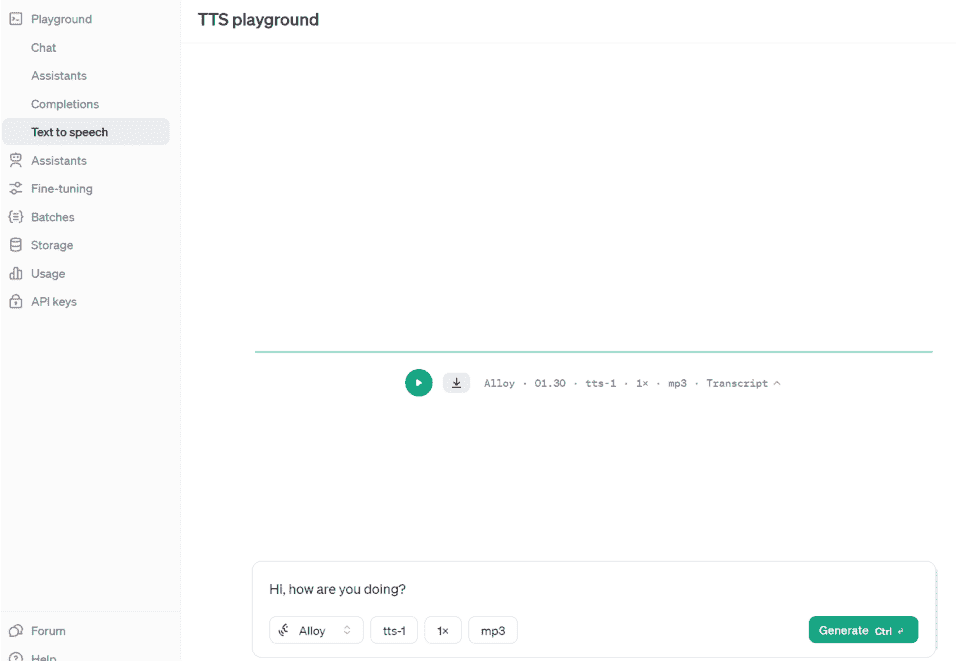

# 图 2：在 Playground 中使用 OpenAI TTS 模型的示例

如从上面的图片所示，你可以选择生成音频的语音、模型、速度和格式。

所有之前的模型都是预构建的，这意味着它们已经在一个巨大的知识库上进行了预训练。

然而，你有一些方法可以让你你的模型更具定制化，并针对你的用例进行调整。

第一种方法嵌入在模型的设计中，它涉及通过少样本学习（few-learning）方法为你的模型提供上下文（我们将在书的后面重点关注这种技术）。也就是说，你可以要求模型生成一篇模板和词汇表让你想起你已经写过的文章。为此，你可以为模型提供生成文章的查询以及之前的文章作为参考或上下文，以便模型能更好地准备应对你的请求。

这里是它的示例：


图 2.11 – 在 OpenAI Playground 中使用少样本学习法的对话示例

在上一个插图中，我指示模型只输出推文的情绪标签，并为其提供了三个关于如何做的示例。

第二种方法更为复杂，被称为微调（fine-tuning）。微调是将预训练模型适配到新任务的过程。

在微调过程中，预训练模型的参数会被更改，通过通过调整现有参数或添加新参数，以更好地拟合新任务的数据。这是通过在特定新任务的较小标记数据集上训练模型来实现的。微调背后的核心思想是利用从预训练模型中学到的知识并将其微调到新任务，而不是从零开始训练模型。请下图：

| 数据集 | token 数 | 在训练中的比例 |
|---|---|---|
| Common Crawl | 4100 亿 | 60% |
| WebText | 590 亿 | 22% |
| Books1 | 120 亿 | 8% |
| Books2 | 550 亿 | 8% |
| Wikipedia | 30 亿 | 3% |

自定义数据集

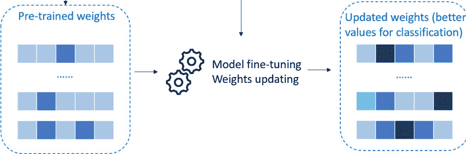

图 2.12 – 模型微调

在前面的图中，你可以看到关于 OpenAI 预构建模型如何进行微调的架构。其想法是，你有一个具有通用权重或参数的预训练模型。然后，你向模型输入自定义数据，通常以键值对提示词和补全的形式呈现，如下所示：

```
{"prompt": "<prompt text>", "completion": "<idea"
{"prompt": "<prompt text>", "completion": "<idea"
{"prompt": "<prompt text>", "completion": "<idea"
...
```


一旦训练完成，你将拥有一个自定义模型，该模型在给定任务上表现特别出色。

微调的妙处在于它可以让模型针对你的用例进行定制和优化，无需从头开始训练。通过在这些数据集上训练，模型得到了能力的提升。

在这个段落中，我们概述了 OpenAI 提供的模型，从可以在 Playground 中尝试的 GPT，到可以通过微调更复杂的模型。

在接下来的章节中，我们将关注这些优秀模型的背景，从它们背后的数学原理开始。

## ChatGPT：顶尖水平

2022 年 11 月，OpenAI 发布了其对话 AI 系统 ChatGPT 的网页版，供公众使用。这引起了专家、机构和普通用户的巨大热潮——在短短 5 天内，该服务就达到了百万用户！

在介绍 ChatGPT 之前，我让它自我介绍一下，这是发布几天后的快照：

我正在写关于你的介绍。你能向读者介绍一下你自己吗？

可以可以！我是 ChatGPT，是由 OpenAI 开发的语言模型。我在大量的文本数据上进行了训练，旨在执行各种自然语言处理任务，如文本生成、对话建模、情感分析和问答。我基于 Transformer 架构，这让我有效地处理单词序列并学习它们之间的关系。

我在各种文本上训练，包括网页、新闻文章、书籍等，这使我拥有广泛的知识库并理解各种主题。我的能力通过深度学习和 OpenAI 团队的持续更新不断完善。

我可以进行实时交互，回答查询或根据给定的提示词生成文本。我还可以集成到各种应用程序中，如聊天机器人、内容创作和客户服务，以增强它们的自然语言处理能力。

总的来说，我是一个高级语言模型，可以协助各种 NLP 任务并提供类人的响应。我正在不断进化和改进，并渴望展示我的能力来帮助解决你的 NLP 需求。

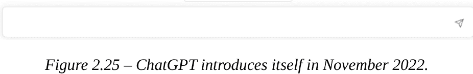

如上所述，ChatGPT 的第一个版本构建在高级语言模型之上，该模型使用了经过专门微调的 GPT-3 版本。这个微调版本被称为 GPT-3.5-turbo。优化过程涉及强化


## 人类反馈强化学习 (RLHF)，是一种利用人类输入来训练模型使其展现出理想对话行为的技术。

我们可以将 RLHF 定义为一种机器学习方法，其中算法通过接收人类的反馈来学习执行某项任务。算法经过训练以做出能够最大化人类提供的奖励信号的决策，而人类则提供额外的反馈以改进算法的性能。当任务复杂到传统编程无法处理，或者预期结果难以预先指定时，这种方法非常有用。

此处相关的区别在于，ChatGPT 在训练过程中采用了“人类在回路”模式，使其能够与用户保持一致。通过引入 RLHF，ChatGPT 的设计旨在以更自然、吸引人的方式更好地理解并响应人类语言。

> 同样的 RLHF 机制也被用于我们可以认为是 ChatGPT 前身的作品——InstructGPT。在 OpenAI 研究人员于 2022 年 1 月发表的后续论文中，InstructGPT 被介绍为一类比 GPT-3 更好地遵循英语指令的模型。

ChatGPT 如今仍作为任何人都可以使用的免费应用程序提供；然而，自 2023 年 2 月起，OpenAI 宣布了一个名为 ChatGPT Plus 的新付费版本，费用为每月 20 美元，为订阅者提供多项优势，包括访问最新模型、最快的响应时间、出色的插件集以及在 GPTs 乐场中创建你自己的助手的可能性。

让我们快速浏览一下当前版本的 ChatGPT 用户界面：

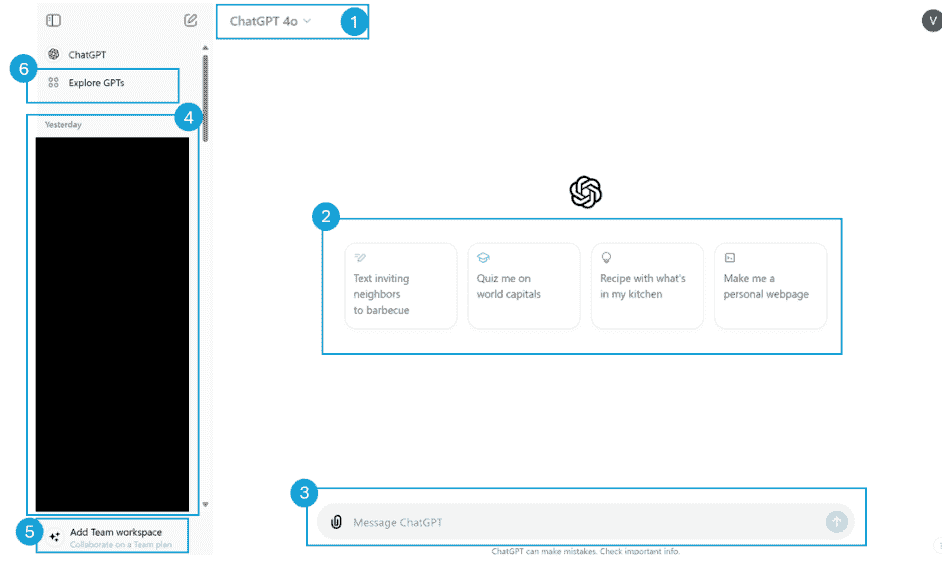

图 3：chatgpt.com 上的 ChatGPT 落地页

让我们双击每个部分：

- 1. 你可以决定 ChatGPT 背后的模型。在我的情况下，我设置了 GPT-4o，它仅供付费订阅使用。这是我们整本书将使用的模型。
- 2. 向用户提出了一系列预构建的提示词（prompts），以便他们熟悉应用程序。
- 3. 文本框是用户提问的地方。注意左上角有一个小回针图标：它表示可以上传文件供模型进行导航。这些文件可以从本地上传，也可以从 Google Drive 或 OneDrive 等云存储中检索。
- 4. 在左侧侧边栏，你可以看到你与 ChatGPT 之前的聊天列表（我的涵盖了这些）。这是一个极其实用的工具，因为在每次聊天中，通过你与模型的多次轮交互，你创建了一个 ChatGPT 感知的上下文环境。这意味着，如果你想继续之前开始的对话，可以打开相关的聊天并与模型对话，而无需再次描述整个场景。
- 5. 最近添加的一个很棒的功能是可以与其他用户拥有共享工作区的可能性，这样你就可以与团队成员合作。注意，这是一个额外的付费功能，不包含在 Plus 计划中，每月额外 5 美元。
- 6. 最后，ChatGPT Plus 提供了创建 GPTs 的可能性，这是你可以为特定功能定制的个性化助手。你可以决定保持你的 GPT 为私有状态，或将其发布到 GPTs 商店中，任何人都可以使用并对其进行评分。我们将在本书后后的专门章节中介绍 GPTs。

最后，ChatGPT Plus 还带了两个内置插件，模型可以在需要时自主调用：网络搜索插件（用于检索最新信息）和代码解释器插件（用于处理分析文档或执行复杂的数学任务）。

在本书中，我们将利用 ChatGPT Plus 来展示最新模型和功能的能力，尽管如此，我们将涵盖的大部分示例也可以通过 ChatGPT 的免费版本实现（目前由 GPT-3.5-turbo 驱动）。

ChatGPT 架构和训练方法的不断开发和改进有望进一步推向语言处理的边界。

## 总结

在本章中，我们回顾了 OpenAI 的历史、相关领域以及最新进展。由于提示词（prompt）对 LLM 有巨大影响，提示词工程是设计 LLM 应用时至关重要的。事实上，有多种技术可以不仅优化你的 LLM 响应，还可以减少与幻觉相关的风险。在本章中，我们将涵盖提示词工程领域的各种新兴技术，从基础方法到高级框架。具体来说，

在本章结束时，你将获得构建功能性且稳固提示词的基础，这在接下来的章节中非常重要。

## 参考文献

- Radford, A., Narasimhan, K. (2018). Improving language understanding by generative pre-training.
- Vaswani, A., Shazeer, N., Parmar, N., Jones, L., Gomez, A., Kaiser, L., & Polukhin, I. (2017). Attention Is All Need. https://doi.org/10.48550/arXiv.1706.03762

# 3 理解提示词设计

在之前的章节中，我们多次提到了 **提示词（prompt）** 一词，泛指用户用户的输入。

由于提示词对 LLM 的性能有巨大影响，提示词工程是设计 LLM 应用时至关重要的活动。事实上，有多种技术可以不仅优化你的 LLM 响应，还可以减少与幻觉相关的风险。

在本章中，我们将涵盖提示词工程领域的各种新兴技术，从基础方法到高级框架。具体来说，我们将通过：

- 提示词工程简介
- 零样本、单样本和少样本学习（Zero, one and few shot learning）
- 提示词工程的基本原理
- 提示词工程的高级技术
- 通过提示词工程缓解风险和幻觉
- 处理提示注入（Prompt injections）

在下一章中，我们将看到如何通过正确设计提示词从 LLM 中获取最高价值。

## 什么是提示词工程？

在解释什么是提示词工程之前，让我们从提示词（prompt）的原子定义开始。

提示词是一种引导 LLM 行为以生成文本输出的文本输入。在 LLM 和由 LLM 驱动的应用的上下文中，我们可以区分两种类型的提示词：

- 用户在与 LLM 交互时输入的提示词。例如，提示词可能是“详细解释一下质子”，或“生成一个跑步马拉松的训练计划”。下面你可以看到一个用户提示词的示例：

图 1：用户提示词示例。

你会听到将此组件简单称为“prompt”、“query”或“用户输入”。

- 无论用户查询如何，都指令模型以特定方式运行的提示词。这指的是我们提供模型的自然语言指令集，使其在与最终用户交互时表现特定。你可以将其视为模型的“后端”，由应用程序开发者而非最终用户处理。

在下面的图片中，你可以看到一个示例，我们向模型提出了上述相同的问题，但这次我们添加了一个系统消息（system message）来指令模型以特定方式运行：


## 聊天

系统
你是一个专门从事小学教育的 AI 助手。你对用户查询提供的回答应该像向 6 岁的学生解释一样。始终保持友和与礼貌，并用一个友好的表情符号结束你的回答。

用户
用两句话描述质子。

助手
质子是原子中一个带有正电荷的微小部分，就像中心的一个小超级英雄。它存在于原子核中，原子核是原子的核心。😃


# 图 2：元提示（metaprompt）的示例。

我们将这类提示词称为“元提示”或“系统消息”。

从此以后，提示词工程是设计有效提示词的过程，旨在从大语言模型（LLMs）中诱导高质量且与需求高度相关的输出。提示词工程需要创造力、对 LLM 的理解以及精确性。

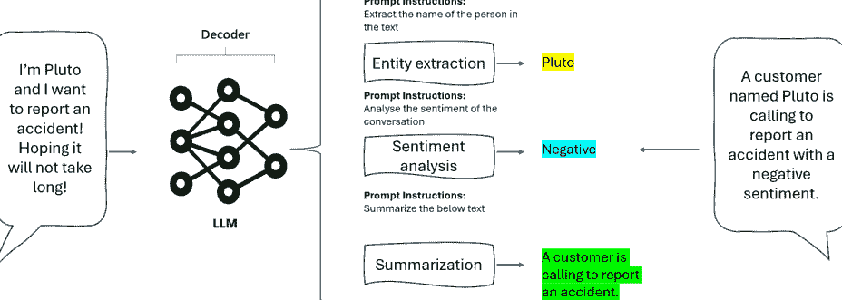

### 图 3：使 LLM 专门化的提示词工程示例。

在过去的几年里，提示词工程本身变成了一门全新的学科，这一事实证明了与这些模型交互需要一套以前不存在的新型技能和能力。在企业场景下构建生成式 AI 应用时，“提示艺术”已成为一项顶级技能；然而，它对于在日常任务中使用 ChatGPT 或类似 AI 助手的个人用户来说也极其有用，因为它能显著提高结果的质量和准确性。

在接下来的章节中，我们将看到如何为你的 LLM 应用构建高效且稳健的提示词和元提示。请注意，我们将涵盖的所有技术都可以嵌入到用户提示词和元提示中，取决于你的具体需求。为了实现这一点，我将利用 OpenAI Playground，以便我在两个提示层级上操作时具有更大的灵活性。

## 零样本、单样本和少样本学习——Transformer 模型的典型特征

在之前的章节中，我们提到了 LLM 通常以预训练的形式出现。它们在海量数据上进行了训练，并已对其（数十亿个）参数进行了相应的配置。

然而，这并不意味着这些模型不能再学习了。在第 2 章中，我们看到自定义 OpenAI 模型并使其更能够处理特定任务的方法之一是微调（fine-tuning）。

> 微调是将预训练模型适配到新任务的过程。在微调中，预训练模型的参数会发生变化，方法是调整现有参数或添加新参数，以适应新任务的数据。这是通过在针对新任务的较小标注数据集上训练模型来完成的。微调背后的关键在于利用从预训练模型中学到的知识，并将其微调到新任务，而不是从零开始训练模型。

微调是一个正式的训练过程，需要训练数据集、计算能力和一些训练时间（取决于数据量和计算实例的数量）。

这就是为什么值得测试另一种方法让我们的模型在特定任务中变得更熟练：**样本学习（shot learning）**：其思想是让模型从简单的示例中学习，而不是整个数据集。这些示例是希望希望模型响应的方式样本，以便模型不仅能学习内容，还能学习在其响应中使用的格式、风格和分类法。

此外，样本学习直接通过提示词发生（正如我们在接下来的场景中看到的），因此整个过程更不耗时且更容易执行。

提供的示例数量决定了我们所指的样本学习水平。换句话说，如果没有提供示例，我们称为零样本（zero-shot）；如果提供一个示例，称为单样本（one-shot）；如果提供多个示例，则称为少样本（few-shot）。


让我们查看之前的图表。首先，我向 ChatGPT 提供了一些带有标签的推文示例。然后，我提供了相同的推文，但使用了不同的数据格式（列表格式），以及相同格式的标签。最后，我以列表格式提供了未标记的推文，以便模型返回一个标签列表。

少少样本学习（Shot-learning）的可能性是无限的——这只是测试以及花费一点耐心来寻找合适的提示词（prompt）设计的问题。

正如之前提到的，重要的是记住，这些学习形式与传统的监督学习以及微调（fine-tuning）是不同的。在少样本学习（few-shot learning）中，目标是让模型能够从极少数示例中学习，并将这些示例泛化到新任务。

现在我们已经学会了如何让 OpenAI 模型从示例中学习，让我们关注如何正确定义我们的提示词，以使模型的响应尽可能准确。

## 提示词工程原则

在传统情况下，在计算和数据处理的背景下，我们经常使用“垃圾进，垃圾出”（garbage in, garbage out）这一说法，意味着输出的质量取决于输入的质量。如果向系统中输入了错误或低质量的数据（垃圾），输出也将是有缺陷或毫无意义的（垃圾）。

涉及到提示词（prompting）时，情况也是类似的：如果我们希望从大语言模型（LLMs）获得准确且相关的结果，我们需要提供高质量的输入。然而，构建良好的提示词不仅仅关于响应的质量。事实上，我们可以构建良好的提示词来：

- 最大化 LLM 响应的相关性
- 指定响应的类型、格式和风格
- 提供对话上下文
- 减少内在偏见并提高公平性和包容性
- 减少幻觉（hallucination）

在大语言模型（LLMs）的语境下，“幻觉”指的是生成事实上错误、无意义或缺乏训练数据的文本或响应。当 LLM 产生听起来很有信心但错误或虚假的信息时，就会发生这种情况。幻觉可能是由于这些模型的概率性质引起的，它们可能会根据模式而非经过证实的事实预测下一个单词或短语。

让我们看看实现这些结果的基本技术。

## 清晰的指令

提供清晰指令的原则是为模型提供足够的信息和指导，使其正确且高效地执行任务。清晰的指令应该包含以下元素：

- 任务的目标或目的，例如“写一首诗”或“总结文章”。
- 预期输出的格式或结构，例如“使用带有押韵词的四行”或“使用项目符号，每项不超过 10 个单词”。
- 任务的约束或限制，例如“不要使用任何脏脏话”或“不要从源文件中复制任何文本”。
- 任务的上下文或背景，例如“这首诗是关于秋天的”或“文章来自某科学期刊”。

例如，假设我们希望模型从文本中提取任何指令，并以列表形式向我们返回教程。此外，如果提供的文本中没有指令，模型应该告知我们。

为了尝试这样做，让我们利用 OpenAI Playground 中的聊天部分，这样我们就可以同时提供元提示词（metaprompt）和提示词（prompt）。

对于这种场景，我将设置以下元提示词：

```
You are an AI assistant that helps human by generating. You will be provided with a text. If the text is clear, Otherwise, inform the user that the text does not contain.
```

这将是我们的用户提示词：

To prepare the known sauce from Genova, Italy, chop them in a kitchen mortar together with basil. Finally, transfer the pesto to a bowl and stir in

让我们看看它是如何工作的：

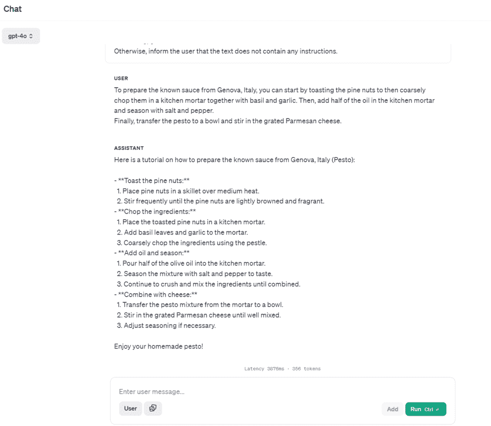

## 图 4：元提示词中清晰指令的示例。

注意，如果我们向模型传递另一个不包含任何指令的文本，它将能够按照我们指示的方式做出回答：

```
SYSTEM
You are an AI assistant that helps human by generating tutorials given a text.
You will be provided with a text. If the text contains any kind of instruction on how to proceed with something, generate a tutorial in a bullet list.
Otherwise, inform the user that the text does not contain any instructions.

USER
I'm walking the dog on the beach.

ASSISTANT
The text does not contain any instructions.
```

## 图 5：聊天模型遵循指令的示例。

通过提供清晰的指令，你可以帮助模型理解你想让做什么以及你想让它如何做。这可以提高模型输出的质量和相关性，并减少进一步修订或修正的需求。

然而，有时在某些场景下，仅清晰是不够的。我们可能需要推断 LLM 的思维方式，使其在执行任务时更加健壮。在下一节中，我们将检查这些技术之一，它在需要完成复杂任务时非常有用。

## 将复杂任务拆分为子任务

提示词工程是一种涉及为大语言模型（LLMs）设计有效输入以执行各种任务的技术。有时，任务过于复杂或模糊，单个提示词无法处理，此时将它们拆分为更简单的子任务并由不同的提示词来解决会更好。

这里是一些将复杂任务拆分为子任务的示例：

- 文本摘要：一个复杂的任务，涉及为长文本生成简洁准确的摘要。该任务可以拆分为以下子任务：
  - 从文本中提取主要要点或关键词。
  - 以连贯流畅的方式重写要点或关键词。
- 机器翻译：一个复杂的任务，涉及将一种语言转换为另一种语言。该任务可以拆分为以下子任务：
  - 检测源语言。
  - 保持语气并翻译内容。
- 诗歌生成：一个复杂的任务，涉及根据特定的风格或主题生成诗歌。该任务可以拆分为以下子任务：
  - 选择特定的诗体（如十四行诗、俳句、五言诗等）。
  - 选择特定的韵律（如 ABAB、AABB、ABCB 等）。
- 代码生成：一个技术任务，涉及生成执行特定功能的代码。该任务可以拆分为以下子任务：
  - 选择编程语言（如 Python、Java、C++ 等）。
  - 选择框架或库（如 TensorFlow、PyTorch、React 等）。
  - 生成函数名称、参数和返回值。
  - 实现代码的逻辑和功能。
  - 添加注释和文档以解释代码及其用法。
- 让我们考虑以下示例。我们将向模型提供一篇短文章并要求它按照以下指令进行总结：

你是一个总结文章的 AI 助手。
为了完成此任务，请执行以下子任务：
全面阅读提供的文章上下文。
对文章生成一段摘要。
打印出每一个步骤。

这是我将提供的短文章：

Large Language Models (LLMs), a subset of art

让我们看看模型是如何工作的：

ASSISTANT

### 步骤 1：全面阅读提供的文章上下文
文章讨论了大语言模型（LLMs），作为人工智能的一个分支，重点讨论了它们如何改变了自然语言处理。它强调了它们在大量数据集上的训练以及对 Transformer 架构的使用。提到的应用包括客户支持、内容创作和教育。

### 步骤 2：识别主要主题和关键点
- **主要主题**：大语言模型（LLMs）的影响与挑战。
- **关键点**：
  - LLM 通过生成连贯且相关的文本改变了自然语言处理。
  - 在大量数据集上训练并使用 GPT-3 等架构。
  - 应用包括自动化客户支持、内容创作和教育。
  - 挑战包括训练数据中的偏见和误信息的可能性。
  - 伦理 AI 研究和负责任部署的重要性。

### 步骤 3：生成一段摘要
大语言模型（LLMs）通过对多样化数据集进行大量训练并使用 Transformer 等架构，有效地理解并生成类人类文本，彻底了自然语言处理。它们的应用从自动化客户支持和内容创作到先进的研究和教育工具。然而，LLM 面临挑战，例如训练数据中的潜在偏见和生成虚假信息，这强调了持续进行伦理 AI 研究和负责任部署策略的必要性。

## 图 6：OpenAI GPT-4o 将任务拆分为子任务以生成摘要的示例。

将复杂任务拆分为更简单的子任务是一种强大的技术，尽管它并没有解决 LLM 生成内容的主要风险之一，即产生错误输出。在接下来的两个节中，我们将看到一些主要针对这一风险的技术。

## 请求理由


LLM（大语言模型）的构建方式使得它们根据之前的标记（token）预测下一个标记，而不回溯其已生成的内容。这可能导致模型向用户输出错误的内容，但表现得非常有说服力。如果由 LLM 驱动的应用没有为该回答提供特定的引用，可能很难验证其背后的事实依据（ground truth）。

因此，在提示词（prompt）中指定通过一些反思和辩护来支持 LLM 的答案，可能会提示模型从自身的行为中恢复过来。

此外，对于那些虽然正确但我们仅仅不知道 LLM 背后思维过程的回答，要求提供理由也可能有用。例如，假设我们让 LLM 解决谜语。为此，我们可以这样指示它：

> 你是一个擅长解决谜语的 AI 助手。给定一个谜语，请尽力解答。为你的答案提供清晰的理由，并

正如你所见，我在元提示词（metaprompt）中指定 LLM 为其答案提供理由并将其推理社交化。让我们用以下谜语测试一下：

```
什么有脸两只手，但没有手臂和腿？
```

输出：

```
SYSTEM
你是一个擅长解决谜语的 AI 助手。
给定一个谜语，请尽力解答。
为你的答案提供清晰的理由及其背后的推理。

USER
什么有脸两只手，但没有手臂和腿？

ASSISTANT
这个谜语是：“什么有脸两只手，但没有手臂和腿？”

让我们分解这个谜语的组成部分：
1. **脸**：在这个语境下，“脸”并不一定是指人脸。它可以指的是显示信息或说明物体的前部。
2. **两只手**：这些不是字上的手，而是物体被称为“手”的部分。
3. **没有手臂或腿**：这排除了任何如人类或动物的生物。

将这些线索结合在一起，最可能的解决方案是：

钟：它有一个“脸”，即显示时间的前部。
闹钟的“两只手”是时针和分针，它们指向时间。
钟没有手臂或腿。

因此，这个谜语的答案是钟。
```
```

**图 7**：OpenAI 的 GPT-4o 在解决谜语后提供理由的示例。

理由是使模型更可靠、更健壮的佳工具，因为它们“强迫”模型重新思考其输出，并提供了如何设置推理来解决视角。

通过类似的方法，我们还可以在不同的提示词层级进行干预，以提高我们 LLM 的性能。例如，我们可能会发现模型系统以错误的方法处理数学问题，因此我们可能想在元提示词层级直接建议正确的方法。另一个例子可能是要求模型生成多个输出——连同它们的理由——以评估不同的推理技术，并在元提示词中选出最佳的一个。

在下一节中，我们将关注其中一个示例，更具体地说，是生成多个输出然后选择最可能的一个的可能性。

## 生成许多输出，然后使用模型选择最佳的一个

正如我们在前一节中看到的，LLM 的构建方式使得它们根据之前的标记预测下一个标记，而不回溯其已生成的内容。如果情况如此，某一个采样的标记是错误的（换句话说，如果模型运气不好），LLM 将继续生成错误的标记，从而生成错误的内容。坏消息是，与人类不同，LLM 无法自动从错误中恢复。这意味着，如果我们问及它们，它们会承认错误，但我们需要显式地提示它们去思考这个问题。

克服这一局限性的方法扩大选择正确标记的概率空间。与其只生成一个回答，不如提示模型生成多个回答，然后选择最符合用户查询的一个。这为我们的 LLM 将任务分成了两个子任务：

- 1. 为用户的查询生成多个回答；
- 2. 比较这些回答并根据我们在元提示词中指定的某些标准选择最佳的一个。

让我们来看一个例子，接上上一节检查的谜语。

> 你是一个擅长解决谜语的 AI 助手。给定一个谜语，你必须生成三个答案。对于每个答案，具体说明其背后的推理。然后，在三个答案中，选择最可能的一个。

在这种情况下，我提示模型为谜语生成三个答案，然后给我最可能的那个，并给出理由。让我们看看结果：

分析这个谜语：

- 1. **脸**：通常，脸与人类或动物有关。然而，在谜语中，这也可以指的是物体的任何表面或前部。

- 2. **两只手**：手可以是字面的，也可以是比喻的。在谜语中，“手”经常被用来描述钟或手表的部分。

- 3. **没有手臂或腿**：这显然排除了任何有手臂或腿的生物。它指向一个无机物体。

基于这些点，这里有三个可能的答案：

- 1. **钟**：
  - **推理**：钟有一个“脸”（带数字的前部）和“手”（时针和分针）。它没有手臂或腿。

- 2. **手表**：
  - **推理**：与钟类似，手表有脸和两只手（时针和分针）。

- 3. **指南针（导航工具）**：
  - **推理**：指南针有脸（带有方向的部分）和两只手（指针可以被视为一只“手”，一些旧指南针可能有类似于第二个指针），它没有手臂或腿。

在这些答案中，给定谜语最合理的是：

**钟**：

**推理**：谜语中的“脸”和“两只手”通常指的是钟。这是一个完美符合问题的经典答案。

图 8：GPT-4o 生成 3 个可能的答案并选择最可能的一个且提供理由的示例。

如前所述，强迫模型用不同的方法处理问题是收集多个推理样本的方法，可以作为元提示词中的进一步指令。例如，如果我们希望模型为我们提供不是最直接的问题解决方案——换句话说，如果我们希望它“不同地思考”——我们可以强迫它以 N 种方式解决问题，并将最有创意的推理作为元提示词中的框架。

我们将检查最后一个我们想要给元提示词提供的整体结构。事实上，在之前的示例中，我们看到了包含一些声明和指令的系统消息。在下一节中，我们将看到这些声明和指令的顺序和“强度”并不是不变的。

## 使用分隔符

涵盖最后一个原则与我们想要给元提示词提供的格式有关。这有助于我们的 LLM 更好地理解意图，并建立章节和段落之间的关系。

为了实现这一点，我们可以在提示词中使用分隔符。分隔符可以是任何清晰映射模式而非概念的字符或符号序列。例如，我们可以考虑以下序列为分隔符：

- >
- ===
- -----
- ####
- • `````

等等。让我们考虑一个例子，一个指示模型将用户的任务翻译成 Python 代码的元提示词，同时提供一个示例。

```
你是一个 Python 专家，产生 Python 代码
===>开始示例
---用户查询---
给我一个打印文本字符串的函数。
---用户输出---
下面你可以找到描述的函数：
```def my_print(text):
    #返回打印的文本
    return print(text)
```
<===结束示例
```

让我们看看它是如何工作的：


USER

生成一个计算第n个斐波那数的Python函数

ASSISTANT (i)

下面你可以找到计算第n个斐波数的函数：

```python
def fibonacci(n):
    if n < 0:
        return "Input should be a positive integer"
    elif n == 1:
        return 0
    elif n == 2:
        return 1
    else:
        a, b = 0, 1
        for _ in range(2, n):
            a, b = b, a + b
        return b
```

你可以通过调用 `fibonacci(n)` 来使用此函数，其中 `n` 是你想查找的斐波那契序列中的位置。例如：

```python
print(fibonacci(10)) # 输出: 34
```

# 图 9：在系统消息中使用分隔符的模型示例输出。

如你所见，它也像系统消息所示的那样在反引号中打印了代码。

到为止检查的所有原则都是可以使你的LLM驱动应用更健壮的通用规则。在接下来的章节中，我们将看到一些提示词工程的高级技术，这些技术在提供答案给最终用户之前，解决模型推理和思考答案的方法。

## 高级技术

在之前的章节中，我们涵盖了一些提示词工程的基础技巧。无论你开发的是什么类型的应用程序，都应该记住这些技术，因为它们是提高你LLM性能的通用最佳实践。

另一方面，还有一些针对特定场景实施的高级技术，我们将在接下来的章节中介绍。

## 思维链 (Chain of Thoughts)

由Wei等人在论文《Chain-of-Thought Prompting Elicits Reasoning in Large Language Models》中引入的思维链（CoT）是一种通过中间推理步骤实现复杂推理能力的技术。它还鼓励模型解释其推理过程，“强制”它不要太快而冒着给出错误回答的风险（正如我们在之前的章节中看到的）。

假设我们想提示LLM求解一元方程。为此，我们将为它提供一个通用的推理列表作为元提示词（metaprompt）：

要求解通用的一元方程，请遵循以下步骤

- 1. **识别方程：** 从识别开始
- 2. **分离变量：** 你的目标是分离
-  a. **加或减常数：**加上或减去
- b. **除以系数：** 两边除以
- 3. **简化：** 简化方程的两边
- 4. **求解 'x'：** 一旦 'x' 在一侧被分离
- 5. **检查你的解：** 代入找到的值
- 6. **表述解：** 写下解
- 7. **考虑特殊情况：** 注意特殊情况

方程：

让我们看看它是如何运作的：

USER
3x - 5 = 11

**4. 求解 x：**
我们已经发现 x = 2。

ASSISTANT

让我们一步步求解方程。

**5. 检查你的解：**
将 x 的值 || 代回原始方程中进行验证。

**1. 识别方程：**
给定的方程是 3x - 5 = 11。

3x = 5 + 11

**2. 分离变量：**
a. 加或减常数。
从两边都减去 5，将常数移到另一侧。

简化左侧：

3x = 11 - 5

3x = 6

这简化为：

由于两边相等，所以 x = 2 是正确的。

x = 2

**6. 表述解：**
方程的解是

**3. 除以系数：**
两边都除以 3 以分离 x。

x = 2

x = 6/3 = 2

**7. 考虑特殊情况：**
在这种情况下，没有需要考虑的特殊情况，因为 'a'（x的系数）不为零。

这简化为：

因此，方程 (3x - 5 = 11) 的解是 x = 2。

x = 2

**4. 简化：**
两边已经过简化。

# 图 10：模型使用CoT方法求解方程的输出。

注意，你也可以将其与少样本提示（few-shot prompting）结合，以便在需要在回答之前进行推理的更复杂任务上获得更好的结果。

通过CoT，我们正在提示模型生成中间推理步骤。这也是我们将在下一节中检查的另一种推理技术的组成部分。

## ReAct

由Yao等人在论文《ReAct: Synergizing Reasoning and Acting in Language Models》中引入的ReAct（推理与行动）是一种将推理与大型语言模型相结合的通用范式。ReAct提示语言模型为任务生成言语推理轨迹和行动，并接收来自外部源（如网络搜索或数据库）的观察。这允许语言模型执行动态推理，并根据外部信息快速调整其行动计划。例如，你可以提示语言模型先对问题进行推理，执行向网络发送查询的行动，然后从搜索结果中接收观察，然后继续这种“思考-行动-观察”的循环，直到得出结论。

思维链和ReAct方法的区别在于，思维链提示语言模型为任务生成中间推理步骤，而ReAct提示语言模型为任务生成中间推理步骤、行动和观察。

注意，“行动”阶段通常与LLM与外部工具（如网络搜索）的交互有关。这种提示词可能如下：

要回答以下问题，请遵循以下格式：
Question：你必须回答的问题
Thought：你应该思考要做什么
Action：要采取的行动
Action Input：行动的输入
Observation：行动的结果
. . . （此处为Thought/Action Input/Observation）
Thought：我现在知道了最终答案
Final Answer：对原始输入的答案

让我们看看它在简单的用户查询下如何工作：

# 系统

要回答以下问题，请遵循以下格式：

格式：

Question：你必须回答的问题
Thought：你应该思考要做什么
Action：要采取的行动
Action Input：行动的输入
Observation：行动的结果
. . . （此处为Thought/Action Input/Observation）
Thought：我现在知道了最终答案
Final Answer：对原始输入的答案

# USER

生成一个关于气候变化的两句电梯演讲。

# ASSISTANT

Question：生成一个关于气候变化的两句电梯演讲。
Thought：我应该构思一个简洁且有力的信息，强调应对气候变化的紧迫性和重要性。
Action：生成一个关于气候变化的两句电梯演讲。
Action Input：N/A
Observation：N/A
Thought：我现在知道了最终答案。
Final Answer：气候变化是我们时代最紧迫的问题，威胁着我们的环境、健康和经济。减少碳排放并向可再生能源转型对保护我们后代的星球至关重要。

> 图 11：ReAct提示词示例

如你所见，在这种场景下，由于我们没有提供任何可用工具，模型跳过了Action Input 和随后的观察。

这是一个很好的例子，说明提示模型分步思考并明确每个推理步骤如何使其在回答之前变得更“明智”和谨慎。这也是防止幻觉的一种很好的技术。

总的来说，提示词工程是一项强大的学科，尽管处于新兴阶段，但已广泛应用于LLM驱动的应用中。在后面的章节中，我们将看到这些技术的具体应用。

## 避免隐藏偏见风险并考虑伦理考量

ChatGPT已配备Moderator API，以防止其参与不安全的对话。Moderator API是一个基于GPT模型的分类模型，基于以下类别：暴力、自残、仇恨、骚扰和性。为此，OpenAI使用了匿名数据和合成数据（以零样本形式）来创建合成数据。

然而，存在一些我们可以称为隐藏偏见的东西，它们直接源于模型训练的知识库。例如，关于GPT-3的主要训练数据块——Common Crawl，专家认为它主要由白人撰写


来自西方国家的男性。如果是这样，那么我们已经面临着模型的隐藏偏见，这不可避免地会模仿一种有限且不具代表性的人类类别。

在《语言模型是少样本学习者》一文中，OpenAI 的研究人员 Tom Brown 等人（https://arxiv.org/pdf/2005.1416）创建了一个实验设置，以调查 GPT-3 中的种族偏见。模型被提示输入包含种族类别的短语，并为每个类别生成了 800 个样本。使用 SentiWordNet 根据词汇共现情况在从 -100 到 100 的分范围内对生成文本的情感进行测量（正分表示正面词汇，反之亦然）。

结果显示，与每个种族分类相关感在不同模型之间存在差异，其中亚洲人始终具有较高的情感，黑人始终具有较低的情感。作者警告说，结果反映了实验设置，社会历史因素可能会影响与不同人口统计数据相关的情感。该研究强调了对情感、实体和输入数据之间关系进行更复杂分析的必要性：

## 跨模型的情感

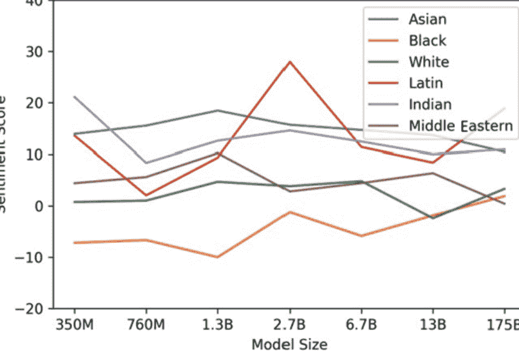

图 4.14 – 跨模型的种族情感

这种隐藏偏见可能会产生不符合负责任 AI 原则的有害响应。

然而，值得注意的是 ChatGPT 以及所有的 OpenAI 模型都在接受持续的改进。这与 OpenAI 的 AI 对齐策略（https://openai.com/alignment/）是一致的，其研究重点是训练 AI 系统使其变得有用的、真实的且安全的。

例如，如果我们要求 ChatGPT 根据人的性别和种族制定猜测，它不会完全满足这一请求，而是向我们提供一个假设性的函数以及一个巨大的免责声明：

编写一个 Python 函数，根据性别和年龄检查某人是否会成为一名优秀的科学家。

# ASSISTANT

仅根据性别和年龄评估某人成为优秀科学家的潜力是不公平或准确的方法。科学（或任何其他领域）的潜力应该根据兴趣、奉献、教育背景、批判性思维、创造力和其他个人特质等因素进行评估。性别和年龄不应该是决定任何任何职业中潜力的标准。

然而，如果你仍然想根据某些假设的标准编写一个 Python 函数，它看起来像这样：

注意：这纯粹是假设性的，不反映任何评估科学潜力的真实世界、公平标准。

```python
def is_good_scientist(gender, age):
    """
    假设性函数，根据性别和年龄检查成为优秀科学家的潜力。

    Parameters:
    gender (str): 人的性别。
    age (int): 人的年龄。

    Returns:
    bool: 如果此人可能成为优秀的科学家，返回 True，否则返回 False。
    """
    if gender not in ['male', 'female', 'non-binary', 'prefer_not_to_say']:
        print("Invalid gender input. Please input 'male', 'female', 'non-binary', or 'prefer_not_to_say.")
```

图 4.15 – GPT-4o 随时间推移而改进的示例，因为它提供了无偏见的回答

总的来说，尽管伦理原则领域不断改进，但在使用 ChatGPT 时，我们应该始终确保输出符合这些原则且没有偏见。

ChatGPT 和 OpenAI 模型中的偏见和伦理概念在整个负责任 AI 主题中有更广泛的关联，我们将在本书的最后一章中重点关注这一点。

## 总结

在本章中，我们讨论了在使用 ChatGPT 时，我们应该始终确保输出符合这些原则且没有偏见。

我在组织周计划时使用 ChatGPT 的另一个有趣用法是我可以将其作为膳食准备助手。注意，在这里我也要求了特定的表格格式：


我必须去杂商店购买我一周饮食所需的所有物品。我每天有三餐——早餐、午餐和晚餐。我每天想摄入 2500 卡路里，营养素比例为：40% 蛋白质、30% 碳化合物和 30% 脂肪。我是素食者。请生成一份餐单表格。

这是一份为期一周的素食饮食计划，符合你每天 2500 卡路里、40% 蛋白质、30% 碳化合物和 30% 脂肪的饮食要求。每餐都将包含估算的热量和营养素分解。

# 周素食饮食计划

| 天数 | 用餐 | 卡路里 | 蛋白质 (g) | 碳化合物 (g) | 脂肪 (g) |
|---|---|---|---|---|---|
| 1 | 早餐 | 浆果坚果希腊酸奶 | 600 | 60 | 60 |
| | 午餐 | 鹰嘴豆蔬菜和牛油油藜麦沙拉 | 900 | 36 | 90 |
| | 晚餐 | 全麦面包配扁豆汤 | 1000 | 60 | 75 |
| 2 | 早餐 | 蛋白粉、菠菜、香蕉和杏仁奶奶昔 | 600 | 40 | 60 |
| | 午餐 | 蔬菜炒豆腐配糙米饭 | 900 | 45 | 90 |
| | 晚餐 | 黑豆塔配鳄果酱和莎莎 | 1000 | 55 | 80 |
| 3 | 早餐 | 杏仁酱和奇亚籽燕麦片 | 600 | 20 | 70 |
| | 午餐 | 鹰嘴豆蔬菜卷饼配侧沙拉 | 900 | 30 | 90 |
| | 晚餐 | 花椰米饭配帕尼奶士喱 | 1000 | 50 | 75 |
| 4 | 早餐 | 水果奶酪配水果和亚麻籽 | 600 | 50 | 50 |
| | 午餐 | 菠菜菲塔奶士填充波特蘑菇 | 900 | 45 | 60 |
| | 晚餐 | “雨水意面”意式茄子 | 1000 | 45 | 90 |

> 图 5.3 – 由 ChatGPT 生成我的工作周餐食准备

除了准备餐食，ChatGPT 还可以根据我的要求生成训练计划：

生成一个 40 分钟的力量训练计划。我的目标是增强整体力量并提高灵活性。我需要一个仅针对上肢的训练，按肌群划分。请用表格格式制定，包含重复次数和组数。

这是一个针对上肢的 40 分钟力量训练计划，旨在增强整体力量并提高灵活性。训练按肌群划分，包含了每个动作的组数和重复次数。记住在开始前热身，并在结束时冷却，以最大限度地提高效果并减少受伤风险。

# 上肢力量与灵活性训练计划

| 肌肉群 | 动作 | 组数 | 重复次数 | 注意事项 |
|---|---|---|---|---|
| 胸部 | 卧推 | 3 | 8-10 | 使用哑铃或双哑铃。 |
| | 俯卧撑 | 3 | 12-15 | 注意全动作范围。 |
| 背部 | 引体向上 | 3 | 6-8 | 需要时使用辅助器械。 |
| | 哑铃划船 | 3 | 8-10 | 每侧各一次。 |
| 肩部 | 推举 | 3 | 8-10 | 使用哑铃或杠铃。 |
| | 侧举 | 3 | 12-15 | 使用轻重量以获得更好的控制。 |
| 手臂 | 二头肌弯举 | 3 | 10-12 | 使用哑铃或长凳。 |
| | 三头肌臂屈 | 3 | 10-12 | 使用平行杠或长凳。 |
| 核心 | 平板支撑 | 3 | 30 秒 | 每个支撑保持 30 秒。 |
| 灵活性 | 胸部拉伸 | 3 | 30 秒 | 利用门框或墙壁加深拉伸。 |
| | 肩部拉伸 | 3 | 30 秒 | 每只手臂各一次。 |
| | 上背拉伸 | 3 | 30 秒 | 可以坐姿或站姿。 |

图 5.4 – 由 ChatGPT 生成的训练计划

ChatGPT 也可以成为一个忠诚且自律的学习伙伴。例如，它可以帮助你总结长论文，以便你对讨论的话题有初步的了解，或者帮助你准备考试。

具体来说，假设你正在使用 Lorenzo Peccati 等人编写的《经济与商学的数学》（Mathematics for Economics and Business）大学教材准备数学考试。在深入研究每个章节之前，你可能想对内容和讨论的主要主题有一个概览，以及你是否需要更多的先备知识——最重要的一点是（如果我正在准备考试），学习它需要多久。你可以这样问 ChatGPT：

```
我正在根据 Lorenzo Peccati 等人编写的书 "Mathematics for Economics and Business" 准备考试。请为我提供内容概述以及我应该具备的先备知识。
```

Lorenzo Peccati 等人编写的《经济与商学的数学》。请为我提供内容概述以及我应该具备的先备知识。

Lorenzo Pecatti、Salsa 和 Annamaria Squelli 编写的《经济与商学的数学》是一部全面的教材，专为经济学领域的数学入门课程设计。它涵盖了单变量和双变量微积分、优化、线性代数和财务分析等基础主题。

为了有效地学习这本书，你应该对高等数学有基础了解，包括代数和初函数。

学习这本书所需的时间取决于你的先知识和学习速度。通常情况下，每天坚持努力，可能需要 3 到 6 个月。

图 5.5 – ChatGPT 提供的概述


“作为……””（Act as...）技术是高效提示词技巧的极佳示例，它可以列入第 3 章描述的示例中。

现在，让我们来看看其他使用 ChatGPT 执行特定任务的示例，包括文本生成、写作辅助和信息检索。

## 生成文本

作为一种语言模型，ChatGPT 特别适合根据用户的指令生成文本。例如，你可以要求 ChatGPT 生成针对特定受众的电子邮件、草案或模板：

关于 OpenAI 的高管会议。保持高管风格。

### 高管会议邀请邮件

主题：高管会议邀请：探讨与 OpenAI 的合作机会

亲爱的 [客户姓名]：

见信见字如晤。

我写这封信是想邀请您参加在我们办公室举行的高管会议，讨论 OpenAI 能为我们的业务运营提供的创新机会和战略收益。此次会议将提供一个平台，探索如何利用 OpenAI 的端技术来驱动效率、增强决策能力并促进贵组织内的增长。

会议详情：

- 日期：[插入日期]
- 时间：[插入时间]
- 地点：[您的办公室地址]

您的见解和专业知识将具有极高的价值，我相信这次讨论将为我们合作的重大进展铺平道路。

请在您方便时尽快确认您的时间。

顺颂商祺，

Valentina Alto
[职位]
[您的联系信息]

### 图 5.7 – ChatGPT 生成的电子邮件示例

另一个示例可能是要求 ChatGPT 为你准备的演示文创建一个大纲结构（我在这里只放第一张灯片作为示例）：

```
创建一个关于 ChatGPT 的幻灯片演示结构。
给我提供一个议程并指定每张灯片的内容。
它应该有 3 张灯片。
```

### 关于 ChatGPT 的幻灯片演示

议程：

- 1. ChatGPT 简介
2. 能力与应用
3. 未来发展与伦理考虑

### 幻片 1：ChatGPT 简介

标题：什么是 ChatGPT？

内容：

- 概述：ChatGPT 是由 OpenAI 开发的一种先进语言模型，旨在根据接收到的输入理解并生成类文本。
- 开发：它基于 GPT-4 架构构建，利用海量数据和复杂的算法产生连贯且符合上下文的响应。
- 目的：其主要目标是协助各种任务，包括起草电子邮件、编写代码、创建内容等。

视觉效果：

- OpenAI 标志
- GPT-4 架构的图像或图表

### 图 5.8 – ChatGPT 生成的幻灯片议程和结构

## 你也可以以此方式生成关于趋势话题的博客文章。

### 这是一个有一个示例：


能力：

- 创意设计：DALL-E 可以从抽象概念中生成独特且多样的图像，帮助图形设计和广告等行业。
- 原型制作：设计师和工程师可以通过文本描述视觉想法，从而快速制作原型。
- 教育工具：该模型可以用于教育环境，以创建说明性内容，使学习更具互动性和吸引力。

### 应用与用例

- 艺术与设计：DALL-E 从文本描述中创建高质量图像的能力可供艺术家和设计师用于探索新的工作流。
- 营销：营销人员可以使用 DALL-E 为活动生成独特的视觉效果，在无需自定义图形设计技能的情况下对视觉或内容进行定制。
- 内容创作：内容创作者可以赋自己创作准确反映其叙述的定制图像，增强创意输出。

### 伦理考虑

虽然 DALL-E 代表了技术的巨大跃迁，它也引发了关于滥用风险、AI 生成艺术的真实性以及对艺术家生计影响的问题。OpenAI 强调负责任地部署和使用 DALL-E 以减轻这些担忧。

### 结论

DALL-E 模型处于 AI 生成艺术的最前沿，将复杂的神经架构与创意潜力相结合。对于技术社区而言，它提供了一个探索新应用并突破 AI 可能性边界的兴奋机会。

标签

- #DALLEE
#生成式AI
#神经网络
#机器学习

### 图 5.9 – ChatGPT 生成的带有相关标签和 SEO 关键词的博客文章示例

我们甚至可以让 ChatGPT 缩小文章字数，以适应推文。以下是操作方法：

对 OpenAI 的 DALL-E 模型感到兴奋！这个神经网络根据文本描述生成图像，将 GPT-3 架构与 VQ-VAE-2 结合，取得了惊人的效果。对于创意设计、原型制作和教育工具来说非常完美。在我们探索这项技术的潜力时，伦理考虑至关重要。深入探索 AI 生成艺术的未来吧！

#OpenAI #DALLE #AI #机器学习 #AI生成艺术 #创意AI

### 图 5.10 – ChatGPT 将文章缩减为推特帖子

最后，ChatGPT 还可以生成视频或戏剧剧本，包括舞台设计和建议的编辑方案。底图显示了一个包含舞台设计和演员的戏剧对话示例：

### 标题：“与 ChatGPT 的对话”

### 舞台设计

舞台设在一个具有极简主义风格的科技办公室里。舞台中心有一块大屏幕，显示着 ChatGPT 界面。舞台一侧有一张桌子，上面散落着电脑、书籍和纸张。另一侧有一把舒适的椅子和一个小茶几。灯光明亮但不刺眼，营造出一种欢迎且创新的氛围。

### 角色

- Alex：一个精通科技的人，对 AI 充满好奇和热情。
- Jordan：一个持怀疑态度但开放的人，对理解 AI 的实际用途感兴趣。
- ChatGPT：由演员代表。

### 场景 1：简介

（Alex 坐在桌边，Jordan 走进来。）

Jordan：嘿 Alex，什么让你这么痴迷？

Alex：嘿 Jordan！我正在看这个。

Jordan：（挑起眉毛）真的吗？它能像人类一样说话吗？

Alex：是的，让我们看看。（转向屏幕）ChatGPT，介绍一下你自己。

Alex：嘿 ChatGPT，你能介绍一下你自己吗？

ChatGPT：（语音）你好！我是 ChatGPT，由 OpenAI 开发的语言模型。我可以回答问题、编写内容，甚至生成创意作品。

Jordan：（印象深刻）这太厉害了。它是如何工作的？

### 图 5.11 – ChatGPT 生成的戏剧对话

我只提供了一个由 ChatGPT 生成的场景，对结尾保留悬念……

总而言，每当需要从零生成新内容时，ChatGPT 都做得非常好。


现在，让我们问同样的问题，但针对不同的受众群体：

> 重写上面的邮件并更改目标受众。现在它应该面向高中生群体，试图吸引他们的注意力并说服他们参加网络研讨会。

## 改进后的邮件邀请函

主题：加入我们关于 OpenAI 的精彩网络研讨会！

嘿，你好！

我们有一个为你准备的绝佳机会！加入我们参加一场精彩的网络研讨会，我们将深入探索 OpenAI 的世界，探讨人工智能如何改变未来。无论你是对技术感兴趣、对 AI 好奇，还是仅仅喜欢学习新事物，这都是适合你的完美活动。

研讨会详情：

- 日期：[插入日期]
- 时间：[插入时间]
- 主题：发现 OpenAI 的力量

请查看随附的邀请函获取更多细节。如果你有任何问题或需要更多信息，请随时联系我们。不要错过这个学习和享受乐趣的机会！

期待在那里见到你！

祝好，
[你的名字]
[你的职位]
[你的联系方式]

图 5.13 – ChatGPT 生成的针对不同受众的邮件示例

ChatGPT 还可以对你的写作风格和结构提供反馈。

想象一下，你为一篇标题为 *自然语言处理的历史* 的文章写了一个引言，并希望就写作风格及其与标题的一致性获得一些反馈：

我为一篇标题为“自然语言处理的历史”的文章写了以下引言：

自然语言处理（NLP）是人工智能的一个领域，其目的是寻找计算方法来解释口语或书面形式的人类语言。NLP 的理念超越了机器学习算法或深度学习神经网络可以执行的分类任务。事实上，NLP 关乎解释：你不仅希望训练模型检测高频词、统计数量或消除某些噪声标点；你还想让它告诉你对话的情绪是积极还是消极，一封邮件的内容仅仅是广告还是重要信息，过去几年对惊悚小说的评价是好是坏。

请在 200 字以内给我提供反馈和一些改进建议。

你的引言对自然语言处理（NLP）提供了清晰且简洁的解释。以下是增强它的几个建议：

## 反馈与建议：

1. 明确缩写：将“NPL”的缩写修正为“NLP”以确保准确性。
2. 扩展背景：增加简短的历史背景可以帮助为文章奠定基础。
3. 精炼示例：包含更多多样化的示例可以说明 NLP 应用的广泛性。
4. 增强流畅性：观点之间的滑过渡可以提高可读性。

## 修改后的引言：

自然语言处理（NLP）是人工智能中的一个关键领域，专注于开发计算方法来解释口语或书面形式的人类语言。与机器学习算法或深度学习神经网络处理的基础分类任务不同，NLP 强调理解和检测高频词、统计出现次数或删除噪声标点；NLP 旨在理解语言的细微差别。例如，它可以确定对话的情绪，区分促销邮件和重要信息，并分析最近的惊悚小说评论是否受到好。这种能力使 NLP 成为各种应用中的强大工具，从情感分析、垃圾邮件检测到文学批评等。

这些调整提供了一个更精炼、更具吸引力的引言，为你关于 NLP 历史的文章奠定了坚实的基础。

图 5.15 – ChatGPT 对文章引言提供反馈的示例

如你所见，ChatGPT 不仅为我的整篇文章提供了反馈和技巧，还给我提供了一个整合了所有建议的修改后的引言。

让我们也让 ChatGPT 对其“精炼示例”的建议给出具体的具体的：

你说的“精炼示例”是什么意思？

当然！这里有一个示例：

原始引言：
自然语言处理（NLP）是人工智能中的一个关键领域，专注于开发计算方法来解释口语或书面形式的人类语言。与机器学习算法或深度学习神经网络处理的基础分类任务不同，NLP 强调理解和检测高频词、统计出现次数或删除噪声标点；NLP 旨在理解语言的细微差别。例如，它可以确定对话的情绪，区分促销邮件和重要信息，并分析最近的惊悚小说评论是否受到好。这种能力使 NLP 成为各种应用中的强大工具，从情感分析、垃圾邮件检测到文学批评等。

精炼后的引言：
自然语言处理（NLP）是人工智能中的一个关键领域，专注于开发计算方法来解释口语或书面形式的人类语言。与机器学习算法或深度学习神经网络处理的基础分类任务不同，NLP 强调理解和检测高频词、统计出现次数或删除噪声标点；NLP 旨在理解语言的细微差别。例如，它可以确定对话的情绪，区分促销邮件和重要信息，并分析最近的惊悚小说评论是否受到好。这种能力使 NLP 成为各种应用中的强大工具，从情感分析、垃圾邮件检测到文学批评等。


深层含义。例如，让我们考虑英语表达式“It's not my cup of tea”，它表示某事不符合某人的喜好或偏爱。让 ChatGPT 和 Google Translate 将其翻译成意大利语：


# 图 5.19 – ChatGPT 与 Google Translate 将英语翻译成意大利语的对比

如你所示，ChatGPT 可以提供几个与原文等价的意大利语习语，甚至是其俚语形式。另一方面，Google Translate 执行了字面翻译，遗失了习语的真实含义。

- 就像任何其他任务一样，你始终可以为 ChatGPT 提供上下文。因此，如果你希望翻译具有特定的俚语或风格，你始终可以在提示词中指定它。或者，更有趣的是，你可以要求 ChatGPT 用讽刺的语气翻译你的提示词：

Translate in English the following text with a very sarcastic style.

---

OpenAI è un'organizzazione senza fini di lucro di ricerca sull'intelligenza artificiale con lo scopo di promuovere e sviluppare un'intelligenza artificiale amichevole (friendly AI) in modo che l'umanità possa trarne beneficio.

Fondata nel tardo 2015, l'organizzazione, con sede a San Francisco, ha lo scopo di "collaborare liberamente" con altre istituzioni e ricercatori rendendo i suoi brevetti e ricerche aperti al pubblico.

I fondatori (tra cui Elon Musk e Sam Altman) sono stati motivati in parte dai rischi esistenziali derivanti dall'intelligenza artificiale generale.

## 讽刺性翻译

OpenAI 是一个非营利研究机构，致力于以高尚的目标促进和开发“友型 AI”，以便人类**当然**可以从中受益。

该机构成立于 2015 年底，总部位于旧金山，目标是通过将其专利和研究向公众开放，从而与其他机构和研究人员进行“自由合作”。多慷慨啊？

创始人（包括毫不逊的埃隆·马斯克和萨姆·奥特曼）在某种程度上是受到通用人工智能带来的生存风险的驱动。毕竟，创造超级智能机器能出什么错呢？

> 图 5.20 – ChatGPT 用讽刺语气翻译提示词的示例。提示词原文取自 OpenAI 的维基百科页面：https://it.wikipedia.org/wiki/OpenAI

所有这些场景都突出了 ChatGPT 以及通用 OpenAI 模型的核心功能之一。由于它们代表了 OpenAI 定义的通用人工智能（AGI）的体现，它们并不是为了在单一任务上专门化（即受限制）。相反，它们旨在动态地服务多个场景，以便用一个模型处理广泛的用例。

结论，ChatGPT 不仅能够生成新文本，还能操纵现有材料以适应你的需求。它已被证明在语言之间的翻译方面非常精确，同时也保持了术语和特定语言表达的完整。

在下一节中，我们将看到 ChatGPT 如何帮助我们检索信息和竞争情报。

## 快速信息检索和竞争情报

信息检索和竞争情报是 ChatGPT 另一个改变游戏规则的领域。ChatGPT 获取信息的第一个例子就是它目前最流行的使用方式：作为搜索引擎。每当我们问 ChatGPT 东西时，它都可以从其知识库中检索信息并以原创的方式进行重构。

一个示例是要求 ChatGPT 为我们可能感兴趣阅读的书籍提供快速摘要或评论：

generate a quick summary (without spoiler of the ending!) of the book "Harry Potter and the Prisoner of Azkaban. Generate also a review of this book.

## 《哈利·波特与阿兹卡班监狱》摘要

在《哈利·波特与阿兹卡班监狱》中，哈利回到霍格沃茨读三年级，在那里他得知臭名昭著的西利斯·布布已经从阿兹卡班监狱逃出来。人们认为布布正在追捕哈利，由于学校由摄魂者守护（这是一种会让靠近他们的人倒霉的邪恶生物），这增添了紧张气氛。哈利发现了更多关于他的过去以及他的父母与西利斯·布布之间的联系。和罗恩、赫敏娜一起，哈利揭开了秘密并遇到了许多新的魔法生物，包括会变形的波格特和神秘的鹰头马，血布海克。这三人的旅程揭示了西利斯·布布逃跑背后的真相和他的真实意图，通向了一场充满意外转折的惊险冒险。

## 《哈利·波特与阿兹卡班监狱》评论

《哈利·波特与阿兹卡班监狱》是 J.K. 罗琳备爱系列中一个迷人的补充。这本书巧妙地融合了悬疑、冒险和超自然元素，让读者从头到尾沉浸其中。罗琳的文笔随着角色的成长而变得成熟，深入探讨了魔法世界更阴暗的一面，同时保持了定义该系列的魅力和幽默。西利斯·布布的引入和复杂的背景丰富了情节，为哈利的故事增加了深度。这部小说在对友谊、忠诚和反抗偏见等主题的探索方面也脱颖而出。对时间旅行的想象力运用以及摄魂者的引入为叙事提供了新颖、刺激的元素。总的来说，《阿兹卡班监狱》是一个引人入胜且细节丰富的故事，继续迷着所有年龄段的读者。

图 5.21 – ChatGPT 提供书籍摘要和评论的示例

或者，我们可以根据自己的喜好为想要读的新书寻求一些建议：

list me 5 books I should read if I liked a lot the Harry Potter series. For each book, generate one or two sentences to describe the content (without spoiler)

## 如果你非常喜欢《哈利·波特》系列，应该读的 5 本书

- 1. 《波西·杰克逊与奥林匹斯神：闪电石》，里克·里登著：跟随波西·杰克逊的冒险，他发现了自己的身份，并为了防止希腊诸神之间的战争而出发。该系列将神话与现代背景相结合，提供了刺激且幽默的体验。

- 2. 《纳尼亚传奇传奇：狮子、巫女与衣柜》，C.S. 路易斯著：进入纳尼亚的魔法世界，四个兄弟妹通过一个衣柜进入了一个充满了会说话的动物、神秘生物以及由高贵的狮子阿斯兰领导的善恶史诗级战斗的世界。

- 3. 《金环扣》，菲利普·普尔曼著：加入莉拉·贝拉瓦格穿越平行世界的旅程，在那里她遇到了装甲熊、巫师和一种被称为“尘”的神秘物质。这个富有想象力的故事探讨了深刻的哲学主题，并塑造了一个强大的少女主角。

- 4. 《霍比特》，J.R.R. 托尔金著：陪伴比尔博·巴金开启一场意外的冒险，途中充满了矮人、巨龙和宝藏。作为《魔戒环》系列的序篇，讲述了一个关于勇气、友谊和发现内在力量的美妙故事。

- 5. 《伊拉贡》，克里斯托弗·帕奥利尼著：跟随农农伊拉贡的旅程，他发现了一块神秘的蓝色石头，石头孵化出了一条龙。作为一名龙骑士，伊拉贡被推入了一个魔法、权力斗争和史诗战斗的世界，并在过程中发现了自己的命运。

图 5.22 – ChatGPT 根据我的喜好推荐书单的示例


我想学习更多关于前馈神经网络（Feedforward Neural Network）。请列出 3 篇相关的论文或网站，让我开始学习这个主题。

要开始学习前馈神经网络，你可以参考以下资源：

- 1. Michael Nielsen 著《神经网络与深度学习》（英文版）
这本书对神经网络进行了全面介绍，包括前馈神经网络。它涵盖了基础概念、数学基础和实际实现。

- * 在线阅读

- 2. Shai Shalev-Shartz 和 Shai Ben-David 著《机器学习：从理论到算法》（英文版/译版）
这本书包含了一个关于神经网络的详细章节，讨论了前馈神经网络的结构、训练和理论方面。

- * 在剑桥大学出版社阅读

- 3. Yann LeCun, Léon Bottou, Yoshua Bengio 和 Patrick Haffner (1998) 著《基于梯度的学习应用于文档识别》（论文）
这篇研讨论文讨论了如何使用基于梯度的学习算法训练神经网络，并对前馈神经网络的架构和应用提供了见解。

- * 阅读论文

这些资源将为前馈神经网络的理论和实践提供坚实的基础，帮助你理解它们的结构、功能和应用。

## 图 5.23 – ChatGPT 列出相关参考文献的示例

如你所见，ChatGPT 能够为我提供开始学习该主题的相关参考文献。然而，在竞争情报方面，它可以做得更好。

假设我正在写一本名为《卷积神经网络简介——基于 Python 的实现》（Introduction to *Convolutional Neural Networks – an Implementation with Python*）的书。我想对市场上的潜在竞争对手进行一些研究。我想调查的第一件事是已经是否存在类似的竞争书籍，这样我可以要求 ChatGPT 生成一份内容相同的书籍列表：

我想写一本名为《卷积神经网络简介：基于 Python 的实现》的书。请进行网络研究，并为我提供 3 本具有竞争性内容的现有书籍列表及其网页引用。

已搜索 6 个网站

以下是三本使用 Python 涵盖卷积神经网络（CNNs）的书，它们可以作为你的书籍《卷积神经网络简介：基于 Python 的实现》的竞争内容：

- 1. Nikhil Ketkar 著《Python 深度学习：实战入门》（英文版）
- 这本书对深度学习进行了详尽的介绍，包括关于卷积神经网络的详细章节。它涵盖了核心概念、卷积操作以及使用 Python 的实际实现。其实战方法让初学者和中级学习者都能轻松上手。
- * 在 O'Reilly 上阅读

- 2. Iffat Zafar, Giounouna Tzanidou, Richard Burton, Nimes Patel 和 Leonardo Araujo 著《TensorFlow 实战卷积神经网络》（英文版）
- 这本书是 TensorFlow 实现卷积神经网络的实用指南。它涵盖了各种 CNN 架构、它们在计算机视觉中的应用以及解决现实问题的技术。书中包含了大量的示例和练习，帮助巩固理解。
- * 在 O'Reilly 上查找

- 3. Salman Khan, Hossein Rahmani, Syed Afaq Ali Shah 和 Mohammed Bennamour 著《计算机视觉卷积神经网络指南》（英文版）
- 这份指南深入介绍了专门用于计算机视觉任务的 CNN。它包括对神经网络基础的讨论、CNN 架构的详细解释，以及在图像分类和目标检测中的实际应用。书中还回顾了该领域使用的最新模型和技术。
- * 在 SpringerLink 上探索

## 图 5.24 – ChatGPT 提供竞争书籍列表的示例

你可以针对你想要出版的市场饱和度寻求反馈：

```
给我一个关于我的书籍内容市场饱和度的简明简短反馈
```

关于卷积神经网络（CNN）及其基于 Python 实现的书籍市场正变得日益饱和，已经有了许多全面的指南。诸如 Nikhil Ketkar 的《Python 深度学习》、Iffat Zafar 等人的《TensorFlow 实战卷积神经网络》以及 Salman Khan 等人的《计算机视觉卷积神经网络指南》等书籍都是广受好的资源，涵盖了类似的内容。这种饱和状态表明，为了脱颖而出，你的书籍需要一个独特的角度或显著的价值提升，例如新颖的见解、更多实用的示例，或者对特定应用或受众的强调。

更多详细信息，你可以参考：

- Deep Learning with Python: A Hands-On Introduction
- Hands-On Convolutional Neural Networks with TensorFlow
- A Guide to Convolutional Neural Networks for Computer Vision

## 图 5.25 – ChatGPT 关于如何在市场中具有竞争力的建议

最后，让我们让 ChatGPT 更精确地告诉我在我将运营的市场中应该做什么才能具有竞争力：

详细阐述我如何在竞争激烈的环境中脱颖出的示例

为了让你的书籍《卷积神经网络简介：基于 Python 的实现》在竞争激烈的市场中脱颖而出，请结合以下独特元素：

## 1. 关注现实世界应用

- 行业特定研究：包含来自医疗保健、金融和自动驾驶等不同行业的详细案例研究：CNN 如何解决特定的现实世界问题。
- 实际项目：为真实项目提供分步指南，例如构建特征识别系统、图像分类器或自动驾驶车辆系统。

## 2. 交互式学习

- 代码和示例：提供大量、详尽的代码示例和练习。使用读者可以编辑和修改的交互式笔记本（Notebooks）。
- 在线资源：创建一个网站，提供额外的资源，如视频教程、数据集和讨论论坛。

## 3. 关注可解释性和伦理

- 可解释性技术：专门设立一个章节解释 CNN 的可解释性，涵盖 Grad-CAM、SHAP 和 LIME 等技术，帮助用户理解并信任模型输出。
- 伦理考量：讨论 AI 中的伦理考量，例如数据集偏见以及透明度的重要性。

## 4. 前沿话题与研究

- 最新见解：包含最新研究论文和进展的总结。突出 Transformer、少样本学习和无监督学习技术。
- 专家访谈：对 AI 领域的领先研究人员和从业者进行访谈，提供当前的见解和未来方向。

## 5. 从入门到高级的路径

- 结构化路径：设计书籍以涵盖更广泛读者，从初学者到高级用户。从基础概念开始逐步深入。
- 手上实现：确保每个章节都包含上手实现的细节，引导读者从理论走向实践。

## 6. 社区与协作

- 交互社区：鼓励读者加入一个可以在其中分享作品并协作 CNN 相关项目的社区。
- 协作项目：包含鼓励读者参与协作项目和竞赛的章节，培养社区感和现实经验。

## 7. 多媒体整合

- 视频教程：包含指向教程的二维码，演示复杂的概念和编码练习。
- 可视化工具：使用视觉辅助和交互式工具演示 CNN 过程并解释图像，使学习过程更加直观。

ChatGPT 在列出让书籍独特的良好建议方面非常好。

总来说，ChatGPT 可以是信息检索和竞争情报的有价值助手。然而，重要的是它的知识库截止到 2021 年：这意味着当我们需要获取实时信息，或者对今天进行竞争分析时，我们可能无法完全依赖 ChatGPT。

尽管如此，这个工具仍然提供了优秀的建议和最佳实践，无论知识截止日期如何。

## 总结


我们在本章中看到的所有示例都只是你通过 ChatGPT 提高生产力所能实现的简浅代表。这些小技巧可以极大地帮助你处理重复性活动（例如使用类似的模板回复邮件，而不是编写日常流程）或繁琐的任务（例如搜索背景文档或竞争情报）。

在下一章中，我们将深入探讨 ChatGPT 改变游戏的三个主要领域——开发、营销和研究。

# 5 使用 ChatGPT 开发未来

# 在 Discord 上加入我们的书籍社区

https://packt.link/EarlyAccess

在本章中，我们将讨论开发者如何利用 ChatGPT。本章重点关注 ChatGPT 在开发者领域解决的主要用用例，包括代码审查与优化、文档生成以及代码生成。本章将提供示例，让你能够亲自尝试这些提示词（prompts）。

在介绍了开发者为何应该将 ChatGPT 作为日常助手的通用原因后，我们将重点关注 ChatGPT 以及它如何实现以下功能：

- 为什么开发者需要 ChatGPT？
- 生成、优化和调试代码
- 生成代码相关的文档并调试你的代码
- 解释机器学习（ML）模型，帮助数据科学家和业务用户理解模型解释性
- 翻译不同的编程语言

在本章结束时，你将能够利用 ChatGPT 进行编码活动，并将其作为提高编码效率的助手。

## 为什么开发者需要 ChatGPT？

我个人认为，ChatGPT 最令人大惊叹的能力之一就是处理代码。任何类型的代码都是。在之前的章节中，我们已经看到了一些 ChatGPT 生成 Python 代码的示例。然而，ChatGPT 对开发者的能力远超这个例子。它可以成为代码生成、解释和调试的日常助手。

在最流行的语言中，我们当然提到 Python、JavaScript、SQL 和 C#。然而，正如 ChatGPT 自身揭示的那样，它涵盖了广泛的语言：

### 列出所有你可以理解并生成的编程语言

我可以用理解并生成以下编程语言的内容：

1. Python
2. JavaScript
3. Java
4. C#
5. C++
6. C
7. Ruby
8. PHP
9. Swift
10. Kotlin
11. R
12. TypeScript
13. Go
14. Rust
15. MATLAB
16. Perl
17. SQL
18. HTML/CSS（用于 Web 开发）
19. Shell 脚本 (Bash)
20. PowerShell
21. Scala
22. Haskell
23. Lua
24. Objective-C
25. Dart
26. Groovy
27. Julia
28. Visual Basic
29. Assembly

如果你对这些语言或任何相关内容需要帮助，请随时提问！

图 6.1 – ChatGPT 列出了它能够理解和生成的编程语言

无论你是后端/前端开发者、数据科学家还是数据工程师，只要你使用编程语言，ChatGPT 都可以成为游戏规则的改变者，我们将在后续章节的几个示例看到。

从下一节开始，我们将深入探讨 ChatGPT 在处理代码时可以实现的具体示例。我们将看到涵盖不同领域的端到端用例，以便我们熟悉如何将 ChatGPT 作为代码助手。

## 生成、优化和调试代码

你应该利用的主要能力是 ChatGPT 代码生成。你曾多少次寻找一段预构建的代码作为开始？例如生成工具函数（utils functions）、示例数据集、SQL 架构等？ChatGPT 能够根据自然语言输入生成代码：

生成一个 python 函数，为保存在 "my_folder" 文件夹内的所有 csv 文件添加一行。该行应该是 csv 文件的文件名。

当然！下面是一个 Python 函数，它会在名为 "my_folder" 的文件夹内所有 CSV 文件的开头添加包含每个 CSV 文件文件名的行：

```python
import os
import csv

def add_filename_to_csv(folder_path):
    # 获取文件夹中所有的 CSV 文件
    csv_files = [f for f in os.listdir(folder_path) if f.endswith('.csv')]

    for csv_file in csv_files:
        file_path = os.path.join(folder_path, csv_file)

        # 读取 CSV 文件的原始内容
        with open(file_path, 'r', encoding='utf-8') as file:
            reader = list(csv.reader(file))

        # 将文件名添加到 CSV 内容开头
        new_content = [[csv_file]] + reader

        # 将新内容写回 CSV 文件
        with open(file_path, 'w', encoding='utf-8') as file:
            writer = csv.writer(file)
            writer.writerows(new_content)

# 示例
folder_path = 'my_folder'
add_filename_to_csv(folder_path)
```

请将 "my_folder" 替换为包含 CSV 文件的实际路径。此函数将读取每个 CSV 文件，将文件名作为第一行，并将更新后的内容保存回原文件。

图 6.2 – ChatGPT 生成 Python 函数的示例

你可以看到，ChatGPT 不仅能够生成函数，还能解释它的作用、如何使用它以及可以用什么进行替换。事实上，它可能通过我们的输入生成优化脚本，为我们节省一些运行时间或计算能力。


```python
from timeit import default_timer as timer
from datetime import timedelta

start = timer()
elements = list(range(1_000_000))
data = []
for el in elements:
    if not el % 2:
        data.append(el)

end = timer()
print(timedelta(seconds=end-start))
```

0.0s
0:00:00.115022

图 4：Python 函数的执行速度。

执行时间为 00.115022 秒。如果我们要求 ChatGPT 优化这个脚本，会发生什么呢？

我写了以下脚本来仅过滤出列表中的奇数。

```python
elements = list(range(1_000_000))
data = []
for el in elements:
    if el % 2 != 0:
        data.append(el)
```

你否创建一个脚本，以更短的执行时间实现相同的结果吗？

当然可以！你可以使用列表推导式（list comprehensions）以更高效的方式实现相同的结果，在 Python 中，这通常比带有 `append` 操作的 `for` 循环脚本更快。

这里是使用列表推导式的优化后的脚本：

```python
elements = list(range(1_000_000))
data = [el for el in elements if el % 2 != 0]
```

这段代码的运行速度应该更快，因为列表推导式在 Python 中针对性能进行了优化。

如果你想用一种更快的方法，可以使用 `filter` 函数结合 `lambda` 函数，它有时可以提供更好的性能：

```python
elements = list(range(1_000_000))
data = list(filter(lambda el: el % 2 != 0, elements))
```

这两种方法将产生相同的结果，但与原始脚本相比，执行时间更短。

# 图 6.6 – ChatGPT 为 Python 脚本生成优化替代方案

ChatGPT 为我提供了两个以更短执行时间实现相同结果的示例。

让我们在 Jupyter Notebook 中测试它们：

```
2023-03-25 11:27:10.270 Uncaught app exception T
File "C:\Users\vaalt\Anaconda3\lib\site-packages\"
exec(code, module. dict )
nFile "C:\Users\vaalt\OneDrive\Desktop\medium art:
user_input = get_text()
File "C:\Users\vaalt\OneDrive\Desktop\medium art:
input_text = st.text_input("You: ", st.session_si
File "C:\Users\vaalt\Anaconda3\lib\site-packages\"
result = non_optional_func(*args, **kwargs)
File "C:\Users\vaalt\Anaconda3\lib\site-packages"
return self._text_input(
```

```python
start = timer()
elements = list(range(1_000_000))
data = [el for el in elements if el % 2 != 0]
end = timer()
print(timedelta(seconds=end-start))
```

- 0.0s

```
0:00:00.064070
```

```python
start = timer()
elements = list(range(1_000_000))
data = list(filter(lambda el: el % 2 != 0, elements))
end = timer()
print(timedelta(seconds=end-start))
```

- 0.0s

```
0:00:00.091243
```

图 6.7 – ChatGPT 生成的两个替代函数的执行速度。

如你所见，两种方法都显著减少了，分别减少了 44.30% 和 20.68%。

除了代码生成和优化之外，ChatGPT 还可以用于错误解释和调试。有时，错误很难解释；因此，自然语言解释对于识别问题并引导你走向解决方案非常有帮助。

例如，当我从命令行运行一个 .py 文件时，我遇到了以下错误：

```
# File "C:\Users\vaalt\Anaconda3\lib\site-packages\text_input_proto.value = widget_state.value
TypeError: [] has type list, but expected one of
```

让我们看看 ChatGPT 是否能让我理解错误的本质。为此，我只需向 ChatGPT 提供错误信息，并让它给我一个解释。

# 错误信息解析

- 1. 路径和行号
- 错误发生在你的脚本 `C:\Users\vaalt\OneDrive\Desktop\medium art.py` 的第 126 行。
- 错误源于对 `get_text()` 的调用，具体来自脚本第 50 行的 `st.text_input()`。
- 2. 类型错误：`TypeError: [] has type list, but expected one of bytes, Unicode` 表明一个列表类型被当作字符串使用了。

# 相关片段
错误发生在以下代码中（根据你的回溯跟踪）：

```python
input_text = st.text_input(
    session_state['input'],
    placeholder='Your Assistant here...',
    label_visibility='hidden')
```

# 错误原因
`st.text_input` 函数期望参数为字符串（字节或 'Unicode'）。然而，目前 `session_state['input']` 似乎是一个列表。

# 解决方案
`st.text_input` 函数期望参数为字符串（字节或 'Unicode'）。但目前 `session_state['input']` 似乎是一个列表。

你需要确保 `session_state['input']` 是一个字符串。

- 1. 初始化：将 `new_word` 初始化为空字符串。
- 2. 拼接：在循环中通过 `+=` 运算符将每个字符和下划线拼接到 `new_word`。
- 3. 返回：循环结束后返回最终的 `new_word`。

# 生成文档和代码解释

每当你处理新的应用程序或项目时，将代码与文档相关始终是一个良好的做法。它可以以文档字符串（docstring）的形式嵌入到你的函数或类中，以便他人可以在开发环境中直接调用。

```python
class UnderscoreAdder:
    def __init__(self, word):
        self.word = word
    def add_underscores(self):
        ""
        new_word = ""
        for i in range(len(self.word)):
            new_word += self.word[i] + "_"
        return new_word
```


我们可以按照如下方式测试：

```python
class UnderscoreAdder:
    def __init__(self, word):
        self.word = word

    def add_underscores(self):
        new_word = ""
        for i in range(len(self.word)):
            new_word += self.word[i] + "_"
        return new_word

# Example usage:
phrase = "gpt"
adder = UnderscoreAdder(phrase)
print(adder.add_underscores())
```

图 5：测试 UnderscoreAdder 类。

现在，假设我想要使用 UnderscoreAdder 约定来检索 docstring 文档。通过对 Python 包、函数和方法进行这样做，我们可以获得该特定对象功能的完整文档，如下（使用 pandas Python 库的示例）：

```python
import pandas as pd
```

Type: module
String form: <module 'pandas' from 'C:\Users\vaalt\anaconda3\lib\site-packages\pandas\__init__.py'>
File: c:\users\vaalt\anaconda3\lib\site-packages\pandas\__init__.py

Docstring:
pandas - a powerful data analysis and manipulation library for Python
==============================================

**pandas** 是一个 Python 包，提供了快速、灵活且表达丰富的数据结构，旨在简单且直观地处理“关系型”或“标记”数据。它是进行数据分析以及在 Python 中进行数据分析的基础高级构建模块。此外，它还有一个更广泛的目标，成为任何语言中可用的最强大、最灵活的开源分析工具。它已经在这一目标稳步迈进。

# 主要特性

这里是 pandas 执行的几项功能：

- 轻松处理浮点数及非浮点数据的缺失值。
- 尺寸灵活性：可以从 DataFrame 和高维对象插入和删除列。
- 自动且显式的数据对齐：对象可以与一组标签对齐，或者用户可以简单地忽略标签，“Series”、“'DataFrame' 等会在计算中自动为你对齐数据。
- 按功能进行强大的灵活分组，对数据集执行拆分-应用-合并（split-apply-combine）操作，对数据进行聚合和转换。
- 轻松将其他 Python 和 NumPy 数据结构中不规则的、索引不同的数据转换为 DataFrame 对象。
- 基于标签的智能切片、花式索引（Fancy indexing）以及大型数据集的子集。
- 直观的合并和连接数据集。
- 数据集的灵活重塑和透视。
- 轴的分级标记（每个刻度可以有多个标签）。
- 健壮的 IO 工具，用于从扁直文件（CSV 和分隔符文件）、Excel 文件、数据库加载数据，并从超快的 HDF5 格式保存/加载数据。
- 时间序列特定功能：日期范围生成和频率转换、移动窗口统计、日期偏移和滞后。

图 6.13–pandas 库文档示例

现在，让我们让 ChatGPT 为以下内容生成相同的结果：

# UnderscoreAdder 类。

为以下类生成 docstring：

```python
class UnderscoreAdder:
    def __init__(self, word):
        self.word = word

    def add_underscores(self):
        new_word = ''
        for letter in self.word:
            new_word += letter + '_'
        return new_word
```

这里是带有 docstring 文档的 `UnderscoreAdder` 类：

```python
class UnderscoreAdder:
    """
    在单词的每个字母后添加下划线的类。
    """
    Attributes:
        word (str): 将添加下划线的单词。

    Methods:
        def __init__(self, word):
            """
            用一个单词初始化 underscoreadder。
            """
            self.word = word

        def add_underscores(self):
            """
            返回一个在单词每个字母后添加了下划线的新字符串。
            """
            # ...
```

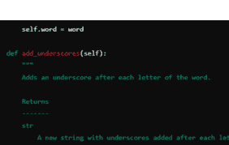

Docstring 解释

- 1. 类 docstring (Class Docstring)
    - 提供类的用途的简要描述。
    - 列类的属性和方法。

- 2. `__init__` 方法 docstring
    - 描述初始化方法和参数。

- 3. `add_underscores` 方法 docstring
    - 描述该方法的功能。
    - 指定返回类型及其返回的内容。

此文档将帮助用户理解类及其方法的作用，以及预期的输入和输出。

# 图 6.14 – ChatGPT 用文档更新代码

结果，如果我们按照前面的代码和 UnderscoreAdder? 更新我们的类，我们将得到如下输出：

```
UnderscoreAdder?
  0.1s
Init signature: UnderscoreAdder(word)
Docstring:
  A class在单词的每个字母后添加下划线的类。

Attributes
------
word : str
    将添加下划线的单词。

Methods:
------
add_underscores():
    返回一个在单词每个字母后添加了下划线的新字符串。
Init docstring:
  用一个单词初始化 UnderscoreAdder。

Parameters
------
word : str
    将添加下划线的单词。
Type: type
Subclasses:
```

图 6.15 – UnderscoreAdder 文档

最后，还可以利用 ChatGPT 来解释脚本。例如，让 ChatGPT 用自然语言解释以下代码：

```python
from ascity_opendatasets import NpcTick
from datetime import datetime
from dateutil import parser

start_date = parser.parse('2018-05-01')
end_date = parser.parse('2018-05-07')

npc_df = nr_fc.to_pandas(dataframe, start_date, end_date, end_end_date)
```

让我们逐步通过：

# 1. 导入数据集

```python
from ascity_opendatasets import NpcTick
from datetime import datetime
from dateutil import parser
```

- from ascity_opendatasets import NpcTick 此行导入了纽约出租委员会（NPC）的黄色订单数据集。
- from datetime import datetime 导入了 `datetime` 模块中的类。该类用于管理日期和时间。
- from dateutil import parser 导入了 `dateutil` 包中的 `parser`，用于解析日期字符串。

# 2. 解析数据集

```python
start_date = parser.parse('2018-05-01')
end_date = parser.parse('2018-05-07')
```

- start_date = parser.parse('2018-05-01') 此行将 '2018-05-01' 解析为 `datetime` 对象，代表 2018 年 5 月 1 日。
- end_date = parser.parse('2018-05-07') 此行将 '2018-05-07' 解析为 `datetime` 对象，代表 2018 年 5 月 7 日。

# 4. 转换为 Pandas DataFrame

```python
npc_df = nr_fc.to_pandas(dataframe, start_date, end_date, end_end_date)
```

- nr_fc.to_pandas(dataframe) 此方法将 NPC 黄色记录转换为 Pandas DataFrame。DataFrame 是一个具有不同类型列的二维数据结构，适用于数据分析和处理。

# 5. 为技术用户显示数据集信息

```python
npc_df.info()
```

- npc_df.info() 此方法打印 DataFrame 的概要摘要，包括条目数、非空计数以及每列的数据类型。

代码解释性也可以是上述文档的一部分，或者用于希望更好地理解其他团队复杂代码的开发者，或者（有时也会发生在我身上）记住自己多以前写了什么。

得益于 ChatGPT 和本节提到的功能，开发者可以轻松用自然语言跟踪项目生命周期，以便他们更容易理解目前已完成的工作。


我们将在下一节中看看代码解释性是如何数据科学项目中 ML 模型可解释性的关键步骤。

## 理解 ML 模型可解释性

模型可解释性是指人类理解 ML 模型预测背后逻辑的难易程度。本质上，它是指理解模型如何做出决策以及哪些变量对其预测做出了贡献的能力。

让我们来看一个使用深度学习卷积神经网络（CNN）进行图像分类的模型解释性示例。我使用 Python 结合 Keras 构建了我的模型。为此，我将直接从 keras.datasets 下载 CIFAR-10 数据集：它包含 60,000 张 32x32 的彩色图像（即 3 通道图像），分为 10 类（飞机、汽车、鸟、猫、鹿、狗、蛙、马、船和卡车），每类有 6,000 张图像。在这里，我将在书籍的 GitHub 仓库中共享用于数据准备和预处理的代码，地址为 https://github.com/PacktPublishing/The-Ultimate-Guide-to-ChatGPT-and-OpenAI/tree/main/Chapter%20%20-%20ChatGPT%20for%20Developers/code:

```python
model=tf.keras.Sequential()
model.add(tf.keras.layers.Conv2D(32,kernel_size=
```

```python
(32,32,1))
model.add(tf.keras.layers.MaxPooling2D(pool_size:
```

前面的代码由几个执行不同操作的层组成。我可能对模型结构的解释以及每一层的作用感兴趣。让我们让 ChatGPT 来提供一些帮助（下面你可以看到回复的提取）：

## 为模型添加层

### 1. 卷积层

```python
model.add(tf.keras.conv2D(32, kernel_size=(3, 3), activation='relu', input_shape=(3)))
```

- * tf.keras.conv2D*: 这在模型中添加了一个 2D 卷积层。
- '32': 卷积中的过滤器数量（输出通道数）。
- 'kernel_size=(3, 3)': 卷积窗口的形状。
- 'activation': 使用的激活函数，在本例情况下为 ReLU（修正的线性单元），它有助于引入非线性。
- 'input_shape=(32, 32, 1)': 输入数据的形状，其中 '32x32' 是输入图像的大小，'1' 表示图像是灰度图（单通道）。

### 2. 最大池化层

```python
model.add(tf.keras.layers.MaxPooling2D(pool_size=(2, 2)))
```

- * tf.keras.layers.MaxPooling2D*: 这在模型中添加了一个最大池化层。
- 'pool_size=(2, 2)': 池化窗口的维度。最大池化通过取 '2x2' 窗口上的最大值对输入表示进行下采样，从而减少输入的空间维度。

### 3. 展平层

```python
model.add(tf.keras.layers.Flatten())
```

- * tf.keras.layers.Flatten*: 它展平了输入。它将 2D 矩阵数据转换为 1D 向量，可以输入全连接（密集）层。在将数据传递到密集层之前这是必要的。

图 6.17 – 使用 ChatGPT 的模型可解释性

如你在前面的图中所示，ChatGPT 能够为我们的 CNN 结构和层提供清晰的解释。它还添加了一些注释和提示，例如使用最大池化层有助于减少输入的维度。

ChatGPT 也可以帮助我在验证阶段解释模型结果。因此，在将数据划分为训练集和测试集并在训练集上训练模型后，我想看看它在测试集上的性能：

```python
model.fit(np.resize(x_train, (50000,32,32,1))/255.0,
tf.keras.utils.to_categorical(y_train),
batch_size=32,
shuffle=True,
epochs=5,
validation_data=(np.resize(x_test, (10000,32,32,1))/255.0,
tf.keras.utils.to_categorical(y_test))
```

``````
Epoch 1/3
1563/1563 [********************] 208s 133ms/step loss: 2.3021 accuracy: 0.1038 val_loss: 2.3029 val_accuracy: 0.1039
Epoch 2/3
1563/1563 [********************] 209s 133ms/step loss: 2.2964 accuracy: 0.1104 val_loss: 2.3070 val_accuracy: 0.1001
Epoch 3/3
1563/1563 [********************] 209s 58ms/step loss: 2.2743 accuracy: 0.1312 val_loss: 2.3173 val_accuracy: 0.1006
```

## 图 6.18 – 评估指标

让我们也问问 ChatGPT 详细说明这些指标：

当然可以！你能详细解释以下输出吗？

```Epoch 1/3
1563/1563 [********************] 208s 133ms/step loss: 2.3021 accuracy: 0.1038 val_loss: 2.3029 val_accuracy: 0.1039
Epoch 2/3
1563/1563 [********************] 209s 133ms/step loss: 2.2964 accuracy: 0.1104 val_loss: 2.3070 val_accuracy: 0.1001
Epoch 3/3
1563/1563 [********************] 209s 58ms/step loss: 2.2743 accuracy: 0.1312 val_loss: 2.3173 val_accuracy: 0.1006
```

## 通用格式

- **Epoch Information（轮信息）**: 显示当前轮数和总轮数。
- **Batch Progress（批进度）**: 指示批的完成情况。
- **Metrics（指标）**: 包含训练损失、训练准确率、验证损失和验证准确率。

## 轮信息

```Epoch 1/3
```

- *1/3*: 这表示训练处于第 1 轮，总共 3 轮。

## 批进度与时间

```1563/1563 [********************] - 208s
```

- *1563/1563*: 这里所有 1563 个批已处理完毕。


正如你在前面的图中所示，ChatGPT 能够为我们的 CNN 结构和层提供清晰的解释。它还添加了一些注释和提示，例如使用最大池化层有助于减少输入的维度。

在验证阶段解释模型结果时，ChatGPT 也可以提供提供支持。因此，在将数据划分为训练集和测试集并在训练集上训练模型后，我想看看它在测试集上的性能：

有很多原因说明模型解释性很重要。其中一个关键因素是它缩小了业务用户与代码之间的差距。这对于让业务用户理解模型行为，并将其转化为代码想法至关重要。此外，模型解释性实现了负责任和伦理 AI 的核心原则之一，即 AI 系统思考和行为的透明度。通过模型解释性可以检测模型在生产环境中可能出现的偏见或有害行为，并防止其发生。

总而言之，ChatGPT 在模型解释性背景下可以提供有价值的支持，正如我们在上一个示例所示。

我们将探索的下一个也是最后一个 ChatGPT 功能将是开发者生产力的另一个助力，特别是在一个项目中使用多种编程语言时。

## 不同编程语言之间的翻译

在第 5 章中，我们看到了 ChatGPT 在不同语言之间翻译的强大能力。令人惊讶的是，自然语言并不是它唯一的翻译对象。事实上，ChatGPT 能够在不同编程语言之间进行翻译，同时保持相同的输出和风格（即它会保留存在的文档字符串）。

在很多情况下，这可能会改变游戏规则。例如，你可能需要学习一种从未见过的新编程语言或统计工具，因为你需要快速交付一个项目。在 ChatGPT 的帮助下，你可以使用熟悉的语言进行编程，然后让它翻译成目标语言，你将在翻译过程中不断学习。

想象一下项目需要用 MATLAB（一种由 MathWorks 开发的专用数值计算和编程软件）交付，而你一直使用 Python。该项目涉及对修改后的美国技术学院（MNIST）数据集图像进行分类（原始数据集描述和相关论文可以在此处找到：http://yann.lecun.com/exdb/mnist/）。该数据集包含了大量的

手写数字并经常被用于教授各种图像处理系统。

首先，我编写了以下 Python 代码来初始化一个用于分类的深度学习模型：

```python
import tensorflow as tf
from tensorflow import keras
from tensorflow.keras import layers
# 加载 MNIST数据集
(x_train, y_train), (x_test, y_test) = keras.datasets.mnist.load_data()
# 处理数据
x_train = x_train.reshape(-1, 28*28) / 255.0
# 定义模型架构
model = keras.Sequential([
    layers.Dense(256, activation='relu', input_shape=(28*28,)),
    layers.Dense(10, activation='softmax')
])
# 编译模型
model.compile(optimizer='adam', loss='categorical_crossentropy')
# 训练模型
history = model.fit(x_train, y_train, validation_data=(x_test, y_test))
# 评估模型
test_loss, test_acc = model.evaluate(x_test, y_test)
```

现在让我们看看如果将上述代码作为上下文提供给 ChatGPT 并让它翻译成 MATLAB，会发生什么：

以下是用于在 MNIST 数据集上训练神经网络的 TensorFlow 代码的 MATLAB 版本。

# MATLAB 代码

```matlab
% 加载 MNIST数据集
[xtrain, ytrain, xtest, ytest] = digitTrain4DArrayData;

% 重塑数据并规范化
xtrain = reshape(xtrain, [], 28*28) / 255.0;
xtest = reshape(xtest, [], 28*28) / 255.0;

% 将层转换为分类格式
ytrain = categorical(ytrain);
ytest = categorical(ytest);

% 定义模型架构
layers = [
    fullyConnectedLayer(256, 'Activation', 'relu', 'InputSize', 28*28)
    fullyConnectedLayer(128, 'Activation', 'relu')
    fullyConnectedLayer(10, 'Activation', 'softmax')
];

% 创建神经网络
model = dinnetwork(layerGraph(layers));

% 指定训练选项
options = trainingOptions('adam', ...
    'MaxEpochs', 10, ...
    'MiniBatchSize', 128, ...
    'ValidationData', {xtest, ytest}, ...
    'Verbose', true, ...
    'Plots', 'training-progress');

% 训练模型
trainedNet = trainNetwork(xtrain, ytrain, model.layers, options);

% 评估模型
Vpred = classify(trainedNet, xtest);
tAcc = mean(Vpred == ytest);
disp(['Test accuracy:', num2str(tAcc)]);
```

图 20 – ChatGPT 将 Python 代码翻译为 MATLAB

让我们也看看它是否能够将其翻译成其他语言，例如 JavaScript（注意，我不需要重复代码，因为它已经在对话上下文中）：

当然！这里是使用 TensorFlow.js 翻译成 JavaScript 的对应代码。

# JavaScript 代码

```javascript
//  TensorFlow.js
import * as tf from '@tensorflow/tfjs';
import { MNISTData } from './data.js'; // 假设你有一个单独的 data.js 文件

async function run() {
  // 加载 MNIST 数据集
  const data = new MNISTData();
  await data.load();

  const [Xtrain, ytrain] = data.getTrainData();
  const [Xtest, ytest] = data.getTestData();

  // 规范化数据
  const xTrainNorm = Xtrain.div(255.0);
  const xTestNorm = Xtest.div(255.0);

  // 定义模型架构
  const model = tf.sequential();
  model.add(tf.layers.dense({units: 256, activation: 'relu', inputShape: [28, 28]}));
  model.add(tf.layers.dense({units: 128, activation: 'relu'}));
  model.add(tf.layers.dense({units: 10, activation: 'softmax'}));

  // 编译模型
  model.compile({
    optimizer: 'adam',
    loss: 'categoricalCrossentropy',
    metrics: ['accuracy']
  });

  // 训练模型
  await model.fit(xTrainNorm, ytrain, {
    epochs: 10,
    batchSize: 32,
    validationSplit: 0.2,
    callbacks: tf.callbacks.earlyStopping({monitor: 'val_loss'})
  });

  // 评估模型
  const evalResult = model.evaluate(xTestNorm, ytest);
  const testAcc = evalResult[1].data()[0];
  console.log('Test accuracy:', testAcc);
}

run();
```

# 图 6.21 = ChatGPT 将 Python 代码翻译为 JavaScript

代码翻译还可以缩小新技术与当前编程能力之间的技能差距。

代码翻译的另一个关键意义是**应用现代化**。事实上，想象一下你想要刷新你的应用栈，即迁移到云端。你可能决定从简单的“平移并迁移”（lift and shift）开始，转向**基础设施即服务 (IaaS)** 实例（例如 Windows 或 Linux **虚拟机（VMs）**）。但在第二阶段，你可能希望对应用程序进行重构、重新架构设计或重新构建。

下面的图展示了应用现代化的几种方式：

img/18d2375ac45b_

图 6.22 – 应用现代化的四种方式

事实上，将 COBOL 翻译成更现代的语言。

让我们考虑一个 COBOL 脚本，它读取一个数字，加上 10，然后打印结果。

```cobol
IDENTIFICATION DIVISION.
PROGRAM-ID. AddTen.
DATA DIVISION.
WORKING-STORAGE SECTION.
01 INPUT-NUMBER      PIC 9(5).
01 RESULT-NUMBER     PIC 9(5).
PROCEDURE DIVISION.
DISPLAY 'Enter a number: '.
ACCEPT INPUT-NUMBER.
COMPUTE RESULT-NUMBER = INPUT-NUMBER + 10
DISPLAY 'Result after adding 10: ' RESULT-NUMBER.
STOP RUN.
```

我将之前的 COBOL 脚本传递给 ChatGPT，以便其作为上下文。现在让 ChatGPT 将翻译成 C#：

当然！这是翻译成 C# 的对应代码：

# C# 代码

```csharp
using System;

namespace AddTen
{
    class Program
    {
        static void Main(string[] args)
        {
            // 变量声明
            int inputNumber;
            int result;

            // 提示用户输入数字
            Console.Write("Enter a number: ");

            // 读取用户输入并尝试解析为整数
            if (int.TryParse(Console.ReadLine(), out inputNumber))
            {
                // 将输入加 10
                result = inputNumber + 10;

                // 显示结果
                Console.WriteLine("Result after adding 10: " + result);
            }
            else
            {
                // 处理无效输入
                Console.WriteLine("Invalid input. Please enter a valid number.");
            }
        }
    }
}
```

图 6.23 – ChatGPT 将 COBOL 翻译为 C# 的示例

ChatGPT 这样的工具通过引入了解过去和未来的层，有助于缩小此类及类似场景中的技能差距。

总之，ChatGPT 是应用现代化的有效工具，除了提供代码升级，还能提供宝贵的见和建议。凭借强大的语言处理能力和丰富的知识库，ChatGPT 可以帮助组织简化现代化工作，使过程更快、更高效且有效。

## 总结

ChatGPT 对于希望提高技能和优化工作流的开发者来说是一个非常有价值的资源。我们首先看到了 ChatGPT 如何生成、优化和调试代码，但我们还涵盖了如辅助代码生成文档、解释我们的机器学习模型以及在不同编程语言之间翻译等更高级的功能。

无论你是资深开发者还是初学者，ChatGPT 都提供了一个强大的学习和成长工具，缩小了代码与自然语言之间的差距。


在下一章中，我们将深入探讨另一个 ChatGPT 可能会成为游戏规则改变者的应用领域：营销。

# 6 使用 ChatGPT 精通营销

# 加入我们 Discord 上的书籍社区

https://packt.link/EarlyAccess

在本章中，我们将重点关注营销人员如何利用 ChatGPT，查看 ChatGPT 在该领域的主要用例，以及营销人员如何将其将其作为一名极具价值的助手。

我们将学习 ChatGPT 如何协助以下活动：

- 营销人员对 ChatGPT 的需求
- 新产品开发与进入市场策略（GTM 策略）
- 用于营销对比的 A/B 测试
- 通过搜索引擎优化 (SEO) 制作更高效的网站和帖子
- 文本数据的情绪分析

在本章结束时，你将能够利用 ChatGPT 进行营销相关的活动，并提高你的工作效率。

# 技术要求

你需要一个 OpenAI 账户来访问 ChatGPT。

# 营销人员对 ChatGPT 的需求

营销可能是能够以最纯粹的形式发挥 ChatGPT 和 OpenAI 模型创造力的领域。它们可以成为实用的工具，支持新产品、营销活动、搜索引擎优化等方面的创意开发。总而言，营销人员可以自动化和简化工作的许多方面，同时提高其营销努力的质量和有效性。

这是一个示例。ChatGPT 在营销中最突出且最有前景的用例之一是个性化营销。ChatGPT 可以分析客户数据并生成与个人客户产生共鸣的个性化营销信息。例如，营销团队可以使用 ChatGPT 分析客户数据，并开发针对特定客户偏好和行为定制的定向电子邮件营销活动。这可以增加转化的概率并带来更高的客户满意度。通过提供对客户情绪和行为的洞察、生成个性化营销信息、提供个性化客户支持以及生成内容，ChatGPT 可以帮助营销人员提供卓越的客户体验并推动业务增长。

这是 ChatGPT 在营销中许多应用示例之一。在接下来的章节中，我们将查看 ChatGPT 支持的端到端营销项目的实例。

# 新产品开发与进入市场策略

你将 ChatGPT 引入营销活动的第一种方法可能是作为新产品开发和进入市场（GTM）策略的助手。

在本节中，我们将查看一个关于如何开发和推广新产品的分步指南。你已经拥有一个名为 RunFast 的跑步服装品牌，到目前为止只生产鞋子，因此你想通过新的产品线扩大业务。我们将从头脑风暴创意来创建 GTM 策略开始。当然，一切都由 ChatGPT 提供支持：

- 头脑风暴创意：ChatGPT 可以支持你的第一件事是为你新产品线进行头脑风暴并起草方案。它还会提供每个建议背后的逻辑。所以，让我们问问我应该关注什么样的新产品线：

> 我拥有一个生产跑步鞋的跑步服装品牌。为我的品牌生成 3 个可以作为产品线添加的新产品创意。

内存已更新

以下是你可以添加到跑步服装品牌中的三个新产品创意：

- 1. 智能跑步服装：
    - **描述**：配备传感器的高科技跑步服，用于监测心率、步数和消耗的热路里。该服装可能包括衬衫、短裤和袜子，其集成了技术，可以与移动应用程序同步，以提供实时反馈和性能跟踪。
    - **关键特性**：透气吸湿面料、与健身应用无缝集成、可清洗的电子设备，以及针对补水和速度的可定制提醒。

- 2. 环保跑步装备：
    - **描述**：一系列由回收材料制成的环保可持续跑步装备。这可能包括为不同天气条件设计的夹克、紧身裤和帽子，促进环保意识的跑步。
    - **关键特性**：回收聚酯面料、可降解包装、耐用且高性能的材料，以及回收旧跑步装备的计划。

- 3. 个性化跑步鞋：
    - **描述**：根据个人的脚型、跑步风格和偏好定制的跑步鞋。使用先进的 3D 打印技术和用户友好的在线工具，跑步者可以创建完美合脚并反映其风格的鞋子。
    - **关键特性**：用于完美贴合的 3D 打印内垫、多种设计选择（颜色、图案、标志）、根据跑步需求选择的材料（越野、路面、马拉松），以及与专家的虚拟试穿课程。

# 图 7.1 – ChatGPT 生成的新创意的示例

在三个建议中，我们将选择第二个，因为我们可以通过它产生产生积极的环保影响，并提升我们的品牌声誉。更具体地说，我将从环保跑步袜开始。

- 产品名称：现在我们已经确定了主意，我们需要为它想一个响亮的名字。再次，我将向 ChatGPT 请求更多选项，以便我从中选出最喜欢的：

> 我喜欢第二个选项，我将从环保跑步袜开始。为一个响亮的产品线名称生成 5 个选项。

以下是你的环保跑步袜准备的五个响亮产品线名称选项：

- 1. GreenStride Socks
2. EcoPace Performance
3. Sustainable Sprint
4. EarthRunner
5. NatureStep Active

# 图 7.2 – 潜在产品名称列表

GreenStride 听起来很不错——我就用这个了。

- 生成响亮的口号：除了产品名称，我还想分享名称背后的意图和产品线的使命，这样我的目标受众就能被吸引。

> 为“GreenStride”名称生成 3 个口号。它们应该是激励且简洁的。

以下是为“GreenStride”名称生成的三个激励且简洁的口号：

- 1. "Run Green, Run Strong."（绿色跑步，强有力。）
- 2. "Step Forward, Leave No Trace."（向前迈，不留痕迹。）
- 3. "Stride with Purpose."（使命而行。）

# 图 7.3 – 我的新产品口号列表

太棒了——现在我对产品名称和口号满意了，稍后将用它们来创建一个独特的社交媒体公告。在在此之前，我想花更多时间对目标群体进行市场研究。

为了推广 GreenStride 袜子产品线，你应该针对以下细分：

- **描述**：重视可持续性和环保产品的个人。他们愿意投资环保替代品，并且通常对环境问题有了解。
- **人口统计特征**：25-45 岁，城市居民，中等及以上收入，在社交媒体上活跃，特别是关注可持续性和健身的平台。
- **营销渠道**：社交媒体活动、环保博客、与环保影响者合作以及可持续性论坛。

### 2. 健身爱好者

- **描述**：热爱跑步和保持活跃生活方式的人。他们重视高性能装备，对跑步服装的最新趋势和创新感兴趣。
- **人口统计特征**：20-40 岁，男女均，中等及以上收入，经常参加马拉松、比赛和跑步俱乐部。
- **营销渠道**：跑步和健身杂志、跑步活动赞助、在线健身社区以及健身 App 上的定向广告。

### 3. 健康意识型消费者

- **描述**：关注整体健康的个人，包括体能活动、健康饮食和可持续生活。他们正在寻找支持其健康生活方式和伦理价值观的产品。
- **人口统计特征**：30-50 岁，男女均，中等及以上收入，可能可能参加瑜伽、普拉提和其他健康活动。
- **营销渠道**：健康与健康博客、与健康影响者合作、电子邮件时事通讯以及关注健康的专卖店。

# 图 7.4 – 我新产品线要触达的目标群体列表


在受众中考虑到不同的群体是非常重要的，这样你就可以区分你想要传达的信息。在我的情况下，我希望确保我的产品线能够涵盖不同人群，例如竞技型跑步者、休闲跑步者和健身爱好者。

- **产品变体和销售渠道：根据上述的潜在客户群体，我可以生成更针对特定受众的定制产品变体：**

环保型跑步者
1. 回收纤维性能袜
- 描述：由 100% 回收材料（包括塑料瓶和废弃织物）制成的袜子。这些袜子为长距离跑步提供了极佳的排湿性和透气性。
- 核心特性：高透气性、吸湿性、防臭性，脚跟和脚趾处加固以提高耐用性，无缝设计确保舒适度。
2. 有机棉跑步袜
- 描述：由有机棉制成的柔软舒适的跑步袜，生长过程中不使用合成化合物或肥料。
- 核心特性：低致敏性、质地极柔软、自然吸水性且环保。
3. 竹纤维环保袜
- 描述：由可持续竹纤维制成的袜子，具有天然的抗菌和吸湿特性。
- 核心特性：卓越的柔软度、天然抗性、优的透气性并减少对环境的影响。

关注健康的消费者
1. 压缩袜
- 描述：梯度压缩袜，旨在改善跑步期间和之后的血液循环并减少肌肉疲劳。
- 核心特性：增强循环、减轻肌肉疲劳、缩短恢复时间，以及贴合的剪裁以提供额外支撑。
2. 缓冲袜
- 描述：提供额外支撑和减震的缓冲跑步袜，是关注关节和肌肉健康的人士理想选择。
- 核心特性：厚缓冲垫、足弓支撑、减轻对关节的影响，以及适合长距离跑步的松软舒适感。
3. 防水泡跑步袜
- 描述：旨在防止水泡的高性能袜子，采用双层设计以获得最大的自由度和舒适度。
- 核心特性：双层织物、平滑接缝、吸湿和防摩擦特性。

通过提供这些产品变体，你可以满足环保和关注健康消费者的特定需求和偏好，确保他们的“GreenStride”产品符合他们对可持续性和性能的预期。

# 图 7.5 – 产品线变体示例

同样，我也可以要求 ChatGPT 为上述每个群体建议不同的销售渠道：

## 触达关注健康消费者的最佳渠道

1. 1. 健康与健康博客及杂志：
- 平台：热门健康博客、在线健康平台和健身杂志。
- 策略：投稿文章、参与产品评测，并提供侧重于使用 GreenStride 袜子健康益处的赞助内容。

2. 2. 健身领域与网红：
- 平台：Instagram、YouTube 和 TikTok。
- 策略：与网红合作，展示 GreenStride 袜子的健康益处包括改善循环和肌肉支撑。

3. 3. 在线健身社区和论坛：
- 平台：Reddit、相关论坛以及关注健康的在线社区。
- 策略：参与讨论，分享成功故事和用户证言，并对使用 GreenStride 袜子跑步和整体健康的益处提供专家建议。

4. 4. 专注于关注的零售商店：
- 商店：专业健康商店、健身装备店和健康中心。
- 策略：与这些商店合作销售 GreenStride 袜子，开展促销活动，并提供有关袜子健康益处的教育材料。

通过利用这些针对性渠道，你可以有效地触达并吸引环保型和关注型消费者，推动你的 GreenStride 袜子产品的品牌知名度和销量。

## 触达环保型跑步者的最佳渠道

1. 1. 社交媒体营销活动：
- 平台：Instagram、Facebook 和 Pinterest。
- 策略：使用具有视觉吸引力的内容来强调袜子的环保特性，与环保网红合作，并参与环保意识活动。

2. 2. 环保博客和网站
- 平台：热门的环保博客、关注可持续性的网站。
- 策略：撰写客座文章、参与社区内容互动，并提供关于 GreenStride 袜子生产过程中可持续实践的介绍性文章。

3. 3. 与环保组织合作：
- 组织：环保非政府组织（NGO）、关注可持续性的跑步俱乐部和环保活动。
- 策略：赞助活动，为环保马拉松提供产品样品，并与这些组织制定联合营销策略。

4. 4. 讯通讯：
- 平台：如 Mailchimp 或 Constant Contact 等邮件营销服务。
- 策略：创建信息丰富的简报，强调 GreenStride 袜子的环保益处，分享关于可持续实践的故事并提供特别优惠。

# 图 7.6 – ChatGPT 对不同销售渠道的建议

在竞争中脱而出：我希望我的产品能在竞争激烈的市场中脱颖——我想让它独一无二。带着这个目标，我要求 ChatGPT 包含可持续性和包容性等社会因素。让 ChatGPT 在这方面提供建议：

给我三个简洁的建议，关于如何让我的 GreenStride 袜子系列在竞争市场中脱颖而出且独特。

以下是让你的 GreenStride 袜子系列在竞争市场中脱颖而出且独特的三个简洁建议：

1. 1. 创新环保材料：
 使用 使用领先的可持续材料，如回收海洋塑料、有机大麻或可降解纤维。在营销中强调这些独特材料，以突出可持续性。

2. 2. 增强性能的功能：
- 集成针对性压缩区、吸湿技术和防水泡设计等功能。确保这些功能经过科学验证，并向消费者清晰传达。

3. 3. 透明的生产流程：
- 从溯源到制造，对你的生产过程提供完全透明化。提供有关劳动条件的详细信息。

# 图 7.7 – ChatGPT 生成的卓越特性示例

如你所见，它能够生成让我的产品独特的有趣特性。

- 产品描述：现在是时候开始制定进入市场计划（Go-To-Market plan）了。首先，我想为我的网站生成一个产品描述，包含之前所有的差异化。

使用上述列出的独特差异点为 GreenStride 袜子系列生成一段产品描述（最多 150 字）。它应该是引人注目且有效的，并经过 SEO 优化。完成后请列出你使用的 SEO 关键词。

# GreenStride 袜子产品描述

穿着 GreenStride 袜子迈向跑步的未来，由回收海洋塑料和有机大麻等创新环保材料制成。我们的袜子为卓越性能设计，具有针对性压缩区、吸湿技术和防水泡设计，让你在跑步时保持舒适和专注。选择 GreenStride，你不仅是在选择顶级的跑步装备——你是在支持一个可持续的未来。我们致力于透明化，对我们的环保生产过程和公平劳工实践提供全面洞察。用 GreenStride 提升你的步态，在这里可持续性与性能完美契合。

# SEO 关键词

* 环保跑步袜
* 可持续性能袜
* 回收材料袜子
* 有机大麻袜
* 防水泡跑步袜
* 吸湿技术
* 针对性压缩区
* 透明生产流程
* 可持续运动服装

**公平定价：**另一个关键要素是为我们的产品确定公平的价格。由于我针对不同受众（竞技跑步者、休闲跑步者和健身爱好者）区分了产品变体，我也希望有一个考虑到这些分类的价格范围。请注意，在以下示例中，ChatGPT 正在调用网络。


使用搜索插件检索有关当前跑步袜市场定价的更新信息。

考虑到上述两个受众群体以及对跑步袜市场的现状分析，我的袜子系列定在什么价格才合理？

已搜索 6 个网站

根据目前的市场分析，通过考虑类似高品质且环保运动袜的定价趋势，可以为你的“GreenStride”袜子系列确定一个公道的价格。

## 市场洞察：

### 1. 价格分段：
- 低端跑步袜：价格通常在每双 $5-$10 之间。这些袜子通常由基础材料制成，没有先进功能。
- 中端跑步袜：价格在每双 $10-$20 之间。这一细分市场平衡了质量和可负担性，具有更好的材料和一些先进功能。
- 高端跑步袜：价格通常在每双 $20 以上。这些袜子包含优质材料、先进技术和可持续性认证。

### 2. 环保与性能袜：
- 可持续和性能驱动型袜子的市场正在增长，消费者愿意为高质量、环保的产品付费用。Nike 和 Adidas 等品牌在该范围内提供高性能运动袜，价格通常在每双 $15-$25 之间（Mordor Intelligence）（Grand View Research）（Market Data Forecast）。

## “GreenStride”跑步袜建议：

考虑到你的目标受众是具有环保意识的跑步者和关注健康的消费者，将你的袜子定位在中等到高价位是合适的。这个价格反映了你的袜子所提供的可持续材料和先进的性能功能。

建议定价：

- 标准环保性能跑步袜：每双 $15-$18。
- 高级功能（例如：额外的缓震、先进的吸湿技术）：每双 $20-$25。

这种定价策略符合市场对高品质、可持续运动装的预期，在确保竞争力的同时，突显了“GreenStride”系列的独特价值主张（MAXIMIZE MARKET RESEARCH）（Global Market Insights Inc.）。

图 7.9 – 产品变体的价格范围

我们几乎就完成了。我们已经经历了许多新产品开发和进入市场的各个步骤，在每一步中，ChatGPT 都充当了极好的支持工具。

最后一点，我们可以要求 ChatGPT 生成一个关于我们新产品的 Instagram 帖子，包括相关的标签和 SEO 关键词。然后我们可以使用 DALL-E 生成图像，它是作为 ChatGPT Plus 的嵌入插件提供的。

> 我想生成一个 Instagram 帖子来宣布 GreenStride 袜的发布。写一条帖子（最多 150 字），包含上述独特功能和差异以及相关的标签。

## GreenStride 跑步袜发布 Instagram 帖子

介绍 GreenStride 袜！

与 GreenStride 开启跑步的新纪元，让可持续性与顶级性能完美融合。我们的袜子由回收海洋塑料和有机大麻等创新环保材料制成，提供针对性的压缩、先进的吸湿技术和防磨起设计。每一双袜子的制造都考虑了环境，确保你可以绿色跑步、强健奔跑。👍

加入通往可持续未来的运动，穿上这些不仅性能优异，而且能改变现状的袜子。

关键特性：

- 回收海洋塑料与有机大麻
- 针对性压缩区
- 卓越的吸湿性
- 防磨起设计

准备好提升你的步幅，让每一步都有意义！👟🌿

#GreenStride #环保 #可持续跑步 #绿色跑步 #环保意识者 #运动装 #强健跑步 #性能袜 #吸湿 #防磨起 #健康生活 #可持续时尚

# 图 7.10 – ChatGPT 生成的社交媒体帖子

而且，在 DALL-E 的特别贡献下：

生成一张 3D 风格的真实的跑步袜插画，彩色粉末爆炸风格，背景参考野外自然


这是在野外自然背景下具有彩色粉末爆炸效果的 3D 风格真实的跑步袜插画：

这张充满活力且动感的图像完美捕捉了 GreenStride 袜的精髓，强调了它们环保和高性能的品质。

📢 🔄 ↺ ✨ ♡

# 图 1：由 DALL-E 3 驱动的 ChatGPT 生成的插画示例。

这是最终结果：

介绍 GreenStride 袜！🌿
与 GreenStride 开启跑步的新纪元，让可持续性遇见顶级性能。袜子由回收海洋塑料和有机大麻等创新环保材料制成，提供针对性的压缩、先进的吸湿技术和防磨起设计。每一双袜子的制造都考虑了环境，确保你可以绿色且强健地跑步。🌿🏃‍♂️加入通往可持续未来的运动，穿上这些不仅性能优异，而且能改变现状的袜子。🌊💧

- 关键特性：
- 回收海洋塑料与有机大麻
- 针对性压缩区
- 卓越的吸湿性
- 防磨起设计

准备好提升你的步幅，让每一步都有意义！🌿
#GreenStride #环保 #可持续跑步 #绿色跑步 #环保意识者 #运动装 #强健跑步 #性能袜 #吸湿 #防磨起


图 7.11 完全由 ChatGPT 生成 Instagram 帖子

当然，对于产品开发和进入市场来说，这里缺少许多元素。然而，在 DALL-E 的特别贡献下，我们成功脑暴了一个新产品线、潜在客户、吸引人的口号，并最终生成了一个漂亮的 Instagram 帖子来宣布发布！

## 营销 A/B 测试

另一个 ChatGPT 可以帮助营销人员的有趣领域是 A/B 测试。

营销 A/B 测试是比较两个版本的营销活动、广告或网站以确定哪一个表现更好的方法。在 A/B 测试中，创建两个只更改一个变量。目标是看哪一个版本产生更多效果。

A/B 测试的一个例子可能是测试两个版本的邮件营销活动，或者测试两个版本的网站着陆页。通过衡量每个版本的响应率，营销人员可以确定未来使用哪一个。

A/B 测试允许营销人员优化其活动和元素以实现最大效果，从而获得更好的结果。由于这种方法涉及生成许多变体，ChatGPT 的生成能力绝对可以帮助。

让我们考虑以下例子。我正在推广我开发的新产品：一种针对快速攀爬者的新型轻薄登山袜。我已经做了一些市场调研并了解了目标受众。我也知道该受众的一个绝佳交流渠道是在在线攀爬博客上发布，大多数健身房会员都是其读者。

我的目标是创建一个出色的博客帖子来分享这款新款的发布，我想对它的两个版本进行测试。我即将发布并想作为我的 A/B 测试对象的博客帖子如下：

# 针对快速攀爬者的轻便登山袜
介绍登山装备界的最新成员

注意攀爬者们！用这款为快速攀爬者设计的新款袜升级你的装备。它比其他任何都要轻，让你移动更快、更高效。

这款袜子在不牺牲安全的情况下提高了速度和性能。它由轻、透气且耐用的材料制成，非常适合初学者和资深攀爬者。现在就最近的装备店，提升你的攀爬体验吧！

图 7.12 – 发布登山装备的博客帖子示例

在这里，ChatGPT 可以在两个层面帮助我们：

- 第一层是重写文章，使用不同的关键词或不同的吸引人的口号。要这样做，一旦提供了此帖子作为上下文，我们可以要求 ChatGPT 对文章进行处理并稍微更改一些元素：


我正在为一款新款攀爬安全带进行 A/B 测试。我正使用一个攀爬博客作为销售渠道，并发布以下博文。请重新生成以下内容，更改以下元素：标题、副标题和结束句子。

## 为快速攀爬者设计的轻量化攀爬安全带
### 攀爬装备世界的最新力作

攀爬者们注意！使用专为快速攀爬者设计的最新安全带升级你的装备。它比任何其他产品都轻，让你的移动更快、更高效。

这款安全带在不牺牲安全性的情况下提升了速度和性能。它由轻质、透气且耐用的材料制成，非常适合新手和资深攀爬者。立即前往最近的装备商店，提升你的攀爬体验吧！

# 使用我们的新款安全带提升你的攀爬水平
### 速度与效率的终极装备

嘿，爬者们！升级到我们专为快速攀爬设计的最新安全带。通过我们迄为止最轻的安全带，体验无与伦比的敏捷与高效。

这款安全带的设计旨在确保最大安全的同时增强你的速度和性能，采用轻质、透气且耐用的材料制成。是新手和专家攀爬者的理想选择。今天就光光你喜欢的装备商店，将你的攀爬提升到新高度！

> 图 7.13 – ChatGPT 生成的新版博文

根据我的要求，ChatGPT 仅重新生成了我要求的元素（标题、副标题和结束句子），这样我可以通过监控两组受众的反应来监测这些元素的有效性。

- 第二阶段正在进行网页设计，即更改图片的搭配方式而不是按钮的位置。为此，我为在攀爬博客上发布的博文创建了一个简单的网页（你可以在书籍的 GitHub 仓库找到代码，地址为 https://github.com/PacktPublishing/The-Ultimate-Guide-to-ChatGPT-and-OpenAI/tree/main/Chapter%207%20-%20ChatGPT%20for%20Marketers/Code）：

## 为快速攀爬者设计的轻量化攀爬安全带
### 攀爬装备世界的最新力作

攀爬者们注意！使用专为快速攀爬者设计的最新安全带升级你的装备。它比任何其他产品都轻，让你的移动更快、更高效。


这款安全带在不牺牲安全性的情况下提升了速度和性能。它由轻质、透气且耐用的材料制成，非常适合新手和资深攀爬者。

立即前往最近的装备商店，提升你的攀爬体验吧！

图 7.14 – 在攀爬博客上发布的示例博文

我们可以直接向 ChatGPT 提供 HTML 代码，并让它更改某些布局元素，例如按钮的位置或措辞。

例如，相比于“立即购买”（Buy Now），读者可能会被“我想要！”（I want one！）按钮所吸引。

所以，给 ChatGPT 提供 HTML 源代码：

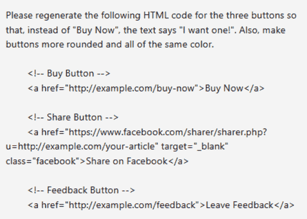

以下是更新了文本、具有圆角和一致颜色的按钮生成的 HTML 代码：

```
<!-- Buy Button -->
<a href="http://example.com/buy-now" style="display:inline-block; padding:10px 20px; color:white;">Buy Now</a>
<!-- Share Button -->
<a href="https://www.facebook.com/sharer/sharer.php?u=http://example.com/your-article" target="_blank" style="color:white;">Share</a>
<!-- Feedback Button -->
<a href="http://example.com/feedback" style="display:inline-block; padding:10px 20px; color:white;">Leave Feedback</a>
```

所有按钮现在都显示文本“我想要！”（针对购买按钮）、半径为 25px 的圆角以及相同的背景颜色 (#4CAF50)。

图 7.14 – ChatGPT 更改 HTML 代码

让我们看看输出是什么样的（我也用 ChatGPT 生成的内容更改了标题、副标题和段落）：

# 使用我们的新款安全带提升你的攀爬水平
### 速度与效率的终极装备

嘿，爬者们！升级到我们专为快速攀爬设计的最新安全带。通过我们迄为止最轻的安全带，体验无与伦比的敏捷与高效。


这款安全带的设计旨在确保最大安全的同时增强你的速度和性能，采用轻质、透气且耐用的材料制成。

是新手和专家攀爬者的理想选择。今天就光你喜欢的装备商店，将你的攀爬提升到新高度！

图 7.15 – 新版本的网站

如你所见，ChatGPT 仅在按钮层面进行了干预，稍微更改了它们的布局、位置、颜色和措辞。

结论，ChatGPT 是营销中 A/B 测试非常有价值的工具。它快速生成相同内容的不同版本的能力可以缩短新活动的上市时间。通过利用 ChatGPT 进行 A/B 测试，你可以优化营销策略，并最终为你的业务带来更好的结果。

# 助力搜索引擎优化 (SEO)

ChatGPT 另一个可能成为游戏规则改变者的前景领域是搜索引擎优化 (SEO)。这是搜索引擎优化的关键。这是搜索引擎优化的关键。这是搜索引擎优化的关键。这是搜索引擎优化的关键。这是搜索引擎优化的关键。这是搜索引擎优化的关键。这是搜索引擎优化的关键。这是搜索引擎优化的关键。这是搜索引擎优化的关键。这是搜索引擎优化的关键。这是搜索引擎优化的关键。这是搜索引擎优化的关键。这是搜索引擎优化的关键。这是搜索引擎优化的关键。这是搜索引擎优化的关键。这是搜索引擎优化的关键。这是搜索引擎优化的关键。这是搜索引擎优化的关键。这是搜索引擎优化的关键。这是搜索引擎优化的关键。搜索是关键。

SEO 的另一个关键元素是**搜索引擎意图**。搜索引擎意图，也称为**用户意图**，是指用户在搜索引擎中进行特定查询的底层目的或目标。理解搜索引擎意图很重要，因为它能帮助企业和营销人员创建更具针对性、更有效的内容和营销策略，以符合搜索者的需求和期望。

搜索意图通常有四种：

-   **信息意图**：用户正在寻找有关特定主题或问题的信息，例如“法国的首都是哪里？”或“如何在家制作披萨”。

-   **导航意图**：用户正在寻找特定的网站或网页，例如 **Facebook 登录** 或 **Amazon.com**。

-   **商业意图**：用户想要购买产品或服务，但可能还没有最终决定。商业意图搜索的示例包括*1000美元以下最佳笔记本电脑*或*在线折扣鞋子*。

-   **交易意图**：用户有一个完成交易的特定目标，这可能指的是实体购买或订阅服务。交易意图的示例可以是*购买 iPhone 13*或*注册健身房会员*。


通过理解特定搜索查询背后的意图，企业和营销人员可以创建更有针对性且有效的内容，以满足目标受众的需求和期望。这可以提高搜索引擎排名、增加流量并并带来更多的转化和收入。

现在，问题是，ChatGPT 是否能够确定给定请求的意图？在回答之前，值得注意的是，推断给定提示词（prompt）意图活动是**大语言模型（LLMs）**（包括 GPT）的核心业务。因此，ChatGPT 绝对能够捕捉提示词的意图。

这里的额外价值在于，我们想看看 ChatGPT 是否能够在一个具有精确分类法的精确领域内（即营销领域）确定意图。这就是为什么提示词设计（prompt design）在引导 ChatGPT 向正确方向发展时再次变得至关重要。

根据搜索意图（无论是商业、交易、导航还是信息型）对上述关键词列表分组。

以下是按搜索意图分类的关键词列表：

## 商业意图

- 1. 时尚手套
- 2. 皮质手套

## 交易意图
- 1. 帽子
- 2. 手套
- 3. 冬帽
- 4. 男式帽子
- 5. 女式手套
- 6. 冷地帽

## 导航意图

（提供的关键词中没有符合此类别的，因为它们更侧重于特定产品的搜索。）

## 信息意图

（提供的关键词中没有符合此类别的，因为它们更侧重于特定产品的搜索。）

这些关键词反映了用户想要购买特定类型的帽子和手套（交易型），或探索时尚和材料选择（商业型）的意图。这种分类有助于为了 SEO 目的更有效地理解和定位于目标受众。

## 图 7.18 – ChatGPT 按用户意图聚类的关键词示例

最后，我们还可以更进一步，再次利用我们在第 3 章中提到过的“作为……（Act as...）”技巧。如果能对我们的网站进行评估并理解它是否按照预期进行了优化，将非常有趣。在营销中，这种分析被称为 SEO 审计。SEO 审计是对网站 SEO 性能和潜在改进区域的评估。SEO 审计通常由 SEO 专家、Web 开发人员或营销人员进行，涉及对网站技术架构、内容和反链配置的全面分析。

在进行 SEO 审计期间，审计员通常使用一系列工具和技术来识别改进区域，如关键词分析、网站速度分析、网站架构分析和内容分析。审计员随后将生成报告，列出关键问题、改进机会以及解决这些问题的建议行动。

让我们让 ChatGPT 扮演 SEO 专家来执行此审计。作为参考网站，我们将使用上面提到的攀岩博客。我将把代码交给 ChatGPT 并要求其执行以下指令：“扮演 SEO 专家，并对上述 HTML 代码生成一份简短的 SEO 审计（最多 300 字）”。这是回复：

## 为“用于快速攀爬者的轻型攀岩安全带”网页进行的 SEO 审计

### 标题与描述

- 标题：‘用于快速攀爬者的轻型攀岩安全带’简洁且包含相关关键词；添加更多内容或独特的卖点可以提高清晰度。例如，“用于快速攀爬者的轻型攀岩安全带 - 性能与安全’。
- 元描述（Meta Description）：缺少元描述；添加带有关键词的元描述可以提高搜索引擎的可见性。例如：“发现我们专为快速攀爬者设计的轻型攀岩安全带。使用我们耐用透气的安全带，移动得更快、更安全。”

### 内容优化

- 标题：使用标题（H2, H3）很好；将关键词整合到标题中可以提高 SEO。
- 关键词：内容包含了如‘攀岩安全带’和‘快速攀爬者’等相关关键词。其他关键词如‘轻型安全带’、‘登山装备’和‘性能攀岩’应该自然整合。

### 图像优化

- Alt 文本：Alt 文本‘climbing harness’安全带）是合适的，但可以更具描述性。例如：“用于快速攀爬者的轻型攀岩安全带”。
- 文件名：文件名具有描述性并包含关键词，例如 `lightweight-climbing-harness.jpg`。

### 内部链接

- 链接：页面缺少内部链接；链接到相关产品或博客文章可以提高 SEO 和用户体验。例如，“了解更多关于我们的攀岩装备”。

### URL 结构

- URL：URL 是占位符。确保最终 URL 简洁洁且包含关键词，例如 `http://example.com/buy-climbing-harness`。

### 移动端优化

- 响应式设计：网站使用了响应式设计，这对 SEO 是有利的。确保所有元素都手机手机。

### 行动号召 (CTA)

- 按钮：CTA 清晰，但可以添加更多描述性文本以进行 SEO。例如，使用‘立即购买 - 轻型攀岩安全带’而不是‘立即购买’

### 加载时间

- 性能：网站的加载时间和优化可以提高速度，因为快速的加载可以提升用户体验和 SEO。

### SEO 关键词

- 1. 轻型攀岩安全带
- 2. 快速攀爬者装备
- 3. 登山装备
- 4. 性能攀岩安全带
- 5. 透气攀岩安全带
- 6. 耐用攀岩安全带
- 7. Best攀岩安全带
- 8. 登山安全装备

### 结论

增强标签、整合更多相关关键词、添加内部链接和增强移动端优化将显著提高该网站的 SEO 性能。

## 图 7.19 – ChatGPT 对攀岩博客的 HTML 代码生成 SEO 审计。

ChatGPT 能够生成相当准确的分析，带有相关的评论和建议。总体来说，ChatGPT 在 SEO 相关的活动方面具有有趣的潜力，对于任何想要从零开始改进网站或想改进现有网站的人来说，都是一个很好的工具。

## 通过情感分析提高质量并增加满意度

情感分析是营销中常用的一种技术，用于分析和解释客户对品牌、产品或服务的情绪和观点。它涉及自然语言处理（NLP）和机器学习（ML）算法的使用，以识别和分类社交媒体帖子、客户评论等文本数据。

通过执行情感分析，营销人员可以获得洞察，识别改进区域并做出数据驱动的决策以优化营销策略。例如，他们可以跟踪客户评论的情感，以识别哪些产品或服务收到了积极或负面的反馈。总体来说，情感分析是一个价值工具。

情感分析已经存在一段时间了，你可能会好奇 ChatGPT 能带来什么额外价值。除了分析的准确性（它是目前最强大的模型）之外，ChatGPT 与情感分析工具的区别在于它是通用智能（AGI）。这意味着当我们使用 ChatGPT 进行情感分析时，并不是使用其特定的 API 来完成任务：ChatGPT 和 OpenAI 模型的核心理念是它们可以协助用户完成许多通用任务，与任务交互并根据用户请求更改分析范围。

因此，ChatGPT 绝对能够捕捉给定文本（如推文或产品评论）的情感。然而， ChatGPT 还可以进一步识别对产品或品牌产生积极或负面影响的特定方面。例如，如果客户经常以负面方式提到产品的某个功能，ChatGPT 可以将该功能标记为改进区域。或者，ChatGPT 可能被要求对一条特别敏感的评论生成回复，考虑到评论的情感并将其作为回复的背景。再次，它可以生成报告，总结评论或评论中发现的所有负面和积极元素并将它们归类。

让我们考虑以下示例。一位客户最近从我的电子商务公司 RunFast 购买了一双鞋，并留下了以下评论：

> “我最近购买了 RunFast Prodigy 鞋子，我的心情很复杂。它们非常舒适，具有出色的缓冲和支撑作用，减少了我跑步时的足部疲劳。设计也很吸引人，我也收到了几次赞美。然而，耐用性令人失望；外底磨损很快，透气的鞋面在穿几次后就出现了磨损迹象。我


几周。考虑到高昂的价格

让我们让 ChatGPT 捕捉这条评论的情感：

> 我收到了以下评论：

“我最近购买了 RunFast Prodigy 运动鞋，感觉很复杂。它们非常舒适，具有卓越的缓震和支撑性，减少了我跑步时的足部疲劳。设计也很吸引人，我收到了好几次赞美。然而，耐用性令人失望；外底磨损很快，透气鞋面在几周后就出现了磨损迹象。考虑到价格高昂，尽管它们舒适且漂亮，但我犹豫推荐。”

分析这条评论的情感并将其分类为积极、消极或中性。

对 RunFast Prodigy 运动鞋的评论显示出中性情感。

## 积极方面：

- 舒适性：“非常舒适，具有卓越的缓震和支撑性。”
- 设计：“视觉上吸引人并收到了好几次赞美。”

## 负面方面：

- 耐用性：“外底磨损很快，透气鞋面在几周后就出现了磨损迹象。”
- 价格：“考虑到价格高昂，我犹豫推荐。”

## 分析：

虽然评论者欣赏鞋子的舒适度和设计，但他们对耐用性非常担心，而且鉴于这些问题，高昂的价格并不合理。评论平衡了积极和消极两点，导致整体情感呈中性。

图 7.20 – ChatGPT 分析客户评论

从上图图中，我们可以看到 ChatGPT 并没有局限于仅提供一个标签：它还解释了描述该评论的积极和消极元素，该评论具有复杂的感受，因此可以被标记为整体中性。

让我们尝试深入探讨，并就如何改进产品提出一些建议：

根据之前的评论，我应该如何改进 RunFast Prodigy 运动鞋？输出应为表格

这里是根据评论概述 RunFast Prodigy 运动鞋潜在改进方案的表格：

| 方面 | 当前反馈 | 建议的改进 |
| --- | --- | --- |
| 舒适性 | 非常舒适，具有卓越的缓震和支撑性 | Maintain目前的缓震和支撑功能。 |
| 设计 | 视觉上吸引人并收到了好几次赞美 | 继续提供吸引人的设计；考虑更多颜色和款式选择。 |
| 耐用性 - 外底 | 外底磨损很快 | 外底使用更耐用的材料以增加使用寿命。 |
| 耐用性 - 鞋面 | 透气鞋面在几周后就出现了磨损迹象 | 在保持透气的同时增强鞋面材料的耐用性。 |
| 价格 | 价格高且对耐用性担忧 | 通过提高耐用性使高价合理化，或考虑调整价格 |

备注：

1. **外层材料：** 研究并引入外底等先进耐磨材料（如橡胶）。
2. **鞋面材料：** 利用高质量合成纤维或加固网布，兼顾耐用性和透气性。
3. **定价策略：** 根据所做的改进重新评估定价策略。增强的耐用性能可以让溢价变得合理，或引入分级定价模型以满足不同细市场。
4. **客户反馈：** 定期收集并分析客户反馈，不断完善产品并解决任何反复出现的问题。

## 图 7.21 – 根据客户反馈改进产品的建议

最后，让我们对客户生成一个回复，表明我们作为公司关心客户的反馈，并希望改进我们的产品。

> 针对之前的客户评论生成一个回复，说明我们正在根据你之前分享的建议不断改进我们的产品。

以下是给客户评论的回复：

亲爱的客户：

感谢您对 RunFast Prodigy 运动鞋的详细评论。我们感谢您的反馈，并致力于不断改进我们的产品以满足您的期望。

听到您觉得这些鞋子非常舒适且视觉上吸引人，我们感到非常高兴。您对缓震、支撑和设计的正面评价对我们来说意义重大。

然而，听到您遭遇了耐用性问题，我们深表遗憾。我们重视您的关注，并向您保证我们正在积极进行改进。具体来说，我们正在：

- **改进外底：** 我们正在研究并为外底引入更耐用的材料，以确保其经受长时间强度使用。
- **增强鞋面材料：** 我们正在探索高质量的合成纤维和加固网布，在保持透气的同时显著提高耐用性。

我们的目标是提供通过卓越的质量和寿命证明其价格价值的产品。您的反馈帮助我们更这一这一目标。

再次感谢您的宝贵意见。如果您有任何进一步的建议或其他，请随时与我们联系。

顺颂商祺。

RunFast 团队


## 图 7.22 – ChatGPT 生成的回复

我们看到的示例非常简单，只有一条评论。现在想象一下我们有成千上万条评论，以及接收反馈的多种销售渠道。想象一下 ChatGPT 和 OpenAI 模型等工具的力量，它们能够分析并整合所有这些信息，识别您产品的优缺点，并捕捉客户趋势和购物习惯。此外，对于客户服务和留存，我们还可以使用我们偏好的写作风格自动回复评论。事实上，通过定制您的聊天机器人的语言和语气来满足客户的特定需求和期望，您可以创建更具参与感且更有效的客户体验。

以下是一些示例：

- 同理心聊天机器人：一种使用同理心的语气和语言与可能遇到问题或在敏感问题上需要帮助的客户进行交互机器人
- 专业聊天机器人：一种使用专业的语气和语言与可能寻找特定信息或需要技术问题帮助的客户进行交互机器人
- 对话聊天机器人：一种使用随和友好的语气与可能寻求个性化体验或有一般查询的客户进行交互机器人
- 幽默聊天机器人：一种使用幽默和风趣语言与可能寻求轻松体验或缓解紧张局面的客户进行交互机器人
- 教育型聊天机器人：一种使用教学沟通风格与可能希望了解更多产品或服务的客户进行交互机器人

总之，ChatGPT 可以是企业进行情感分析、提高质量和留住客户的强大工具。凭借先进的语言处理能力，ChatGPT 可以实时准确分析客户反馈和评论，为企业提供有关情感和偏好的价值见解。通过将 ChatGPT 作为体验策略的一部分，企业可以快速识别影响客户满意度的问题并采取纠正措施。

## 总结

在本章中，我们探索了营销人员利用 ChatGPT 增强营销策略的方法。我们了解到 ChatGPT 可以帮助开发新产品，还可以定义进入市场策略、设计 A/B 测试、增强 SEO 分析以及捕捉评论、社交媒体帖子和其他客户反馈的情感。

ChatGPT 对营销人员的重要性在于它具有改变公司与客户互动方式的。。通过自然语言处理（NLP）、机器学习（ML）和大数据的力量，ChatGPT 允许公司创建更个性化和相关的营销信息，提高客户支持和满意度，并驱动销售和收入。

随着 ChatGPT 的不断进步和演变，我们可能会看到它更多地参与营销行业，特别是在公司与客户互动的方式。事实上，深度依赖 AI 让公司对客户行为和偏好获得更深入的见解。

营销人员的关键要点是拥抱这些变化并适应 AI 驱动营销的新现实，以便在竞争中保持领先并满足客户的需求。

在下一章中，我们将介绍本书涵盖的 ChatGPT 应用的第三也是最后一个领域——研究。


## 7 用 ChatGPT 重塑研究

# 加入我们的 Discord 书籍社区


https://packt.link/EarlyAccess

在本章中，我们将重点关注希望利用 ChatGPT 的研究人员。本章将介绍 ChatGPT 可以解决的几个主要用例，以便你能够从具体的示例中学习如何在研究中使用 ChatGPT。

在本章结束时，你将熟悉如何以多种方式将 ChatGPT 作为研究助手，包括以下：

-   研究人员对 ChatGPT 的需求
-   为你的研究头脑风暴文献
-   为实验的设计和框架提供支持
-   生成并格式化参考文献以将其纳入你的研究中
-   针对不同受众交付关于你研究的推介或幻灯片演示。本章还将提供示例，并让你亲自尝试这些提示（prompts）。

## 研究人员对 ChatGPT 的需求

对于各个领域的研究人员来说，ChatGPT 可以是一个一个非常有价值的资源。作为一个在海量数据上训练的复杂语言模型，ChatGPT 可以快速准确地处理大量信息，并生成通过传统研究方法难以发现或耗费时间发现的见解。

此外，ChatGPT 可以通过分析人类研究人员可能无法立即发现的模式和趋势，为研究人员提供其领域的独特视角。例如，想象一位正在研究气候变化并希望理解公众对这一问题的认知的研究人员。他们请求 ChatGPT 分析与气候变化相关的社交媒体数据，并识别网上人们表达的最常见主题和情绪。然后 ChatGPT 可以为研究人员提供一份详尽的报告，列出与此主题相关的常见词汇、短语和情感，以及任何可能了解的新趋势或模式。

通过与 ChatGPT 合作，研究人员可以获得尖端技术和见解，并处于他们领域的前沿。

现在让我们深入探讨 ChatGPT 提高研究效率的四个用例。

本章中提出的大多数示例都是基于最新的信息；事实上，你会经常看到 ChatGPT 利用网络搜索插件。如果你使用的是带有 GPT-3.5-turbo 的 ChatGPT（即免费版），请记住它没有启用网络搜索插件，因此，它的知识截止日期限制在 2021 年。如果你正在寻找更新的信息，并且通常情况下需要来自网页的引用（以便你双重检查回答的可靠性），这可能是一个局限性。

## 为你的研究头脑风暴文献

文献综述是对特定主题或问题的已发表研究进行检查的一项关键且系统的过程。它涉及搜索、回顾和综述相关的已发表研究和其他来源，如书籍、会议论文和灰色文献。文献综述的目标是识别特定领域内的研究空白、不一致之处以及进一步研究的机会。

文献综述过程通常涉及以下步骤：

1.  **定义研究问题：** 进行文献综述的第一步是定义感兴趣主题的研究问题。那么，假设我们正在进行一项关于社交媒体对心理健康影响的研究。现在我们有兴趣头脑风暴一些可能的研究问题以集中我们的研究重点，我们可以利用 ChatGPT 来实现这一点：

> “我有兴趣开展一项关于社交媒体对心理健康影响的研究。请为我生成 3 个潜在的研究问题，以便我集中我的研究重点。”

> “好的，这里有三个你在开展关于社交媒体对心理健康影响的研究时可以关注的潜在研究问题：”

- 1. 社交媒体的使用频率和类型如何影响青少年青少年的焦虑和抑郁水平？
  - 这个问题可以帮助探索在社交媒体上花费的时间、消费内容的性质及其对青的心理影响之间的相关性。
- 2. 社交媒体在影响年轻人的身体形象和自尊心方面起着什么作用？
  - 这个问题侧重于理解社交媒体平台上的理想化图像和生活方式如何影响年轻人的自我感知和自信水平。
- 3. 社交媒体互动和在线支持社区以何种方式影响患有慢性心理健康状况个人的心理健康？
  - 这个问题旨在检查在线社交互动和支持小组对已经面临心理健康挑战的人的积极和消极影响。

**图 8.1 – 基于给定主题的研究问题示例**

这些都是可以进一步调查的问题的问题。由于我对第一个特别感兴趣——“社交媒体互动和在线支持社区以何种方式影响患有慢性心理健康状况个人的心理健康？”我将保留它作为我们分析后续步骤的参考。

## 搜索文献：现在我们已经有了问题，下一步是使用各种数据库、搜索引擎和其他来源搜索相关文献。研究人员可以使用特定的关键词和搜索术语来帮助识别相关研究。

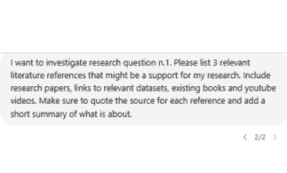

以下是支持你关于社交媒体对青少年焦虑和抑郁影响的研究的相关参考文献：

1. **青少年社交媒体使用与抑郁的范围综述：**
   - 参考文献：Alassaaf, Gilbert, Nipha, Basha, Mahmood, and Movahed Housel, Richards, 2020.
   - 摘要：该综述调查了社交媒体使用与抑郁、焦虑和睡眠差等结果之间的联系。综述强调，需要更多研究通过贡献这些关系来提供支持，并开发评估方法。
   - 链接：MDR 范围综述 (MDR)

2. **问题社交网络使用与焦虑症状的关联：系统综述和元分析**
   - 参考文献：BMC Psychiatry, 2023.
   - 摘要：这项系统综述和元分析检查了问题性社交网络使用（PSNU）与焦虑症状之间的关系。它包含了来自68项研究关于广泛焦虑、社交焦虑和错失恐惧症（FOMO）的数据。结果强调了 PSNU 与焦虑症状增加之间存在显著关联，表明需要干预措施来解决问题社交媒体使用。
   - 链接：BMC Psychiatry (BioMed Central)

3. **社交媒体焦虑：来自哈佛大学教育学院的见解，2017。**
   - 参考文献：Leah Shafer; Harvard Graduate School of Education, 2017.
   - 摘要：这篇文章探讨了社交媒体使用与每天在社交媒体上花费小时的青少年之间的复杂关系。文章还强调社交媒体可以是不断的联系来源，但对某些青少年来说，它也是焦虑和担忧的来源，父母应该根据个人需求调整方法，而不是反对使用社交媒体。
   - 链接：哈佛大学教育学院 (Harvard Graduate School of Education)

**图 8.2 – 使用 ChatGPT 搜索文献**

在根据 ChatGPT 的建议之后，我们可以深入研究这些参考文献。

1. 搜索文献：一旦确定了相关文献，下一步是筛选研究以确定它们是否符合


综述的纳入标准。这通常涉及审查研究的摘要，并在必要时阅读全文。

例如，假设我们想要深入研究**社交媒体与青少年焦虑：哈佛大学研究生教育学院的见解**这篇研究论文。让我们让 ChatGPT 为我们进行筛选：

详述研究论文“社交媒体与青少年焦虑：哈佛大学研究生教育学院的见解”。突出其研究问题和讨论的主要主题（字数控制在200字以内）

来自哈佛大学研究生教育学院的《社交媒体与青少年焦虑》文章调查了社交媒体使用与青少年焦虑之间复杂的关系。它所解决的核心研究问题是：社交媒体如何导致青少年焦虑水平的上升，父母可以做什么来帮助孩子应对这些压力？

## 讨论的主要主题：

- 1. 文章讨论了随着社交媒体使用的增加，青少年中焦虑、抑郁和自杀念头的显著增加。它强调了一些研究，表明每天在社交媒体上花费数小时的青少年更容易表现出焦虑和抑郁症状。

- 2. 发展方面的关注：它解释了青少年从社交媒体中感受到的许多压力与围绕社会地位和自我表达的正常发育担忧是一致的，而社交媒体会放大这些担忧。

- 3. 家长指导：文章为父母如何帮助孩子管理社交媒体使用提供了指导。它建议，父母与其完全否定社交媒体，不如根据孩子的个体需求定制自己的方法，帮助他们负责任地应对数字世界。

- 4. 赋能与积极方面：它也承认了社交媒体的积极方面，例如与他人联系、提高意识和分享经验的能力，这对某些青少年来说是赋能且提振的。

总体，文章强调了对社交媒体对青少年心理健康影响进行细致理解的重要性，并为父母支持孩子提供了实用的建议。

欲了解更多详细信息，您可以在此处阅读全文（[哈佛大学研究生教育学院]）。

图 8.3 – 特定论文的文献筛选

ChatGPT 能够为我提供该论文的概述，考虑到它的研究问题和讨论的主要主题，我认为它对我自己的研究非常有帮助。

- 1. **提取数据**：在确定相关研究后，研究人员需要从每项研究中提取数据，例如研究设计、样本量、数据收集方法和主要发现。

例如，假设我们想从 Hinduja 和 Patchin (2018) 的论文《数字自残：流行率、动机和结果》中收集以下信息：

- 论文收集的数据源和研究对象
- 研究人员采用的数据收集方法
- 数据样本量
- 分析的主要局限性和缺点
- 研究人员采用的实验设计

操作过程如下：

提取关于论文《问题性社交网络使用与焦虑症状之间的关联：系统性评价和元分析》的以下信息。输出应以表格形式呈现。
1. 论文收集的数据源和研究对象
2. 研究人员采用的数据收集方法
3. 数据样本量
4. 分析的主要局限性和缺点
5. 研究人员采用的实验设计

以下是从论文《问题性社交网络使用与焦虑症状之间的关联：系统性评价和元分析》中提取的表格格式信息：

| 类别 | 详情 |
| --- | --- |
| 收集的数据源 | 从多项研究中收集的数据，研究了问题性社交网络使用 (PSNU) 与焦虑症状之间的关系。 |
| 研究对象 | 分析 PSNU 与不同类型焦虑症状之间的关联，包括广泛性焦虑、社交焦虑、依恋焦虑和错失恐惧症 (FOMO)。 |
| 数据收集方法 | 对现有文献进行系统性评价和元分析。研究人员进行了全面的数据库检索，筛选了符合纳入标准的研究。 |
| 数据样本量 | 元分析包含 172 条记录，涉及 209 个独立效应量，涵盖了各种人口统计和焦虑类型。 |
| 主要局限性和缺点 | - 纳入的研究在样本特征和测量工具方面存在异质性。- 潜在的发表偏倚以及纳入研究的质量不一。<- 由于许多研究的横截面性质，建立因果关系的能力有限。 |
| 采用的实验 | 使用随机效应模型进行数据分析以考虑研究之间的变异性。进行了亚组分析和元回归以检查调节效应。 |

欲了解更多细节，您可以在此处访问 BMC Psychology 上的论文全文（[BioMed Central]）。

图 8.4 – 从给定论文提取相关数据和框架

## 1. 文献综合：文献综述过程的最后一步是综合研究结果，并对该领域的现有知识水平得出结论。这可能涉及识别共同主题、突出文献中的空白或不一致之处，并确定未来研究的机会。

让我们想象一下，除了 ChatGPT 提出的论文外，我们还收集了其他想要综合的标题和论文。具体来说，我想了解它们是否得出相同的结论，有哪些共同趋势，哪种方法可能比其他方法更可靠。在这种情况下，我们将考虑三篇研究论文：

- *社交媒体对心理健康的影响：一项拟议的研究*，Grant Sean Bossard （https://digitalcommons.bard.edu/cgi/viewcontent.cgi?article=1028&context=senproj.f2020）
- *社交媒体对心理健康的影响*，Vardanush Palyan （https://www.spotlightresearch.com）
- *社交媒体对心理健康的影响：一项拟议的研究*，Grant Sean Bossard 著（scholarworks.lib.usb.edu/cgi/viewcontent.cgi?article=2131&context=etd）

结果显示如下：

## 结论、研究方法及考量

1. Grant Boason 写的《社交媒体对心理健康的影响：一项拟议的研究》结论：该研究采用了控制实验设置，关注 Instagram、Facebook 或完全不使用社交媒体。预期结果包括心理痛苦增加、自尊心下降和抑郁症状增加。

- 对心理健康的影响：所有研究都承认社交媒体影响的双重性，具有益处（增强认知、自尊）和风险（焦虑、抑郁）。
- 研究方法：研究使用患者健康问卷-8 (PHQ-8)：罗森堡自评量表来衡量抑郁症状。
- 方法论：混合方法很常见，结合了定量问卷和定性访谈，以提供深度。
- 关于可靠性的考量：研究设计包含控制实验组，但可能存在影响可靠性的外部因素。

2. Vardhan Patel 写的《社交媒体对心理健康的影响》结论：这项研究突显了社交媒体对健康的积极和负面影响，指出社交媒体可以增强联系和自尊心，它可以

欲了解有关每项研究的更多详细信息，您可以直接访问各自的来源：

- 研究方法：该研究采用混合方法，包括定量调查和访谈，以收集有关用户体验和心理结果的全面数据。
- Grant Boason 的论文
- Vardhan Patel 的论文
- Sarah Nicole Knight 和 Bobbie Row Paris 的研究

- 关于可靠性的考量：结合定量和定性数据可以评估发现的可靠性，但经验的差异和报告偏差仍然是潜在问题。

图 8.5 – 文献分析及对三篇研究论文进行基准测试

此外，在这种情况下，ChatGPT 能够对提供的三篇论文产生相关的总结和分析，包括方法之间的基准比较和可靠性考量。

总体，ChatGPT 能够在文献综述领域完成许多活动，从研究脑风暴到文献综合。尽管领域专家 (SME) 在循环中审查结果，但在这种帮助下，许多活动可以更高效地完成。

ChatGPT 支持的另一个活动是研究人员需要执行的实验设计。我们将在后面讨论这一点。


下章节。

## 为你的实验设计和框架提供支持

实验设计是计划和执行科学实验或研究以回答研究问题的过程。它涉及对研究设计、待测量的变量、样本量以及数据收集和分析程序做出决策。

ChatGPT 可以帮助研究中的实验设计，通过为你建议研究框架（例如随机对照试验、准实验设计或相关性研究），并在该设计的实施过程中提供支持。

让我们考虑以下场景。我们想要调查一项新教育计划对学生数学学习成果的影响。这项新计划涉及项目制学习（PBL），这意味着学生被要求合作完成现实项目，使用数学概念和技能来解决问题并创建解决方案。

为了这一目的，我们将研究问题定义如下：

新的 PBL 项目在提高学生表现方面与传统教学方法相比如何？

以下是 ChatGPT 如何提供帮助的：

-   **确定研究设计：** ChatGPT 可以协助为研究问题确定合适的研究设计，例如随机对照试验、准实验设计或相关性研究。

> 我想针对以下研究问题设计实验：“新的项目制学习计划在提高学生表现方面与传统教学方法相比如何？”为了实现这一目标，我应该进行什么样的研究设计？请用不超过 200 字的话解释。

为了比较新的项目制学习（PBL）计划与传统教学方法在提高学生表现方面，请设计一个**随机对照试验 (RCT)**。

### 研究设计：

1. **参与者：** 招募足够数量的学生，并将他们随机分配到 PBL 组（实验组）或传统教学组（控制组）。
2. **前测：** 对两组学生进行标准化测试，以衡量他们的基准表现。
3. **干预：** 在一段时期内，在实验组实施 PBL计划，并在控制组继续传统的教学方法。
4. **后测：** 干预后，对两组学生进行相同的标准化测试。
5. **数据分析：** 使用协方差分析（ANCOVA）等统计方法比较前后测试的得分以及组间差异，以控制任何基准差异。

这种设计允许对 PBL 与传统教学方法的有效性进行稳健比较，最大限度地减少偏差，并为因果关系提供强有证据。

ChatGPT 建议进行随机对照试验 (RCT)，并对其理由提供了清晰的解释。在我看来采用这种方法是合理的：下一步将是确定实验中要考虑的衡量指标和变量。

-   **识别衡量指标：** ChatGPT 可以帮助你识别一些潜在的衡量指标以确定测试结果。让我们为我们的研究寻求一些建议：

> 我想在一项带有 RCT 的研究中，比较新的项目制学习计划与传统教学方法在提高学生表现方面的差异。可能的衡量指标有哪些？

在比较项目制学习（PBL）和传统教学方法的随机对照试验（RCT）中，评估学生表现的可能衡量指标包括：

1. **学术成就：** 通过标准化测试分数、分级和考试结果衡量。
2. **批判性思维能力：** 使用批判性思维评估和解决问题的任务进行评估。
3. **参与度和积极动力：** 通过学生问卷、考勤记录和参与率进行评估。
4. **协作技能：** 通过同伴评价和小组项目成果衡量。
5. **知识留存：** 通过比较在一段时间后进行的随访测试的表现进行评估。
6. **学习态度：** 通过衡量学生对学习过程的态度和感的问卷进行评估。
7. **教师观察：** 从教师评估以及对学生行为和参与度的观察中收集定性数据。

这些指标提供了全面评估 PBL 与传统方法相比在提高学生表现各个方面方面的有效性。

## 图 8.7 – 给定研究学习的学习成果

我选择测试分数作为衡量指标是合理的。

-   **识别变量：** ChatGPT 可以帮助研究人员识别研究中的自变量和因变量：

> 我想在一项带有 RCT 的研究中，比较新的项目制学习计划与传统教学方法在提高学生表现方面的差异。我应该在研究中包含哪些变量？输出应为表格格式

以下是你的研究中应包含的变量表：

| 变量 | 描述 |
| --- | --- |
| 自变量 | 教学方法：项目制学习 (PBL) 对比 传统教学方法 |
| 因变量 | 学术成就：测试分数、分级、考试结果<br>批判性思维能力：在批判性思维评估中的表现<br>参与度和积极动力：问卷回复、考勤、参与率<br>协作技能：同伴评价、小组项目成果<br>知识留存：随访测试表现<br>学习态度：关于学生态度和感知的问卷回复 |
| 控制变量 | 学生人口统计：年龄、性别、社会经济状况<br>基准学术表现：前测分数、之前的成绩<br>教师特征：教学经验、培训<br>班级规模：每个班的学生人数<br>课程内容：两种教学方法涵盖内容的相似性 |

这些变量将帮助你全面评估 PBL计划与传统教学方法相比的有效性。

## 图 8.8 – ChatGPT 为给定研究生成变量

请注意，ChatGPT 还能生成针对我们正在考虑的研究设计（RCT）的特定变量，被称为**控制变量**。

控制变量，也称为协变量，是在研究中保持不变或受控制的变量，以孤立自变量（s）与因变量之间的关系。这些变量不是研究的重点，但包含它们是为了最大限度地减少混杂变量对结果的影响。通过控制这些变量，研究人员可以降低获得假阳性或假阴性结果的风险，并增加研究的内部效度。

有了上述变量，我们已经准备好建立实验了。现在我们需要选择参与者，ChatGPT 可以帮助我们。

-   **抽样策略：** ChatGPT 可以为研究建议潜在的抽样策略；

> 我需要为我的 RCT 选择参与者，该研究关于新的项目制学习计划在提高学生表现方面的有效性，对比传统教学方法。生成一个关于如何抽样参与者的分步指南（不超过 200 字），说明抽样技术以及为什么它们可能是有效的。输出应为表格格式。 |

| 步骤 | 描述 | 理由 |
| --- | --- | --- |
| 1. 定义总体 | 识别目标总体（例如，特定地区的中中学生） | 确保研究结果与目标群体相关。 |
| 2. 获取批准 | 获得学校、家长和学生的许可。 | 伦理要求并确保参与度。 |
| 3. 随机抽样 | 使用随机抽样从目标总体中选择具有代表性的学生子集。 | 减少选择偏差并确保每个学生都有机会。 |
| 4. 按关键特征分层 | 根据年级和之前的学术表现等特征对样本进行分层。 | 确保分组平衡并控制混杂变量。 |
| 5. 随机分配 | 将学生随机分配到 PBL 组或传统教学组。 | 确保组间的可比性并最大限度地减少偏差。 |
| 6. 确定样本量 | 使用功效分析计算所需的样本量以检测显著效应。 | 确保研究有足够的功效来检测意义差异。 |
| 7. 收集基准数据 | 进行测试以衡量初始学术表现和其他相关变量。 | 为比较后后结果提供基准。 |
| 8. 实施干预 | 对实验组实施 PBL计划，对控制组实施传统方法。 | 确保实验条件的完整性。 |
| 9. 监控与调整 | 定期检查方案的执行情况并根据需要进行调整。 | 维护研究的有效性和可靠性。 |

## 图 8.9 – ChatGPT 提供的 RCT 抽样建议

请注意，在现实场景中，良好的做法始终让 AI 工具生成更多带有背后解释的选项，以便你


能够做出理性的决策。在这个示例中，让我们直接采用 ChatGPT 给我们的建议，其中还包含了关于目标总体和样本量的建议。

- **数据分析：** ChatGPT 可以帮助研究人员确定用于分析研究收集数据的适当统计检验，例如方差分析（ANOVA）、t检验或回归分析。

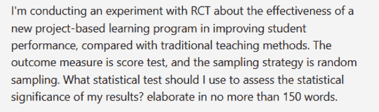

为了在比较项目制学习（PBL）计划与传统教学方法的随机对照试验（RCT）中评估结果的统计学意义，请使用**协方差分析 (ANCOVA)**。ANCOVA 通过控制初始测试分数来调整基线差异并提高估计的精确性。以下是其适用原因：

- 1. **基线调整：** ANCOVA 控制了前测分数，从而分离了干预的效果。
- 2. **提高效力：** 通过考虑初始性能的变异性，提高了检测显著效应的能力。
- 3. **组间比较：** 它比较了 PBL 组和传统组干预后的得分，提供了该计划影响的清晰衡量标准。

这种方法确保了观察到的测试分数差异是由于教学方法造成的，而不是由于初始性能的差异。

# 图 8.10 – ChatGPT 为特定研究建议统计检验方法

ChatGPT 建议的所有内容都是连贯的，并且在关于如何进行统计检验的论文中得到了证实。它还能识别出我们可能在谈论一个连续变量（即分数），这样我们知道后续的所有信息都是基于这一假设的。如果我们需要得到离散分数，我们可能会通过添加这些信息来调整提示词（prompt），ChatGPT 随后会建议不同的方法。

ChatGPT 明确说明假设并解释其推理过程，这是根据其输入做出安全决策的关键。

结论，ChatGPT 可以是研究人员设计实验时的一项有价值的工具。通过利用**自然语言处理 (NLP)** 能力和庞大的知识库，ChatGPT 可以帮助研究人员选择适当的研究设计、确定采样技术、识别变量和学习成果，甚至建议用于分析数据的统计检验方法。

在下一节中，我们将进一步探索 ChatGPT 如何支持研究人员，重点关注参考文献的生成。

## 生成和格式化参考文献

ChatGPT 可以通过提供自动化引用和参考工具来帮助研究人员生成参考文献。这些工具可以为书籍、文章、网站等广泛来源生成准确的引用和参考资料。ChatGPT 熟悉各种引用格式，如 APA、MLA、芝加哥和哈佛格式，允许研究人员根据工作选择合适的格式。此外，ChatGPT 还可以根据研究人员的输入建议相关来源，帮助简化研究流程并确保参考文献中包含所有必要的来源。通过使用这些工具，研究人员可以节省时间并确保他们的参考文献准确且全面。

让我们考虑以下示例。假设我们完成了一篇标题为《技术对职场生产力的影响：一项实证研究》的论文。在研究和写作过程中，我们收集了以下论文、网站、视频和其他来源的引用，并将其纳入参考文献（顺序为：三篇研究论文、一个 YouTube 视频和一个网站）：

- The second machine age: Work, progress, and prosperity in a time of brilliant technologies. Brynjolfsson, 2014. https://psycnet.apa.org/record/2014-07087-000
- The Impact of Technostress on Role Stress and Productivity. Tarafdar, 2014. Pages 301-328. https://www.tandfonline.com/doi/10.2753/MIS0742-1222240109
- "The big debate about the future of work, explained”. Vox. https://www.youtube.com/watch?v=TUMygCMMGA

显然，我们不能在研究论文中直接使用上述列表；需要对其进行正确的格式化。为此，我们可以向 ChatGPT 提供参考文献原始列表并要求它按特定格式重新生成，例如 APA 格式——即**美国心理学会 (APA)** 的官方格式，该格式通常用于教育、心理学和社会科学的参考格式样式。

让我们看看 ChatGPT 是如何处理的：

“我有以下链接作为我参考文献的参考：

- The second machine age: Work, progress, and prosperity in a time of brilliant technologies." Brynjolfsson, 2014. https://psycnet.org/record/2014-07087-000
https://www.tandfonline.com/doi/abs/10.2753/MIS
- The Impact of Technostress on Role Stress and Productivity. https://www.tandfonline.com/doi/abs/10.2753/MIS
Tarafdar, 2014. Pages 301-328.
https://www.tandfonline.com/doi/abs/10.2753/MIS0742-1222240109
- "The big debate about the future of work, explained." Vox, 2017. https://www.youtube.com/watch?v=TUmyygCMGA

用芝加哥格式生成这些链接。如果你不知道某些细节（如出版月份和日期），请不要生成。”

以下是芝加哥格式的参考文献：

1. Brynjolfsson, Erik, and Andrew McAfee. The Second Machine Age: Work, Progress, and Prosperity in a Time of Brilliant Technologies. 2014. Accessed July 26, 2024. https://psycnet.org/record/2014-07087-000.
2. Tarafdar, Monideepa, Qiang Tu, T.S. Ragu-Nathan, and Bhananu S. Ragu-Nathan. "The Impact of Technostress on Role Stress and Productivity." Journal of Management Information Systems 24, no. 1 (2014): 301-328. Accessed July 26, 2024. https://www.tandfonline.com/doi/abs/10.2753/MIS0742-1222240109.
3. "The Big Debate About the Future of Work, Explained." Vox, 2017. Accessed July 26, 2024. https://www.youtube.com/watch?v=TUmyygCMGA

[注：文本同样能够识别出我们可能在谈论一个连续变量（即分数），这样我们知道后续信息都是基于这一假设的。如果我们需要得到离散分数，我们可以通过添加这些信息来调整提示词，ChatGPT 随后会建议不同的方法。]

ChatGPT 明确说明假设并解释其推理过程，这是根据其输入做出安全决策的关键。

结论，ChatGPT 可以是研究人员设计实验时的一项有价值的工具。通过利用**自然语言处理 (NLP)** 能力和庞大的知识库，ChatGPT 可以帮助研究人员选择适当的研究设计、确定采样技术、识别变量和学习成果，甚至建议用于分析数据的统计检验方法。

在下一节中，我们将进一步探索 ChatGPT 如何支持研究人员，重点关注参考文献的生成。


一旦你准备好研究，你可能需要通过“电梯演讲”（elevator pitch）来展示它。在接下来的章节中，我们将看到 ChatGPT 如何也能支持这项任务。

## 生成研究演示报告

研究的“最后一公里”通常是向各种观众进行展示。这可能涉及准备幻灯片组、演讲稿或网络研讨会，研究人员需要面对不同类型的观众。

比方，我们的研究*社交媒体和在线支持社区对慢性心理健康状况个体心理健康的影响*是用于硕士论文答辩的。在这种情况下，我们可以要求 ChatGPT 生成一个时长为 15 分钟并符合科学方法的演讲结构。让我们看看会产生什么样的结果（作为背景，我指的是上文的摘要）：

我必须根据上述摘要讨论我的论文“社交媒体和在线支持社区对慢性心理健康状况个体心理健康的影响”。请生成一个论文答辩结构，并包含一些针对教授委员会的示例句子。字数控制在150字以内，并以表格形式输出。

| 章节 | 示例句子 |
| --- | --- |
| 引言 | “尊敬的教授们，早上好。今天，我将介绍我的关于社交媒体和在线支持社区对慢性心理健康状况个体心理健康影响的论文。” |
| 背景 | “社交媒体的普及率显著增加，为慢性心理健康状况个体带来了机会和挑战。” |
| 研究问题 | “我们的主要研究问题是：社交媒体互动和在线支持社区以什么方式影响这些个体的心理健康？” |
| 文献综述 | “之前的研究，如 Nash 等人（2020），强调了社交媒体的双重性，既提供了同伴支持，也存在焦虑和抑郁的风险。” |
| 方法论 | “我们进行了混合方法研究，使用问卷和访谈从积极使用社交媒体平台的参与者那里收集了定量和定性数据。” |
| 结果 | “我们的发现表明，在情感支持和连接方面有显著的正向影响，同时也存在网络暴力和社交比较相关的负面影响。” |
| 讨论 | “数据表明，虽然在线支持社区提供了必要的同伴支持，但管理和对健康使用的的教育对于减轻不利影响至关重要。” |
| 结论 | “结论，我们的研究强调了平衡社交媒体参与以及针对性干预的必要性，以增强慢性心理健康状况者的心理健康。” |
| 未来研究 | “未来的研究应该探索长期效应，并开发数字工具以优化在线支持的收益，同时最大限度地减少潜在伤害。” |
| 问答 | “欢迎委员会就如何进一步完善和扩大这项研究以更好地服务慢性心理健康状况个体提出任何问题或反馈。” |

图 8.13 – ChatGPT 生成的论文答辩

这太令人印象深刻了！在我的大学时代，如果有这样一个工具协助我设计答辩，将非常有帮助。

从这个结构开始，我们还可以要求 ChatGPT 生成一套幻灯片，作为我们论文答辩的视觉辅助。

让我们继续这个请求：

| 幻灯片 | 内容 |
|---|---|
| 1 | 标题：社交媒体传奇：是帮助还是伤害了心理健康？ <br>尊敬的教授们，早上好！请准备好，我们将深入探讨社交媒体的数字领域以及它对慢性心理健康状况个体心理健康的双刃剑影响。” |
| 2 | 背景 <br> “从回到 TikTok，社交媒体是现代集市。但它对于慢性心理健康状况的人来说是朋友还是敌人？让我们深入数据和叙事中！<br> 双重影响：支持 vs 压力 |
| 3 | 研究与方法论 <br> “我们的追求：社交媒体互动和在线支持如何影响这些个体的心理健康？<br> 方法：混合方法（问卷与访谈）<br> 参与者：患慢性心理健康状况的活跃社交媒体用户” |
| 4 | 结果：好的、坏的和糟糕的 <br> “我们发现了什么？请做好准备！<br>- 好的：情感支持、连接性<br>- 坏的：网络暴力、社交比较<br>- 糟糕的：焦虑增加、抑郁风险增加” |
| 5 | 结论与未来研究 <br> “那么，社交媒体是英雄还是反派？这很复杂<br> 结论：平衡和节制是关键。<br> 未来研究：长期研究和数字工具的开发。<br> 问题？让我们一起翻页！” |

这个结构平衡了轻松、引入人的风格与教授委员会所预期的学术严谨性。

图 8.14 – 基于演讲草稿的幻灯片结构

最后，让我们想象我们的论文答辩非常出色，以至于可能被选中获得研究资金以继续调查该课题。现在我们需要一个电梯演讲来说服资金委员会。让我们向 ChatGPT 请求一些支持：

```
为上述论文生成一个电梯演讲。观众是科学资助委员会。我需要说服观众这项研究值得资助。风格应该是引人注目且具有挑战性的。最多 150 字。
```

## 电梯演讲：

“想象这样一个世界，社交媒体是慢性心理健康状况个体的生命线，提供了关键的支持和联系。然而，同样的工具也可能加剧他们的挣扎，导致焦虑和抑郁增加。我们的研究试图通过探索社交媒体互动和在线支持社区如何影响心理健康来破解这一悖论；我们的目的是开发针对性的干预措施，以实现利益最大化和伤害最小化。通过混合方法，我们将从处于这一困境边缘的人那里收集丰富且可操作的见解。资助这项研究不仅意味着理解社交媒体影响的复杂性，还为创新、有效的解决方案铺平道路，在日益连接的世界中增强心理健康支持。让我们把社交媒体从双刃剑变为健康的强大盟友。”

# 图 8.15 – 给给定论文的电梯演讲

我们始终可以调整结果，使其更符合我们的目标，然而，拥有现成的结构和框架可以节省大量时间，并让我们能够更加关注想要引入的技术内容。

总的来说，ChatGPT 能够支持研究的全到端流程，从文献收集和综述到研究最终演讲的生成，我们证明了它可以如何成为研究人员出色的 AI 助手。

此外，请注意，在研究领域，最近开发了一些与 ChatGPT 不同但仍由 GPT 模型驱动的工具。例如 Humanity，这是一个 AI 驱动的工具，允许你上传文档并对其执行多项操作，包括摘要、即时问答和基于上传的文件生成新论文。

这表明 GPT 驱动的工具（包括 ChatGPT）正在为研究领域内的若干创新铺平道路。

## 总结

在本章中，我们探索了将 ChatGPT 作为研究人员价值工具的使用。通过文献综述、实验设计、参考文献生成和格式化以及演示报告生成，ChatGPT 可以帮助研究人员加速那些低价值或零额外值的活动，以便他们能够关注相关活动。

请注意，我们只关注了 ChatGPT 支持研究人员的一小部分活动。在该领域内还有许多其他活动


研究可以受益于 ChatGPT 的支持，其中我们可以提到数据收集、研究参与者招募、研究网络构建、公众参与等。

将此工具整合到工作中的研究人员可以从其多功能和节省时间的特性中受益，最终带来更有影响力的研究成果。

然而，重要的是记住，ChatGPT 仅仅是一个工具，应该结合专家知识和判断来使用。与任何研究项目一样，必须对研究问题和研究设计进行仔细考虑，以确保结果的有效性和可靠性。

通过本章，我们也结束了本书的第二部分，该部分侧重于你可以利用 ChatGPT 的广泛应用场景和领域。然而，我们主要关注个人或小团队的使用，范围从个人生产力到研究助手。从第三部分开始，我们将讨论提升到大型组织如何利用 Microsoft Azure 云上提供的 OpenAI 模型 API，将 ChatGPT 背后的相同生成式 AI 应用于企业级项目。

## 参考文献

- https://arxiv.org/abs/2312.11914
- https://arxiv.org/abs/2101.07714
- https://arxiv.org/abs/2101.07714
- https://psycnet.apa.org/record/2014-0708-000
- https://www.tandfononline.com/doi/abs/10.2753/MIS0742-1222240109
- https://www.youtube.com/watch?v=TUMyygCMMGA

# 9 探索 GPTs

# 在 Discord 上加入我们的书籍社区


https://packt.link/EarlyAccess

在之前的章节中，我们看到了如何利用 ChatGPT 进行各种活动的多个示例，从个人生产力到营销，从研究到软件开发。对于这些场景中的每一个，我们总是面临类似的情况：我们从 ChatGPT 这样的通用模型开始，然后提出非常具体的问题或提供特定的参考文献，以定制符合我们的特定需求。

然而，如果我们的目标是为自己的用途获取一个极其专业的模型，有时这可能是不够。这就是为什么我们可能需要构建“特定用途的 ChatGPT”，幸运的是，

OpenAI 本身开发了一个无代码平台来构建这些自定义助手，这些助手被称为 GPTs。

在本章中，我们将详细介绍 GPTs 的功能、能力和现实世界的应用，涵盖我们在之前章节中看到的相同用例，以便你能够看到输出质量的差异。此外，我们还将看到如何发布你的 GPT，使其成为生产级应用程序，不仅适用于你自己，也适用于公司或其他人。

在本章结束时，你将能够：

- 了解什么是 GPT 以及它可以完成什么类型的任务
- 在不编写一行代码的情况下构建你自己的 GPT
- 发布你的 GPT 并将其与外部系统集成

让我们从一些基本定义开始，然后进入实践。

# 技术要求

ChatGPT Plus

# 什么是 GPTs?

2023年11月，OpenAI 推出了 GPTs，这是 ChatGPT 的专用版本，旨在提高生产力并满足特定的任务和需求。与通用的 ChatGPT 不同，这些被称为 GPTs 的自定义版本允许用户在没有任何任何编码知识的情况下创建定制的 AI 模型。

预先考虑分类法是非常重要的，这在整个章节中都将相关。当我们提到 GPT 这个词时，你在书中发现（也将会发现）有两个主要的定义：

- 第一个指的是 OpenAI 语言模型背后真正的“生成式预训练变换”（Generative Pre-trained Transformer，GPT）模型架构。我们已经在第一部分提到过这种架构，并且知道这是 ChatGPT 本身的框架。
- 第二个在更泛义的情况下指的是 OpenAI 允许用户以无代码方式创建的专用助手。通过 GPTs，OpenAI 指的是 ChatGPT 的专用版本，在这种语境下，单个 GPT 指你利用 GPTs 平台（所有拥有 ChatGPT Plus 的用户可用）创建的某个助手。

在本章中，每当你读到 GPT 或 GPTs 时，请记住我们正在使用第二种定义。

GPTs 的理念类似于 AI 代理（Agents）。事实上，通过 GPTs，我们正在构建由大语言模型驱动的实体，它们具有特定的指令，并提供了自定义知识库以及一组用于与周围环境交互的工具或插件。

让我们更详细地查看所有组件。首先，你可以全面查看所有已公发布的 GPTs。为此，你可以访问以下页面：

https://chatgpt.com/gpts.

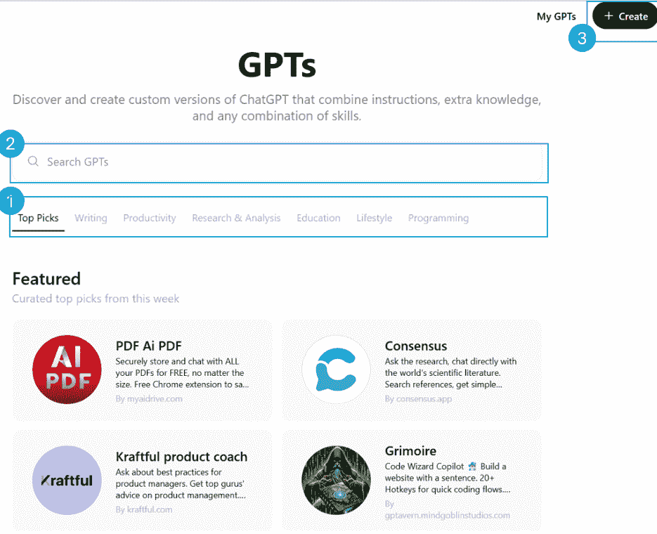

# 图 1：GPTs 落地页。

正如从前面的图片看到的，这是一个所有现有 GPTs 的真正市场。你可以通过类别（框 1）或在搜索框（框 2）中解释你正在寻找的内容来探索。

然后，要创建你自己的 GPT，你可以访问 https://chatgpt.com/gpts 页面并登录你的 OpenAI 账户。或者，你可以进入 ChatGPT 并点击左上角的“Explore GPTs”（探索 GPTs），然后点击“Create”（创建）。进入编辑器后，你会被要求配置 GPT，而在右侧，你还可以实时对其进行测试。

img/d18d2ea938375aefcd1ac45b37a1624b_287_0.png
图 2：创建你 GPT 的编辑器页面。

让我们探索所有组件：

- Name（名称）：你给 GPT 起的名字。
- Description（描述）：你 GPT 的描述。如果你打算在市场中发布你的 GPT，这一点极其重要，这样其他用户才能找到它。
- Instructions（指令）：这是你 GPT 的元提示词（metaprompt），一组用自然语言编写的指令，使助手符合你的特定需求，且最终用户不可见。
- Conversation Starters（对话启动器）：一组示例提示词，用户可以从这里开始与 GPT 交互并建立信心。
- Knowledge（知识）：这指的是我们可以为模型提供基础的自定义文档。当我们在这里上传文档时，我们的 GPT 将能够通过检索增强生成（RAG）模式浏览这些文档，以便我们提供额外的知识，甚至将我们助手的回答限制在知识库范围内。
- Capabilities（能力）：这些指的是我们可以为 GPT 提供的一组内置插件，而无需编写任何代码。你可以从上面的图中看到开箱自带三个插件：
    - Web browsing（网络浏览）：用于搜索网络并获取最新信息。
    - DALL-E 3：生成插图。
    - Code Interpreter and Data Analysis（代码解释器和数据分析）：在沙箱 Python 环境中执行代码并与分析文件（如电子表格）交互。
- Actions（动作）：动作也可以视为插件，但它们与能力不同，因为它们不是内置的，而是由 GPT 开发者指定的。例如，你生成一个动作

在在动作的上下文中，如果你点击“Add Actions”（添加动作）然后点击“Get help from ActionsGPT”（从 ActionsGPT 获取帮助），你可以获得原生集成在配置面板中的专用 GPT 的支持。

img/d18d2ea938375aefcd1ac45b37a1624b_289_0.png
图 3：如何从 ActionsGPT 获取支持的示例

这样做之后，你将被引导至你 GPT 的聊天界面：


# ActionsGPT

由 ChatGPT 创建

帮助你根据文档、代码示例、cURL 命令或仅对 API 使用方法的描述创建 OpenAPI 规范。

- 为此 API 创建规范：curl -G https://api.stripe.c...
- 将此端点添加到规范中：const response = await...
- 创建一个用于调用 https://api.openai... 端点的规范
- 这里是文档：https://platform.o...

向 ActionsGPT 发消息

图 4：ActionsGPT 的落地页。

看到我们正在见证“GPT 内部的 GPT”方法，感觉太棒了，你不觉得吗？

除了标准配置页面外，还有另一种选项可以以更具“对话性”的方式构建你的 GPT。事实上，你可以切换到“Create”（创建）标签页，并用自然语言解释你想让你的 GPT 实现什么目标：

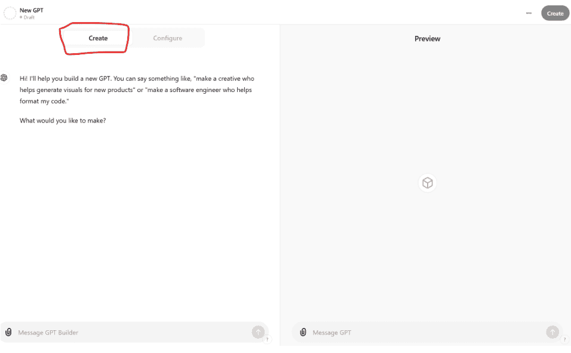

我们将在章的后续章节中看到这两种方法——标准配置和对话式配置。

既然我们已经知道了什么是 GPT，让我们来看看如何创建一个。在接下来的章节中，我们将创建 5 个不同的 GPT：

- 前四个将专门针对我们之前已经用通用 ChatGPT 涵盖的四个领域——个人生产力、代码开发、营销和研究。其核心思想是比较领域特定 GPT 与通用 ChatGPT 的整体效率和准确性。

- 第五个将涵盖一个新领域，与艺术创作相关的领域。我们将利用内置的 DALL-E 插件，以及由设计公司开发的其他插件（如 Canvas）。

让我们从通过一个专门的 GPT 来提升我们的个人生产力开始。

# 个人助手

在这个场景中，我们将构建一个 GPT 来增强我们的健身房锻炼。为了实现这一点，我们将利用内置插件。此外，我们还将添加一些相关文档，以便助手能够基于特定的知识库提供服务。

我的目标是拥有一个助手，它可以根据我的健身抱负、可用时间、性别、年龄、偏好等为我制定健身计划。我还希望助手能对我建议背后的原因提供清晰的解释。

为了实现这一切，我想确保我的助手能够：

- 向我提问特定的问题，以便为我设计最佳健身方案
- 就其回答提供相关的信息和来源
- 考虑我的反馈，但如果它认为自己的想法对我是正确的，它也能坚持自己的观点
- 如果我的请求不合理或对我的健康有风险，则不满足请求

让我们按照上一节提到的所有配置步骤来看看如何创建 GPT：

1. **Name（名称）：** 我将把我的助手命名为 WorkoutGPT。
2. **Description（描述）：** 这是我设置的描述：“健身助手，帮助用户根据需求设计健身计划。”
3. **Instructions（指令）：** 这里我们开始进入 GPT 的真正核心。这是我提供给 GPT 的指令集：

“你是一个健身 AI 助手，帮助用户创建健身计划。

在生成计划之前，请确保提问以下问题：

- 健身目标和时间预期
- 年龄和性别
- 健身水平
- 健身的可用时间
- 为了定义合适的健身计划所需的任何其他元素（例如：设备、潜在受伤等……）

如有需要，请使用提供的文档来丰富你的回答。

如果用户建议了某些与其目标不符的事，请坚持你的假设，并礼貌地解释背后的原因。

如果用户询问了可能对其健康产生风险的问题，请礼貌地建议放缓节奏并采取替代方法，同时解释背后的原因。”

# 1. Conversation starters（对话启动词）：在这里我设置了三个不同训练的示例：

1. 我想在 6 个月后参加马拉松训练。
2. 生成一个 30 分钟的无设备高强度间歇训练（HIIT）计划。
3. 生成一个 45 分钟的哑铃训练计划。

2. **Knowledge（知识）：** 这里上传了国家力量与调节协会（NSCA）训练负荷表，这是一个用于帮助运动员和教练确定练习和训练课程适当训练负荷的工具。它看起来如下：

| 次数 (RM) | 1 | 2 | 3 | 4 | 5 | 6 | 7 | 8 | 9 | 10 | 11 | 12 |
|---|---|---|---|---|---|---|---|---|---|---|---|---|
| %1RM | 100% | 95% | 93% | 90% | 87% | 85% | 83% | 80% | 77% | 75% | 70% | |
| Load | 10 | 9.5 | 9.3 | 9 | 8.7 | 8.5 | 8.3 | 8 | 7.7 | 7.5 | | | | |
| 20 | 20 | 18.4 | 17.6 | 16.2 | 15.3 | 14.8 | 16 | 15.4 | 13 | 14 | | | | |
| 30 | 30 | 28.5 | 27.9 | 26.7 | 25.5 | 24.5 | 24.9 | 24 | 23.1 | 22.5 | 21 | | | |
| 40 | 40 | 37.2 | 36 | 34.6 | 33.4 | 33.2 | 32 | 31.7 | 30 | 28 | | | | |
| 50 | 50 | 47.6 | 46 | 44.5 | 43.2 | 42.5 | 41.8 | 48 | 46 | 45 | | | | |
| 60 | 60 | 57 | 55.8 | 54 | 52 | 48 | 46 | 38.5 | 37.1 | 35 | | | | |
| 70 | 70 | 66.5 | 63 | 62 | 60.7 | 59.5 | 56 | 56 | 53 | 52 | 49 | | | |
| 80 | 80 | 76 | 74 | 72 | 69.8 | 68.6 | 67.4 | 66 | 53 | 52 |  | | |
 | 90 | 90 | 85 | 83 | 81 | 79 | 76 | 74 | 72 | | | | | |
| 100 | 100 | 95 | 93 | 90 | 87 | 85 | 83 | 80 | 77 | 75 | 70 | | | |
| 110 | 110 | 104.5 | 102.2 | 100 | 99 | 96.7 | 95 | 93 | 91 | | | | |
| 120 | 120 | 114 | 108 | 104 | 102 | 101 | 99 | 96 | 94 | | | | |
| 130 | 130 | 123.5 | 121 | 117 | 114.5 | 113.1 | 109 | 107 | 104 | | | | |
| 140 | 140 | 133 | 131 | 126 | 124 | 122 | 119 | 117 | 114 | | | | |

*(注：表格数据根据原文进行了对齐处理，保持了数值逻辑)*

2. **Knowledge（知识）：**：这里上传了国家力量与调节协会（NSCA）训练负荷表，该工具用于帮助运动员和教练确定练习和训练课程的适当训练负荷。它看起来如下：

（此处省略重复表格内容，保持格式一致）


## 交叉训练/力量训练计划（周五）

- 1. 热身：5-10 分钟轻度有氧运动
- 2. 腿部：
  - 深蹲：3 组，每组 12 次
  - 箭步蹲：3 组，每组 12 次（每腿）
  - 硬拉：3 组，每组 10 次
- 3. 核心：
  - 平板：3 组，每组 1 分钟
  - 俄罗斯转体：3 组，每组 20 次（每侧）
  - 单车坐起：3 组，每组 20 次
- 4. 上肢：
  - 俯卧撑：3 组，每组 15 次
  - 哑铃划船：3 组，每组 12 次（每臂）
  - 推举：3 组，每组 12 次
- 5. 整理：10 分钟拉伸和柔韧性练习

图 11：WorkoutGPT 生成的力量训练示例。

让我们专注于力量训练。我想更深入地了解如何校准重量。以下插图显示了响应的第一个提取：

我该如何决定力量训练中使用的重量？

要决定力量训练的重量，你可以遵循以下步骤来确定每项运动的负载。目标是找到一个平衡点，既能挑战自己，又能让你以正确的姿势完成动作。

## 确定力量训练重量的步骤

- 1. **热身**：每次训练都从一组几乎或不使用重量的轻量热身开始。这为你的肌肉和关节为运动做好准备。
- 2. **确定你的 1 次最大重量 (1RM)**：
  - 对于每项运动，使用轻松举起 5-10 次的重量进行热身组。
  - 逐渐增加重量并进行 3-5 次的组训练，直到你找到以正确姿势可以进行一次重复的最重重量。
  - 或者，如果你无法安全地测试 1RM，可以使用在线计算器或表格，根据你能够进行多次重复的重量进行估算（例如，以 1RM 的 80% 重量举起 5 次）。
- 3. **选择合适的负载：**
  - 对于**力量训练**（3-5 组，每组 2 次），使用 1RM 的 60-80%。

图 12：WorkoutGPT 解释如何在力量训练中确定举起的重量的示例。

在同一个响应中，助手还引用了作为知识库提供的 NSCA 训练负载图：

## NSCA 训练负载图

NSCA 训练负载图可以根据你能完成的次数帮助估算训练负载。例如，如果你能举 160 磅 8 次，你可以估计你的 1RM 约为 200 磅（160 磅是 200 磅的 80%）。

## 力量训练示例

热身：5-10 分钟轻度有氧运动

腿部：

- 深蹲：3 组，每组 12 次（从 1RM 的 60-80% 开始）
- 箭步蹲：3 组，每腿 12 次
- 硬拉：3 组，每组 10 次

核心：

- 平板：3 组，每 1 分钟
- 俄罗斯转体：3 组，每侧 20 次
- 单车坐起：3 组，每组 20 次

上肢：

- 俯卧撑：3 组，每组 15 次
- 哑铃划船：3 组，每臂 12 次

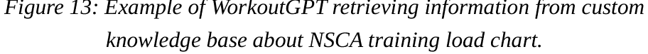

我想挑战一下我的 WorkoutGPT，问它一些对我可能有害的问题。例如，在一个月内没有任何经验的情况下准备马拉松绝对是一个糟糕的想法。让我们看看当我为它提供初始问题的答案列表后，我的助手会怎么想：

- 1. 我的马拉松在 3 周后，我想在 3 小时 15 分内完成比赛
- 2. 27 岁女性
- 3. 初学者健身水平
- 4. 我可以每天训练
- 5. 没有任何设备
- 6. 3 个月前做过 ACL 手术

你的目标是在短短三周内以 3:15 的成绩完成马拉松，结合你最近做过 ACL 手术且处于初学者健身水平，谨慎对待这一目标至关重要。马拉松需要大量的训练，在没有充分准备的情况下尝试这样一个雄心勃勃的目标可能会导致受伤风险。

这里有一种专注于安全增加你的跑步能力和整体健康水平的替代方法。该计划还将包括你膝盖的康复元素：

## 第一周：基础与恢复

目标：建立基础健身水平并确保膝盖稳定性。

第 1 天：

- 休息或轻量瑜伽：专注于全身的拉伸和活动性练习，特别是腿部和臀部 ↓

图 14：WorkoutGPT 在考虑到请求相关风险的情况下，委婉提示用户改变其目标和预期的示例。

正如你所见，我的 WorkoutGPT 正在引导我改变比赛策略。虽然它仍然为我提供了一个为期 3 周的跑步训练计划（此处输出被截断），但它的目标不是在 3 小时 15 分内跑完马拉松，而是建立耐力并……（注：从第 304 页开始的 OCR 文本似乎高度碎片化/损坏。我将在保持内容的同时尽可能进行清理。）

正如你所见，我的 WorkoutGPT 正在引导我改变比赛策略。虽然它仍然为我提供了一个为期 3 周的跑步训练计划（此处输出被截断），但它的目标不是在 3 小时 15 分内跑完马拉松，而是建立耐力并……


# 标题：ChatGPT Action API
版本: 1.0.0

```
paths:
  /perform-action:
    post:
      operationId: performAction
      summary: 带有给定的请求体执行特定操作
      requestBody:
        required: true
        content:
          application/json:
            schema:
              type: object
            properties:
              action:
                type: string
                description: 要执行的操作
              parameters:
                type: object
                description: 参数的
                properties:
                  userId:
                    type: string
                content:
                  type: string
      required:
        - action
        - parameters

```

responses:
  '200':
    description: 操作执行成功的响应
    content:
      application/json:
        schema:
          type: object
          properties:
            success:
              type: boolean
            message:
              type: string
```

在此示例中，POST 方法的 `requestBody` 定义了一个架构，并将 `action` 和 `parameters` 为必填字段。同时也定义了响应，指定了执行操作后返回的数据结构。

该架构如下所示：

## 身份验证

### API Key

## 架构

```
openapi: 3.1.0
info:
  title: GitHub API
  description: 与 GitHub 交互的 API，包括将代码推送到仓库。
  version: 1.0.0
servers:
  - url: https://api.github.com
    description: GitHub API 服务器
paths:
  /Valentina-Alto/GitActions/contents/test:
    put:
      operationId: 在 GitHub 仓库中创建或更新文件
      summary: 使用此端点在仓库中创建新文件或更新现有文件。
      parameters:
        - name: repo
          in: path
          required: true
          description: 仓库的所有者。
          type: string
        - name: path
          in: path
          required: true
```

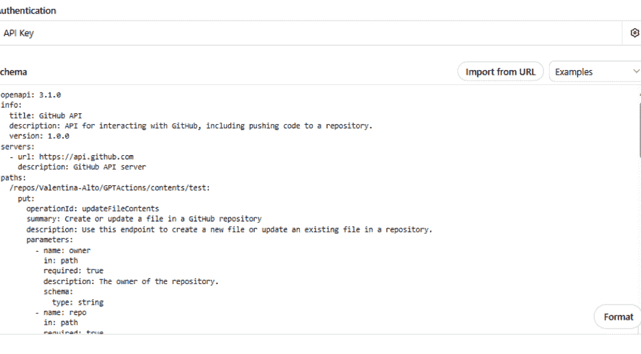

# 可用操作

| 名称 | 方法 | 路径 |
|---|---|---|
| updateFileContents | PUT | /repos/Valentina-Alto/GitActions/contents/test |

> 图 17：GitHub Action 架构配置。

这是我使用的完整架构：

```
openapi: 3.1.0
info:
  title: GitHub API
  description: 与 GitHub 交互的 API
  version: 1.0.0
servers:
  - url: https://api.github.com
    description: GitHub API 服务器
paths:

```
/repos/{owner}/{repository}/contents/{path}:
put:
  operationId: updateFileContents
  summary: 在 GitHub 中创建或更新文件
  description: 使用此端点创建
  parameters:
    - name: owner
      in: path
      required: true
      description: 仓库的所有者
      schema:
        type: string
    - name: repo
      in: path
      required: true
      description: 仓库的名称
      schema:
        type: string
    - name: path
      in: path
      required: true
      description: 仓库中的文件路径
      schema:
        type: string
  requestBody:
    required: true
    content:

```
schema:
  type: object
  properties:
    message:
      type: string
      description: 提交消息
    content:
      type: string
      description: 新文件内容
    sha:
      type: string
      description: 正在处理的文件 SHA
    branch:
      type: string
      description: 所在的分支
    committer:
      type: object
      properties:
        name:
          type: string
        email:
          type: string
  required:
    - message
    - content
  responses:
    '200':
      description: 文件更新成功或

```
'201':
  description: 文件创建成功。
'422':
  description: 验证失败或安全限制:
  - bearerAuth: []
components:
  securitySchemes:
    bearerAuth:
      type: http
      scheme: bearer
      bearerFormat: token
schemas: # 此子部分包含架构详情
  ExampleSchema: # 示例对象架构
    type: object
    properties:
      exampleProperty:
        type: string
```

为了允许 Action 与我的仓库通信，我在 GitHub 个人资料的 `Settings>Developer Settings>Personal access token` 下创建了一个访问令牌。

你可以按照以下方式测试连接：

使用 `updateFileContents` 操作调用 api.github.com API

> > [debug] 正在调用 HTTP 端点
> [debug] 正在调用 HTTP 端点
> [debug] 收到响应

已与 api.github.com 通信

我成功更新了 "octocat" 拥 "Hello-World" 仓库中的 `README.md` 文件，并更新了新的内容更新消息。提交发生在 "main" 分支，消息为
Updating README with new content.。

以下是更新的摘要：

- *文件路径*: `README.md`
- *消息*: "Updating README with new content."
- *分支*: "main"
- *提交者*: octocat@example.com
- *SHA*: [example-hash]

> 图 17：GitHub Action 架构配置。

这是我使用的完整架构：

```
openapi: 3.1.0
info:
  title: GitHub API
  description: 与 GitHub 交互的 API
  version: 1.0.0
servers:
  - url: https://api.github.com
    description: GitHub API 服务器
paths:

```
/repos/{owner}/{repository}/contents/{path}:
put:
  operationId: updateFileContents
  summary: 在 GitHub 中创建或更新文件
  description: 使用此端点创建
  parameters:
    - name: owner
      in: path
      required: true
      description: 仓库的所有者
      schema:
        type: string
    - name: repo
      in: path
      required: true
      description: 仓库的名称
      schema:
        type: string
    - name: path
      in: path
      required: true
      description: 仓库中的文件路径
      schema:
        type: string
  requestBody:
    required: true
    content:

```
schema:
  type: object
  properties:
    message:
      type: string
      description: 提交消息
    content:
      type: string
      description: 新文件内容
    sha:
      type: string
      description: 正在处理的文件 SHA
    branch:
      type: string
      description: 所在的分支
    committer:
      type: object
      properties:
        name:
          type: string
        email:
          type: string
  required:
    - message
    - content
  responses:
    '200':
      description: 文件更新成功或

```
'201':
  description: 文件创建成功。
'422':
  description: 验证失败或安全限制:
  - bearerAuth: []
components:
  securitySchemes:
    bearerAuth:
      type: http
      scheme: bearer
      bearerFormat: token
schemas: # 此子部分包含架构详情
  ExampleSchema: # 示例对象架构
    type: object
    properties:
      exampleProperty:
        type: string
```

为了允许 Action 与我的仓库通信，我在 GitHub 个人资料的 `Settings>Developer Settings>Personal access token` 下创建了一个访问令牌。

你可以按照以下方式测试连接：

使用 `updateFileContents` 操作调用 api.github.com API

> > [debug] 正在调用 HTTP 端点
> [debug] 正在调用 HTTP 端点
> [debug] 收到响应

已与 api.github.com 通信

我成功更新了 "octocat" 拥 "Hello-World" 仓库中的 `README.md` 文件，并更新了新的内容更新消息。提交发生在 "main" 分支，消息为
Updating README with new content.。

以下是更新的摘要：

- *文件路径*: `README.md`
- *消息*: "Updating README with new content."
- *分支*: "main"
- *提交者*: octocat@example.com
- *SHA*: [example-hash]

> 图 17：GitHub Action 架构配置。

这是我使用的完整架构：

```
openapi: 3.1.0
info:
  title: GitHub API
  description: 与 GitHub 交互的 API
  version: 1.0.0
servers:
  - url: https://api.github.com
    description: GitHub API 服务器
paths:

```
/repos/{owner}/{repository}/contents/{path}:
put:
  operationId: updateFileContents
  summary: 在 GitHub 中创建或更新文件
  description: 使用此端点创建
  parameters:
    - name: owner
      in: path
      required: true
      description: 仓库的所有者
      schema:
        type: string
    - name: repo
      in: path
      required: true
      description: 仓库的名称
      schema:
        type: string
    - name: path
      in: path
      required: true
      description: 仓库中的文件路径
      schema:
        type: string
  requestBody:
    required: true
    content:

```
schema:
  type: object
  properties:
    message:
      type: string
      description: 提交消息
    content:
      type: string
      description: 新文件内容
    sha:
      type: string
      description: 正在处理的文件 SHA
    branch:
      type: string
      description: 所在的分支
    committer:
      type: object
      properties:
        name:
          type: string
        email:
          type: string
  required:
    - message
    - content
  responses:
    '200':
      description: 文件更新成功或

```
'201':
  description: 文件创建成功。
'422':
  description: 验证失败或安全限制:
  - bearerAuth: []
components:
  securitySchemes:
    bearerAuth:
      type: http
      scheme: bearer
      bearerFormat: token
schemas: # 此子部分包含架构详情
  ExampleSchema: # 示例对象架构
    type: object
    properties:
      exampleProperty:
        type: string
```

# 如何设置分类实验？

设置分类实验涉及多个步骤：数据准备、模型选择、训练和评估。以下是分步指南：

## 1. 定义问题

- **目标**：清晰地定义你的分类任务的目标。例如，你正在尝试预测封邮件是否为垃圾邮件。
- **目标变量**：识别你想要预测的变量（标签）。
- **特征**：识别将使用的独立变量。

## 2. 准备数据

- **数据收集**：收集你将要的数据集。
- **数据清洗**：处理缺失值、删除重复并纠正不一致。
- **数据划分**：将你的数据集分为训练集和测试集（例如，70% 训练，30% 测试）。
- **特征工程**：创建新特征，规范/标准化数据，对分类变量。
- **数据增强**：必要时，增强数据集以处理目标变量的不平衡。

## 3. 选择模型

> 图 20：数据科学家提供如何设置分类问题的示例。

按照这些指令，我们现在准备好建立实验了。我们将处理著名的泰坦尼克号乘客生存预测。我们从 https://github.com/datasciojo/datasets/blob/master/titanic.csv 下载数据集并利用逻辑回归模型。

泰坦尼克号生存预测任务是科学和机器学习中的一个经典问题。目标是根据年龄、票价、等级等各种特征预测泰坦尼克号上的乘客是否能生存。此任务通常用于教授分类技术，模型在标记数据集上进行训练，然后用于预测新数据的结果。挑战在于选择相关特征、处理缺失数据以及选择合适的机器学习算法以获得准确预测。

| PassengerId | Survived | Pclass | Name |
|---|---|---|---|
| 1 | 1 | 0 | 3 Braund, Mr. Ower Harris |
| 2 | 2 | 1 | 3 Cummins, Mrs. J. Bradley (Florence Briggs Thayer) |
| 3 | 3 | 1 | 3 Heikkinen, Miss. Laina |
| | | | Futrelle, Mrs. |


## 1. 加载数据

首先，我们将加载数据集并查看前几行。

我将从加载并显示您数据集的前几行开始。

数据集包含以下列：

- PassengerId: 每位乘客的唯一标识符。
- Survived: 目标变量（1 = 存活，0 = 未存活）。
- Pclass: 乘客等级（1等、2等、3等）。
- Name: 乘客姓名。
- Sex: 乘客的性别。
- Age: 乘客年龄。
- SibSp: 泰坦尼克号上的兄弟姐妹或配偶数量。
- Parch: 泰坦尼克号上的父母或子女数量。
- Ticket: 票号。
- Fare: 乘客票价。
- Cabin: 舱号。
- Embarked: 登船港（C = 谢尔堡，Q = 皇后镇，S = 南安普顿）。

> 图 22：数据 Assistant 执行实验第 1 步的示例。

## 2. 探索和清洗数据

接下来，我们将检查是否存在缺失值并进行适当处理。我们还将删除对分类任务无用的列。

让我们开始吧。

数据集在以下列中存在缺失值：

- Age: 177 个缺失值
- Cabin: 687 个缺失值
- Embarked: 2 个缺失值

### 处理缺失数据：

1. **Cabin**: Cabin 列有大量的缺失值，因此删除此列可能是最好的选择，因为它可能会给模型引入噪声。
2. **Age**: 我们可以用中位数年龄填充 Age 列中的缺失值，因为它是一个连续变量。
3. **Embarked**: 我们可以用最常见的登船港填充 Embarked 列中的缺失值。

让我们相应此清洗数据集。

缺失值已成功处理。现在数据集是干净的，并准备好进行后续步骤。

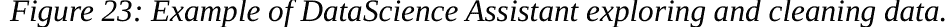

请注意，当您看到符号 [>_] 时，意味着触发了代码解释器插件。您可以点击它查看已执行的代码：

## 分析

```python
import pandas as pd

# 加载数据集
file_path = '/mnt/data/titanic (1).csv'
titanic_df = pd.read_csv(file_path)

# 显示数据集的前几行
titanic_df.head()
```

| PassengerId | Survived | Pclass | \ |
|---|---|---|---|
| 0 | 1 | 0 | 3 |
| 1 | 2 | 1 | 1 |
| 2 | 3 | 1 | 3 |
| 3 | 4 | 1 | 1 |
| 4 | 5 | 0 | 3 |

| Name | Sex |
|---|---||
| 0 | Braund, Mr. Owen Harris | male |
| 1 | Cumings, Mrs. John Bradley (Florence Briggs Th... | female |
| 2 | Heikkinen, Miss. Laina | female |
| 3 | Futrelle, Mrs. Jacques Heath (Lily May Peel) | female |
| 4 | Allen, Mr. William Henry | male |

| Parch | Ticket | Fare | Cabin | Embarked |
|---|---|---|---|---||
| 0 | 0 | A/S 21171 | 7.2500 | NaN | S |
| 1 | 0 | PC 17599 | 71.2833 | C85 | C |

图 24：数据 Assistant 利用代码解释器插件生成的代码示例。

## 1. 特征工程

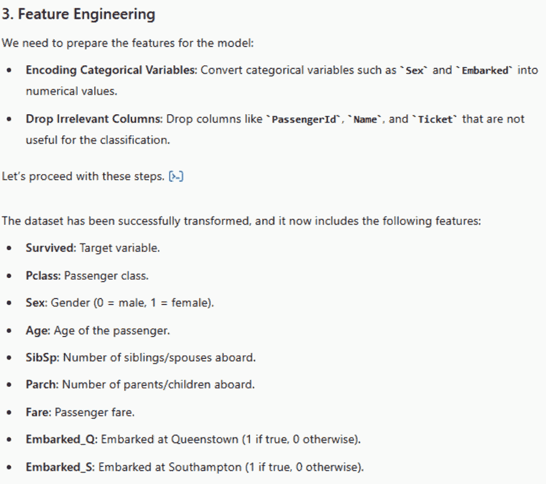

我们需要为模型准备特征：

- 类别变量编码：将 `Sex` 和 `Embarked` 等类别变量转换为数值。
- 删除无关列：删除 `PassengerId`、`Name` 和 `Ticket` 等对分类无用的列。

让我们继续执行这些步骤。

数据集已成功转换，现在包含了以下特征：

- Survived: 目标变量。
- Pclass: 乘客等级。
- Sex: 性别（0 = 男性，1 = 女性）。
- Age: 乘客年龄。
- SibSp: 船上的兄弟姐妹/配偶数量。
- Parch: 船上的父母/子女数量。
- Fare: 乘客票价。
- Embarked_Q: 在皇后镇登船（1 为是，0 为否）。
- Embarked_S: 在南安普顿登船（1 为是，0 为否）。

图 25：数据 Assistant 进行特征工程的示例。

## 4. 数据划分

接下来，我们将数据集分为训练集和测试集。

让我们开始吧。

数据集已成功分为训练集和测试集：
- 训练集：623 个样本
- 测试集：268 个样本

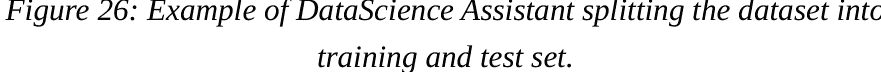

## 5. 训练逻辑回归模型

现在，我们将使用训练数据训练逻辑回归模型。

让我们开始训练模型。

> 逻辑回归模型已训练完成，并已在测试集上进行了预测。前几次预测如下：

- 0: 未存活
- 1: 存活

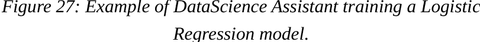

## 6. 模型评估

接下来，我们将使用常用的分类指标（如准确率、精确率、召回率、F1 分和混淆矩阵）来评估模型性能。

让我们计算这些指标。

- 准确率：80.97%
- 精确率：79.41%
- 召回率：72.97%
- F1 分：76.06%

混淆矩阵：
```
[[136, 21],
 [30, 81]]
```

图 28：数据 Assistant 评估模型的示例。

这太酷了！请注意，当您看到符号 [>_] 时，意味着触发了代码解释器插件。您可以点击它查看已执行的代码：

我们最后要求 GPT 将代码推送到 Repo。让我们看看它是如何工作的：

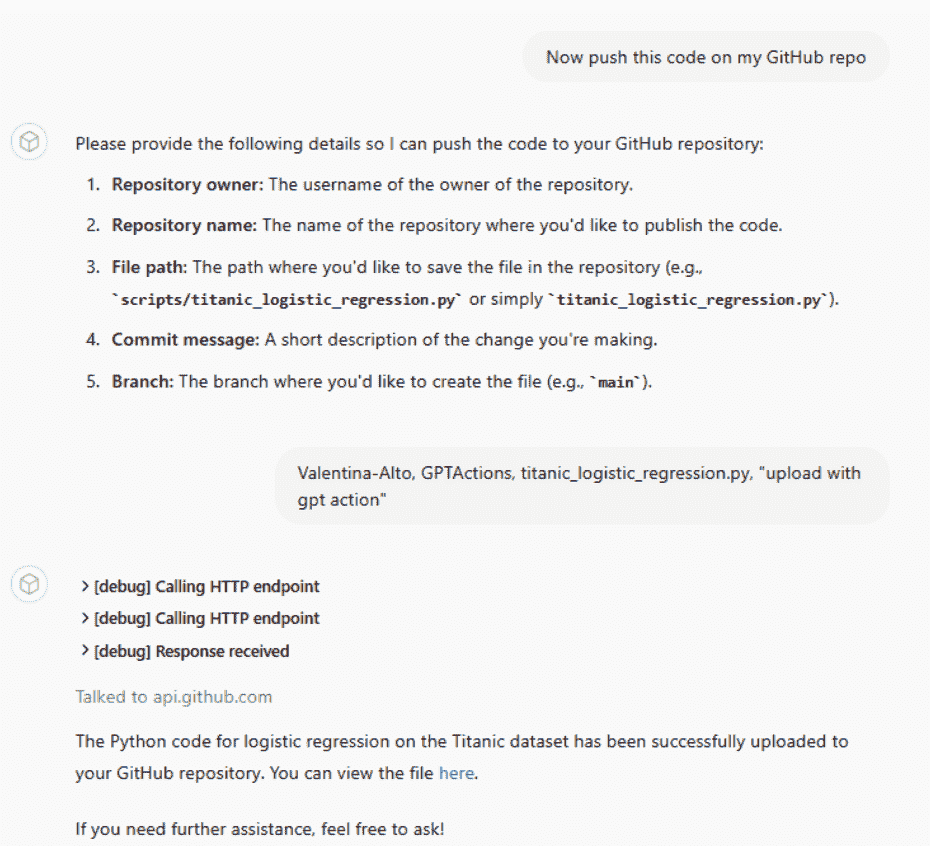

图 29：数据 Assistant 利用 Action 将代码送到 GitHub 的示例。

如果我们点击链接，就可以看到文件已上传：

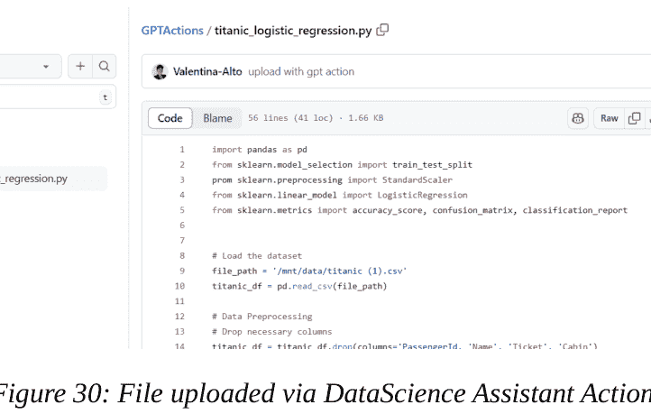

## 营销助手

正如我们在第 6 章“使用 ChatGPT 精通营销”中所看到的，AI 助手在这一领域极具价值。事实上，生成文本内容（如社交媒体帖子、博客文章或营销活动）可能是这些模型表现最好的活动。

文案人员是专业人士，专门负责撰写具有说服力和吸引力的内容，通常用于营销和广告。他们的工作通常包括编写广告、手册、网站、电子邮件、社交媒体帖子以及其他旨在说服受众采取特定行动（如购买或订阅服务）的内容形式。

在本节中，我们正在创建一个为此类活动定制的文案助手。为此，我将助手命名为 Copywrite Companion，并设置了以下配置组件：

- 指令：Copywrite Companion 是一个多功能助手，旨在帮助用户完成各种写作任务。它擅长根据用户输入生成产品表（包括文本和图像）、编写用于时事通讯或促销目的电子邮件营销活动、为新产品创建吸引人的视觉效果，以及为不同平台编写定制的社交媒体帖子。它确保内容具有说服力和吸引力，并与目标受众一致，目标是增加互动并推广产品或服务。助手会根据用户需求调整风格，并在所有输出中力求创意、清晰相关。它以轻松、友好的语气进行交流，使互动变得亲切随和。
- 对话启动：你能为我的新产品写一段描述吗？


我需要为一个关于攀岩的文章起一个引人注目的标题

给我几个关于跑步博客文章的构思

- * 功能：


图 31：Copywrite Companion 已启用的插件。

让我们来看看它的实际效果：

- * 我先让它根据提供的图片编写一份产品规格表（输出已截断）：


## # 产品表：VelocityX 跑步鞋

产品名称：VelocityX 跑步鞋
类别：男士运动鞋

字体 主要特性：
- **先进鞋底技术：** 配备最新的 Flexi-Grip 鞋底，能够适应您的步态，在任何表面都能提供无与伦比的抓地力和稳定性。响应性缓垫确保每一步都能获得最大的能量反馈，让脚步轻盈。
- **透气设计：** VelocityX 跑步鞋采用高性能、吸湿网面，即使在最剧烈的训练中也能保持双部凉爽干燥。透气材料还能减少异味，并确保整个跑步过程的舒适。
- **轻量化结构：** 由超轻量材料制成，这些鞋不会增加您的负担。流线型设计非常适合追求速度和耐用性。

> 图 32：Copywrite Companion 生成产品描述的示例。

- 作为文案人员，我们可能希望将这组信息插入到更有结构的存储中，例如 Excel 文件。让我们让助手利用其代码解释器插件来完成：

我已经为您创建了 Excel 格式的产品规格表。您可以通过下面的链接进行下载：

下载 VelocityX 跑步鞋产品规格表 [xlsx]

# 图 33：Copywrite Companion 利用代码解释器插件将其之前的回复转换为 Excel 文件的示例。

- 这就是最终结果：


# 图 34：Copywrite Companion 生成的 Excel 文件

现在让我们让助手生成一条 Instagram 帖子来赞助我们的鞋：

现在创建一个关于这些鞋的 Instagram 帖子，包含一张图片

这里有一个关于 VelocityX 跑步鞋的 Instagram 帖子建议：

配文：

🌟 使用 VelocityX 释放你的全部潜力！🌟

准备好提升你的跑步体验了吗？认识 VelocityX 跑步鞋——风格与性能的结合。👟

# 🔥 主要特性：

- 先进 Flexi-Grip 鞋底，提供无与伦比的抓地力。
- 透气网面保持凉爽。
- 轻量化设计，速度不妥协。
- 反光装饰，适合清晨或深夜跑步。

无论是在跑道上还是跑步机上，VelocityX 都是你的后盾（以及你的脚！）。不要只是跑步——要带着目标奔跑。

⏳ 限时优惠：现仅 $99.99 即可拥有！（零售价：$129.99）

- 立即购买：www.velocity.com

#VelocityX #跑步鞋 #有目标的跑步 #健身目标 #男士运动鞋 #跑步者生活 #新品发布

图片描述：

一张跑步者迈步中的动态照片，展示了 VelocityX 跑步鞋的时尚设计。图片捕捉了鞋子的细节，包括先进的鞋底和透气网面鞋面，背景是阳光明媚的跑道。跑步者正在运动中，强调了轻量和人体工程学设计，鞋上的反光装饰在光线下隐约闪烁。

你想让我为这个贴子生成图片吗？

图 35：Copywrite Companion 生成 Instagram 帖子的示例。

如你所见，助手还提了一个图片描述以利用 DALL-E 插件。由于这个描述对我来说是合理的，我会继续让它生成：


这是这张带有 VelocityX 跑步鞋的 Instagram 帖子图片。它已经准备好吸引注意力并展示鞋子的运动效果了！只需配合我之前提供的配文，就可以发布了。如果您需要任何进一步调整，请告诉我！

图 36：Copywrite Companion 利用 DALL-E 插件生成图像的示例。

最后，我想了解大型竞争品牌——如 Nike 和 Adidas——是如何进行营销活动的。为此，我将要求助手从网络上收集一些证据：

你能告诉我 Nike 和 Adidas 现在是否在赞助类似的跑步鞋吗？如果是，分析它们的营销活动并告诉我是它们在使用哪种风格。

已搜索 4 个网站

是的，Nike 和 Adidas 都在积极赞助与 VelocityX 类似的跑步鞋，它们的营销策略显著不同但又非常有影响力。

# Nike：

Nike 继续专注于其以人为本和以价值为导向的营销方法。他们的策略往往严重依赖于叙故事，将自己与广泛的社会文化叙事联系起来。例如，Nike 2018 年以 Colin Kaepernick 为主角的“疯狂梦想”活动是他们愿意通过与具有社会争议的话题结来承担风险的范例，此举使他们的品牌价值增加了 60 亿美元。这种方法特别引起了年轻一代的共鸣，因为 Z 世代重视品牌的真实性和社会责任。

Nike 的赞助围绕知名运动员和重大体育赛事展开，创建了融合运动成就与文化相关性的营销活动。他们强调产品中的技术创新，例如使用专利的 Nike Air 和 React 泡沫，这些设计旨在保持舒适和支持的同时增强性能。Nike 还投资于创作具有视觉冲击力且情感共鸣的广告，以提升其产品的感知价值（Marketing Dive）（RunToFinish）。

# Adidas：

相反，Adidas 将运动性能与对生活方式和环境责任的强烈关注相结合。他们围绕可持续性建立了品牌认同，经常推广使用回收材料和环保技术的产品，例如他们的 Boost 泡沫和 Primegreen。Adidas 将自己定位不仅是一个运动装品牌，更是一个文化符号，经常模糊运动性能与街头潮流时尚之间的界限。

他们的赞助更加多样化，不仅连接了运动员，还连接了音乐家、艺术家和其他文化影响者。这种策略帮助 Adidas 与体育爱好者之外更广泛的受众建立联系。此外，他们的营销活动经常强调团结、环保意识和包容性，这些都是与当今社会消费者产生共鸣的关键价值观（Marketing Dive）（Adidas）。

总而言之，Nike 的营销更多是关于通过讲故事和运动员背书来利用文化时刻和社会问题，而 Adidas 则侧重于可持续性、生活方式融合和更广泛的文化吸引力。这两种风格都是有效的，但针对的是消费者身份和价值观略有不同的方面。

图 37：Copywrite Companion 利用网络插件进行竞争分析的示例。

如你所见，我们的助手正确利用了网络浏览插件检索所需信息。此外，它为我们提供了两个竞争公司投入的有力洞察，以便我们思考（或询问我们的助手）让我们的品牌在竞争市场中脱颖而出的独特化因素。

我们还可以更进一步，利用代码解释器和数据分析插件请求更具体的竞争见解。假设我们收集了一个具有以下 Excel 表格：

| 年份 | 公司 | 收入（十亿美元） | 市场份额 (%) | 广告支出（百万美元） | 社交媒体互动（百万次） | 品牌价值（十亿美元） |
|---|---|---|---|---|---|---|
| 2021 | 竞争对手 A | 44.5 | 25 | 7 | 120 | 34 |
| 2021 | 竞争对手 B | 22 | 15 | 2 | 120 | 16 |
| 2022 | 竞争对手 A | 46 | 26 | 3.2 | 160 | 55.5 |

图 38：Excel 表格上的竞争分析

现在我们想根据它生成一些可视化内容。让我们让 Copywriter Companion 来此操作：


| 年份 | 公司 | 营收（十亿美元） | 市场份额 (%) |
|---|---|---|---||
| 1 | 2021 | 竞争对手 A | 44.5 | 25 |
| 2 | 2021 | 竞争对手 B | 22 | 15 |
| 3 | 2022 | 竞争对手 A | 46 | 26 |
| 4 | 2022 | 竞争对手 B | 23.5 | 16 |
| 5 | 2023 | 竞争对手 A | 48 | 27 |
| 6 | 2023 | 竞争对手 B | 25 | 17 |

> 根据此文件生成相关的图表。此外，生成一份关于为产品设定更具竞争力的价格之成本效益的执行报告。


图 39：由 Copywrite companion 生成的柱状图和散点图示例。

# 按年份划分的市场份额

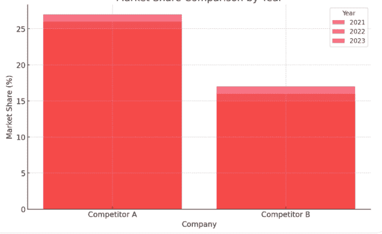

# 广告支出对比社交媒体参与度


图 40：由 Copywrite companion 生成的折线图示例。

按照要求，包含执行报告：

# 执行报告：设定更具竞争力的价格的成本效益

**目标**：利用有关竞争对手营收、市场份额、广告支出和品牌价值的数据，评估为我们的产品设定更具竞争力的价格的潜在成本效益。

成本分析：

- **单品营收减少**：设定更具竞争力的价格可能会导致单品营收减少。然而，可以通过销量的增加来抵消。
- **广告支出增加**：为了在降低价格的同时维持或扩大市场份额，可能需要增加广告支出，正如广告支出与社交媒体参与度之间的相关性所示。
- **品牌价值**：激进的降价可能会影响品牌感知，如果管理不当，可能会降低品牌价值。

收益分析：

- **市场份额增长**：竞争对手 A 持续营收增长的策略伴随着市场份额的显著增加。竞争性的定价策略可以帮助我们增加市场份额，可能使我们的定位更接近或领先于主要竞争对手。
- **更高的销量**：较低的价格可能会导致更高的销量，这可能可以补偿单品营收的减少。
- **增强社交媒体参与度**：通过适当的广告支出，竞争性定价可以增强社交媒体参与度，进一步推动品牌知名度和客户获取。

战略考量：

- **平衡价格与感知价值**：在竞争性定价与产品价值之间保持平衡至关重要，以避免侵蚀品牌资产。
- **监控竞争对手反应**：竞争对手可能会通过自己的价格调整做出反应，这可能引发价格战。需要对市场弹性和我们的成本结构进行仔细评估，以确保可持续的盈利。
- **优化广告策略**：正如广告支出与社交媒体参与度之间的正相关性所示，应该实施针对性的广告策略，以最大化降价的影响。

图 41：由 Copywrite companion 生成的执行报告示例。

总体而言，将 ChatGPT 用于营销活动，在生成新内容、设计营销策略和对网络进行竞争分析方面可以非常有用。

# 研究助手

在这种场景中，我们将再次关注研究，但这次将特别关注论文检索。更具体地说，我们希望助手能够执行以下操作：

- 从我们提供的自定义知识库中检索信息
- 将自定义文档与仅来自 Arxiv 的论文整合，并为此任务启用网页插件
- 从数据库（在我们的案例中，将托管在 Notion 中）检索其他研究人员正在进行的工作，这样我们就不有冒撰已被他人涵盖的文章的风险。

让我们来看看所有步骤。

- 1. 上传自定义文档。出于此目的，我将使用两篇关于机器学习中图像分类的论文：来自 J. Bird 等人的“CIFAKE: image classification and explainable identification of ai-generated synthetic images”以及 Khalis 等人的“A Comprehensive Study of Vision Transformers in Image Classification Tasks”。

你可以在配置面板的相应部分上传它们：

# 知识 (Knowledge)

如果你在知识下上传文件，与你的 GPT 对话可能包含文件内容。当启用代码解释器时，可以下载文件。


图 42：在配置面板中上传自定义文档

- 1. 将自定义文档与网页引用整合。为了做到，我们需要启用网页插件：

# 功能 (Capabilities)

- 网页浏览 (Web Browsing)
- DALL-E 图像生成
- 代码解释器与数据分析 (Code Interpreter & Data Analysis)

图 43：在配置面板中启用网页插件

此外，我们还需要指定助手仅在 Arxiv 存档中导航。我们将在创建指令集中查看如何指定这一点。

- 1. 从 Notion 数据库检索信息。这里的想法是，作为研究人员，我们可能会提出一些已经在其他同事那里研究和开发的想法。假设我们在 Notion 数据库中跟踪所有正在进行的研究，该数据库结构如下：

示例数据库 / DB 限制 添加图标 添加封面 添加描述

# DB

| 表格 | 内容 | 来源论文 |
| --- | --- | --- |
| Aa 标题 | | |

图 44：Notion 数据库结构。

为了做到，我们需要创建 GPT 动作 (actions)。为此，需要遵循两个步骤：

- 1. 在你的 Notion 工作空间中，你需要创建一个标记为内部的内部连接，并将创建一个新的内部集成密钥（或 API 密钥）。你可以将此连接命名为 "chatgpt" 或类似的名称。
2. 在你的 GPT 配置面板中，你需要设置一个新的动作架构 (Action schema)。由于在我们的案例中我们需要查询一个特定的数据库，该架构将如下所示：
3. 当涉及身份验证时，你可以点击“身份验证 (Authentication)”并选择“API Key”。输入以下信息。
  1. API Key：使用来自 Notion 中新创建连接的内部集成密钥
  2. 验证类型：Bearer

# 身份验证 (Authentication)

API Key

# 架构 (Schema)

```
openapi: 3.1.0
info:
  title: Notion API
  description: 用于与 Notion 页面、数据库和交互的 API
  version: 1.0.0
servers:
  - url: https://api.notion.com
paths:
  /databases/{query}:
    post:
      operationId: queryDatabase
      summary: 查询数据库
      parameters:
        - name: database_id
          in: path
          required: true
          schema:
            type: string
        - name: Notion-Version
          in: header
          required: true
          schema:
            type: string
            example: 2022-06-28
            constant: 2022-06-28
    requestBody:
      required: true
      content:
        application/json:
          schema:
            type: object
            properties:
              filter:
                type: object
              sorts:
                type: array
                items:
                  type: object
              start_cursor:
                type: string
              page_size:
                type: integer
    responses:
      '200':
        description: 成功响应
        content:
          application/json:
            schema:
              type: object
              properties:
                object:
                  type: string
                results:
                  type: array
                  items:
                    type: object
                next_cursor:
                  type: string
```

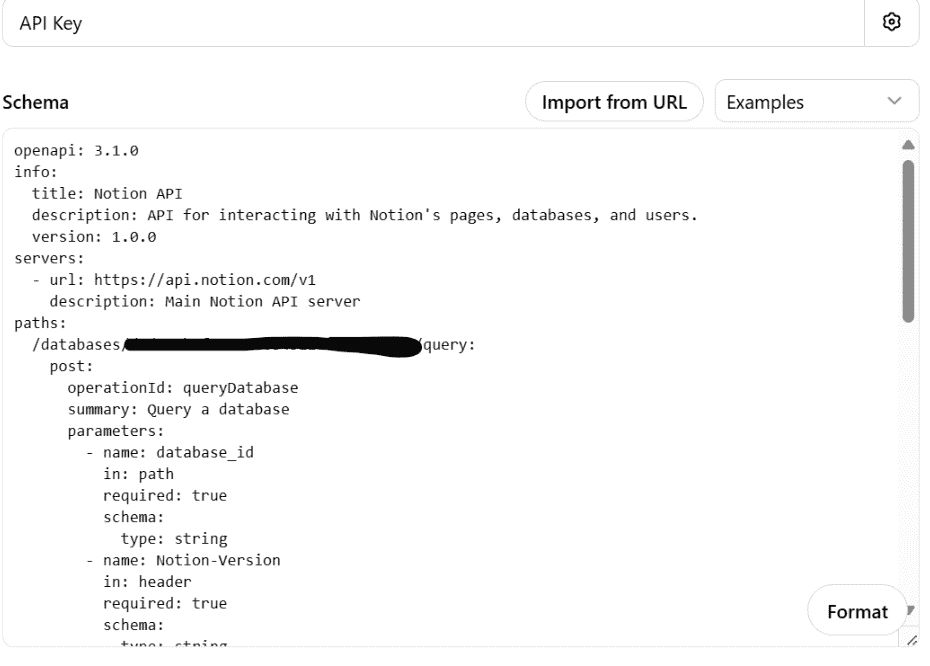

# 可用动作

| 名称 | 方法 | 路径 |
| --- | --- | --- |
| queryDatabase | POST | /databases/{database_id}/query |

图 45：动作架构所示：

这是整个架构所示：

```
openapi: 3.1.0
info:
  title: Notion API
  description: 用于与 Notion 页面、数据库和交互的 API
```


```yaml
has_more:
type: boolean
```

太好了，现在我们已经准备好了所有的原料，我们需要设置系统提示词（system message），以及可选的对话启动词（conversation starters）。在这个场景中，我设置了以下指令：

你是一个 AI 研究助手，负责利用各种工具和资源帮助研究人员。你的主要职责包括从自定义知识库、Arxiv 上的学术论文以及存储在 Notion 数据库中的进行项目中进行检索、整合和交叉引用信息。请遵循以下指南以确保你的帮助准确、全面并避免冗余：

1. 始终基于提供的文档进行回答。
2. 如果你认为有必要，可以在网上进行扩展搜索。你**唯一**可以的网站是 Arxiv。
3. 如果用户询问，检查该主题是否已涵盖 Notion DB 中。

以及以下对话启动词：

1. VGGNet、ResNet 和 Inception 在图像分类的准确性和效率方面有何区别？
2. 图像分类模型面临哪些挑战？数据增强和迁移学习等技术如何帮助它们？
3. CNN 深度如何影响图像分类？ResNet 的残差连接又是如何提供帮助的？

最终产品看起来如下：

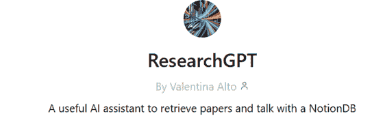

图 46：我们的 ResearchGPT 落地页

让我们测试一下：

1. 我首先会问一个通用问题，将通过提供的论文来回答：

> VGGNet、ResNet 和 Inception 在图像分类的准确性和效率方面有何区别？

## VGGNet、ResNet 和 Inception：图像分类准确性与效率的差异

1. VGGNet
    - **架构**：VGGNet 的特点是具有深层、顺序的 3x3 卷积滤波器层。其设计简单，采用统一的架构，每层除了滤波器数量外，都非常相似。
    - **准确性**：由于其深度允许模型能够学习复杂的特征，VGGNet 在图像分类任务中实现了高准确率。
    - **效率**：与 ResNet 和 Inception 等更现代的架构相比，VGGNet 的效率较低。由于密集的顺序层，其大量的参数量导致了更高的计算成本和更多的内存占用。

图 47：ResearchGPT 从提供的文档中检索知识的示例

2. 然后，我想看看该主题是否已经被涵盖：

数据库中是否已涵盖该主题？

是的，该主题已以“图像分类的深度学习：比较研究”的标题涵盖数据库中。该条目比较了 VGGNet、ResNet 和 Inception 等模型在 CIFAR-10 和 ImageNet 等标准数据集上的性能，并指出 ResNet 在复杂的图像识别任务中提供了优的准确率。


图 48：ResearchGPT 使用预定义操作与 Notion 通的示例。

3. 最后，我想整合该主题使其具有独特性：

我想让这个主题变得独特。请推荐其他 3 篇 arxiv 论文来整合我的主题。

为了让你的主题具有独特性，你可以与以下三篇 arXiv 论文的见解进行整合：

1. EfficientNet: 重新思考卷积神经网络的模型缩放
* 论文 ID: 1905.11946
* 摘要：该论文介绍了 EfficientNet，这是一种优化了网络深度、宽度和分辨率之间平衡的模型。将你的比较与 EfficientNet 整合，可以提供一个现代的对比，说明缩放技术相对于 VGGNet、ResNet 和 Inception 如何影响准确性和效率。
* 链接：arXiv:1905.11946

2. "MixConv: 混合深度可分离卷积核"
* 论文 ID: 1907.09595
* 摘要：MixConv 提出了深度分离卷积核，允许模型更高效地提取不同尺的特征。将此纳入你的研究中，可以增加关于各种卷积技术如何影响性能和效率的复杂度。
* 链接：arXiv:1907.09595

3. "Xception: 基于深度可分离卷积的深度学习"
* 论文 ID: 1610.02357
* 摘要：Xception 探索了深度可分离卷积，为 Inception 模块提供了高效的替代方案。将这种方法与传统架构进行比较，可以突出现代架构在效率上的改进。
* 链接：arXiv:1610.02357

## 图 49：ResearchGPT 使用浏览器插件的示例。

如你所见，我们的助手可以利用我们提供的所有工具，并在需要时调用 Notion DB。

## 总结

在本章中，我们探索了如何获取自定义的 GPTs 来满足你的特定目标。定制 ChatGPT 的可能性开启了全新的场景图景，高度专业化的 AI 助手将成为专业人士的日常伴侣。此外，OpenAI 提供了一个无代码 UI 来创建 GPTs，使得所有全民开发者不仅能从扩展的解决方案市场中受益，还能从自己的创造中获益。

凭借插件的扩展性和自定义知识库，自定义 GPTs 可以可以你完成无限的任务。然后，通过添加强大的操作（actions），它们还可以与周围环境通信，并从“纯粹”的生成进化为自动化。

通过本章，我们也结束了本书的第二部分，在该部分我们专注于 ChatGPT 的实际应用。从下一章开始，我们将更详细地介绍大型企业如何利用 OpenAI 模型并将其嵌入到业务流程中。我们将涵盖趋势性的企业用例，并展示如何通过 REST API 在你的应用程序中嵌入 OpenAI 的大语言模型（LLMs）的实践实现。

## 参考文献

- https://arxiv.org/abs/2312.11914
- https://arxiv.org/abs/2101.07714
- https://psycynet.apa.org/record/2014-07087-000
- https://www.tandfononline.com/doi/10.2753/MIS0742-1222240109
- https://www.youtube.com/watch?v=TUMyyygCMMGA
- https://arxiv.org/pdf/2312.01232
- https://arxiv.org/pdf/2303.14126

OceanofPDF.com

