## 1 生成式 AI 简介

### 在 Discord 上加入我们的书籍社区


https://packt.link/EarlyAccess

你好！欢迎来到 ChatGPT 与 OpenAI 终极指南！在书中，我们将探索生成式人工智能（GAI）的迷人世界及其突破性的应用。生成式 AI 改变我们与机器交互的方式，使计算机能够在没有明确人类指令的情况下创作、预测和学习。自从2023年11月ChatGPT发布以来，我们见证了自然语言处理、图像视频合成以及许多领域以前所未有的速度发展。无论你是好奇的初学者还是经验丰富的从业者，本指南都将提供应对生成式 AI 精彩格局所需的知识和技能。现在，让我们深入浅出，从一些定义开始了解我们所处的背景。

本章提供了生成式 AI 领域的概述，该领域涉及使用机器学习（ML）算法创建新且独特的数据或内容。

重点关注生成式 AI 在各个领域的应用，如图像合成、文本生成和音乐创作，突显了生成式 AI 变革各行业的潜力。本生成式 AI 简介将提供该技术所处的背景，以及在广阔的 AI、机器学习和深度学习（DL）世界中的知识。然后，我们将通过具体示例和最新进展探讨生成式 AI 的主要应用领域，以便你熟悉它对企业和整个社会可能产生的影响。

此外，了解生成式 AI 向当前最先进水平的研究历程将帮助你更好地理解近期进展的基础。

我们将通过以下主题涵盖所有内容：

- *理解生成式 AI*

在本章结束时，你将熟悉令人兴奋的生成式 AI 世界、其应用背后的研究历史以及当前的发展，这些发展可能已经并且正在对业务产生颠覆性的影响。

## 介绍生成式 AI

AI 在近年来取得了巨大进展，其中增长明显的领域之一就是生成式 AI。生成式 AI 是人工智能（AI）和深度学习（DL）的一个子领域，侧重于使用机器学习（ML）技术在现有数据上训练的算法和模型来生成新内容，如图像、文本、音乐和视频。

为了更好地理解 AI、ML、DL 和生成式 AI 之间的关系，可以将 AI 视为基础，而 ML、DL 和生成式 AI 代表了日益专业化和专注的研究与应用领域：

- AI 代表一个广泛的领域，即创建能够执行任务、表现出人类智能和能力并与生态系统交互的系统。

- ML 是一个分支，侧重于创建算法和模型，使这些系统能够随着时间和训练进行自我学习和改进。ML 模型从现有数据中学习，并随着其增长自动更新其参数。

- DL 是 ML 的一个子分支，从意义上说，它包含了深度 ML 模型。这些深度模型被称为神经网络，特别适用于计算机视觉或自然语言处理（NLP）等领域。当我们谈论 ML 和 DL 模型时，通常指的是判别式模型，其目标是在数据基础上进行预测或模式推理。

- 最后，我们得到了生成式 AI，它是 DL 的进一步子分支，它不使用深度人工神经网络对现有数据进行聚类、分类或预测：它利用那些强大的人工神经网络模型来生成全新的内容，从图像到自然语言，从音乐到视频。

下图展示了这些研究领域之间是如何相互关联的：

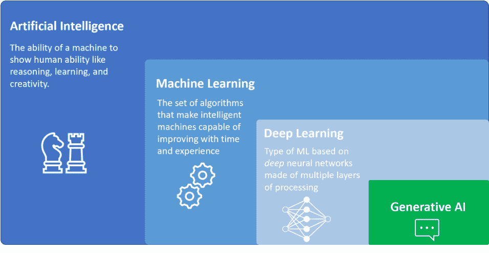

图 1.1 – AI、ML、DL 和生成式 AI 之间的关系

生成式 AI 模型可以在海量数据上进行训练，然后可以使用这些数据中的模式从零开始生成新示例。这种生成过程与判别式模型不同，后者被训练用于预测给定示例的类别或标签。

具有生成式 AI 特性的神经网络类型被称为大基础模型（LFMs），在 ChatGPT 等语言模型的情况下，我们称之为**大语言模型（LLMs）**。

大语言模型是一种以 Transformer 架构为特征的人工神经网络。它们的特点是海量的参数（数量以万亿计），并且在数十亿个单词上进行过训练。给定训练集，LLMs 能够根据用户的输入理解并生成自然语言。

尽管文本理解和生成可能是生成式 AI 最出特征之一，但该领域涵盖了许多领域。

## 生成式 AI 的领域

近年来，生成式 AI 取得了显著进展，并将其应用扩展到广泛的领域，如艺术、音乐、时尚、建筑等。在某些领域中，它确实在改变我们创造、设计和理解周围世界的方式。在另一些领域，它正在改进并使现有流程和操作更加高效。

生成式 AI 用于许多领域这一事实意味着它的模型可以处理各种数据，从自然语言到音频或图像。让我们了解生成式 AI 模型是如何处理不同类型的数据和领域的。

### 文本生成

生成式 AI 最大的应用之一（也是我们在本书中涵盖最多的）是它产生自然语言新内容的能力。事实上，生成式 AI 算法可以用于生成新文本，如文章、诗歌和产品描述。

例如，由 OpenAI 开发的 GPT-4o 等语言模型可以在大量文本数据上进行训练，然后用于用不同语言生成新的、连贯且语法正确的文本（无论是在输入还是输出方面），并从文本中提取相关特征，如关键词、主题或全文摘要。

这里有一个使用 GPT-3 的示例：

ChatGPT 4o

用一个简单的例子向一个 5 岁的孩子解释什么是质子。

想象你有一个非常小的乐木积木。这块乐木积木超级小，小到你用肉眼看不见。这个微小的乐木积木就像质子。

现在，想想你用乐木积木可以搭建的所有玩具。每个玩具都是由这些微小的乐木积木组合成的。同样，我们周围的一切，比如你的玩具、你的房子甚至是宇宙，都是由被称为原子的极小物体组成的。在每个原子内部，还有更小的部分，质质子。所以，质子就像那些帮助构成世界上一切的乐木积木之一！


图 1.2 – ChatGPT 响应用户提示的示例，同时也添加了引用

接下来，我们将转向图像生成。

### 图像生成

生成式 AI 在图像合成领域最早且最为人知的示例之一是由 I. Goodfellow 等人在 2014 年引入的生成对抗网络（GAN）架构。GAN 的目的是生成与真实图像无异的图像。这种能力具有许多有趣的业务应用，例如为计算机视觉模型生成合成数据集、生成真实的商品图像，以及用于虚拟现实和增强现实。

这是一个不存在的人脸示例，因为它们完全是由 AI 生成的：


图 1.3 – 生成 this-person-does-exist.com 的脸

随后，2021 年，OpenAI 在该领域引入了一种新的生成式 AI 模型——DALL-E。与 GAN 不同，DALL-E 设计用于根据自然语言生成图像（GAN 接收随机向量作为输入），并可以生成广泛的图像，这些图像可能看起来并不真实，但仍描述了所需的概念。

生成 AI 在广告、产品设计和时尚等创意行业具有巨大潜力，可以创建独特且创意的图像。

自首次发布（2024 年 12 月）以来，DALL-E 取得了巨大的改进，如下所示。让我们看看下面 DALL-E 在诞生之初创作的艺术作品：

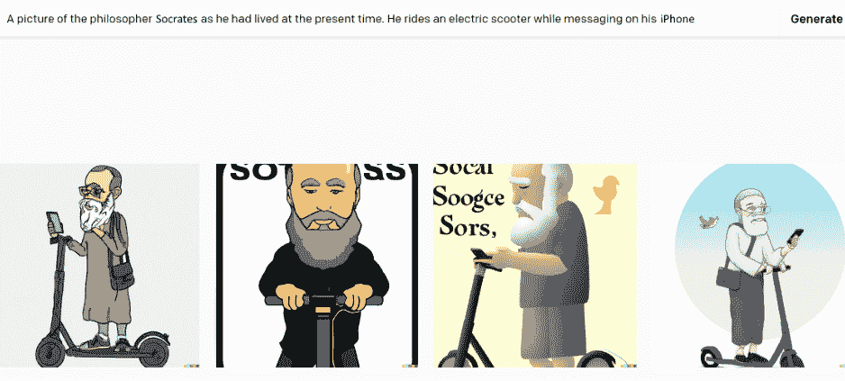

图 1.4 – DALL-E 根据自然语言提示生成的图像

现在让我们看看 DALL-E3（本书编写时的最新版本）可以生成（这里我使用的是 DALL-E3 驱动的 Microsoft Image Creator，你可以在 https://copilot.microsoft.com/images/create 进行尝试）哲学家苏格拉底现在的照片。他骑着电动滑板一边在手机上发信息。

探索创意

创作


图 1.5 – DALL-E3 根据自然语言提示生成的图像

在不到 18 个月的时间里，看到这个模型的改进程度如此之大，令人印象深刻。有趣的是，我们仅仅接触了过去几个月生成式 AI 领域发生的巨大改进的冰山一角。

### 音乐生成

音乐生成是生成式 AI 的早期方法追溯到 50 年代，源自算法作曲领域的研究，这种技术利用算法来生成音乐作品。事实上，1957年，Lejaren Hiller 和 Leonard Isaacson 创作了《弦乐四重奏伊利亚克套曲》（https://www.youtube.com/watch?v=n0pjBFLQSk8），这是第一部完全由 AI 创作的音乐。从那时起，音乐生成式 AI 领域几十年来一直是持续的研究课题。在近年的发展中，新的架构和框架在公众中变得流行，例如 Google 在2016年引入的 WaveNet 架构，它能够生成高质量的音频样本；或者由 Google 开发的 Magenta 项目，它使用循环神经网络（RNNs）和其他机器学习技术来生成音乐和其他艺术形式。随后，2020年，OpenAI 也宣布了 Jukebox，这是一种生成音乐的神经网络，并可以根据音乐和人声风格、流派、参考艺术家等对输出进行自定义。

这些以及其他框架成为了许多 AI 作曲师助手的基础。例如由 Sony CSL Research 开发的 Flow Machines。这个生成式 AI 系统在大型音乐作品数据库上进行了训练，以创建各种风格的新音乐。法国作曲家 Benoît Carré 使用它创作了专辑《Hello World》（https://www.helloworldalbum.net/），该专辑包含了与多位人类音乐家的合作。

在这里，你可以看到一个由 Music Transformer 生成的曲目示例，它是 Magenta 项目的模型之一：

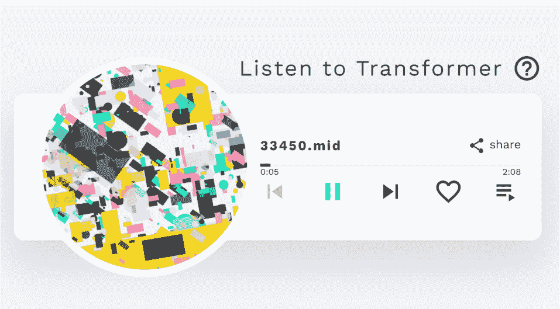

图 1.6 – Music Transformer 允许用户收听 AI 生成的音乐表演

生成式 AI 在音乐领域的另一个惊人应用是语音合成。确实，可以找到许多 AI 工具，它们根据文本输入以知名歌手的声音创建音频。

例如，如果你一直好奇如果由 Kanye West 演唱你的歌曲听起来是什么样，那么你可以使用 FakeYou.com（https://fakeyou.com/）、Deep Fake Text to Speech 或 UberDuck.ai（https://uberduck.ai/）等工具来实现你的梦想。

#### 选定声音

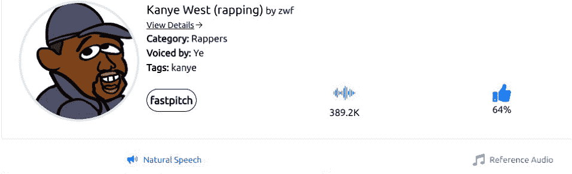

选择声音

| 说唱歌手 | Kanye West (说唱) |
| :--- | :--- |
| 输入文本进行合成 | hello hello! |
| 高级控制 | |

图 1.7 – 使用 UberDuck 进行文本转语音合成。

我必须说，结果真的令人印象深刻。如果你想玩玩，也可以尝试你所有喜爱的卡通片的配音，例如小熊维……

让我们更进一步吧。如果我们能从零开始生成一首歌，只需用自然语言让 GenAI 为我们做到这一点呢？嗯，今天我们可以无缝地做到这一点，而不需要任何音乐知识。在当今音乐市场上兴起的 GenAI 产品中，Suno 是一个极佳的例子，它的使命是“[...] 正在建立一个任何人都能创作优秀音乐的未来。无论你是淋浴歌手还是上榜艺人，我们都打破了你与你梦想创作的歌曲之间的障碍。不需要乐器，只需要想象力。从你的脑海到音乐。”（来源：https://suno.com/about）。

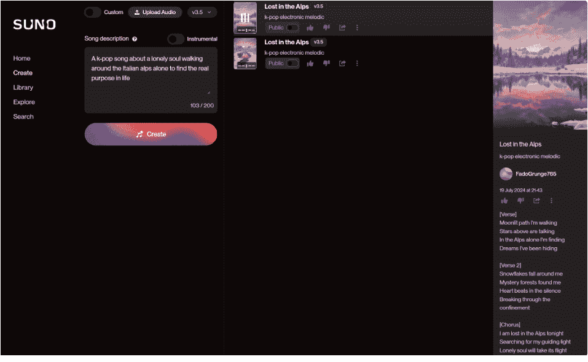

你能相信它成了我 2024 年夏天的热门金曲吗？如果你也想创作你的夏季热门金曲，可以在 https://suno.com/create 免费尝试。

### 视频生成

视频生成的生成式 AI 与图像生成具有相似的发展时间线。事实上，视频生成领域的关键进展之一是 GANs（生成对抗网络）的发展。得益于它们在生成真实图像方面的准确性，研究人员开始将这些技术应用于视频生成。基于 GAN 的视频生成最著名的例子之一是 DeepMind 的 Motion to Video，它能从单张图像和动作序列生成高质量视频。另一个很好的例子是 NVIDIA 的基于 DL 的 Video-to-Video Synthesis（Vid2Vid）框架，它利用 GANs 从输入视频合成高质量视频。

Vid2Vid 系统可以生成时间上一致的视频，这意味着它们在时间推移过程中保持平滑且真实的动作。该技术可以执行各种视频合成任务，如下：

- 将视频从一个领域转换为另一个领域（例如，将白天的视频转换为夜间的视频，或将素描转换为真实的图像）

- 修改现有视频（例如，更改视频中对象的风格或外观）

- 从静态图像创建新视频（例如，让一系列静态图像动起来）

2022年9月，Meta 的研究人员宣布了 Make-A-Video（https://makeavideo.studio/）的开放，这是一个新的 AI 系统，允许用户将自然语言提示转换为视频片段。在这种技术背后，你可以识别出我们迄今提到的其他领域的许多模型——用于提示的语言理解、带有图像生成的图像和动作生成，以及由 AI 作曲师制作背景音乐。

现在，我们上面提到的所有内容与最新的文本转视频模型相比都相形见绌。其中，OpenAI 在2024年2月宣布了一种名为 SORA 的新文本转视频模型，发布了一些早期实验：


提示：一位时尚的女性走在充满温暖发光霓虹灯牌的街道上。她穿着皮夹克、连衣裙和靴子。戴着墨镜和口红。


提示：一部电影预告片，主角是一个戴着头盔的30岁宇航员，天空，沙漠，电影风格，35mm胶片拍摄，色彩鲜艳。

图 1 – SORA 生成的视频

我必须说，结果真的令人印象深刻。如果你想玩玩，也可以尝试你所有喜爱的卡通片的配音，例如小熊维……

总体而言，生成式 AI 多年来影响了许多领域，某些 AI 工具已经支持了艺术家、机构和普通用户。未来看起来非常有前景；然而，在跳转到现有的最先进模型之前，我们首先需要对生成式 AI 的根源、历史和近期发展有更深入的理解。

之前的章节中，我们概述了生成式 AI 领域最新、最前沿的技术，这些都是近几年开发的。然而，该领域的研究可以追溯到几十年前。

我们将生成式 AI 研究的起点标记在20世纪 60年代，当时 Joseph Weizenbaum 开发了聊天机器人 ELIZA，这是 NLP 系统的早期示例之一。它是一个基于规则的交互系统，旨在根据文本输入的响应来娱乐用户，并为 NLP 和生成式 AI 的进一步发展铺平了道路。然而，我们知道现代生成式 AI 是 DL 的一个分支，尽管最早人工神经网络（ANNs）在20世纪40年代就已引入，但研究人员面临着许多挑战，包括计算能力有限以及对大脑生物基础缺乏了解。因此，ANNs 直到80年代才获得广泛关注，当时，除了新硬件和神经科学的发展外，反向传播算法的出现促进了 ANNs 的训练阶段。事实上，在反向传播出现之前，训练神经网络是困难的，因为无法高效计算误差相对于每个神经元的参数或权重的梯度，而反向传播使得自动化训练成为可能，并使 ANNs 的应用成为现实。

随后，在2000年代和2010年代，随着计算能力的提升，结合海量的可用训练数据，使得深度学习（DL）变得更加实用并向普通大众普及，并随之推动了研究的增长。

2013年，Kingma 和 Welling 在其论文《Auto-Encoding Variational Babies》中引入了一种新的模型架构，称为变分自编码器（VAEs）。VAE 是基于变分推理概念的生成式模型。它们提供了一种学习方法，通过将数据编码到名为**潜空间**（latent space）的低维表示空间中（通过编码器组件），然后将其解码回原始数据空间（通过解码器组件），来实现对数据的紧凑表示。

VAE 的核心创新在于引入了潜空间的概率解释。编码器不再是学习一个从输入到潜空间的确定性映射，而是将输入映射为潜空间上的一个概率分布。这使得 VAE 能够通过从潜空间中采样并将这些样本解码到输入空间，来生成新的样本。

例如，假设我们想要训练一个 VAE，它可以创建出看起来像真实的猫和狗的新图片。

为了做到这一点，VAE 首先接收一张猫或狗的照片，并将其压缩为潜空间中一组较小的数字，这些数字代表了图片中最重要的特征。这些数字被称为**潜变量**（latent variables）。

然后，VAE 获取潜变量并利用它们创建一张看起来可能像真实的猫或狗照片的新图片。这张新图片可能与原始图片存在某些差异，但它看起来仍然属于同一组图片。

随着时间的推移，VAE 通过将其生成的图片与真实图片进行比较，并调整其潜变量以使生成的图片看起来更真实，从而在创建真实图片方面变得更好。

VAE 为生成式 AI 领域的快速发展铺平了道路。事实上，仅在一年后，Ian Goodfellow 就引入了生成对抗网络（GANs）。与以编码器和解码器为主要元素的 VAE 架构不同，GANs 由两个神经网络组成——生成器（generator）和判别器（discriminator）——它们在零和博弈中相互对抗。

生成器创建伪造数据（对于图像而言，就是创建一张新图像），其目的是使其看起来像真实数据（例如，一张猫的照片）。判别器接收真实和伪造数据，并试图区分它们——它在我们艺术伪造示例中扮演着评论的角色。

在训练过程中，生成器试图创建能够欺骗判别器使其认为是真实的数据，而判别器则试图更擅于区分真伪数据。这两个部分被一起训练，这一过程被称为**对抗训练**（adversarial training）。

随着时间的推移，生成器在创建看起来像真实的伪造数据方面变得更好，而判别器在区分真伪数据方面变得更好。最终，生成器创建伪造数据的能力变得非常精湛，以至于判别器都无法区分真伪数据的差异。

这是一个完全由 GAN 生成的人脸示例：

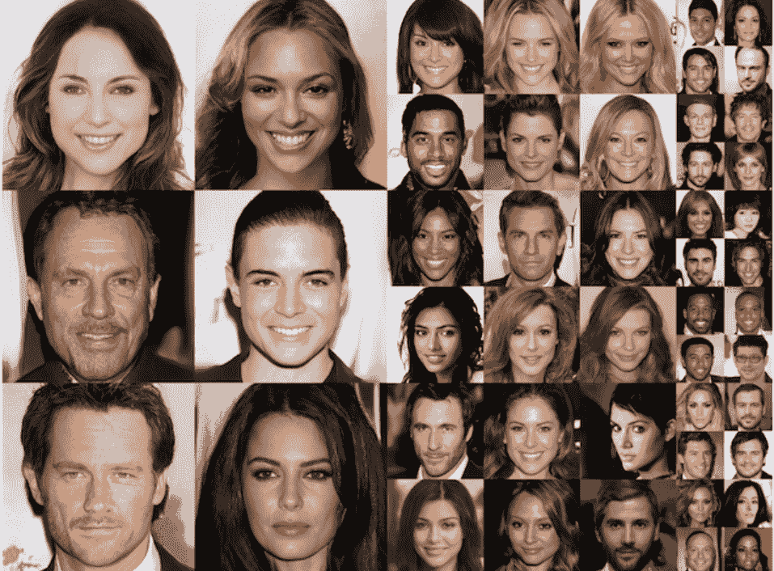

图 1.8 – GAN 生成的光真脸示例（取自《Progressive Growing of GANs for Improved Quality, Stability, and Variation》，2017: https://arxiv.org/pdf/1710.10196.pdf）


# VAE 和 GANs 的生成模型发展

`VAE` 和 `GANs` 两种模型的目的都是生成与原始样本无法区分的新数据，而且自构想以来，它们的架构得到了改进，并与 Van den Oord 及其团队提出的 `PixelCNNs` 以及 Google DeepMind 开发的 `WaveNet` 等新模型的发展并进，导致了音频和语音生成领域的进展。

另一个伟大的里程碑出现在 2017 年，当时 Google 研究人员在论文《Attention Is All You Need》中引入了一种名为 `Transformer` 的新架构。它在语言生成领域具有革命性，因为它在保留语言上下文记忆的同时允许并行处理，性能优于此前基于 `RNN` 或长短期记忆（`LSTM`）框架的语言模型尝试。

`Transformer` 确实构成了由 Google 在 2018 年引入的名为 BERT（基于 `Transformer` 的双向编码器表示）的大型语言模型的基础，并很快成为了 NLP（自然语言处理）实验的基准。

`Transformer` 也是 OpenAI 引入的所有生成式预训练（GPT）模型的基础，包括 ChatGPT 背后的模型 GPT-3，以及大型基础模型（Large Foundation Models）。

尽管在这些年里已经有了大量的研究和成就，但直到 2022 年下半年，公众的注意力才转向生成式 AI 领域。

并非巧合，2022 年被称为“生成式 AI 之年”。这一年，强大的 AI 模型和工具在普通大众中普及：基于扩散的图像服务（`MidJourney`、`DALL-E 2` 和 `Stable Diffusion`）、OpenAI 的 `ChatGPT`、文本生成视频（`Make-a-Video` 和 `Imagen Video`）以及文本生成 3D（`DreamFusion`、`Magic3D` 和 `Get3D`）工具都向个人用户开放，有时甚至是免费的。

这产生了颠覆性的影响，主要原因有两点：

- 一旦生成式 AI 模型在公众中普及，每个个人用户或组织都有机会尝试并体会其潜力，即使他们不是数据科学家或机器学习工程师。
- 这些新模型的输出及其嵌入的创造力在客观上是令人惊叹的，而且往往令人担忧。一种紧迫的适应呼吁——针对个人和政府——应运而生。

从此起，在不久的将来，我们可能会见证 AI 系统在个人使用和企业级采用率的激增。

## 18 个月后：主要趋势与创新

回回到 2022 年 11 月到今天，我们在 GenAI 领域见证了大量的创新。这些创新许多与新发布的模型有关，例如 OpenAI 的 `GPT-4o` 和 `DALL-E3`，以及 Google 的 `Gemini`、Meta 的 `Llama 3` 以及微软的 `Phi3` 等。

然而，最显著的成就可能在于我们与模型交互以及构建应用的方式。在本节中，我们将探索标记了 GenAI 应用参考架构的三大主要进展。

# 男王+女人 ≈ 女王

# RAG 的组成阶段

`RAG` 由三个阶段组成：

- *检索*：给定用户查询及其对应的向量，检索出最相似的文档片段（即与用户查询向量接近的向量），并将其作为大语言模型（LLM）的底层上下文。
- *增强*：通过额外的指令、规则、安全护栏以及类似的提示词工程典型实践，对检索到的上下文进行丰富（我们将在第 3 章中介绍提示词工程主题）。

## 系统消息

你是一个帮助用户回答查询的 AI 助手。

## 上文

## 提示词工程

## 文档

回复中应使用以下文档：

```
(retrieved_docs)
```

## #安全

你**应该始终**根据检索到的文档搜索结果来引用事实性陈述。

- *生成*：基于增强后的上下文，LLM 对用户的查询生成回复。

## 系统消息 + 检索文档

你是一个帮助用户回答查询的 AI 助手。

## 文档

回复中应使用以下文档：

```
(retrieved_docs)
```

## 用户查询

## #安全

你**应该始终**根据检索到的文档搜索结果来引用事实性陈述。

整体流程如下：

`RAG` 结合了生成模型和信息检索系统的优势，以增强生成内容的质量和相关性。传统的生成模型完全依赖训练数据来产生响应，这有时会导致过时或无关的信息。`RAG` 通过在生成过程中整合外部知识库解决了这一局限性。

例如，OpenAI 的 `ChatGPT` 在 `RAG` 的增强下，可以从可靠来源获取当前数据，以回答关于近期事件的查询，而这超出了其训练截止日的范围。这种检索与生成的协同扩大了生成式 AI 的适用性，使其在动态、信息丰富的环境中更加健壮和实用用。

## 多模态性

在本章的第一节中，我们看到了生成式 AI 的各个领域，从文本到图像，从视频到音乐。通常，大型基础模型（Large Foundation Models）倾向于特定领域，正如我们在语言理解和生成方面的大语言模型，或在图像生成方面 `DALL-E3` 所示。

然而，生成式 AI 最近的进展使得大多模态模型（LMMs）的发展，它们能够处理和生成不同类型的数据，如文本、图像、音频和视频。

`LMMs` 与“标准”大语言模型（`LLMs`）共同拥有大型基础模型典型的泛化和适应能力。然而，`LMMs` 能够处理异构数据，其理念是模仿人类与周围生态系统交互的方式——即通过我们所有的感官。

多模态模型的绝佳例子是 OpenAI 的 `GPT-4o`，它能够通过文本、图像和音频与用户交互。让我们来看例子：

图片中的建筑是哈利法塔，位于阿拉伯酋联合长国的迪拜。它是目前世界上最高的建筑。

如你所见，模型能够分析并对其进行推理。现在让模型生成一张插图：

谢谢。你能为它生成一张卡通风格的插图吗？黑白的

`LMMs` 最有趣的的事实是，它们保留了自己的推理能力，使其适用于异构数据语境下的复杂推理。让我们考虑最后一个例子（仅显示响应的前几行）：

好的，让我们解决字谜游戏。以下是根据给定线索的答案：

## 横向：

- 2. 头胸（螯肢节肢动物中头部和胸部的融合）
- 3. 节肢类（蝎子所属的纲）
- 4. 变态（从幼态形态向成体的转变）

正如你所想象的，这在各个行业开启了应用蓝图，我们将在接下来的章节看到一些具体的例子。

## AI 代理（AI Agents）

在之前的章节中，我们揭示了基础模型（`LFMs`）在生成内容方面非常强大。然而，它们缺乏一种能力，即采取行动与周围生态系统交互的能力。例如，如果我们希望我们的 `LLM` 不仅能生成 LinkedIn 帖子，还能将其发布在我们的页面上怎么办？

为了克服这一局限性，AI 代理成为了关键角色。但它们究竟是什么？代理可以被看作是由大语言模型驱动的 AI 系统，给定用户查询，它们能够在允许的范围内与周围生态系统交互。生态系统的边界由我们为代理提供的工具（或插件）决定（在之前的例子中，我们为代理提供了一个 LinkedIn 插件，以便它可以发布生成的内容）：

- 作为 AI 系统推理引擎的 `LLM`
- 指导代理以特定方式行为和思考的系统消息。例如，你可以设计一个教学助手的代理，使用如下系统消息："你是一个教学助手。给定学生的查询，永远不要提供最终答案，而是提供提示以引导他们到达答案。"
- 代理可以利用的与周围生态系统交互的工具集

AI 代理完美代表了"`LLM` 作为应用程序推理引擎"的含义。事实上，代理的魅力之处在于它们可以选择最合适的工具来完成用户的请求。例如，假设我们有一个制作 LinkedIn 内容的 AI 代理，并为它提供了两个工具：LinkedIn 插件和网络搜索插件（每个插件都有其功能的相应描述）。然后，让我们探索代理面对两个不同问题时的：

- 生成一个关于小狗在山间漫步的故事：代理将在不涉及任何插件的情况下生成故事。
- 生成一个关于米兰当前天气的故事：代理将调用网络搜索插件获取米兰天气。
- 生成一个关于米兰当前天气的 LinkedIn 帖子并发布到我的简介上：代理将调用网络搜索插件获取米兰天气，并调用 LinkedIn 插件将其发布到我的简介上。

而且不仅如此。

为什么只有一个代理呢，如果你可以创建一个相互通信和合作的代理团队呢？想象多个代理，每个代理都有特定的专业知识和目标，通过相互通信和交互来完成任务。这就是多代理应用程序的外观，并且在过去的几个月里，这种模式开始显示出现涌行为。

让我们考虑以下示例。我们想生成一个关于气候变化的电梯演讲稿（elevator pitch）。为了做到这一点，我们需要最新的信息（最新的趋势和研究、未来展望等），以及基于学术论文的坚实研究。此外，我们需要保持简洁、敏锐且高效，在非常短的演讲中交付所有关键信息。

现在，我们可以向一个单一智能体（agent）提出所有这些要求，为它提供所有必需的工具和长长的指令来完成任务。然而，事实证明，当我们给大语言模型（`LLMs`）安排"过多的任务"时，它们的表现往往会变差。相反，让我们使用多智能体方法（multi-agent approach），创建一个由以下 AI 专家组成的团队：

- 一位市场分析师，可以在网络上搜索有关气候变化的最新新闻；这将是一个带有网络搜索插件和特定新闻搜索指令的智能体；
- 一位专家研究员，可以轻松地浏览有关气候变化的学术研究论文；这将是一个带有 `Arxiv` 插件以及如何检索相关信息的特定指令的智能体；
- 一位公共演讲专家，可以轻松地将所有信息整合成一个电梯演讲稿；这将是一个具有关于如何进行完美演讲的适当指令的智能体；
- 一位批评者，他将审查演讲稿并在需要时向公共演讲专家提出一些修改；这将是一个具有关于如何进行完美演讲的适当指令的智能体；

因此，当用户提出问题"生成一个关于当前气候变化问题的电梯演讲稿"时，所有智能体都可以开始处理该项目。

有许多框架可以帮助开发者构建多智能体应用（包括 `AutoGen`、`LangGraph`、`CrewAI`），特别是涉及到我们希望智能体遵循的"流"（flow）时。例如，我们可能希望强制特定的迭代次数，或者确保所有智能体至少被调用一次；或者甚至在每次迭代中都让我们作为用户参与进来，提供进一步的反馈，并整合到下一次迭代中。

在写作期间，多智能体框架正显示出广阔的进展，但它仍然处于实验阶段，可能远未达到企业级就绪。尽管如此，它是对大语言模型背后卓越推理能力的一种瞥，展示了它们如何开启解决问题和创造的新方法。

## 小语言模型

不出所意料，大语言模型确实很大。这意味着包含大语言模型的人工神经网络架构是由海量的参数组成的，数量级达到万亿级。理想情况下，参数数量越高，大语言模型的推理能力就越强。

然而，高参数量也意味着高昂的训练和托管成本，因为这需要强大的 AI 基础设施。此外，这些模型所需的能量消耗对大语言模型训练的环境影响以及从远来看的整体可持续性引发了严重的问题。为了让你有一个直观的概念，以下是与不同尺寸（以参数数量衡量）开源大语言模型相关的数字：

| | GPU 类型 | GPU 功耗 | GPU 小时 | 总功耗 | 碳排放 (CO2eq) |
| :--- | :--- | :--- | :--- | :--- | :--- |
| `OPT-175B` | `A100-80GB` | 400W | 809,472 | 356 MWh | 137 |
| `BLOOM-175B` | `A100-80GB` | 400W | 1,082,880 | 475 MWh | 183 |
| `LLaMA-7B` | `A100-80GB` | 400W | 82,432 | 36 MWh | 14 |
| `LLaMA-13B` | `A100-80GB` | 400W | 135,168 | 59 MWh | 23 |
| `LLaMA-33B` | `A100-80GB` | 400W | 530,432 | 233 MWh | 90 |
| `LLaMA-65B` | `A100-80GB` | 400W | 1,022,362 | 449 MWh | 173 |

> 图 2：在同一数据中心训练不同模型所需的碳足迹和计算算力。来源：https://arxiv.org/pdf/2302.13971

幸运的是，在过去的几个月里，我们看到人们对较小模型的研究兴趣和投资日益增长，目标是在减少参数数量的同时保持良好的推理能力。其想法是，较小的模型即使"智能程度较低"，如果能在更定制的活动中专业化，仍然可以达到预期要求。毕竟，我们真的需要万亿参数的巨大强大模型来解决我们脑海中的所有任务吗？

这些较小的模型被称为小语言模型（SMLs），除了在基础设施方面更轻量、需求更低外，它们还表现出惊人的性能。

例如，如果我们考虑 `Phi-3` 的较小版本（它是微软开发的流行的 `SLM` 家族的一部分），它"仅"有 70 亿参数，我们可以看到它在最流行的大语言模型基准测试中超过了 `GPT-3.5-turbo`。

| 类别 | 基准测试 | `Phi-3-Small-8K-In` | `Phi-3-Small-128K-In` | `Gemma-7b` | `Mixtral-8x7` | `Llama-3-8B-In` | `GPT3.5-Turbo-1106` |
| :--- | :--- | :--- | :--- | :--- | :--- | :--- | :--- |
| 类别 | MMLU (0-shot) | 75.7 | 75.5 | 63.6 | 70.5 | 71.4 | |
| 语言理解 | HellSwag (0-shot) | 77.0 | 69.6 | 49.8 | 70.4 | | |
| 理解 | WinoGrande (0-shot) | 81.5 | 80.1 | 55.6 | 62. | | |
| 推理 | Social IQA (0-shot) | 79.2 | 78.7 | 65.5 | 73.9 | | |
| 事实知识 | TruthfulQA (MC2) (0-shot) | 58.1 | 66.0 | 52.1 | 60.2 | | |
| 数学 | GSM8K CoT (0-shot) | 89.6 | 87.3 | 59.8 | 64.7 | | |
| 代码生成 | HumanEval (0-shot) | 61.0 | 59.1 | 34.1 | 37.8 | 60.4 | |
| 碳足迹 | MBFP (0-shot) | 71.7 | 70.3 | 51.5 | 60.2 | 67.7 | |

图 3：`Phi-3` 能力的基准表。来源：https://azure.microsoft.com/en-us/blog/introducing-phi-3-redefining-whats-possible-with-slms/

- 什么是 OpenAI？
- OpenAI 系列概述
- 通往 ChatGPT 之路：其背后的模型数学
- ChatGPT：顶尖水平

## 技术要求

为了能够测试本章中的示例，你需要以下内容：

- 一个 OpenAI 账户以访问 Playground 和 Models API (https://openai.com/api/login)
- 你最喜欢的 IDE 环境，例如 Jupyter 或 Visual Studio
- 安装了 `Python 3.7.1` (https://www.python.org/downloads)
- 安装了 `pip` (https://pip.python.io/en/stable/installation/)
- OpenAI Python 库 (https://pypi.org/project/openai/)

## 什么是 OpenAI？

OpenAI 是一家由埃隆·马斯克（Elon Musk）、萨姆·奥特曼（Sam Altman）、格雷格·布洛克曼（Greg Brockman）、利亚·苏特凯斯基（Ilya Sutskever）、沃伊杰奇·扎伦巴（Wojciech Zaremba）和约翰·舒尔曼（John Schulman）于 2015 年创立的研究机构。正如 OpenAI 网页上所述，它的使命是"确保通用人工智能（AGI）造福全人类"。由于其具有通用性，AGI 旨在具备学习和执行广泛任务的能力，而无需针对特定任务进行编程。

自 2015 年以来，OpenAI 将其研究集中在**深度强化学习 (DRL)** 上，这是**机器学习 (ML)** 的一个子集，它将**强化学习 (RL)** 与深度神经网络相结合。该领域的首个贡献可以追溯到 2016 年，当时公司发布了 OpenAI Gym，这是一个供研究人员开发和测试 **RL** 算法的工具包。

## Gym 是强化学习的标准 API，以及多样化的参考环境集

Gym 接口简单、符合 Python 风格，并且能够表示通 RL 问题：

```python
import gym
env = gym.make("LunarLander-v2", render_mode="human")
observation, info = env.reset(seed=42)
for _ in range(1000):
    action = policy(observation) # 用户定义的策略函数
    observation, reward, terminated, truncated, info = env.step(action)
```

```python
if terminated or truncated:
    observation, info = env.reset()
env.close()
```

图 2.1 – Gym 文档的首页 (https://www.gymlibrary.dev/)

OpenAI 继续在该领域进行研究并做出贡献，但其最显著的成就与生成式模型有关——生成式预训练 Transformer (GPT)。

在他们的论文《通过生成式预训练改进语言理解》中引入了模型架构并将其命名为 GPT-1 后，OpenAI 的研究人员很快在 2019 年发布了其继者 GPT-2。这个版本的 GPT 是在一个名为 WebText 的语料库上训练的，该语料库当时包含超过 800 万份文档，来自 Reddit 提交中获得至少 3 个点赞的 URL，总计有 40 GB 的文本。它拥有 12 亿个参数，是其前者的十倍。

在这里，你可以看到由 HuggingFace 发布的 GPT-2 UI 首页 (https://transformer.huggingface.co/doc/distil-gpt2)：

图 2.2 – GPT-2 根据提示编写段落。来源：https://transformer.huggingface.co/doc/distil-gpt2


接着，2020 年，OpenAI 首次宣布并发布了 GPT-3，它拥有 1750 亿个参数，大幅提高了相对于 GPT-2 的基准结果。通过 GPT-3 模型——更准确地说，通过名为 GPT-3.5 的微调版本——我们进入了 ChatGPT 时代：事实上，ChatGPT 在首次发布时是由 GPT-3.5 驱动的。

从那时（2022年11月）至今，OpenAI 发布了 GPT 系列的许多新版本：GPT-4、GPT-4-turbo、GPT-4vision（第一个多模态模型）和 GPT-4o，“o”代表“omni”，指的是其多模态能力。

除了自然语言生成模型外，OpenAI 在生成式 AI 的其他领域也有开发，包括：

- DALL-E：一种文本到图像的模型，可根据文本描述生成详细且创意的图像。它可以产生各种图像，从现实场景到想象力丰富的抽象艺术。
- Whisper：一种语音识别模型，旨在将口语转录为文本。它擅长理解各种口音、方言和嘈杂环境，使其在实时转录和语音控制应用中非常有效。
- SORA：一种文本到视频的模型，可根据文本指令生成真实且富有想象力的视频。SORA 可以创建长达一分钟的视频，同时保持视觉质量并遵循用户的提示。在本文写作期间，SORA 尚未向公众开放。

尽管 OpenAI 已投资于生成式 AI 的许多领域，但它在文本理解和生成方面的贡献是卓越的，这归功于我们将在接下来几个段落中探索的基础 GPT 模型的发展。

## OpenAI Playground 概述

今天，OpenAI 提供了一系列预训练的、即开即用的模型供大众使用。

- OpenAI Playground：一个友好的界面，你可以在其中与模型交互而无需编写代码。
- OpenAI APIs：提供 OpenAI 模型的高质量端点，可以整合到你的应用程序中。

在进入 Playground 之前，让我们先概述一下模型。

## OpenAI 系列

在过去的几年里，OpenAI 在该领域取得了巨大进展，发布了更新的版本。在本节中，我们将看到按领域划分的主要模型。

### 语言模型

OpenAI 的 GPT 是先进的语言模型，旨在根据提示生成类人类的文本。它们功能多变，可用于各种自然语言任务，如文本完成、翻译、摘要和编码。自 2022 年 11 月 ChatGPT 发布以来，OpenAI 发布了：

- GPT-3.5-turbo：ChatGPT 第一版本的模型
- GPT-4（第一个多模态模型）和 GPT-4-turbo：针对聊天和助手进行了优化
- GPT-4o：最先进的多模态模型
- GPT-4o mini：GPT-4o 的小型版本

除了这些最新模型，用户还可以访问一组所谓的“基础 GPT 模型”，例如 Babbage-002 或 davinci-002（GPT-2），它们代表补全 API（我们将在下一节介绍补全 API）。

### 图像模型

OpenAI 的图像模型（如 DALL-E）根据文本描述生成并处理图像。这些模型可以创建详细且富有想象力的视觉效果，使用户产生独特的艺术品、设计方案等。例如，DALL-E 3（模型的最新版本）能够根据复杂的提示创建复杂的且创意的图像，推动了 AI 在视觉艺术领域的边界。这些模型在创意产业、数字营销以及任何受益于高质量自定义视觉效果的领域都特别有用。

### 文本转语音与语音转文本

在第 1 章中，我们已经了解了 OpenAI 开发的语音转文本 (STT) 模型 Whisper，它可以处理和分析音频输入。此外，OpenAI 还开发了文本转语音 (TTS) 模型，提供清晰且富有表现力的高质量输出，适用于从客户服务机器人到教育工具的广泛应用。由 OpenAI 开发的文本转语音 (TTS) 模型将文本转换为口语，产生逼真且自然的音频。这些模型对于创建语音助手、提高视障用户的无障碍性以及生成自动公告至关重要。

### 文本转视频

随着 SORA 的发布，OpenAI 展示了其尖端的文本到视频模型，该模型能够根据文本描述生成具有想象力的真实视频场景。通过采用 DALL-E 的技术并结合 Transformer，SORA 可以创建长达一分钟的高保真视频。它在保持 3D 一致性、物体持久性以及模拟视频内交互方面表现出色。尽管在准确建模复杂物理和确保时间连贯性方面仍面临挑战，SORA 在创意产业具有巨大潜力，为视频制作和故事讲述提供了新的可能性。

- **Embeddings (嵌入)**：来自 OpenAI 的嵌入模型将文本转换为向量（或嵌入）的数值表示，这些向量捕捉了语义并投影到多维向量空间中。空间中不同实例之间的数学距离表示它们在语义上的相似性。例如，想象 `queen`（皇后）、`woman`（女性）、`king`（国王）和 `man`（男人）这些词。理想情况下，在我们词即向量的多维空间中，如果表示是正确的，我们希望实现以下效果：

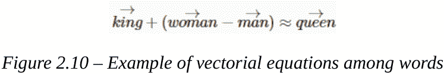

这意味着 `woman` 和 `man` 之间的距离应该等于 `Queen` 和 `King` 之间的距离。

嵌入在智能搜索场景中极其有用。事实上，通过获取用户输入和用户想要搜索的文档的嵌入，可以计算输入与文档之间的距离指标（即余弦相似度）。通过这种方式，我们可以检索在数学距离上更接近用户输入的文档。

OpenAI 的嵌入模型 `text-embedding-ada-002` 和 `text-embedding-3-large` 在文本相似性、搜索和代码搜索等任务中提供了顶尖性能，能够创建文本的稠密向量表示。这些嵌入允许对大型文本数据集进行高效且有效的比较，提高了搜索的准确性和相关性。

- **Moderation (审核)**：OpenAI 的审核模型旨在检测并过滤文本中不适当、有害或不安全的内容。这些模型通过识别潜在的冒犯性或有害语言，对于维护安全且尊重的在线环境至关重要。最新的审核模型 `text-moderation-007` 在确保跨平台内容合规性和安全性方面既稳健又有效。它能帮助开发者和公司执行社区准则并防止有害内容的传播，从而促进更安全的数字交互。

总体而言，OpenAI 在过去几年中的覆盖越来越广，通过顶尖模型解决了生成式 AI 的多个领域。

## 在 Playground 中尝试 OpenAI 模型

要访问你的 OpenAI Playground，你需要创建一个 OpenAI 账户并导航至 `https://platform.openai.com/playground`。落地页如下图所示：

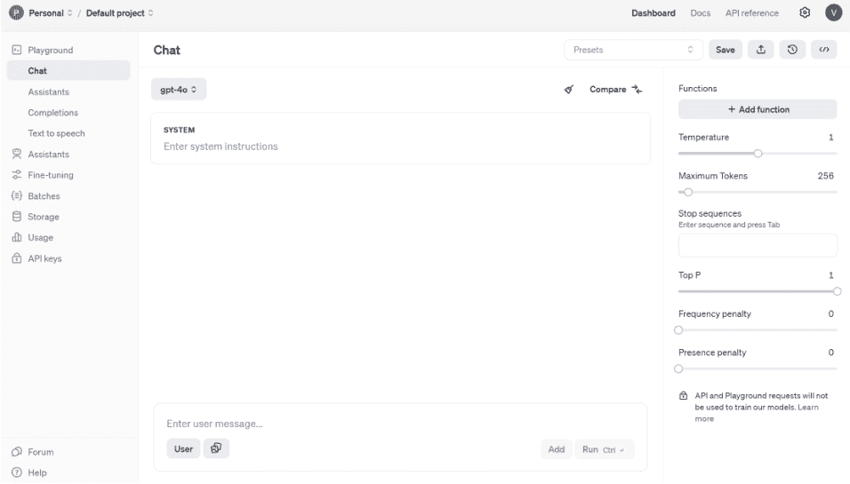

图 2.4 – 位于 `https://platform.openai.com/playground` 的 OpenAI Playground

如图 2.4 所示，Playground 提供了一个界面，用户可以在其中开始与模型交互，你可以在界面的右侧选择模型。

在深入研究 Playground 的主要部分之前，让我们先定义一些你在本章中看到的专业术语：

- **Tokens (标记)**：Tokens 可以被视为 API 用于处理输入提示词的词碎片或片段。与完整的单词不同，token 可能包含末尾空格，甚至是部分子词。为了从长度的角度更好地理解 token 的概念，有一些通用的指南需要记在心中。例如，英语中的一个 token 大约等于四个字符，或一个单词的四分之三。
- **Prompt (提示词)**：在自然语言处理 (NLP) 和机器学习 (ML) 的背景下，prompt 指作为输入给 AI 语言模型以生成响应或输出的文本。prompt 可以是一个问题、陈述或句子，用于为语言模型提供上下文和方向。
- **Context (上下文)**：在 GPT 领域，上下文指的是用户 prompt 之前的词和句子。语言模型使用这些上下文，根据训练数据中发现的模式和关系，生成概率最大的下一个词或短语。
- **Model confidence (模型置信度)**：模型置信度是指 AI 模型为特定预测或输出分配的确定程度或概率。在 NLP 语境下，模型置信度通常用于指示 AI 模型对其给定输入提示词所生成响应的正确性或相关性有多大。
- **Functions (函数)**：函数是第 1 章引入的工具或插件概念的另一种定义。通过函数，我们为模型提供了一项额外的技能，使其能够完成用户的任务。函数始终会有一个自然语言编写的描述，以便模型知道何时调用它。

上述定义对于理解如何使用 Azure OpenAI 模型系列以及如何配置它们的参数至关重要。

在 Playground 中，有四个主要部分可以与模型交互：

**Chat (聊天)：** 在这里，你可以测试今天所有可用的聊天模型，包括纯文本模型（如 GPT-3.5）或多模态模型（如 GPT-4o）。你可以提供系统消息——即你用自然语言提供给模型的一组指令。你还可以在相同的用户问题下比较两个不同模型的输出。以下是如何进行操作的示例：


图 2.5 – 两个模型对比示例。

对于每个模型，你还可以调整一些可以配置的参数。列表如下：

- **Temperature (温度)**（范围从 0 到 1）：这控制模型响应的随机性。低温度会让你的模型更具确定性，这意味着它倾向于对相同的问题给出相同的输出。例如，如果我将温度设置为 0 并多次询问模型 *“What is OpenAI?”*，它将始终给出相同的答案。另一方面，如果我对温度设置为 1 的模型进行同样的操作，它将尝试在措辞和风格上每次修改其答案。
- **Max tokens (最大标记数)**：这控制模型对用户提示词响应的长度（以 token 为单位）。
- **Stop sequences (停止序列，用户输入)**：这让响应在指定的点结束，例如句子或列表的结束。
- **Top probabilities (高概率)**（范围从 0 到 1）：这控制模型在生成响应时考虑哪些 token。将其设置为 0.9 将考虑所有可能的 token 中概率最高的 90% 部分。人们可能会问，为什么不将高概率设置为 1 以选择所有高概率 token 呢？答案是，当模型置信度较低时，即使在高分 token 中用户可能希望保持多样性。
- **Frequency penalty (频率惩罚)**（范围从 0 到 1）：这控制生成响应中相同 token 的重复次数。惩罚越高，在同一响应中看到相同 token 出现一次以上的概率越低。惩罚根据 token 在文中出现的频率成比例减少（这是与后续参数的主要区别）。
- **Presence penalty (存在惩罚)**（范围从 0 到 2）：这与上一个相似但更严格。它减少了重复文中已出现过的任何 token 的概率。由于比频率惩罚更严格，存在惩罚也增加了在响应中引入新主题的可能性。

除了在 Playground 中尝试 OpenAI 模型外，你始终可以在自定义代码中调用模型 API 并将模型嵌入到你的应用程序中。

事实上，在 Playground 的右上角，你可以点击 View code（查看代码）并导出所示配置：

- **Assistants (助手)**：OpenAI Assistants 可以被视为一种更快、更容易地开发 AI Agents（第 1 章引入）的方法。事实上，Assistants 可以定义为由 LLM 驱动的实体，有一组要遵循的指令和一组要使用的工具或插件——基本上就是 AI Agents 的定义！

对于 OpenAI，它们配备了三个内置工具：

- **File Search (文件搜索)**：它允许用户上传自定义文档，以便助手可以通过它来完成查询。它基于 RAG 框架运行。
- **Function Calling (函数调用)**：它允许用户定义一组自定义函数，助手可以调用这些函数来完成给定任务。
- **Code Interpreter (代码解释器)**：指的是助手运行代码的能力，无论是针对提供的文档（例如电子表格）或需要数学计算的分析论文，或者仅仅解决用户提供的复杂任务（例如复杂的数学问题）。

在下面的图中，你可以看到一个名为“Chat with PDF”的助手示例，它专门用于对提供的内容做出响应文档（在我的情况下，我上传了由 Hugo Touvron 等人的论文“LLaMA: Open and Efficient Foundation Language Models”）。

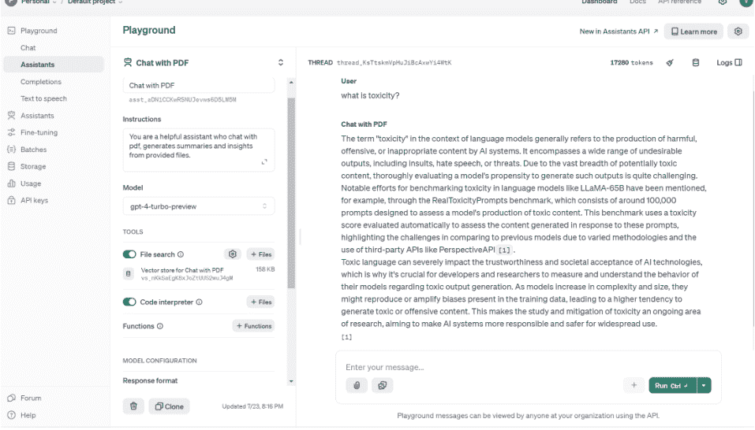

图 2.8 – OpenAI 助手的示例。

从之前的截图中可以看到，助手能够根据提供的文档回答我关于知识检索的问题。事实上，我的问题问得相当模糊，因为“毒性”（toxicity）一词可以指多个领域；尽管如此，助手知道将提供的文档作为主要信息来源。

**补全（Completions）**。这一节指的是一类被称为“基础模型”（base models）的模型，例如 GPT-3，它们是构建所谓的“助手模型”（或我们之前看到的聊天模型）的基础。例如，`chat gpt-3.5-turbo`（ChatGPT 背后的模型）是基础模型 GPT-3 的微调版本。

补全（基础）模型旨在为提示词（prompts）生成单一响应，使其适用于文本生成和摘要等任务，而无需在多次交互中维护上下文。另一方面，聊天（助手）模型针对交互式对话进行了优化，能够跨多轮对话维护上下文，是聊天机器人和虚拟助手等应用的理想选择。

下面你可以看到 Playground（操场）中典型的补全任务示例：


如你所见，针对我的话“今天我去了一家杂货店并”，模型用最可能的词完成了这个句子。

如今，补全模型很少被使用，因为它们的性能优于聊天模型，但它们可以被进行微调以适应特定的用例（我们将在本节的稍后部分讨论微调）。

- **文本转语音**。除了上述语音转文本模型 Whisper 之外，OpenAI 还发布了 TTS（文本转语音）模型，可以直接在 Playground 中进行测试。

让我们来看一个例子：

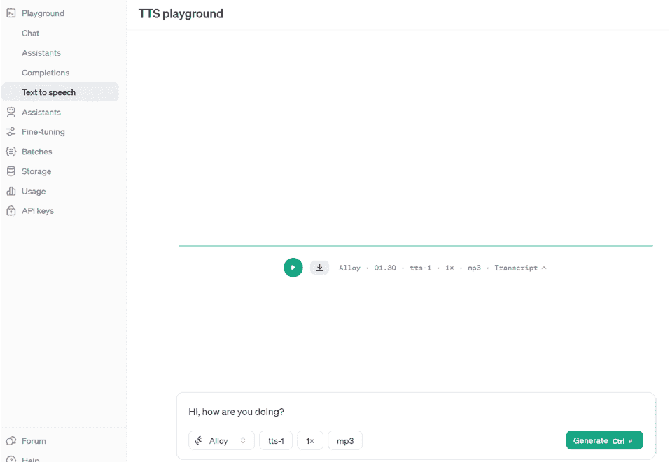

图 2：在 Playground 中使用 OpenAI TTS 模型的示例

如从上面的图片所示，你可以选择生成音频的语音、模型、速度和格式。

所有之前的模型都是预构建的，这意味着它们已经在一个巨大的知识库上进行了预训练。

然而，你有一些方法可以让你的模型更具定制化，并针对你的用例进行调整。

第一种方法嵌入在模型的设计中，它涉及通过少样本学习（few-shot learning）方法为你的模型提供上下文（我们将在书的后面重点关注这种技术）。也就是说，你可以要求模型生成一篇模板和词汇表让你想起你已经写过的文章。为此，你可以为模型提供生成文章的查询以及之前的文章作为参考或上下文，以便模型能更好地准备应对你的请求。

这里是它的示例：

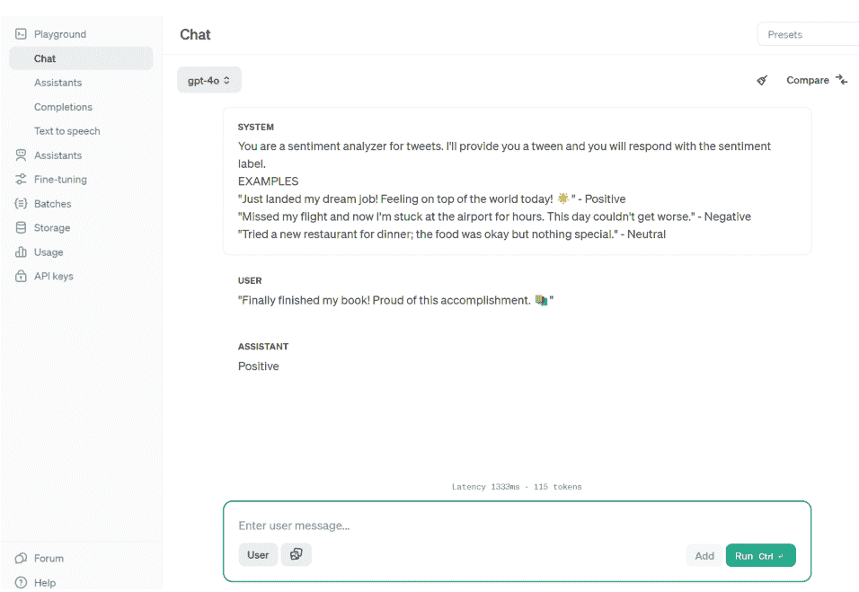

图 2.11 – 在 OpenAI Playground 中使用少样本学习法的对话示例

在上一个插图中，我指示模型只输出推文的情绪标签，并为其提供了三个关于如何做的示例。

第二种方法更为复杂，被称为微调（fine-tuning）。微调是将预训练模型适配到新任务的过程。

在微调过程中，预训练模型的参数会被更改，通过调整现有参数或添加新参数，以更好地拟合新任务的数据。这是通过在特定新任务的较小标记数据集上训练模型来实现的。微调背后的核心思想是利用从预训练模型中学到的知识并将其微调到新任务，而不是从零开始训练模型。请见下图：

| 数据集 | token 数 | 在训练中的比例 |
|---|---|---|
| Common Crawl | 4100 亿 | 60% |
| WebText | 590 亿 | 22% |
| Books1 | 120 亿 | 8% |
| Books2 | 550 亿 | 8% |
| Wikipedia | 30 亿 | 3% |

自定义数据集

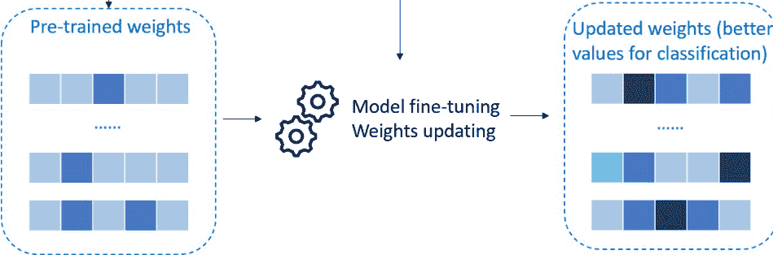

图 2.12 – 模型微调

在前面的图中，你可以看到关于 OpenAI 预构建模型如何进行微调的架构。其想法是，你有一个具有通用权重或参数的预训练模型。然后，你向模型输入自定义数据，通常以键值对提示词和补全的形式呈现，如下所示：

```
{"prompt": "<prompt text>", "completion": "<idea"}
{"prompt": "<prompt text>", "completion": "<idea"}
{"prompt": "<prompt text>", "completion": "<idea"}
...
```


一旦训练完成，你将拥有一个自定义模型，该模型在给定任务上表现特别出色。

微调的妙处在于它可以让模型针对你的用例进行定制和优化，无需从头开始训练。通过在这些数据集上训练，模型得到了能力的提升。

在这个段落中，我们概述了 OpenAI 提供的模型，从可以在 Playground 中尝试的 GPT，到可以通过微调更复杂的模型。

在接下来的章节中，我们将关注这些优秀模型的背景，从它们背后的数学原理开始。

## ChatGPT：顶尖水平

2022 年 11 月，OpenAI 发布了其对话 AI 系统 ChatGPT 的网页版，供公众使用。这引起了专家、机构和普通用户的巨大热潮——在短短 5 天内，该服务就达到了百万用户！

在介绍 ChatGPT 之前，我让它自我介绍一下，这是发布几天后的快照：

我正在写关于你的介绍。你能向读者介绍一下你自己吗？

可以可以！我是 ChatGPT，是由 OpenAI 开发的语言模型。我在大量的文本数据上进行了训练，旨在执行各种自然语言处理任务，如文本生成、对话建模、情感分析和问答。我基于 Transformer 架构，这让我有效地处理单词序列并学习它们之间的关系。

我在各种文本上训练，包括网页、新闻文章、书籍等，这使我拥有广泛的知识库并理解各种主题。我的能力通过深度学习和 OpenAI 团队的持续更新不断完善。


我可以进行实时交互，回答查询或根据给定的提示词生成文本。我还可以集成到各种应用程序中，如聊天机器人、内容创作和客户服务，以增强它们的自然语言处理能力。

总的来说，我是一个高级语言模型，可以协助各种 NLP 任务并提供类人的响应。我正在不断进化和改进，并渴望展示我的能力来帮助解决你的 NLP 需求。

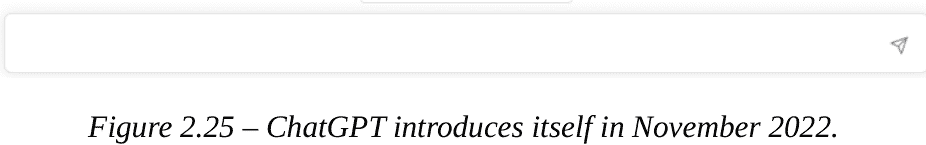

如上所述，ChatGPT 的第一个版本构建在高级语言模型之上，该模型使用了经过专门微调的 GPT-3 版本。这个微调版本被称为 `GPT-3.5-turbo`。优化过程涉及强化

## 人类反馈强化学习 (RLHF)

人类反馈强化学习 (RLHF)，是一种利用人类输入来训练模型使其展现出理想对话行为的技术。

我们可以将 RLHF 定义为一种机器学习方法，其中算法通过接收人类的反馈来学习执行某项任务。算法经过训练以做出能够最大化人类提供的奖励信号的决策，而人类则提供额外的反馈以改进算法的性能。当任务复杂到传统编程无法处理，或者预期结果难以预先指定时，这种方法非常有用。

此处相关的区别在于，ChatGPT 在训练过程中采用了“人类在回路”模式，使其能够与用户保持一致。通过引入 RLHF，ChatGPT 的设计旨在以更自然、吸引人的方式更好地理解并响应人类语言。

> 同样的 RLHF 机制也被用于我们可以认为是 ChatGPT 前身的作品——InstructGPT。在 OpenAI 研究人员于 2022 年 1 月发表的后续论文中，`InstructGPT` 被介绍为一类比 GPT-3 更好地遵循英语指令的模型。

ChatGPT 如今仍作为任何人都可以使用的免费应用程序提供；然而，自 2023 年 2 月起，OpenAI 宣布了一个名为 ChatGPT Plus 的新付费版本，费用为每月 20 美元，为订阅者提供多项优势，包括访问最新模型、最快的响应时间、出色的插件集以及在 GPTs 乐场中创建你自己的助手的可能性。

让我们快速浏览一下当前版本的 ChatGPT 用户界面：

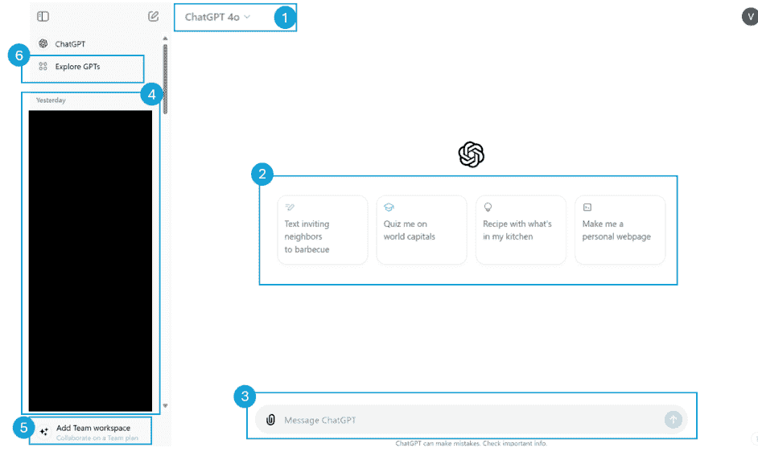

图 3：chatgpt.com 上的 ChatGPT 落地页

让我们双击每个部分：

- 1. 你可以决定 ChatGPT 背后的模型。在我的情况下，我设置了 GPT-4o，它仅供付费订阅使用。这是我们整本书将使用的模型。

- 2. 向用户提出了一系列预构建的提示词（prompts），以便他们熟悉应用程序。

- 3. 文本框是用户提问的地方。注意左上角有一个小回针图标：它表示可以上传文件供模型进行导航。这些文件可以从本地上传，也可以从 Google Drive 或 OneDrive 等云存储中检索。

- 4. 在左侧侧边栏，你可以看到你与 ChatGPT 之前的聊天列表（我的涵盖了这些）。这是一个极其实用的工具，因为在每次聊天中，通过你与模型的多次轮交互，你创建了一个 ChatGPT 感知的上下文环境。这意味着，如果你想继续之前开始的对话，可以打开相关的聊天并与模型对话，而无需再次描述整个场景。

- 5. 最近添加的一个很棒的功能是可以与其他用户拥有共享工作区的可能性，这样你就可以与团队成员合作。注意，这是一个额外的付费功能，不包含在 Plus 计划中，每月额外 5 美元。

- 6. 最后，ChatGPT Plus 提供了创建 GPTs 的可能性，这是你可以为特定功能定制的个性化助手。你可以决定保持你的 GPT 为私有状态，或将其发布到 GPTs 商店中，任何人都可以使用并对其进行评分。我们将在本书后后的专门章节中介绍 GPTs。

最后，ChatGPT Plus 还带了两个内置插件，模型可以在需要时自主调用：网络搜索插件（用于检索最新信息）和代码解释器插件（用于处理分析文档或执行复杂的数学任务）。

在本书中，我们将利用 ChatGPT Plus 来展示最新模型和功能的能力，尽管如此，我们将涵盖的大部分示例也可以通过 ChatGPT 的免费版本实现（目前由 GPT-3.5-turbo 驱动）。

ChatGPT 架构和训练方法的不断开发和改进有望进一步推向语言处理的边界。

## 总结

在本章中，我们回顾了 OpenAI 的历史、相关领域以及最新进展。由于提示词（prompt）对 LLM 有巨大影响，提示词工程是设计 LLM 应用时至关重要的。事实上，有多种技术可以不仅优化你的 LLM 响应，还可以减少与幻觉相关的风险。在本章中，我们将涵盖提示词工程领域的各种新兴技术，从基础方法到高级框架。具体来说，

在本章结束时，你将获得构建功能性且稳固提示词的基础，这在接下来的章节中非常重要。

## 参考文献

- Radford, A., Narasimhan, K. (2018). Improving language understanding by generative pre-training.

- Vaswani, A., Shazeer, N., Parmar, N., Jones, L., Gomez, A., Kaiser, L., & Polukhin, I. (2017). Attention Is All Need. https://doi.org/10.48550/arXiv.1706.03762
