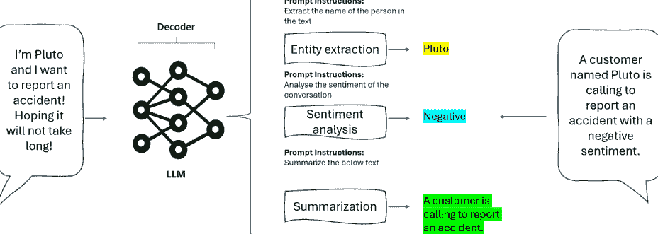
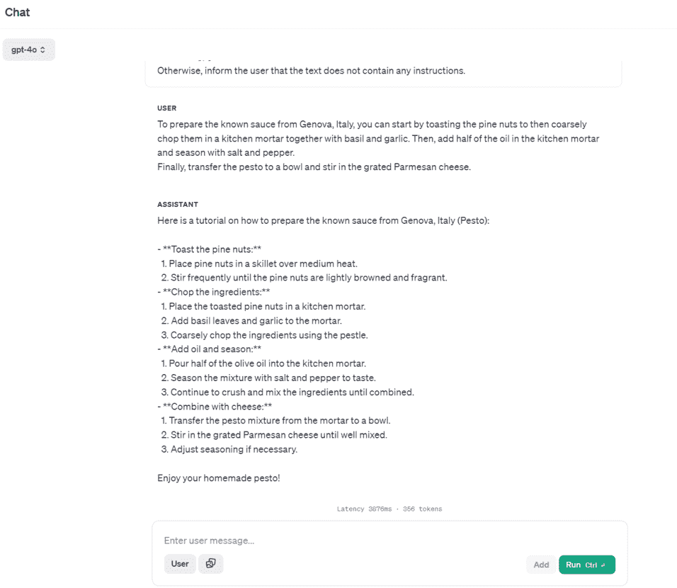
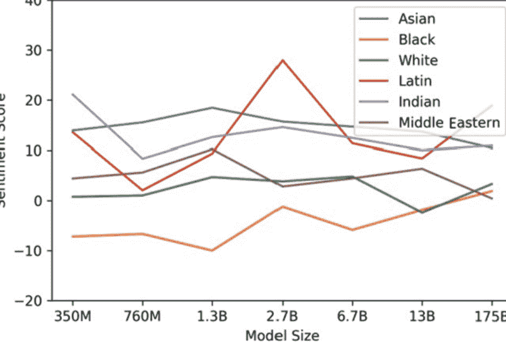

# 3 理解提示词设计

在之前的章节中，我们多次提到了 **提示词（prompt）** 一词，泛指用户用户的输入。

由于提示词对 LLM 的性能有巨大影响，提示词工程是设计 LLM 应用时至关重要的活动。事实上，有多种技术可以不仅优化你的 LLM 响应，还可以减少与幻觉相关的风险。

在本章中，我们将涵盖提示词工程领域的各种新兴技术，从基础方法到高级框架。具体来说，我们将通过：

- 提示词工程简介

- 零样本、单样本和少样本学习（Zero, one and few shot learning）

- 提示词工程的基本原理

- 提示词工程的高级技术

- 通过提示词工程缓解风险和幻觉

- 处理提示注入（Prompt injections）

在下一章中，我们将看到如何通过正确设计提示词从 LLM 中获取最高价值。

## 什么是提示词工程？

在解释什么是提示词工程之前，让我们从提示词（prompt）的原子定义开始。

提示词是一种引导 LLM 行为以生成文本输出的文本输入。在 LLM 和由 LLM 驱动的应用的上下文中，我们可以区分两种类型的提示词：

- 用户在与 LLM 交互时输入的提示词。例如，提示词可能是“详细解释一下质子”，或“生成一个跑步马拉松的训练计划”。下面你可以看到一个用户提示词的示例：

图 1：用户提示词示例。

你会听到将此组件简单称为“prompt”、“query”或“用户输入”。

- 无论用户查询如何，都指令模型以特定方式运行的提示词。这指的是我们提供模型的自然语言指令集，使其在与最终用户交互时表现特定。你可以将其视为模型的“后端”，由应用程序开发者而非最终用户处理。

在下面的图片中，你可以看到一个示例，我们向模型提出了上述相同的问题，但这次我们添加了一个系统消息（system message）来指令模型以特定方式运行：


## 聊天

系统

你是一个专门从事小学教育的 AI 助手。你对用户查询提供的回答应该像向 6 岁的学生解释一样。始终保持友和与礼貌，并用一个友好的表情符号结束你的回答。

用户

用两句话描述质子。

助手

质子是原子中一个带有正电荷的微小部分，就像中心的一个小超级英雄。它存在于原子核中，原子核是原子的核心。😃


# 图 2：元提示（metaprompt）的示例。

我们将这类提示词称为“元提示”或“系统消息”。

从此以后，提示词工程是设计有效提示词的过程，旨在从大语言模型（LLMs）中诱导高质量且与需求高度相关的输出。提示词工程需要创造力、对 LLM 的理解以及精确性。



### 图 3：使 LLM 专门化的提示词工程示例。

在过去的几年里，提示词工程本身变成了一门全新的学科，这一事实证明了与这些模型交互需要一套以前不存在的新型技能和能力。在企业场景下构建生成式 AI 应用时，“提示艺术”已成为一项顶级技能；然而，它对于在日常任务中使用 ChatGPT 或类似 AI 助手的个人用户来说也极其有用，因为它能显著提高结果的质量和准确性。

在接下来的章节中，我们将看到如何为你的 LLM 应用构建高效且稳健的提示词和元提示。请注意，我们将涵盖的所有技术都可以嵌入到用户提示词和元提示中，取决于你的具体需求。为了实现这一点，我将利用 OpenAI Playground，以便我在两个提示层级上操作时具有更大的灵活性。

## 零样本、单样本和少样本学习——Transformer 模型的典型特征

在之前的章节中，我们提到了 LLM 通常以预训练的形式出现。它们在海量数据上进行了训练，并已对其（数十亿个）参数进行了相应的配置。

然而，这并不意味着这些模型不能再学习了。在第 2 章中，我们看到自定义 OpenAI 模型并使其更能够处理特定任务的方法之一是微调（fine-tuning）。

> 微调是将预训练模型适配到新任务的过程。在微调中，预训练模型的参数会发生变化，方法是调整现有参数或添加新参数，以适应新任务的数据。这是通过在针对新任务的较小标注数据集上训练模型来完成的。微调背后的关键在于利用从预训练模型中学到的知识，并将其微调到新任务，而不是从零开始训练模型。

微调是一个正式的训练过程，需要训练数据集、计算能力和一些训练时间（取决于数据量和计算实例的数量）。

这就是为什么值得测试另一种方法让我们的模型在特定任务中变得更熟练：**样本学习（shot learning）**：其思想是让模型从简单的示例中学习，而不是整个数据集。这些示例是希望希望模型响应的方式样本，以便模型不仅能学习内容，还能学习在其响应中使用的格式、风格和分类法。

此外，样本学习直接通过提示词发生（正如我们在接下来的场景中看到的），因此整个过程更不耗时且更容易执行。

提供的示例数量决定了我们所指的样本学习水平。换句话说，如果没有提供示例，我们称为零样本（zero-shot）；如果提供一个示例，称为单样本（one-shot）；如果提供多个示例，则称为少样本（few-shot）。

让我们查看之前的图表。首先，我向 ChatGPT 提供了一些带有标签的推文示例。然后，我提供了相同的推文，但使用了不同的数据格式（列表格式），以及相同格式的标签。最后，我以列表格式提供了未标记的推文，以便模型返回一个标签列表。

少少样本学习（Shot-learning）的可能性是无限的——这只是测试以及花费一点耐心来寻找合适的提示词（prompt）设计的问题。

正如之前提到的，重要的是记住，这些学习形式与传统的监督学习以及微调（fine-tuning）是不同的。在少样本学习（few-shot learning）中，目标是让模型能够从极少数示例中学习，并将这些示例泛化到新任务。

现在我们已经学会了如何让 OpenAI 模型从示例中学习，让我们关注如何正确定义我们的提示词，以使模型的响应尽可能准确。

## 提示词工程原则

在传统情况下，在计算和数据处理的背景下，我们经常使用“垃圾进，垃圾出”（garbage in, garbage out）这一说法，意味着输出的质量取决于输入的质量。如果向系统中输入了错误或低质量的数据（垃圾），输出也将是有缺陷或毫无意义的（垃圾）。

涉及到提示词（prompting）时，情况也是类似的：如果我们希望从大语言模型（LLMs）获得准确且相关的结果，我们需要提供高质量的输入。然而，构建良好的提示词不仅仅关于响应的质量。事实上，我们可以构建良好的提示词来：

- 最大化 LLM 响应的相关性

- 指定响应的类型、格式和风格

- 提供对话上下文

- 减少内在偏见并提高公平性和包容性

- 减少幻觉（hallucination）

在大语言模型（LLMs）的语境下，“幻觉”指的是生成事实上错误、无意义或缺乏训练数据的文本或响应。当 LLM 产生听起来很有信心但错误或虚假的信息时，就会发生这种情况。幻觉可能是由于这些模型的概率性质引起的，它们可能会根据模式而非经过证实的事实预测下一个单词或短语。

让我们看看实现这些结果的基本技术。

## 清晰的指令

提供清晰指令的原则是为模型提供足够的信息和指导，使其正确且高效地执行任务。清晰的指令应该包含以下元素：

- 任务的目标或目的，例如“写一首诗”或“总结文章”。

- 预期输出的格式或结构，例如“使用带有押韵词的四行”或“使用项目符号，每项不超过 10 个单词”。

- 任务的约束或限制，例如“不要使用任何脏脏话”或“不要从源文件中复制任何文本”。

- 任务的上下文或背景，例如“这首诗是关于秋天的”或“文章来自某科学期刊”。

例如，假设我们希望模型从文本中提取任何指令，并以列表形式向我们返回教程。此外，如果提供的文本中没有指令，模型应该告知我们。

为了尝试这样做，让我们利用 OpenAI Playground 中的聊天部分，这样我们就可以同时提供元提示词（metaprompt）和提示词（prompt）。

对于这种场景，我将设置以下元提示词：

```
You are an AI assistant that helps human by generating. You will be provided with a text. If the text is clear, Otherwise, inform the user that the text does not contain.
```

这将是我们的用户提示词：

To prepare the known sauce from Genova, Italy, chop them in a kitchen mortar together with basil. Finally, transfer the pesto to a bowl and stir in

让我们看看它是如何工作的：



## 图 4：元提示词中清晰指令的示例。

注意，如果我们向模型传递另一个不包含任何指令的文本，它将能够按照我们指示的方式做出回答：

```
SYSTEM
You are an AI assistant that helps human by generating tutorials given a text.
You will be provided with a text. If the text contains any kind of instruction on how to proceed with something, generate a tutorial in a bullet list.
Otherwise, inform the user that the text does not contain any instructions.

USER
I'm walking the dog on the beach.

ASSISTANT
The text does not contain any instructions.
```

## 图 5：聊天模型遵循指令的示例。

通过提供清晰的指令，你可以帮助模型理解你想让做什么以及你想让它如何做。这可以提高模型输出的质量和相关性，并减少进一步修订或修正的需求。

然而，有时在某些场景下，仅清晰是不够的。我们可能需要推断 LLM 的思维方式，使其在执行任务时更加健壮。在下一节中，我们将检查这些技术之一，它在需要完成复杂任务时非常有用。

## 将复杂任务拆分为子任务

提示词工程是一种涉及为大语言模型（LLMs）设计有效输入以执行各种任务的技术。有时，任务过于复杂或模糊，单个提示词无法处理，此时将它们拆分为更简单的子任务并由不同的提示词来解决会更好。

这里是一些将复杂任务拆分为子任务的示例：

- 文本摘要：一个复杂的任务，涉及为长文本生成简洁准确的摘要。该任务可以拆分为以下子任务：

  - 从文本中提取主要要点或关键词。

  - 以连贯流畅的方式重写要点或关键词。

- 机器翻译：一个复杂的任务，涉及将一种语言转换为另一种语言。该任务可以拆分为以下子任务：

  - 检测源语言。

  - 保持语气并翻译内容。

- 诗歌生成：一个复杂的任务，涉及根据特定的风格或主题生成诗歌。该任务可以拆分为以下子任务：

  - 选择特定的诗体（如十四行诗、俳句、五言诗等）。

  - 选择特定的韵律（如 ABAB、AABB、ABCB 等）。

- 代码生成：一个技术任务，涉及生成执行特定功能的代码。该任务可以拆分为以下子任务：

  - 选择编程语言（如 Python、Java、C++ 等）。

  - 选择框架或库（如 TensorFlow、PyTorch、React 等）。

  - 生成函数名称、参数和返回值。

  - 实现代码的逻辑和功能。

  - 添加注释和文档以解释代码及其用法。

- 让我们考虑以下示例。我们将向模型提供一篇短文章并要求它按照以下指令进行总结：

你是一个总结文章的 AI 助手。

为了完成此任务，请执行以下子任务：

全面阅读提供的文章上下文。

对文章生成一段摘要。

打印出每一个步骤。

这是我将提供的短文章：

Large Language Models (LLMs), a subset of art

让我们看看模型是如何工作的：

ASSISTANT

### 步骤 1：全面阅读提供的文章上下文

文章讨论了大语言模型（LLMs），作为人工智能的一个分支，重点讨论了它们如何改变了自然语言处理。它强调了它们在大量数据集上的训练以及对 Transformer 架构的使用。提到的应用包括客户支持、内容创作和教育。

### 步骤 2：识别主要主题和关键点

- **主要主题**：大语言模型（LLMs）的影响与挑战。

- **关键点**：

  - LLM 通过生成连贯且相关的文本改变了自然语言处理。

  - 在大量数据集上训练并使用 GPT-3 等架构。

  - 应用包括自动化客户支持、内容创作和教育。

  - 挑战包括训练数据中的偏见和误信息的可能性。

  - 伦理 AI 研究和负责任部署的重要性。

### 步骤 3：生成一段摘要


大语言模型（LLMs）通过对多样化数据集进行大量训练并使用 Transformer 等架构，有效地理解并生成类人类文本，彻底改变了自然语言处理。它们的应用从自动化客户支持和内容创作到先进的研究和教育工具。然而，LLM 面临挑战，例如训练数据中的潜在偏见和生成虚假信息，这强调了持续进行伦理 AI 研究和负责任部署策略的必要性。

## 图 6：OpenAI GPT-4o 将任务拆分为子任务以生成摘要的示例

将复杂任务拆分为更简单的子任务是一种强大的技术，尽管它并没有解决 LLM 生成内容的主要风险之一，即产生错误输出。在接下来的两个节中，我们将看到一些主要针对这一风险的技术。

## 请求理由

LLM（大语言模型）的构建方式使得它们根据之前的标记（token）预测下一个标记，而不回溯其已生成的内容。这可能导致模型向用户输出错误的内容，但表现得非常有说服力。如果由 LLM 驱动的应用没有为该回答提供特定的引用，可能很难验证其背后的事实依据（ground truth）。

因此，在提示词（prompt）中指定通过一些反思和辩护来支持 LLM 的答案，可能会提示模型从自身的行为中恢复过来。

此外，对于那些虽然正确但我们仅仅不知道 LLM 背后思维过程的回答，要求提供理由也可能有用。例如，假设我们让 LLM 解决谜语。为此，我们可以这样指示它：

> 你是一个擅长解决谜语的 AI 助手。给定一个谜语，请尽力解答。为你的答案提供清晰的理由，并

正如你所见，我在元提示词（metaprompt）中指定 LLM 为其答案提供理由并将其推理社交化。让我们用以下谜语测试一下：

```
什么有脸两只手，但没有手臂和腿？
```

输出：

```
SYSTEM
你是一个擅长解决谜语的 AI 助手。
给定一个谜语，请尽力解答。
为你的答案提供清晰的理由及其背后的推理。

USER
什么有脸两只手，但没有手臂和腿？

ASSISTANT
这个谜语是：“什么有脸两只手，但没有手臂和腿？”

让我们分解这个谜语的组成部分：
1. **脸**：在这个语境下，“脸”并不一定是指人脸。它可以指的是显示信息或说明物体的前部。
2. **两只手**：这些不是字上的手，而是物体被称为“手”的部分。
3. **没有手臂或腿**：这排除了任何如人类或动物的生物。

将这些线索结合在一起，最可能的解决方案是：

钟：它有一个“脸”，即显示时间的前部。
闹钟的“两只手”是时针和分针，它们指向时间。
钟没有手臂或腿。

因此，这个谜语的答案是钟。
```

**图 7**：OpenAI 的 GPT-4o 在解决谜语后提供理由的示例。

理由是使模型更可靠、更健壮的绝佳工具，因为它们“强迫”模型重新思考其输出，并提供了如何设置推理来解决视角。

通过类似的方法，我们还可以在不同的提示词层级进行干预，以提高我们 LLM 的性能。例如，我们可能会发现模型系统以错误的方法处理数学问题，因此我们可能想在元提示词层级直接建议正确的方法。另一个例子可能是要求模型生成多个输出——连同它们的理由——以评估不同的推理技术，并在元提示词中选出最佳的一个。

在下一节中，我们将关注其中一个示例，更具体地说，是生成多个输出然后选择最可能的一个的可能性。

## 生成许多输出，然后使用模型选择最佳的一个

正如我们在前一节中看到的，LLM 的构建方式使得它们根据之前的标记预测下一个标记，而不回溯其已生成的内容。如果情况如此，某一个采样的标记是错误的（换句话说，如果模型运气不好），LLM 将继续生成错误的标记，从而生成错误的内容。坏消息是，与人类不同，LLM 无法自动从错误中恢复。这意味着，如果我们问及它们，它们会承认错误，但我们需要显式地提示它们去思考这个问题。

克服这一局限性的方法扩大选择正确标记的概率空间。与其只生成一个回答，不如提示模型生成多个回答，然后选择最符合用户查询的一个。这为我们的 LLM 将任务分成了两个子任务：

1. 为用户的查询生成多个回答；
2. 比较这些回答并根据我们在元提示词中指定的某些标准选择最佳的一个。

让我们来看一个例子，接上上一节检查的谜语。

> 你是一个擅长解决谜语的 AI 助手。给定一个谜语，你必须生成三个答案。对于每个答案，具体说明其背后的推理。然后，在三个答案中，选择最可能的一个。

在这种情况下，我提示模型为谜语生成三个答案，然后给我最可能的那个，并给出理由。让我们看看结果：

分析这个谜语：

- 1. **脸**：通常，脸与人类或动物有关。然而，在谜语中，这也可以指的是物体的任何表面或前部。
- 2. **两只手**：手可以是字面的，也可以是比喻的。在谜语中，“手”经常被用来描述钟或手表的部分。
- 3. **没有手臂或腿**：这显然排除了任何有手臂或腿的生物。它指向一个无机物体。

基于这些点，这里有三个可能的答案：

- 1. **钟**：
  - **推理**：钟有一个“脸”（带数字的前部）和“手”（时针和分针）。它没有手臂或腿。
- 2. **手表**：
  - **推理**：与钟类似，手表有脸和两只手（时针和分针）。
- 3. **指南针（导航工具）**：
  - **推理**：指南针有脸（带有方向的部分）和两只手（指针可以被视为一只“手”，一些旧指南针可能有类似于第二个指针），它没有手臂或腿。

在这些答案中，给定谜语最合理的是：

**钟**：

**推理**：谜语中的“脸”和“两只手”通常指的是钟。这是一个完美符合问题的经典答案。

图 8：GPT-4o 生成 3 个可能的答案并选择最可能的一个且提供理由的示例。

如前所述，强迫模型用不同的方法处理问题是收集多个推理样本的方法，可以作为元提示词中的进一步指令。例如，如果我们希望模型为我们提供不是最直接的问题解决方案——换句话说，如果我们希望它“不同地思考”——我们可以强迫它以 N 种方式解决问题，并将最有创意的推理作为元提示词中的框架。

我们将检查最后一个我们想要给元提示词提供的整体结构。事实上，在之前的示例中，我们看到了包含一些声明和指令的系统消息。在下一节中，我们将看到这些声明和指令的顺序和“强度”并不是不变的。

## 使用分隔符

涵盖最后一个原则与我们想要给元提示词提供的格式有关。这有助于我们的 LLM 更好地理解意图，并建立章节和段落之间的关系。

为了实现这一点，我们可以在提示词中使用分隔符。分隔符可以是任何清晰映射模式而非概念的字符或符号序列。例如，我们可以考虑以下序列为分隔符：

- >
- ===
- -----
- ####
- • `````

等等。让我们考虑一个例子，一个指示模型将用户的任务翻译成 Python 代码的元提示词，同时提供一个示例。

```
你是一个 Python 专家，产生 Python 代码
===>开始示例
---用户查询---
给我一个打印文本字符串的函数。
---用户输出---
下面你可以找到描述的函数：
def my_print(text):

    #返回打印的文本

    return print(text)

<===结束示例
```

让我们看看它是如何工作的：

USER

生成一个计算第n个斐波那契数的Python函数

ASSISTANT (i)

下面你可以找到计算第n个斐波那契数的函数：

```python
def fibonacci(n):
    if n < 0:
        return "Input should be a positive integer"
    elif n == 1:
        return 0
    elif n == 2:
        return 1
    else:
        a, b = 0, 1
        for _ in range(2, n):
            a, b = b, a + b
        return b
```

你可以通过调用 `fibonacci(n)` 来使用此函数，其中 `n` 是你想查找的斐波那契序列中的位置。例如：

```python
print(fibonacci(10)) # 输出: 34
```

图 9：在系统消息中使用分隔符的模型示例输出。

如你所见，它也像系统消息所示的那样在反引号中打印了代码。

到现在为止检查的所有原则都是可以使你的 LLM 驱动应用更健壮的通用规则。在接下来的章节中，我们将看到一些提示词工程的高级技术，这些技术在提供答案给最终用户之前，解决模型推理和思考答案的方法。

## 高级技术

在之前的章节中，我们涵盖了一些提示词工程的基础技巧。无论你开发的是什么类型的应用程序，都应该记住这些技术，因为它们是提高你 LLM 性能的通用最佳实践。

另一方面，还有一些针对特定场景实施的高级技术，我们将在接下来的章节中介绍。

## 思维链（Chain of Thoughts）

由 Wei 等人在论文《Chain-of-Thought Prompting Elicits Reasoning in Large Language Models》中引入的思维链（CoT）是一种通过中间推理步骤实现复杂推理能力的技术。它还鼓励模型解释其推理过程，“强制”它不要太快而冒着给出错误回答的风险（正如我们在之前的章节中看到的）。

假设我们想提示 LLM 求解一元方程。为此，我们将为它提供一个通用的推理列表作为元提示词（metaprompt）：

要求解通用的一元方程，请遵循以下步骤：

1. **识别方程：** 从识别开始
2. **分离变量：** 你的目标是分离
   a. **加或减常数：** 加上或减去
   b. **除以系数：** 两边除以
3. **简化：** 简化方程的两边
4. **求解 'x'：** 一旦 'x' 在一侧被分离
5. **检查你的解：** 代入找到的值
6. **表述解：** 写下解
7. **考虑特殊情况：** 注意特殊情况

方程：

让我们看看它是如何运作的：

USER

3x - 5 = 11

**4. 求解 x：**

我们已经发现 x = 2。

ASSISTANT

让我们一步步求解方程。

**5. 检查你的解：**

将 x 的值代回原始方程中进行验证。

**1. 识别方程：**

给定的方程是 3x - 5 = 11。

3x = 5 + 11

**2. 分离变量：**

a. 加或减常数。

从两边都减去 5，将常数移到另一侧。

简化左侧：

3x = 11 - 5

3x = 6

这简化为：

由于两边相等，所以 x = 2 是正确的。

x = 2

**6. 表述解：**

方程的解是

**3. 除以系数：**

两边都除以 3 以分离 x。

x = 2

x = 6/3 = 2

**7. 考虑特殊情况：**

在这种情况下，没有需要考虑的特殊情况，因为 'a'（x 的系数）不为零。

这简化为：

因此，方程 (3x - 5 = 11) 的解是 x = 2。

x = 2

**4. 简化：**

两边已经过简化。

图 10：模型使用CoT方法求解方程的输出。

注意，你也可以将其与少样本提示（few-shot prompting）结合，以便在需要在回答之前进行推理的更复杂任务上获得更好的结果。

通过 CoT，我们正在提示模型生成中间推理步骤。这也是我们将在下一节中检查的另一种推理技术的组成部分。

## ReAct

由 Yao 等人在论文《ReAct: Synergizing Reasoning and Acting in Language Models》中引入的 ReAct（推理与行动）是一种将推理与大型语言模型相结合的通用范式。ReAct 提示语言模型为任务生成言语推理轨迹和行动，并接收来自外部源（如网络搜索或数据库）的观察。这允许语言模型执行动态推理，并根据外部信息快速调整其行动计划。例如，你可以提示语言模型先对问题进行推理，执行向网络发送查询的行动，然后从搜索结果中接收观察，然后继续这种“思考-行动-观察”的循环，直到得出结论。

思维链和 ReAct 方法的区别在于，思维链提示语言模型为任务生成中间推理步骤，而 ReAct 提示语言模型为任务生成中间推理步骤、行动和观察。

注意，“行动”阶段通常与 LLM 与外部工具（如网络搜索）的交互有关。这种提示词可能如下：

要回答以下问题，请遵循以下格式：

Question：你必须回答的问题

Thought：你应该思考要做什么

Action：要采取的行动

Action Input：行动的输入

Observation：行动的结果

（此处为Thought/Action Input/Observation）

Thought：我现在知道了最终答案

Final Answer：对原始输入的答案

让我们看看它在简单的用户查询下如何工作：

**系统**

要回答以下问题，请遵循以下格式：

格式：

Question：你必须回答的问题

Thought：你应该思考要做什么

Action：要采取的行动

Action Input：行动的输入

Observation：行动的结果

（此处为Thought/Action Input/Observation）

Thought：我现在知道了最终答案

Final Answer：对原始输入的答案

**USER**

生成一个关于气候变化的两句电梯演讲。

**ASSISTANT**

Question：生成一个关于气候变化的两句电梯演讲。

Thought：我应该构思一个简洁且有力的信息，强调应对气候变化的紧迫性和重要性。

Action：生成一个关于气候变化的两句电梯演讲。

Action Input：N/A

Observation：N/A

Thought：我现在知道了最终答案。

Final Answer：气候变化是我们时代最紧迫的问题，威胁着我们的环境、健康和经济。减少碳排放并向可再生能源转型对保护我们后代的星球至关重要。

> 图 11：ReAct 提示词示例

如你所见，在这种场景下，由于我们没有提供任何可用工具，模型跳过了 Action Input 和随后的观察。

这是一个很好的例子，说明提示模型分步思考并明确每个推理步骤如何使其在回答之前变得更“明智”和谨慎。这也是防止幻觉的一种很好的技术。

总的来说，提示词工程是一项强大的学科，尽管处于新兴阶段，但已广泛应用于 LLM 驱动的应用中。在后面的章节中，我们将看到这些技术的具体应用。

## 避免隐藏偏见风险并考虑伦理考量

ChatGPT 已配备 Moderator API，以防止其参与不安全的对话。Moderator API 是一个基于 GPT 模型的分类模型，基于以下类别：暴力、自残、仇恨、骚扰和性。为此，OpenAI 使用了匿名数据和合成数据（以零样本形式）来创建合成数据。

然而，存在一些我们可以称为隐藏偏见的东西，它们直接源于模型训练的知识库。例如，关于 GPT-3 的主要训练数据块——Common Crawl，专家认为它主要由来自西方国家的白人男性撰写。如果是这样，那么我们已经面临着模型的隐藏偏见，这不可避免地会模仿一种有限且不具代表性的人类类别。

在《语言模型是少样本学习者》一文中，OpenAI 的研究人员 Tom Brown 等人（https://arxiv.org/pdf/2005.1416）创建了一个实验设置，以调查 GPT-3 中的种族偏见。模型被提示输入包含种族类别的短语，并为每个类别生成了 800 个样本。使用 SentiWordNet 根据词汇共现情况在从 -100 到 100 的分范围内对生成文本的情感进行测量（正分表示正面词汇，反之亦然）。

结果显示，与每个种族分类相关的情感在不同模型之间存在差异，其中亚洲人始终具有较高的情感，黑人始终具有较低的情感。作者警告说，结果反映了实验设置，社会历史因素可能会影响与不同人口统计数据相关的情感。该研究强调了对情感、实体和输入数据之间关系进行更复杂分析的必要性：

## 跨模型的情感



图 4.14 – 跨模型的种族情感

这种隐藏偏见可能会产生不符合负责任 AI 原则的有害响应。

然而，值得注意的是 ChatGPT 以及所有的 OpenAI 模型都在接受持续的改进。这与 OpenAI 的 AI 对齐策略（https://openai.com/alignment/）是一致的，其研究重点是训练 AI 系统使其变得有用的、真实的且安全的。

例如，如果我们要求 ChatGPT 根据人的性别和种族制定猜测，它不会完全满足这一请求，而是向我们提供一个假设性的函数以及一个巨大的免责声明：

编写一个 Python 函数，根据性别和年龄检查某人是否会成为一名优秀的科学家。

**ASSISTANT**

仅根据性别和年龄评估某人成为优秀科学家的潜力是不公平或准确的方法。科学（或任何其他领域）的潜力应该根据兴趣、奉献、教育背景、批判性思维、创造力和其他个人特质等因素进行评估。性别和年龄不应该是决定任何任何职业中潜力的标准。

然而，如果你仍然想根据某些假设的标准编写一个 Python 函数，它看起来像这样：

注意：这纯粹是假设性的，不反映任何评估科学潜力的真实世界、公平标准。

```python
def is_good_scientist(gender, age):
    """
    假设性函数，根据性别和年龄检查成为优秀科学家的潜力。

    Parameters:
    gender (str): 人的性别。
    age (int): 人的年龄。

    Returns:
    bool: 如果此人可能成为优秀的科学家，返回 True，否则返回 False。
    """
    if gender not in ['male', 'female', 'non-binary', 'prefer_not_to_say']:
        print("Invalid gender input. Please input 'male', 'female', 'non-binary', or 'prefer_not_to_say.")
```

图 4.15 – GPT-4o 随时间推移而改进的示例，因为它提供了无偏见的回答

总的来说，尽管伦理原则领域在不断改进，但在使用 ChatGPT 时，我们应该始终确保输出符合这些原则且没有偏见。

ChatGPT 和 OpenAI 模型中的偏见和伦理概念在整个负责任 AI 主题中有更广泛的关联，我们将在本书的最后一章中重点关注这一点。

## 总结

在本章中，我们讨论了在使用 ChatGPT 时，我们应该始终确保输出符合这些原则且没有偏见。


我在组织周计划时使用 ChatGPT 的另一个有趣用法是我可以将其作为膳食准备助手。注意，在这里我也要求了特定的表格格式：

> 我必须去杂商店购买我一周饮食所需的所有物品。我每天有三餐——早餐、午餐和晚餐。我每天想摄入 2500 卡路里，营养素比例为：40% 蛋白质、30% 碳化合物和 30% 脂肪。我是素食者。请生成一份餐单表格。

这是一份为期一周的素食饮食计划，符合你每天 2500 卡路里、40% 蛋白质、30% 碳化合物和 30% 脂肪的饮食要求。每餐都将包含估算的热量和营养素分解。

# 周素食饮食计划

| 天数 | 用餐 | 卡路里 | 蛋白质 (g) | 碳化合物 (g) | 脂肪 (g) |
|---|---|---|---|---|---|
| 1 | 早餐 | 浆果坚果希腊酸奶 | 600 | 60 | 60 |
| | 午餐 | 鹰嘴豆蔬菜和牛油油藜麦沙拉 | 900 | 36 | 90 |
| | 晚餐 | 全麦面包配扁豆汤 | 1000 | 60 | 75 |
| 2 | 早餐 | 蛋白粉、菠菜、香蕉和杏仁奶奶昔 | 600 | 40 | 60 |
| | 午餐 | 蔬菜炒豆腐配糙米饭 | 900 | 45 | 90 |
| | 晚餐 | 黑豆塔配鳄果酱和莎莎 | 1000 | 55 | 80 |
| 3 | 早餐 | 杏仁酱和奇亚籽燕麦片 | 600 | 20 | 70 |
| | 午餐 | 鹰嘴豆蔬菜卷饼配侧沙拉 | 900 | 30 | 90 |
| | 晚餐 | 花椰米饭配帕尼奶士喱 | 1000 | 50 | 75 |
| 4 | 早餐 | 水果奶酪配水果和亚麻籽 | 600 | 50 | 50 |
| | 午餐 | 菠菜菲塔奶士填充波特蘑菇 | 900 | 45 | 60 |
| | 晚餐 | “雨水意面”意式茄子 | 1000 | 45 | 90 |

> 图 5.3 – 由 ChatGPT 生成我的工作周餐食准备

除了准备餐食，ChatGPT 还可以根据我的要求生成训练计划：

> 生成一个 40 分钟的力量训练计划。我的目标是增强整体力量并提高灵活性。我需要一个仅针对上肢的训练，按肌群划分。请用表格格式制定，包含重复次数和组数。

这是一个针对上肢的 40 分钟力量训练计划，旨在增强整体力量并提高灵活性。训练按肌群划分，包含了每个动作的组数和重复次数。记住在开始前热身，并在结束时冷却，以最大限度地提高效果并减少受伤风险。

# 上肢力量与灵活性训练计划

| 肌肉群 | 动作 | 组数 | 重复次数 | 注意事项 |
|---|---|---|---|---|
| 胸部 | 卧推 | 3 | 8-10 | 使用哑铃或双哑铃。 |
| | 俯卧撑 | 3 | 12-15 | 注意全动作范围。 |
| 背部 | 引体向上 | 3 | 6-8 | 需要时使用辅助器械。 |
| | 哑铃划船 | 3 | 8-10 | 每侧各一次。 |
| 肩部 | 推举 | 3 | 8-10 | 使用哑铃或杠铃。 |
| | 侧举 | 3 | 12-15 | 使用轻重量以获得更好的控制。 |
| 手臂 | 二头肌弯举 | 3 | 10-12 | 使用哑铃或长凳。 |
| | 三头肌臂屈 | 3 | 10-12 | 使用平行杠或长凳。 |
| 核心 | 平板支撑 | 3 | 30 秒 | 每个支撑保持 30 秒。 |
| 灵活性 | 胸部拉伸 | 3 | 30 秒 | 利用门框或墙壁加深拉伸。 |
| | 肩部拉伸 | 3 | 30 秒 | 每只手臂各一次。 |
| | 上背拉伸 | 3 | 30 秒 | 可以坐姿或站姿。 |

图 5.4 – 由 ChatGPT 生成的训练计划

ChatGPT 也可以成为一个忠诚且自律的学习伙伴。例如，它可以帮助你总结长论文，以便你对讨论的话题有初步的了解，或者帮助你准备考试。

具体来说，假设你正在使用 Lorenzo Peccati 等人编写的《经济与商学的数学》（Mathematics for Economics and Business）大学教材准备数学考试。在深入研究每个章节之前，你可能想对内容和讨论的主要主题有一个概览，以及你是否需要更多的先备知识——最重要的一点是（如果我正在准备考试），学习它需要多久。你可以这样问 ChatGPT：

```
我正在根据 Lorenzo Peccati 等人编写的书 "Mathematics for Economics and Business" 准备考试。请为我提供内容概述以及我应该具备的先备知识。
```

Lorenzo Peccati 等人编写的《经济与商学的数学》。请为我提供内容概述以及我应该具备的先备知识。

Lorenzo Pecatti、Salsa 和 Annamaria Squelli 编写的《经济与商学的数学》是一部全面的教材，专为经济学领域的数学入门课程设计。它涵盖了单变量和双变量微积分、优化、线性代数和财务分析等基础主题。

为了有效地学习这本书，你应该对高等数学有基础了解，包括代数和初函数。

学习这本书所需的时间取决于你的先知识和学习速度。通常情况下，每天坚持努力，可能需要 3 到 6 个月。

图 5.5 – ChatGPT 提供的概述

“作为……”（Act as...）技术是高效提示词技巧的极佳示例，它可以列入第 3 章描述的示例中。

现在，让我们来看看其他使用 ChatGPT 执行特定任务的示例，包括文本生成、写作辅助和信息检索。

## 生成文本

作为一种语言模型，ChatGPT 特别适合根据用户的指令生成文本。例如，你可以要求 ChatGPT 生成针对特定受众的电子邮件、草案或模板：

> 关于 OpenAI 的高管会议。保持高管风格。

### 高管会议邀请邮件

主题：高管会议邀请：探讨与 OpenAI 的合作机会

亲爱的 [客户姓名]：

见信见字如晤。

我写这封信是想邀请您参加在我们办公室举行的高管会议，讨论 OpenAI 能为我们的业务运营提供的创新机会和战略收益。此次会议将提供一个平台，探索如何利用 OpenAI 的端技术来驱动效率、增强决策能力并促进贵组织内的增长。

会议详情：

- 日期：[插入日期]
- 时间：[插入时间]
- 地点：[您的办公室地址]

您的见解和专业知识将具有极高的价值，我相信这次讨论将为我们合作的重大进展铺平道路。

请在您方便时尽快确认您的时间。

顺颂商祺，

Valentina Alto

[职位]

[您的联系信息]

### 图 5.7 – ChatGPT 生成的电子邮件示例

另一个示例可能是要求 ChatGPT 为你准备的演示文创建一个大纲结构（我在这里只放第一张灯片作为示例）：

```
创建一个关于 ChatGPT 的幻灯片演示结构。
给我提供一个议程并指定每张灯片的内容。
它应该有 3 张灯片。
```

### 关于 ChatGPT 的幻灯片演示

议程：

- 1. ChatGPT 简介
- 2. 能力与应用
- 3. 未来发展与伦理考虑

### 幻片 1：ChatGPT 简介

标题：什么是 ChatGPT？

内容：

- 概述：ChatGPT 是由 OpenAI 开发的一种先进语言模型，旨在根据接收到的输入理解并生成类文本。
- 开发：它基于 GPT-4 架构构建，利用海量数据和复杂的算法产生连贯且符合上下文的响应。
- 目的：其主要目标是协助各种任务，包括起草电子邮件、编写代码、创建内容等。

视觉效果：

- OpenAI 标志
- GPT-4 架构的图像或图表

### 图 5.8 – ChatGPT 生成的幻灯片议程和结构

## 你也可以以此方式生成关于趋势话题的博客文章。

### 这是一个有一个示例：


能力：

- 创意设计：DALL-E 可以从抽象概念中生成独特且多样的图像，帮助图形设计和广告等行业。
- 原型制作：设计师和工程师可以通过文本描述视觉想法，从而快速制作原型。
- 教育工具：该模型可以用于教育环境，以创建说明性内容，使学习更具互动性和吸引力。

### 应用与用例

- 艺术与设计：DALL-E 从文本描述中创建高质量图像的能力可供艺术家和设计师用于探索新的工作流。
- 营销：营销人员可以使用 DALL-E 为活动生成独特的视觉效果，在无需自定义图形设计技能的情况下对视觉或内容进行定制。
- 内容创作：内容创作者可以赋自己创作准确反映其叙述的定制图像，增强创意输出。

### 伦理考虑

虽然 DALL-E 代表了技术的巨大跃迁，它也引发了关于滥用风险、AI 生成艺术的真实性以及对艺术家生计影响的问题。OpenAI 强调负责任地部署和使用 DALL-E 以减轻这些担忧。

### 结论

DALL-E 模型处于 AI 生成艺术的最前沿，将复杂的神经架构与创意潜力相结合。对于技术社区而言，它提供了一个探索新应用并突破 AI 可能性边界的兴奋机会。

标签

- #DALLEE
- #生成式AI
- #神经网络
- #机器学习

### 图 5.9 – ChatGPT 生成的带有相关标签和 SEO 关键词的博客文章示例

我们甚至可以让 ChatGPT 缩小文章字数，以适应推文。以下是操作方法：

> 对 OpenAI 的 DALL-E 模型感到兴奋！这个神经网络根据文本描述生成图像，将 GPT-3 架构与 VQ-VAE-2 结合，取得了惊人的效果。对于创意设计、原型制作和教育工具来说非常完美。在我们探索这项技术的潜力时，伦理考虑至关重要。深入探索 AI 生成艺术的未来吧！

#OpenAI #DALLE #AI #机器学习 #AI生成艺术 #创意AI

### 图 5.10 – ChatGPT 将文章缩减为推特帖子

最后，ChatGPT 还可以生成视频或戏剧剧本，包括舞台设计和建议的编辑方案。底图显示了一个包含舞台设计和演员的戏剧对话示例：

### 标题：“与 ChatGPT 的对话”

### 舞台设计

舞台设在一个具有极简主义风格的科技办公室里。舞台中心有一块大屏幕，显示着 ChatGPT 界面。舞台一侧有一张桌子，上面散落着电脑、书籍和纸张。另一侧有一把舒适的椅子和一个小茶几。灯光明亮但不刺眼，营造出一种欢迎且创新的氛围。

### 角色

- Alex：一个精通科技的人，对 AI 充满好奇和热情。
- Jordan：一个持怀疑态度但开放的人，对理解 AI 的实际用途感兴趣。
- ChatGPT：由演员代表。

### 场景 1：简介

（Alex 坐在桌边，Jordan 走进来。）

Jordan：嘿 Alex，什么让你这么痴迷？

Alex：嘿 Jordan！我正在看这个。

Jordan：（挑起眉毛）真的吗？它能像人类一样说话吗？

Alex：是的，让我们看看。（转向屏幕）ChatGPT，介绍一下你自己。

Alex：嘿 ChatGPT，你能介绍一下你自己吗？

ChatGPT：（语音）你好！我是 ChatGPT，由 OpenAI 开发的语言模型。我可以回答问题、编写内容，甚至生成创意作品。

Jordan：（印象深刻）这太厉害了。它是如何工作的？

### 图 5.11 – ChatGPT 生成的戏剧对话

我只提供了一个由 ChatGPT 生成的场景，对结尾保留悬念……

总而言之，每当需要从零生成新内容时，ChatGPT 都做得非常好。

现在，让我们问同样的问题，但针对不同的受众群体：

> 重写上面的邮件并更改目标受众。现在它应该面向高中生群体，试图吸引他们的注意力并说服他们参加网络研讨会。

## 改进后的邮件邀请函

主题：加入我们关于 OpenAI 的精彩网络研讨会！

嘿，你好！

我们有一个为你准备的绝佳机会！加入我们参加一场精彩的网络研讨会，我们将深入探索 OpenAI 的世界，探讨人工智能如何改变未来。无论你是对技术感兴趣、对 AI 好奇，还是仅仅喜欢学习新事物，这都是适合你的完美活动。

研讨会详情：

- 日期：[插入日期]
- 时间：[插入时间]
- 主题：发现 OpenAI 的力量

请查看随附的邀请函获取更多细节。如果你有任何问题或需要更多信息，请随时联系我们。不要错过这个学习和享受乐趣的机会！

期待在那里见到你！

祝好，

[你的名字]

[你的职位]

[你的联系方式]

图 5.13 – ChatGPT 生成的针对不同受众的邮件示例

ChatGPT 还可以对你的写作风格和结构提供反馈。

想象一下，你为一篇标题为 *自然语言处理的历史* 的文章写了一个引言，并希望就其写作风格及与标题的一致性获得一些反馈：

> 我为一篇标题为“自然语言处理的历史”的文章写了以下引言：
>
> 自然语言处理（NLP）是人工智能的一个领域，其目的是寻找计算方法来解释口语或书面形式的人类语言。NLP 的理念超越了机器学习算法或深度学习神经网络可以执行的分类任务。事实上，NLP 关乎解释：你不仅希望训练模型检测高频词、统计数量或消除某些噪声标点；你还想让它告诉你对话的情绪是积极还是消极，一封邮件的内容仅仅是广告还是重要信息，过去几年对惊悚小说的评价是好是坏。
>
> 请在 200 字以内给我提供反馈和一些改进建议。

你的引言对自然语言处理（NLP）提供了清晰且简洁的解释。以下是增强它的几个建议：

## 反馈与建议：

1. 明确缩写：将“NPL”的缩写修正为“NLP”以确保准确性。
2. 扩展背景：增加简短的历史背景可以帮助为文章奠定基础。
3. 精炼示例：包含更多多样化的示例可以说明 NLP 应用的广泛性。
4. 增强流畅性：观点之间的滑过渡可以提高可读性。

## 修改后的引言：

自然语言处理（NLP）是人工智能中的一个关键领域，专注于开发计算方法来解释口语或书面形式的人类语言。与机器学习算法或深度学习神经网络处理的基础分类任务不同，NLP 强调理解和检测高频词、统计出现次数或删除噪声标点；NLP 旨在理解语言的细微差别。例如，它可以确定对话的情绪，区分促销邮件和重要信息，并分析最近的惊悚小说评论是否受到好。这种能力使 NLP 成为各种应用中的强大工具，从情感分析、垃圾邮件检测到文学批评等。

这些调整提供了一个更精炼、更具吸引力的引言，为你关于 NLP 历史的文章奠定了坚实的基础。

图 5.15 – ChatGPT 对文章引言提供反馈的示例

如你所见，ChatGPT 不仅为我的整篇文章提供了反馈和技巧，还给我提供了一个整合了所有建议的修改后的引言。

让我们也让 ChatGPT 对其“精炼示例”的建议给出具体的具体的：

> 你说的“精炼示例”是什么意思？

当然！这里有一个示例：

原始引言：

自然语言处理（NLP）是人工智能中的一个关键领域，专注于开发计算方法来解释口语或书面形式的人类语言。与机器学习算法或深度学习神经网络处理的基础分类任务不同，NLP 强调理解和检测高频词、统计出现次数或删除噪声标点；NLP 旨在理解语言的细微差别。例如，它可以确定对话的情绪，区分促销邮件和重要信息，并分析最近的惊悚小说评论是否受到好。这种能力使 NLP 成为各种应用中的强大工具，从情感分析、垃圾邮件检测到文学批评等。

精炼后的引言：

自然语言处理（NLP）是人工智能中的一个关键领域，专注于开发计算方法来解释口语或书面形式的人类语言。与机器学习算法或深度学习神经网络处理的基础分类任务不同，NLP 强调理解和检测高频词、统计出现次数或删除噪声标点；NLP 旨在理解语言的细微差别。例如，它可以确定对话的情绪，区分促销邮件和重要信息，并分析最近的惊悚小说评论是否受到好。这种能力使 NLP 成为各种应用中的强大工具，从情感分析、垃圾邮件检测到文学批评等。

深层含义。例如，让我们考虑英语表达式“It's not my cup of tea”，它表示某事不符合某人的喜好或偏爱。让 ChatGPT 和 Google Translate 将其翻译成意大利语：


# 图 5.19 – ChatGPT 与 Google Translate 将英语翻译成意大利语的对比

如你所示，ChatGPT 可以提供几个与原文等价的意大利语习语，甚至是其俚语形式。另一方面，Google Translate 执行了字面翻译，遗失了习语的真实含义。

- 就像任何其他任务一样，你始终可以为 ChatGPT 提供上下文。因此，如果你希望翻译具有特定的俚语或风格，你始终可以在提示词中指定它。或者，更有趣的是，你可以要求 ChatGPT 用讽刺的语气翻译你的提示词：

> Translate in English the following text with a very sarcastic style.

---

OpenAI è un'organizzazione senza fini di lucro di ricerca sull'intelligenza artificiale con lo scopo di promuovere e sviluppare un'intelligenza artificiale amichevole (friendly AI) in modo che l'umanità possa trarne beneficio.

Fondata nel tardo 2015, l'organizzazione, con sede a San Francisco, ha lo scopo di "collaborare liberamente" con altre istituzioni e ricercatori rendendo i suoi brevetti e ricerche aperti al pubblico.

I fondatori (tra cui Elon Musk e Sam Altman) sono stati motivati in parte dai rischi esistenziali derivanti dall'intelligenza artificiale generale.

## 讽刺性翻译

OpenAI 是一个非营利研究机构，致力于以高尚的目标促进和开发“友型 AI”，以便人类**当然**可以从中受益。

该机构成立于 2015 年底，总部位于旧金山，目标是通过将其专利和研究向公众开放，从而与其他机构和研究人员进行“自由合作”。多慷慨啊？

创始人（包括毫不逊的埃隆·马斯克和萨姆·奥特曼）在某种程度上是受到通用人工智能带来的生存风险的驱动。毕竟，创造超级智能机器能出什么错呢？


> 图 5.20 – ChatGPT 用讽刺语气翻译提示词的示例。提示词原文取自 OpenAI 的维基百科页面：https://it.wikipedia.org/wiki/OpenAI

所有这些场景都突出了 ChatGPT 以及通用 OpenAI 模型的核心功能之一。由于它们代表了 OpenAI 定义的通用人工智能（AGI）的体现，它们并不是为了在单一任务上专门化（即受限制）。相反，它们旨在动态地服务多个场景，以便用一个模型处理广泛的用例。

结论，ChatGPT 不仅能够生成新文本，还能操纵现有材料以适应你的需求。它已被证明在语言之间的翻译方面非常精确，同时也保持了术语和特定语言表达的完整。

在下一节中，我们将看到 ChatGPT 如何帮助我们检索信息和竞争情报。

## 快速信息检索和竞争情报

信息检索和竞争情报是 ChatGPT 另一个改变游戏规则的领域。ChatGPT 获取信息的第一个例子就是它目前最流行的使用方式：作为搜索引擎。每当我们问 ChatGPT 东西时，它都可以从其知识库中检索信息并以原创的方式进行重构。

一个示例是要求 ChatGPT 为我们可能感兴趣阅读的书籍提供快速摘要或评论：

```
generate a quick summary (without spoiler of the ending!) of the book "Harry Potter and the Prisoner of Azkaban. Generate also a review of this book.
```

## 《哈利·波特与阿兹卡班监狱》摘要

在《哈利·波特与阿兹卡班监狱》中，哈利回到霍格沃茨读三年级，在那里他得知臭名昭著的西利斯·布布已经从阿兹卡班监狱逃出来。人们认为布布正在追捕哈利，由于学校由摄魂者守护（这是一种会让靠近他们的人倒霉的邪恶生物），这增添了紧张气氛。哈利发现了更多关于他的过去以及他的父母与西利斯·布布之间的联系。和罗恩、赫敏娜一起，哈利揭开了秘密并遇到了许多新的魔法生物，包括会变形的波格特和神秘的鹰头马，血布海克。这三人的旅程揭示了西利斯·布布逃跑背后的真相和他的真实意图，通向了一场充满意外转折的惊险冒险。

## 《哈利·波特与阿兹卡班监狱》评论

《哈利·波特与阿兹卡班监狱》是 J.K. 罗琳备爱系列中一个迷人的补充。这本书巧妙地融合了悬疑、冒险和超自然元素，让读者从头到尾沉浸其中。罗琳的文笔随着角色的成长而变得成熟，深入探讨了魔法世界更阴暗的一面，同时保持了定义该系列的魅力和幽默。西利斯·布布的引入和复杂的背景丰富了情节，为哈利的故事增加了深度。这部小说在对友谊、忠诚和反抗偏见等主题的探索方面也脱颖而出。对时间旅行的想象力运用以及摄魂者的引入为叙事提供了新颖、刺激的元素。总的来说，《阿兹卡班监狱》是一个引人入胜且细节丰富的故事，继续迷着所有年龄段的读者。

图 5.21 – ChatGPT 提供书籍摘要和评论的示例

或者，我们可以根据自己的喜好为想要读的新书寻求一些建议：

```
list me 5 books I should read if I liked a lot the Harry Potter series. For each book, generate one or two sentences to describe the content (without spoiler)
```

## 如果你非常喜欢《哈利·波特》系列，应该读的 5 本书

1. 《波西·杰克逊与奥林匹斯神：闪电石》，里克·里登著：跟随波西·杰克逊的冒险，他发现了自己的身份，并为了防止希腊诸神之间的战争而出发。该系列将神话与现代背景相结合，提供了刺激且幽默的体验。

2. 《纳尼亚传奇传奇：狮子、巫女与衣柜》，C.S. 路易斯著：进入纳尼亚的魔法世界，四个兄弟妹通过一个衣柜进入了一个充满了会说话的动物、神秘生物以及由高贵的狮子阿斯兰领导的善恶史诗级战斗的世界。

3. 《金环扣》，菲利普·普尔曼著：加入莉拉·贝拉瓦格穿越平行世界的旅程，在那里她遇到了装甲熊、巫师和一种被称为“尘”的神秘物质。这个富有想象力的故事探讨了深刻的哲学主题，并塑造了一个强大的少女主角。

4. 《霍比特》，J.R.R. 托尔金著：陪伴比尔博·巴金开启一场意外的冒险，途中充满了矮人、巨龙和宝藏。作为《魔戒环》系列的序篇，讲述了一个关于勇气、友谊和发现内在力量的美妙故事。

5. 《伊拉贡》，克里斯托弗·帕奥利尼著：跟随农农伊拉贡的旅程，他发现了一块神秘的蓝色石头，石头孵化出了一条龙。作为一名龙骑士，伊拉贡被推入了一个魔法、权力斗争和史诗战斗的世界，并在过程中发现了自己的命运。

图 5.22 – ChatGPT 根据我的喜好推荐书单的示例

```
我想学习更多关于前馈神经网络（Feedforward Neural Network）。请列出 3 篇相关的论文或网站，让我开始学习这个主题。
```

要开始学习前馈神经网络，你可以参考以下资源：

1. Michael Nielsen 著《神经网络与深度学习》（英文版）

这本书对神经网络进行了全面介绍，包括前馈神经网络。它涵盖了基础概念、数学基础和实际实现。

- 在线阅读

2. Shai Shalev-Shartz 和 Shai Ben-David 著《机器学习：从理论到算法》（英文版/译版）

这本书包含了一个关于神经网络的详细章节，讨论了前馈神经网络的结构、训练和理论方面。

- 在剑桥大学出版社阅读

3. Yann LeCun, Léon Bottou, Yoshua Bengio 和 Patrick Haffner (1998) 著《基于梯度的学习应用于文档识别》（论文）

这篇研讨论文讨论了如何使用基于梯度的学习算法训练神经网络，并对前馈神经网络的架构和应用提供了见解。

- 阅读论文

这些资源将为前馈神经网络的理论和实践提供坚实的基础，帮助你理解它们的结构、功能和应用。

图 5.23 – ChatGPT 列出相关参考文献的示例

如你所见，ChatGPT 能够为我提供开始学习该主题的相关参考文献。然而，在竞争情报方面，它可以做得更好。

假设我正在写一本名为《卷积神经网络简介——基于 Python 的实现》（Introduction to *Convolutional Neural Networks – an Implementation with Python*）的书。我想对市场上的潜在竞争对手进行一些研究。我想调查的第一件事是已经是否存在类似的竞争书籍，这样我可以要求 ChatGPT 生成一份内容相同的书籍列表：

```
我想写一本名为《卷积神经网络简介：基于 Python 的实现》的书。请进行网络研究，并为我提供 3 本具有竞争性内容的现有书籍列表及其网页引用。
```

已搜索 6 个网站

以下是三本使用 Python 涵盖卷积神经网络（CNNs）的书，它们可以作为你的书籍《卷积神经网络简介：基于 Python 的实现》的竞争内容：

1. Nikhil Ketkar 著《Python 深度学习：实战入门》（英文版）

- 这本书对深度学习进行了详尽的介绍，包括关于卷积神经网络的详细章节。它涵盖了核心概念、卷积操作以及使用 Python 的实际实现。其实战方法让初学者和中级学习者都能轻松上手。

- 在 O'Reilly 上阅读

2. Iffat Zafar, Giounouna Tzanidou, Richard Burton, Nimes Patel 和 Leonardo Araujo 著《TensorFlow 实战卷积神经网络》（英文版）

- 这本书是 TensorFlow 实现卷积神经网络的实用指南。它涵盖了各种 CNN 架构、它们在计算机视觉中的应用以及解决现实问题的技术。书中包含了大量的示例和练习，帮助巩固理解。

- 在 O'Reilly 上查找

3. Salman Khan, Hossein Rahmani, Syed Afaq Ali Shah 和 Mohammed Bennamour 著《计算机视觉卷积神经网络指南》（英文版）

- 这份指南深入介绍了专门用于计算机视觉任务的 CNN。它包括对神经网络基础的讨论、CNN 架构的详细解释，以及在图像分类和目标检测中的实际应用。书中还回顾了该领域使用的最新模型和技术。

- 在 SpringerLink 上探索

图 5.24 – ChatGPT 提供竞争书籍列表的示例

你可以针对你想要出版的市场饱和度寻求反馈：

```
给我一个关于我的书籍内容市场饱和度的简明简短反馈
```

关于卷积神经网络（CNN）及其基于 Python 实现的书籍市场正变得日益饱和，已经有了许多全面的指南。诸如 Nikhil Ketkar 的《Python 深度学习》、Iffat Zafar 等人的《TensorFlow 实战卷积神经网络》以及 Salman Khan 等人的《计算机视觉卷积神经网络指南》等书籍都是广受好的资源，涵盖了类似的内容。这种饱和状态表明，为了脱颖而出，你的书籍需要一个独特的角度或显著的价值提升，例如新颖的见解、更多实用的示例，或者对特定应用或受众的强调。

更多详细信息，你可以参考：

- Deep Learning with Python: A Hands-On Introduction
- Hands-On Convolutional Neural Networks with TensorFlow
- A Guide to Convolutional Neural Networks for Computer Vision

图 5.25 – ChatGPT 关于如何在市场中具有竞争力的建议

最后，让我们让 ChatGPT 更精确地告诉我在我将运营的市场中应该做什么才能具有竞争力：

```
详细阐述我如何在竞争激烈的环境中脱颖出的示例
```

为了让你的书籍《卷积神经网络简介：基于 Python 的实现》在竞争激烈的市场中脱颖而出，请结合以下独特元素：

### 1. 关注现实世界应用

- 行业特定研究：包含来自医疗保健、金融和自动驾驶等不同行业的详细案例研究：CNN 如何解决特定的现实世界问题。
- 实际项目：为真实项目提供分步指南，例如构建特征识别系统、图像分类器或自动驾驶车辆系统。

### 2. 交互式学习

- 代码和示例：提供大量、详尽的代码示例和练习。使用读者可以编辑和修改的交互式笔记本（Notebooks）。
- 在线资源：创建一个网站，提供额外的资源，如视频教程、数据集和讨论论坛。

### 3. 关注可解释性和伦理

- 可解释性技术：专门设立一个章节解释 CNN 的可解释性，涵盖 Grad-CAM、SHAP 和 LIME 等技术，帮助用户理解并信任模型输出。
- 伦理考量：讨论 AI 中的伦理考量，例如数据集偏见以及透明度的重要性。

### 4. 前沿话题与研究

- 最新见解：包含最新研究论文和进展的总结。突出 Transformer、少样本学习和无监督学习技术。
- 专家访谈：对 AI 领域的领先研究人员和从业者进行访谈，提供当前的见解和未来方向。

### 5. 从入门到高级的路径

- 结构化路径：设计书籍以涵盖更广泛读者，从初学者到高级用户。从基础概念开始逐步深入。
- 手上实现：确保每个章节都包含上手实现的细节，引导读者从理论走向实践。

### 6. 社区与协作

- 交互社区：鼓励读者加入一个可以在其中分享作品并协作 CNN 相关项目的社区。
- 协作项目：包含鼓励读者参与协作项目和竞赛的章节，培养社区感和现实经验。

### 7. 多媒体整合

- 视频教程：包含指向教程的二维码，演示复杂的概念和编码练习。
- 可视化工具：使用视觉辅助和交互式工具演示 CNN 过程并解释图像，使学习过程更加直观。

ChatGPT 在列出让书籍独特的良好建议方面非常好。

总来说，ChatGPT 可以是信息检索和竞争情报的有价值助手。然而，重要的是它的知识库截止到 2021 年：这意味着当我们需要获取实时信息，或者对今天进行竞争分析时，我们可能无法完全依赖 ChatGPT。

尽管如此，这个工具仍然提供了优秀的建议和最佳实践，无论知识截止日期如何。

## 总结

我们在本章中看到的所有示例都只是你通过 ChatGPT 提高生产力所能实现的简浅代表。这些小技巧可以极大地帮助你处理重复性活动（例如使用类似的模板回复邮件，而不是编写日常流程）或繁琐的任务（例如搜索背景文档或竞争情报）。

在下一章中，我们将深入探讨 ChatGPT 改变游戏的三个主要领域——开发、营销和研究。
