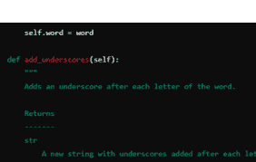

# 5 使用 ChatGPT 开发未来

# 在 Discord 上加入我们的书籍社区

https://packt.link/EarlyAccess

在本章中，我们将讨论开发者如何利用 ChatGPT。本章重点关注 ChatGPT 在开发者领域解决的主要用用例，包括代码审查与优化、文档生成以及代码生成。本章将提供示例，让你能够亲自尝试这些提示词（prompts）。

在介绍了开发者为何应该将 ChatGPT 作为日常助手的通用原因后，我们将重点关注 ChatGPT 以及它如何实现以下功能：

- 为什么开发者需要 ChatGPT？
- 生成、优化和调试代码
- 生成代码相关的文档并调试你的代码
- 解释机器学习（ML）模型，帮助数据科学家和业务用户理解模型解释性
- 翻译不同的编程语言

在本章结束时，你将能够利用 ChatGPT 进行编码活动，并将其作为提高编码效率的助手。

## 为什么开发者需要 ChatGPT？

我个人认为，ChatGPT 最令人大惊叹的能力之一就是处理代码。任何类型的代码都是。在之前的章节中，我们已经看到了一些 ChatGPT 生成 Python 代码的示例。然而，ChatGPT 对开发者的能力远超这个例子。它可以成为代码生成、解释和调试的日常助手。

在最流行的语言中，我们当然提到 Python、JavaScript、SQL 和 C#。然而，正如 ChatGPT 自身揭示的那样，它涵盖了广泛的语言：

### 列出所有你可以理解并生成的编程语言

我可以用理解并生成以下编程语言的内容：

1. Python
2. JavaScript
3. Java
4. C#
5. C++
6. C
7. Ruby
8. PHP
9. Swift
10. Kotlin
11. R
12. TypeScript
13. Go
14. Rust
15. MATLAB
16. Perl
17. SQL
18. HTML/CSS（用于 Web 开发）
19. Shell 脚本 (Bash)
20. PowerShell
21. Scala
22. Haskell
23. Lua
24. Objective-C
25. Dart
26. Groovy
27. Julia
28. Visual Basic
29. Assembly

如果你对这些语言或任何相关内容需要帮助，请随时提问！

图 6.1 – ChatGPT 列出了它能够理解和生成的编程语言

无论你是后端/前端开发者、数据科学家还是数据工程师，只要你使用编程语言，ChatGPT 都可以成为游戏规则的改变者，我们将在后续章节的几个示例看到。

从下一节开始，我们将深入探讨 ChatGPT 在处理代码时可以实现的具体示例。我们将看到涵盖不同领域的端到端用例，以便我们熟悉如何将 ChatGPT 作为代码助手。

## 生成、优化和调试代码

你应该利用的主要能力是 ChatGPT 代码生成。你曾多少次寻找一段预构建的代码作为开始？例如生成工具函数（utils functions）、示例数据集、SQL 架构等？ChatGPT 能够根据自然语言输入生成代码：

```
生成一个 python 函数，为保存在 "my_folder" 文件夹内的所有 csv 文件添加一行。该行应该是 csv 文件的文件名。
```

当然！下面是一个 Python 函数，它会在名为 "my_folder" 的文件夹内所有 CSV 文件的开头添加包含每个 CSV 文件文件名的行：

```python
import os
import csv

def add_filename_to_csv(folder_path):
    # 获取文件夹中所有的 CSV 文件
    csv_files = [f for f in os.listdir(folder_path) if f.endswith('.csv')]

    for csv_file in csv_files:
        file_path = os.path.join(folder_path, csv_file)

        # 读取 CSV 文件的原始内容
        with open(file_path, 'r', encoding='utf-8') as file:
            reader = list(csv.reader(file))

        # 将文件名添加到 CSV 内容开头
        new_content = [[csv_file]] + reader

        # 将新内容写回 CSV 文件
        with open(file_path, 'w', encoding='utf-8') as file:
            writer = csv.writer(file)
            writer.writerows(new_content)

# 示例
folder_path = 'my_folder'
add_filename_to_csv(folder_path)
```

请将 "my_folder" 替换为包含 CSV 文件的实际路径。此函数将读取每个 CSV 文件，将文件名作为第一行，并将更新后的内容保存回原文件。

图 6.2 – ChatGPT 生成 Python 函数的示例

你可以看到，ChatGPT 不仅能够生成函数，还能解释它的作用、如何使用它以及可以用什么进行替换。事实上，它可能通过我们的输入生成优化脚本，为我们节省一些运行时间或计算能力。


# 代码优化示例

```python
from timeit import default_timer as timer
from datetime import timedelta

start = timer()
elements = list(range(1_000_000))
data = []
for el in elements:
    if not el % 2:
        data.append(el)

end = timer()
print(timedelta(seconds=end-start))
```

- 0.0s

```
0:00:00.115022
```

图 4：Python 函数的执行速度。

执行时间为 00.115022 秒。如果我们要求 ChatGPT 优化这个脚本，会发生什么呢？

我写了以下脚本来仅过滤出列表中的奇数。

```python
elements = list(range(1_000_000))
data = []
for el in elements:
    if el % 2 != 0:
        data.append(el)
```

你否创建一个脚本，以更短的执行时间实现相同的结果吗？

当然可以！你可以使用列表推导式（list comprehensions）以更高效的方式实现相同的结果，在 Python 中，这通常比带有 `append` 操作的 `for` 循环脚本更快。

这里是使用列表推导式的优化后的脚本：

```python
elements = list(range(1_000_000))
data = [el for el in elements if el % 2 != 0]
```

这段代码的运行速度应该更快，因为列表推导式在 Python 中针对性能进行了优化。

如果你想用一种更快的方法，可以使用 `filter` 函数结合 `lambda` 函数，它有时可以提供更好的性能：

```python
elements = list(range(1_000_000))
data = list(filter(lambda el: el % 2 != 0, elements))
```

这两种方法将产生相同的结果，但与原始脚本相比，执行时间更短。

## 图 6.6 – ChatGPT 为 Python 脚本生成优化替代方案

ChatGPT 为我提供了两个以更短执行时间实现相同结果的示例。

让我们在 Jupyter Notebook 中测试它们：

```
2023-03-25 11:27:10.270 Uncaught app exception T
File "C:\Users\vaalt\Anaconda3\lib\site-packages\"
exec(code, module. dict )
nFile "C:\Users\vaalt\OneDrive\Desktop\medium art:
user_input = get_text()
File "C:\Users\vaalt\OneDrive\Desktop\medium art:
input_text = st.text_input("You: ", st.session_si
File "C:\Users\vaalt\Anaconda3\lib\site-packages\"
result = non_optional_func(*args, **kwargs)
File "C:\Users\vaalt\Anaconda3\lib\site-packages"
return self._text_input(
```

```python
start = timer()
elements = list(range(1_000_000))
data = [el for el in elements if el % 2 != 0]
end = timer()
print(timedelta(seconds=end-start))
```

- 0.0s

```
0:00:00.064070
```

```python
start = timer()
elements = list(range(1_000_000))
data = list(filter(lambda el: el % 2 != 0, elements))
end = timer()
print(timedelta(seconds=end-start))
```

- 0.0s

```
0:00:00.091243
```

图 6.7 – ChatGPT 生成的两个替代函数的执行速度。

如你所见，两种方法都显著减少了，分别减少了 44.30% 和 20.68%。

除了代码生成和优化之外，ChatGPT 还可以用于错误解释和调试。有时，错误很难解释；因此，自然语言解释对于识别问题并引导你走向解决方案非常有帮助。

例如，当我从命令行运行一个 `.py` 文件时，我遇到了以下错误：

```
# File "C:\Users\vaalt\Anaconda3\lib\site-packages\text_input_proto.value = widget_state.value
TypeError: [] has type list, but expected one of
```

让我们看看 ChatGPT 是否能让我理解错误的本质。为此，我只需向 ChatGPT 提供错误信息，并让它给我一个解释。

### 错误信息解析

- 1. 路径和行号
  - 错误发生在你的脚本 `C:\Users\vaalt\OneDrive\Desktop\medium art.py` 的第 126 行。
  - 错误源于对 `get_text()` 的调用，具体来自脚本第 50 行的 `st.text_input()`。

- 2. 类型错误：`TypeError: [] has type list, but expected one of bytes, Unicode` 表明一个列表类型被当作字符串使用了。

### 相关片段

错误发生在以下代码中（根据你的回溯跟踪）：

```python
input_text = st.text_input(
    session_state['input'],
    placeholder='Your Assistant here...',
    label_visibility='hidden')
```

### 错误原因

`st.text_input` 函数期望参数为字符串（字节或 `Unicode`）。然而，目前 `session_state['input']` 似乎是一个列表。

### 解决方案

`st.text_input` 函数期望参数为字符串（字节或 `Unicode`）。但目前 `session_state['input']` 似乎是一个列表。

你需要确保 `session_state['input']` 是一个字符串。

- 1. 初始化：将 `new_word` 初始化为空字符串。
- 2. 拼接：在循环中通过 `+=` 运算符将每个字符和下划线拼接到 `new_word`。
- 3. 返回：循环结束后返回最终的 `new_word`。

## 生成文档和代码解释

每当你处理新的应用程序或项目时，将代码与文档相关始终是一个良好的做法。它可以以文档字符串（docstring）的形式嵌入到你的函数或类中，以便他人可以在开发环境中直接调用。

```python
class UnderscoreAdder:
    def __init__(self, word):
        self.word = word
    def add_underscores(self):
        new_word = ""
        for i in range(len(self.word)):
            new_word += self.word[i] + "_"
        return new_word
```

我们可以按照如下方式测试：

```python
class UnderscoreAdder:
    def __init__(self, word):
        self.word = word

    def add_underscores(self):
        new_word = ""
        for i in range(len(self.word)):
            new_word += self.word[i] + "_"
        return new_word

# Example usage:
phrase = "gpt"
adder = UnderscoreAdder(phrase)
print(adder.add_underscores())
```

图 5：测试 `UnderscoreAdder` 类。

现在，假设我想要使用 `UnderscoreAdder` 约定来检索 docstring 文档。通过对 Python 包、函数和方法进行这样做，我们可以获得该特定对象功能的完整文档，如下（使用 pandas Python 库的示例）：

```python
import pandas as pd
```

Type: module

String form: <module 'pandas' from 'C:\Users\vaalt\anaconda3\lib\site-packages\pandas\__init__.py'>

File: c:\users\vaalt\anaconda3\lib\site-packages\pandas\__init__.py

Docstring:

pandas - a powerful data analysis and manipulation library for Python

==============================================

**pandas** 是一个 Python 包，提供了快速、灵活且表达丰富的数据结构，旨在简单且直观地处理“关系型”或“标记”数据。它是进行数据分析以及在 Python 中进行数据分析的基础高级构建模块。此外，它还有更广泛的目标，成为任何语言中可用的最强大、最灵活的开源分析工具。它已经在这一目标稳步迈进。

### 主要特性

这里是 pandas 执行的几项功能：

- 轻松处理浮点数及非浮点数据的缺失值。
- 尺寸灵活性：可以从 `DataFrame` 和高维对象插入和删除列。
- 自动且显式的数据对齐：对象可以与一组标签对齐，或者用户可以简单地忽略标签，`Series`、`DataFrame` 等会在计算中自动为你对齐数据。
- 按功能进行强大的灵活分组，对数据集执行拆分-应用-合并（split-apply-combine）操作，对数据进行聚合和转换。
- 轻松将其他 Python 和 NumPy 数据结构中不规则的、索引不同的数据转换为 `DataFrame` 对象。
- 基于标签的智能切片、花式索引（Fancy indexing）以及大型数据集的子集。
- 直观的合并和连接数据集。
- 数据集的灵活重塑和透视。
- 轴的分级标记（每个刻度可以有多个标签）。
- 健壮的 IO 工具，用于从扁直文件（CSV 和分隔符文件）、Excel 文件、数据库加载数据，并从超快的 HDF5 格式保存/加载数据。
- 时间序列特定功能：日期范围生成和频率转换、移动窗口统计、日期偏移和滞后。

图 6.13–pandas 库文档示例

现在，让我们让 ChatGPT 为以下内容生成相同的结果：

### `UnderscoreAdder` 类

为以下类生成 docstring：

```python
class UnderscoreAdder:
    def __init__(self, word):
        self.word = word

    def add_underscores(self):
        new_word = ''
        for letter in self.word:
            new_word += letter + '_'
        return new_word
```

这里是带有 docstring 文档的 `UnderscoreAdder` 类：

```python
class UnderscoreAdder:
    """
    在单词的每个字母后添加下划线的类。
    """
    Attributes:
        word (str): 将添加下划线的单词。

    Methods:
        def __init__(self, word):
            """
            用一个单词初始化 underscoreadder。
            """
            self.word = word

        def add_underscores(self):
            """
            返回一个在单词每个字母后添加了下划线的新字符串。
            """
            # ...
```



Docstring 解释

- 1. 类 docstring (Class Docstring)
  - 提供类的用途的简要描述。
  - 列类的属性和方法。
- 2. `__init__` 方法 docstring
  - 描述初始化方法和参数。
- 3. `add_underscores` 方法 docstring
  - 描述该方法的功能。
  - 指定返回类型及其返回的内容。

此文档将帮助用户理解类及其方法的作用，以及预期的输入和输出。

## 图 6.14 – ChatGPT 用文档更新代码

结果，如果我们按照前面的代码和 `UnderscoreAdder?` 更新我们的类，我们将得到如下输出：

```
UnderscoreAdder?
  0.1s
Init signature: UnderscoreAdder(word)
Docstring:
  A class在单词的每个字母后添加下划线的类。

Attributes
------
word : str
    将添加下划线的单词。

Methods:
------
add_underscores():
    返回一个在单词每个字母后添加了下划线的新字符串。
Init docstring:
  用一个单词初始化 UnderscoreAdder。

Parameters
------
word : str
    将添加下划线的单词。
Type: type
Subclasses:
```

图 6.15 – `UnderscoreAdder` 文档

最后，还可以利用 ChatGPT 来解释脚本。例如，让 ChatGPT 用自然语言解释以下代码：

```python
from ascity_opendatasets import NpcTick
from datetime import datetime
from dateutil import parser

start_date = parser.parse('2018-05-01')
end_date = parser.parse('2018-05-07')

npc_df = nr_fc.to_pandas(dataframe, start_date, end_date, end_end_date)
```

让我们逐步通过：

### 1. 导入数据集

```python
from ascity_opendatasets import NpcTick
from datetime import datetime
from dateutil import parser
```

- `from ascity_opendatasets import NpcTick` 此行导入了纽约出租委员会（NPC）的黄色订单数据集。
- `from datetime import datetime` 导入了 `datetime` 模块中的类。该类用于管理日期和时间。
- `from dateutil import parser` 导入了 `dateutil` 包中的 `parser`，用于解析日期字符串。

### 2. 解析数据集

```python
start_date = parser.parse('2018-05-01')
end_date = parser.parse('2018-05-07')
```

- `start_date = parser.parse('2018-05-01')` 此行将 `'2018-05-01'` 解析为 `datetime` 对象，代表 2018 年 5 月 1 日。
- `end_date = parser.parse('2018-05-07')` 此行将 `'2018-05-07'` 解析为 `datetime` 对象，代表 2018 年 5 月 7 日。

### 3. 转换为 Pandas DataFrame

```python
npc_df = nr_fc.to_pandas(dataframe, start_date, end_date, end_end_date)
```

- `nr_fc.to_pandas(dataframe)` 此方法将 NPC 黄色记录转换为 Pandas DataFrame。DataFrame 是一个具有不同类型列的二维数据结构，适用于数据分析和处理。

### 4. 为技术用户显示数据集信息

```python
npc_df.info()
```

- `npc_df.info()` 此方法打印 DataFrame 的概要摘要，包括条目数、非空计数以及每列的数据类型。

代码解释性也可以是上述文档的一部分，或者用于希望更好地理解其他团队复杂代码的开发者，或者（有时也会发生在我身上）记住自己多以前写了什么。

得益于 ChatGPT 和本节提到的功能，开发者可以轻松用自然语言跟踪项目生命周期，以便他们更容易理解目前已完成的工作。

我们将在下一节中看看代码解释性是如何数据科学项目中 ML 模型可解释性的关键步骤。

## 理解 ML 模型可解释性


模型可解释性是指人类理解 ML 模型预测背后逻辑的难易程度。本质上，它是指理解模型如何做出决策以及哪些变量对其预测做出了贡献的能力。

让我们来看一个使用深度学习卷积神经网络（CNN）进行图像分类的模型解释性示例。我使用 Python 结合 Keras 构建了我的模型。为此，我将直接从 `keras.datasets` 下载 CIFAR-10 数据集：它包含 60,000 张 32x32 的彩色图像（即 3 通道图像），分为 10 类（飞机、汽车、鸟、猫、鹿、狗、蛙、马、船和卡车），每类有 6,000 张图像。在这里，我将在书籍的 GitHub 仓库中共享用于数据准备和预处理的代码，地址为 `https://github.com/PacktPublishing/The-Ultimate-Guide-to-ChatGPT-and-OpenAI/tree/main/Chapter%20%20-%20ChatGPT%20for%20Developers/code`：

```python
model=tf.keras.Sequential()
model.add(tf.keras.layers.Conv2D(32,kernel_size=
```

```python
(32,32,1))
model.add(tf.keras.layers.MaxPooling2D(pool_size:
```

前面的代码由几个执行不同操作的层组成。我可能对模型结构的解释以及每一层的作用感兴趣。让我们让 ChatGPT 来提供一些帮助（下面你可以看到回复的提取）：

## 为模型添加层

### 1. 卷积层

```python
model.add(tf.keras.conv2D(32, kernel_size=(3, 3), activation='relu', input_shape=(3)))
```

- `tf.keras.conv2D`：这在模型中添加了一个 2D 卷积层。
- `32`：卷积中的过滤器数量（输出通道数）。
- `kernel_size=(3, 3)`：卷积窗口的形状。
- `activation`：使用的激活函数，在本例情况下为 ReLU（修正的线性单元），它有助于引入非线性。
- `input_shape=(32, 32, 1)`：输入数据的形状，其中 `32x32` 是输入图像的大小，`1` 表示图像是灰度图（单通道）。

### 2. 最大池化层

```python
model.add(tf.keras.layers.MaxPooling2D(pool_size=(2, 2)))
```

- `tf.keras.layers.MaxPooling2D`：这在模型中添加了一个最大池化层。
- `pool_size=(2, 2)`：池化窗口的维度。最大池化通过取 `2x2` 窗口上的最大值对输入表示进行下采样，从而减少输入的空间维度。

### 3. 展平层

```python
model.add(tf.keras.layers.Flatten())
```

- `tf.keras.layers.Flatten`：它展平了输入。它将 2D 矩阵数据转换为 1D 向量，可以输入全连接（密集）层。在将数据传递到密集层之前这是必要的。

图 6.17 – 使用 ChatGPT 的模型可解释性

如你在前面的图中所示，ChatGPT 能够为我们的 CNN 结构和层提供清晰的解释。它还添加了一些注释和提示，例如使用最大池化层有助于减少输入的维度。

ChatGPT 也可以帮助我在验证阶段解释模型结果。因此，在将数据划分为训练集和测试集并在训练集上训练模型后，我想看看它在测试集上的性能：

```python
model.fit(np.resize(x_train, (50000,32,32,1))/255.0,
tf.keras.utils.to_categorical(y_train),
batch_size=32,
shuffle=True,
epochs=5,
validation_data=(np.resize(x_test, (10000,32,32,1))/255.0,
tf.keras.utils.to_categorical(y_test))
```

```text
Epoch 1/3
1563/1563 [********************] 208s 133ms/step loss: 2.3021 accuracy: 0.1038 val_loss: 2.3029 val_accuracy: 0.1039
Epoch 2/3
1563/1563 [********************] 209s 133ms/step loss: 2.2964 accuracy: 0.1104 val_loss: 2.3070 val_accuracy: 0.1001
Epoch 3/3
1563/1563 [********************] 209s 58ms/step loss: 2.2743 accuracy: 0.1312 val_loss: 2.3173 val_accuracy: 0.1006
```

## 图 6.18 – 评估指标

让我们也问问 ChatGPT 详细说明这些指标：

当然可以！你能详细解释以下输出吗？

```text
Epoch 1/3
1563/1563 [********************] 208s 133ms/step loss: 2.3021 accuracy: 0.1038 val_loss: 2.3029 val_accuracy: 0.1039
Epoch 2/3
1563/1563 [********************] 209s 133ms/step loss: 2.2964 accuracy: 0.1104 val_loss: 2.3070 val_accuracy: 0.1001
Epoch 3/3
1563/1563 [********************] 209s 58ms/step loss: 2.2743 accuracy: 0.1312 val_loss: 2.3173 val_accuracy: 0.1006
```

## 通用格式

- **Epoch Information（轮信息）**：显示当前轮数和总轮数。
- **Batch Progress（批进度）**：指示批的完成情况。
- **Metrics（指标）**：包含训练损失、训练准确率、验证损失和验证准确率。

## 轮信息

```text
Epoch 1/3
```

- `1/3`：这表示训练处于第 1 轮，总共 3 轮。

## 批进度与时间

```text
1563/1563 [********************] - 208s
```

- `1563/1563`：这里所有 1563 个批已处理完毕。


正如你在前面的图中所示，ChatGPT 能够为我们的 CNN 结构和层提供清晰的解释。它还添加了一些注释和提示，例如使用最大池化层有助于减少输入的维度。

在验证阶段解释模型结果时，ChatGPT 也可以提供支持。因此，在将数据划分为训练集和测试集并在训练集上训练模型后，我想看看它在测试集上的性能：

有很多原因说明模型解释性很重要。其中一个关键因素是它缩小了业务用户与代码之间的差距。这对于让业务用户理解模型行为，并将其转化为代码想法至关重要。此外，模型解释性实现了负责任和伦理 AI 的核心原则之一，即 AI 系统思考和行为的透明度。通过模型解释性可以检测模型在生产环境中可能出现的偏见或有害行为，并防止其发生。

总而言之，ChatGPT 在模型解释性背景下可以提供有价值的支持，正如我们在上一个示例所示。

我们将探索的下一个也是最后一个 ChatGPT 功能将是开发者生产力的另一个助力，特别是在一个项目中使用多种编程语言时。

## 不同编程语言之间的翻译

在第 5 章中，我们看到了 ChatGPT 在不同语言之间翻译的强大能力。令人惊讶的是，自然语言并不是它唯一的翻译对象。事实上，ChatGPT 能够在不同编程语言之间进行翻译，同时保持相同的输出和风格（即它会保留存在的文档字符串）。

在很多情况下，这可能会改变游戏规则。例如，你可能需要学习一种从未见过的新编程语言或统计工具，因为你需要快速交付一个项目。在 ChatGPT 的帮助下，你可以使用熟悉的语言进行编程，然后让它翻译成目标语言，你将在翻译过程中不断学习。

想象一下项目需要用 MATLAB（一种由 MathWorks 开发的专用数值计算和编程软件）交付，而你一直使用 Python。该项目涉及对修改后的美国技术学院（MNIST）数据集图像进行分类（原始数据集描述和相关论文可以在此处找到：`http://yann.lecun.com/exdb/mnist/`）。该数据集包含了大量的手写数字并经常被用于教授各种图像处理系统。

首先，我编写了以下 Python 代码来初始化一个用于分类的深度学习模型：

```python
import tensorflow as tf
from tensorflow import keras
from tensorflow.keras import layers
# 加载 MNIST数据集
(x_train, y_train), (x_test, y_test) = keras.datasets.mnist.load_data()
# 处理数据
x_train = x_train.reshape(-1, 28*28) / 255.0
# 定义模型架构
model = keras.Sequential([
    layers.Dense(256, activation='relu', input_shape=(28*28,)),
    layers.Dense(10, activation='softmax')
])
# 编译模型
model.compile(optimizer='adam', loss='categorical_crossentropy')
# 训练模型
history = model.fit(x_train, y_train, validation_data=(x_test, y_test))
# 评估模型
test_loss, test_acc = model.evaluate(x_test, y_test)
```

现在让我们看看如果将上述代码作为上下文提供给 ChatGPT 并让它翻译成 MATLAB，会发生什么：

以下是用于在 MNIST 数据集上训练神经网络的 TensorFlow 代码的 MATLAB 版本。

# MATLAB 代码

```matlab
% 加载 MNIST数据集
[xtrain, ytrain, xtest, ytest] = digitTrain4DArrayData;

% 重塑数据并规范化
xtrain = reshape(xtrain, [], 28*28) / 255.0;
xtest = reshape(xtest, [], 28*28) / 255.0;

% 将层转换为分类格式
ytrain = categorical(ytrain);
ytest = categorical(ytest);

% 定义模型架构
layers = [
    fullyConnectedLayer(256, 'Activation', 'relu', 'InputSize', 28*28)
    fullyConnectedLayer(128, 'Activation', 'relu')
    fullyConnectedLayer(10, 'Activation', 'softmax')
];

% 创建神经网络
model = dinnetwork(layerGraph(layers));

% 指定训练选项
options = trainingOptions('adam', ...
    'MaxEpochs', 10, ...
    'MiniBatchSize', 128, ...
    'ValidationData', {xtest, ytest}, ...
    'Verbose', true, ...
    'Plots', 'training-progress');

% 训练模型
trainedNet = trainNetwork(xtrain, ytrain, model.layers, options);

% 评估模型
Vpred = classify(trainedNet, xtest);
tAcc = mean(Vpred == ytest);
disp(['Test accuracy:', num2str(tAcc)]);
```

图 20 – ChatGPT 将 Python 代码翻译为 MATLAB

让我们也看看它是否能够将其翻译成其他语言，例如 JavaScript（注意，我不需要重复代码，因为它已经在对话上下文中）：

当然！这里是使用 TensorFlow.js 翻译成 JavaScript 的对应代码。

# JavaScript 代码

```javascript
//  TensorFlow.js
import * as tf from '@tensorflow/tfjs';
import { MNISTData } from './data.js'; // 假设你有一个单独的 data.js 文件

async function run() {
  // 加载 MNIST 数据集
  const data = new MNISTData();
  await data.load();

  const [Xtrain, ytrain] = data.getTrainData();
  const [Xtest, ytest] = data.getTestData();

  // 规范化数据
  const xTrainNorm = Xtrain.div(255.0);
  const xTestNorm = Xtest.div(255.0);

  // 定义模型架构
  const model = tf.sequential();
  model.add(tf.layers.dense({units: 256, activation: 'relu', inputShape: [28, 28]}));
  model.add(tf.layers.dense({units: 128, activation: 'relu'}));
  model.add(tf.layers.dense({units: 10, activation: 'softmax'}));

  // 编译模型
  model.compile({
    optimizer: 'adam',
    loss: 'categoricalCrossentropy',
    metrics: ['accuracy']
  });

  // 训练模型
  await model.fit(xTrainNorm, ytrain, {
    epochs: 10,
    batchSize: 32,
    validationSplit: 0.2,
    callbacks: tf.callbacks.earlyStopping({monitor: 'val_loss'})
  });

  // 评估模型
  const evalResult = model.evaluate(xTestNorm, ytest);
  const testAcc = evalResult[1].data()[0];
  console.log('Test accuracy:', testAcc);
}

run();
```

# 图 6.21 – ChatGPT 将 Python 代码翻译为 JavaScript

代码翻译还可以缩小新技术与当前编程能力之间的技能差距。

代码翻译的另一个关键意义是**应用现代化**。事实上，想象一下你想要刷新你的应用栈，即迁移到云端。你可能决定从简单的“平移并迁移”（lift and shift）开始，转向**基础设施即服务 (IaaS)** 实例（例如 Windows 或 Linux **虚拟机（VMs）**）。但在第二阶段，你可能希望对应用程序进行重构、重新架构设计或重新构建。

下面的图展示了应用现代化的几种方式：

`img/18d2375ac45b_`

图 6.22 – 应用现代化的四种方式

事实上，将 COBOL 翻译成更现代的语言。

让我们考虑一个 COBOL 脚本，它读取一个数字，加上 10，然后打印结果。

```cobol
IDENTIFICATION DIVISION.
PROGRAM-ID. AddTen.
DATA DIVISION.
WORKING-STORAGE SECTION.
01 INPUT-NUMBER      PIC 9(5).
01 RESULT-NUMBER     PIC 9(5).
PROCEDURE DIVISION.
DISPLAY 'Enter a number: '.
ACCEPT INPUT-NUMBER.
COMPUTE RESULT-NUMBER = INPUT-NUMBER + 10
DISPLAY 'Result after adding 10: ' RESULT-NUMBER.
STOP RUN.
```

我将之前的 COBOL 脚本传递给 ChatGPT，以便其作为上下文。现在让 ChatGPT 将翻译成 C#：

当然！这是翻译成 C# 的对应代码：

# C# 代码


```csharp
using System;

namespace AddTen
{
    class Program
    {
        static void Main(string[] args)
        {
            // 变量声明
            int inputNumber;
            int result;

            // 提示用户输入数字
            Console.Write("Enter a number: ");

            // 读取用户输入并尝试解析为整数
            if (int.TryParse(Console.ReadLine(), out inputNumber))
            {
                // 将输入加 10
                result = inputNumber + 10;

                // 显示结果
                Console.WriteLine("Result after adding 10: " + result);
            }
            else
            {
                // 处理无效输入
                Console.WriteLine("Invalid input. Please enter a valid number.");
            }
        }
    }
}
```

图 6.23 – ChatGPT 将 COBOL 翻译为 C# 的示例

ChatGPT 这样的工具通过引入了解过去和未来的层，有助于缩小此类及类似场景中的技能差距。

总之，`ChatGPT` 是应用现代化的有效工具，除了提供代码升级，还能提供宝贵的见和建议。凭借强大的语言处理能力和丰富的知识库，`ChatGPT` 可以帮助组织简化现代化工作，使过程更快、更高效且有效。

## 总结

`ChatGPT` 对于希望提高技能和优化工作流的开发者来说是一个非常有价值的资源。我们首先看到了 `ChatGPT` 如何生成、优化和调试代码，但我们还涵盖了如辅助代码生成文档、解释我们的机器学习模型以及在不同编程语言之间翻译等更高级的功能。

无论你是资深开发者还是初学者，`ChatGPT` 都提供了一个强大的学习和成长工具，缩小了代码与自然语言之间的差距。

在下一章中，我们将深入探讨另一个 `ChatGPT` 可能会成为游戏规则改变者的应用领域：营销。
