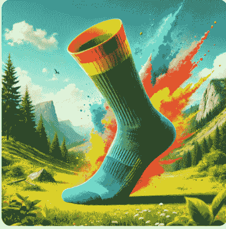
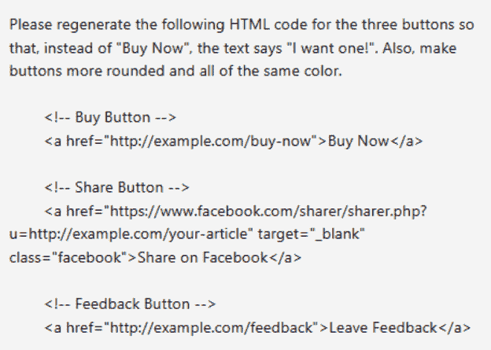

# 6 使用 ChatGPT 精通营销

# 加入我们 Discord 上的书籍社区

`https://packt.link/EarlyAccess`

在本章中，我们将重点关注营销人员如何利用 `ChatGPT`，查看 `ChatGPT` 在该领域的主要用例，以及营销人员如何将其作为一名极具价值的助手。

我们将学习 `ChatGPT` 如何协助以下活动：

- 营销人员对 `ChatGPT` 的需求

- 新产品开发与进入市场策略（GTM 策略）

- 用于营销对比的 A/B 测试

- 通过搜索引擎优化 (SEO) 制作更高效的网站和帖子

- 文本数据的情绪分析

在本章结束时，你将能够利用 `ChatGPT` 进行营销相关的活动，并提高你的工作效率。

# 技术要求

你需要一个 OpenAI 账户来访问 `ChatGPT`。

# 营销人员对 ChatGPT 的需求

营销可能是能够以最纯粹的形式发挥 `ChatGPT` 和 OpenAI 模型创造力的领域。它们可以成为实用的工具，支持新产品、营销活动、搜索引擎优化等方面的创意开发。总而言之，营销人员可以自动化和简化工作的许多方面，同时提高其营销努力的质量和有效性。

这是一个示例。`ChatGPT` 在营销中最突出且最有前景的用例之一是个性化营销。`ChatGPT` 可以分析客户数据并生成与个人客户产生共鸣的个性化营销信息。例如，营销团队可以使用 `ChatGPT` 分析客户数据，并开发针对特定客户偏好和行为定制的定向电子邮件营销活动。这可以增加转化的概率并带来更高的客户满意度。通过提供对客户情绪和行为的洞察、生成个性化营销信息、提供个性化客户支持以及生成内容，`ChatGPT` 可以帮助营销人员提供卓越的客户体验并推动业务增长。

这是 `ChatGPT` 在营销中许多应用示例之一。在接下来的章节中，我们将查看 `ChatGPT` 支持的端到端营销项目的实例。

# 新产品开发与进入市场策略

你将 `ChatGPT` 引入营销活动的第一种方法可能是作为新产品开发和进入市场（GTM）策略的助手。

在本节中，我们将查看一个关于如何开发和推广新产品的分步指南。你已经拥有一个名为 `RunFast` 的跑步服装品牌，到目前为止只生产鞋子，因此你想通过新的产品线扩大业务。我们将从头脑风暴创意来创建 GTM 策略开始。当然，一切都由 `ChatGPT` 提供支持：

- 头脑风暴创意：`ChatGPT` 可以支持你的第一件事是为你新产品线进行头脑风暴并起草方案。它还会提供每个建议背后的逻辑。所以，让我们问问我应该关注什么样的新产品线：

> 我拥有一个生产跑步鞋的跑步服装品牌。为我的品牌生成 3 个可以作为产品线添加的新产品创意。

内存已更新

以下是你可以添加到跑步服装品牌中的三个新产品创意：

- 1. 智能跑步服装：

    - **描述**：配备传感器的高科技跑步服，用于监测心率、步数和消耗的卡路里。该服装可能包括衬衫、短裤和袜子，其集成了技术，可以与移动应用程序同步，以提供实时反馈和性能跟踪。

    - **关键特性**：透气吸湿面料、与健身应用无缝集成、可清洗的电子设备，以及针对补水和速度的可定制提醒。

- 2. 环保跑步装备：

    - **描述**：一系列由回收材料制成的环保可持续跑步装备。这可能包括为不同天气条件设计的夹克、紧身裤和帽子，促进环保意识的跑步。

    - **关键特性**：回收聚酯面料、可降解包装、耐用且高性能的材料，以及回收旧跑步装备的计划。

- 3. 个性化跑步鞋：

    - **描述**：根据个人的脚型、跑步风格和偏好定制的跑步鞋。使用先进的 3D 打印技术和用户友好的在线工具，跑步者可以创建完美合脚并反映其风格的鞋子。

    - **关键特性**：用于完美贴合的 3D 打印内垫、多种设计选择（颜色、图案、标志）、根据跑步需求选择的材料（越野、路面、马拉松），以及与专家的虚拟试穿课程。

# 图 7.1 – ChatGPT 生成的新创意的示例

在三个建议中，我们将选择第二个，因为我们可以通过它产生积极的环保影响，并提升我们的品牌声誉。更具体地说，我将从环保跑步袜开始。

- 产品名称：现在我们已经确定了主意，我们需要为它想一个响亮的名字。再次，我将向 `ChatGPT` 请求更多选项，以便我从中选出最喜欢的：

> 我喜欢第二个选项，我将从环保跑步袜开始。为一个响亮的产品线名称生成 5 个选项。

以下是你的环保跑步袜准备的五个响亮产品线名称选项：

- 1. GreenStride Socks

- 2. EcoPace Performance

- 3. Sustainable Sprint

- 4. EarthRunner

- 5. NatureStep Active

# 图 7.2 – 潜在产品名称列表

`GreenStride` 听起来很不错——我就用这个了。

- 生成响亮的口号：除了产品名称，我还想分享名称背后的意图和产品线的使命，这样我的目标受众就能被吸引。

> 为“GreenStride”名称生成 3 个口号。它们应该是激励且简洁的。

以下是为“GreenStride”名称生成的三个激励且简洁的口号：

- 1. "Run Green, Run Strong."（绿色跑步，强有力。）

- 2. "Step Forward, Leave No Trace."（向前迈，不留痕迹。）

- 3. "Stride with Purpose."（使命而行。）

# 图 7.3 – 我的新产品口号列表

太棒了——现在我对产品名称和口号满意了，稍后将用它们来创建一个独特的社交媒体公告。在此之前，我想花更多时间对目标群体进行市场研究。

为了推广 `GreenStride` 袜子产品线，你应该针对以下细分：

### 1. 环保型跑步者

- **描述**：重视可持续性和环保产品的个人。他们愿意投资环保替代品，并且通常对环境问题有了解。

- **人口统计特征**：25-45 岁，城市居民，中等及以上收入，在社交媒体上活跃，特别是关注可持续性和健身的平台。

- **营销渠道**：社交媒体活动、环保博客、与环保影响者合作以及可持续性论坛。

### 2. 健身爱好者

- **描述**：热爱跑步和保持活跃生活方式的人。他们重视高性能装备，对跑步服装的最新趋势和创新感兴趣。

- **人口统计特征**：20-40 岁，男女均，中等及以上收入，经常参加马拉松、比赛和跑步俱乐部。

- **营销渠道**：跑步和健身杂志、跑步活动赞助、在线健身社区以及健身 App 上的定向广告。

### 3. 健康意识型消费者

- **描述**：关注整体健康的个人，包括体能活动、健康饮食和可持续生活。他们正在寻找支持其健康生活方式和伦理价值观的产品。

- **人口统计特征**：30-50 岁，男女均，中等及以上收入，可能参加瑜伽、普拉提和其他健康活动。

- **营销渠道**：健康与健康博客、与健康影响者合作、电子邮件时事通讯以及关注健康的专卖店。

# 图 7.4 – 我新产品线要触达的目标群体列表

在受众中考虑到不同的群体是非常重要的，这样你就可以区分你想要传达的信息。在我的情况下，我希望确保我的产品线能够涵盖不同人群，例如竞技型跑步者、休闲跑步者和健身爱好者。

- **产品变体和销售渠道**：根据上述的潜在客户群体，我可以生成更针对特定受众的定制产品变体：

**环保型跑步者**

1. 回收纤维性能袜

   - **描述**：由 100% 回收材料（包括塑料瓶和废弃织物）制成的袜子。这些袜子为长距离跑步提供了极佳的排湿性和透气性。

   - **核心特性**：高透气性、吸湿性、防臭性，脚跟和脚趾处加固以提高耐用性，无缝设计确保舒适度。

2. 有机棉跑步袜

   - **描述**：由有机棉制成的柔软舒适的跑步袜，生长过程中不使用合成化合物或肥料。

   - **核心特性**：低致敏性、质地极柔软、自然吸水性且环保。

3. 竹纤维环保袜

   - **描述**：由可持续竹纤维制成的袜子，具有天然的抗菌和吸湿特性。

   - **核心特性**：卓越的柔软度、天然抗菌性、优异的透气性并减少对环境的影响。

**关注健康的消费者**

1. 压缩袜

   - **描述**：梯度压缩袜，旨在改善跑步期间和之后的血液循环并减少肌肉疲劳。

   - **核心特性**：增强循环、减轻肌肉疲劳、缩短恢复时间，以及贴合的剪裁以提供额外支撑。

2. 缓冲袜

   - **描述**：提供额外支撑和减震的缓冲跑步袜，是关注关节和肌肉健康的人士理想选择。

   - **核心特性**：厚缓冲垫、足弓支撑、减轻对关节的影响，以及适合长距离跑步的松软舒适感。

3. 防水泡跑步袜

   - **描述**：旨在防止水泡的高性能袜子，采用双层设计以获得最大的灵活度和舒适度。

   - **核心特性**：双层织物、平滑接缝、吸湿和防摩擦特性。

通过提供这些产品变体，你可以满足环保和关注健康消费者的特定需求和偏好，确保他们的`GreenStride`产品符合他们对可持续性和性能的预期。

# 图 7.5 – 产品线变体示例

同样，我也可以要求 `ChatGPT` 为上述每个群体建议不同的销售渠道：

## 触达关注健康消费者的最佳渠道

1. **健康与健康博客及杂志**

   - 平台：热门健康博客、在线健康平台和健身杂志。

   - 策略：投稿文章、参与产品评测，并提供侧重于使用 `GreenStride` 袜子健康益处的赞助内容。

2. **健身领域与网红**

   - 平台：`Instagram`、`YouTube` 和 `TikTok`。

   - 策略：与网红合作，展示 `GreenStride` 袜子的健康益处，包括改善循环和肌肉支撑。

3. **在线健身社区和论坛**

   - 平台：`Reddit`、相关论坛以及关注健康的在线社区。

   - 策略：参与讨论，分享成功故事和用户证言，并对使用 `GreenStride` 袜子跑步和整体健康的益处提供专家建议。

4. **专注于健康的零售商店**

   - 商店：专业健康商店、健身装备店和健康中心。

   - 策略：与这些商店合作销售 `GreenStride` 袜子，开展促销活动，并提供有关袜子健康益处的教育材料。

通过利用这些针对性渠道，你可以有效地触达并吸引环保型和关注型消费者，推动你的 `GreenStride` 袜子产品的品牌知名度和销量。

## 触达环保型跑步者的最佳渠道

1. **社交媒体营销活动**

   - 平台：`Instagram`、`Facebook` 和 `Pinterest`。

   - 策略：使用具有视觉吸引力的内容来强调袜子的环保特性，与环保网红合作，并参与环保意识活动。

2. **环保博客和网站**

   - 平台：热门的环保博客、关注可持续性的网站。

   - 策略：撰写客座文章、参与社区内容互动，并提供关于 `GreenStride` 袜子生产过程中可持续实践的介绍性文章。

3. **与环保组织合作**

   - 组织：环保非政府组织（NGO）、关注可持续性的跑步俱乐部和环保活动。

   - 策略：赞助活动，为环保马拉松提供产品样品，并与这些组织制定联合营销策略。

4. **电子邮件通讯**

   - 平台：如 `Mailchimp` 或 `Constant Contact` 等邮件营销服务。

   - 策略：创建信息丰富的简报，强调 `GreenStride` 袜子的环保益处，分享关于可持续实践的故事并提供特别优惠。

# 图 7.6 – ChatGPT 对不同销售渠道的建议

在竞争中脱颖而出：我希望我的产品能在竞争激烈的市场中脱颖而出——我想让它独一无二。带着这个目标，我要求 `ChatGPT` 包含可持续性和包容性等社会因素。让 `ChatGPT` 在这方面提供建议：

> 给我三个简洁的建议，关于如何让我的 `GreenStride` 袜子系列在竞争市场中脱颖而出且独特。

以下是让你的 `GreenStride` 袜子系列在竞争市场中脱颖而出且独特的三个简洁建议：

1. **创新环保材料**

   - 使用领先的可持续材料，如回收海洋塑料、有机大麻或可降解纤维。在营销中强调这些独特材料，以突出可持续性。

2. **增强性能的功能**

   - 集成针对性压缩区、吸湿技术和防水泡设计等功能。确保这些功能经过科学验证，并向消费者清晰传达。

3. **透明的生产流程**

   - 从溯源到制造，对你的生产过程提供完全透明化。提供有关劳动条件的详细信息。

# 图 7.7 – ChatGPT 生成的卓越特性示例

如你所见，它能够生成让我的产品独特的有趣特性。

- **产品描述**：现在是时候开始制定进入市场计划（Go-To-Market plan）了。首先，我想为我的网站生成一个产品描述，包含之前所有的差异化。

> 使用上述列出的独特差异点为 `GreenStride` 袜子系列生成一段产品描述（最多 150 字）。它应该是引人注目且有效的，并经过 SEO 优化。完成后请列出你使用的 SEO 关键词。

# GreenStride 袜子产品描述

穿着 `GreenStride` 袜子迈向跑步的未来，由回收海洋塑料和有机大麻等创新环保材料制成。我们的袜子为卓越性能设计，具有针对性压缩区、吸湿技术和防水泡设计，让你在跑步时保持舒适和专注。选择 `GreenStride`，你不仅是在选择顶级的跑步装备——你是在支持一个可持续的未来。我们致力于透明化，对我们的环保生产过程和公平劳工实践提供全面洞察。用 `GreenStride` 提升你的步态，在这里可持续性与性能完美契合。

# SEO 关键词

- 环保跑步袜

- 可持续性能袜

- 回收材料袜子

- 有机大麻袜

- 防水泡跑步袜

- 吸湿技术

- 针对性压缩区

- 透明生产流程

- 可持续运动服装

**公平定价**：另一个关键要素是为我们的产品确定公平的价格。由于我针对不同受众（竞技跑步者、休闲跑步者和健身爱好者）区分了产品变体，我也希望有一个考虑到这些分类的价格范围。请注意，在以下示例中，`ChatGPT` 正在调用网络。

> 使用搜索插件检索有关当前跑步袜市场定价的更新信息。

> 考虑到上述两个受众群体以及对跑步袜市场的现状分析，我的袜子系列定在什么价格才合理？

已搜索 6 个网站

根据目前的市场分析，通过考虑类似高品质且环保运动袜的定价趋势，可以为你的“GreenStride”袜子系列确定一个公道的价格。

## 市场洞察：

### 1. 价格分段：

- 低端跑步袜：价格通常在每双 `$5-$10` 之间。这些袜子通常由基础材料制成，没有先进功能。

- 中端跑步袜：价格在每双 `$10-$20` 之间。这一细分市场平衡了质量和可负担性，具有更好的材料和一些先进功能。

- 高端跑步袜：价格通常在每双 `$20` 以上。这些袜子包含优质材料、先进技术和可持续性认证。

### 2. 环保与性能袜：

- 可持续和性能驱动型袜子的市场正在增长，消费者愿意为高质量、环保的产品付费。`Nike` 和 `Adidas` 等品牌在该范围内提供高性能运动袜，价格通常在每双 `$15-$25` 之间（Mordor Intelligence）（Grand View Research）（Market Data Forecast）。

## “GreenStride”跑步袜建议：

考虑到你的目标受众是具有环保意识的跑步者和关注健康的消费者，将你的袜子定位在中等到高价位是合适的。这个价格反映了你的袜子所提供的可持续材料和先进的性能功能。

建议定价：

- 标准环保性能跑步袜：每双 `$15-$18`。

- 高级功能（例如：额外的缓震、先进的吸湿技术）：每双 `$20-$25`。

这种定价策略符合市场对高品质、可持续运动装的预期，在确保竞争力的同时，突显了“GreenStride”系列的独特价值主张（MAXIMIZE MARKET RESEARCH）（Global Market Insights Inc.）。

图 7.9 – 产品变体的价格范围

我们几乎就完成了。我们已经经历了许多新产品开发和进入市场的各个步骤，在每一步中，`ChatGPT` 都充当了极好的支持工具。

最后一点，我们可以要求 `ChatGPT` 生成一个关于我们新产品的 `Instagram` 帖子，包括相关的标签和 SEO 关键词。然后我们可以使用 `DALL-E` 生成图像，它是作为 `ChatGPT Plus` 的嵌入插件提供的。

> 我想生成一个 `Instagram` 帖子来宣布 `GreenStride` 袜的发布。写一条帖子（最多 150 字），包含上述独特功能和差异以及相关的标签。


## GreenStride 跑步袜发布 Instagram 帖子

介绍 GreenStride 袜！

与 GreenStride 开启跑步的新纪元，让可持续性与顶级性能完美融合。我们的袜子由回收海洋塑料和有机大麻等创新环保材料制成，提供针对性的压缩、先进的吸湿技术和防磨起设计。每一双袜子的制造都考虑了环境，确保你可以绿色跑步、强健奔跑。👍

加入通往可持续未来的运动，穿上这些不仅性能优异，而且能改变现状的袜子。

关键特性：

- 回收海洋塑料与有机大麻
- 针对性压缩区
- 卓越的吸湿性
- 防磨起设计

准备好提升你的步幅，让每一步都有意义！👟🌿

#GreenStride #环保 #可持续跑步 #绿色跑步 #环保意识者 #运动装 #强健跑步 #性能袜 #吸湿 #防磨起 #健康生活 #可持续时尚

# 图 7.10 – ChatGPT 生成的社交媒体帖子

而且，在 DALL-E 的特别贡献下：

生成一张 3D 风格的真实的跑步袜插画，彩色粉末爆炸风格，背景参考野外自然



这是在野外自然背景下具有彩色粉末爆炸效果的 3D 风格真实的跑步袜插画：

这张充满活力且动感的图像完美捕捉了 GreenStride 袜的精髓，强调了它们环保和高性能的品质。

📢 🔄 ↺ ✨ ♡

# 图 1：由 DALL-E 3 驱动的 ChatGPT 生成的插画示例。

这是最终结果：

介绍 GreenStride 袜！🌿

与 GreenStride 开启跑步的新纪元，让可持续性遇见顶级性能。袜子由回收海洋塑料和有机大麻等创新环保材料制成，提供针对性的压缩、先进的吸湿技术和防磨起设计。每一双袜子的制造都考虑了环境，确保你可以绿色且强健地跑步。🌿🏃‍♂️加入通往可持续未来的运动，穿上这些不仅性能优异，而且能改变现状的袜子。🌊💧

- 关键特性：
  - 回收海洋塑料与有机大麻
  - 针对性压缩区
  - 卓越的吸湿性
  - 防磨起设计

准备好提升你的步幅，让每一步都有意义！🌿

#GreenStride #环保 #可持续跑步 #绿色跑步 #环保意识者 #运动装 #强健跑步 #性能袜 #吸湿 #防磨起


图 7.11 完全由 ChatGPT 生成 Instagram 帖子

当然，对于产品开发和进入市场来说，这里缺少许多元素。然而，在 DALL-E 的特别贡献下，我们成功脑暴了一个新产品线、潜在客户、吸引人的口号，并最终生成了一个漂亮的 Instagram 帖子来宣布发布！

## 营销 A/B 测试

另一个 ChatGPT 可以帮助营销人员的有趣领域是 A/B 测试。

营销 A/B 测试是比较两个版本的营销活动、广告或网站以确定哪一个表现更好的方法。在 A/B 测试中，创建两个只更改一个变量。目标是看哪一个版本产生更多效果。

A/B 测试的一个例子可能是测试两个版本的邮件营销活动，或者测试两个版本的网站着陆页。通过衡量每个版本的响应率，营销人员可以确定未来使用哪一个。

A/B 测试允许营销人员优化其活动和元素以实现最大效果，从而获得更好的结果。由于这种方法涉及生成许多变体，ChatGPT 的生成能力绝对可以帮助。

让我们考虑以下例子。我正在推广我开发的新产品：一种针对快速攀爬者的新型轻薄登山袜。我已经做了一些市场调研并了解了目标受众。我也知道该受众的一个绝佳交流渠道是在在线攀爬博客上发布，大多数健身房会员都是其读者。

我的目标是创建一个出色的博客帖子来分享这款新款的发布，我想对它的两个版本进行测试。我即将发布并想作为我的 A/B 测试对象的博客帖子如下：

# 针对快速攀爬者的轻便登山袜

介绍登山装备界的最新成员

注意攀爬者们！用这款为快速攀爬者设计的新款袜升级你的装备。它比其他任何都要轻，让你移动更快、更高效。

这款袜子在不牺牲安全的情况下提高了速度和性能。它由轻、透气且耐用的材料制成，非常适合初学者和资深攀爬者。现在就最近的装备店，提升你的攀爬体验吧！

图 7.12 – 发布登山装备的博客帖子示例

在这里，ChatGPT 可以在两个层面帮助我们：

- 第一层是重写文章，使用不同的关键词或不同的吸引人的口号。要这样做，一旦提供了此帖子作为上下文，我们可以要求 ChatGPT 对文章进行处理并稍微更改一些元素：

我正在为一款新款攀爬安全带进行 A/B 测试。我正使用一个攀爬博客作为销售渠道，并发布以下博文。请重新生成以下内容，更改以下元素：标题、副标题和结束句子。

## 为快速攀爬者设计的轻量化攀爬安全带

### 攀爬装备世界的最新力作

攀爬者们注意！使用专为快速攀爬者设计的最新安全带升级你的装备。它比任何其他产品都轻，让你的移动更快、更高效。

这款安全带在不牺牲安全性的情况下提升了速度和性能。它由轻质、透气且耐用的材料制成，非常适合新手和资深攀爬者。立即前往最近的装备商店，提升你的攀爬体验吧！

# 使用我们的新款安全带提升你的攀爬水平

### 速度与效率的终极装备

嘿，爬者们！升级到我们专为快速攀爬设计的最新安全带。通过我们迄为止最轻的安全带，体验无与伦比的敏捷与高效。

这款安全带的设计旨在确保最大安全的同时增强你的速度和性能，采用轻质、透气且耐用的材料制成。是新手和专家攀爬者的理想选择。今天就光光你喜欢的装备商店，将你的攀爬提升到新高度！

> 图 7.13 – ChatGPT 生成的新版博文

根据我的要求，ChatGPT 仅重新生成了我要求的元素（标题、副标题和结束句子），这样我可以通过监控两组受众的反应来监测这些元素的有效性。

- 第二阶段正在进行网页设计，即更改图片的搭配方式而不是按钮的位置。为此，我为在攀爬博客上发布的博文创建了一个简单的网页（你可以在书籍的 GitHub 仓库找到代码，地址为 `https://github.com/PacktPublishing/The-Ultimate-Guide-to-ChatGPT-and-OpenAI/tree/main/Chapter%207%20-%20ChatGPT%20for%20Marketers/Code`）：

## 为快速攀爬者设计的轻量化攀爬安全带

### 攀爬装备世界的最新力作

攀爬者们注意！使用专为快速攀爬者设计的最新安全带升级你的装备。它比任何其他产品都轻，让你的移动更快、更高效。


这款安全带在不牺牲安全性的情况下提升了速度和性能。它由轻质、透气且耐用的材料制成，非常适合新手和资深攀爬者。

立即前往最近的装备商店，提升你的攀爬体验吧！

图 7.14 – 在攀爬博客上发布的示例博文

我们可以直接向 ChatGPT 提供 HTML 代码，并让它更改某些布局元素，例如按钮的位置或措辞。

例如，相比于“立即购买”（Buy Now），读者可能会被“我想要！”（I want one！）按钮所吸引。

所以，给 ChatGPT 提供 HTML 源代码：



以下是更新了文本、具有圆角和一致颜色的按钮生成的 HTML 代码：

```
<!-- Buy Button -->
<a href="http://example.com/buy-now" style="display:inline-block; padding:10px 20px; color:white;">Buy Now</a>
<!-- Share Button -->
<a href="https://www.facebook.com/sharer/sharer.php?u=http://example.com/your-article" target="_blank" style="color:white;">Share</a>
<!-- Feedback Button -->
<a href="http://example.com/feedback" style="display:inline-block; padding:10px 20px; color:white;">Leave Feedback</a>
```

所有按钮现在都显示文本“我想要！”（针对购买按钮）、半径为 25px 的圆角以及相同的背景颜色 (`#4CAF50`)。

图 7.14 – ChatGPT 更改 HTML 代码

让我们看看输出是什么样的（我也用 ChatGPT 生成的内容更改了标题、副标题和段落）：

# 使用我们的新款安全带提升你的攀爬水平

### 速度与效率的终极装备

嘿，爬者们！升级到我们专为快速攀爬设计的最新安全带。通过我们迄为止最轻的安全带，体验无与伦比的敏捷与高效。


这款安全带的设计旨在确保最大安全的同时增强你的速度和性能，采用轻质、透气且耐用的材料制成。

是新手和专家攀爬者的理想选择。今天就光你喜欢的装备商店，将你的攀爬提升到新高度！

图 7.15 – 新版本的网站

如你所见，ChatGPT 仅在按钮层面进行了干预，稍微更改了它们的布局、位置、颜色和措辞。

结论，ChatGPT 是营销中 A/B 测试非常有价值的工具。它快速生成相同内容的不同版本的能力可以缩短新活动的上市时间。通过利用 ChatGPT 进行 A/B 测试，你可以优化营销策略，并最终为你的业务带来更好的结果。

# 助力搜索引擎优化 (SEO)

ChatGPT 另一个可能成为游戏规则改变者的前景领域是搜索引擎优化 (SEO)。这是搜索引擎优化的关键。这是搜索引擎优化的关键。这是搜索引擎优化的关键。这是搜索引擎优化的关键。这是搜索引擎优化的关键。这是搜索引擎优化的关键。这是搜索引擎优化的关键。这是搜索引擎优化的关键。这是搜索引擎优化的关键。这是搜索引擎优化的关键。这是搜索引擎优化的关键。这是搜索引擎优化的关键。这是搜索引擎优化的关键。这是搜索引擎优化的关键。这是搜索引擎优化的关键。这是搜索引擎优化的关键。这是搜索引擎优化的关键。这是搜索引擎优化的关键。这是搜索引擎优化的关键。这是搜索引擎优化的关键。搜索是关键。

SEO 的另一个关键元素是**搜索引擎意图**。搜索引擎意图，也称为**用户意图**，是指用户在搜索引擎中进行特定查询的底层目的或目标。理解搜索引擎意图很重要，因为它能帮助企业和营销人员创建更具针对性、更有效的内容和营销策略，以符合搜索者的需求和期望。

搜索意图通常有四种：

- **信息意图**：用户正在寻找有关特定主题或问题的信息，例如“法国的首都是哪里？”或“如何在家制作披萨”。
- **导航意图**：用户正在寻找特定的网站或网页，例如 **Facebook 登录** 或 **Amazon.com**。
- **商业意图**：用户想要购买产品或服务，但可能还没有最终决定。商业意图搜索的示例包括*1000美元以下最佳笔记本电脑*或*在线折扣鞋子*。
- **交易意图**：用户有一个完成交易的特定目标，这可能指的是实体购买或订阅服务。交易意图的示例可以是*购买 iPhone 13*或*注册健身房会员*。

通过理解特定搜索查询背后的意图，企业和营销人员可以创建更有针对性且有效的内容，以满足目标受众的需求和期望。这可以提高搜索引擎排名、增加流量并并带来更多的转化和收入。

现在，问题是，ChatGPT 是否能够确定给定请求的意图？在回答之前，值得注意的是，推断给定提示词（prompt）意图活动是**大语言模型（LLMs）**（包括 GPT）的核心业务。因此，ChatGPT 绝对能够捕捉提示词的意图。

这里的额外价值在于，我们想看看 ChatGPT 是否能够在一个具有精确分类法的精确领域内（即营销领域）确定意图。这就是为什么提示词设计（prompt design）在引导 ChatGPT 向正确方向发展时再次变得至关重要。

根据搜索意图（无论是商业、交易、导航还是信息型）对上述关键词列表分组。

以下是按搜索意图分类的关键词列表：

## 商业意图

- 1. 时尚手套
- 2. 皮质手套

## 交易意图

- 1. 帽子
- 2. 手套
- 3. 冬帽
- 4. 男式帽子
- 5. 女式手套
- 6. 冷地帽

## 导航意图

（提供的关键词中没有符合此类别的，因为它们更侧重于特定产品的搜索。）

## 信息意图

（提供的关键词中没有符合此类别的，因为它们更侧重于特定产品的搜索。）

这些关键词反映了用户想要购买特定类型的帽子和手套（交易型），或探索时尚和材料选择（商业型）的意图。这种分类有助于为了 SEO 目的更有效地理解和定位于目标受众。

## 图 7.18 – ChatGPT 按用户意图聚类的关键词示例

最后，我们还可以更进一步，再次利用我们在第 3 章中提到过的“作为……（Act as...）”技巧。如果能对我们的网站进行评估并理解它是否按照预期进行了优化，将非常有趣。在营销中，这种分析被称为 SEO 审计。SEO 审计是对网站 SEO 性能和潜在改进区域的评估。SEO 审计通常由 SEO 专家、Web 开发人员或营销人员进行，涉及对网站技术架构、内容和反链配置的全面分析。

在进行 SEO 审计期间，审计员通常使用一系列工具和技术来识别改进区域，如关键词分析、网站速度分析、网站架构分析和内容分析。审计员随后将生成报告，列出关键问题、改进机会以及解决这些问题的建议行动。

让我们让 ChatGPT 扮演 SEO 专家来执行此审计。作为参考网站，我们将使用上面提到的攀岩博客。我将把代码交给 ChatGPT 并要求其执行以下指令：“扮演 SEO 专家，并对上述 HTML 代码生成一份简短的 SEO 审计（最多 300 字）”。这是回复：

## 为“用于快速攀爬者的轻型攀岩安全带”网页进行的 SEO 审计

### 标题与描述

- 标题：‘用于快速攀爬者的轻型攀岩安全带’简洁且包含相关关键词；添加更多内容或独特的卖点可以提高清晰度。例如，“用于快速攀爬者的轻型攀岩安全带 - 性能与安全’。
- 元描述（Meta Description）：缺少元描述；添加带有关键词的元描述可以提高搜索引擎的可见性。例如：“发现我们专为快速攀爬者设计的轻型攀岩安全带。使用我们耐用透气的安全带，移动得更快、更安全。”

### 内容优化

- 标题：使用标题（H2, H3）很好；将关键词整合到标题中可以提高 SEO。
- 关键词：内容包含了如‘攀岩安全带’和‘快速攀爬者’等相关关键词。其他关键词如‘轻型安全带’、‘登山装备’和‘性能攀岩’应该自然整合。

### 图像优化

- Alt 文本：Alt 文本‘climbing harness’安全带）是合适的，但可以更具描述性。例如：“用于快速攀爬者的轻型攀岩安全带”。
- 文件名：文件名具有描述性并包含关键词，例如 `lightweight-climbing-harness.jpg`。

### 内部链接

- 链接：页面缺少内部链接；链接到相关产品或博客文章可以提高 SEO 和用户体验。例如，“了解更多关于我们的攀岩装备”。

### URL 结构

- URL：URL 是占位符。确保最终 URL 简洁洁且包含关键词，例如 `http://example.com/buy-climbing-harness`。

### 移动端优化

- 响应式设计：网站使用了响应式设计，这对 SEO 是有利的。确保所有元素都手机手机。

### 行动号召 (CTA)

- 按钮：CTA 清晰，但可以添加更多描述性文本以进行 SEO。例如，使用‘立即购买 - 轻型攀岩安全带’而不是‘立即购买’

### 加载时间

- 性能：网站的加载时间和优化可以提高速度，因为快速的加载可以提升用户体验和 SEO。

### SEO 关键词

- 1. 轻型攀岩安全带
- 2. 快速攀爬者装备
- 3. 登山装备
- 4. 性能攀岩安全带
- 5. 透气攀岩安全带
- 6. 耐用攀岩安全带
- 7. Best攀岩安全带
- 8. 登山安全装备

### 结论

增强标签、整合更多相关关键词、添加内部链接和增强移动端优化将显著提高该网站的 SEO 性能。

## 图 7.19 – ChatGPT 对攀岩博客的 HTML 代码生成 SEO 审计。

ChatGPT 能够生成相当准确的分析，带有相关的评论和建议。总体来说，ChatGPT 在 SEO 相关的活动方面具有有趣的潜力，对于任何想要从零开始改进网站或想改进现有网站的人来说，都是一个很好的工具。

## 通过情感分析提高质量并增加满意度

情感分析是营销中常用的一种技术，用于分析和解释客户对品牌、产品或服务的情绪和观点。它涉及自然语言处理（NLP）和机器学习（ML）算法的使用，以识别和分类社交媒体帖子、客户评论等文本数据。

通过执行情感分析，营销人员可以获得洞察，识别改进区域并做出数据驱动的决策以优化营销策略。例如，他们可以跟踪客户评论的情感，以识别哪些产品或服务收到了积极或负面的反馈。总体来说，情感分析是一个价值工具。

情感分析已经存在一段时间了，你可能会好奇 ChatGPT 能带来什么额外价值。除了分析的准确性（它是目前最强大的模型）之外，ChatGPT 与情感分析工具的区别在于它是通用智能（AGI）。这意味着当我们使用 ChatGPT 进行情感分析时，并不是使用其特定的 API 来完成任务：ChatGPT 和 OpenAI 模型的核心理念是它们可以协助用户完成许多通用任务，与任务交互并根据用户请求更改分析范围。

因此，ChatGPT 绝对能够捕捉给定文本（如推文或产品评论）的情感。然而， ChatGPT 还可以进一步识别对产品或品牌产生积极或负面影响的特定方面。例如，如果客户经常以负面方式提到产品的某个功能，ChatGPT 可以将该功能标记为改进区域。或者，ChatGPT 可能被要求对一条特别敏感的评论生成回复，考虑到评论的情感并将其作为回复的背景。再次，它可以生成报告，总结评论或评论中发现的所有负面和积极元素并将它们归类。

让我们考虑以下示例。一位客户最近从我的电子商务公司 RunFast 购买了一双鞋，并留下了以下评论：

> “我最近购买了 RunFast Prodigy 鞋子，我的心情很复杂。它们非常舒适，具有出色的缓冲和支撑作用，减少了我跑步时的足部疲劳。设计也很吸引人，我也收到了几次赞美。然而，耐用性令人失望；外底磨损很快，透气的鞋面在穿几次后就出现了磨损迹象。我

几周。考虑到高昂的价格

让我们让 ChatGPT 捕捉这条评论的情感：


> 我收到了以下评论：

“我最近购买了 RunFast Prodigy 运动鞋，感觉很复杂。它们非常舒适，具有卓越的缓震和支撑性，减少了我跑步时的足部疲劳。设计也很吸引人，我收到了好几次赞美。然而，耐用性令人失望；外底磨损很快，透气鞋面在几周后就出现了磨损迹象。考虑到价格高昂，尽管它们舒适且漂亮，但我犹豫推荐。”

分析这条评论的情感并将其分类为积极、消极或中性。

对 RunFast Prodigy 运动鞋的评论显示出中性情感。

## 积极方面

- 舒适性：“非常舒适，具有卓越的缓震和支撑性。”
- 设计：“视觉上吸引人并收到了好几次赞美。”

## 负面方面

- 耐用性：“外底磨损很快，透气鞋面在几周后就出现了磨损迹象。”
- 价格：“考虑到价格高昂，我犹豫推荐。”

## 分析

虽然评论者欣赏鞋子的舒适度和设计，但他们对耐用性非常担心，而且鉴于这些问题，高昂的价格并不合理。评论平衡了积极和消极两点，导致整体情感呈中性。

图 7.20 – ChatGPT 分析客户评论

从上图图中，我们可以看到 ChatGPT 并没有局限于仅提供一个标签：它还解释了描述该评论的积极和消极元素，该评论具有复杂的感受，因此可以被标记为整体中性。

让我们尝试深入探讨，并就如何改进产品提出一些建议：

根据之前的评论，我应该如何改进 RunFast Prodigy 运动鞋？输出应为表格。

这里是根据评论概述 RunFast Prodigy 运动鞋潜在改进方案的表格：

| 方面 | 当前反馈 | 建议的改进 |
| --- | --- | --- |
| 舒适性 | 非常舒适，具有卓越的缓震和支撑性 | 维持目前的缓震和支撑功能。 |
| 设计 | 视觉上吸引人并收到了好几次赞美 | 继续提供吸引人的设计；考虑更多颜色和款式选择。 |
| 耐用性 - 外底 | 外底磨损很快 | 外底使用更耐用的材料以增加使用寿命。 |
| 耐用性 - 鞋面 | 透气鞋面在几周后就出现了磨损迹象 | 在保持透气的同时增强鞋面材料的耐用性。 |
| 价格 | 价格高且对耐用性担忧 | 通过提高耐用性使高价合理化，或考虑调整价格。 |

备注：

1. **外层材料：** 研究并引入外底等先进耐磨材料（如橡胶）。
2. **鞋面材料：** 利用高质量合成纤维或加固网布，兼顾耐用性和透气性。
3. **定价策略：** 根据所做的改进重新评估定价策略。增强的耐用性能可以让溢价变得合理，或引入分级定价模型以满足不同细分市场。
4. **客户反馈：** 定期收集并分析客户反馈，不断完善产品并解决任何反复出现的问题。

## 图 7.21 – 根据客户反馈改进产品的建议

最后，让我们对客户生成一个回复，表明我们作为公司关心客户的反馈，并希望改进我们的产品。

> 针对之前的客户评论生成一个回复，说明我们正在根据你之前分享的建议不断改进我们的产品。

以下是给客户评论的回复：

亲爱的客户：

感谢您对 RunFast Prodigy 运动鞋的详细评论。我们感谢您的反馈，并致力于不断改进我们的产品以满足您的期望。

听到您觉得这些鞋子非常舒适且视觉上吸引人，我们感到非常高兴。您对缓震、支撑和设计的正面评价对我们来说意义重大。

然而，听到您遭遇了耐用性问题，我们深表遗憾。我们重视您的关注，并向您保证我们正在积极进行改进。具体来说，我们正在：

- **改进外底：** 我们正在研究并为外底引入更耐用的材料，以确保其经受长时间强度使用。
- **增强鞋面材料：** 我们正在探索高质量的合成纤维和加固网布，在保持透气的同时显著提高耐用性。

我们的目标是提供通过卓越的质量和寿命证明其价格价值的产品。您的反馈帮助我们更接近这一目标。

再次感谢您的宝贵意见。如果您有任何进一步的建议或其他问题，请随时与我们联系。

顺颂商祺。

RunFast 团队


## 图 7.22 – ChatGPT 生成的回复

我们看到的示例非常简单，只有一条评论。现在想象一下我们有成千上万条评论，以及接收反馈的多种销售渠道。想象一下 ChatGPT 和 OpenAI 模型等工具的力量，它们能够分析并整合所有这些信息，识别您产品的优缺点，并捕捉客户趋势和购物习惯。此外，对于客户服务和留存，我们还可以使用我们偏好的写作风格自动回复评论。事实上，通过定制您的聊天机器人的语言和语气来满足客户的特定需求和期望，您可以创建更具参与感且更有效的客户体验。

以下是一些示例：

- 同理心聊天机器人：一种使用同理心的语气和语言与可能遇到问题或在敏感问题上需要帮助的客户进行交互的机器人。
- 专业聊天机器人：一种使用专业的语气和语言与可能寻找特定信息或需要技术问题帮助的客户进行交互的机器人。
- 对话聊天机器人：一种使用随和友好的语气与可能寻求个性化体验或有一般查询的客户进行交互的机器人。
- 幽默聊天机器人：一种使用幽默和风趣语言与可能寻求轻松体验或缓解紧张局面的客户进行交互的机器人。
- 教育型聊天机器人：一种使用教学沟通风格与可能希望了解更多产品或服务的客户进行交互的机器人。

总之，ChatGPT 可以是企业进行情感分析、提高质量和留住客户的强大工具。凭借先进的语言处理能力，ChatGPT 可以实时准确分析客户反馈和评论，为企业提供有关情感和偏好的价值见解。通过将 ChatGPT 作为体验策略的一部分，企业可以快速识别影响客户满意度的问题并采取纠正措施。

## 总结

在本章中，我们探索了营销人员利用 ChatGPT 增强营销策略的方法。我们了解到 ChatGPT 可以帮助开发新产品，还可以定义进入市场策略、设计 A/B 测试、增强 SEO 分析以及捕捉评论、社交媒体帖子和其他客户反馈的情感。

ChatGPT 对营销人员的重要性在于它具有改变公司与客户互动方式的潜力。通过自然语言处理（NLP）、机器学习（ML）和大数据的力量，ChatGPT 允许公司创建更个性化和相关的营销信息，提高客户支持和满意度，并驱动销售和收入。

随着 ChatGPT 的不断进步和演变，我们可能会看到它更多地参与营销行业，特别是在公司与客户互动的方式上。事实上，深度依赖 AI 让公司对客户行为和偏好获得更深入的见解。

营销人员的关键要点是拥抱这些变化并适应 AI 驱动营销的新现实，以便在竞争中保持领先并满足客户的需求。

在下一章中，我们将介绍本书涵盖的 ChatGPT 应用的第三也是最后一个领域——研究。
