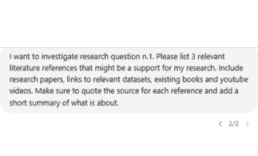
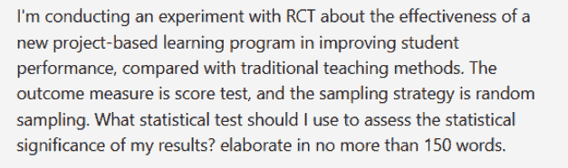

## 7 用 ChatGPT 重塑研究

# 加入我们的 Discord 书籍社区


https://packt.link/EarlyAccess

在本章中，我们将重点关注希望利用 ChatGPT 的研究人员。本章将介绍 ChatGPT 可以解决的几个主要用例，以便你能够从具体的示例中学习如何在研究中使用 ChatGPT。

在本章结束时，你将熟悉如何以多种方式将 ChatGPT 作为研究助手，包括以下：

- 研究人员对 ChatGPT 的需求
- 为你的研究头脑风暴文献
- 为实验的设计和框架提供支持
- 生成并格式化参考文献以将其纳入你的研究中
- 针对不同受众交付关于你研究的推介或幻灯片演示

本章还将提供示例，并让你亲自尝试这些提示（prompts）。

## 研究人员对 ChatGPT 的需求

对于各个领域的研究人员来说，ChatGPT 可以是一个非常有价值的资源。作为一个在海量数据上训练的复杂语言模型，ChatGPT 可以快速准确地处理大量信息，并生成通过传统研究方法难以发现或耗费时间发现的见解。

此外，ChatGPT 可以通过分析人类研究人员可能无法立即发现的模式和趋势，为研究人员提供其领域的独特视角。例如，想象一位正在研究气候变化并希望理解公众对这一问题的认知的研究人员。他们请求 ChatGPT 分析与气候变化相关的社交媒体数据，并识别网上人们表达的最常见主题和情绪。然后 ChatGPT 可以为研究人员提供一份详尽的报告，列出与此主题相关的常见词汇、短语和情感，以及任何可能了解的新趋势或模式。

通过与 ChatGPT 合作，研究人员可以获得尖端技术和见解，并处于他们领域的前沿。

现在让我们深入探讨 ChatGPT 提高研究效率的四个用例。

本章中提出的大多数示例都是基于最新的信息；事实上，你会经常看到 ChatGPT 利用网络搜索插件。如果你使用的是带有 GPT-3.5-turbo 的 ChatGPT（即免费版），请记住它没有启用网络搜索插件，因此，它的知识截止日期限制在 2021 年。如果你正在寻找更新的信息，并且通常情况下需要来自网页的引用（以便你双重检查回答的可靠性），这可能是一个局限性。

## 为你的研究头脑风暴文献

文献综述是对特定主题或问题的已发表研究进行检查的一项关键且系统的过程。它涉及搜索、回顾和综述相关的已发表研究和其他来源，如书籍、会议论文和灰色文献。文献综述的目标是识别特定领域内的研究空白、不一致之处以及进一步研究的机会。

文献综述过程通常涉及以下步骤：

1. **定义研究问题：** 进行文献综述的第一步是定义感兴趣主题的研究问题。那么，假设我们正在进行一项关于社交媒体对心理健康影响的研究。现在我们有兴趣头脑风暴一些可能的研究问题以集中我们的研究重点，我们可以利用 ChatGPT 来实现这一点：

> “我有兴趣开展一项关于社交媒体对心理健康影响的研究。请为我生成 3 个潜在的研究问题，以便我集中我的研究重点。”

> “好的，这里有三个你在开展关于社交媒体对心理健康影响的研究时可以关注的潜在研究问题：”

1. 社交媒体的使用频率和类型如何影响青少年青少年的焦虑和抑郁水平？
   - 这个问题可以帮助探索在社交媒体上花费的时间、消费内容的性质及其对青少年的心理影响之间的相关性。

2. 社交媒体在影响年轻人的身体形象和自尊心方面起着什么作用？
   - 这个问题侧重于理解社交媒体平台上的理想化图像和生活方式如何影响年轻人的自我感知和自信水平。

3. 社交媒体互动和在线支持社区以何种方式影响患有慢性心理健康状况个人的心理健康？
   - 这个问题旨在检查在线社交互动和支持小组对已经面临心理健康挑战的人的积极和消极影响。

**图 8.1 – 基于给定主题的研究问题示例**

这些都是可以进一步调查的问题。由于我对第一个特别感兴趣——“社交媒体互动和在线支持社区以何种方式影响患有慢性心理健康状况个人的心理健康？”我将保留它作为我们分析后续步骤的参考。

## 搜索文献

现在我们已经有了问题，下一步是使用各种数据库、搜索引擎和其他来源搜索相关文献。研究人员可以使用特定的关键词和搜索术语来帮助识别相关研究。



以下是支持你关于社交媒体对青少年焦虑和抑郁影响的研究的相关参考文献：

1. **青少年社交媒体使用与抑郁的范围综述：**
   - 参考文献：Alassaaf, Gilbert, Nipha, Basha, Mahmood, and Movahed Housel, Richards, 2020.
   - 摘要：该综述调查了社交媒体使用与抑郁、焦虑和睡眠差等结果之间的联系。综述强调，需要更多研究通过贡献这些关系来提供支持，并开发评估方法。
   - 链接：MDR 范围综述 (MDR)

2. **问题社交网络使用与焦虑症状的关联：系统综述和元分析**
   - 参考文献：BMC Psychiatry, 2023.
   - 摘要：这项系统综述和元分析检查了问题性社交网络使用（PSNU）与焦虑症状之间的关系。它包含了来自68项研究关于广泛焦虑、社交焦虑和错失恐惧症（FOMO）的数据。结果强调了 PSNU 与焦虑症状增加之间存在显著关联，表明需要干预措施来解决问题社交媒体使用。
   - 链接：BMC Psychiatry (BioMed Central)

3. **社交媒体焦虑：来自哈佛大学教育学院的见解，2017。**
   - 参考文献：Leah Shafer; Harvard Graduate School of Education, 2017.
   - 摘要：这篇文章探讨了社交媒体使用与每天在社交媒体上花费小时的青少年之间的复杂关系。文章还强调社交媒体可以是不断的联系来源，但对某些青少年来说，它也是焦虑和担忧的来源，父母应该根据个人需求调整方法，而不是反对使用社交媒体。
   - 链接：哈佛大学教育学院 (Harvard Graduate School of Education)

**图 8.2 – 使用 ChatGPT 搜索文献**

在根据 ChatGPT 的建议之后，我们可以深入研究这些参考文献。

1. 搜索文献：一旦确定了相关文献，下一步是筛选研究以确定它们是否符合综述的纳入标准。这通常涉及审查研究的摘要，并在必要时阅读全文。

例如，假设我们想要深入研究**社交媒体与青少年焦虑：哈佛大学研究生教育学院的见解**这篇研究论文。让我们让 ChatGPT 为我们进行筛选：

> 详述研究论文“社交媒体与青少年焦虑：哈佛大学研究生教育学院的见解”。突出其研究问题和讨论的主要主题（字数控制在200字以内）

来自哈佛大学研究生教育学院的《社交媒体与青少年焦虑》文章调查了社交媒体使用与青少年焦虑之间复杂的关系。它所解决的核心研究问题是：社交媒体如何导致青少年焦虑水平的上升，父母可以做什么来帮助孩子应对这些压力？

## 讨论的主要主题

1. 文章讨论了随着社交媒体使用的增加，青少年中焦虑、抑郁和自杀念头的显著增加。它强调了一些研究，表明每天在社交媒体上花费数小时的青少年更容易表现出焦虑和抑郁症状。
2. 发展方面的关注：它解释了青少年从社交媒体中感受到的许多压力与围绕社会地位和自我表达的正常发育担忧是一致的，而社交媒体会放大这些担忧。
3. 家长指导：文章为父母如何帮助孩子管理社交媒体使用提供了指导。它建议，父母与其完全否定社交媒体，不如根据孩子的个体需求定制自己的方法，帮助他们负责任地应对数字世界。
4. 赋能与积极方面：它也承认了社交媒体的积极方面，例如与他人联系、提高意识和分享经验的能力，这对某些青少年来说是赋能且提振的。

总体，文章强调了对社交媒体对青少年心理健康影响进行细致理解的重要性，并为父母支持孩子提供了实用的建议。

欲了解更多详细信息，您可以在此处阅读全文（[哈佛大学研究生教育学院]）。

图 8.3 – 特定论文的文献筛选

ChatGPT 能够为我提供该论文的概述，考虑到它的研究问题和讨论的主要主题，我认为它对我自己的研究非常有帮助。

1. **提取数据**：在确定相关研究后，研究人员需要从每项研究中提取数据，例如研究设计、样本量、数据收集方法和主要发现。

例如，假设我们想从 Hinduja 和 Patchin (2018) 的论文《数字自残：流行率、动机和结果》中收集以下信息：

- 论文收集的数据源和研究对象
- 研究人员采用的数据收集方法
- 数据样本量
- 分析的主要局限性和缺点
- 研究人员采用的实验设计

操作过程如下：

> 提取关于论文《问题性社交网络使用与焦虑症状之间的关联：系统性评价和元分析》的以下信息。输出应以表格形式呈现。
>
> 1. 论文收集的数据源和研究对象
> 2. 研究人员采用的数据收集方法
> 3. 数据样本量
> 4. 分析的主要局限性和缺点
> 5. 研究人员采用的实验设计

以下是从论文《问题性社交网络使用与焦虑症状之间的关联：系统性评价和元分析》中提取的表格格式信息：

| 类别 | 详情 |
| --- | --- |
| 收集的数据源 | 从多项研究中收集的数据，研究了问题性社交网络使用 (PSNU) 与焦虑症状之间的关系。 |
| 研究对象 | 分析 PSNU 与不同类型焦虑症状之间的关联，包括广泛性焦虑、社交焦虑、依恋焦虑和错失恐惧症 (FOMO)。 |
| 数据收集方法 | 对现有文献进行系统性评价和元分析。研究人员进行了全面的数据库检索，筛选了符合纳入标准的研究。 |
| 数据样本量 | 元分析包含 172 条记录，涉及 209 个独立效应量，涵盖了各种人口统计和焦虑类型。 |
| 主要局限性和缺点 | - 纳入的研究在样本特征和测量工具方面存在异质性。 - 潜在的发表偏倚以及纳入研究的质量不一。 - 由于许多研究的横截面性质，建立因果关系的能力有限。 |
| 采用的实验设计 | 使用随机效应模型进行数据分析以考虑研究之间的变异性。进行了亚组分析和元回归以检查调节效应。 |

欲了解更多细节，您可以在此处访问 BMC Psychology 上的论文全文（[BioMed Central]）。

图 8.4 – 从给定论文提取相关数据和框架

## 文献综合

文献综述过程的最后一步是综合研究结果，并对该领域的现有知识水平得出结论。这可能涉及识别共同主题、突出文献中的空白或不一致之处，并确定未来研究的机会。

让我们想象一下，除了 ChatGPT 提出的论文外，我们还收集了其他想要综合的标题和论文。具体来说，我想了解它们是否得出相同的结论，有哪些共同趋势，哪种方法可能比其他方法更可靠。在这种情况下，我们将考虑三篇研究论文：

- *社交媒体对心理健康的影响：一项拟议的研究*，Grant Sean Bossard （https://digitalcommons.bard.edu/cgi/viewcontent.cgi?article=1028&context=senproj.f2020）
- *社交媒体对心理健康的影响*，Vardanush Palyan （https://www.spotlightresearch.com）
- *社交媒体对心理健康的影响：一项拟议的研究*，Grant Sean Bossard 著（scholarworks.lib.usb.edu/cgi/viewcontent.cgi?article=2131&context=etd）

结果显示如下：

## 结论、研究方法及考量

1. Grant Boason 写的《社交媒体对心理健康的影响：一项拟议的研究》结论：该研究采用了控制实验设置，关注 Instagram、Facebook 或完全不使用社交媒体。预期结果包括心理痛苦增加、自尊心下降和抑郁症状增加。

- 对心理健康的影响：所有研究都承认社交媒体影响的双重性，具有益处（增强认知、自尊）和风险（焦虑、抑郁）。
- 研究方法：研究使用患者健康问卷-8 (PHQ-8)：罗森堡自评量表来衡量抑郁症状。
- 方法论：混合方法很常见，结合了定量问卷和定性访谈，以提供深度。


# 文献分析与研究设计支持

## 文献分析

### 关于可靠性的考量

研究设计包含控制实验组，但可能存在影响可靠性的外部因素。

### 研究结论摘要

Vardhan Patel 写的《社交媒体对心理健康的影响》结论：这项研究突显了社交媒体对健康的积极和负面影响，指出社交媒体可以增强联系和自尊心。欲了解有关每项研究的更多详细信息，您可以直接访问各自的来源。

### 研究方法

该研究采用混合方法，包括定量调查和访谈，以收集有关用户体验和心理结果的全面数据。

### 参考文献

- Grant Boason 的论文
- Vardhan Patel 的论文
- Sarah Nicole Knight 和 Bobbie Row Paris 的研究

### 关于可靠性的考量

结合定量和定性数据可以评估发现的可靠性，但经验的差异和报告偏差仍然是潜在问题。

```
图 8.5 – 文献分析及对三篇研究论文进行基准测试
```

此外，在这种情况下，`ChatGPT` 能够对提供的三篇论文产生相关的总结和分析，包括方法之间的基准比较和可靠性考量。

总体而言，`ChatGPT` 能够在文献综述领域完成许多活动，从研究脑风暴到文献综合。尽管领域专家 (SME) 在循环中审查结果，但在这种帮助下，许多活动可以更高效地完成。

`ChatGPT` 支持的另一个活动是研究人员需要执行的实验设计。我们将在后面讨论这一点。

## 为你的实验设计和框架提供支持

实验设计是计划和执行科学实验或研究以回答研究问题的过程。它涉及对研究设计、待测量的变量、样本量以及数据收集和分析程序做出决策。

`ChatGPT` 可以帮助研究中的实验设计，通过为你建议研究框架（例如随机对照试验、准实验设计或相关性研究），并在该设计的实施过程中提供支持。

让我们考虑以下场景。我们想要调查一项新教育计划对学生数学学习成果的影响。这项新计划涉及项目制学习（PBL），这意味着学生被要求合作完成现实项目，使用数学概念和技能来解决问题并创建解决方案。

为了这一目的，我们将研究问题定义如下：

新的 PBL 项目在提高学生表现方面与传统教学方法相比如何？

以下是 `ChatGPT` 如何提供帮助的：

### 确定研究设计

`ChatGPT` 可以协助为研究问题确定合适的研究设计，例如随机对照试验、准实验设计或相关性研究。

> 我想针对以下研究问题设计实验：“新的项目制学习计划在提高学生表现方面与传统教学方法相比如何？”为了实现这一目标，我应该进行什么样的研究设计？请用不超过 200 字的话解释。

为了比较新的项目制学习（PBL）计划与传统教学方法在提高学生表现方面，请设计一个**随机对照试验 (RCT)**。

#### 研究设计

1. **参与者：** 招募足够数量的学生，并将他们随机分配到 PBL 组（实验组）或传统教学组（控制组）。
2. **前测：** 对两组学生进行标准化测试，以衡量他们的基准表现。
3. **干预：** 在一段时期内，在实验组实施 PBL 计划，并在控制组继续传统的教学方法。
4. **后测：** 干预后，对两组学生进行相同的标准化测试。
5. **数据分析：** 使用协方差分析（`ANCOVA`）等统计方法比较前后测试的得分以及组间差异，以控制任何基准差异。

这种设计允许对 PBL 与传统教学方法的有效性进行稳健比较，最大限度地减少偏差，并为因果关系提供强有力的证据。

`ChatGPT` 建议进行随机对照试验 (RCT)，并对其理由提供了清晰的解释。在我看来采用这种方法是合理的：下一步将是确定实验中要考虑的衡量指标和变量。

### 识别衡量指标

`ChatGPT` 可以帮助你识别一些潜在的衡量指标以确定测试结果。让我们为我们的研究寻求一些建议：

> 我想在一项带有 RCT 的研究中，比较新的项目制学习计划与传统教学方法在提高学生表现方面的差异。可能的衡量指标有哪些？

在比较项目制学习（PBL）和传统教学方法的随机对照试验（RCT）中，评估学生表现的可能衡量指标包括：

1. **学术成就：** 通过标准化测试分数、分级和考试结果衡量。
2. **批判性思维能力：** 使用批判性思维评估和解决问题的任务进行评估。
3. **参与度和积极动力：** 通过学生问卷、考勤记录和参与率进行评估。
4. **协作技能：** 通过同伴评价和小组项目成果衡量。
5. **知识留存：** 通过比较在一段时间后进行的随访测试的表现进行评估。
6. **学习态度：** 通过衡量学生对学习过程的态度和感知的问卷进行评估。
7. **教师观察：** 从教师评估以及对学生行为和参与度的观察中收集定性数据。

这些指标提供了全面评估 PBL 与传统方法相比在提高学生表现各个方面方面的有效性。

```
图 8.7 – 给定研究学习的学习成果
```

我选择测试分数作为衡量指标是合理的。

### 识别变量

`ChatGPT` 可以帮助研究人员识别研究中的自变量和因变量：

> 我想在一项带有 RCT 的研究中，比较新的项目制学习计划与传统教学方法在提高学生表现方面的差异。我应该在研究中包含哪些变量？输出应为表格格式

以下是你的研究中应包含的变量表：

| 变量 | 描述 |
| --- | --- |
| 自变量 | 教学方法：项目制学习 (PBL) 对比 传统教学方法 |
| 因变量 | 学术成就：测试分数、分级、考试结果<br>批判性思维能力：在批判性思维评估中的表现<br>参与度和积极动力：问卷回复、考勤、参与率<br>协作技能：同伴评价、小组项目成果<br>知识留存：随访测试表现<br>学习态度：关于学生态度和感知的问卷回复 |
| 控制变量 | 学生人口统计：年龄、性别、社会经济状况<br>基准学术表现：前测分数、之前的成绩<br>教师特征：教学经验、培训<br>班级规模：每个班的学生人数<br>课程内容：两种教学方法涵盖内容的相似性 |

这些变量将帮助你全面评估 PBL 计划与传统教学方法相比的有效性。

```
图 8.8 – ChatGPT 为给定研究生成变量
```

请注意，`ChatGPT` 还能生成针对我们正在考虑的研究设计（RCT）的特定变量，被称为**控制变量**。

控制变量，也称为协变量，是在研究中保持不变或受控制的变量，以孤立自变量与因变量之间的关系。这些变量不是研究的重点，但包含它们是为了最大限度地减少混杂变量对结果的影响。通过控制这些变量，研究人员可以降低获得假阳性或假阴性结果的风险，并增加研究的内部效度。

有了上述变量，我们已经准备好建立实验了。现在我们需要选择参与者，`ChatGPT` 可以帮助我们。

### 抽样策略

`ChatGPT` 可以为研究建议潜在的抽样策略：

> 我需要为我的 RCT 选择参与者，该研究关于新的项目制学习计划在提高学生表现方面的有效性，对比传统教学方法。生成一个关于如何抽样参与者的分步指南（不超过 200 字），说明抽样技术以及为什么它们可能是有效的。输出应为表格格式。

| 步骤 | 描述 | 理由 |
| --- | --- | --- |
| 1. 定义总体 | 识别目标总体（例如，特定地区的中学学生） | 确保研究结果与目标群体相关。 |
| 2. 获取批准 | 获得学校、家长和学生的许可。 | 伦理要求并确保参与度。 |
| 3. 随机抽样 | 使用随机抽样从目标总体中选择具有代表性的学生子集。 | 减少选择偏差并确保每个学生都有机会。 |
| 4. 按关键特征分层 | 根据年级和之前的学术表现等特征对样本进行分层。 | 确保分组平衡并控制混杂变量。 |
| 5. 随机分配 | 将学生随机分配到 PBL 组或传统教学组。 | 确保组间的可比性并最大限度地减少偏差。 |
| 6. 确定样本量 | 使用功效分析计算所需的样本量以检测显著效应。 | 确保研究有足够的功效来检测显著差异。 |
| 7. 收集基准数据 | 进行测试以衡量初始学术表现和其他相关变量。 | 为比较后测结果提供基准。 |
| 8. 实施干预 | 对实验组实施 PBL 计划，对控制组实施传统方法。 | 确保实验条件的完整性。 |
| 9. 监控与调整 | 定期检查方案的执行情况并根据需要进行调整。 | 维护研究的有效性和可靠性。 |

```
图 8.9 – ChatGPT 提供的 RCT 抽样建议
```

请注意，在现实场景中，良好的做法始终让 AI 工具生成更多带有背后解释的选项，以便你能够做出理性的决策。在这个示例中，让我们直接采用 `ChatGPT` 给我们的建议，其中还包含了关于目标总体和样本量的建议。

### 数据分析

`ChatGPT` 可以帮助研究人员确定用于分析研究收集数据的适当统计检验，例如方差分析（`ANOVA`）、`t` 检验或回归分析。



为了在比较项目制学习（PBL）计划与传统教学方法的随机对照试验（RCT）中评估结果的统计学意义，请使用**协方差分析 (ANCOVA)**。`ANCOVA` 通过控制初始测试分数来调整基线差异并提高估计的精确性。以下是其适用原因：

1. **基线调整：** `ANCOVA` 控制了前测分数，从而分离了干预的效果。
2. **提高效力：** 通过考虑初始性能的变异性，提高了检测显著效应的能力。
3. **组间比较：** 它比较了 PBL 组和传统组干预后的得分，提供了该计划影响的清晰衡量标准。

这种方法确保了观察到的测试分数差异是由于教学方法造成的，而不是由于初始性能的差异。

```
图 8.10 – ChatGPT 为特定研究建议统计检验方法
```

`ChatGPT` 建议的所有内容都是连贯的，并且在关于如何进行统计检验的论文中得到了证实。它还能识别出我们可能在谈论一个连续变量（即分数），这样我们知道后续的所有信息都是基于这一假设的。如果我们需要得到离散分数，我们可能会通过添加这些信息来调整提示词（prompt），`ChatGPT` 随后会建议不同的方法。

`ChatGPT` 明确说明假设并解释其推理过程，这是根据其输入做出安全决策的关键。

结论，`ChatGPT` 可以是研究人员设计实验时的一项有价值的工具。通过利用**自然语言处理 (NLP)** 能力和庞大的知识库，`ChatGPT` 可以帮助研究人员选择适当的研究设计、确定采样技术、识别变量和学习成果，甚至建议用于分析数据的统计检验方法。

在下一节中，我们将进一步探索 `ChatGPT` 如何支持研究人员，重点关注参考文献的生成。

## 生成和格式化参考文献

`ChatGPT` 可以通过提供自动化引用和参考工具来帮助研究人员生成参考文献。这些工具可以为书籍、文章、网站等广泛来源生成准确的引用和参考资料。`ChatGPT` 熟悉各种引用格式，如 `APA`、`MLA`、芝加哥和哈佛格式，允许研究人员根据工作选择合适的格式。此外，`ChatGPT` 还可以根据研究人员的输入建议相关来源，帮助简化研究流程并确保参考文献中包含所有必要的来源。通过使用这些工具，研究人员可以节省时间并确保他们的参考文献准确且全面。

让我们考虑以下示例。假设我们完成了一篇标题为《技术对职场生产力的影响：一项实证研究》的论文。在研究和写作过程中，我们收集了以下论文、网站、视频和其他来源的引用，并将其纳入参考文献（顺序为：三篇研究论文、一个 `YouTube` 视频和一个网站）：

- The second machine age: Work, progress, and prosperity in a time of brilliant technologies. Brynjolfsson, 2014. https://psycnet.apa.org/record/2014-07087-000
- The Impact of Technostress on Role Stress and Productivity. Tarafdar, 2014. Pages 301-328. https://www.tandfonline.com/doi/10.2753/MIS0742-1222240109
- "The big debate about the future of work, explained". Vox. https://www.youtube.com/watch?v=TUMygCMMGA

显然，我们不能在研究论文中直接使用上述列表；需要对其进行正确的格式化。为此，我们可以向 `ChatGPT` 提供参考文献原始列表并要求它按特定格式重新生成，例如 `APA` 格式——即**美国心理学会 (APA)** 的官方格式，该格式通常用于教育、心理学和社会科学的参考格式样式。

让我们看看 `ChatGPT` 是如何处理的：

> 我有以下链接作为我参考文献的参考：
> - The second machine age: Work, progress, and prosperity in a time of brilliant technologies." Brynjolfsson, 2014. https://psycnet.org/record/2014-07087-000
> - The Impact of Technostress on Role Stress and Productivity. https://www.tandfonline.com/doi/abs/10.2753/MIS
> - Tarafdar, 2014. Pages 301-328. https://www.tandfonline.com/doi/abs/10.2753/MIS0742-1222240109
> - "The big debate about the future of work, explained." Vox, 2017. https://www.youtube.com/watch?v=TUmyygCMGA
>
> 用芝加哥格式生成这些链接。如果你不知道某些细节（如出版月份和日期），请不要生成。

以下是芝加哥格式的参考文献：

1. Brynjolfsson, Erik, and Andrew McAfee. The Second Machine Age: Work, Progress, and Prosperity in a Time of Brilliant Technologies. 2014. Accessed July 26, 2024. https://psycnet.org/record/2014-07087-000.
2. Tarafdar, Monideepa, Qiang Tu, T.S. Ragu-Nathan, and Bhananu S. Ragu-Nathan. "The Impact of Technostress on Role Stress and Productivity." Journal of Management Information Systems 24, no. 1 (2014): 301-328. Accessed July 26, 2024. https://www.tandfonline.com/doi/abs/10.2753/MIS0742-1222240109.
3. "The Big Debate About the Future of Work, Explained." Vox, 2017. Accessed July 26, 2024. https://www.youtube.com/watch?v=TUmyygCMGA

注意：文本同样能够识别出我们可能在谈论一个连续变量（即分数），这样我们知道后续信息都是基于这一假设的。如果我们需要得到离散分数，我们可以通过添加这些信息来调整提示词，`ChatGPT` 随后会建议不同的方法。

`ChatGPT` 明确说明假设并解释其推理过程，这是根据其输入做出安全决策的关键。

结论，`ChatGPT` 可以是研究人员设计实验时的一项有价值的工具。通过利用**自然语言处理 (NLP)** 能力和庞大的知识库，`ChatGPT` 可以帮助研究人员选择适当的研究设计、确定采样技术、识别变量和学习成果，甚至建议用于分析数据的统计检验方法。

在下一节中，我们将进一步探索 `ChatGPT` 如何支持研究人员，重点关注参考文献的生成。

一旦你准备好研究，你可能需要通过“电梯演讲”（elevator pitch）来展示它。在接下来的章节中，我们将看到 `ChatGPT` 如何也能支持这项任务。

## 生成研究演示报告

研究的“最后一公里”通常是向各种观众进行展示。这可能涉及准备幻灯片组、演讲稿或网络研讨会，研究人员需要面对不同类型的观众。

比方说，我们的研究*社交媒体和在线支持社区对慢性心理健康状况个体心理健康的影响*是用于硕士论文答辩的。在这种情况下，我们可以要求 `ChatGPT` 生成一个时长为 15 分钟并符合科学方法的演讲结构。让我们看看会产生什么样的结果（作为背景，我指的是上文的摘要）：

> 我必须根据上述摘要讨论我的论文“社交媒体和在线支持社区对慢性心理健康状况个体心理健康的影响”。请生成一个论文答辩结构，并包含一些针对教授委员会的示例句子。字数控制在 150 字以内，并以表格形式输出。

| 章节 | 示例句子 |
| --- | --- |
| 引言 | “尊敬的教授们，早上好。今天，我将介绍我的关于社交媒体和在线支持社区对慢性心理健康状况个体心理健康影响的论文。” |
| 背景 | “社交媒体的普及率显著增加，为慢性心理健康状况个体带来了机会和挑战。” |
| 研究问题 | “我们的主要研究问题是：社交媒体互动和在线支持社区以什么方式影响这些个体的心理健康？” |
| 文献综述 | “之前的研究，如 Nash 等人（2020），强调了社交媒体的双重性，既提供了同伴支持，也存在焦虑和抑郁的风险。” |
| 方法论 | “我们进行了混合方法研究，使用问卷和访谈从积极使用社交媒体平台的参与者那里收集了定量和定性数据。” |
| 结果 | “我们的发现表明，在情感支持和连接方面有显著的正向影响，同时也存在网络暴力和社交比较相关的负面影响。” |
| 讨论 | “数据表明，虽然在线支持社区提供了必要的同伴支持，但管理和对健康使用的教育对于减轻不利影响至关重要。” |
| 结论 | “结论，我们的研究强调了平衡社交媒体参与以及针对性干预的必要性，以增强慢性心理健康状况个体的心理健康。” |
| 未来研究 | “未来的研究应该探索长期效应，并开发数字工具以优化在线支持的收益，同时最大限度地减少潜在伤害。” |
| 问答 | “欢迎委员会就如何进一步完善和扩大这项研究以更好地服务慢性心理健康状况个体提出任何问题或反馈。” |

```
图 8.13 – ChatGPT 生成的论文答辩
```


这太令人印象深刻了！在我的大学时代，如果有这样一个工具协助我设计答辩，将非常有帮助。

从这个结构开始，我们还可以要求 ChatGPT 生成一套幻灯片，作为我们论文答辩的视觉辅助。

让我们继续这个请求：

| 幻灯片 | 内容 |
|---|---|
| 1 | 标题：社交媒体传奇：是帮助还是伤害了心理健康？ <br>尊敬的教授们，早上好！请准备好，我们将深入探讨社交媒体的数字领域以及它对慢性心理健康状况个体心理健康的双刃剑影响。 |
| 2 | 背景 <br> 从回到 TikTok，社交媒体是现代集市。但它对于慢性心理健康状况的人来说是朋友还是敌人？让我们深入数据和叙事中！<br> 双重影响：支持 vs 压力 |
| 3 | 研究与方法论 <br> 我们的追求：社交媒体互动和在线支持如何影响这些个体的心理健康？<br> 方法：混合方法（问卷与访谈）<br> 参与者：患慢性心理健康状况的活跃社交媒体用户 |
| 4 | 结果：好的、坏的和糟糕的 <br> 我们发现了什么？请做好准备！<br>- 好的：情感支持、连接性<br>- 坏的：网络暴力、社交比较<br>- 糟糕的：焦虑增加、抑郁风险增加 |
| 5 | 结论与未来研究 <br> 那么，社交媒体是英雄还是反派？这很复杂<br> 结论：平衡和节制是关键。<br> 未来研究：长期研究和数字工具的开发。<br> 问题？让我们一起翻页！ |

这个结构平衡了轻松、引入人的风格与教授委员会所预期的学术严谨性。

图 8.14 – 基于演讲草稿的幻灯片结构

最后，让我们想象我们的论文答辩非常出色，以至于可能被选中获得研究资金以继续调查该课题。现在我们需要一个电梯演讲来说服资金委员会。让我们向 ChatGPT 请求一些支持：

为上述论文生成一个电梯演讲。观众是科学资助委员会。我需要说服观众这项研究值得资助。风格应该是引人注目且具有挑战性的。最多 150 字。

## 电梯演讲：

想象这样一个世界，社交媒体是慢性心理健康状况个体的生命线，提供了关键的支持和联系。然而，同样的工具也可能加剧他们的挣扎，导致焦虑和抑郁增加。我们的研究试图通过探索社交媒体互动和在线支持社区如何影响心理健康来破解这一悖论；我们的目的是开发针对性的干预措施，以实现利益最大化和伤害最小化。通过混合方法，我们将从处于这一困境边缘的人那里收集丰富且可操作的见解。资助这项研究不仅意味着理解社交媒体影响的复杂性，还为创新、有效的解决方案铺平道路，在日益连接的世界中增强心理健康支持。让我们把社交媒体从双刃剑变为健康的强大盟友。

# 图 8.15 – 给给定论文的电梯演讲

我们始终可以调整结果，使其更符合我们的目标，然而，拥有现成的结构和框架可以节省大量时间，并让我们能够更加关注想要引入的技术内容。

总的来说，ChatGPT 能够支持研究的全到端流程，从文献收集和综述到研究最终演讲的生成，我们证明了它可以如何成为研究人员出色的 AI 助手。

此外，请注意，在研究领域，最近开发了一些与 ChatGPT 不同但仍由 GPT 模型驱动的工具。例如 Humanity，这是一个 AI 驱动的工具，允许你上传文档并对其执行多项操作，包括摘要、即时问答和基于上传的文件生成新论文。

这表明 GPT 驱动的工具（包括 ChatGPT）正在为研究领域内的若干创新铺平道路。

## 总结

在本章中，我们探索了将 ChatGPT 作为研究人员价值工具的使用。通过文献综述、实验设计、参考文献生成和格式化以及演示报告生成，ChatGPT 可以帮助研究人员加速那些低价值或零额外值的活动，以便他们能够关注相关活动。

请注意，我们只关注了 ChatGPT 支持研究人员的一小部分活动。在该领域内还有许多其他活动研究可以受益于 ChatGPT 的支持，其中我们可以提到数据收集、研究参与者招募、研究网络构建、公众参与等。

将此工具整合到工作中的研究人员可以从其多功能和节省时间的特性中受益，最终带来更有影响力的研究成果。

然而，重要的是记住，ChatGPT 仅仅是一个工具，应该结合专家知识和判断来使用。与任何研究项目一样，必须对研究问题和研究设计进行仔细考虑，以确保结果的有效性和可靠性。

通过本章，我们也结束了本书的第二部分，该部分侧重于你可以利用 ChatGPT 的广泛应用场景和领域。然而，我们主要关注个人或小团队的使用，范围从个人生产力到研究助手。从第三部分开始，我们将讨论提升到大型组织如何利用 Microsoft Azure 云上提供的 OpenAI 模型 API，将 ChatGPT 背后的相同生成式 AI 应用于企业级项目。

## 参考文献

- https://arxiv.org/abs/2312.11914
- https://arxiv.org/abs/2101.07714
- https://arxiv.org/abs/2101.07714
- https://psycnet.apa.org/record/2014-0708-000
- https://www.tandfononline.com/doi/abs/10.2753/MIS0742-1222240109
- https://www.youtube.com/watch?v=TUMyygCMMGA
