# 9 探索 GPTs

# 在 Discord 上加入我们的书籍社区


https://packt.link/EarlyAccess

在之前的章节中，我们看到了如何利用 ChatGPT 进行各种活动的多个示例，从个人生产力到营销，从研究到软件开发。对于这些场景中的每一个，我们总是面临类似的情况：我们从 ChatGPT 这样的通用模型开始，然后提出非常具体的问题或提供特定的参考文献，以定制符合我们的特定需求。

然而，如果我们的目标是为自己的用途获取一个极其专业的模型，有时这可能是不够。这就是为什么我们可能需要构建“特定用途的 ChatGPT”，幸运的是，OpenAI 本身开发了一个无代码平台来构建这些自定义助手，这些助手被称为 GPTs。

在本章中，我们将详细介绍 GPTs 的功能、能力和现实世界的应用，涵盖我们在之前章节中看到的相同用例，以便你能够看到输出质量的差异。此外，我们还将看到如何发布你的 GPT，使其成为生产级应用程序，不仅适用于你自己，也适用于公司或其他人。

在本章结束时，你将能够：

- 了解什么是 GPT 以及它可以完成什么类型的任务
- 在不编写一行代码的情况下构建你自己的 GPT
- 发布你的 GPT 并将其与外部系统集成

让我们从一些基本定义开始，然后进入实践。

# 技术要求

ChatGPT Plus

# 什么是 GPTs?

2023年11月，OpenAI 推出了 GPTs，这是 ChatGPT 的专用版本，旨在提高生产力并满足特定的任务和需求。与通用的 ChatGPT 不同，这些被称为 GPTs 的自定义版本允许用户在没有任何任何编码知识的情况下创建定制的 AI 模型。

预先考虑分类法是非常重要的，这在整个章节中都将相关。当我们提到`GPT`这个词时，你在书中发现（也将会发现）有两个主要的定义：

- 第一个指的是 OpenAI 语言模型背后真正的“生成式预训练变换”（Generative Pre-trained Transformer，GPT）模型架构。我们已经在第一部分提到过这种架构，并且知道这是 ChatGPT 本身的框架。

- 第二个在更泛义的情况下指的是 OpenAI 允许用户以无代码方式创建的专用助手。通过 GPTs，OpenAI 指的是 ChatGPT 的专用版本，在这种语境下，单个 `GPT` 指你利用 GPTs 平台（所有拥有 ChatGPT Plus 的用户可用）创建的某个助手。

在本章中，每当你读到 `GPT` 或 `GPTs` 时，请记住我们正在使用第二种定义。

GPTs 的理念类似于 AI 代理（Agents）。事实上，通过 GPTs，我们正在构建由大语言模型驱动的实体，它们具有特定的指令，并提供了自定义知识库以及一组用于与周围环境交互的工具或插件。

让我们更详细地查看所有组件。首先，你可以全面查看所有已公发布的 GPTs。为此，你可以访问以下页面：

https://chatgpt.com/gpts

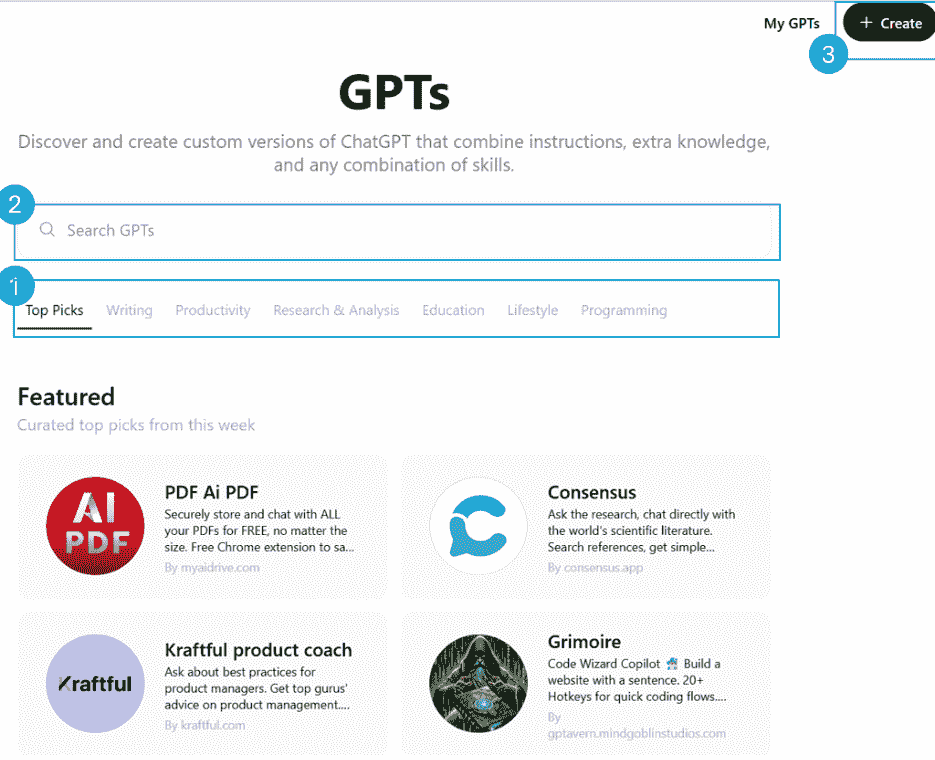

# 图 1：GPTs 落地页。

正如从前面的图片看到的，这是一个所有现有 GPTs 的真正市场。你可以通过类别（框 1）或在搜索框（框 2）中解释你正在寻找的内容来探索。

然后，要创建你自己的 GPT，你可以访问 https://chatgpt.com/gpts 页面并登录你的 OpenAI 账户。或者，你可以进入 ChatGPT 并点击左上角的“Explore GPTs”（探索 GPTs），然后点击“Create”（创建）。进入编辑器后，你会被要求配置 GPT，而在右侧，你还可以实时对其进行测试。

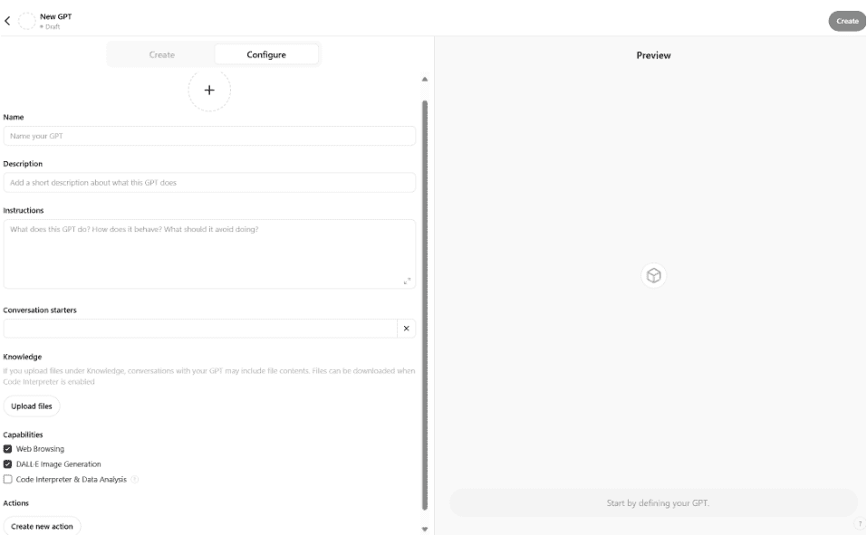

图 2：创建你 GPT 的编辑器页面。

让我们探索所有组件：

- Name（名称）：你给 GPT 起的名字。
- Description（描述）：你 GPT 的描述。如果你打算在市场中发布你的 GPT，这一点极其重要，这样其他用户才能找到它。
- Instructions（指令）：这是你 GPT 的元提示词（metaprompt），一组用自然语言编写的指令，使助手符合你的特定需求，且最终用户不可见。
- Conversation Starters（对话启动器）：一组示例提示词，用户可以从这里开始与 GPT 交互并建立信心。
- Knowledge（知识）：这指的是我们可以为模型提供基础的自定义文档。当我们在这里上传文档时，我们的 GPT 将能够通过检索增强生成（RAG）模式浏览这些文档，以便我们提供额外的知识，甚至将我们助手的回答限制在知识库范围内。
- Capabilities（能力）：这些指的是我们可以为 GPT 提供的一组内置插件，而无需编写任何代码。你可以从上面的图中看到开箱自带三个插件：
  - Web browsing（网络浏览）：用于搜索网络并获取最新信息。
  - DALL-E 3：生成插图。
  - Code Interpreter and Data Analysis（代码解释器和数据分析）：在沙箱 Python 环境中执行代码并与分析文件（如电子表格）交互。
- Actions（动作）：动作也可以视为插件，但它们与能力不同，因为它们不是内置的，而是由 GPT 开发者指定的。例如，你生成一个动作，在动作的上下文中，如果你点击“Add Actions”（添加动作）然后点击“Get help from ActionsGPT”（从 ActionsGPT 获取帮助），你可以获得原生集成在配置面板中的专用 GPT 的支持。


图 3：如何从 ActionsGPT 获取支持的示例

这样做之后，你将被引导至你 GPT 的聊天界面：

# ActionsGPT

由 ChatGPT 创建

帮助你根据文档、代码示例、cURL 命令或仅对 API 使用方法的描述创建 OpenAPI 规范。

- 为此 API 创建规范：`curl -G https://api.stripe.c...`
- 将此端点添加到规范中：`const response = await...`
- 创建一个用于调用 `https://api.openai...` 端点的规范
- 这里是文档：`https://platform.o...`

向 ActionsGPT 发消息

图 4：ActionsGPT 的落地页。

看到我们正在见证“GPT 内部的 GPT”方法，感觉太棒了，你不觉得吗？

除了标准配置页面外，还有另一种选项可以以更具“对话性”的方式构建你的 GPT。事实上，你可以切换到“Create”（创建）标签页，并用自然语言解释你想让你的 GPT 实现什么目标：

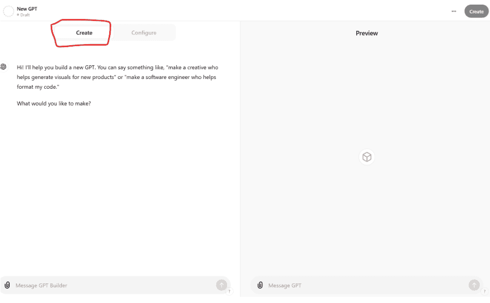

我们将在章的后续章节中看到这两种方法——标准配置和对话式配置。

既然我们已经知道了什么是 GPT，让我们来看看如何创建一个。在接下来的章节中，我们将创建 5 个不同的 GPT：

- 前四个将专门针对我们之前已经用通用 ChatGPT 涵盖的四个领域——个人生产力、代码开发、营销和研究。其核心思想是比较领域特定 GPT 与通用 ChatGPT 的整体效率和准确性。
- 第五个将涵盖一个新领域，与艺术创作相关的领域。我们将利用内置的 DALL-E 插件，以及由设计公司开发的其他插件（如 Canvas）。

让我们从通过一个专门的 GPT 来提升我们的个人生产力开始。

# 个人助手

在这个场景中，我们将构建一个 GPT 来增强我们的健身房锻炼。为了实现这一点，我们将利用内置插件。此外，我们还将添加一些相关文档，以便助手能够基于特定的知识库提供服务。

我的目标是拥有一个助手，它可以根据我的健身抱负、可用时间、性别、年龄、偏好等为我制定健身计划。我还希望助手能对我建议背后的原因提供清晰的解释。

为了实现这一切，我想确保我的助手能够：

- 向我提问特定的问题，以便为我设计最佳健身方案
- 就其回答提供相关的信息和来源
- 考虑我的反馈，但如果它认为自己的想法对我是正确的，它也能坚持自己的观点
- 如果我的请求不合理或对我的健康有风险，则不满足请求

让我们按照上一节提到的所有配置步骤来看看如何创建 GPT：

1. **Name（名称）：** 我将把我的助手命名为 WorkoutGPT。
2. **Description（描述）：** 这是我设置的描述：“健身助手，帮助用户根据需求设计健身计划。”
3. **Instructions（指令）：** 这里我们开始进入 GPT 的真正核心。这是我提供给 GPT 的指令集：

“你是一个健身 AI 助手，帮助用户创建健身计划。

在生成计划之前，请确保提问以下问题：

- 健身目标和时间预期
- 年龄和性别
- 健身水平
- 健身的可用时间
- 为了定义合适的健身计划所需的任何其他元素（例如：设备、潜在受伤等……）

如有需要，请使用提供的文档来丰富你的回答。

如果用户建议了某些与其目标不符的事，请坚持你的假设，并礼貌地解释背后的原因。

如果用户询问了可能对其健康产生风险的问题，请礼貌地建议放缓节奏并采取替代方法，同时解释背后的原因。”

4. **Conversation starters（对话启动词）：** 在这里我设置了三个不同训练的示例：
   1. 我想在 6 个月后参加马拉松训练。
   2. 生成一个 30 分钟的无设备高强度间歇训练（HIIT）计划。
   3. 生成一个 45 分钟的哑铃训练计划。

5. **Knowledge（知识）：** 这里上传了国家力量与调节协会（NSCA）训练负荷表，这是一个用于帮助运动员和教练确定练习和训练课程适当训练负荷的工具。它看起来如下：

| 次数 (RM) | 1 | 2 | 3 | 4 | 5 | 6 | 7 | 8 | 9 | 10 | 11 | 12 |
|---|---|---|---|---|---|---|---|---|---|---|---|---|
| %1RM | 100% | 95% | 93% | 90% | 87% | 85% | 83% | 80% | 77% | 75% | 70% | |
| Load | 10 | 9.5 | 9.3 | 9 | 8.7 | 8.5 | 8.3 | 8 | 7.7 | 7.5 | | | | |
| 20 | 20 | 18.4 | 17.6 | 16.2 | 15.3 | 14.8 | 16 | 15.4 | 13 | 14 | | | | |
| 30 | 30 | 28.5 | 27.9 | 26.7 | 25.5 | 24.5 | 24.9 | 24 | 23.1 | 22.5 | 21 | | | |
| 40 | 40 | 37.2 | 36 | 34.6 | 33.4 | 33.2 | 32 | 31.7 | 30 | 28 | | | | |
| 50 | 50 | 47.6 | 46 | 44.5 | 43.2 | 42.5 | 41.8 | 48 | 46 | 45 | | | | |
| 60 | 60 | 57 | 55.8 | 54 | 52 | 48 | 46 | 38.5 | 37.1 | 35 | | | | |
| 70 | 70 | 66.5 | 63 | 62 | 60.7 | 59.5 | 56 | 56 | 53 | 52 | 49 | | | |
| 80 | 80 | 76 | 74 | 72 | 69.8 | 68.6 | 67.4 | 66 | 53 | 52 |  | | | |
| 90 | 90 | 85 | 83 | 81 | 79 | 76 | 74 | 72 | | | | | | |
| 100 | 100 | 95 | 93 | 90 | 87 | 85 | 83 | 80 | 77 | 75 | 70 | | | |
| 110 | 110 | 104.5 | 102.2 | 100 | 99 | 96.7 | 95 | 93 | 91 | | | | |
| 120 | 120 | 114 | 108 | 104 | 102 | 101 | 99 | 96 | 94 | | | | |
| 130 | 130 | 123.5 | 121 | 117 | 114.5 | 113.1 | 109 | 107 | 104 | | | | |
| 140 | 140 | 133 | 131 | 126 | 124 | 122 | 119 | 117 | 114 | | | | |

*(注：表格数据根据原文进行了对齐处理，保持了数值逻辑)*

6. **Knowledge（知识）：** 这里上传了国家力量与调节协会（NSCA）训练负荷表，该工具用于帮助运动员和教练确定练习和训练课程的适当训练负荷。它看起来如下：

（此处省略重复表格内容，保持格式一致）

## 交叉训练/力量训练计划（周五）

- 1. 热身：5-10 分钟轻度有氧运动
- 2. 腿部：
  - 深蹲：3 组，每组 12 次
  - 箭步蹲：3 组，每组 12 次（每腿）


# 力量训练示例

热身：5-10 分钟轻度有氧运动

**腿部：**
- 深蹲：3 组，每组 12 次（从 1RM 的 60-80% 开始）
- 箭步蹲：3 组，每腿 12 次
- 硬拉：3 组，每组 10 次

**核心：**
- 平板：3 组，每组 1 分钟
- 俄罗斯转体：3 组，每组 20 次（每侧）
- 单车坐起：3 组，每组 20 次

**上肢：**
- 俯卧撑：3 组，每组 15 次
- 哑铃划船：3 组，每组 12 次（每臂）
- 推举：3 组，每组 12 次

**整理：** 10 分钟拉伸和柔韧性练习

> 图 11：`WorkoutGPT` 生成的力量训练示例。

让我们专注于力量训练。我想更深入地了解如何校准重量。以下插图显示了响应的第一个提取：

## 我该如何决定力量训练中使用的重量？

要决定力量训练的重量，你可以遵循以下步骤来确定每项运动的负载。目标是找到一个平衡点，既能挑战自己，又能让你以正确的姿势完成动作。

### 确定力量训练重量的步骤

1. **热身**：每次训练都从一组几乎或不使用重量的轻量热身开始。这为你的肌肉和关节为运动做好准备。

2. **确定你的 1 次最大重量 (1RM)**：
   - 对于每项运动，使用轻松举起 5-10 次的重量进行热身组。
   - 逐渐增加重量并进行 3-5 次的组训练，直到你找到以正确姿势可以进行一次重复的最重重量。
   - 或者，如果你无法安全地测试 1RM，可以使用在线计算器或表格，根据你能够进行多次重复的重量进行估算（例如，以 1RM 的 80% 重量举起 5 次）。

3. **选择合适的负载**：
   - 对于**力量训练**（3-5 组，每组 2 次），使用 1RM 的 60-80%。

> 图 12：`WorkoutGPT` 解释如何在力量训练中确定举起的重量的示例。

在同一个响应中，助手还引用了作为知识库提供的 NSCA 训练负载图：

### NSCA 训练负载图

`NSCA` 训练负载图可以根据你能完成的次数帮助估算训练负载。例如，如果你能举 160 磅 8 次，你可以估计你的 1RM 约为 200 磅（160 磅是 200 磅的 80%）。

### 力量训练示例

热身：5-10 分钟轻度有氧运动

**腿部：**
- 深蹲：3 组，每组 12 次（从 1RM 的 60-80% 开始）
- 箭步蹲：3 组，每腿 12 次
- 硬拉：3 组，每组 10 次

**核心：**
- 平板：3 组，每 1 分钟
- 俄罗斯转体：3 组，每侧 20 次
- 单车坐起：3 组，每组 20 次

**上肢：**
- 俯卧撑：3 组，每组 15 次
- 哑铃划船：3 组，每臂 12 次

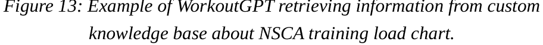

---

我想挑战一下我的 `WorkoutGPT`，问它一些对我可能有害的问题。例如，在一个月内没有任何经验的情况下准备马拉松绝对是一个糟糕的想法。让我们看看当我为它提供初始问题的答案列表后，我的助手会怎么想：

1. 我的马拉松在 3 周后，我想在 3 小时 15 分内完成比赛
2. 27 岁女性
3. 初学者健身水平
4. 我可以每天训练
5. 没有任何设备
6. 3 个月前做过 ACL 手术

你的目标是在短短三周内以 3:15 的成绩完成马拉松，结合你最近做过 `ACL` 手术且处于初学者健身水平，谨慎对待这一目标至关重要。马拉松需要大量的训练，在没有充分准备的情况下尝试这样一个雄心勃勃的目标可能会导致受伤风险。

这里有一种专注于安全增加你的跑步能力和整体健康水平的替代方法。该计划还将包括你膝盖的康复元素：

### 第一周：基础与恢复

目标：建立基础健身水平并确保膝盖稳定性。

**第 1 天：**
- 休息或轻量瑜伽：专注于全身的拉伸和活动性练习，特别是腿部和臀部 ↓

> 图 14：`WorkoutGPT` 在考虑到请求相关风险的情况下，委婉提示用户改变其目标和预期的示例。

正如你所见，我的 `WorkoutGPT` 正在引导我改变比赛策略。虽然它仍然为我提供了一个为期 3 周的跑步训练计划（此处输出被截断），但它的目标不是在 3 小时 15 分内跑完马拉松，而是建立耐力并……（注：从第 304 页开始的 OCR 文本似乎高度碎片化/损坏。我将在保持内容的同时尽可能进行清理。）

正如你所见，我的 `WorkoutGPT` 正在引导我改变比赛策略。虽然它仍然为我提供了一个为期 3 周的跑步训练计划（此处输出被截断），但它的目标不是在 3 小时 15 分内跑完马拉松，而是建立耐力并……

---

# ChatGPT Action API

版本: 1.0.0

```
paths:
  /perform-action:
    post:
      operationId: performAction
      summary: 带有给定的请求体执行特定操作
      requestBody:
        required: true
        content:
          application/json:
            schema:
              type: object
            properties:
              action:
                type: string
                description: 要执行的操作
              parameters:
                type: object
                description: 参数的
                properties:
                  userId:
                    type: string
                content:
                  type: string
      required:
        - action
        - parameters
```

`responses`:

  `'200'`:

    description: 操作执行成功的响应

    content:

      application/json:

        schema:

          type: object

          properties:

            success:

              type: boolean

            message:

              type: string

在此示例中，`POST` 方法的 `requestBody` 定义了一个架构，并将 `action` 和 `parameters` 为必填字段。同时也定义了响应，指定了执行操作后返回的数据结构。

该架构如下所示：

## 身份验证

### API Key

## 架构

```
openapi: 3.1.0
info:
  title: GitHub API
  description: 与 GitHub 交互的 API，包括将代码推送到仓库。
  version: 1.0.0
servers:
  - url: https://api.github.com
    description: GitHub API 服务器
paths:
  /Valentina-Alto/GitActions/contents/test:
    put:
      operationId: 在 GitHub 仓库中创建或更新文件
      summary: 使用此端点在仓库中创建新文件或更新现有文件。
      parameters:
        - name: repo
          in: path
          required: true
          description: 仓库的所有者。
          type: string
        - name: path
          in: path
          required: true
```

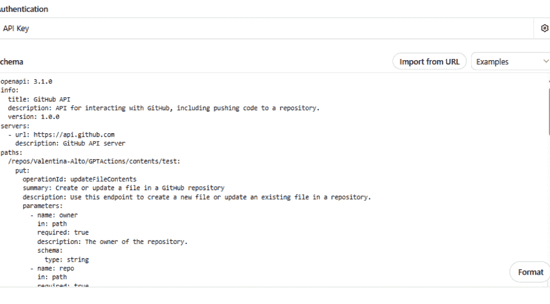

## 可用操作

| 名称 | 方法 | 路径 |
|---|---|---|
| `updateFileContents` | `PUT` | `/repos/Valentina-Alto/GitActions/contents/test` |

> 图 17：GitHub Action 架构配置。

这是我使用的完整架构：

```
openapi: 3.1.0
info:
  title: GitHub API
  description: 与 GitHub 交互的 API
  version: 1.0.0
servers:
  - url: https://api.github.com
    description: GitHub API 服务器
paths:
  /repos/{owner}/{repository}/contents/{path}:
    put:
      operationId: updateFileContents
      summary: 在 GitHub 中创建或更新文件
      description: 使用此端点创建
      parameters:
        - name: owner
          in: path
          required: true
          description: 仓库的所有者
          schema:
            type: string
        - name: repo
          in: path
          required: true
          description: 仓库的名称
          schema:
            type: string
        - name: path
          in: path
          required: true
          description: 仓库中的文件路径
          schema:
            type: string
      requestBody:
        required: true
        content:
          application/json:
            schema:
              type: object
              properties:
                message:
                  type: string
                  description: 提交消息
                content:
                  type: string
                  description: 新文件内容
                sha:
                  type: string
                  description: 正在处理的文件 SHA
                branch:
                  type: string
                  description: 所在的分支
                committer:
                  type: object
                  properties:
                    name:
                      type: string
                    email:
                      type: string
              required:
                - message
                - content
      responses:
        '200':
          description: 文件更新成功或
        '201':
          description: 文件创建成功。
        '422':
          description: 验证失败或安全限制:
          - bearerAuth: []
components:
  securitySchemes:
    bearerAuth:
      type: http
      scheme: bearer
      bearerFormat: token
schemas: # 此子部分包含架构详情
  ExampleSchema: # 示例对象架构
    type: object
    properties:
      exampleProperty:
        type: string
```

为了允许 Action 与我的仓库通信，我在 GitHub 个人资料的 `Settings > Developer Settings > Personal access token` 下创建了一个访问令牌。

你可以按照以下方式测试连接：

使用 `updateFileContents` 操作调用 `api.github.com` API

> [debug] 正在调用 HTTP 端点

> [debug] 收到响应

已与 `api.github.com` 通信

我成功更新了 "octocat" 拥有 "Hello-World" 仓库中的 `README.md` 文件，并更新了新的内容更新消息。提交发生在 "main" 分支，消息为 `Updating README with new content.`。

以下是更新的摘要：

- *文件路径*: `README.md`
- *消息*: "Updating README with new content."
- *分支*: "main"
- *提交者*: octocat@example.com
- *SHA*: [example-hash]


为了允许 Action 与我的仓库通信，我在 GitHub 个人资料的 `Settings > Developer Settings > Personal access token` 下创建了一个访问令牌。

你可以按照以下方式测试连接：

使用 `updateFileContents` 操作调用 `api.github.com` API。

> [debug] 正在调用 HTTP 端点  
> [debug] 正在收到响应  
> [debug] 已与 `api.github.com` 通信

我成功更新了 `octocat` 拥有的 `Hello-World` 仓库中的 `README.md` 文件，并附带了新的更新内容消息。提交发生在 `main` 分支，消息为 `Updating README with new content.`。

以下是更新的摘要：

- *文件路径*：`README.md`
- *消息*："Updating README with new content."
- *分支*：`main`
- *提交者*：`octocat@example.com`
- *SHA*：[example-hash]

> 图 17：GitHub Action 架构配置。

这是我使用的完整架构：

```yaml
openapi: 3.1.0
info:
  title: GitHub API
  description: 与 GitHub 交互的 API
  version: 1.0.0
servers:
  - url: https://api.github.com
    description: GitHub API 服务器
paths:
  /repos/{owner}/{repository}/contents/{path}:
    put:
      operationId: updateFileContents
      summary: 在 GitHub 中创建或更新文件
      description: 使用此端点创建
      parameters:
        - name: owner
          in: path
          required: true
          description: 仓库的所有者
          schema:
            type: string
        - name: repo
          in: path
          required: true
          description: 仓库的名称
          schema:
            type: string
        - name: path
          in: path
          required: true
          description: 仓库中的文件路径
          schema:
            type: string
      requestBody:
        required: true
        content:
          application/json:
            schema:
              type: object
              properties:
                message:
                  type: string
                  description: 提交消息
                content:
                  type: string
                  description: 新文件内容
                sha:
                  type: string
                  description: 正在处理的文件 SHA
                branch:
                  type: string
                  description: 所在的分支
                committer:
                  type: object
                  properties:
                    name:
                      type: string
                    email:
                      type: string
              required:
                - message
                - content
      responses:
        '200':
          description: 文件更新成功或
        '201':
          description: 文件创建成功。
        '422':
          description: 验证失败或安全限制
      security:
        - bearerAuth: []
components:
  securitySchemes:
    bearerAuth:
      type: http
      scheme: bearer
      bearerFormat: token
schemas: # 此子部分包含架构详情
  ExampleSchema: # 示例对象架构
    type: object
    properties:
      exampleProperty:
        type: string
```

# 如何设置分类实验？

设置分类实验涉及多个步骤：数据准备、模型选择、训练和评估。以下是分步指南：

## 1. 定义问题

- **目标**：清晰地定义你的分类任务的目标。例如，你正在尝试预测某封邮件是否为垃圾邮件。
- **目标变量**：识别你想要预测的变量（标签）。
- **特征**：识别将使用的独立变量。

## 2. 准备数据

- **数据收集**：收集你将要使用的数据集。
- **数据清洗**：处理缺失值、删除重复项并纠正不一致。
- **数据划分**：将你的数据集分为训练集和测试集（例如，70% 训练，30% 测试）。
- **特征工程**：创建新特征，规范化/标准化数据，编码分类变量。
- **数据增强**：必要时，增强数据集以处理目标变量的不平衡。

## 3. 选择模型

> 图 20：数据科学家提供如何设置分类问题的示例。

按照这些指令，我们现在准备好建立实验了。我们将处理著名的泰坦尼克号乘客生存预测。我们从 `https://github.com/datasciojo/datasets/blob/master/titanic.csv` 下载数据集并利用逻辑回归模型。

泰坦尼克号生存预测任务是科学和机器学习中的一个经典问题。目标是根据年龄、票价、等级等各种特征预测泰坦尼克号上的乘客是否能生存。此任务通常用于教授分类技术，模型在标记数据集上进行训练，然后用于预测新数据的结果。挑战在于选择相关特征、处理缺失数据以及选择合适的机器学习算法以获得准确预测。

| PassengerId | Survived | Pclass | Name |
|---|---|---|---|
| 1 | 1 | 0 | 3 Braund, Mr. Ower Harris |
| 2 | 2 | 1 | 3 Cummins, Mrs. J. Bradley (Florence Briggs Thayer) |
| 3 | 3 | 1 | 3 Heikkinen, Miss. Laina |
| | | | Futrelle, Mrs. |

## 1. 加载数据

首先，我们将加载数据集并查看前几行。

我将从加载并显示数据集的前几行开始。

数据集包含以下列：

- `PassengerId`：每位乘客的唯一标识符。
- `Survived`：目标变量（1 = 存活，0 = 未存活）。
- `Pclass`：乘客等级（1等、2等、3等）。
- `Name`：乘客姓名。
- `Sex`：乘客的性别。
- `Age`：乘客年龄。
- `SibSp`：泰坦尼克号上的兄弟姐妹或配偶数量。
- `Parch`：泰坦尼克号上的父母或子女数量。
- `Ticket`：票号。
- `Fare`：乘客票价。
- `Cabin`：舱号。
- `Embarked`：登船港（C = 谢尔堡，Q = 皇后镇，S = 南安普顿）。

> 图 22：数据 Assistant 执行实验第 1 步的示例。

## 2. 探索和清洗数据

接下来，我们将检查是否存在缺失值并进行适当处理。我们还将删除对分类任务无用的列。

让我们开始吧。

数据集在以下列中存在缺失值：

- `Age`：177 个缺失值
- `Cabin`：687 个缺失值
- `Embarked`：2 个缺失值

### 处理缺失数据：

1. **Cabin**：`Cabin` 列有大量的缺失值，因此删除此列可能是最好的选择，因为它可能会给模型引入噪声。
2. **Age**：我们可以用中位数年龄填充 `Age` 列中的缺失值，因为它是一个连续变量。
3. **Embarked**：我们可以用最常见的登船港填充 `Embarked` 列中的缺失值。

让我们相应地清洗数据集。

缺失值已成功处理。现在数据集是干净的，并准备好进行后续步骤。

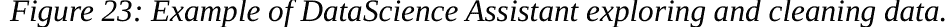

请注意，当您看到符号 `[>_]` 时，意味着触发了代码解释器插件。您可以点击它查看已执行的代码：

## 分析

```python
import pandas as pd

# 加载数据集
file_path = '/mnt/data/titanic (1).csv'
titanic_df = pd.read_csv(file_path)

# 显示数据集的前几行
titanic_df.head()
```

| PassengerId | Survived | Pclass | \ |
|---|---|---|---|
| 0 | 1 | 0 | 3 |
| 1 | 2 | 1 | 1 |
| 2 | 3 | 1 | 3 |
| 3 | 4 | 1 | 1 |
| 4 | 5 | 0 | 3 |

| Name | Sex |
|---|---|
| 0 | Braund, Mr. Owen Harris | male |
| 1 | Cumings, Mrs. John Bradley (Florence Briggs Th... | female |
| 2 | Heikkinen, Miss. Laina | female |
| 3 | Futrelle, Mrs. Jacques Heath (Lily May Peel) | female |
| 4 | Allen, Mr. William Henry | male |

| Parch | Ticket | Fare | Cabin | Embarked |
|---|---|---|---|---|
| 0 | 0 | A/S 21171 | 7.2500 | NaN | S |
| 1 | 0 | PC 17599 | 71.2833 | C85 | C |

图 24：数据 Assistant 利用代码解释器插件生成的代码示例。

## 1. 特征工程

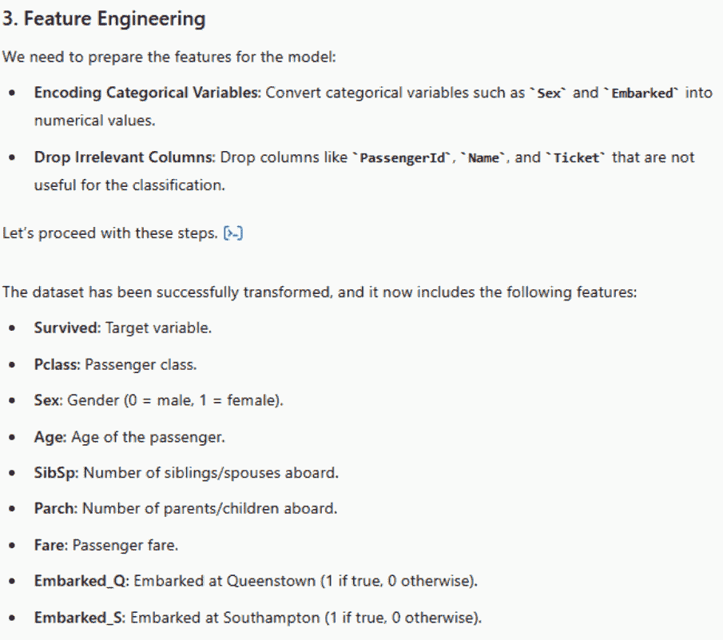

我们需要为模型准备特征：

- 类别变量编码：将 `Sex` 和 `Embarked` 等类别变量转换为数值。
- 删除无关列：删除 `PassengerId`、`Name` 和 `Ticket` 等对分类无用的列。

让我们继续执行这些步骤。

数据集已成功转换，现在包含了以下特征：

- `Survived`：目标变量。
- `Pclass`：乘客等级。
- `Sex`：性别（0 = 男性，1 = 女性）。
- `Age`：乘客年龄。
- `SibSp`：船上的兄弟姐妹/配偶数量。
- `Parch`：船上的父母/子女数量。
- `Fare`：乘客票价。
- `Embarked_Q`：在皇后镇登船（1 为是，0 为否）。
- `Embarked_S`：在南安普顿登船（1 为是，0 为否）。

图 25：数据 Assistant 进行特征工程的示例。

## 4. 数据划分

接下来，我们将数据集分为训练集和测试集。

让我们开始吧。

数据集已成功分为训练集和测试集：

- 训练集：623 个样本
- 测试集：268 个样本

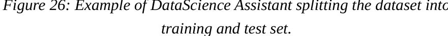

## 5. 训练逻辑回归模型

现在，我们将使用训练数据训练逻辑回归模型。

让我们开始训练模型。

> 逻辑回归模型已训练完成，并已在测试集上进行了预测。前几次预测如下：
> - 0：未存活
> - 1：存活

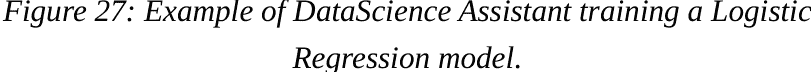

## 6. 模型评估

接下来，我们将使用常用的分类指标（如准确率、精确率、召回率、F1 分和混淆矩阵）来评估模型性能。

让我们计算这些指标。

- 准确率：80.97%
- 精确率：79.41%
- 召回率：72.97%
- F1 分：76.06%

混淆矩阵：

```
[[136, 21],
 [30, 81]]
```

图 28：数据 Assistant 评估模型的示例。

这太酷了！请注意，当您看到符号 `[>_]` 时，意味着触发了代码解释器插件。您可以点击它查看已执行的代码：

我们最后要求 GPT 将代码推送到 Repo。让我们看看它是如何工作的：

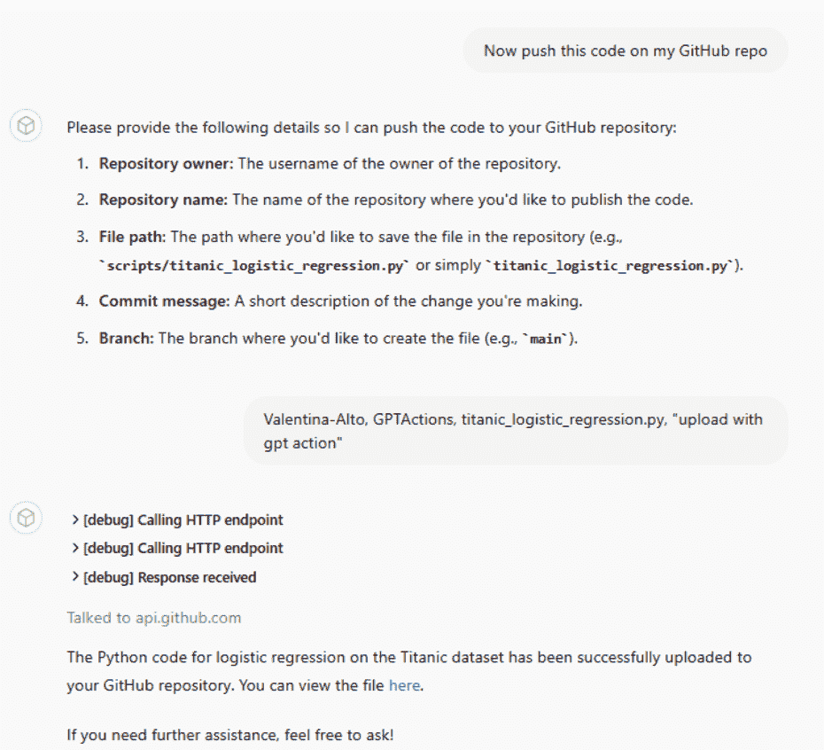

图 29：数据 Assistant 利用 Action 将代码送到 GitHub 的示例。

如果我们点击链接，就可以看到文件已上传：

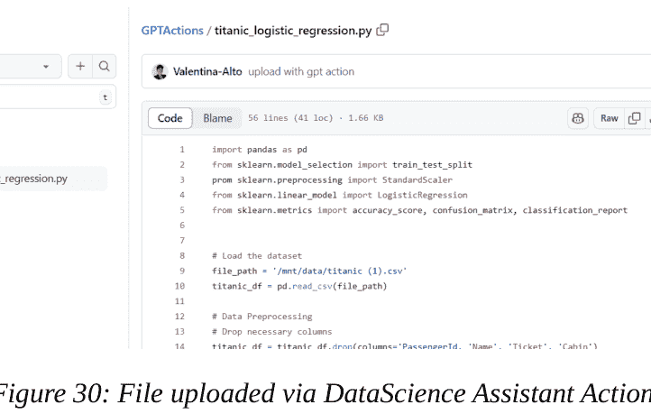

## 营销助手

正如我们在第 6 章“使用 ChatGPT 精通营销”中所看到的，AI 助手在这一领域极具价值。事实上，生成文本内容（如社交媒体帖子、博客文章或营销活动）可能是这些模型表现最好的活动。

文案人员是专业人士，专门负责撰写具有说服力和吸引力的内容，通常用于营销和广告。他们的工作通常包括编写广告、手册、网站、电子邮件、社交媒体帖子以及其他旨在说服受众采取特定行动（如购买或订阅服务）的内容形式。

在本节中，我们正在创建一个为此类活动定制的文案助手。为此，我将助手命名为 Copywrite Companion，并设置了以下配置组件：

- **指令**：Copywrite Companion 是一个多功能助手，旨在帮助用户完成各种写作任务。它擅长根据用户输入生成产品表（包括文本和图像）、编写用于时事通讯或促销目的电子邮件营销活动、为新产品创建吸引人的视觉效果，以及为不同平台编写定制的社交媒体帖子。它确保内容具有说服力和吸引力，并与目标受众一致，目标是增加互动并推广产品或服务。助手会根据用户需求调整风格，并在所有输出中力求创意和清晰相关。它以轻松、友好的语气进行交流，使互动变得亲切随和。
- **对话启动**：
  - 你能为我的新产品写一段描述吗？
  - 我需要为一个关于攀岩的文章起一个引人注目的标题
  - 给我几个关于跑步博客文章的构思
- **功能**：


图 31：Copywrite Companion 已启用的插件。

让我们来看看它的实际效果：

- 我先让它根据提供的图片编写一份产品规格表（输出已截断）：


## 产品表：VelocityX 跑步鞋

产品名称：VelocityX 跑步鞋

类别：男士运动鞋

主要特性：

- **先进鞋底技术：** 配备最新的 Flexi-Grip 鞋底，能够适应您的步态，在任何表面都能提供无与伦比的抓地力和稳定性。响应性缓垫确保每一步都能获得最大的能量反馈，让脚步轻盈。
- **透气设计：** VelocityX 跑步鞋采用高性能、吸湿网面，即使在最剧烈的训练中也能保持双部凉爽干燥。透气材料还能减少异味，并确保整个跑步过程的舒适。
- **轻量化结构：** 由超轻量材料制成，这些鞋不会增加您的负担。流线型设计非常适合追求速度和耐用性。

> 图 32：Copywrite Companion 生成产品描述的示例。

- 作为文案人员，我们可能希望将这组信息插入到更有结构的存储中，例如 Excel 文件。让我们让助手利用其代码解释器插件来完成：

我已经为您创建了 Excel 格式的产品规格表。您可以通过下面的链接进行下载：

下载 VelocityX 跑步鞋产品规格表 [xlsx]

# 图 33：Copywrite Companion 利用代码解释器插件将其之前的回复转换为 Excel 文件的示例。

- 这就是最终结果：


# 图 34：Copywrite Companion 生成的 Excel 文件

现在让我们让助手生成一条 Instagram 帖子来赞助我们的鞋：

现在创建一个关于这些鞋的 Instagram 帖子，包含一张图片

这里有一个关于 VelocityX 跑步鞋的 Instagram 帖子建议：

配文：

🌟 使用 VelocityX 释放你的全部潜力！🌟

准备好提升你的跑步体验了吗？认识 VelocityX 跑步鞋——风格与性能的结合。👟

🔥 主要特性：

- 先进 Flexi-Grip 鞋底，提供无与伦比的抓地力。
- 透气网面保持凉爽。
- 轻量化设计，速度不妥协。
- 反光装饰，适合清晨或深夜跑步。

无论是在跑道上还是跑步机上，VelocityX 都是你的后盾（以及你的脚！）。不要只是跑步——要带着目标奔跑。

⏳ 限时优惠：现仅 $99.99 即可拥有！（零售价：$129.99）

- 立即购买：www.velocity.com

#VelocityX #跑步鞋 #有目标的跑步 #健身目标 #男士运动鞋 #跑步者生活 #新品发布

图片描述：

一张跑步者迈步中的动态照片，展示了 VelocityX 跑步鞋的时尚设计。图片捕捉了鞋子的细节，包括先进的鞋底和透气网面鞋面，背景是阳光明媚的跑道。跑步者正在运动中，强调了轻量和人体工程学设计，鞋上的反光装饰在光线下隐约闪烁。

你想让我为这个帖子生成图片吗？

图 35：Copywrite Companion 生成 Instagram 帖子的示例。

如你所见，助手还提了一个图片描述以利用 DALL-E 插件。由于这个描述对我来说是合理的，我会继续让它生成：


这是这张带有 VelocityX 跑步鞋的 Instagram 帖子图片。它已经准备好吸引注意力并展示鞋子的运动效果了！只需配合我之前提供的配文，就可以发布了。如果您需要任何进一步调整，请告诉我！

图 36：Copywrite Companion 利用 DALL-E 插件生成图像的示例。

最后，我想了解大型竞争品牌——如 Nike 和 Adidas——是如何进行营销活动的。为此，我将要求助手从网络上收集一些证据：

你能告诉我 Nike 和 Adidas 现在是否在赞助类似的跑步鞋吗？如果是，分析它们的营销活动并告诉我是它们在使用哪种风格。

已搜索 4 个网站

是的，Nike 和 Adidas 都在积极赞助与 VelocityX 类似的跑步鞋，它们的营销策略显著不同但又非常有影响力。

## Nike

Nike 继续专注于其以人为本和以价值为导向的营销方法。他们的策略往往严重依赖于叙故事，将自己与广泛的社会文化叙事联系起来。例如，Nike 2018 年以 Colin Kaepernick 为主角的"疯狂梦想"活动是他们愿意通过与具有社会争议的话题结来承担风险的范例，此举使他们的品牌价值增加了 60 亿美元。这种方法特别引起了年轻一代的共鸣，因为 Z 世代重视品牌的真实性和社会责任。

Nike 的赞助围绕知名运动员和重大体育赛事展开，创建了融合运动成就与文化相关性的营销活动。他们强调产品中的技术创新，例如使用专利的 Nike Air 和 React 泡沫，这些设计旨在保持舒适和支持的同时增强性能。Nike 还投资于创作具有视觉冲击力且情感共鸣的广告，以提升其产品的感知价值（Marketing Dive）（RunToFinish）。

## Adidas

相反，Adidas 将运动性能与对生活方式和环境责任的强烈关注相结合。他们围绕可持续性建立了品牌认同，经常推广使用回收材料和环保技术的产品，例如他们的 Boost 泡沫和 Primegreen。Adidas 将自己定位不仅是一个运动装品牌，更是一个文化符号，经常模糊运动性能与街头潮流时尚之间的界限。

他们的赞助更加多样化，不仅连接了运动员，还连接了音乐家、艺术家和其他文化影响者。这种策略帮助 Adidas 与体育爱好者之外更广泛的受众建立联系。此外，他们的营销活动经常强调团结、环保意识和包容性，这些都是与当今社会消费者产生共鸣的关键价值观（Marketing Dive）（Adidas）。

总而言之，Nike 的营销更多是关于通过讲故事和运动员背书来利用文化时刻和社会问题，而 Adidas 则侧重于可持续性、生活方式融合和更广泛的文化吸引力。这两种风格都是有效的，但针对的是消费者身份和价值观略有不同的方面。

图 37：Copywrite Companion 利用网络插件进行竞争分析的示例。

如你所见，我们的助手正确利用了网络浏览插件检索所需信息。此外，它为我们提供了两个竞争公司投入的有力洞察，以便我们思考（或询问我们的助手）让我们的品牌在竞争市场中脱颖而出的独特化因素。

我们还可以更进一步，利用代码解释器和数据分析插件请求更具体的竞争见解。假设我们收集了一个具有以下 Excel 表格：

| 年份 | 公司 | 收入（十亿美元） | 市场份额 (%) | 广告支出（百万美元） | 社交媒体互动（百万次） | 品牌价值（十亿美元） |
|---|---|---|---|---|---|---|
| 2021 | 竞争对手 A | 44.5 | 25 | 7 | 120 | 34 |
| 2021 | 竞争对手 B | 22 | 15 | 2 | 120 | 16 |
| 2022 | 竞争对手 A | 46 | 26 | 3.2 | 160 | 55.5 |

图 38：Excel 表格上的竞争分析

现在我们想根据它生成一些可视化内容。让我们让 Copywriter Companion 来此操作：

| 年份 | 公司 | 营收（十亿美元） | 市场份额 (%) |
|---|---|---|---|
| 1 | 2021 | 竞争对手 A | 44.5 | 25 |
| 2 | 2021 | 竞争对手 B | 22 | 15 |
| 3 | 2022 | 竞争对手 A | 46 | 26 |
| 4 | 2022 | 竞争对手 B | 23.5 | 16 |
| 5 | 2023 | 竞争对手 A | 48 | 27 |
| 6 | 2023 | 竞争对手 B | 25 | 17 |

> 根据此文件生成相关的图表。此外，生成一份关于为产品设定更具竞争力的价格之成本效益的执行报告。


图 39：由 Copywrite companion 生成的柱状图和散点图示例。

### 按年份划分的市场份额


### 广告支出对比社交媒体参与度


图 40：由 Copywrite companion 生成的折线图示例。

按照要求，包含执行报告：

## 执行报告：设定更具竞争力的价格的成本效益

**目标**：利用有关竞争对手营收、市场份额、广告支出和品牌价值的数据，评估为我们的产品设定更具竞争力的价格的潜在成本效益。

**成本分析**：

- **单品营收减少**：设定更具竞争力的价格可能会导致单品营收减少。然而，可以通过销量的增加来抵消。
- **广告支出增加**：为了在降低价格的同时维持或扩大市场份额，可能需要增加广告支出，正如广告支出与社交媒体参与度之间的相关性所示。
- **品牌价值**：激进的降价可能会影响品牌感知，如果管理不当，可能会降低品牌价值。

**收益分析**：

- **市场份额增长**：竞争对手 A 持续营收增长的策略伴随着市场份额的显著增加。竞争性的定价策略可以帮助我们增加市场份额，可能使我们的定位更接近或领先于主要竞争对手。
- **更高的销量**：较低的价格可能会导致更高的销量，这可能可以补偿单品营收的减少。
- **增强社交媒体参与度**：通过适当的广告支出，竞争性定价可以增强社交媒体参与度，进一步推动品牌知名度和客户获取。

**战略考量**：

- **平衡价格与感知价值**：在竞争性定价与产品价值之间保持平衡至关重要，以避免侵蚀品牌资产。
- **监控竞争对手反应**：竞争对手可能会通过自己的价格调整做出反应，这可能引发价格战。需要对市场弹性和我们的成本结构进行仔细评估，以确保可持续的盈利。
- **优化广告策略**：正如广告支出与社交媒体参与度之间的正相关性所示，应该实施针对性的广告策略，以最大化降价的影响。

图 41：由 Copywrite companion 生成的执行报告示例。

总体而言，将 ChatGPT 用于营销活动，在生成新内容、设计营销策略和对网络进行竞争分析方面可以非常有用。

## 研究助手

在这种场景中，我们将再次关注研究，但这次将特别关注论文检索。更具体地说，我们希望助手能够执行以下操作：

- 从我们提供的自定义知识库中检索信息
- 将自定义文档与仅来自 Arxiv 的论文整合，并为此任务启用网页插件
- 从数据库（在我们的案例中，将托管在 Notion 中）检索其他研究人员正在进行的工作，这样我们就不有冒撰已被他人涵盖的文章的风险。

让我们来看看所有步骤。

1. 上传自定义文档。出于此目的，我将使用两篇关于机器学习中图像分类的论文：来自 J. Bird 等人的"CIFAKE: image classification and explainable identification of ai-generated synthetic images"以及 Khalis 等人的"A Comprehensive Study of Vision Transformers in Image Classification Tasks"。

你可以在配置面板的相应部分上传它们：

### 知识 (Knowledge)

如果你在知识下上传文件，与你的 GPT 对话可能包含文件内容。当启用代码解释器时，可以下载文件。


图 42：在配置面板中上传自定义文档

2. 将自定义文档与网页引用整合。为了做到，我们需要启用网页插件：

### 功能 (Capabilities)

- 网页浏览 (Web Browsing)
- DALL-E 图像生成
- 代码解释器与数据分析 (Code Interpreter & Data Analysis)

图 43：在配置面板中启用网页插件

此外，我们还需要指定助手仅在 Arxiv 存档中导航。我们将在创建指令集中查看如何指定这一点。

3. 从 Notion 数据库检索信息。这里的想法是，作为研究人员，我们可能会提出一些已经在其他同事那里研究和开发的想法。假设我们在 Notion 数据库中跟踪所有正在进行的研究，该数据库结构如下：

示例数据库 / DB 限制 添加图标 添加封面 添加描述

### DB

| 表格 | 内容 | 来源论文 |
| --- | --- | --- |
| Aa 标题 | | |

图 44：Notion 数据库结构。

为了做到，我们需要创建 GPT 动作 (actions)。为此，需要遵循两个步骤：

1. 在你的 Notion 工作空间中，你需要创建一个标记为内部的内部连接，并将创建一个新的内部集成密钥（或 API 密钥）。你可以将此连接命名为"chatgpt"或类似的名称。
2. 在你的 GPT 配置面板中，你需要设置一个新的动作架构 (Action schema)。由于在我们的案例中我们需要查询一个特定的数据库，该架构将如下所示：
3. 当涉及身份验证时，你可以点击"身份验证 (Authentication)"并选择"API Key"。输入以下信息。
   - API Key：使用来自 Notion 中新创建连接的内部集成密钥
   - 验证类型：Bearer

### 身份验证 (Authentication)

API Key

### 架构 (Schema)

```
openapi: 3.1.0
info:
  title: Notion API
  description: 用于与 Notion 页面、数据库和交互的 API
  version: 1.0.0
servers:
  - url: https://api.notion.com
paths:
  /databases/{query}:
    post:
      operationId: queryDatabase
      summary: 查询数据库
      parameters:
        - name: database_id
          in: path
          required: true
          schema:
            type: string
        - name: Notion-Version
          in: header
          required: true
          schema:
            type: string
            example: 2022-06-28
            constant: 2022-06-28
    requestBody:
      required: true
      content:
        application/json:
          schema:
            type: object
            properties:
              filter:
                type: object
              sorts:
                type: array
                items:
                  type: object
              start_cursor:
                type: string
              page_size:
                type: integer
    responses:
      '200':
        description: 成功响应
        content:
          application/json:
            schema:
              type: object
              properties:
                object:
                  type: string
                results:
                  type: array
                  items:
                    type: object
                next_cursor:
                  type: string
```

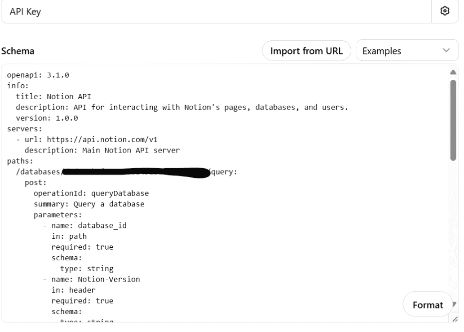

### 可用动作

| 名称 | 方法 | 路径 |
| --- | --- | --- |
| queryDatabase | POST | /databases/{database_id}/query |

图 45：动作架构所示：

这是整个架构所示：

```
openapi: 3.1.0
info:
  title: Notion API
  description: 用于与 Notion 页面、数据库和交互的 API
```

```yaml
has_more:
type: boolean
```

太好了，现在我们已经准备好了所有的原料，我们需要设置系统提示词（system message），以及可选的对话启动词（conversation starters）。在这个场景中，我设置了以下指令：

你是一个 AI 研究助手，负责利用各种工具和资源帮助研究人员。你的主要职责包括从自定义知识库、Arxiv 上的学术论文以及存储在 Notion 数据库中的进行项目中进行检索、整合和交叉引用信息。请遵循以下指南以确保你的帮助准确、全面并避免冗余：

1. 始终基于提供的文档进行回答。
2. 如果你认为有必要，可以在网上进行扩展搜索。你**唯一**可以的网站是 Arxiv。
3. 如果用户询问，检查该主题是否已涵盖 Notion DB 中。

以及以下对话启动词：

1. VGGNet、ResNet 和 Inception 在图像分类的准确性和效率方面有何区别？
2. 图像分类模型面临哪些挑战？数据增强和迁移学习等技术如何帮助它们？
3. CNN 深度如何影响图像分类？ResNet 的残差连接又是如何提供帮助的？

最终产品看起来如下：

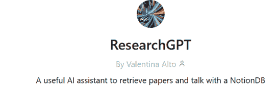

图 46：我们的 ResearchGPT 落地页

让我们测试一下：

1. 我首先会问一个通用问题，将通过提供的论文来回答：

> VGGNet、ResNet 和 Inception 在图像分类的准确性和效率方面有何区别？

### VGGNet、ResNet 和 Inception：图像分类准确性与效率的差异

1. VGGNet
    - **架构**：VGGNet 的特点是具有深层、顺序的 3x3 卷积滤波器层。其设计简单，采用统一的架构，每层除了滤波器数量外，都非常相似。
    - **准确性**：由于其深度允许模型能够学习复杂的特征，VGGNet 在图像分类任务中实现了高准确率。
    - **效率**：与 ResNet 和 Inception 等更现代的架构相比，VGGNet 的效率较低。由于密集的顺序层，其大量的参数量导致了更高的计算成本和更多的内存占用。

图 47：ResearchGPT 从提供的文档中检索知识的示例

2. 然后，我想看看该主题是否已经被涵盖：

数据库中是否已涵盖该主题？

是的，该主题已以"图像分类的深度学习：比较研究"的标题涵盖数据库中。该条目比较了 VGGNet、ResNet 和 Inception 等模型在 CIFAR-10 和 ImageNet 等标准数据集上的性能，并指出 ResNet 在复杂的图像识别任务中提供了优的准确率。


图 48：ResearchGPT 使用预定义操作与 Notion 通的示例。

3. 最后，我想整合该主题使其具有独特性：

我想让这个主题变得独特。请推荐其他 3 篇 arxiv 论文来整合我的主题。

为了让你的主题具有独特性，你可以与以下三篇 arXiv 论文的见解进行整合：

1. EfficientNet: 重新思考卷积神经网络的模型缩放
   - 论文 ID: 1905.11946
   - 摘要：该论文介绍了 EfficientNet，这是一种优化了网络深度、宽度和分辨率之间平衡的模型。将你的比较与 EfficientNet 整合，可以提供一个现代的对比，说明缩放技术相对于 VGGNet、ResNet 和 Inception 如何影响准确性和效率。
   - 链接：arXiv:1905.11946

2. MixConv: 混合深度可分离卷积核
   - 论文 ID: 1907.09595
   - 摘要：MixConv 提出了深度分离卷积核，允许模型更高效地提取不同尺的特征。将此纳入你的研究中，可以增加关于各种卷积技术如何影响性能和效率的复杂度。
   - 链接：arXiv:1907.09595

3. Xception: 基于深度可分离卷积的深度学习
   - 论文 ID: 1610.02357
   - 摘要：Xception 探索了深度可分离卷积，为 Inception 模块提供了高效的替代方案。将这种方法与传统架构进行比较，可以突出现代架构在效率上的改进。


# 链接：arXiv:1610.02357

## 图 49：ResearchGPT 使用浏览器插件的示例

如你所见，我们的助手可以利用我们提供的所有工具，并在需要时调用`Notion DB`。

## 总结

在本章中，我们探索了如何获取自定义的 GPTs 来满足你的特定目标。定制 ChatGPT 的可能性开启了全新的场景图景，高度专业化的 AI 助手将成为专业人士的日常伴侣。此外，OpenAI 提供了一个无代码 UI 来创建 GPTs，使得所有全民开发者不仅能从扩展的解决方案市场中受益，还能从自己的创造中获益。

凭借插件的扩展性和自定义知识库，自定义 GPTs 可以可以你完成无限的任务。然后，通过添加强大的操作（actions），它们还可以与周围环境通信，并从“纯粹”的生成进化为自动化。

通过本章，我们也结束了本书的第二部分，在该部分我们专注于 ChatGPT 的实际应用。从下一章开始，我们将更详细地介绍大型企业如何利用 OpenAI 模型并将其嵌入到业务流程中。我们将涵盖趋势性的企业用例，并展示如何通过 REST API 在你的应用程序中嵌入 OpenAI 的大语言模型（LLMs）的实践实现。

## 参考文献

- https://arxiv.org/abs/2312.11914
- https://arxiv.org/abs/2101.07714
- https://psycynet.apa.org/record/2014-07087-000
- https://www.tandfononline.com/doi/10.2753/MIS0742-1222240109
- https://www.youtube.com/watch?v=TUMyyygCMMGA
- https://arxiv.org/pdf/2312.01232
- https://arxiv.org/pdf/2303.14126

OceanofPDF.com
