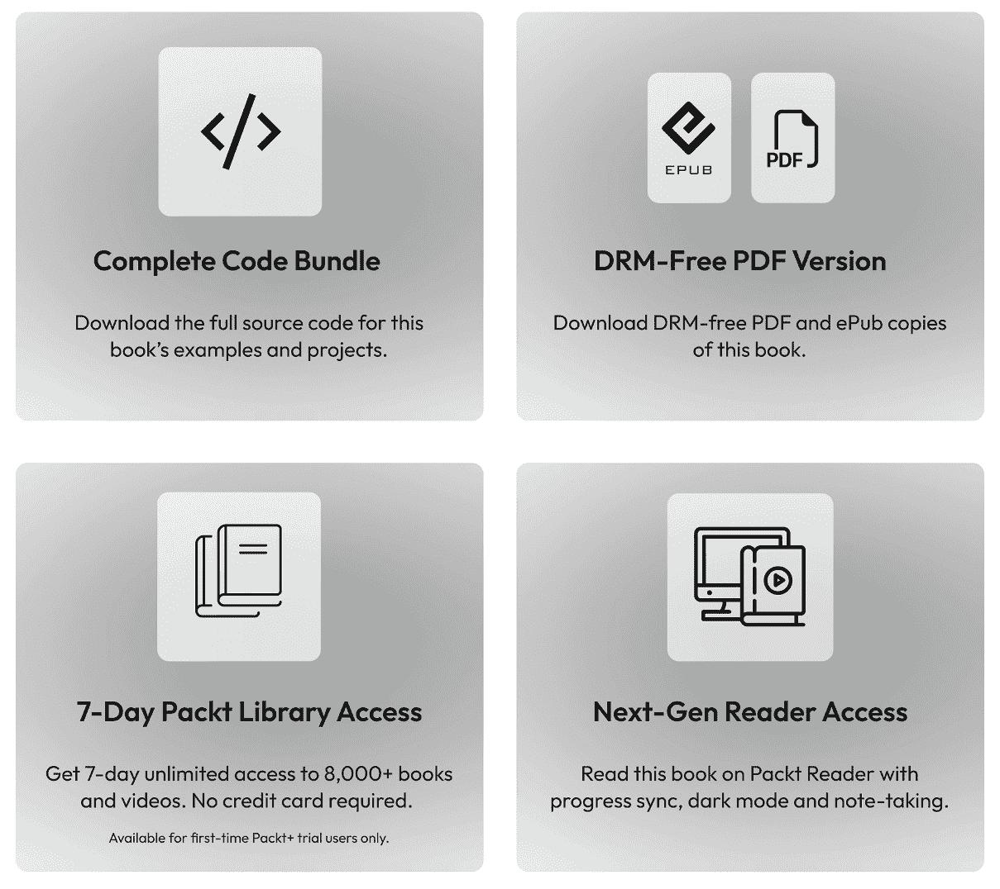

# 贡献者

## 关于作者

**Jia Huang** 是新加坡 A\*STAR 的 AI 研究员，也是一位技术作者，撰写关于 AI 智能体如何被工程化的内容。他是 *Designing AI Agents* 和 *RAG from First Principles* 的作者。

他提出了智能体设计模式的双轴框架，该框架按认知功能和执行拓扑对模式进行分类，以及模式选择卡（Pattern Selection Card），一种在真实成本和延迟约束下选择模式的实用方法。他的工作聚焦于模型周围的工程，而非模型本身：上下文、工具、执行环境和治理。他用中文和英文写作。

感谢 Lucy Wan，她连接了我的中文和英文市场，并将我带入 Packt 团队，这一联系开启了一段非凡的合作时期。我也感谢 Kinnari Chohan，她的专业编辑使这个英文版比我独自完成的更加清晰和有力。

我在人民邮电出版社的中国出版团队全程支持了这项工作。

Jikang Chen 和 Sha Li 在每一步都支持我，并帮助塑造了我的写作方式；

Jian Qin 编辑了中文版；Chenyu Yuan 创作了插图。

我也感谢极客时间团队，特别是编辑 Yuxin Zhao 和 Dongqing Wang，以及我的 Claude Code 课程中的众多学习者。他们深思熟虑的问题、实用的反馈和宝贵的建议帮助我完善了本书中的想法，并使其对实践者更有用。

我感谢 ADPS 社区——智能体设计模式学会（Agent Design Patterns Society）——的同事们：Bingsheng Ru、Ning Jiang、Bo Liang、Haofen Wang 教授、Huisheng Yin、Haili Zhang 和 Pingping Bai，感谢他们与我共同建设这个社区。

最后，我最深切地感谢我的父母，感谢他们无条件的爱与支持。

## 关于审阅者

**Wei Wei** 是一位 AI 工程实践者和技术作者，拥有英国阿伯丁大学人工智能硕士学位。他专攻 LLM 系统、智能体 AI 架构和 Harness Engineering。他著有五本以上技术书籍，涵盖 Python 系统、Web 架构和应用机器学习，曾在同程数科领导大数据平台开发，并作为高级 ML 科学家构建了多模态智能系统。作为独立顾问，他曾为花旗银行、中国银行和平安人寿等机构提供企业 AI 培训和咨询，并在十多所大学讲授 LLM 工程课程。

**Yury Vashchylau** 以制作软件和自动化系统为生，并将两者视为同一件事。早在智能体 AI 成为一个类别之前，他就已经在自托管服务栈之上开展工程工作。他相信，塑造优秀代码的原则同样塑造围绕代码构建的 AI 工具。他的工作涵盖银行基础设施、开源贡献、DIGITALBY 的消费级应用以及开发者工具。他在 yuryv.info 上写作，并对动画、电影制作、业务流程以及自动化系统如何随时间演变感兴趣。

# 前言

两年来，业界最关心的问题始终是：哪个模型最强？在当时，这是个正确的问题。但到了 2025 年的某个时候，格局发生了转变。前沿模型变得如此强大，彼此之间又如此接近，以至于原始模型质量不再是区分一个运转良好的系统和一个令人沮丧的系统之关键。真正区分它们的是模型周围的一切：你喂给它的上下文、你赋予它的工具、你运行它的环境，以及你施加于它的护栏。这种围绕模型的结构在本书中有一个名字：Harness（驾驭框架）。这些篇章的核心论点说起来简单，实践起来却要求极高——智能体等于模型加 Harness，而一旦模型被商品化，Harness 才是工程所在之处。

Claude Code 是当今这一理念最清晰的化身。从表面看，它是一个命令行编码助手。在底层，它是一个完整、可检视的 Harness：`CLAUDE.md` 注入上下文，Skills 和子智能体扩展能力，Hooks 和权限强制实施控制，而无头模式、Agent SDK 和插件将这一切带入真实的执行环境。本书逐一拆解 Claude Code 的各个机制，不是为了赞叹它，而是为了传授底层的方法论，这样你所学到的东西就能迁移到你构建的任何智能体、任何框架中——即便在具体工具早已更迭之后依然如此。

这是一本动手实践的工程书，而非综述。每一个机制都通过一个具体问题引入，用真实代码实践，并一路推进，直到它要么站得住脚，要么暴露出自身的局限。各章层层递进：前面的章节建立 Harness 的四个层次——上下文、工具、执行和治理——后面的章节将它们组合成无头流水线、自定义 SDK 智能体、可共享的插件，最后是让整个组织能够以这种方式工作而不陷入混乱的团队实践。

关于书中的人物，有一点说明。贯穿全书，你会在简短对话中遇到三位反复出现的角色。小冰是一位将 Claude Code 应用于真实项目的工程师；小雪带来数据分析的视角，提出实践者真正会遇到的问题；Kage 则是资深技术导师，帮助他们推理架构决策。他们不是装饰——每一段对话都铺陈出你自己将会面临的一种设计张力，而随后的章节会用代码来解决它。

这个领域的工具发展迅速，本书中的一些具体细节将会过时。但机制不会。注入仍然是注入，上下文窗口仍然会被填满，而在智能体可以感知什么和可以做什么之间划定一条清晰的边界，仍然是一个你可以信任的系统和一个你无法信任的系统之间的区别。我的目标是，当你读完本书时，你不仅能知道如何操作 Claude Code，还能知道如何思考任何智能体底层的 Harness，以及如何构建一个值得信任的 Harness。

# 本书的读者对象

本书面向软件工程师、技术架构师和工程负责人，他们使用过 AI 编码助手，现在想要认真、可靠、大规模地、以团队的方式用 AI 进行构建。如果你运行过 Claude Code 或类似的工具，既感受到了它的强大，也感受到了它的粗糙之处，并且想要足够深入地理解这套机制，从而去塑造它而非与之抗争，那么这本书就是为你而写的。书中假定你熟悉命令行、Git 和至少一种编程语言（示例主要使用 Python、JavaScript/TypeScript 和 shell）。你不需要有智能体框架或 LLM 内部原理方面的经验；本书会从头开始逐步构建这些概念。

# 本书涵盖的内容

*第 1 章*，*Claude Code 作为智能体框架：技术架构概览*，确立了本书的核心视角——智能体等于模型加 Harness——并勾勒出本书其余部分将要填充的四个层次（上下文、工具、执行和治理）。

*第 2 章*，*以史为鉴：记忆系统的工程实践*，考察 Claude Code 如何通过 `CLAUDE.md` 层级结构及其记忆作用域来管理上下文，以及如何保持上下文精简、分层并以正确的顺序加载。

*第 3 章*，*授人以渔：可复用 Skills 的工程化*，介绍 Skills——在 `SKILL.md` 中定义的声明式能力包——并展示如何设计、界定作用域和触发它们，使 Claude 在正确的时刻调用正确的能力。

*第 4 章*，*分而治之：子智能体与任务委派的艺术*，涵盖子智能体和上下文隔离：如何分解工作、将其委派给专注的智能体，并确定性地聚合结果。

*第 5 章*，*从准则到护栏：用 Hooks 实现自动化控制*，使用事件驱动的 Hooks 机制将软性准则转化为强制执行的护栏，包括钩子如何在危险操作运行之前将其阻止。

*第 6 章*，*连接一切：用 MCP 集成外部工具*，通过模型上下文协议（Model Context Protocol）将 Claude Code 向外部世界开放，安全地连接外部工具、数据源和凭据。

*第 7 章*，*无头模式与 CI/CD 集成*，将 Claude Code 从交互式终端带入自动化：无头调用、预算和轮次限制，以及在 GitHub Actions、GitLab 和 Jenkins 上的完整 CI/CD 流水线。

*第 8 章*，*以 Claude 为引擎构建：Agent SDK 智能体开发工具包*，从通过参数驱动 Claude 转向在代码中编排它——使用 `@tool` 装饰器自定义工具、结构化输出、权限层，以及一个完整的基于 SDK 的服务。

*第 9 章*，*从个人技艺到共享资产：插件生态*，将 Skills、子智能体、Hooks 和 MCP 打包成可分发的插件，并展示私有市场如何将一位工程师的配置变成团队标准。

*第 10 章*，*从个人到团队：Claude Code 的工程实践*，在组织规模上处理治理层——成本、调试、安全、扩展、指令和协作——使整个团队能够以这种方式工作而不陷入混乱。

*后记*，*刀之道*，回到本书的指导隐喻和 Harness 论题，并指向本书所连接更广泛的方法论和设计模式工作。

# 如何充分利用本书

要跟随书中的示例，你需要一个可用的 Claude Code 安装和对 Claude 的访问权限（一个 Anthropic API 密钥或等效的 Claude 订阅）。需要较新的 Node.js 运行时，因为 Claude Code 运行在 Node 上；示例中贯穿使用了 Python 3.10+ 和 Git。本书假定你熟悉命令行和代码编辑器。其他一切——Skills、子智能体、Hooks、MCP 服务器、Agent SDK——都会在需要时引入和搭建，因此你可以从一个干净的安装开始，逐步构建。

请将官方 Claude Code 文档与本书一起打开。机制是稳定的，但确切的标志、模型名称和定价会演变；当某个具体细节自出版以来已经发生变化时，文档是真相的来源。

## 下载示例代码文件

本书包含一个完整的可下载代码包，其中包含各章节中使用的所有示例项目和文件。我们建议下载该代码包，以便你能够顺利地跟随学习并对示例进行实验。

将代码包作为实用的起点。修改它、扩展它，并在阅读各章的过程中通过创建自己的变体来应用所学内容。

**获取代码包**

**如果你直接从 Packt 购买了本书：**

1. 前往 **packtpub.com**

2. 点击你的**头像**并选择**你的订单**


3. 找到这本书并点击 **Download Code**

**如果你是从 Amazon 或任何其他渠道购买的这本书：**

1. 访问 [packtpub.com/unlock](https://packtpub.com/unlock) 或扫描以下二维码：

    

2. 搜索这本书

3. 注册或登录你的免费 Packt 账户

4. 上传你的购买凭证并在本地下载代码包

**使用说明：** 你可以自由使用和修改这些代码，用于个人学习和非商业项目。

## 下载彩色图片

你的购买包含这本书的彩色、无 DRM 的 PDF 副本，非常适合查看彩色图片、截图和图表。请参阅 *Preface* 末尾的 *Free benefits with your book section* 来解锁你的 PDF 副本。

## 使用的约定

本书中使用了若干文本约定。

`CodeInText`：表示文本中的代码词、命令名、文件和目录名以及环境变量。例如：“`CLAUDE.md` 文件在每次会话开始时自动加载。”

代码块设置如下：

```
{
  "hooks": {
    "PreToolUse": [
      { "matcher": "Bash", "hooks": [ { "type": "command",
        "command": "./check-bash.sh" } ] }
    ]
  }
}
```

任何命令行输入或输出都写成如下形式：

```
claude -p "Review the code changes in this MR" --output-format json --max-turns 10
```

**粗体**：表示一个新术语、一个重要词或你在屏幕上看到的词。终端标签、斜杠命令和键组合会像这样出现在文本中。例如：“首先，进入你的 GitHub 仓库，然后点击 **Settings** | **Secrets** | **Actions**。”

警告或重要提示会像这样出现。

提示和技巧会像这样出现。

# 联系我们

读者的反馈始终欢迎。

**一般反馈**：如果你对本书的任何方面有疑问，或有任何一般性反馈，请发送电子邮件至 `customercare@packt.com` 并在邮件主题中提及书名。

**勘误**：尽管我们已尽一切努力确保内容的准确性，但错误仍会发生。如果你在本书中发现错误，我们将非常感谢你向我们报告。请访问 [`www.packt.com/submit-errata`](http://www.packt.com/submit-errata)，点击 **Submit Errata**，并填写表格。

**盗版**：如果你在互联网上以任何形式遇到我们作品的非法副本，我们将非常感谢你提供位置地址或网站名称。请通过 `copyright@packt.com` 联系我们，并附上该材料的链接。

**如果你有兴趣成为作者**：如果你在某个主题上有专业知识，并且有兴趣撰写或参与一本书，请访问 [`authors.packt.com/`](http://authors.packt.com/)。

# 本书的免费权益

本书包含旨在支持你的学习并帮助你有效应用所学内容的免费权益。立即激活它们以获得即时访问权限（请参阅 *How to unlock* 部分获取说明）。

以下是你可以通过购买立即解锁内容的快速概览：



## 如何解锁

扫描二维码（或访问 [packtpub.com/unlock](https://packtpub.com/unlock)）。按名称搜索这本书，确认版本，然后按照页面上的步骤操作。


*注意：请准备好你的发票。直接从 Packt 网站进行的购买不需要发票。*

# 分享你的想法

一旦你阅读了 *The Claude Code Operating Model*，我们很想听听你的想法！扫描下方的二维码，直接前往这本书的 Amazon 评论页面并分享你的反馈。


[`packt.link/r/1808082710`](https://packt.link/r/1808082710)

你的评论对我们和科技社区都很重要，并将帮助我们确保我们提供高质量的内容。

# 1

