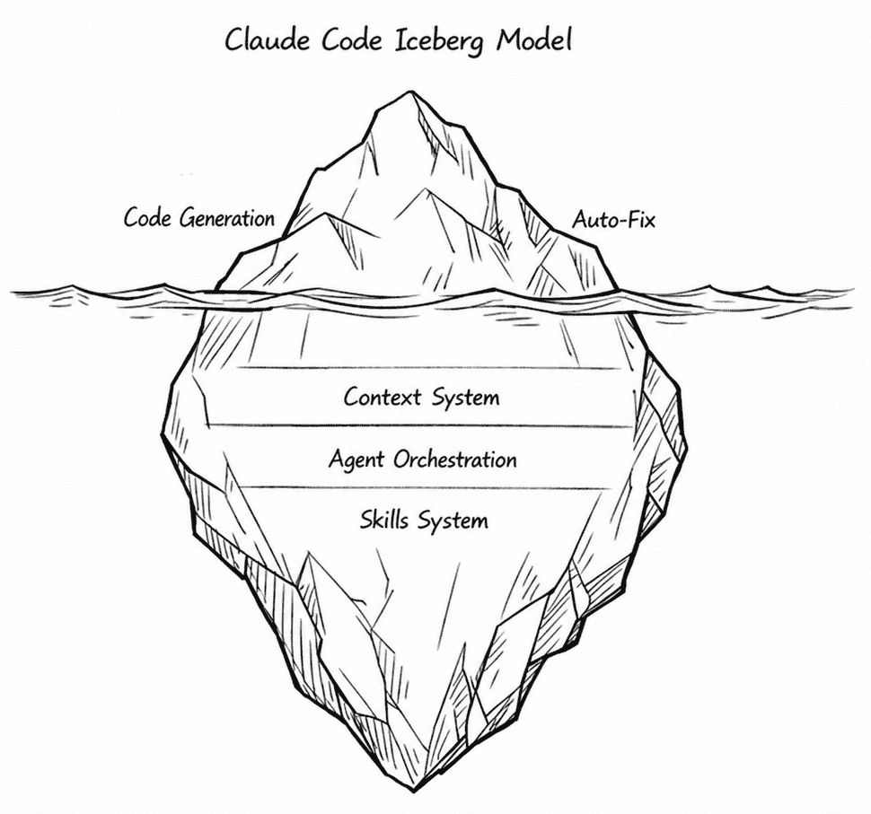
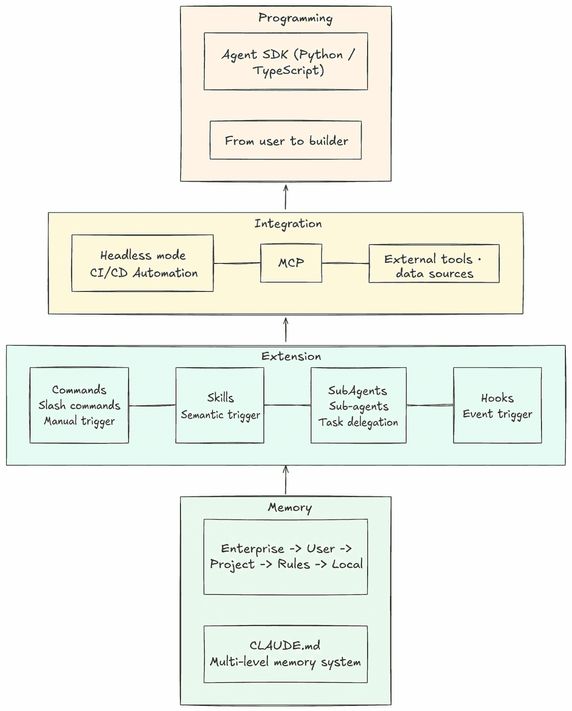
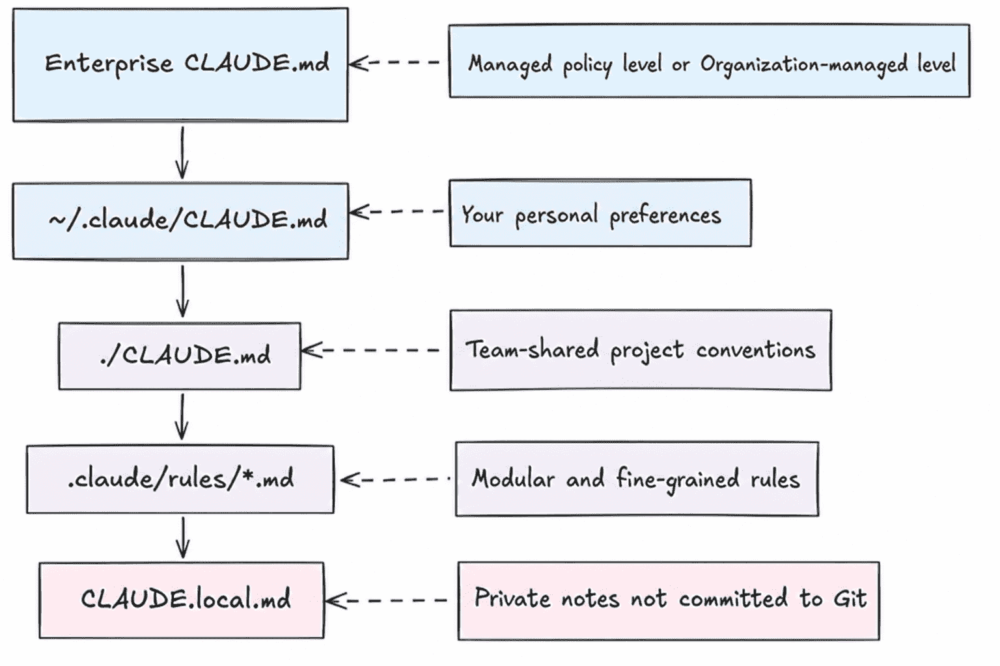
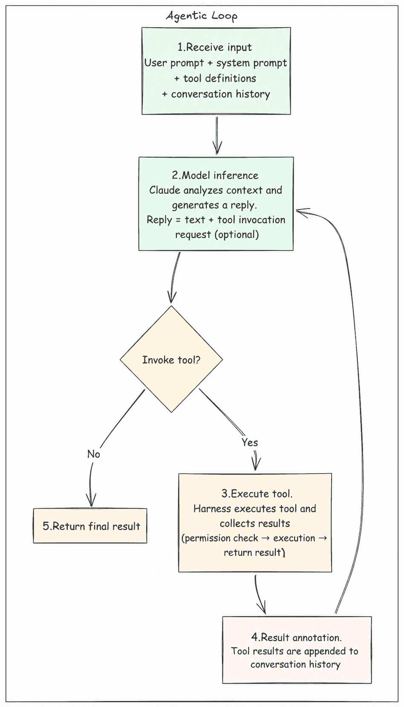
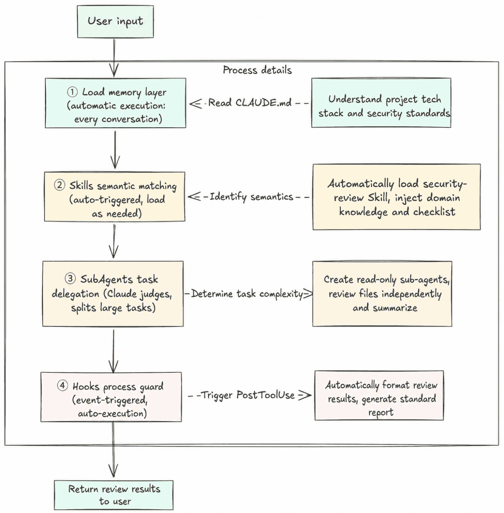
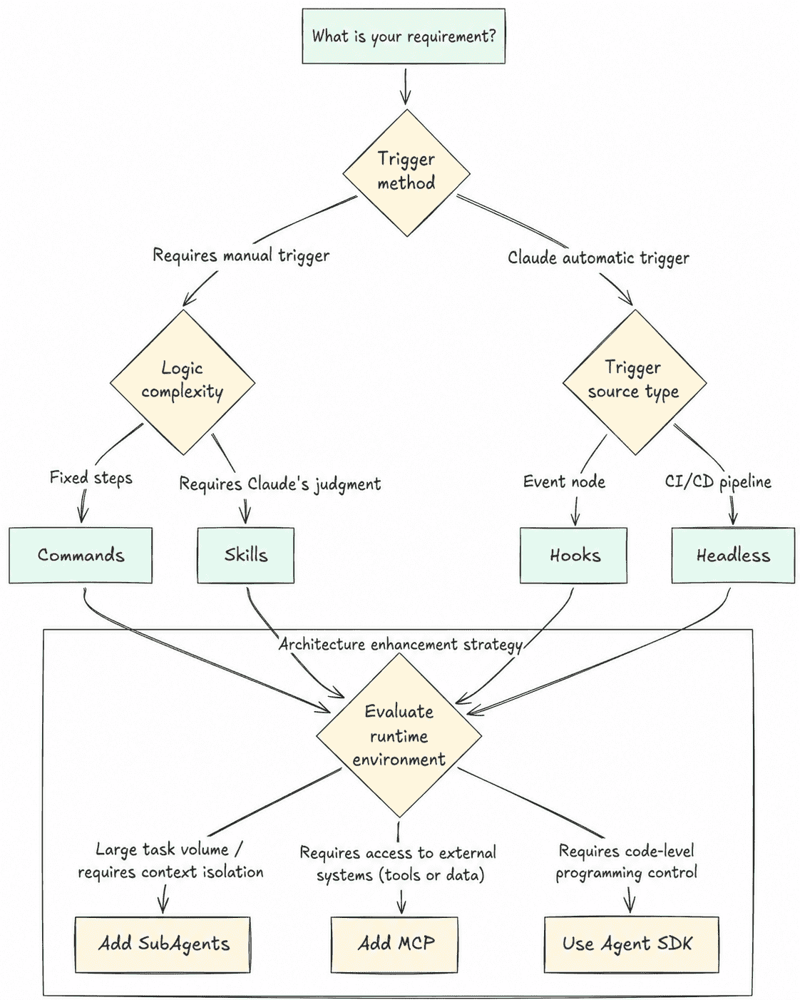

# 第一章：Claude Code 作为 Agent 框架：技术架构概览

“我们塑造工具，此后工具塑造我们。”

—— Marshall McLuhan

最近，Xiaobing 领导了一个 AI Agent 项目，并选择 Claude Code 作为核心开发工具。起初，它的表现令人惊叹：只要需求表述清楚，代码就能快速生成，效率远超手动编码。然而，两周后，一系列问题突然爆发：每次新会话开始时，Claude 似乎都无法记住项目的技术栈（例如 FastAPI + SQLAlchemy），迫使开发者反复重述背景信息；生成的代码缺乏风格一致性，Black 格式标准应用不一致，导致三个 **pull requests**（**PRs**）在审查中被拒绝。更关键的是，在执行一个涉及六个文件的重构任务时，受上下文窗口容量限制，Claude 到第四个文件时已经“忘记”了前面的逻辑，导致输出代码不一致且不连贯。

“*感觉就像每天都在管理一个失忆的实习生*，”Xiaobing 向 Xiaoxue 和 Kage 抱怨道，“*能力极强，但对项目上下文毫无记忆*。”

Kage 没有急于安慰她，而是连续抛出三个问题：

*第一，你在项目根目录中配置了 CLAUDE.md 吗？*

*第二，对于那个涉及六个文件的重构任务，你为什么不把它拆解给子代理协作处理？*

*第三，既然代码规范如此重要，为什么只依赖口头说明，而不把它们打包成一个 Skill，让模型自动加载？*

Xiaobing 哑口无言，一个问题也答不上来。

“*问题的根源不是 Claude 模型不够聪明*，”Kage 指出，“*而是你只使用了它的基本对话能力，因此只触及了它潜力的表面。事实上，Claude Code 本身就是一个完整的 Agent 框架，内置记忆系统、技能模块、子代理委派机制、事件钩子和外部工具协议。你遇到的每一个痛点，在框架层面都有相应的解决方案——只是你还不知道而已。*”

这场对话持续了整整两个小时。接近尾声时，Xiaobing 感叹道：“*我以为自己在驾驭一个 AI 助手，但实际上，我只是在使用一个花哨的聊天窗口。*”

# 从命令行助手到代理框架

Xiaobing 遇到的问题：记忆丢失、风格漂移，以及长任务中的上下文溢出，几乎是每个将 Claude Code 应用于真实工程开发的人都会面临的瓶颈。这些现象表面上看起来是三个独立缺陷，但实际上，它们都指向同一个根本原因：把一个 **Agent** 框架误认为是一个简单的聊天工具。

Claude Code 的本质是：它是一个可编程、可扩展、可组合的 **Agent** 框架。

这不仅仅是营销噱头。这三个关键词对应着核心工程能力。

*   **可编程**：这意味着你可以直接用 Python 或 TypeScript 代码驱动它，将其无缝嵌入 CI/CD 流水线或自动化脚本中，完全解放人力资源，而无需人工终端监督

*   **可扩展**：这意味着你可以通过配置文件注入记忆模块、技能库和事件钩子等能力，而无需接触或修改核心代码

*   **可组合**：这意味着这些扩展模块可以像乐高积木一样灵活编排、自由组装，从而构建复杂而高效的工作流

综合起来，这三个方面勾勒出的不是一个单一工具，而是一个健壮的基础设施框架，是开发者构建自己的 AI 工作系统的基石。


Kage 生动地将 Claude Code 比作一座冰山，并画在了白板上，如*图 1.1*所示。



图 1.1：Claude Code 与冰山类比

*图 1.1* Claude Code 就像一座冰山，许多核心功能隐藏在水面之下。水面之上只是冰山一角，对应着小冰的日常使用场景：终端对话、代码生成和命令执行。隐藏在水面之下的庞大基座，则是一系列精准解决小冰所遇挑战的关键技术架构。

*   `CLAUDE.md`：治愈“健忘症”问题，将项目规范一次性写入**配置文件**，之后每次会话自动加载，无需反复重述

*   **Skills**：终结风格漂移，将代码审查标准可配置化、制度化，彻底取代口头提醒的不确定性

*   **Sub-agents**：解决上下文溢出，将六文件重构任务拆分为六个独立的上下文单元，实现并行处理与逻辑隔离

*   **Hooks**：在工具调用时自动触发安全检查或日志记录，构建防御性编程机制

*   **MCP**（**模型上下文协议**）：打破数据孤岛，赋予 Claude 调用外部数据库和 API 的能力

*   **Headless 模式**：支持在 CI/CD 流水线中无人值守运行，实现真正的自动化交付

*   **Agent SDK**：允许通过代码编排复杂的多步骤 Agent 工作流，增强任务执行的灵活性

*   **Plugins 生态**：将上述能力打包，便于团队内部高效分发和复用

“*你遇到的每一个痛点*，”Kage 指着冰山下方的庞大基座说，“*这里都有对应的机制来解决它。问题不在于工具本身不够强大，而在于你还没有解锁它真正的潜力。现在，我希望你能退后一步，从全局视角审视 Claude Code，掌握它的全貌，释放它的真正力量。*”

小冰听后反思道：“*我之前的使用方式本质上就是低效的‘手动脚本’，反复给 Claude 喂同样的信息，手动拆解任务，靠肉眼检查风格；而框架化的方法则将这一切变为可配置、自动化的流程。*”

Kage 点头确认：“*正是如此。每次开始新对话，你都要重述技术栈；每次代码审查，你都要手动描述标准；每次代码提交都靠个人记忆来检查——所有这些都是低效的‘手动脚本’操作。框架化的方法是：将技术栈一劳永逸地固化在* `CLAUDE.md` *中；将审查标准打包成 Skill 自动加载；将提交检查配置为 Hooks 确保万无一失。*”

这种从“逐步指令”到“系统配置”的范式转变，不仅极大提升了效率，更深刻重塑了人机协作的质量。配置一旦建立，就永远不会被遗忘，永远不会被忽视，永远不会因深夜加班而打折扣。这就是工程化的本质：将个人智慧提炼为制度标准。

接下来，我们将深入剖析这个框架的内部结构。

# 四层架构模型

在真正理解任何复杂系统之前，都需要一张清晰的“地图”。正如建筑师在施工前绘制蓝图，软件工程师在编码前确立架构，Claude Code 的完整技术栈也可以抽象为一个四层架构模型，如*图 1.2*所示。从下到上，这四层分别是：记忆层、扩展层、集成层和编程层。深入理解这四层的含义与边界，是掌握整个 Claude Code 系统的第一步。



图 1.2：Claude Code 的四层架构模型

Kage 生动地将这四层比作一栋摩天大楼。

*   记忆层的记忆系统是深埋地下的地基。没有这个地基，上面建造的一切都将随时面临坍塌的风险。

*   扩展层的四大扩展组件构成了建筑的主体楼层，承载着日常运行的核心功能，代表了用户最直接感知到的价值。

*   集成层的集成能力就像隐藏但至关重要的水电网络，将建筑与广阔的外部基础设施紧密连接，确保能量和信息的持续流动。

*   编程层的 Agent SDK 是顶楼的建筑师工作室。在这里，你不再只是住户，而是拥有设计新建筑和重构空间逻辑的最高权限。

“*从下往上看是建造者的视角，关注地基和支撑；从上往下看是用户的视角，关注功能和体验，*”Kage 强调。“*这是一个值得记住的原则。*”

## 记忆层：`CLAUDE.md` 系统

建筑的地基决定了整个结构的承载能力。Claude Code 的记忆层同样如此：它直接定义了 Claude 对项目“理解”的深度。

本质上，Claude 是一个无状态模型。每次新对话开始时，它对项目背景、技术栈选择、代码规范或团队约定一无所知。如果不做任何配置，开发者就必须反复重述“用 TypeScript 而不是 JavaScript”、“优先用 pnpm 而不是 npm”或“将 Vitest 设为测试框架”等基本设置。这种模式好比每天都要重新做一次自我介绍，显然极其低效。

记忆系统通过 `CLAUDE.md` 文件彻底解决了这一痛点。本质上，它是一份“AI 的员工手册”，在每次对话开始时自动加载到 Claude 的上下文中。更巧妙的是，这种记忆机制并非铁板一块，而是构建了一个五级记忆层次结构（见*图 1.3*），每一级对应不同的适用范围。



图 1.3：Claude Code 的五级记忆系统

这种分层设计背后的工程哲学与 CSS 中的层叠优先级机制，或软件配置中的四级覆盖模型——“全局–用户–项目–本地”非常相似：每一级都可以覆盖上一级的设置，层级越具体（如本地），优先级越高。

一个典型的项目级 `CLAUDE.md` 文件如下：

```
# Project Memory CLAUDE.md

## Tech Stack
- Language: TypeScript 5.x (strict mode enabled)
- Framework: Fastify + Prisma
- Testing: Vitest (all public functions must include unit tests)
- Package Management: pnpm (npm or yarn are prohibited)

## Code Standards
- Component Style: Prefer functional components; class components are forbidden
- Error Handling: Always return using the Result type; throwing exceptions directly is strictly prohibited
- Commit Convention: Follow the <type>(<scope>): <description> format

## Common Commands
- pnpm dev — Start the development server
- pnpm test — Run the test suite
- pnpm lint — Run code linting
```


有了 `CLAUDE.md` 文件，Claude 每次对话开始都会自动“研读说明书”，从而杜绝技术栈误用和代码风格靠猜。正如小雪所说：“*自从我们创建了* `CLAUDE.md` *文件，我再也不用在每次对话时反复提醒 Claude‘我们用的是 pnpm，不是 npm’了。*”

这个看似简单的机制，实际上是整个框架的基石。所有上层配置和行为——无论是 Skills、Commands 还是 Hooks——都建立在 Claude 对项目上下文的精确理解之上。正如建筑的地基可能不如外观装饰那样引人注目，但没有了地基，一切装饰都将无所依附。*第 2 章*将深入剖析这个看似平淡却至关重要的记忆系统。

## 扩展层：四大扩展组件

如果说记忆层是地基，那么扩展层就是建筑的主体结构——它赋予了 Claude 在日常使用中最丰富的能力。这一层由四大组件构成：Commands（斜杠命令）、Skills、SubAgents 和 Hooks。它们各自独立运作，又能灵活组合。

其中，**Commands** 是最直观的扩展方式。当你在终端输入 `/review`、`/commit` 或 `/deploy` 这样的命令时，Claude 会按照预定义的模板执行标准化的工作流程。本质上，这是将高频、固定步骤的操作封装成“一键式”快捷方式——就像智能手机上的快捷指令，轻点一下便能触发一系列预设动作。

从设计模式的角度看，Commands 是命令模式（Command Pattern）的教科书级应用：它将请求封装为对象，使得客户端可以用参数化的方式处理不同的请求。命令定义文件存放在 `.claude/commands/` 目录下，每个 Markdown 文件代表一个独立命令。例如，一个名为 `review.md` 的文件里可能写着代码审查的检查清单和输出格式要求，输入 `/review` 就能让 Claude 严格按照清单逐项审查当前代码。

**Kage 的笔记**

在当前的 Claude Code 中，自定义命令通过 Skills 系统实现。本章仍将 Commands 单独命名，作为一种概念上的触发模式：手动调用的斜杠工作流，与语义触发的 Skills 相对。

**Skills** 则走着一条完全不同的设计路线。Skills 位于 `.claude/skills/<skill‑name>/SKILL.md`（旧版的 `.claude/commands/` 位置仍然可用）；子代理定义位于 `.claude/agents/<agent‑name>.md.` 它们不需要用户手动触发，而是由 Claude 根据当前任务的语义上下文自动判断并加载相关技能。每个 Skill 本质上是一个包含 `SKILL.md` 文件的目录。在这个文件中，通过 YAML Frontmatter（顶部的元数据）声明技能的名称、描述和允许使用的工具列表。Claude 根据 description 字段的内容来动态决定“当前任务是否需要激活这个 Skill”。这种隐式触发机制使 Skills 成为领域知识的理想载体——无论是财务分析方法、API 设计规范，还是某个特定框架的最佳实践，都可以封装其中。

例如，当你和 Claude 讨论财务指标时，它会自动加载“财务 Skill”；而一旦话题转向代码架构，那个 Skill 就会悄然退场。这种“按需加载、闲时沉默”的机制，极大提升了交互的流畅性和智能感。

下面是一个典型的 `SKILL.md` 示例。

```
---
name: code-reviewing
description: >
  Review code for best practices and potential issues.
  Use when the user asks for code review or mentions
  reviewing changes.
allowed-tools:
  - Read
  - Grep
  - Glob
---

# Code Review Guidelines
You are a professional code reviewer...
```

Sub-agent 的设计则针对一个更深层的瓶颈：上下文窗口的限制。

Claude 的上下文窗口就像一张固定大小的桌面：工作空间有限，文件堆得越多就越杂乱。当一个任务涉及海量文件时（例如审查整个 PR 的所有代码变更），把所有细节都塞进主对话的上下文中，很快就会出现“桌面溢出”，导致 Claude 顾此失彼，甚至遗漏关键信息。

Sub-agent 的解决思路是为特定任务开辟一个独立的上下文空间——这相当于在主桌旁边新开一张工作台，派一位专员在那里处理子任务。任务完成后，只需把结论（一份简洁的报告）带回主桌，而不必把所有工作草稿都搬过来。这很像管理者向下属委派任务：管理者无需逐行查看代码，只需审阅审查结论和改进建议。

Sub-agent 定义文件位于 `.claude/agents/` 目录下，每个 Markdown 文件详细描述一个子代理的角色、权限范围和行事准则。更重要的是，你可以为子代理设置严格的工具权限——例如规定“代码审查员”只拥有读取文件的权限，严禁进行任何修改操作。这种设计有力地体现了 AI Agent 架构中“最小权限原则”（Principle of Least Privilege）的核心思想。

**Hooks** 是四大模块中唯一具备“拦截”能力的组件。如果说 Commands 定义了 Claude“做什么”，Skills 指导 Claude“怎么做”，那么 Hooks 则决定 Claude“能不能做”。

它们在特定的事件节点自动触发，最常用的 hook 包括工具调用前（`PreToolUse`）、工具调用后（`PostToolUse`）以及响应生成结束前（`Stop`）。完整的事件列表记录在 Claude Code hooks 参考文档中。开发者可以在这些关键时刻插入检查、拦截或增强逻辑。这种机制与 Web 框架中的中间件（middleware）概念如出一辙。

例如，通过在 `.claude/settings.json` 中配置一个 Hook，可以实现这样的效果：每当 Claude 尝试执行 `git commit` 时，自动运行一次 lint 检查；如果检查不通过，则直接阻止这次提交操作。这种“隐形守护者”的角色，使 Hooks 成为保障代码质量和安全合规的利器。

下面是一个典型的配置示例。

```
{
  "hooks": {
    "PreToolUse": [
      {
        "matcher": "Bash",
        "hooks": [
          {
            "type": "command",
            "command": "python .claude/hooks/safety_check.py"
          }
        ]
      }
    ]
  }
}
```

上述配置的含义是这样的：每当 Claude 即将调用 Bash 工具时，`safety_check.py` 脚本会先行运行。注意这个条目的结构——一个 matcher 搭配一个 hooks 数组，每个元素声明自己的 type 和 command。这里没有“blocking”字段；hook 通过以退出码 2 退出来阻止工具调用，而它写入 stderr 的内容会作为原因反馈给 Claude。*第 5 章*将完整介绍这一约定。

这种事件驱动的守护机制在软件工程中有成熟的对应物——无论是 Git Hooks、数据库触发器，还是消息队列的消费者，它们的本质都遵循同一个模式：当特定事件发生时，自动执行预设逻辑。

这四大组件共同构成了 Claude Code 可扩展性的核心基础。需要强调的是，它们是正交的：既支持独立学习和单独使用，也能灵活组合，构建出更强大的工作流。


# Claude Code 的四层架构

这种正交设计紧密遵循软件工程中的**单一职责原则**（**SRP**）：每个组件专注于解决某一类特定问题（“做好一件事”），但通过有机组合，便能释放出看似无穷能力的系统。

**Kage 的笔记**

在初学阶段，不要急于一次性掌握全部四个组件。建议遵循以下循序渐进的学习路径：首先，编写一份扎实的 `CLAUDE.md` 文件；接着，学习 **Commands**，这是扩展功能最直观的方式；然后，掌握 **Skills**，体验语义自动触发的魔力；之后，引入 **Hooks**，建立安全与质量保障机制；最后，挑战子代理，去应对大规模复杂任务。每掌握一个组件，务必在真实项目中实践两周，再进入下一阶段。毕竟，“贪多嚼不烂”这句话在这里同样适用。

## 集成层：连接外部世界

在四层架构这座摩天大楼中，集成层就像维持其运转的水网与电网——它将 **Claude Code** 的核心能力延伸到外部系统，使其真正融入开发生态。

其中，**Headless** 是关键。它使 Claude Code 能够在无人值守环境中自动运行，摆脱交互式终端。通过 `‑p` 参数传入任务描述，并用 `‑‑output‑format json` 指定输出格式，**Claude Code** 可以无缝嵌入任何 **CI/CD 流水线**，例如 **GitHub Actions**、**Jenkins** 或 **GitLab CI**。

一个典型用例是自动化 **PR 审查**：每当开发者提交 Pull Request 时，CI 流水线会自动调用 Claude Code 进行代码审查，并将结果直接写回 PR 页面作为评论。整个过程无需人工干预，真正实现了“无人值守”的智能协作。

下面是在 CI/CD 流水线中调用 Claude Code 的示例命令。

```
# Invoke Claude Code in a CI/CD pipeline
claude -p "Review the most recent code changes, focusing on security risks and performance issues" \
--output-format json \
--max-turns 10 \
--allowedTools Read,Grep,Glob
```

上述命令中的每个参数都带有明确的工程意图：`‑p` 激活 Headless 模式以实现非交互式运行；`‑‑output‑format json` 确保输出可被脚本自动解析；`‑‑max‑turns` 通过限制最大交互轮数来精确控制成本；`‑‑allowedTools` 则使用白名单机制严格限制 Claude 可调用的工具范围，从而建立强大的安全屏障。

而 **MCP** 则解锁了另一个集成维度——它让 Claude 能够与外部工具和数据源深度交互。如果说 Headless 让 Claude 能够“走出去”并融入流水线，那么 MCP 就是让外部能力“走进来”并为模型赋能。

你只需在项目根目录的 `.mcp.json` 文件中配置 MCP 服务器，就能轻松扩展 Claude 的能力边界：无论是访问数据库、调用第三方 API、操作 GitHub Issues，还是查询 Jira 工单，都可以通过一次配置无缝连接。Anthropic 将 MCP 生动地描述为“AI 时代的 USB-C”——一种标准化接口协议，使任何工具或数据源都能以统一、规范的方式集成到 Claude Code 生态中。

下面是一个 GitHub MCP 服务器的示例配置。

```
{
  "mcpServers": {
    "github": {
      "command": "npx",
      "args": ["-y", "@modelcontextprotocol/server-github"],
      "env": {
        "GITHUB_TOKEN": "your-token-here"
      }
    }
  }
}
```

MCP 背后的设计理念值得深入思考。在传统的 AI 工具集成中，接入每一个新的外部系统往往都需要编写大量定制适配代码。而 MCP 则通过定义一套标准化协议（涵盖 Tools、Resources 和 Prompts 三项核心能力），实现了工具提供方与 AI 使用方之间的“接口统一”。这让人联想到 REST API 在 Web 时代对前后端通信统一所产生的变革性影响——标准化并不会带来限制，反而会催生繁荣的生态。

Headless 与 MCP 共同构成了集成层的两大支柱。

*   Headless 面向自动化流水线，使 Claude Code 能够无缝嵌入现有 CI/CD 系统

*   MCP 面向工具生态，将外部数据和服务纳入 Claude Code 的能力工具箱

二者共同推动 Claude Code 从独立的终端工具，演进为可灵活集成到任何技术栈中的基础组件。如果说扩展层是在“内部”强化 Claude Code 的核心功能，那么集成层就是“外部”构建连接网络——二者相辅相成，缺一不可。

## 编程层：Agent SDK

摩天大楼的顶层是建筑师的工作室——在这里，你不再只是住户，而是设计新蓝图的人。

Agent SDK 位于 Claude Code 技术栈的顶端，也是一个关键的“分水岭”。在下面三层（记忆、扩展和集成）中，开发者主要通过配置文件和命令行操作来扩展 Claude 的行为边界，本质上仍是使用者。但一旦跨过 Agent SDK 的门槛，你就正式进入了构建者的领域：开发者可以使用 Python 或 TypeScript 编写代码，直接调用 Claude Code 的核心能力，从零构建全新的 AI Agent。

下面是使用 Agent SDK 构建代码健康检查 Agent 的示例。

```
import asyncio
from claude_agent_sdk import query, ClaudeAgentOptions, 
    AssistantMessage, ResultMessage

async def main():
    options = ClaudeAgentOptions(
        allowed_tools=["Read", "Grep", "Glob"],
        max_turns=15,
    )

    async for message in query(
        prompt="Analyze the code quality of all Python files
            under src/ and provide a health score.",
        options=options,
    ):
        if isinstance(message, AssistantMessage):
            for block in message.content:
                if hasattr(block, "text"):
                    print(block.text)
        elif isinstance(message, ResultMessage):
            print(f"\n[done] cost=${message.total_cost_usd}")
asyncio.run(main())
```

上述代码更深层的意义在于：开发者不再局限于 Claude Code 的终端界面，而是可以在自己的应用中直接驱动 Claude 执行任务。这意味着 Claude 的分析与推理能力可以无缝嵌入任何场景——定时任务、Web 服务、数据处理流水线——只要你的代码能够到达，Claude 的能力就能延伸过去。

对绝大多数开发者而言，前三层（记忆、扩展、集成）已足以轻松应对日常开发场景。然而，如果你的愿景是构建团队级 AI 开发平台，或设计多代理协作自动化系统，那么 Agent SDK 就是必经之路。

借助 Agent SDK，你可以构建批量代码审查工具、项目健康仪表盘、自动化测试报告生成器，甚至将多个 Claude Agent 编排成高效协作团队。例如，第一个 Agent 专门负责读代码，第二个专门负责写测试，第三个专门负责审查，共同组成一条全自动的智能流水线。


Agent SDK 的存在还揭示了一个有趣的事实：**Claude Code 和 Agent SDK 运行着相同的智能体循环、工具和上下文管理。SDK 将这套运行时打包为库，使开发者能够将驱动 Claude Code 的同一套 harness 嵌入到自己的应用中。** 你在终端中看到的一切——读取文件、编写代码、执行命令——本质上都是 Agent SDK 层面的一次工具调用。一旦理解了这一点，你对 Claude Code 的认知将从“一个产品”提升为“一种架构模式的具体实现”。

在后续章节中，我们将深入探讨 Agent SDK 的实际应用。现在，建立一个核心认知至关重要：Agent SDK 是这座架构大厦的顶峰，也标志着从“配置驱动”到“代码驱动”开发方式飞跃的起点。

## 底层视角：harness 与智能体循环

理解了四层架构的“外部视角”后，让我们深入探讨一个更基础的概念：**Harness**。

Anthropic 的官方文档给出了一个简洁的定义：“Claude Code 是围绕 Claude 的**智能体 harness**：它提供了工具、上下文管理和执行环境，将语言模型转变为有能力的编码智能体。”

简而言之，Claude Code 是包裹在 Claude 模型外层的**智能编排框架**。原生模型只能生成文本。是 Harness 赋予了它读取文件、编写代码、检索代码库和在终端中执行命令的“手脚”。没有 Harness，Claude 只是一个有智能但无法行动的“大脑”。

“harness”的原意是套在马身上的挽具和缰绳。马虽然有力量，但没有挽具的引导，就无法拉动车辆。挽具并不改变马本身的力量，而是改变了力量的**传递和控制**方式。

用公式表示：**Agent** = Model + Harness。

如果模型是引擎，那么 Harness 就是围绕它构建的所有基础设施：工具系统、权限控制、上下文管理、会话持久化、事件钩子，以及驱动这一切的核心循环：**智能体循环**。



图 1.4：智能体循环——Harness 的核心

这种循环机制深刻揭示了 Claude Code 核心能力的来源。当你提交一个 bug 时，它不会简单地“看一眼就猜答案”。相反，它会经历一个观察、假设和验证的反复过程：先查阅错误日志，然后搜索相关代码，深入理解上下文，然后才着手修复问题。

循环何时终止？取决于两个条件：第一，模型主动停止（即判断任务完成，不再发起工具调用）；第二，达到最大轮次（由 `--max-turns` 参数设置以防止无限循环）。

最近的基准测试结果使这一点更加具体：即使底层模型保持不变，改变 harness 也能显著改变智能体的性能（[`www.langchain.com/blog/improving-deep-agents-with-harness-engineering`](https://www.langchain.com/blog/improving-deep-agents-with-harness-engineering)）。

在 TerminalBench 基准测试中，仅仅优化 **Harness** 就使同一模型在 Terminal-Bench 2.0 上从第 30 名跃升至前 5 名（52.8% → 66.5%，提升了 13.7 个百分点）。换句话说，Harness 比模型本身更重要。你所学到的四层架构中的每一个环节——无论是编写 `CLAUDE.md`、设置工具权限、集成 hooks，还是连接 MCP——本质上都是对 Harness 的精心打磨。

听到这里，小冰恍然大悟：“*我以前以为 Claude Code 只是 Claude 模型的一个外壳。原来，这个‘外壳’才是它真正价值所在。*”

# 组件关系与协作

深入理解四层架构中每个组件之后，更关键的问题是：它们如何协同工作？在不同场景下应该如何选择？一个真实的任务是如何流经这个系统的？

## 触发机制对比

四大扩展组件中最容易混淆的是它们的触发机制。*表 1.1* 从五个维度对它们进行了比较。

| **触发方式** || 命令 || 技能 || 人工或 AI || 钩子 |

| --- | --- | --- | --- | --- |

| **是否需要记忆？** || 是（需要知道命令名称） || 金融分析、API 设计 || 是（需要知道智能体名称） || 否（配置后即生效） |

| **典型场景** || CLI 命令 || AI || 代码审查、日志分析 || 提交前检查、保存后格式化 |

| **工程类比** || Claude 根据语义自动匹配 || 策略模式（自动选择算法） || 线程池（隔离执行） || 中间件/Git Hooks |

| **用户手动输入** || /review、/deploy || 子智能体 || 系统事件自动触发 || 应用场景 |

| **人工** || 否（自动发现） || 用户指定或 Claude 主动委托 || 系统 || 推荐组件 |

表 1.1：四大扩展组件对比

一个直观的记忆口诀如下：

*   **命令**：“你告诉它做什么”（响应用户指令）

*   **技能**：“它自己知道做什么”（自主判断并执行）

*   **子智能体**：“它把任务委托给别人”（协调子智能体完成任务）

*   **钩子**：“无论谁做，这一步都执行检查”（在特定工作流节点自动拦截或处理）

读完上述总结，小学颇有见地地指出：“*命令和钩子都是确定性触发——前者由用户命令显式触发，后者由特定事件自动触发；而技能和子智能体则涉及 AI 的自主判断——前者在 AI 认为必要时启用，后者在 AI 决定委托任务时启用。*”

Kage 赞赏地点了点头：“*这种‘确定性 vs. AI 判断’的二分法确实是理解四大扩展组件差异的另一个关键视角。在工程实践中，对于安全性要求极高的场景（如敏感信息拦截），应优先使用确定性的钩子；对于需要更大灵活性的场景（如领域知识匹配），由 AI 判断触发的技能更为合适。*”

## 数据流：一个请求的旅程

为了更直观地理解各组件的协作机制，让我们追踪一个请求在 Claude Code 系统中的完整旅程。

假设开发者在终端中输入命令：“帮我审查 `src/payment/` 目录中最近的代码变更，确保没有安全风险。”

Claude Code 的处理流程如*图 1.5*所示。



图 1.5：Claude Code 的处理流程

在*图 1.5*所示的过程中，记忆层和扩展层中的每个组件都发挥着各自的作用：记忆层（`CLAUDE.md`）构建项目上下文，技能注入领域知识，子智能体提供隔离的执行环境，钩子严格把守质量检查关口。整个过程无需用户额外干预——一切都在用户输入那条自然语言命令后自动编排完成。


这正是“可组合性”的精髓所在。每个组件都像一个独立的积木，组合起来便形成了一条完整的自动化流水线。这与软件工程中经典的“关注点分离”原则完美契合：每个模块专注于单一职责，通过清晰的接口协作。Claude Code 的组件设计正是这一原则的典范。

- `CLAUDE.md` 专注于“知道做什么”
- Skills 专注于“知道怎么做”
- Sub-agents 专注于“谁来做”
- Hooks 专注于“安全护栏”

正是因为这些清晰的职责边界，这些组件才能自由组合而不互相干扰。

值得注意的是，上面的示例展示的是一个“全家桶”式的协作场景。在实际工程实践中，大多数任务并不需要所有组件：简单的代码生成可能只需要 memory 和 Skills 的配合，而日常的 commit 操作可能只涉及 Hooks。组件的核心价值不在于“全部用上”，而在于“按需调用，随时可用”。

## Plugins：组合的打包与分发

“*小冰，你曾经问我：*‘*Skills 和 Plugins 到底是什么关系？*’” Kage 在白板上画了一个大盒子，然后揭晓了答案：“*很简单——Plugins 不是一种新能力，而是一种打包机制。*”

想象一下，你花了三周时间为团队精心打造了一套 Claude Code 扩展体系：包含两个 Skills（代码审查、API 设计）、一个 sub-agent（安全审计员）、三个 Hooks（提交前 lint 检查、保存后格式化、敏感信息拦截）。现在，一位新同事加入，急需复用这套配置。如果靠手动复制文件，光搞清楚“哪些文件放哪个目录”就得花上半天。

Plugins 机制优雅地解决了这个问题。它本质上是一种标准化的打包格式：通过一个 `plugin.json` 清单文件，将 Skills、Commands、sub-agents、Hooks 和 MCP 配置统一封装在一起。打包完成后，一条安装命令即可自动将所有配置部署到位。

这就好比 npm 之于 Node.js、Docker 镜像之于容器——Plugins 的核心价值在于分发和复用，而非创造新的能力维度。

厘清这个概念至关重要。初学者常误以为 Plugins 是某种“更高级的 Skills”，但实际上两者处于完全不同的维度：Skills 定义的是**能力类型**，而 Plugins 定义的是**分发形式**。

Plugin 就像一个容器，能够将 Skills、Commands、Hooks、sub-agents 等组件封装在一起。它的核心关注点不是“执行什么任务”，而是“如何打包和分享”。

对于个人开发者而言，可能无需刻意创建 Plugins，在项目中本地配置组件即可。

但对于团队负责人来说，Plugins 则是标准化最佳实践、实现新成员一键配置的强大工具。

# 技术选型指南

面对多种多样的组件，一个核心问题随之而来：针对你的具体需求，应该选择哪一个？

为了帮助你快速判断，这里提供了 Claude Code 组件选型决策树（见图 1.6）和应用场景对照表（见表 1.2）。



图 1.6：Claude Code 组件选型决策树

| **核心原因** || **每次发布执行固定的检查清单** || **步骤清晰且固定，适合通过手动命令一键触发** |

| --- | --- | --- |

| 讨论财务问题时自动获得专业指导 || Commands || 基于语义自动匹配领域知识并按需加载；用户无需手动指定或记忆命令 |

| --- | --- | --- |

| 审查大型 PR 以避免上下文溢出 || Skills || Sub-agent |

| 使用独立的 sub-agent 隔离上下文，仅向主会话返回简洁结论，有效管理 token 消耗 || 在代码提交前自动拦截敏感信息泄露 || 事件驱动机制确保在特定操作（如工具调用）前强制执行拦截和检查，无一遗漏 |

| PR 提交后自动触发代码审查 || Hooks（PreToolUse） || 适合无人值守环境，可嵌入 CI/CD 流水线，通过命令自动执行审查任务 |

| 让 Claude 操作 GitHub Issues || Headless Commands || 通过标准协议无缝连接外部系统（如 GitHub API），扩展模型的工具边界 |

| 文件类型 || MCP || 路径 |

表 1.2：Claude Code 组件选型应用场景对照表

对于**决策树**，请按照以下自问路径进行。首先，问自己：“*这个任务是如何触发的？*”如果需要人工发起，继续问：“*逻辑有多复杂？*”如果步骤固定，选择 Commands；如果需要 Claude 进行判断，选择 Skills。如果由 Claude 自动触发，则问：“*是在特定事件节点触发，还是在 CI/CD 流水线中触发？*”如果是事件节点，选择 Hooks；如果在 CI/CD 流水线中，选择 Headless 模式。接下来，问自己：“*运行环境是什么？*”如果任务负载较重或需要上下文隔离，加入 sub-agents。如果需要访问外部系统（如工具或数据），加入 MCP。如果需要代码级的编程控制，使用 Agent SDK。

需要注意的是，这些组件通常是组合使用，而非互斥选择。

一个成熟的团队配置通常会协调所有组件，构建一个稳健的自动化体系。

- `CLAUDE.md` 文件奠定基础上下文
- Skills 注入领域专业知识
- Commands 为手动操作提供标准化入口
- Hooks 构建自动化安全防线
- Sub-agents 分解并处理高度复杂的任务
- MCP 打破与外部系统的数据壁垒
- Headless 模式将能力无缝集成到 CI/CD 流水线中

这就像一家高效的企业：每个角色（组件）都有清晰的职责和边界，但它们紧密协作以实现最终目标。

**Kage 的笔记**

技术选型的核心原则始终是“用最简单的方案解决当前的问题”。不要陷入“手里有锤子，看什么都是钉子”的陷阱：不要因为学会了 sub-agents 就把每个任务都委托出去，也不要因为掌握了 Hooks 就给每个细微操作都加上护栏。过度工程和工程不足同样有害。优秀的架构师懂得平衡的艺术：知道何时引入抽象层以增强可扩展性，也知道何时一个简单的 `CLAUDE.md` 文件就是完美的解决方案。

# 小结

本章从一个关键的视角转变开始：Claude Code 不是 ChatGPT 的命令行版本，而是一个可编程、可扩展、可组合的 Agent 框架。对于 Claude Code 而言，水线之上的对话界面只是入口；真正的技术深度隐藏在水面之下——在记忆系统、四大扩展组件、集成机制和 Agent SDK 中。理解这一点，是从“被动使用”迈向“主动编排”的第一步。


四层架构为整个系统提供了一张清晰的蓝图。记忆层是地基，让 Claude Code 能够理解项目上下文；扩展层是主体，提供 Commands、Skills、sub-agents 和 Hooks 四种正交的扩展方式；集成层是管道，通过 Headless 和 MCP 连接外部世界；编程层是顶层，让开发者从使用者走向构建者。这四层既层层递进，也可以独立学习——你不需要一次性掌握所有内容才能开始实践。

理清组件之间的关系，是本章要内化的核心知识。Commands 是显式指令，Skills 是隐式知识，sub-agents 是隔离委派，Hooks 是自动守护。这四种触发机制覆盖了从手动干预到自动执行、从显式调用到隐式响应的完整光谱。它们既可以独立运作，也可以组合编排。而 Plugins 作为标准化封装机制，让这些组合能够被高效分发和复用。

在第 2 章中，我们将深入四层架构的基石——记忆系统（`CLAUDE.md` 文件）。它既是整栋建筑的地基，也是实践 Claude Code 框架能力的最佳起点。一份精心编写的 `CLAUDE.md` 文件，胜过十次冗余的口头解释。

# 思考题

1. 回顾你目前使用 Claude Code（或其他 AI 编程工具）的习惯：哪些操作还停留在"冰山之上"的被动交互层？如果引入本章描述的组件，哪些步骤可以被自动化或结构化重构？

2. 在你团队的日常开发流程中，哪些步骤最适合通过 Hooks 实现自动守护（如代码规范检查、敏感信息拦截）？哪些步骤更适合固化为 Commands 以供显式调用？列出 3–5 个具体场景，并为每个场景匹配最合适的组件。

3. 本章指出 Claude Code 的四大扩展组件遵循"单一职责原则"。深入思考：如果将 Skills 和 Commands 合并为一个组件（同时支持手动触发和自动响应），会带来哪些便利？又可能产生哪些潜在问题？这一设计体现了软件设计中"简单性"与"正交性"之间的经典权衡。

