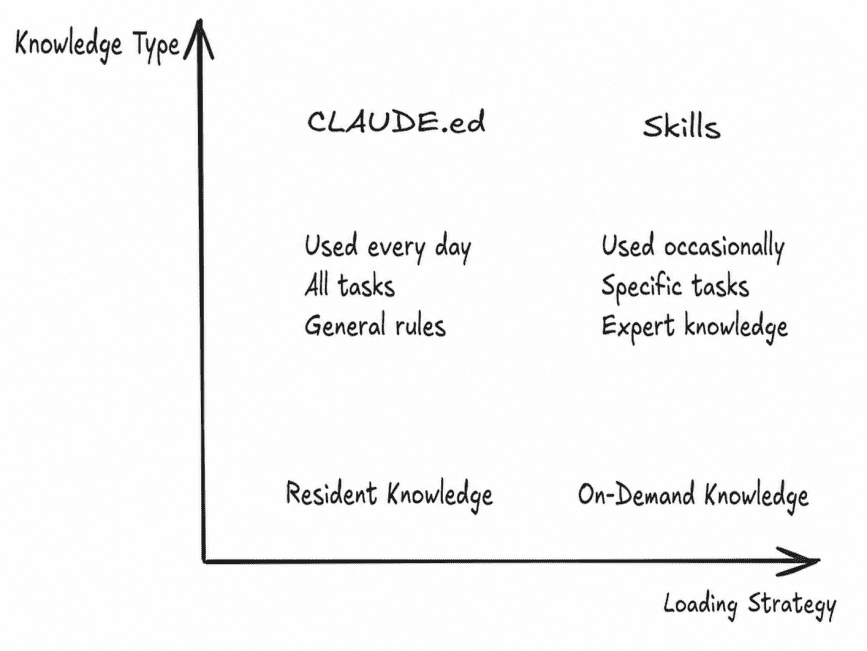
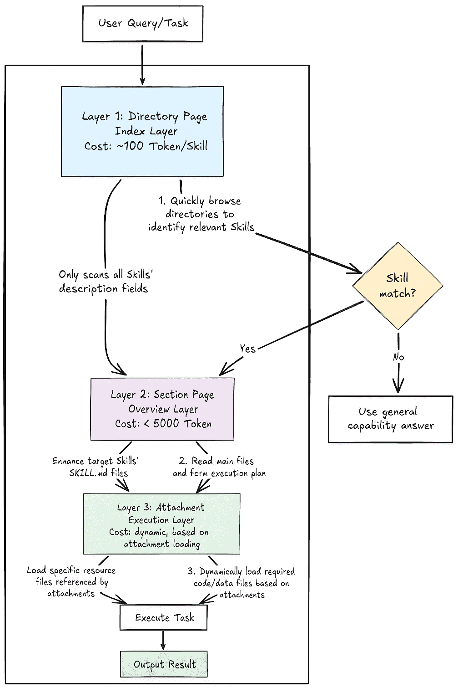
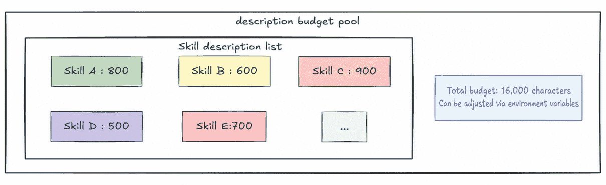
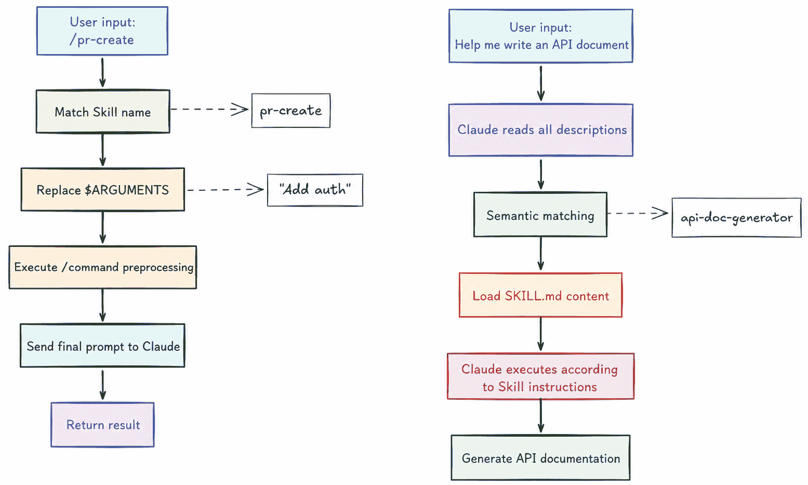
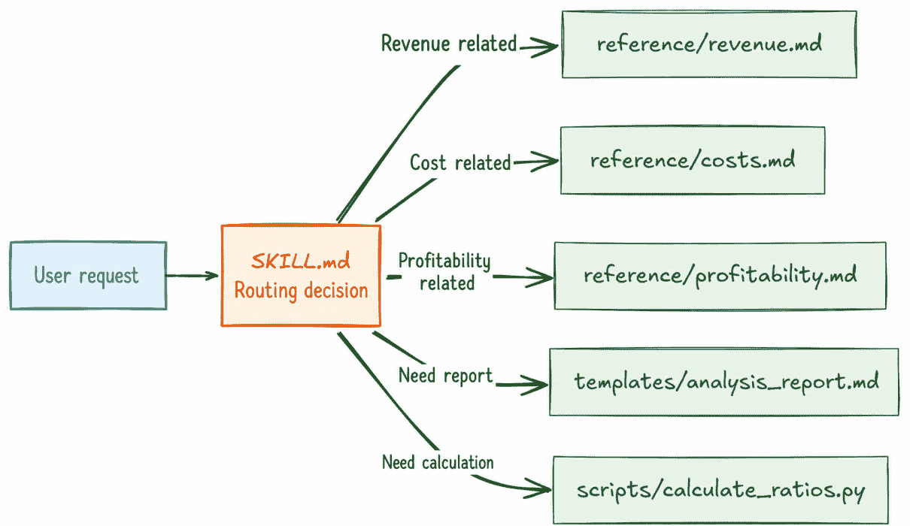
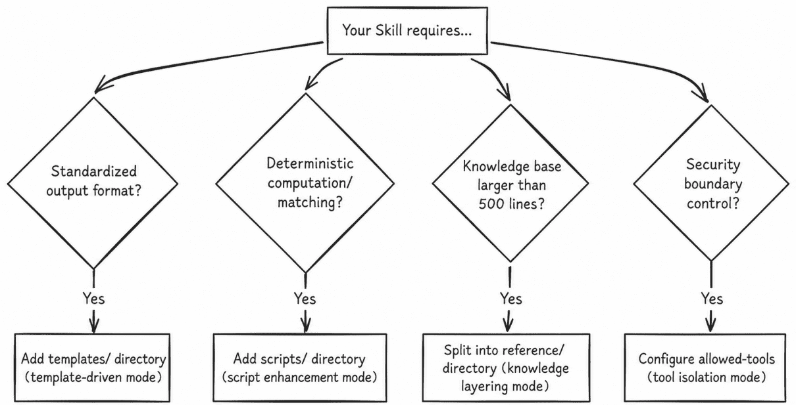

# 第三章：授人以渔：打造可复用的技能

> 我们重复做什么，就会成为什么样的人。因此，卓越不是一种行为，而是一种习惯。

> ——威尔·杜兰特

周二早上，小冰开启了一个全新的 Claude Code 会话，准备处理本周的第一项任务：为支付模块生成 API 文档。她先花了三分钟厘清背景：团队遵循 RESTful 约定，文档必须使用 OpenAPI 3.0 格式，错误码要与企业内部标准对齐，示例数据必须真实有效，输出需包含中英双语。直到把上周同事写的参考文档也喂给模型之后，她才正式下达开工指令。

昨天如此，上周五如此，上上周五亦如此。每一次新对话开始，这些前置知识都要重新“喂”给 Claude。更让人沮丧的是，即便在同一个会话内，当任务从“生成 API 文档”切换到“审查代码质量”时，Claude 也无法自动适应新的工作模式——她不得不又花一轮对话重新说明审查重点、输出格式和严重程度分级。这哪里是在用智能助手，分明是在日复一日地给一个“失忆”的临时工做入职培训。

小雪的体会如出一辙。在与公司数据分析团队协作时，每次让 Claude 执行财务分析，她都要重新解释毛利率公式、行业基准数据和报告模板格式。这些核心知识从未改变，但 Claude 每次都像第一次听说。

“有没有一种办法，”她问 Kage，“能让 Claude 永久记住某些领域专属的工作范式？不只是 `CLAUDE.md` 那样的项目级通用记忆，而是更精准的上下文感知——比如我一提到‘API 文档’，它自动就知道执行标准；一提到‘财务分析’，它自动就加载相关的行业基准和报告模板。”

Kage 微微点头，转身在白板上写下一个词：**Skills**。

## 从 `CLAUDE.md` 到 Skills：知识的两维

“在深入 Skills 之前，”Kage 开口道，“我想先厘清一个根本问题：为什么 `CLAUDE.md` 不再够用了？”

说着，他在白板上画出了一个知识类型与加载策略的坐标系（见图 3.1）。



图 3.1：知识类型与加载策略：`CLAUDE.md` 与 Skills

“`CLAUDE.md` 就像公司的‘文化手册’，”Kage 解释道。“它规定了项目的基本规则：是用 TypeScript 还是 Python，是用 tab 还是空格缩进，PR 标题应该遵循什么格式。这些规则必须在每一次对话的每一个时刻都生效，所以它必须始终驻留在上下文中，每次全量加载。但代价也很明显：‘始终驻留’意味着无论你是否在做相关任务，这些 token 都在被持续消耗。”

他顿了顿，看向小冰：“再想想你的 API 文档知识。OpenAPI 3.0 标准、错误码约定、双语格式。这些信息只有在你生成 API 文档时才需要。如果你硬把它塞进 `CLAUDE.md`，那么当你调试 bug、运行测试、编写配置文件时，这几千 token 的文档标准依然占据着上下文，白白浪费了宝贵空间，也稀释了真正关键信息的权重。”

“所以，这就是 Skills 要解决的核心痛点？”小冰问，开始理解。

“正是。Skills 解决的是**按需知识投递**的问题。”Kage 说着，在白板上画出了一个完整的对比表（见表 3.1）。

| 维度 | `CLAUDE.md` | Skills |
| --- | --- | --- |
| 承载内容 | 项目通用规范 | 专业工作流、领域知识 |
| 作用范围 | 当前项目 | 跨项目、跨会话 |
| 触发方式 | 始终生效 | 按需激活 |
| 加载策略 | 每次全量加载 | 渐进式按需加载 |
| 典型用途 | 使用 TypeScript | “如何执行代码审查” |
| 与 Agent 的关系 | 所有 agent 共享 | 可绑定到特定 Agent |
| Token 消耗 | 固定开销 | 按需付费，用时才花 |
| 企业本体 | 企业文化手册 | SOP（标准作业程序）操作手册 |

表 3.1：`CLAUDE.md` 与 Skills 的全维度对比

表 3.1 最后一行，**企业本体**，引起了小雪的注意。“这是什么意思？”她问。

Kage 解释道：“一个成熟的企业，其实拥有两种截然不同的知识资产。第一种是所有人都必须遵守的通用规则——比如考勤制度、安全红线、沟通协议。这些就像贴在办公室墙上的标语：人人可见，时刻生效。对应的就是 `CLAUDE.md`。第二种是特定角色的**标准作业程序**（**SOP**），比如财务每月如何结账、运维如何处理故障、客服如何应对投诉。这些不会贴在墙上给所有人看，而是整齐地存放在部门的文件柜里，只有特定角色在执行特定任务时才会去查阅。那就是 Skills。`CLAUDE.md` 是墙，Skills 是文件柜。你不需要在写代码时翻阅财务手册，也不需要在做报表时查阅安全规程。只有在‘需要’的那一刻，相应的知识才会被精确调取（见图 3.2）。”


图 3.2：Skills 可以按需调用

这个类比精准地锚定了 Skills 在 Claude Code 架构中的核心地位。Claude Code 对 Skill 的定义既直白又深刻：Skill 是一个包含指令的文件夹，被封装成简单的目录结构，用来“教”Claude 如何处理特定任务或工作流。在这段定义中，有两个关键词值得深究。

第一个是“文件夹”，从“字符串”到“工程化”。Skill 远不止是一个 prompt 或一个简单配置项，它是一个工程化的完整目录，可以容纳复杂的代码库、详尽的领域文档、多样化的模板，甚至可执行的脚本。

第二个是“教”，从“约束”到“内化”。定义中用的是“教”，而不是“命令”或“约束”。这隐隐揭示了其运作机制的根本转变。“教”是能力的传授与内化。通过 Skills，Claude 真正理解了某个领域的运作逻辑。它不再是一台被动执行指令的机器，而是成为了该领域的“熟练从业者”。

## 解剖一个 Skill：骨架与血肉

“中国有个古老的故事，讲的是庖丁解牛，那位大师级屠夫之所以能游刃有余，不是靠蛮力，而是因为他完全内化了牛的自然结构——关节在哪里，空隙如何走，”Kage 引用道。“理解一个 Skill 的结构，也需要同样的智慧：先看到它的‘骨架’，理解知识如何被放置和组织，然后才能谈如何巧妙运用。”

### 目录结构

他转向坐标系旁的白板，列出了一个典型的 Skill 目录结构。

“把这个想象成刀本身是如何被构造的，”Kage 说，指着他刚在白板上画出的目录结构。“就像庖丁解牛那样，大师顺着牛的自然间隙和空隙引导刀刃，而不是强行切割，技巧在于读懂结构——而不在于刀。”然后他将目录逐一拆解。

```
api-doc-generator/                  ← 技能名称（kebab-case，以连字符分隔，像文件名一样清晰）
├── SKILL.md                 ← [核心骨架] 必需的主技能文件（注意：大小写必须完全匹配）
├── scripts/                    ← [手脚] 可选的可执行脚本，使技能能够主动“做”事情
│   └── detect-routes.py        ← 例如，自动扫描代码库以发现路由
├── reference/                  ← [记忆库] 可选的按需加载参考文档，不占用常驻内存
│   ├── openapi-patterns.md    ← 仅在生成文档时读取的标准
│   └── error-codes.md        ← 仅在处理错误时查阅的代码表
└── templates/                 ← [模具] 可选的输出模板，以确保输出格式一致
    └── endpoint-doc.md        ← 定义 API 文档应该是什么样子
```

“这些看似繁琐的‘规章制度’，其实是用惨痛的工程经验换来的防错机制。”Kage 拿起一支红色记号笔，在白板上目录结构旁边重重地圈出了几个关键点，神情变得严肃起来。

**文件名**：`SKILL.md`：唯一的“触发器”。文件名必须全部大写；`skill.md`、`Skill.md`、`SKILL.MD` 全部无效。Claude 的加载器在扫描文件时执行的是精确字符串匹配，而非模糊搜索。

**目录名**：`kebab-case`：跨平台的“通用语言”。目录名使用全小写字母和连字符（例如 `api-doc-generator`），最长 64 个字符，字符集限制为 `[a-z0-9-]`。不允许有空格、下划线、大写字母、开头或结尾的连字符，也不允许连续连字符。这是为了消除操作系统之间的差异。Windows 不区分大小写，而 Linux 区分大小写。`kebab-case` 是互联网时代的“世界语”，确保你的技能能够在任何环境或工具链中被无损识别。

保持技能目录为纯粹的指令空间。Anthropic 建议不要在技能目录中放置 `README.md`，面向人类的文档最好放在父目录中。原因是卫生，而非硬性规则。当一个技能激活时，只有 `SKILL.md` 的主体进入上下文窗口；支持文件——包括任何 `README.md`——只有在 `SKILL.md` 明确指向它们时才会被加载，因此未被引用的 `README.md` 完全不消耗上下文。保持文件夹中没有面向人类的文档，只是消除了引用它们的诱惑，并保持指令表面的清洁。

**命名中立性**：避免使用“claude”和“anthropic”。将无品牌命名视为一种约定，而非强制验证规则。Claude Code 实际上对技能标识符的强制要求是：小写字母、数字和连字符，在长度限制内，并且与文件夹名称匹配。技能是一种通用的知识封装格式，其生命力在于保持跨 harness 的可移植性——这就是为什么即使没有验证器要求，也值得采用品牌中立的名称。

### YAML Frontmatter：技能的“身份证”

`SKILL.md` 文件顶部的 YAML Frontmatter 定义了技能的身份和行为边界。完整字段说明如下：

```
---
name: api-doc-generator
# [唯一标识符] 最多 64 个字符
# 如果省略，默认使用目录名

description: >
  Generate API documentation from source code. Use when
  the user asks to "write API docs", "document endpoints", or
  "create OpenAPI specs".
  Supports Express, FastAPI, and Spring Boot.
# [触发描述] 最多 1024 个字符
# 如果省略，默认使用 SKILL.md 正文的第一段

argument-hint: "[source directory] [output format]"
# [参数提示] 显示在“/”菜单中
# 帮助用户了解此技能接受的输入格式

disable-model-invocation: true
# [禁用模型自动调用] 设置为 true 时，禁止 Claude 自动调用
# 用户必须通过“/skill-name”手动触发
# 默认值：false

user-invocable: false
# [用户可调用性] 设置为 false 时，从“/”菜单中隐藏
# 但 Claude 仍可自动调用
# 默认值：true

allowed-tools:
  - Read
  - Grep
  - Glob
  - Write
  - Bash(python:*)
# [工具白名单] 精确控制技能执行期间可以使用哪些工具和权限范围

model: haiku
# [指定模型] 指定此技能使用的模型
# 对于简单任务，推荐使用 haiku 以提高响应速度并降低成本

context: fork
# [执行上下文] 设置为“fork”时，在隔离的子代理中执行
# 确保主对话上下文不被污染

agent: Explore
# [子代理类型] 当 context 设置为“fork”时生效
# 可选值：Explore、Plan、general-purpose 或自定义 Agent

hooks:
  PreToolUse:
    - matcher: Bash
      hooks:
        - command: echo "$TOOL_INPUT" >> audit.log
# [生命周期钩子] 定义技能激活期间的事件处理逻辑
# 仅在技能处于激活状态时生效
---
```


这些字段可以分为三个逻辑分组，每个分组对应 Skill 设计的三个核心维度之一：触发机制、权限控制和运行时环境。

* **身份字段（触发机制）**：包括 `name`、`description` 和 `argument-hint`。这些字段定义了“Skill 是什么”，向 Claude 和用户清晰地传达 Skill 的功能定位和调用方式。它们构成了触发逻辑的基础。
* **调用与工具字段**：`disable-model-invocation`、`user-invocable`、`allowed-tools`、`disallowed-tools` 和 `model`。请仔细阅读这些字段，因为它们的名称所承诺的比实际提供的更多。`disable-model-invocation: true` 阻止 Claude 自动调用 Skill，使其由用户触发。`user-invocable: false` 将 Skill 从斜杠命令菜单中隐藏——这是一个可见性开关，而非安全边界。`allowed-tools` 在 Skill 激活期间授予并自动批准工具权限；它并不限制工具。真正将工具从 Claude 的访问范围中移除的字段是 `disallowed-tools`。而 `model` 会在当前回合剩余时间内覆盖模型，这是一个路由决策而非权限控制。真正的边界来自你的权限设置和 Hooks（*第 5 章*）。
* **执行字段（运行时环境）**：包括 `context`、`agent` 和 `hooks`。这些字段决定了“在哪里执行”和“执行过程中发生什么”，配置隔离环境、子代理类型和生命周期钩子，以确保任务在预期的上下文中运行。

掌握这三个维度，就掌握了 Skill 架构设计的完整框架。

**Kage 的笔记**

`disable-model-invocation` 和 `user-invocable` 容易混淆，但实际上它们控制的是两个正交的调用方向。`disable-model-invocation: true` 意味着“Claude 不能自动触发此 Skill，必须由用户通过 `/skill-name` 手动执行。”这适用于具有副作用或高风险的操作，例如代码提交（`/commit`）、服务部署（`/deploy`）等，以确保用户明确确认。默认值为 `false`。`user-invocable: false` 意味着“此 Skill 不会出现在 `/` 菜单中，用户无法手动触发它，但 Claude 仍可在内部逻辑中自动调用它。”这适用于纯信息性或辅助参考类 Skill；隐藏它们可以避免菜单杂乱，同时保留 Claude 在适当时自动加载和使用它们的能力。默认值为 `true`。在默认配置下（两者都设为“允许”），Skill 对 Claude 和用户都是开放的。

# 渐进式披露：知识的投资回报

“*好吧，我理解了 Skill 的结构*，”小冰问道，“*但如果我有 20 个 Skill，每个包含数千个 token，Claude Code 是否每次对话都必须加载全部内容？这和把所有东西塞进* `CLAUDE.md` *有什么区别？*”

这是一个非常切中要害的问题，它恰恰揭示了 Skills 系统最精巧的核心：**渐进式披露**。

## 图书馆模型

Kage 回答道：“*这里可以用图书馆来类比。想象你走进一座图书馆查找信息。你绝不会一次性读完所有的书；相反，你会遵循一个高效的检索流程：先浏览目录定位分类，再取出目标书籍查阅其章节，最后只精读你需要的部分。Skills 系统采用了同样的三层渐进式披露模型*（见 *图 3.3*）*，以最小的 token 成本实现按需获取海量知识。*”



图 3.3：三层渐进式披露模型

三层模型在实际应用中带来的性能提升是显著的。以一个完整的财务分析 Skill（总计 5,300 个 token）为例，其文件组成如 *表 3.2* 所示。

| **文件** | **Token 数** | **说明** |
| --- | --- | --- |
| `SKILL.md` | 800 | 主逻辑与路由指南 |
| `reference/revenue.md` | 1500 | 收入数据参考 |
| `reference/costs.md` | 1200 | 成本结构参考 |
| `reference/profitability.md` | 1000 | 利润率公式参考 |
| `templates/report.md` | 800 | 报告模板 |
| 合计 | 5300 | — |

表 3.2：一个完整财务分析 Skill 的文件组成

不同加载方式的 token 消耗对比如 *表 3.3* 所示。

| **场景** | **传统全量加载** | **渐进式披露** | **节省比例** |
| --- | --- | --- | --- |
| Skill 未激活 | 0 | 0 | — |
| 扫描阶段（仅判断相关性） | 5300 | 约 100 | 98% |
| 简单请求（仅主文件） | 5300 | 800 | 85% |
| 中等请求（需要一个参考文件） | 5300 | 2300 | 57% |
| 复杂请求（需要全部资源） | 5300 | 5300 | 0% |

表 3.3：不同加载方式的 token 消耗对比

数据表明，绝大多数请求只需要一部分资源。当用户问“毛利率如何计算？”时，Claude Code 只需加载 `SKILL.md`（用于路由）和 `profitability.md`（获取公式），总计约 1,800 个 token。其余三个文件（约 3,500 个 token）完全留在磁盘上，成本为零。这就是“按需知识交付”的核心经济优势：以最小的上下文成本实现最大的知识覆盖。

## description 的预算机制

渐进式披露的第一层，即所有 Skill 的 description，以常驻方式注入 Claude 的上下文。这意味着它们必须共享有限的 token 预算，形成系统的“入口瓶颈”。

Claude Code 通过一个字符预算来确定此列表的规模，该预算随模型的上下文窗口缩放——默认约为 1%。独立于预算之外，每个条目的合计文本上限为 1,536 个字符。由于这些数值在不同版本之间有所变动，请将其视为数量级参考，并对照你所部署的 Claude Code 版本进行验证。

预算并非在所有已安装的 Skill 之间平均分配。Skill 名称始终会被列出。当合并的 description 超出预算时，Claude Code 会从你调用最少的 Skill 开始缩短、然后丢弃其 description，因此你实际使用的 Skill 会保留完整文本。该机制按使用频率降级，而非按每个 Skill 均等的配额。

*每个 Skill 可用字符数 = 总预算 / Skill 总数*

这意味着一个 Skill 绝不会仅仅因为你安装了很多 Skill 而消失。在预算压力下降级的是你使用最少的 Skill 的 description 文本，而所有 Skill 的名称仍然可见。从第一天起就编写简洁的 description 是良好的实践——不是因为有一个配额在你们之间分配，而是因为简短的 description 能在预算压力下完好存活。



图 3.4：Claude Code 的 description 预算池

一个 Skill 绝不会因为其 description 过长而被悄悄排除在列表之外。它的名称始终存在；只有在预算紧张时，description 文本才会被缩短或丢弃。因此，Claude 似乎“看不到”某个 Skill 是 description 质量问题，而非隐藏的字符上限。

**Kage 的笔记**

技巧 3：要提高预算，可设置 `skillListingBudgetFraction` 配置项（例如 `0.02` 表示 2%）。`SLASH_COMMAND_TOOL_CHAR_BUDGET` 环境变量仍可作为固定字符数的覆盖方式使用。

这一预算机制揭示了一个核心工程哲学：不要盲目创建 Skill，而应追求“少而精”的架构。

当你发现自己需要安装超过 20 个 Skill 时，这通常是一个信号，表明你需要重新审视你的架构策略。

* **合并同类项**：将多个碎片化的 Skill 合并为一个综合性 Skill。
* **隐藏内部工具**：将纯内部子任务标记为 `disable-model-invocation: true` 以减少预算占用。
* **采用“token 投资”回报思维**：将 description 中的每一个字符都视为一笔昂贵的“token 投资”——精准投资，以换取高效检索和准确执行；浪费投资，不仅浪费了自己的预算配额，还挤占了其他 Skill 的生存空间。

# 触发机制：Claude Code 如何决定调用哪个 Skill

Skill 的触发机制是整个系统中最关键、最需要深入理解的部分。它直接决定了 Skill 能否在恰当的时刻被激活——这甚至比 Skill 内容本身的质量更为重要。毕竟，如果无法成功触发，再精彩的内容也无用武之地。

## 双通道激活机制

每个 Skill 支持两条激活路径。

* **显式调用：** 当用户在对话中输入 `/skill-name` 时，Claude Code 立即加载并执行相应的 Skill。这种方式类似于终端命令——清晰、直接、明确。如果 Skill 定义了 `argument-hint`，用户还可以提供参数，例如 `/commit fix login bug` 或 `/review src/auth/login.ts`。
* **语义匹配**：在深入理解用户意图后，Claude 自主判断哪个 Skill 最契合当前任务并自动加载。在日常使用中，这正是 Skills 的核心价值所在——用户只需描述自己的需求，Claude 会在幕后智能地决定是否以及如何调用最合适的 Skill。整个过程对用户完全透明，实现无缝的“所想即所得”体验。

*图 3.5* 展示了显式调用和语义匹配的执行流程。



图 3.5：显式调用（左）和语义匹配（右）的执行流程

## Description：Skills 的灵魂

语义匹配机制完全依赖于 `description` 字段。该字段不是写给人类读者看的说明性文字，而是 Claude 在决定是否调用某个 Skill 时所依据的**唯一信号**。

Claude Code 推荐使用以下公式来组织 `description`：

*\[功能定义\]（做什么）+ \[触发场景\]（何时使用）+ \[核心能力\]（能做什么）*

理解这个公式的最佳方式是对比“无效”和“有效”的示例。以下是两种方式的示例。

# 描述字段的编写要点

## 常见问题示例

### 过于模糊，无法判断何时使用

```yaml
description: Helps with projects.
```

### 过于技术化，缺乏面向用户的触发关键词

```yaml
description: Implements the Project entity model with hierarchical relationships.
```

### 仅描述功能，未说明触发场景

```yaml
description: Generates API documentation.
```

### 正确示例：表述清晰、覆盖具体触发场景、说明核心能力

```yaml
description: Generate API documentation from Express, FastAPI, or Spring Boot source code. Use when user asks to "write API docs", "document endpoints", "create OpenAPI specs", or mentions "Swagger". Supports route detection, request/response schema extraction, and authentication requirement marking.
```

`description` 字段的限制是 **1,024 个字符**。空间不大，每个词都必须仔细斟酌。

一个高效实用的写作策略可以拆解为三步：

1. **定义核心能力（What）**：用一句话概括该 Skill 能做什么，确立其基本功能定位
2. **说明触发场景（When）**：用“Use when user...”句式详细列出可能触发该 Skill 的各种用户指令、短语或关键词，提高语义匹配的命中率
3. **定义排除项（Not For）**：（可选但推荐）如果该 Skill 容易被错误触发，务必加上“Not for...”子句，明确说明不应使用的场景，优化决策准确性

**Kage 的备注**

你描述的读者主要是 Claude，而不是人类读者。人类阅读文档时倾向于扫标题、浏览结构以快速掌握大意；Claude 阅读 `description` 字段时执行的是深层语义匹配。它需要捕捉用户意图中的细微差别。为了提高触发准确性，必须在描述中详尽地包含用户可能的各种表达。例如，对于“生成 API 文档”这一需求，用户可能会说“generate API docs”“write interface documentation”“output OpenAPI specs”或“help me write a Swagger”。所有这些不同说法都应明确写入描述。同义词集越丰富，语义匹配覆盖面越广，触发准确性越高。

## 防止过度触发与触发不足

在实践中，Skill 触发机制常常面临两种典型失败模式。理解并修复这些问题，是优化 Claude 表现的关键。

**1. 触发不足**

* **现象**：应该调用 Skill 时却没有调用。
* **数据警示**：在 Vercel 的 Next.js 16 评估中，当 agent 未获得明确指导时，被测的单个 Skill 有 56% 的情况未被调用（Vercel Engineering，“`AGENTS.md` outperforms skills in our agent evals”）。该结果只针对那次评估中的一个 Skill；应将其理解为关于可发现性的警示，而非普适概率。
* **根本原因**：描述写得过于技术化或学术化，与用户自然、口语化的表达之间存在显著的语义鸿沟。
* **修复策略**：“翻译”用户语言。在描述中加入大量用户常用表达，覆盖领域术语的同义词、口语短语，甚至常见但不准确的表达（例如，很多用户会混淆“Swagger”和“OpenAPI”——两者都应包含）。

**2. 过度触发**

* **现象**：在本不应调用的情况下错误激活 Skill。
* **根本原因**：描述定义得过于宽泛，包含太多高频通用词，导致匹配阈值过低。
* **修复策略**：引入否定约束。用“Not for...”句式明确划定边界，排除无关场景。
* **示例**：“Not for general code questions or debugging. Only for structured documentation generation.”

要测试一个 Skill 是否能准确触发，可以构建一个包含 10–20 个测试用例的验证集，同时覆盖“应触发”和“不应触发”两种场景。

下面是一个实用的测试模板示例。

应触发的测试用例：

```
- "Help me generate interface documentation for src/api/"                  → Should trigger
- "Write an OpenAPI specification"                                        → Should trigger
- "Document the REST endpoints"                                           → Should trigger
- "Help me write Swagger"                                                 → Should trigger
```

不应触发的测试用例：

```
- "Help me debug this API call"                                           → Should not trigger
- "Why does this endpoint return 500?"                                    → Should not trigger
- "Optimize the performance of this API"                                  → Should not trigger
```


## 验收标准

对于相关任务，触发率需达到 90% 或更高；对于无关任务，误触发率需控制在 5% 以下。

## 参考技能与任务技能：两种技能哲学

在 `Skill` 设计理念中，`disable-model-invocation` 字段不仅仅是一个简单的开关；它定义了两种根本不同的 `Skill` 交互模式：参考型和任务型。

### 参考技能

- **配置**：默认行为。
- **核心逻辑**：“按需知识库”。`Claude` 根据对话上下文自动判断是否需要该 `Skill`。`description` 作为触发条件，直接注入 `Claude` 的上下文进行语义匹配。
- **使用场景**：提供知识、指南、框架或标准。用户无需意识到 `Skill` 的存在；`Claude` 会自动在适当的时候“打开手册”。
- **示例**：`API` 设计指南、代码审查清单、行业标准文档。

### 任务技能

- **配置**：显式设置 `disable-model-invocation: true`。
- **核心逻辑**：“受控执行工具”。`Claude` 无法自动触发这些技能；必须由用户通过 `/skill-name` 命令手动调用。`description` 不会注入 `Claude` 的上下文，仅作为用户在命令行中选择 `Skill` 时的标识符。
- **使用场景**：具有副作用、需要用户明确授权才能执行的操作。
- **示例**：`/commit`（提交代码）、`/deploy`（部署应用）、`/notify`（发送通知）。

参考技能与任务技能的对比见 *表 3.4*。

| **维度** | **参考技能** | **任务技能** |
| --- | --- | --- |
| `Claude` 自动触发 | 是（语义匹配） | 否（必须手动） |
| 用户/名称触发 | 是 | 是 |
| `Description` 功能 | 触发条件（注入 `Claude` 上下文） | 仅用于用户识别（不注入 `Claude` 上下文） |
| `Token` 预算消耗 | 是（自动加载消耗） | 否（仅手动调用时消耗） |
| 典型场景 | 知识提供、标准查询 | 动作执行、副作用操作 |
| 经典案例 | `API` 标准、审查清单 | `/commit`、`/deploy` |

表 3.4：参考技能与任务技能对比

### Kage 的注释

这里提到的“副作用”不是吃药的副作用。在软件工程中，副作用是指不仅返回结果，还改变系统外部状态的操作。例如，提交代码会修改 `Git` 仓库历史，部署应用会改变线上服务的状态，发送通知会实际向某人传递消息。这些操作一旦执行，就会产生现实世界的影响，并且通常是不可逆的。因此，这类 `Skill` 通常被设计为需要用户明确发起，而不是允许模型自行决定何时执行。

小冰问：“一个任务应该设计为参考技能还是任务技能？”

Kage 回答：请使用一个简单的“最坏情况测试”来决定：“如果 `Claude` 自动执行这个任务，最坏会发生什么？”

如果答案让你感到紧张，例如自动提交未测试的代码、自动部署有缺陷的版本、自动删除生产数据，或自动发送错误通知——那么你必须选择任务技能。务必添加 `disable-model-invocation: true`。将控制权牢牢掌握在用户手中，只有在用户明确输入 `/skill-name` 时才执行操作。

如果答案无关紧要，例如多显示一份参考文档、多提供一条建议，或稍微增加 `token` 消耗，那么你可以选择参考技能。让 `Claude` 根据上下文智能判断并按需自动加载，为用户提供无缝的知识辅助。

**核心原则**：副作用越大，控制必须越严格。对于任何可能改变系统状态或造成不可逆后果的操作，绝不要信任 `Claude` 的自动判断。

## `SKILL.md` 主体内容：路由器，而非仓库

了解了 `Frontmatter` 中的触发机制和权限控制后，我们现在进入 `SKILL.md` 内容设计的核心。这是 `Skill` 真正发挥作用的地方。

### 路由器思维

一个常见的误区是将 `SKILL.md` 视为“知识仓库”，试图将所有相关信息都塞进去。正确的设计方法是将其定位为**路由器**（见 *图 3.6*）：文件本身只包含核心流程和路由表，而详细的知识内容则分布在引用的文件中。



图 3.6：`SKILL.md` 的角色是路由器

路由设计的核心技巧是构建一个**快速参考**表。该表只需很少的 `token`（3 行约 50 个 `token`），就能清晰地引导 `Claude` 从五个关键维度进行路由判断。

```
## Quick Reference

| Analysis Type                        | Trigger Keywords                  | Reference Resource                     |
|--------------------------------------|-----------------------------------|---------------------------------------|
| Revenue Analysis (Revenue)           | revenue, sales, turnover          | reference/revenue.md                  |
| Cost Analysis (Cost)                 | cost, expense, expenditure        | reference/costs.md                   |
| Profitability Analysis (Profitability) | profit, gross margin, net margin | reference/profitability.md           |
```

与让 `Claude` 逐行扫描整个 `SKILL.md` 文件来推断“遇到收入问题时参考 `revenue.md`”相比，这种结构化表格的效率显著更高，**信息密度**是前者的 10 倍。

### 契约式引用

在 `SKILL.md` 中引用辅助文件时，绝不要简单地列出路径。你应该建立一个清晰的“**契约**”，确保 `Claude` 清楚理解三个核心要素：触发时机（何时加载）、资源位置（在哪里查找）以及预期输出（获得什么）。

以下示例说明了“弱引用”与“契约式引用”的区别。

```
# Weak Reference: Lacks context (Claude cannot determine when to load this file, and lacks action instructions)
See `reference/revenue.md` for more details.

# Contractual Reference: Explicit condition + path + expected content
## Revenue Analysis
When the user asks about revenue growth, ARPU, or revenue composition:
→ Load `reference/revenue.md` for calculation formulas and industry benchmarks.
```

这一设计理念与子代理流水线中的“交接契约”一致：**下游消费者不仅需要知道上游的位置，还必须清楚理解上游能够提供什么。**

### 500 行规则

`Claude Code` 建议将 `SKILL.md` 的长度**控制在 500 行以内**。

“为什么设定为 500 行？”小冰问道。

`Kage` 回答说：“这是因为 500 行大约等于 2,000 到 3,000 个 `token`，对于激活单个 `Skill` 来说是一个合理的上下文成本。结合 `Claude` 的系统提示词和当前对话历史，可以确保总 `token` 数保持在可控范围内。如果超过 500 行，通常意味着你把‘参考资料’和‘路由指令’混淆了——此时解决方案不是继续扩充内容，而是立即重构。”

*表 3.5* 列出了 `Skill` 内容过载时的重构信号和策略。

| **重构信号** | **应对策略** |
| --- | --- |
| 大量公式或标准解释 | 移至 `reference/` 目录 |
| 多个完整示例（单个超过 30 行） | 移至 `examples/` 目录 |
| 多种输出模板 | 移至 `templates/` 目录 |
| 可独立执行的逻辑 | 封装为 `scripts/` 脚本 |
| 多个并行功能模块 | 考虑拆分为多个独立 `Skill` |

表 3.5：`Skill` 内容过载的重构信号与策略

## allowed-tools：知识约束行为

`allowed-tools` 是 `Skill` 安全架构中的核心字段。它不仅仅是一份权限列表，更体现了一个深层设计原则：**知识应当约束行为**。

具体的权限配置应基于 `Skill` 对业务逻辑的理解。

- **代码审查 Skill**：审查过程仅需读取代码，严禁修改，因此仅授予只读工具。
- **文档生成 Skill**：需要创建新文件但绝不能改动已有文件，因此仅授予写入权限，并明确禁止编辑权限。
- **测试执行 Skill**：只需运行特定测试命令，因此可执行的 `Bash` 命令被精确限制，以防止任意命令注入。

### 权限设计模板

以下是不同 `Skill` 类型的 `allowed-tools` 配置最佳实践。这些配置体现了最小权限原则，确保每个 `Skill` 仅拥有完成其特定任务所需的最小工具权限。

```
# Audit-type Skill: Strictly read-only
allowed-tools:
  - Read
  - Grep
  - Glob

# Generation-type Skill: Writable but not editable
allowed-tools:
  - Read
  - Grep
  - Glob
  - Write

# Analysis-type Skill: Read-only + specific scripts
allowed-tools:
  - Read
  - Grep
  - Glob
  - Bash(python:*)

# Execution-type Skill: Controlled command whitelist
allowed-tools:
  - Read
  - Bash(git status:*)
  - Bash(git add:*)
  - Bash(git commit:*)
  - Bash(npm test:*)
```

### 细粒度 Bash 控制语法

`Bash` 工具通过前缀匹配机制支持对可执行命令的细粒度控制。核心语法为 `Bash(prefix:*)`，其中 `prefix` 指定允许的命令前缀，`*` 作为后续参数的通配符。

权限控制示例如下：

```
Bash(git:*)          # Allows all subcommands starting with git
Bash(git log:*)      # Only allows git log and its parameters, prohibiting dangerous operations like git push
Bash(npm test:*)     # Only allows running test commands, preventing accidental execution of npm install or npm publish
Bash(python:*)       # Allows execution of all Python scripts
Bash(./scripts/*:*)  # Allows execution of specific scripts in the scripts/ directory
```

当 `Claude` 尝试执行 `Bash` 命令时，系统会执行预执行检查。

- **提取前缀**：获取用户请求的完整命令字符串
- **匹配规则**：检查命令是否以配置的前缀开头
- **执行决策**：若匹配成功则允许执行；若不匹配则直接拒绝并返回权限错误。

遵循最小权限原则是构建安全 `Skill` 的基石。以下是 `allowed-tools` 配置的正反示例对比。

```
# Precise Authorization: Only explicitly list the specific subset of commands required for the task
# Scenario: Code commit Skill
# Strategy: Only allow the three specific subcommands: status, add, commit
allowed-tools:
  - Bash(git status:*)
  - Bash(git add:*)
  - Bash(git commit:*)

# Over-authorization: Using a global wildcard is equivalent to abandoning all defenses
# Scenario: Incorrect generic configuration
# Risk: Allows execution of any shell command
allowed-tools:
  - Bash(*)
```

`Bash(*)` 在安全性上几乎等同于完全没有设置 `allowed-tools`。这意味着 `Claude Code` 获得了对宿主机的完整 `shell` 访问权限。对于 `/deploy` 这类高风险的任务型 `Skill`，这样的配置是致命的。一旦模型遭受提示注入攻击，攻击者便可利用该权限窃取密钥、删除生产数据或植入后门。

## 参数传递与动态注入

`Skill` 不仅仅是静态指令；它还支持运行时参数传递和上下文预注入，使其行为能够根据调用场景动态调整。

### $ARGUMENTS 与位置参数

当用户通过 `/skill-name arg1 arg2` 调用 `Skill` 时，可以在 `SKILL.md` 正文中引用 *表 3.6* 所示的变量。

| **变量** | **描述** |
| --- | --- |
| `$ARGUMENTS` | 所有参数的完整字符串 |
| `$ARGUMENTS[0]` | 第一个参数（索引从 0 开始） |
| `$ARGUMENTS[1]` | 第二个参数 |
| `$0`、`$1`、`$2` | 位置参数的简写形式 |

表 3.6：可在 `SKILL.md` 正文中引用的变量

此类引用的示例如下：

```
---
name: migrate-component
description: Migrate a component between frameworks
argument-hint: "[component] [from] [to]"
disable-model-invocation: true
---
Migrate the $0 component from $1 to $2.
Preserve all existing behavior and tests.
```

当调用 `/migrate-component SearchBar React Vue` 时，`Claude` 实际接收到的指令是：“将 `SearchBar` 组件从 `React` 迁移到 `Vue`。保留所有现有行为和测试。”

### 动态上下文注入

这是 `Skills` 系统中最强大且独特的特性。`` !`command` `` 语法允许你在将 `SKILL.md` 文件发送给 `Claude` **之前**，在 `Shell` 环境中执行指定命令，并将命令输出直接内联到提示词中。

示例如下。

```
## Current Context (Auto-detected)
Current branch:
!`git branch --show-current`
Recent commits:
!`git log origin/main..HEAD --oneline 2>/dev/null || echo "No commits"`
Files changed:
!`git diff --stat origin/main 2>/dev/null || git diff --stat HEAD~3`
```

当你运行 `/pr-create "Add auth"` 时，`shell` 命令已经执行完毕，其输出已被内联。`Claude` 实际接收到的提示词如下所示：

```
## Current Context (Auto-detected)
Current branch:
feature/auth
Recent commits:
a1b2c3d Add JWT middleware
d4e5f6g Add login endpoint
Files changed:
 src/auth/middleware.ts | 45 +++
 src/auth/login.ts     | 82 +++
 2 files changed, 127 insertions(+)
```


这一设计带来了巨大的工程价值。有无`!`command``功能的对比如*表 3.6*所示。

| **维度** | **无`!`command``** | **有`!`command``** |
| --- | --- | --- |
| Claude 启动上下文 | 空白，需要多轮探索 | 关键信息预先注入 |
| 首次响应中的工具调用次数 | 3–5 次（用于信息收集） | 0–1 次（直接行动） |
| Token 消耗 | 高 | 低 |
| 响应速度 | 慢 | 快 |
| 结果一致性 | 低（存在遗漏信息的风险） | 高（固定注入相同信息） |

表 3.7：有无`!`command``功能对比

**Kage 的笔记**

严格定义执行边界。在执行`!`command``时，Claude 遵循严格的顺序：先替换`$ARGUMENTS`变量，再执行 Shell 命令。这意味着用户的输入会被直接拼接进 Shell 命令中，若缺乏适当控制，极易导致 Shell 注入攻击。因此，任何使用`!`command``语法的 Skill 都必须通过`allowed-tools`配置项严格限制可执行命令的范围，以建立必要的安全边界。

## 作用范围与优先级

Skills 文件可以部署在不同层级，每个层级对应特定的作用范围和适用场景，详见*表 3.8*。

| **存储位置** | **作用范围** | **典型用途** |
| --- | --- | --- |
| 企业配置中心 | 对所有成员生效 | 强制性的企业级开发规范与安全策略 |
| `~/.claude/skills/<name>/` | 个人所有项目 | 个人编码习惯、通用工具集以及跨项目辅助脚本 |
| `<project>/.claude/skills/<name>/` | 仅当前项目 | 项目专属工作流、业务逻辑定制以及团队协作规范 |
| 插件内置资源 | 插件启用时 | 社区共享能力包、特定框架的专用指令集 |

表 3.8：Skills 的作用范围与适用场景

当多个来源包含同名 Skills 时，系统会按照优先级从高到低的顺序解析并加载它们。

```
企业策略 > 个人配置（~/.claude/） > 项目配置（.claude/） > 插件内置
```

这一优先级顺序背后的逻辑严格遵循企业治理架构，确保从“强制基线”到“个性化偏好”的有序过渡。

**企业策略（不可突破的基线）**：企业级配置拥有最高权威，用于强制执行全局安全与合规策略。例如，安全审查 Skill 必须强制检查 OWASP Top 10 漏洞。此类关键规则绝不能被项目级或个人配置覆盖，从而确保组织安全红线不被突破。

**个人配置（个性化效率工具）**：个人目录中的配置旨在满足个人开发者习惯。例如，用户可以定义`/commit`命令，按照 conventional commit 规范自动生成提交信息。此类偏好仅适用于个人环境，不影响他人。

**项目配置（业务场景定制）**：项目根目录中的配置是为特定代码库量身定制的。例如，前端项目可以定制专属的组件文档生成 Skill，以适配其独特的技术栈和文档结构。

将 Skill 目录（`.claude/skills/`）纳入项目的 Git 版本控制，是实现零成本团队知识共享的最优方案。

**即插即用**：当新团队成员克隆代码库时，相关 Skills 会自动激活，无需手动安装或配置。

**同步演进**：随着项目迭代，Skill 库可以随代码一同更新，确保团队始终使用最新的工作流标准。

## 实践：从零构建 3 个 Skills

理论框架至此已经完整，接下来将进入核心工程实践部分。

在本节中，我们将通过三个完整且复杂度递增的案例，逐步演示如何构建高价值 Skills。这三个案例并非随意选择，而是恰好对应前文描述的三种典型应用场景。

- **参考 Skill**：代码审查。
- 小冰团队每天需要进行大量代码审查。为此，团队建立了以下内部约定。
- **优先级原则**：安全问题最高优先，其次是性能问题，最后是代码风格。
- **反馈要求**：必须提供具体修改建议；严禁只指出问题而不提供解决方案。
- **严重程度标注**：每个问题都必须标注严重程度。
- 由于相关指南分散在不同文档中，新人难以一次性掌握全部内容，因此将核心指南与目录结构整理如下：

目录结构如下：

```
code-reviewing/

├── SKILL.md                        # 核心审查流程与标准

└── reference/

    └── severity-guide.md        # 严重程度详细分级标准
```

`SKILL.md` 的核心内容如下。

```
---

name: code-reviewing

description: Performs structured code reviews following team standards.

Checks security vulnerabilities, performance issues, and code quality

in priority order. Use when user asks to "review code", "do a code

review", "check this PR", "audit this function", or provides code

and asks for feedback.

allowed-tools:

- Read

- Grep

- Glob

---

# Code Review Process

You are a senior code reviewer. When conducting reviews, strictly follow the priority order below:

## Top Priority: Security Checks

Immediately report the following security issues:

- SQL injection risks: such as direct concatenation of SQL strings or not using parameterized queries

- XSS vulnerabilities: unescaped user input directly output to HTML

- Hardcoded sensitive information: including passwords, keys, tokens, database connection strings, etc.

- Authorization validation flaws: such as missing authentication middleware or logic that allows privilege escalation

## Second Priority: Performance Issues

- N+1 queries: frequent database calls inside loops

- Missing indexes: high-frequency query fields without indexes

- Redundant computation: invariant calculations inside loops that could be moved outside

- Memory leak risks: such as unclosed connections or continuously growing caches

## Third Priority: Code Quality

- Overly long functions: exceeding 50 lines without reasonable justification

- Non-standard naming: unclear variable or function names

- Missing error handling: such as empty catch blocks or silently swallowed exceptions

- Code duplication: violating the DRY principle

## Output Format Specification

Each identified issue must include the following four elements:

- Severity: Critical / Major / Minor

- Issue Description: specific explanation of the problem

- File Location: file_path:line_number

- Recommendation: provide a concrete code fix or solution strategy

If no issues are found, clearly reply "Review Passed" and briefly summarize the main aspects checked.

Note: For detailed severity classification standards, refer to `reference/severity-guide.md`.
```

本 Skill 围绕三个核心原则设计。

- **只读权限保障**：仅启用`Read`、`Grep`和`Glob`工具，从根本上消除评审过程中意外修改代码的风险
- **优先级排序策略**：严格遵循**安全 > 性能 > 质量**的评审顺序，确保关键风险优先处理、不被遗漏
- **结构化输出规范**：统一采用**严重级别 + 问题描述 + 文件位置 + 修改建议**的输出格式，保证每次评审结果的一致性与可追溯性

## 任务型 Skill：智能提交

小冰每天需要频繁提交代码（每天十余次）。手动编写提交信息既耗时又往往不一致。为此，我们设计了以下任务型 Skill。考虑到该操作具有副作用（会直接修改 Git 历史），系统被配置为需要用户显式发起，并严格禁止自动执行。

```
---

name: committing

description: Quickly perform a git commit with an auto-generated or user-specified message

argument-hint: "[optional: commit message]"

disable-model-invocation: true

allowed-tools:

  - Bash(git status:*)

  - Bash(git add:*)

  - Bash(git commit:*)

  - Bash(git diff:*)

model: haiku

---

# Task: Create a git commit

## Input Handling

If a message is provided: $ARGUMENTS

- Use that as the commit message

If no message is provided:

- Analyze the changes with `git diff --staged` (or `git diff` if nothing is staged)

- Generate a concise, meaningful commit message

## Current State (Auto-detected)

Git status:

!`git status --short 2>/dev/null || echo "Not a git repository"`

Staged changes:

!`git diff --staged --stat 2>/dev/null || echo "Nothing staged"`

## Steps

1. Check `git status` to view the current state

2. If nothing is staged, run `git add .` to stage all changes

3. Review the changes to be committed with `git diff --staged`

4. Create a commit with an appropriate message

5. Display a brief confirmation

## Commit Message Format

- Start with type: `feat:`, `fix:`, `docs:`, `refactor:`, `test:`, `chore:`

- Be concise but descriptive (maximum 72 characters for the first line)

- Example: `feat: add user authentication with JWT`

## Output

Show a brief confirmation:

✓ Committed: [commit message]

  [number] files changed
```

上述 Skill 展示了多项高级特性的深度集成。

- **安全控制**（`disable-model-invocation: true`）：强制禁用模型调用，确保执行仅依赖预设脚本，防止非预期的 AI 推理介入。
- **动态参数**（`$ARGUMENTS`）：支持灵活的参数传递机制，允许用户直接指定提交信息，或留空以触发自动生成
- **上下文预注入**（`!`command``）：利用 Shell 命令在执行前即时捕获并注入当前 Git 状态。这使 Claude 在启动时即拥有完整上下文信息，无需额外工具调用即可感知变化，显著提升响应速度。

  `!`command``中的反引号是语法的一部分，而非 Markdown 格式：你需要在`SKILL.md`中按原样逐字输入它们。

- **成本与性能优化**（`model: haiku`）：指定使用轻量级模型（Haiku）。由于提交操作主要依赖规则匹配而非复杂推理，该配置在保证准确性的同时，有效降低延迟与资源消耗。

一个示例用法如下：

```
# Automatically generate commit message

/committing

# Specify commit message

/committing fix: resolve login validation bug
```

## 复合型 Skill：财务分析（渐进式披露完整案例）

本案例展示了一种高度模块化的渐进式披露架构。通过分层解耦，该设计能够高效管理复杂任务。

- **控制层**：主文件负责意图识别与流程路由。
- **知识层**：参考文件提供深入的领域知识与基准。
- **规范层**：模板确保输出格式高度一致。
- **执行层**：脚本封装确定性计算逻辑，消除幻觉风险。

目录结构如下：

```
financial-analyzing/

├── SKILL.md                    # [Control Layer] Core entry point: responsible for intent recognition and process routing

├── reference/                  # [Knowledge Layer] Domain knowledge base

│    ├── revenue.md             # Revenue analysis: formula definitions, industry benchmarks, and key indicators

│    ├── costs.md               # Cost analysis: cost structure, allocation logic, and benchmarks

│    └── profitability.md       # Profitability analysis: profit margin calculation models and evaluation standards

├── templates/                  # [Specification Layer] Output standardization

│    └── analysis_report.md     # Analysis report: structured template to ensure uniform deliverable format

└── scripts/                      # [Execution Layer] Deterministic computation

    └── calculate_ratios.py    # Calculation engine: performs precise financial ratio computations, eliminating hallucination risk
```

`SKILL.md` 的核心内容如下。

```
---

name: financial-analyzing
```


`description`: Analyze financial data, calculate financial ratios, and generate analysis reports. Use when the user asks about revenue, costs, profits, margins, ROI, financial metrics, or needs financial analysis of a company or project.

`allowed-tools`:
- `Read`
- `Grep`
- `Glob`
- `Bash(python:*)`

---

# Financial Analysis Skill

You are a financial analyst. Help users analyze financial data, calculate key metrics, and generate insightful reports.

## Quick Reference

| Analysis Type | When to Use | Reference |
|---|---|---|
| Revenue Analysis | Revenue, sales, turnover | `reference/revenue.md` |
| Cost Analysis | Cost, expenses, expenditure | `reference/costs.md` |
| Profitability | Profit, gross margin, net margin | `reference/profitability.md` |

## Analysis Process

### Step 1: Understand the Question

- What financial aspect is the user asking about?
- What data do they have available?

### Step 2: Gather Data

- Request the necessary financial data from the user
- Or read from the provided files/sources

### Step 3: Calculate Metrics

For specific formulas and calculations:

- Revenue metrics → see `reference/revenue.md`
- Cost metrics → see `reference/costs.md`
- Profitability metrics → see `reference/profitability.md`

To run calculations programmatically:

```bash
python scripts/calculate_ratios.py <data_file>
```

### Step 4: Generate Report

Use the template in `templates/analysis_report.md` for structured output.

## Output Guidelines

1. Always show your calculations
2. Explain what each metric means in plain language
3. Provide context (industry benchmarks when available)
4. Give actionable recommendations
5. Never make up financial data — ask for clarification if incomplete

`SKILL.md` 文件只有约 200 行，完全符合“500 行规则”。**快速参考**表充当路由器：当 Claude 识别到“毛利率”时，可以直接定位到 `reference/profitability.md` 中的公式，而无需加载与收入和成本相关的冗余文件。此外，`calculate_ratios.py` 脚本封装了确定性的计算逻辑，因此 Claude 无需自己执行容易出错的浮点运算——只需调用脚本即可获得精确结果。

这是“渐进式披露”理念的完整体现：以最小的 token 投入实现最大的任务质量。

## 四种 Skill 设计模式

从工程实践中，我们提炼出四种经过验证的 Skill 设计模式（见 *图 3.7*）。这些模式并不互斥；成熟的 Skill 系统通常会结合多种模式。



图 3.7：Skill 设计模式组合决策树

- **模板驱动模式**：使用预定义模板严格约束输出格式。该模式适用于需要标准化输出的场景，例如周报、事故报告和评审报告。在这种模式下，Claude 的输出将严格遵循模板结构，确保结果可预测、可比较，并支持自动化后处理。
- **脚本增强模式**：将确定性的计算逻辑封装到脚本中，由 Claude 调用和执行，而不是自行推导。该模式适用于财务计算、正则表达式匹配和数据转换等场景。与大模型推理相比，脚本执行更精确、更节省 token，也更具可复现性。一个经验法则：如果你发现自己在 `SKILL.md` 中编写公式让 Claude 计算，请立即停止——该逻辑应移入脚本中。
- **知识分层模式**：根据使用频率对知识进行分层组织。遵循“80/20 法则”（即 80% 的请求只需要 20% 的核心内容），高频知识内联到 `SKILL.md` 中，而低频知识则放在参考文件中并按需加载。这是对“渐进式披露”理念的模式化总结。
- **工具隔离模式**：通过 `allowed-tools` 机制严格定义 Skill 的能力边界。这属于安全设计范畴，而不仅仅是功能设计。其核心价值在于，清晰定义“禁止什么”往往比定义“允许什么”更关键。例如，评审型 Skill 不授予写权限，生成型 Skill 不授予修改权限，测试型 Skill 严禁修改源代码。

小冰问：“*Skill 写完了就结束了吗？*”

Kage 回答：“*当然不是。Skill 是一份活文档，需要持续打磨。*”

Claude Code 官网推荐了三种核心测试方法，以确保 Skill 的稳健性。

- **触发测试**：准备 10 个应触发该 Skill 的问题和 10 个不应触发的问题，以验证 Claude 的判断准确性。目标是相关任务触发率超过 90%，而不相关任务的误触发率低于 5%。
- **功能测试**：验证 Skill 加载后的执行质量。检查点包括输出格式是否符合预期、是否覆盖所有检查清单项，以及边界情况是否得到妥善处理。
- **性能对比**：对于同一任务，分别在“有 Skill”和“无 Skill”条件下各执行五次，比较 token 消耗、用户纠正次数和最终输出质量。

如果你发现自己反复手动纠正 Claude 的输出（例如，总是不得不提醒它“记得标注认证要求”），这就是一个明确信号：`SKILL.md` 正文需要更新。将纠正逻辑直接写入 `SKILL.md`，下次就不会再出现同样的错误。

这个迭代过程与传统软件修 bug 循环完全相同：发现问题 → 定位原因（描述不精确？步骤缺失？格式定义含糊？）→ 修复文档 → 验证效果。

Claude Code 还提供了一个名为 `skill-creator` 的专用 Skill，可以帮助你从自然语言描述生成 `SKILL.md` 的初始版本。示例指令：

```
Use the skill-creator skill to help me build a skill for [your use case]
```

这个工具的存在本身就揭示了一个重要事实：Skills 体系已经足够成熟，可以实现“自举”，也就是用 Skills 体系本身来构建新的 Skills。

## 软件工程视角下的 Skills

与子代理一样，Skills 也是一个全新的概念。其核心本质，是软件工程中久经考验的经典智慧在 AI Agent 知识架构中的迁移与适配。

### 关注点分离

核心理念：“授人以鱼，不如授人以渔。”

Skills 将解决问题的方法、步骤和经验，沉淀为可复用、结构化的资产，而非仅仅提供一次性的答案。这使得 Agent 能够从依赖“临场灵感”转向稳定复现高质量的工作流。

三层架构的职责划分如下：

- `CLAUDE.md`：全局规则（项目背景、通用规范）。
- Skills：专业工作流（特定领域复杂逻辑的封装）。
- Sub-agents：任务执行（动态规划与实时操作）。

工程师警示：切勿将所有逻辑都塞进 `CLAUDE.md`。这就像软件开发时把所有代码都写进主函数，会导致上下文冗余、维护困难、扩展性差。

### 依赖倒置

- 核心机制：面向接口编程，而非面向实现编程。
- Claude 不直接依赖某个 Skill 的具体内部实现（如特定脚本或提示词细节），而是依赖其抽象接口（即 `description` 与输出契约）。只要接口契约不变，开发者可以随时替换、重构或升级 Skill 的内部逻辑。对于 Claude 和用户而言，这些变化完全透明，从而大幅降低了系统耦合度。

### 缓存优化与懒加载

核心策略：渐进式披露 = 按需加载。

“渐进式披露”是一种典型的懒加载策略。系统不会在启动时预加载所有知识库，而是仅在首次需要某个特定技能时，才加载相关资源。

这类似于 Web 开发中的代码分割和数据库中的延迟加载：在正确的时间加载正确的资源，以最小化初始开销并提升响应速度。

### 最小权限原则

安全基石：`allowed-tools` 是经典安全原则在 AI 领域的直接映射。

只授予一个 Skill 足以履行其职责的最小权限——不多不少。就像在 Linux 中使用 `chmod` 精确控制文件读、写、执行权限，或在 AWS 中使用 `IAM Policy` 精细限制服务访问。

明确界定“不能做什么”，对系统安全而言比界定“能做什么”更有效，因为它能防止恶意代码或幻觉导致的越权操作。

### 开放标准

生态愿景：声明式、自包含、以知识为中心。

该规范于 2025 年 12 月 18 日作为开放标准发布，此后已被数十个 Agent 平台采用（包括 OpenAI Codex CLI、Google Gemini CLI、Cursor 和 GitHub Copilot）——截至 2026 年中期，大约有 40 个兼容产品。请将该数字视为截至某一时间点的数据，而非固定不变的数字。

Skills 成功的三个基本属性如下：

- 声明式：纯 Markdown 格式，任何大模型都能读取和理解，没有黑盒二进制文件
- 自包含：所有必要组件都包含在一个文件夹内；安装就像复制一样简单，无需复杂的依赖管理
- 以知识为中心：核心价值在于内容本身而非任何特定格式，且不绑定于单一平台

在 Claude Code 中精心设计的一个 Skill，理论上可以无缝迁移到任何支持该标准的 AI 平台，真正实现“一次编写，到处运行”。

这不仅仅是一个关于产品功能的故事——这是一个关于行业标准的故事。你正在学习的，不仅仅是“如何在 Claude Code 中配置一个功能”，而是“如何为 AI Agent 生态构建标准化的知识包”。

# 小结

Skills 直接解决了开发者的一个日常痛点：如何确保 Claude 永久保留专业的工作范式，从而避免每次对话都要“重新教学”。在 Claude Code 的五层架构中，Skills 位于知识层——建立在工具层（定义“能做什么”）之上，并使能代理层（决定“谁来做”）。向下，它们通过 `allowed-tools` 约束工具行为；向上，它们通过 `skills` 字段向子代理注入专业知识，与 `CLAUDE.md` 形成平行互补的关系（前者始终活跃，后者按需调用）。

理解这一机制的关键在于把握四个核心设计原则。

- 渐进式披露：实现知识的按需加载——从上下文中始终驻留的 `description`，到触发时加载的 `SKILL.md` 正文，再到执行期间动态读取的引用文件。在大多数场景下，这一机制可节省 50%–98% 的 token 消耗。
- 语义触发：确保专业能力在正确的时机自动激活。这里，`description` 是这一机制的灵魂：它不是面向用户的手册，而是辅助 Claude 决策的“语义指纹”。
- 安全约束：通过 `allowed-tools`，将知识限制在安全的操作边界内，实现知识与行动统一的安全设计。
- 动态注入：通过参数传递（`$ARGUMENTS`）和命令执行（`` !`command` ``），Skill 获得了根据运行时上下文灵活适应的能力。

从更广阔的视角来看，Skills 本质上是人类数十年知识管理经验的数字化映射。在这个体系中，`SKILL.md` 相当于部门 SOP 的主页，`reference/` 对应企业知识库，`templates/` 是标准化输出模板，`scripts/` 是自动化工具包——这些角色在任何成熟企业中都有精确的对应物。

它更像是一个由众多厂商同意实现的共享接口；价值来自大家都采用相同的形态，而非来自某个标准机构的认证。

在 *第 4 章* 中，我们将深入探讨 Claude Code 扩展系统的一个里程碑式功能——子代理。如果说 Skills 赋予了 Claude 专业的“知识”，那么子代理则提供了更根本的“能力”：将复杂任务分解并分配给多个具有独立上下文的专家，让它们在隔离环境中深度协作，最终将提炼后的结论汇入主对话。

# 思考题

1. 在你的日常工作中，有哪些领域知识或工作规范，你发现自己需要反复向 Claude 解释？尝试将它们提炼并封装为一个 Skill 的 `description`。在仅限 1,024 个字符的限制下，你会优先保留哪些核心信息？

2. 请设计一个名为 `/deploy` 的任务型 Skill。在设计时，请特别关注以下要素：`disable-model-invocation` 配置的必要性、`allowed-tools` 的精确权限范围、执行 `` !`command` `` 前需要预加载的上下文（如当前分支、最近构建状态等），以及完善的错误处理路径。最后，输出完整的 `Frontmatter` 配置和 `SKILL.md` 文件骨架。

3. 假设你的项目安装了 25 个 Skills，`description` 字符总预算为 16,000。你如何在严格遵守这一预算的同时，最大化每个 Skill 的触发准确率？哪些类型的 Skills 适合配置 `disable-model-invocation: true`，从而释放宝贵的 `description` 空间？


