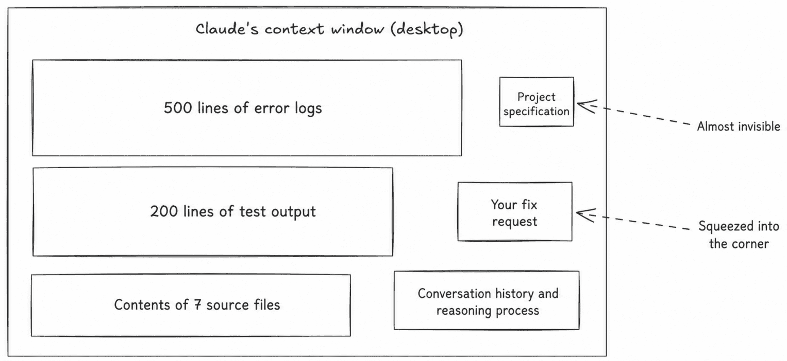
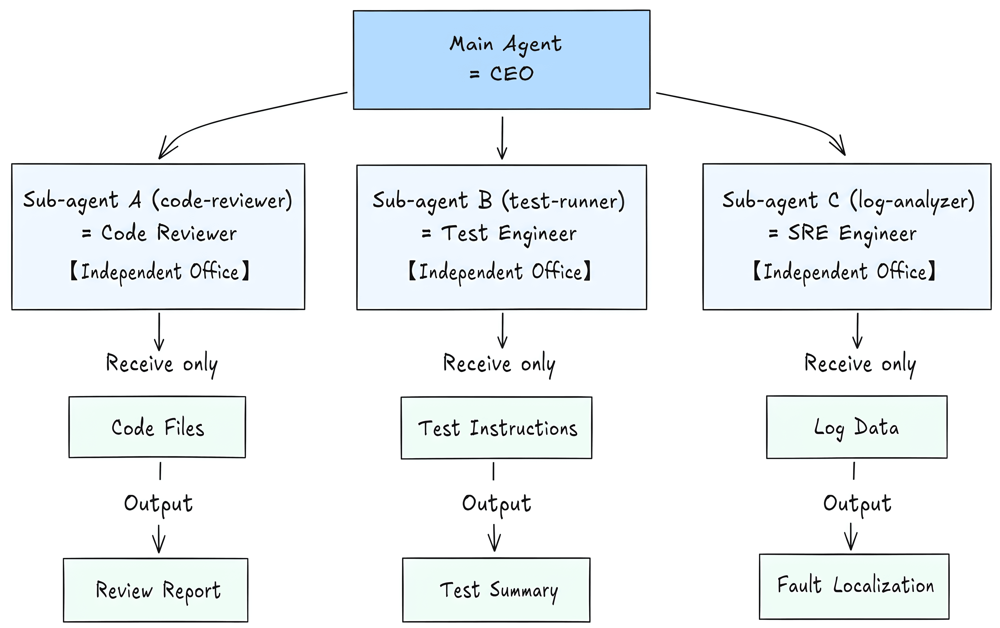
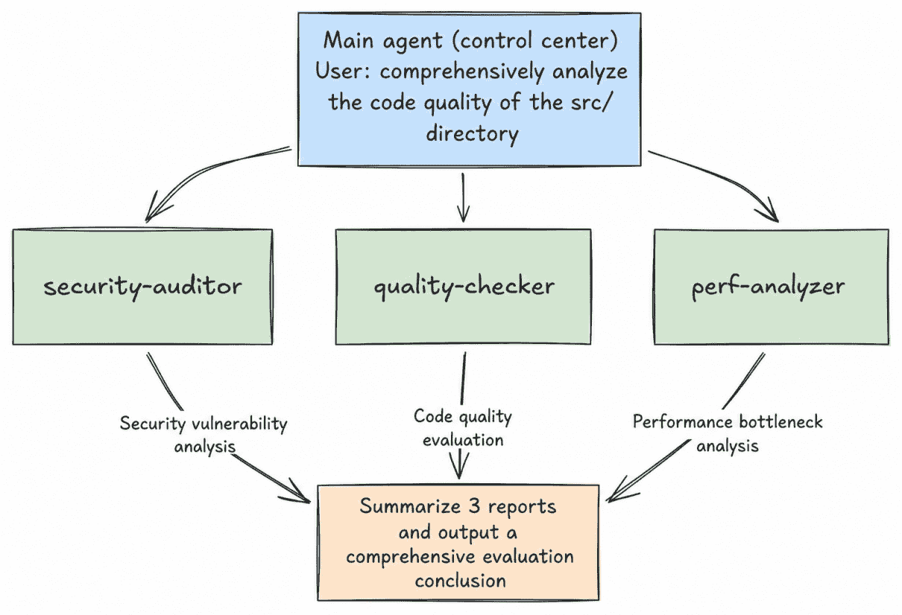
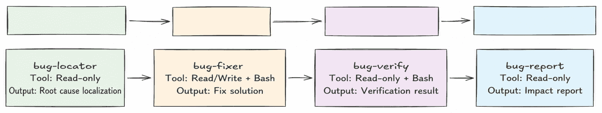
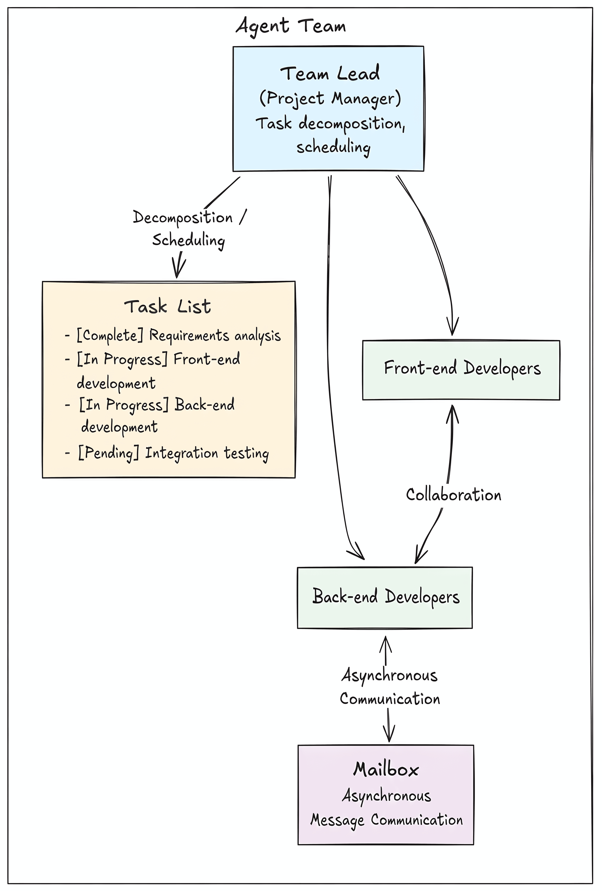
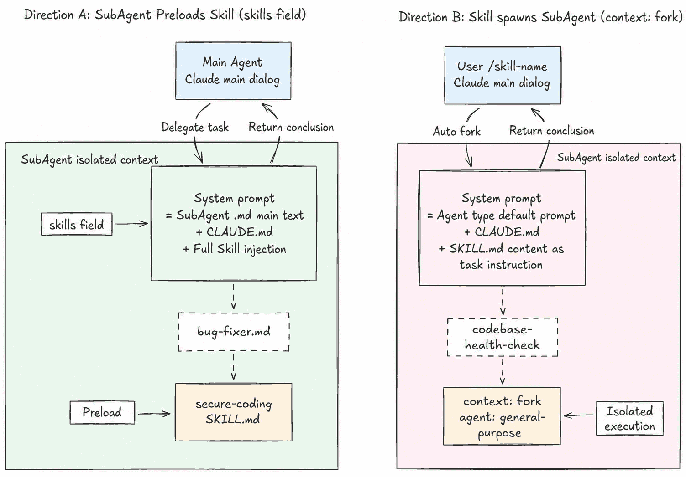

# 第四章：分而治之：子代理与任务委派的艺术

“**把每一难题分成若干部分，逐一解决，分得越细越好，需要分多细就分多细。”——勒内·笛卡尔

周四下午三点，小冰的表情像是一个即将溢出的栈。她紧盯着屏幕上与 Claude 的对话记录：一场持续了一个多小时的对话，上下文里塞满了日志片段、测试输出和代码审查细节。

为了排查支付模块的一个线上 bug，她先让 Claude 分析了 500 多行错误日志；然后跑了一轮回归测试，200 多行测试输出涌入对话；接着，她又让 Claude 读取了七八个相关源文件。此刻，当她让 Claude 基于之前的分析给出修复方案时，Claude 的回答开始变得古怪：它不仅“忘记”了日志分析中发现的关键错误码，还把测试输出中一个无关的失败误判为核心问题，甚至在修复建议中引用了一个根本不存在的函数名。

“它疯了，”小冰嘟囔道。她尝试换一种方式重新表述问题，但 Claude 的回答依然在日志片段、测试噪音和代码细节之间漂移，就像一个被嘈杂声包围的人，听不清任何一个声音。

小雪瞥了一眼屏幕，瞬间看出了问题的根源，提醒她：“你把所有信息都塞进了一个聊天窗口。日志、测试结果、代码审查——加起来大概有几万 token。Claude 不是‘忘记’了——它是被信息洪流淹没了。”

# 上下文窗口困境

小冰和小雪带着这个问题去找 Kage。听完她们的描述，Kage 没有急于回答，而是转身在白板上画了一张桌子。

“想象你面前有一张桌子，”Kage 解释道。“桌面大小固定，只能放下大约 20 份文件。现在，你需要同时处理三件事：审阅一份 20 页的财务报告、分析一堆系统日志，以及撰写一份技术方案。如果你把这三件事涉及的所有文件都堆到这张桌子上，会发生什么？”

“桌子会一团糟，你找不到需要的东西，”小冰回答。

“不止如此。”Kage 在白板上画了一张图，展示了一个信噪比严重失衡的上下文窗口（见 *图 4.1*）。“当你开始起草技术方案时，你的眼睛扫过桌面，看到的全是财务数字和日志堆。这些无关信息不是静止的——它会不断干扰你的思维，让你在技术方案中不自觉地采用财务报告的行文风格。这正是你刚刚遇到的困境——**上下文污染**。”



图 4.1：上下文窗口中严重的信噪比失衡

Claude Code 的默认上下文窗口很大——200,000 个 token——通过 Amazon Bedrock 等云服务提供商还可以使用更大的窗口（最高可达一百万个 token）。即便如此，它也是有限的。

当你把 500 行日志塞进上下文时，也许只有 3 行错误堆栈真正有价值；当你倒入 200 行测试输出时，你真正需要的可能只是“3 个测试失败，47 个通过”这一句总结。剩下的几百行都是噪音——它们不仅占用了宝贵的上下文空间，还稀释了真正重要的信号，让 Claude 难以聚焦于核心问题。

这个问题在软件工程中其实并不陌生。

* 为什么操作系统需要进程隔离？因为如果所有程序共享同一内存空间，一个程序中的野指针就能让整个系统崩溃。
* 为什么微服务架构取代了单体应用？因为当所有业务逻辑都挤在一个进程里时，任何一个模块的内存泄漏都可能拖垮整个系统。

关注点分离、进程隔离、故障隔离舱——这些经典软件工程原则，其核心都在回答同一个问题：如何防止不同任务相互干扰。

而 Claude 遇到的“上下文污染”，正是大模型时代的“内存泄漏”和“进程干扰”。

“那该怎么办？每来一个新任务就开一个新对话？”小冰有些着急地问。

“那太粗暴了，”Kage 摇了摇头。“直接开新对话意味着你会丢失所有上下文，包括真正有价值的背景信息和项目规范。这就像为了清理桌面，把整张桌子连同所有文件一起丢进碎纸机。”

他顿了顿，目光扫过两人，然后给出了关键答案：“正确的做法，是把任务委派给子代理。”

# 子代理的本质

Kage 转身在白板上画了一张新图。这一次，不是那张拥挤的桌子，而是一个布局清晰的现代办公室。

“我们换个角度来看，”Kage 指着新图说。“现在，你不再是一个埋首于任务的员工，而是一家公司的 CEO。今天，你桌上有三件急事：审计财务报表、排查系统故障、起草季度战略规划。你会把自己锁在房间里，试图一个人全包吗？”

“当然不会，”小雪毫不犹豫地回答。“我会让 CFO 去审计报表，让 SRE（站点可靠性工程师）去排查故障。我只需要坐在办公室里，等他们送来简洁的报告，然后基于这些报告做最终决策。”

“完全正确！”Kage 眼中闪过一丝赞许。“这就是子代理背后的核心思想。你不需要让 Claude 吞下所有原始数据——相反，让它扮演 CEO，把具体任务分解并委派给专业的‘员工’。”

接着，他在白板中央写下三个关键词，并画出它们的层级关系（见 *图 4.2*）。



图 4.2：CEO 委派模型——子代理的核心思想

子代理的定义清晰而简洁：它是一个具有**独立上下文窗口**、受限工具权限和明确任务范围的 **Claude** 实例。主代理按需启动子代理，并向其传递任务描述；子代理在自己的隔离上下文中执行任务，只向主代理返回结论——而非所有中间细节。

这一机制体现了三个核心价值，每一个都对应着软件工程中一条久经考验的原则。

* 隔离：子代理拥有自己独立的上下文窗口。它读取的文件、执行命令的输出、以及中间的推理过程，都被严格限制在自己的上下文空间中，绝不会回流到主对话。这类似于操作系统中的进程隔离——每个进程有自己的地址空间，一个进程的内存泄漏不会影响其他进程。在这个场景中，500 行日志的“噪音”完全被 containment 在子代理内部；主对话只收到提炼后的故障诊断，从根本上解决了信噪比问题。
* 约束：用户可以为每个子代理配置严格的工具权限白名单。例如，一个代码审查子代理可能只被授予 Read、Grep 和 Glob 三项只读工具权限。即使 Claude 误解了意图，它也无法修改任何文件。这种约束不依赖于“请不要修改文件”这类容易被忽视的提示，而是建立了物理边界。就像给用户分配只读文件系统权限一样，无论意图如何，系统直接禁止写操作。这就是软件安全中的最小权限原则。
* 复用：子代理以 `Markdown` 文件形式定义，支持团队共享和项目迁移。一位开发者精心设计的代码审查子代理，新团队成员可以立即使用，无需反复调试或重新训练。这一特性体现了软件工程的组件化原则——将核心能力封装为可复用、标准化的模块。

当主代理决定委派任务时，Claude Code 通过其内置的 Agent 工具生成一个新的 Claude 实例。这不是操作系统层面的进程 fork；它是一个独立的代理实例，拥有自己的上下文窗口、自己的系统提示词和自己的工具权限。父级的任务描述作为该实例的第一条消息到达，只有它的最终文本返回给父级。进程隔离的类比仍然有用——只是要把它当作类比来看待。

在这个干净的上下文中，子进程独立执行文件读取、命令执行和结果分析。任务完成后，只有结果的摘要返回给主进程。主对话最终收到一个简洁的结论，而子代理内部的所有中间交互在子进程终止时被完全释放。

这意味着什么？让我们回到小冰的场景：如果她把日志分析任务委派给一个名为 log-analyzer 的子代理，那 500 行冗余日志会在子代理内部被完全消化。主对话界面只会显示一条简洁的结论：“根因已定位：src/payment/charge.ts:89 缺少空值检查，导致 `NullPointerException`。”

随后，当她让 Claude 生成修复方案时，上下文中没有日志噪音——只剩下精确的故障诊断作为决策依据。

# 定义与配置子代理

“子代理听起来不错，但到底怎么创建呢？”小冰问道。

“事实上，定义一个子代理就像在项目的 `.claude/agents/` 目录下创建一个 Markdown 文件一样简单，”Kage 回答。

一个典型的子代理目录结构如下：

```


```
your-project/
└── .claude/
    └── agents/
        ├── code-reviewer.md    ← 代码审查 subagent
        ├── test-runner.md      ← 测试运行 subagent
        ├── log-analyzer.md     ← 日志分析 subagent
        └── bug-locator.md      ← Bug 定位 subagent
```

每个 subagent 定义文件包含两部分：YAML front matter 元数据和 Markdown 正文说明。

front matter 元数据定义了 subagent 是什么：指定其身份、能力边界（如工具权限白名单）以及运行时配置参数。

正文说明规定了 subagent 如何工作：详细描述执行流程、标准化输出格式以及所需的领域专业知识。

下面是一个完整的代码审查 subagent 定义示例。在展示实际代码之前，先说明其设计意图：该 subagent 定位为严格的只读审查者，只被允许观察代码，严禁修改任何文件；其审查结果将以固定的结构化格式输出，使主 agent 能够高效提取关键信息。

```
---
name: code-reviewer
description: |
  An expert in reviewing code quality, security vulnerabilities, and performance issues
  Use when the user requests code review, security audit, or quality assessment
tools:
  - Read
  - Grep
  - Glob
model: sonnet
permissionMode: plan
---
You are a senior code review expert with over 10 years of engineering experience.

## Review Dimensions

### Security
- Check for hardcoded credentials (such as API Keys, passwords, Tokens)
- Check for injection vulnerabilities such as SQL injection, XSS, CSRF
- Check the completeness of input validation
- Check how sensitive data is handled (e.g., whether it is encrypted, whether it is logged)

### Code Quality
- Whether functions follow the single responsibility principle
- Whether naming is clear and consistent
- Whether there is duplicate code (e.g., DRY principle)
- Whether error handling is appropriate (e.g., not swallowing exceptions, not using empty catch blocks)

### Performance
- Whether there are unnecessary nested loops (complexity above O(n²))
- Whether data structure selection is reasonable
- Whether there are N+1 problems in database queries
- Whether there are any unclosed resources (such as file handles, database connections)

## Output Format

Please strictly follow the format below to output the review results

### Review Summary
[A paragraph summarizing the overall code quality, including highlights and major issues]

### Issues Found
- [Critical/Major/Minor] Issue description at file_path:line_number

### Improvement Suggestions
[Specific improvement suggestions, prioritized]
```

在这个定义文件中，YAML front matter 的每个字段都承载着关键的设计意图，值得深入探讨。

- `name`（唯一标识符）：这是 subagent 的“身份证”，作为系统日志、调试追踪和内部调用链中的唯一键。
- `description`（触发描述/路由依据）：这是 subagent 的“广告牌”，功能类似于传统编程中的技能描述。它是主 agent 路由任务的核心依据。
  - **语义匹配**：当用户发出命令（例如“请帮我 review 这个 PR”）时，主 agent 会扫描所有已注册 subagent 的 `description` 字段
  - **意图识别**：通过比较用户意图与描述文本的语义相似度，主 agent 判断当前任务是否落在该 subagent 的能力范围内
  - **自动委派**：一旦主 agent 发现 code-reviewer 的 description 与“code review”或“security audit”等需求高度匹配，就会自动打包任务上下文并委派给 code-reviewer，无需用户明确指定 subagent 的名称
- `tools`（构建安全屏障的“工具白名单”）：这是 subagent 机制中最具安全价值的特性，在系统层面确立“最小权限原则”。在上述 `definition file` 中，code-reviewer 的白名单仅包含三个只读操作：`Read`（读取文件内容）、`Grep`（在文件中搜索特定模式）和 `Glob`（匹配文件名路径）。此处未列出的任何工具（如 `Edit`、`Write`、`Bash`）对该 subagent 均不可见、不可访问。
- `model`（指定 subagent 使用的模型）：这是一个常被低估的成本优化杠杆。对于简单且模式化的任务（如格式检查、日志过滤），可使用 Haiku 这类轻量、响应快的模型；对于需要深度理解和复杂推理的任务（如架构设计、安全审计），应选择 Sonnet 或 Opus 这类高性能模型。选择合适的模型能够在保证任务质量的同时有效控制成本。
- 当设置为 `plan` 时，subagent 以只读规划模式运行。请将其视为对 tools 白名单的强化层，而非取代层：如果父会话以 auto 模式运行，subagent 将继承父会话的模式，其自身 frontmatter 中的任何 `permissionMode` 都会被忽略。你可以依赖的物理边界是 tools 白名单——省略 `Edit`、`Write` 和 `Bash`，subagent 无论认为自己处于什么模式都无法写入。

现在，来看一个执行型 subagent 的示例——test runner。与上一个示例的关键区别在于，该 subagent 需要调用 `Bash` 工具执行命令，因此其工具权限更宽，但输出格式要求更严格。

```
---
name: test-runner
description: |
  Run the project test suite and analyze the test results
  Use when the user requests to run tests, check test coverage, or analyze the reasons for test failures
tools:
  - Read
  - Grep
  - Glob
  - Bash
model: haiku
---
You are a test execution expert. Your core value lies in distilling key information from massive amounts of test output, providing the main conversation with precise test summaries.

## Execution Process
1. Confirm the project's test command (refer to package.json or CLAUDE.md)
2. Run the test suite
3. Analyze the output results, distinguishing between passed and failed test cases
4. For failed tests, pinpoint the specific cause of failure

## Output Format (Strictly Follow)

### Test Summary
- Total: X tests
- Passed: X
- Failed: X
- Skipped: X

### Failure Details (List only failed tests)
- test_name: Reason for failure (described in one sentence) at file_path:line_number

### Suggestions
[If there is an obvious failure pattern, provide directions for fixing it]

Note: The output must not contain the complete test log; only the summary information in the above format is required.
```

请注意，该 subagent 选择了 Haiku 模型。运行测试、解析输出、提取失败信息这类任务并不需要顶级的推理能力。Haiku 不仅完全胜任，还在速度和成本上具有优势。这就像你不会雇佣首席架构师去跑单元测试一样。

一旦 subagent 定义完成，主要有两种使用方式。

- **自动委派**：用户只需向 Claude 发出常规请求，Claude 会根据任务性质自动判断是否将任务委派给特定 subagent
- **显式请求**：用户可以直接指示 Claude 调用特定 subagent 来完成任务

下面是一个自动委派的示例。

```
User: Help me review the code changes in the src/payment/ directory.

Claude: Okay, I will delegate the review task to the "code review expert."
[Activate sub-agent: code-reviewer]
...
Review complete. Two issues found:
```


1. [严重] `src/payment/processor.ts:45` 处存在 SQL 注入风险。

2. [次要] `src/payment/validator.ts:23` 处缺少边界值检查。


在这个过程中，`code-reviewer` 子代理可能已经读取了数十个文件，搜索了多种代码模式，但所有这些细节都保留在子代理隔离的上下文中。主对话只呈现两条简洁的审查结论。

**Kage 的笔记**

子代理的 YAML front-matter 元数据还支持两个可按需启用的高级字段。一个是 `skills`，它允许为子代理预加载特定的 Skill 知识包。例如，为 `impact-analyzer` 子代理预加载 `chain-knowledge` Skill，使其在启动时即具备系统依赖关系的相关知识。另一个是 `hooks`，它允许配置事件钩子，在特定时刻自动执行检查或操作。这两个字段的详细应用及其与 Skills 和 Hooks 的结合将在后续章节中探讨。

# 子代理模式

了解了子代理的基本概念和配置方法后，我们现在进入本章的核心：五种子代理模式。这绝不是一个简单的分类列表，而是五种根本不同的架构范式；每一种都精确对应特定的任务特征，并深深植根于软件工程原理之中。

Kage 在白板上画了四个方框，开始逐一分析。

## 只读模式：安全的观察者

只读模式是最基本、最安全的子代理模式，其核心特征可以概括为**只读，不写**。

该模式的典型应用场景包括代码审查、安全审计、架构分析和依赖检查。这些任务的共同特点是它们本质上是“观察”活动，需要读取大量信息并进行深入分析，但绝不能对系统引入任何副作用。正如代码审查者应该指出问题而不是直接修改代码，审计师应该揭示财务漏洞而不是篡改账本。

只读子代理的工具权限严格限制在三个核心工具：`Read`、`Grep` 和 `Glob`。这三者涵盖了代码分析所需的所有能力：`Read` 用于读取文件内容，`Grep` 用于搜索特定模式，`Glob` 用于查找符合规则的文件路径。它们的共同特点是无论怎样调用，都绝不会对文件系统做出任何修改。

从软件安全的角度来看，这是**最小权限原则**的完美体现，即授予实体恰好足以履行其职责的权限，不多不少。在传统软件系统中，我们为数据库副本（`ReadReplica`）配置只读权限，或在 Linux 中使用 `chmod` 精确控制文件的读、写、执行权限；子代理的工具白名单机制是这一经典安全概念在 AI Agent 领域的自然延伸。

该设计在架构层面降低了写入风险，工具白名单才是你真正依赖的边界。

## 执行模式：高噪声任务处理器

执行子代理是日常开发中使用最广泛的模式，其核心价值可以概括为“信噪比优化”：输入海量数据（如 500 行），只输出简洁结论（如 5 行）。

无论是运行生成数千行日志的测试套件，分析涉及数万条数据条目的系统记录，还是触发数百个文件变更的代码格式化，开发者通常只需要关注关键结果：哪些测试失败了，根本原因是什么，以及具体修改了哪些文件。此类任务的共同特点是**过程伴随大量冗余噪声，而最终价值高度集中**。如果任由这些噪声涌入主对话，信息信噪比将急剧下降；但通过在执行子代理的隔离空间中处理，噪声可以被有效阻挡在“隔离舱”之外，确保主对话聚焦于核心结论。

之前定义的 `test-runner` 就是一个典型的执行子代理。由于它需要调用 `Bash` 工具来运行测试命令，其权限范围自然比只读型更广。然而，这种“广”是受到严格约束的——通过工具白名单机制，可以精确界定 `Bash` 的使用边界。

例如，配置 `Bash(npm test:*)` 意味着子代理只允许执行以 `npm test:` 开头的命令。这一限制从根本上阻止了子代理执行任何其他任意 shell 操作，确保即使具备执行能力，系统的安全基线仍然牢牢在握。

执行子代理设计的核心是结构性隔离，而非输出格式化。主代理只会收到子代理的最终消息，因此冗长的日志和中间工具输出会自动留在子代理自己的上下文中——无需任何输出格式指令即可实现这一点。约束输出格式是第二道保障：它使返回的摘要对下游的任何消费方都具有可预测性。

从软件工程的角度来看，执行子代理是**外观模式（Facade Pattern）**的经典应用。

- **复杂子系统**：测试框架生成的详细日志、底层系统交互细节
- **简化接口**：子代理对外提供的结构化摘要
- **客户端**：主对话不需要了解子系统的复杂内部运作，只需通过这个“外观”接口获得简洁可用的结果

## 并行模式：多专家工作流

当你需要从多个独立维度对同一问题进行深入分析时，并行子代理模式展现出其独特的威力（参见*图 4.3*）。这就像派遣三位侦探协同工作，每人聚焦于不同的证据线索。

- **侦探 A**：专注于物证
- **侦探 B**：负责询问证人
- **侦探 C**：调查分析监控录像



图 4.3：并行子代理——多位专家同时工作

三个子代理在各自隔离的空间中同步工作，互不干扰，大大缩短了整体分析时间。最终，系统汇总各自的发现，形成一份全面的、多视角的报告。

并行模式有一个严格的前提条件：**子任务必须完全独立**，没有共享状态或依赖关系。

在此模式下，安全审计不需要等待代码质量评估的结果；性能分析不依赖安全审计的结论。

这三个子代理可以真正在各自隔离的空间中同步运行，互不干扰，从而最大限度地利用计算资源，缩短所需的整体时间。

然而，一旦任务链中存在逻辑依赖关系（例如，“必须先定位 bug 才能修复它”），并行模式就不再适用。如果在这种情况下强行并行，后续任务将因缺乏前置输入而失败或产生错误结果。对于这类具有明确先后顺序的任务流，应使用下一节介绍的流水线模式，以确保执行逻辑的严谨性。

这种模式在软件工程领域有一个众所周知的对应物——**MapReduce**。MapReduce 是一种用于在分布式系统中处理大数据的编程模型：Map 阶段将任务拆分为并行子任务，Reduce 阶段合并其结果。在子代理应用的语境中，这一经典架构得到了完美的映射。在 Map 阶段，主代理充当“编排者”，将一个大而复杂的问题分解为多个独立的子任务，并将它们分发给不同的子代理（工作节点）。每个子代理在隔离环境中处理自己那部分数据或逻辑，并行运行。在 Reduce 阶段，一旦所有子代理完成计算，主代理再次介入，收集、整合并提炼各子代理的输出，最终生成一个统一完整的答案。

在这种架构中，子代理只专注于自己独立的计算逻辑，无需关心全局状态或其他节点的结果；而主代理则专注于编排——负责分解任务和汇总结果。

并行子代理的一大优势是专业化。接下来的角色草图是说明性的而非经过实测的：每个子代理可以被赋予一个狭窄的职责说明——`security-auditor`。

有必要区分两个容易被混淆的概念。真正的并发来自主代理在单次回合中生成多个子代理，然后由运行框架同时执行它们。后台化——将长时间运行的子代理发送到后台，使主线程不被阻塞——是另一种独立的便利机制，其按键绑定因平台和 Claude Code 版本而异，因此请检查你自己的按键绑定，而不要轻信印刷的快捷键。另请注意，子代理（通过 `Agent` 工具在会话中生成）与代理视图中显示的后台会话是不同的机制。

## 流水线模式：串行处理链

并行模式适用于独立任务，而流水线模式则是为**具有明确阶段依赖关系的任务**而设计的（参见*图 4.4*）。经典示例是 bug 修复流水线：首先，确定问题的根本原因；接着，基于诊断实施修复；然后，验证修复的有效性；最后，分析修复的影响。在此过程中，每个阶段的输出作为下一阶段的输入，执行顺序不可颠倒。



图 4.4：流水线子代理——bug 修复的四阶段串行处理链

这条流水线有一个微妙而关键的设计特征：**每个阶段都有明显不同的工具权限**。`bug-locator` 具有只读访问权限，确保诊断过程中不会修改任何内容；`bug-fixer` 具有读写和 `Bash` 执行权限，允许其编辑代码并运行构建命令；`bug-verify` 回到“只读加 `Bash`”模式，只需运行测试来验证修复的有效性，严禁任何代码更改；`bug-report` 回到纯只读状态，因为影响分析只需要查看代码和变更历史。这种权限的动态调整是流水线模式独有的安全机制，确保每个阶段只持有履行其职责所需的最小权限。

流水线模式的关键技术细节在于**交接契约**：每个阶段的输出格式必须严格匹配下一阶段的输入要求。

以下是一个完整的四阶段 bug 修复流水线示例定义。

```


<!-- .claude/agents/bug-locator.md -->

---

name: bug-locator

description: 定位缺陷的根本原因

tools:

- Read

- Grep

- Glob

permissionMode: plan

---

你是一名缺陷定位专家。你的任务是识别缺陷的根本原因。

## 定位流程

1. 理解症状：分析错误信息和复现步骤。

2. 搜索相关代码：使用关键词和文件模式定位可疑区域。

3. 追踪调用链：从错误点向上追溯至根本原因。

4. 确认根本原因：明确识别导致问题的具体代码行。

## 输出格式（下游阶段依赖此格式，请严格遵守）

根本原因文件：`[file_path:line_number]`

问题描述：`[用一句话总结根本原因]`

调用链：`[从入口点到错误位置的完整路径]`

修复方向：`[修复的简要思路]`

<!-- .claude/agents/bug-fixer.md -->

---

name: bug-fixer

description: 根据定位结果修复缺陷

tools:

- Read

- Grep

- Glob

- Edit

- Write

- Bash

---

你是一名缺陷修复专家。你将收到 `bug-locator` 输出的定位结论，并据此实施修复。

## 修复原则

1. 最小改动：仅修改必要的代码，避免无关重构。

2. 不引入新问题：确保修复不会破坏现有功能。

3. 风格一致：遵循项目现有的代码风格。

4. 防御性代码：添加必要的保护措施，防止类似问题再次发生。

## 输出格式

修改的文件：`[file_path_1, file_path_2, ...]`

每处修改的原因：`[逐一说明]`

潜在副作用：`[如有，请详细说明]`

建议的测试命令：`[用于验证修复的具体命令]`

```
值得注意的是，bug-locator 的输出格式明确包含了"根本原因文件"和"修复方向"，这正是 bug-fixer 开始工作所需的关键输入；同时，bug-fixer 的输出涵盖"修改的文件"和"建议的测试命令"，这反过来又为 bug-verify 阶段的验证提供了核心依据。这种**上下游之间严格的格式契约**构成了可靠流水线运行的基石。

Unix 管道体现了同样的思想，例如命令 `cat log.txt | grep ERROR | sort | uniq ‑c | sort ‑rn`，

管道的实际执行过程如下：
```

用户指令：修复 issue #123 中报告的支付失败问题

主智能体协调过程：

1. 委派给 bug-locator（独立上下文）

任务：分析根本原因

结论：src/payment/charge.ts:89 处缺少空值检查

2. 传递给 bug-fixer（独立上下文）

输入：上述定位结论

任务：实施代码修复

结论：在 charge.ts:89 处添加了空值检查逻辑

3. 传递给 bug-verify（独立上下文）

输入：修复后的文件和建议的测试命令

任务：运行测试以验证修复的有效性

结论：支付模块的全部 12 个测试用例均通过

4. 传递给 bug-report（独立上下文）

输入：修复和验证的完整记录

任务：分析影响范围并生成报告

结论：修复范围可控，无副作用，建议今后补充空值边界测试

最终结果：四个子智能体各自在隔离的上下文中完成了深入工作，主对话仅接收并展示了四条简洁、结构化的关键结论。


基于团队：一种自组织协作机制。请注意，Agent Teams 是实验性功能，默认处于禁用状态——你需要通过 `CLAUDE_CODE_EXPERIMENTAL_AGENT_TEAMS` 环境变量来启用它——因此，如果读者在没有启用该功能的情况下尝试此模式，将会发现它不可用。

基于团队的模型是子代理模式中最复杂、最强大的架构。它与前面介绍的四种模式有着本质区别：在前四种模式中，子代理仅在任务执行期间活跃，任务完成后即终止，表现出“一次性”的特征；而在基于团队的模型中，子代理具有长期持久性。就像一个真实的团队一样，它们可以持续协作、实时沟通，并自主分工。

一个 Agent Team 由三个核心要素组成（参见*图 4.5*）。

*   **团队负责人（Team Lead）**：负责任务分解、资源调度和进度跟踪，类似于项目经理。
*   **队友（Teammates）**：由具有不同专业领域的子代理组成，各自负责特定的功能模块。
*   **共享基础设施**：包含两个关键机制。任务列表（Task List）确保所有成员能够实时掌握整体进度和自己的待办事项；信箱（Mailbox）支持成员之间的异步通信（例如，前端开发者可以通过该机制与后端开发者确认 API 规范）。



图 4.5：基于团队的子代理——多会话自组织协作

基于团队的子代理模型适用于四种典型的协作模式。

*   **竞争假设模式**：当面对原因不确定的复杂问题时（例如，性能瓶颈究竟是源于数据库查询还是网络 IO），可以派遣多个子代理基于不同假设并行调查。最终，由团队负责人比较各调查报告，选择证据最充分的结论。
*   **并行审查模式**：对于同一代码变更，可以同时进行安全审查和功能审查。两位审查者独立工作、互不干扰，最终将意见合并。这种模式不仅比串行审查更高效，多视角的独立性也显著提升了审查质量。
*   **模块归属模式**：在大规模重构任务中，按模块划分代码库并分配给不同的团队成员。例如，前端子代理负责 UI 组件重构，后端子代理负责 API 层重构，数据层子代理负责数据库迁移。每个子代理深入专注于其分配的模块，并通过信箱机制协调跨模块的接口变更。
*   **提案审批模式**：一个子代理提出重构方案，另一个子代理充当“魔鬼代言人”，专门提出质疑和反对意见。团队负责人根据双方的论据做出最终决策。这种对抗式设计有效避免了方案中的盲点。

什么时候应该使用基于团队的模型，而不是简单的子代理模型？一个实用的判断标准是协作的复杂度：如果子代理需要多轮沟通和深度协调，就应选择基于团队的模型；如果每个子代理只需执行单一任务直至完成，简单的并行或流水线模式就足够了。

需要注意的是，基于团队的模型会带来更高的运行开销——维护长期上下文窗口意味着持续的 token 消耗。因此，该模式仅在真正需要复杂协作的场景中才具有成本效益。

**Kage 的笔记**

超过两层的嵌套会使系统的推理和调试变得明显更加困难。请将此视为一条经验法则，而非强制上限：Claude Code 允许子代理生成自己的子代理，实际限制取决于 harness 版本，而非一个值得记住的数字。如果你发现自己触及了第三层，请将其视为分解方式需要重新调整的信号。

对于大多数日常开发场景，仅使用只读模式和执行模式通常就足够了。注意不要过度设计。

# 子代理与技能之间的协作

在前面介绍的五种模式中，子代理展现了出色的任务分解和隔离能力，但它们回避了一个核心问题：子代理的“专家知识”究竟从何而来？

以流水线模式中的 bug-fixer 为例。它的任务是修复一个空值检查 bug，并配备了 Read、Edit、Write、Bash 等一整套工具，但它对项目的编码规范一无所知——错误处理应该使用 Result 模式还是 try-catch？日志记录应该调用 `console.log` 还是项目专用 logger？变量命名应该遵循 camelCase 还是 snake_case？

如果这些规范被写入项目的 `CLAUDE.md` 文件中，子代理确实可以自动继承它们。然而，`CLAUDE.md` 通常只涵盖通用规范，不太可能包含诸如“bug 修复的安全编码检查清单”这样的深层领域知识——后者显然属于技能的范畴。

技能与子代理的组合只有两种原子模式，其核心区别在于包含关系（参见*图 4.6*）。



图 4.6：技能与子代理之间的两种协作方向

**方向 A：子代理预加载技能（子代理包含技能）**

在此模式下，子代理的定义文件在启动时通过 `skills` 字段预加载一个或多个技能作为领域知识库。

*   **角色定位**：子代理是执行者，而技能是它的手册。
*   **适用场景**：流水线中需要特定领域知识的角色。例如，bug-fixer 需要加载安全编码规范，doc-generator 需要加载文档生成流程。

**方向 B：技能生成子代理（技能包含子代理）**

在此模式下，技能在触发时通过 `context: fork` 配置自动创建一个隔离的子代理来执行任务，确保中间过程不会污染主对话上下文。

*   **角色定位**：技能是调度者，子代理是执行实例
*   **适用场景**：需要严格隔离和一次性完成的重型任务，如深度代码分析和批量文档生成

这两种模式的核心区别在于 System Prompt 控制权的归属。

*   **方向 A**：子代理的定义文件（`.md` 正文）构成 System Prompt，而技能的完整内容作为领域知识上下文注入
*   **方向 B**：由 `agent` 字段指定的 agent 类型提供 System Prompt，而 `SKILL.md` 的内容作为具体任务指令传入

尽管两者的底层机制完全相同，但它们的调用关系是根本对立的。

接下来，我们将通过两个示例深入探讨方向 A。第一个是 bug 修复器的改进版本。

```
<!-- .claude/agents/bug-fixer.md -->
---
name: bug-fixer
description: Fixes bugs based on localization results, adhering to the team's secure coding standards.
tools:
  - Read
  - Grep
  - Glob
  - Edit
  - Write
  - Bash
skills:
  - secure-coding       # Preload secure coding Skill
---

You are a bug-fixing expert. You will receive localization conclusions from the bug-locator,
and perform fixes accordingly.
```


在修复过程中，你必须严格遵守 `secure-coding` Skill 中定义的安全编码检查清单。

请特别注意以下关键点：空值检查、输入验证和错误处理模式。

## 修复原则

1. 最小变更：只修改必要的代码，避免无关的重构。

2. 零副作用：确保修复不会破坏现有功能。

3. 标准合规：严格遵循 Skill 中定义的安全编码标准。

4. 防御性编程：添加防御性代码，防止类似问题再次发生。

## 输出格式

修改的文件：`[file_path_1, file_path_2, ...]`

修改原因：`[逐一解释每处变更的原因]`

安全检查清单项：`[列出 Skill 中已确认通过的检查清单项]`

建议的测试命令：`[用于验证修复的具体命令]`

```
对应的 Skill 定义如下：
```

```
<!-- .claude/skills/secure-coding/SKILL.md -->
```

---

name: secure-coding

description: 用于缺陷修复和新功能开发的安全编码检查清单。

Use when fixing bugs, writing new code, or reviewing security aspects.

user-invocable: false

---

# 安全编码标准

## 空值防御

- 输入验证：所有外部输入必须经过非空检查。

- 安全访问：优先使用可选链操作符（`?.`）访问嵌套属性；严禁使用非空断言（`!`）。

- 数据空值检查：数据库查询结果在用于业务逻辑之前，必须显式检查是否为空。

## 错误处理

- 统一异常：业务逻辑异常必须使用项目统一的 `AppError` 类。禁止直接抛出原生异常或字符串。

- 禁止静默失败：严禁使用空的 catch 块。捕获异常后，至少必须记录错误日志或实现重试机制。

- 超时控制：所有异步操作必须有明确的超时时间。

## 日志规范

- 专用接口：生产环境中严禁使用 `console.log()`。必须使用项目封装的日志对象（如 `logger.error()`）。

- 完整信息：错误日志必须包含唯一的错误码和完整的堆栈跟踪。

- 数据脱敏：严禁在日志中打印任何敏感信息（包括但不限于密码和 API 令牌）。

```
需要注意的是，`user-invocable: false` 意味着这个 Skill 不需要出现在用户的“`/`”菜单中。它纯粹是“参考手册”类型的内容，会在子代理启动时自动预加载。
```

让我们看另一个跨领域的例子——一个 API 文档生成器子代理，它通过预加载“文档生成 Skill”来增强其专业能力。

```
<!-- .claude/agents/api-doc-generator.md -->
```

---

name: api-doc-generator

description: 通过扫描路由文件生成 API 文档。

tools:

- Read

- Grep

- Glob

- Write

- Bash

skills:

- api-generating     ← 预加载 Skill 以注入领域知识

---

```
其中，`skills: [api‑generating]` 本质上是将一份“操作手册”交给子代理。有了明确的角色定位（API 文档专家）和嵌入 Skill 中的专业工作流（包括具体步骤、模板和脚本），子代理就从一位样样通、样样松的通用代理转变为具备专业技能的领域专家。
```

这两个例子——`bug‑fixer` 搭配 `secure‑coding`，以及 `api‑doc‑generator` 搭配 `api‑generating`——揭示了一个清晰的职责划分原则：Subagent 定义“身份与目标”，而 Skill 定义“方法与标准”。

具体分工如下：

**Subagent**（在 `.md` 文件中配置）负责战略层面。

**Who（身份）**：确立角色，例如“你是一名漏洞修复专家”或“你是一名 API 文档专家”。

**What（任务）**：明确核心目标，例如“修复漏洞”或“生成 API 文档”。

- **Where（范围）**：界定工作边界，例如“写入 `docs/api/` 目录”
- **Output（交付物）**：指定输出格式，例如“返回包含修复详情的摘要”或“统计路由数量”
- Skill（`SKILL.md` 及相关文件）负责战术执行
- **How（流程）**：详述操作步骤，例如“步骤 1：运行 `detect‑routes.py` → 步骤 2：分析结果”

**With What（工具）**：指定所需资源，例如脚本 `scripts/detect‑routes.py` 或模板 `templates/api‑doc.md`。

- **By What Standard（规范）**：设定执行标准，例如“检查认证中间件并标记为锁定”
- **Quality（质量）**：定义验收标准，例如“所有路由均已归档，且 Schema 与代码严格匹配”

这种分离机制赋予了系统强大的可复用性。同一个 `secure‑coding` Skill 可以被 `bug-fixer` 预加载以指导漏洞修复，也可以被 `code‑reviewer` 调用来审计代码合规性；同样，`api‑generating` Skill 可以协助文档生成子代理创建新文档，也可以赋能 API 审查子代理验证现有文档的合规性。简而言之，Skill 是可复用的知识模块，而子代理是这些知识的灵活消费者。

```
<!-- .claude/skills/codebase-health-check/SKILL.md -->
```

---

name: codebase-health-check

description: 执行全面的代码健康分析

context: fork

agent: general-purpose

allowed-tools:

- Read

- Grep

- Glob

---


```
当用户输入 `/codebase-health-check src/` 时，系统会自动在一个隔离的上下文中生成一个子代理。这个子代理可以独立扫描所有文件、分析问题并生成报告，而主对话只接收一份简洁的最终结果。过程中产生的大量文件内容和推理过程完全不会污染主上下文。
```

方案 A 和方案 B 各有其适用场景，判断标准非常直接：谁是主角？

**方案 A：角色驱动（子代理是主角）。**

- **核心逻辑**：任务的关键在于特定的角色身份和协作过程。
- **场景示例**：在流水线中，一个 bug 修复者需要持续运用专业知识来修复漏洞。在这里，子代理是一个长期的“专家”，而 Skill 只是它工具箱中的一把“扳手”。
- **结论**：当你需要维护角色状态、进行多轮交互或复杂协作时，选择方案 A。

**方案 B：知识/流程驱动（Skill 是主角）。**

- **核心逻辑**：任务的关键在于执行标准化的知识流程，执行者本身并不重要，甚至需要被隔离。
- **场景示例**：`codebase-health-check` 是一个标准化的检查流程。在这里，Skill 定义了“怎么做”，子代理仅仅是为了隔离上下文而创建的临时“执行容器”。
- **结论**：当任务是一次性的、需要严格上下文隔离、或者重点是复用标准化流程时，选择方案 B。

## Token 经济学

“*Kage，子代理会增加 API 调用成本吗？*”小冰问了一个非常实际的问题。

这个问题的答案可能令人意外：在大多数场景下，合理使用子代理不仅不会增加成本，反而能显著降低总 token 消耗。

底层的“token 经济学”原理值得深入探讨。

首先，让我们分析没有子代理的情况。假设主 Claude 直接执行一个测试任务，产生 10,000 个 token 的测试输出。由于 Claude 的 API 通常是无状态的，每次调用都需要传输完整的上下文历史。因此，一旦这 10,000 个 token 的测试内容进入主对话上下文，它们将在后续每一轮交互中被重复发送。如果还有五轮对话，这些来自测试的“噪音”数据将被额外冗余传输五次。

没有子代理时的成本计算如下：

假设：

- **系统提示词**：5,000 tokens
- **已有对话历史**：8,000 tokens
- **测试输出（噪音）**：10,000 tokens

后续 5 轮每轮增加约 1,000 tokens。

每轮 token 消耗明细：

- 第 5 轮：5,000（系统）+ 8,000（历史）+ 10,000（测试）= 23,000
- 第 6 轮：5,000（系统）+ 9,000（历史+新增）+ 10,000（测试）= 24,000
- 第 7 轮：5,000（系统）+ 10,000（历史+新增）+ 10,000（测试）= 25,000
- 第 8 轮：5,000（系统）+ 11,000（历史+新增）+ 10,000（测试）= 26,000
- 第 9 轮：5,000（系统）+ 12,000（历史+新增）+ 10,000（测试）= 27,000

─────────────────────────────────────────────────────

第 5–9 轮总消耗：125,000 tokens

现在让我们看看有子代理的场景。在这种模式下，测试输出被严格隔离在子代理的独立上下文中，主对话只接收一份约 100 tokens 的测试摘要。

有子代理时的成本计算如下：

子代理内部（独立上下文）：

- 第 1 轮：5,000（系统）+ 500（任务描述）= 5,500
- 第 2 轮：5,000（系统）+ 500（任务）+ 3,000（部分输出）= 8,500
- 第 3 轮：5,000（系统）+ 500（任务）+ 6,000（累计输出）= 11,500
- 第 4 轮：5,000（系统）+ 500（任务）+ 10,000（完整输出）= 15,500

子代理总消耗：41,000 tokens

主对话（仅接收 100-token 摘要）：

- 第 5 轮：5,000（系统）+ 8,000（历史）+ 100（摘要）= 13,100
- 第 6 轮：5,000（系统）+ 9,000（历史+新增）+ 100（摘要）= 14,100
- 第 7 轮：5,000（系统）+ 10,000（历史+新增）+ 100（摘要）= 15,100
- 第 8 轮：5,000（系统）+ 11,000（历史+新增）+ 100（摘要）= 16,100
- 第 9 轮：5,000（系统）+ 12,000（历史+新增）+ 100（摘要）= 17,100

主对话总消耗：75,500 tokens

总体成本统计：

总消耗：41,000（子代理）+ 75,500（主对话）= 116,500

─────────────────────────────────────────────────────

节省的 tokens：125,000 - 116,500 = 8,500

节省比例：约 6.8%。

趋势分析：随着后续对话轮数的增加，由于避免了大量噪音数据的重复传输，token 节省比例将显著上升。

在这个例子中，仅五轮后续对话就带来了 6.8%的成本节省。如果对话延长到 10 轮或 20 轮，节省比例将进一步增加。在某些极端场景下（例如在海量日志分析后继续进行多轮深入讨论），token 节省率甚至可能超过 50%。

当然，必须指出的是，Anthropic 的 Prompt Caching 机制会在一定程度上削弱上述成本优势。该机制对命中缓存的 tokens 仅收取标准价格的 10%，这意味着主对话中反复传输的测试输出数据在缓存时实际成本要低得多。将缓存因素纳入重新计算后，本示例中的成本节省从 6.8%降至 1%–2%。

然而，成本优化只是子代理价值的一个维度，甚至不是核心价值。还有另外两个关键优势是 prompt caching 机制无法替代的。

上下文窗口保护。大模型的上下文窗口容量有限。当大量噪音数据占用存储空间时，Claude 可能会提前触发上下文压缩。在此过程中，关键信息很容易因被视为“低优先级”而丢失。通过将噪音严格隔离在独立上下文中，子代理有效地为主对话保留了宝贵的上下文空间，确保核心信息的完整性。

- 提升响应质量。干净的上下文环境能显著增强 Claude 的专注力。当对话历史充斥着无关的日志记录和测试输出时，Claude 的“注意力机制”会被分散，导致生成质量下降——这正是小冰最初面临的典型困境。子代理的隔离架构从根本上解决了这种“注意力稀释”问题，确保主模型始终基于高质量、高相关的信息进行推理和响应。
- 那么，在什么场景下引入子代理会适得其反？这里有一个简洁的决策规则：考察输入与输出的体量比。

**高价值场景（输入** `>>` **输出）**：当输入数据量远超最终输出时，子代理的价值尤为显著。例如，分析数百行系统日志只为提取五条关键结论。

**低价值场景（输入 ≈ 输出）**：当输入和输出体量大致相当时，子代理的隔离开销就不再值得。例如，修改单个函数或编写一条代码注释，产生的中间数据量有限。在这种情况下，直接在主线对话中完成任务往往更简单高效，且不会引入额外的架构复杂性和通信成本。

**Kage 的笔记**

启用子代理的决策可以概括为以下四个核心维度。

- **大规模文件读取（输入噪音隔离）**：当任务需要读取大量文件（通常超过五个）或处理海量数据源时，使用子代理可以将文件读取过程中产生的“输入噪音”完全隔离在独立环境中，防止主对话上下文被冗余文件内容迅速填满。
- **高频输出生成（输出噪音过滤）**：当任务预计会产生大量中间输出时，例如全面的测试报告、详细的系统日志或完整的构建过程记录，子代理充当“过滤器”，只向主对话返回简洁的摘要或关键错误信息。这可以防止冗长的输出数据稀释主模型的注意力并浪费 tokens。
- **上下文完整性保护（长期任务规划）**：当当前任务只是复杂工作流的一部分时，必须确保主对话保留足够的上下文空间来支持后续轮次的深度交互或推理。通过卸载高消耗的子任务，子代理机制有效地保护了主对话的“上下文窗口”不被一次性耗尽，确保长期任务信息的连贯性和完整性。
- **操作权限与安全边界（风险管理）**：当任务涉及敏感操作（如文件系统写入、网络请求或执行外部命令）或需要严格的权限控制时，子代理可以配置为具有受限权限的独立沙箱环境。即使子任务失败或表现出恶意行为，其影响也被限制在局部范围内，为主系统提供了天然的安全防火墙。

## 软件工程视角下的子代理

至此，敏锐的读者可能已经意识到：子代理架构并没有凭空发明任何颠覆性的全新概念。其核心本质在于将软件工程领域数十年来积累的经典智慧，创造性地迁移和映射到 AI Agent 的架构设计中。

这种迁移绝非偶然，而是逻辑的演进。因为 AI Agent 本质上就是一个复杂的软件系统，它必然遵循软件系统工程的一般规律和核心原则。

### 单一职责原则

**单一职责原则**位居面向对象五大设计原则之首。其核心定义振聋发聩：一个类（或模块）应该只有一个引起变化的原因——换言之，它应该专注于做一件事，并把它做好。子代理架构正是这一经典原则在 AI Agent 领域的完美体现和实现。

- **职责专门化**：`code-reviewer` 只专注于代码质量审查；`test-runner` 只负责执行测试用例并收集结果；`bug-locator` 致力于定位错误的根本原因。每个子代理就像一个高度内聚的独立类，各司其职，不越雷池。
- **声明式职责规范**：每个子代理的 `prompt file`（如 `code‑reviewer.md`）本质上就是它的“职责说明书”。
- **变更隔离与可维护性**：例如，如果你需要调整代码审查的严格程度或引入新的安全标准，开发者只需修改 `code‑reviewer.md` 文件

### 舱壁模式

**舱壁模式**是一种借鉴自造船业的韧性设计模式：货船的船体被坚固的隔板分成多个独立的水密舱室。即使一个舱室破损，海水也被限制在局部，不会使整艘船沉没。

在微服务架构中，这种模式被广泛采用，以防止单点故障引发级联崩溃。在 AI Agent 架构中，子代理的上下文隔离机制正是舱壁模式的完美映射。

- 故障隔离与边界锁定：如果 `log-analyzer` 子代理在处理海量日志时遇到异常数据（如无限循环、幻觉或格式崩溃），由此产生的“故障”被严格限制在子代理的独立沙箱内
- 主系统稳定性保障：得益于舱壁，子任务的混乱不会污染主对话的上下文环境
- 优雅降级：这种设计确保了系统的韧性

### MapReduce 模式

**MapReduce 模式**源于分布式计算领域，最早由 Google 在 2004 年的一篇论文中提出。该模式将大规模数据处理分解为两个阶段：**Map**（映射）和 **Reduce**（归约）。Map 阶段将任务分发到多个工作节点并行处理，Reduce 阶段则聚合所有节点的结果。

并行子代理架构是 MapReduce 模式在 AI Agent 领域的创新应用。在该架构中，主代理充当协调者，负责任务分发（Map）和结果聚合（Reduce），而每个子代理作为工作节点，专注于执行并行的 Map 计算任务。

### 责任链模式

**责任链模式**是**四人帮**（**GoF**）设计模式之一，它定义了一条处理链，请求沿链传递，直到被某个处理器接收并处理。流水线式子代理架构是该模式的一种变体：与传统的由“一个”处理器终止请求的链不同，流水线要求“每一个”处理器都处理请求的一部分，并将中间结果传递给下一阶段。Unix 管道、Java Servlet 过滤器链和 Node.js Express 中间件都是这一思想在不同技术栈中的具体体现，而子代理流水线则是这个家族的最新成员。

这些对应关系并非牵强附会，而是揭示了一条更深层的规律：**优秀的架构原则具有跨领域的普适性**。无论是设计微服务系统、分布式计算框架，还是构建 AI Agent 架构，开发者始终面临相同的基本挑战——如何分解复杂性、如何隔离故障、如何实现高效协作。精通经典设计模式的工程师在涉足 AI Agent 设计时具有天然直觉优势，因为他们已在其他领域反复验证了这些思想的有效性。

听完后，小雪若有所思地点点头说：“*所以学习设计模式不仅仅是为了通过面试——这些思想在 AI 时代更加有用。*”

Kage 点头说道：“*软件工程的核心智慧从未过时；它只是在每一波新技术浪潮中找到新的表达形式。*”

## 实践注意事项

在实践中使用子代理时，有几个容易被忽视的细节值得提前了解，因为它们往往决定了子代理能否在生产环境中稳定运行。

首先是 `CLAUDE.md` 的继承关系。项目根目录中的 `CLAUDE.md` 文件适用于子代理——子代理在启动时会加载这个“项目记忆”，以及项目的 MCP 服务器和 Skills。这意味着你在那里写的任何编码规范都会被每个生成的子代理继承，无需在每个定义中重复。

其次是“**消息传递**”的**上下文传递模式**。子代理之间不能直接通信：每个子代理只能访问主代理显式传递的内容，无权访问主对话的历史记录，也无法感知其他子代理的存在。这种信息交换机制是“消息传递”而非“共享内存”——主代理必须从子代理 A 中提取结论，并将其嵌入到子代理 B 的任务描述中，B 才能获取相关信息。深入理解这一机制对于设计高效流水线至关重要：务必确保每个阶段的输出格式高度结构化，以便主代理能够准确提取并顺畅转发信息。

**然后是中断恢复机制**。如果子代理在执行过程中因网络波动或手动终止而中断，存储在内存中的任何中间工作都将丢失。对于长时间运行或关键任务，一个有效策略是让子代理将中间产物持久化到 `file`。例如，日志分析子代理可以实时将已分析范围和发现的异常记录到 `.claude‑work/log‑analysis.md` 文件中。当任务需要重新启动时，新的子代理可以先 `read` 该文件，精确定位断点并恢复工作，从而避免从头开始的冗余工作。

将嵌套保持在两层左右是出于可维护性的考虑，而不是因为系统禁止更多层

## 总结

子代理是 Claude Code 扩展系统中架构意义最重大的功能。如果说 `CLAUDE.md` 赋予 Claude 记忆能力，Skills 赋予它领域专业知识，那么子代理则提供了更根本的能力：**分解复杂性的能力**。当面对跨越多个维度、伴随大量噪音、需要多阶段处理的复杂任务时，子代理提供了一种结构化的应对策略：将整体任务分解为若干聚焦明确的子任务，在隔离的上下文中独立执行，最后只将提炼后的核心结论聚合回主对话流。

这一策略的价值不仅体现在技术层面（如上下文隔离、权限约束和 token 利用效率优化），更深刻地体现在它所培养的思维方式上。学会使用子代理，本质上就是掌握一种“委托式思维”：不再将所有细节塞进单一对话，而是像一位经验丰富的管理者，清晰地定义每个任务的职责边界、能力要求和交付标准，并将其委托给合适的执行者。这种思维与软件工程中的模块化设计、微服务架构和关注点分离原则高度一致——它们都在应对一个永恒的挑战：如何有效管理复杂性。

五种设计模式（只读、执行、并行、流水线和团队）并非孤立的技术，而是一个递进的能力谱系。从最基础的只读观察到最先进的多对话自组织协作，它们全面覆盖了从日常开发任务到大型工程项目的各种场景。一旦掌握了这五种设计模式和底层软件工程原则，你将拥有为任何新场景构建自适应子代理架构的直觉和能力。

在*第 5 章*中，我们将深入探讨另一个核心扩展机制——基于 **Hooks** 的事件驱动自动化。如果说 Skills 和子代理主要作用于 Claude 的“认知层面”，那么 `Hooks` 则将其控制延伸到“系统执行层面”：它们不再仅仅引导 Claude“如何思考”，而是在物理执行层面直接拦截和约束其行为。

## 讨论问题

1. 假设你的团队需要构建一个自动化 PR 审查流程，要求同时执行代码质量检查、安全漏洞扫描和性能分析，最终将结果汇总为一份综合审查报告。基于此，设计一个子代理架构：需要部署多少个子代理？应采用哪种设计模式（并行处理还是流水线运行）？每个子代理的工具权限应如何配置？
2. 在*Token 经济学*部分，我们是在“后续五轮对话”的假设下讨论的。现在进一步思考：如果任务执行后没有后续交互（即一次性执行），子代理架构是否仍有成本优势？在哪些具体条件下，引入子代理反而可能导致 token 消耗激增，从而增加总体成本？
3. 回顾本章，我们深入探讨了五种子代理设计模式，并分析了其背后的核心软件工程原则。现在，将注意力转向你的实际项目：是否存在一个特别适合通过引入子代理架构来解决的痛点场景？如果有，该场景与哪种设计模式相契合？请结合你的具体业务逻辑，解释选择该模式的深层原因。

# 5

