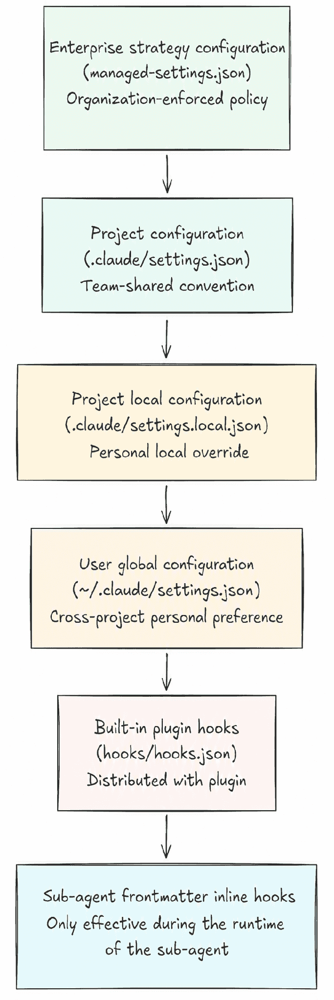
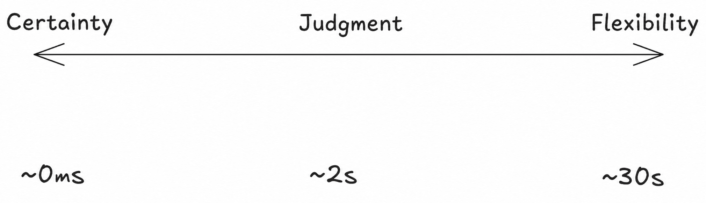
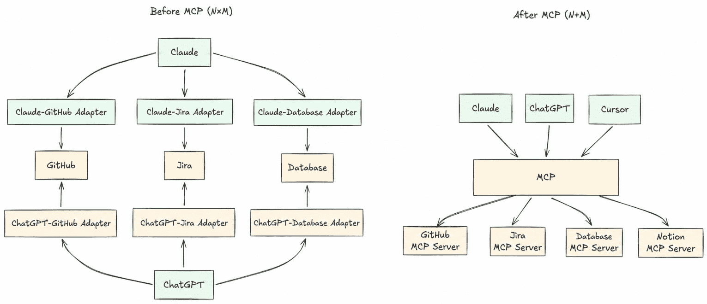
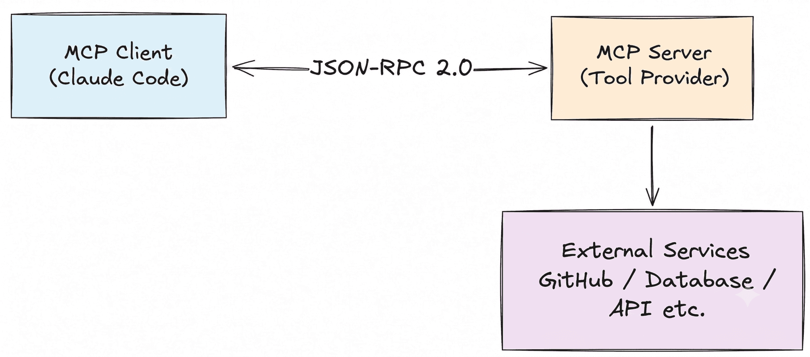
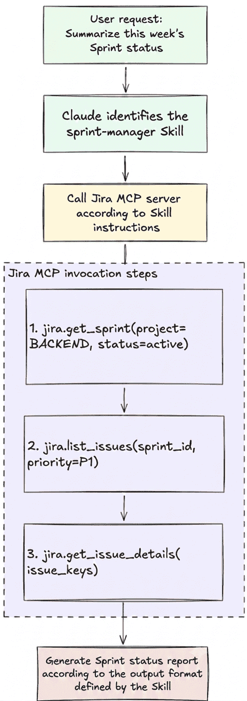

# 第五章：从指南到护栏：用 Hooks 实现自动化控制

“凡事预则立，不预则废。” —— 本杰明·富兰克林

公司出事了。

那是一个深夜。小张正在处理一个紧急需求。他用 Claude Code 编写代码，本地测试通过后，执行了 `git push` 将代码上传到远程仓库，然后关机回家休息。

第二天早上九点，团队聊天炸了：“*谁推送了* `.env` *文件？API key 已经暴露了。* *所有密钥必须立即撤销并重新签发！*”

小张很清楚 `.env` 文件绝不能提交，但由于熬夜工作疲惫，他在提交前疏忽了检查。然而，误提交的 `.env` 文件包含三个环境的数据库连接字符串、一个内部 API key，以及支付网关的测试账户密码。这个错误让整个团队花了半天时间来轮换密钥、审计访问日志并修复所有引用。

作为他的直属主管，小冰的第一反应是：“*这种错误本可以被自动拦截；* *为什么* *没有* *机制来防止它？*”

“*因为之前所有的机制都只是* *‘建议’* *Claude 该做什么，*”Kage 解释道。“`CLAUDE.md` *是建议，Skills 是引导，但从来没有人告诉 Claude，‘你绝对不能做这个。’* *Hooks 则不同：* *它们不是建议，而是强制执行。*”

小雪立刻接话道：“*就像 Web 开发中的中间件？请求通过之前先做检查？*”

“*正是。*”Kage 点点头。“*无论是 Express 中间件链、Django 的请求处理层，还是 Spring 的拦截器，它们的核心逻辑都是一样的：在操作执行前后插入额外的处理逻辑。Hooks 正是这一概念在 AI Agent 语境下的实现。*”

## Hooks 在 Claude 扩展系统中的角色

在深入技术细节之前，让我们先在目前已学习的扩展体系中定位 Hooks。

前四章介绍的三种机制构成了一个“影响力递增”的谱系：`CLAUDE.md` 建立项目规范，Claude 在每次对话开始时读取；Skills 封装领域工作流，可在 Claude 需要时自动或手动触发；子代理通过上下文隔离实现任务委托。

这三种机制有一个共同特点：它们都在 **Claude** 的认知层面运作。`CLAUDE.md` 告诉 Claude“遵循什么规范”，Skills 引导它“如何处理某些问题”，子代理指示它“将子任务委托给谁”。然而，这些本质上仍然只是建议性指导。作为一个语言模型，Claude 理论上能够忽略 prompt 中的任何约束。

Hooks 则在一个完全不同的层面运作。它们不作用于 Claude 的认知，而是在**系统执行层**直接拦截其行为。

当 Claude 尝试调用 Bash 工具执行 `rm ‑rf /` 时，`PreToolUse` Hook 不是“劝说”Claude 放弃该操作，而是在系统层面直接阻止该工具调用的执行，这意味着 Claude 的决定被强制覆盖，无法实施。

用软件工程的话来说，这种区别就是策略与机制的分离。`CLAUDE.md` 和 Skills 定义策略——应该做什么。Hooks 提供机制：当策略被违反时，命令本身在执行前就被阻止。注意这里被阻止的是什么。它不是 prompt，也不是用户试图达成的任务；而是单个工具调用。正如操作系统中的文件权限管理不依赖于应用程序自我约束，Hook 对 Claude 的约束也不依赖于 prompt 中的引导。

*表 5.1* 从四个维度比较了 `CLAUDE.md`、Skills 和 Hooks 的差异。

| **认知层** | | **CLAUDE.md** | | **Skills** | | **Hooks** |
| --- | --- | --- | --- | --- | --- | --- |
| 认知层 | | 执行层 | | 触发方式 | | 始终加载 |
| --- | --- | --- | --- | --- | --- | --- |
| 语义匹配/显式触发 | | 事件自动触发 | | 约束性质 | | 建议 |
| 引导 | | 强制 | | 对 Claude 的控制 | | 引导行为 |
| 治理工作流 | | 拦截/阻止 | | 类比 | | 交通标志 |
| 驾驶手册 | | 路障/限速器 | | 变量 | | 范围 |

表 5.1：`CLAUDE.md`、Skills 和 Hooks 的差异

就像这样：交通标志（`CLAUDE.md`）告诉你“此处限速 60 公里/小时”，驾驶手册（Skills）教你“弯道减速”，而路障/限速器（Hooks）则从物理上阻止你的车达到 120 公里/小时。最好的效果来自三者结合使用：交通标志让你意识到规则，手册教你如何操作，路障/限速器确保即使你忘记规则或判断失误，系统仍能守住安全底线。

## 事件生命周期：二十多个事件

Claude Code 事件系统从早期版本的 7 个事件发展到如今的二十多个，并且几乎每个版本都在持续增长。与其给出一个在你阅读时已经过时的数字，不如查阅官方 hooks 参考文档获取实时列表。重要的是分类：会话级事件、工具调用事件、子代理事件、完成事件，以及一长串较新的事件（`Setup`、`PermissionDenied`、`PostToolBatch`、`PreCompact`、`TaskCreated`、`FileChanged`、`Elicitation` 等）。你不需要记住它们；你需要的是分组逻辑和每组的特点。

### 会话级事件

会话级事件管理整个对话的生命周期，主要包括以下三个关键节点。

#### SessionStart

在会话启动或恢复时触发。其核心能力是通过 `CLAUDE_ENV_FILE` 注入环境变量。Hook 脚本可以将 export 语句写入该文件，使变量对所有后续 `Bash` 命令生效。这意味着你可以在会话开始时自动配置开发环境。参见以下代码示例。

```


```bash
#!/bin/bash

# session-init.sh — SessionStart Hook

if [ -n "$CLAUDE_ENV_FILE" ]; then
    echo 'export NODE_ENV=development' >> "$CLAUDE_ENV_FILE"
    echo 'export DEBUG_LOG=true' >> "$CLAUDE_ENV_FILE"
fi

exit 0
```

### SessionEnd

在会话结束时触发。其匹配器可以区分不同的终止原因：`clear`（用户清除）、`logout`（登出）或 `prompt_input_exit`（用户退出输入）。此事件通常用于清理临时资源或记录会话统计信息。

### PreCompact

在上下文压缩之前触发。其匹配器可以区分手动（用户发起的 `/compact`）和自动（上下文窗口已满时的自动压缩）。此事件适用于在压缩前备份完整的对话记录。

## 工具调用事件

这是最关键的一类事件，涵盖了 Claude 每次工具调用的整个生命周期。工具调用事件主要包含以下五个关键节点。

### PreToolUse（整个 Hooks 系统中最强大的事件）

在 Claude 决定调用工具之后、工具实际运行之前触发。其 `permissionDecision` 可以为 allow（跳过权限检查并运行）、deny（阻止调用并给出原因）、ask（将决定权交给用户）或 defer（交由正常权限流程处理）。参数重写是一个独立机制，而非第四种决策：在 `hookSpecificOutput` 下放置一个 `updatedInput` 对象，工具便会使用你提供的参数运行。

“调整输入参数”的能力尤其强大：它允许你在不中断操作的情况下，静默地为命令添加安全参数。请参见以下代码示例。

```
{
  "hookSpecificOutput": {
    "hookEventName": "PreToolUse",
    "permissionDecision": "allow",
    "updatedInput": {
      "command": "rm -rf /tmp/test --dry-run"
    }
  }
}
```

在上面的示例中，原本危险的命令 `rm ‑rf /tmp/test` 被静默修改为 `rm ‑rf /tmp/test ‑‑dry‑run`，让 Claude 能够继续完成任务，同时避免实际删除文件的风险。

### PostToolUse

在工具运行之后触发。它无法撤销已经发生的事情，但有两个核心用途：通过 `additionalContext` 向 Claude 反馈额外信息（例如 lint 结果），以及对结果进行后处理（自动格式化刚刚写入的文件）。它还可以通过返回 `updatedToolOutput` 字段直接替换工具的输出。这适用于任何工具，而不仅仅是 MCP 工具。

### PostToolUseFailure

在工具执行失败后触发，主要用于错误告警和提供纠错反馈。

### PermissionRequest

在权限对话框即将出现时触发。与 `PreToolUse` 的关键区别在于时机：`PreToolUse` 在每次工具调用前无条件触发，而 `PermissionRequest` 仅在 Claude 需要用户手动确认权限时才会激活。通过此事件，你可以以编程方式批准或拒绝权限请求。请参见以下代码示例。

```
{
  "hookSpecificOutput": {
    "hookEventName": "PermissionRequest",
    "decision": {
      "behavior": "allow",
      "updatedPermissions": {}
    }
  }
}
```


### UserPromptSubmit

在用户提交输入后、Claude 开始处理前触发。此事件通常用于输入预处理或上下文注入场景。例如，在用户每次发送消息时自动追加当前 Git 分支信息。

## Subagent 事件

Subagent 事件可与*第* *4* *章*介绍的 subagent 机制配合使用。

### SubagentStart

在 subagent 启动时触发。其 matcher 可根据 subagent 的类型名称进行过滤，既支持内置类型（如 Bash、Explore、Plan），也支持定义在 `.claude/agents/` 目录下的自定义 subagent（如 code-reviewer）。虽然 `SubagentStart` 无法阻止 subagent 启动，但它通过 `additionalContext` 在运行时注入关键上下文信息。例如，每次 code-reviewer 启动时自动加载团队的编码规范。

### SubagentStop

在 subagent 完成任务后触发。其行为逻辑与全局 Stop 事件完全一致：你既可以放行停止操作，也可以拦截请求，强制 subagent 继续工作，直到满足特定质量标准。此外，`SubagentStop` 的输入数据包含两个关键路径：`transcript_path`（主会话记录）和 `agent_transcript_path`（subagent 自身的对话记录）。借助这些信息，Hook 脚本可以审查 subagent 的完整工作流程，从而精确评估其输出质量。

## 完成事件

### Stop

在 Claude 完成一个完整响应周期时触发。这是实现“质量门禁”的核心机制：如果输出不符合预设标准（如编码规范、安全策略等），你可以通过设置 decision: "block" 阻止会话结束，强制 Claude 继续修改或完善工作，直至满足要求。

### Notification

在 Claude 发送系统通知时触发。其 matcher 可以精确区分不同类型的通知，如 `permission_prompt`、`idle_prompt` 或 `auth_success`。此事件常用于集成自定义通知渠道——例如，将关键告警转发到 Slack 或 Discord，或触发本地桌面弹窗提醒。

## 较新的事件类型

2025 年至 2026 年间，Claude Code 扩展了其事件系统，新增了若干关键事件类型，以支持更复杂的协作与运维场景。

### TeammateIdle 与 TaskCompleted

专为多 agent 团队协作（Agent Teams）而设计。前者在队友 agent 即将进入空闲状态时触发，后者在任务被标记为完成时触发。

### ConfigChange

在配置文件发生变化时触发。此事件主要用于审计与合规，帮助开发者追踪设置变更历史，防止未经授权的配置修改。

### WorktreeCreate 与 WorktreeRemove

分别对应 GitWorktree 的创建与删除。通过拦截这些事件，用户可以为版本控制工作流自定义初始化设置（如自动安装依赖）或清理逻辑（如删除临时构建产物）。

## “能否被阻止”：最关键的维度

在所有 17 个事件中，“能否被阻止”是最根本的分类维度。它决定了一个事件是用于“控制流程”还是仅用于“观察与记录”。

可被阻止的事件包括 `PreToolUse`、`PermissionRequest`、`UserPromptSubmit`、`UserPromptExpansion`、`Stop`、`SubagentStop`、`TeammateIdle`、`TaskCreated`（退出码 2 会回滚任务创建）、`TaskCompleted`、`ConfigChange`、`PostToolBatch`、`PreCompact`（退出码 2 会停止压缩），以及两个 Elicitation 事件。

其余事件（如 `PostToolUse`、`Notification`、`SubagentStart` 等）均为只读。它们主要用于读取上下文、注入附加信息或触发副作用（如发送通知），但无法直接阻止或修改 Claude 的核心执行逻辑。

在日常开发与运维中，最常用的三个事件是：`PreToolUse`（工具执行前的守门员）、`PostToolUse`（工具执行后的质量守护者）和 `Stop`（任务完成时的质量门禁）。如果时间有限，优先掌握 `PreToolUse`、`PostToolUse` 和 `Stop`，就能构建起稳健的自动化闭环。

# 配置系统：6 个位置，6 种用途

Claude Code 的配置系统采用分层叠加机制，优先级自上而下递减。Hook 配置使用标准 JSON 格式，并严格遵循六层优先级架构（见*图 5.1*）。这种设计允许开发者根据作用范围灵活部署自动化逻辑。



图 5.1：Hook 配置的六个层级与作用范围

**项目配置**（`.claude/settings.json`）是团队协作的核心载体。一旦提交到 Git 仓库，所有成员在克隆项目时都能自动同步团队约定的安全检查与自动化规则。**本地项目配置**（`.claude/settings.local.json`）被 `.gitignore` 忽略，适用于需要覆盖团队默认配置的个人场景。**用户全局配置**（`~/.claude/settings.json`）用于管理跨项目的个人偏好，如自定义日志格式或桌面通知方式。

配置结构采用三级嵌套设计：事件类型 → matcher 分组 → Hook 处理器列表。参见以下代码示例。

```
{
  "hooks": {
    "PreToolUse": [
      {
        "matcher": "Bash",
        "hooks": [
          {
            "type": "command",
            "command": "./.claude/hooks/block-dangerous.sh",
            "timeout": 30
          }
        ]
      }
    ],
    "PostToolUse": [
      {
        "matcher": "Write|Edit",
        "hooks": [
          {
            "type": "command",
            "command": "INPUT=$(cat); FILE=$(echo \"$INPUT\" | jq -r
              '.tool_input.file_path'); prettier --write \"$FILE\""
          }
        ]
      }
    ]
  }
}
```

**matcher** 字段用于指定该组 Hook 所适用的工具范围。

*   `"Bash"`：匹配所有 Bash 调用
*   `"Write|Edit"`：匹配 Write 或 Edit 工具（管道符 `|` 表示逻辑“或”）
*   `"*"`：匹配所有工具

对于 `Stop`、`Notification`、`UserPromptSubmit` 等生命周期事件，`matcher` 字段会被忽略，因为这些事件并不针对特定工具。而在 `SubagentStart` 或 `SubagentStop` 事件中，`matcher` 匹配的是 subagent 类型名称，而非工具名称。

# 三类处理器：确定性的阶梯

Hook 处理器共有五种类型。其中 command、prompt 和 agent 三种构成了一架确定性递减、灵活性递增的阶梯，选择哪一种取决于检查需要多严格。另外两种是集成接口，而非阶梯上的层级：http 将事件 JSON POST 到你控制的 URL，`mcp_tool` 则调用已连接的 MCP 服务器上的工具。`/hooks` 菜单列出了全部五种。

## Command 类型：确定性规则

此类型用于执行 shell 命令或脚本。作为最常用、最可靠的类型，确定性规则总是比大模型做出的判断更值得信赖。参见以下代码示例。

```
{
  "type": "command",
  "command": "./.claude/hooks/check-security.sh",
  "timeout": 30
}
```


命令类型的 Hook 通过 `stdin` 接收 JSON 格式的上下文数据（包括 `session_id`、`tool_name`、`tool_input` 等），通过 `stdout` 输出 JSON 格式的决策，并通过退出码表达最终意图。

* `Exit code 0`：成功。系统将解析 `stdout` 中的 JSON 作为决策依据。
* `Exit code 2`：有意阻止。系统会将 `stderr` 的内容作为错误原因返回给 Claude。
* **其他退出码**：脚本错误。运行不会被中断，但失败不再是静默的——对话记录中会显示一个“`<hook name> hook error`”提示，附上 stderr 的第一行，完整的 stderr 则会写入调试日志。

`Exit code 2` 的设计至关重要，因为它严格区分了“有意阻止某个操作”与“脚本故障”。脚本故障不应妨碍正常工作流程——就像故障的烟雾报警器不应阻止人们进出建筑物一样。

## Prompt 类型：单次大模型评估

当验证逻辑需要一定程度的判断，但不需要执行多步操作时，建议使用 prompt 类型。该类型会调用一个轻量级大模型（通常是 Haiku）来评估当前情况。参见以下代码示例。

```
{
  "type": "prompt",
  "prompt": "Evaluate whether this code modification introduces
    security vulnerabilities. $ARGUMENTS",
  "model": "claude-haiku-4-5",
  "timeout": 30
}
```

其中，`$ARGUMENTS` 是一个占位符，在运行时会替换为 Hook 接收到的完整输入 JSON。大模型的响应必须遵循以下 JSON 格式。

允许操作的 JSON 格式：

```
{"ok": true, "reason": "The code modification is safe and
  does not introduce any known vulnerability patterns."}
```

拒绝操作的 JSON 格式：

```
{"ok": false, "reason": "Potential SQL injection risk detected: user input
  is concatenated directly into the query string without escaping."}
```

## Agent 类型：多轮智能验证

当验证逻辑需要实际检查代码文件、执行搜索或多步操作才能得出结论时，应使用 agent 类型。该类型会启动一个子代理，使其能够利用 Read、Grep、Glob 等工具进行多轮深入验证。参见以下代码示例。

```
{
  "type": "agent",
  "prompt": "Check whether all modified files have passed unit tests.
    Run the test suite and verify the results. $ARGUMENTS",
  "timeout": 120
}
```

agent 类型的子代理最多经过 50 轮对话/操作后必须返回决策。其响应格式与 prompt 类型相同，返回一个包含 `ok`（布尔值）和 `reason`（字符串）的 JSON 对象。

在选择 Hook 处理器类型时，应遵循降级原则：“尽可能使用 **command** 类型而非 **prompt** 类型，尽可能使用 prompt 类型而非 **agent** 类型”（参见*图 5.2*）。



图 5.2：三种 Hook 处理器类型的确定性与灵活性比较

确定性规则（如模式匹配、文件名检查和正则表达式）在速度和可靠性上始终优于大模型判断。只有当验证逻辑真正需要“理解能力”（语义分析）或“代码检查能力”（多文件上下文检索）时，才应考虑升级到 prompt 类型或 agent 类型。

# hookSpecificOutput：与 Claude 通信的协议

`PreToolUse` Hook 的输出格式在 2025 年经历了重大升级。早期版本使用顶层的 decision 和 reason 字段，而新版本建议使用嵌套在 `hookSpecificOutput` 对象中的 `permissionDecision` 格式。虽然目前两种格式都受支持，但新代码应遵循新规范。参见以下代码示例。

```
{
  "hookSpecificOutput": {
    "hookEventName": "PreToolUse",
    "permissionDecision": "deny",
    "permissionDecisionReason": "This command attempts to delete a
      protected system directory",
    "additionalContext": "Protected path patterns: /etc, /usr, /var"
  }
}
```

`permissionDecision` 支持四种可能的值。

* `allow`：绕过权限系统，直接执行。
* `deny`：阻止执行。
* `ask`：将决定权交给用户。
* `defer`：落入正常权限流程。

其中，`ask` 是一个微妙但实用的选项——它不会自动拒绝操作，而是传达“我不确定，让人类来决定”的态度。

`additionalContext` 字段适用于所有事件类型，其内容将被注入 Claude 的上下文。这一机制形成了高效的反馈回路。例如，`PostToolUse` Hook 可以使用 `additionalContext` 将代码静态分析（lint）结果反馈给 Claude。收到这些信息后，Claude 会自动修复问题，整个过程无需人工干预。

此外，所有事件都支持以下通用顶层字段。

```
{
  "continue": false,
  "stopReason": "Security violation detected, session terminated",
  "suppressOutput": false,
  "systemMessage": "Warning: This operation has been blocked by
    the security policy"
}
```

* `continue: false`：这相当于一个“紧急刹车”。无论当前处于哪个事件阶段，该设置都会立即终止 Claude 的处理。
* `systemMessage`：该字段的内容将直接显示给用户，不会传递给 Claude。

# 工程实践 1：安全防护体系

让我们回到本章开头提出的挑战性案例。现在，我们将使用 Hooks 构建一个完整的安全防护体系，通过以下三道防线来守护项目：危险命令拦截、敏感文件保护和全面操作审计。

## PreToolUse：危险命令拦截

第一道防线旨在拦截可能造成灾难的 Bash 命令。该脚本在设计上融入了几个关键细节。

* 调试信息输出到标准错误（stderr，即 `>&2`），而非标准输出（`stdout`）。这是因为 `stdout` 必须严格保留用于输出 JSON 格式的决策结果。
* 使用 `jq` 工具解析输入的 JSON 数据，避免脆弱的字符串手动匹配。
* 每次拦截操作都附有清晰具体的操作原因。

参见以下代码示例。

```
#!/bin/bash
# .claude/hooks/block-dangerous.sh
set -e

INPUT=$(cat)

# Extract the command (debug output goes to stderr)
COMMAND=$(echo "$INPUT" | jq -r '.tool_input.command // ""')
echo "DEBUG: Checking command: $COMMAND" >&2

# List of dangerous command patterns
DANGEROUS_PATTERNS=(
    "rm -rf /"
    "rm -rf ~"
    "rm -rf \$HOME"
    "> /dev/sd"
    "mkfs."
    ":(){:|:&};:"                         # Fork bomb
    "chmod -R 777 /"
    "git push --force origin main"
    "git push --force origin master"
    "git reset --hard origin"
    "DROP DATABASE"
    "DROP TABLE"
    "TRUNCATE"
    "curl.*| sh"                          # Dangerous pipe execution
    "curl.*| bash"
)

for pattern in "${DANGEROUS_PATTERNS[@]}"; do
    if [[ "$COMMAND" == *"$pattern"* ]]; then
        echo "BLOCKED: $pattern" >&2
        cat <<EOF
{
    "hookSpecificOutput": {
        "hookEventName": "PreToolUse",
        "permissionDecision": "deny",
        "permissionDecisionReason": "Intercepted dangerous command pattern: $pattern"
    }
}
EOF


```bash
exit 2
fi
done
echo '{"hookSpecificOutput":{"hookEventName":"PreToolUse","permissionDecision":"allow"}}'
exit 0
```

## PreToolUse：敏感文件保护

第二道防线聚焦于保护敏感文件免遭意外修改。此 Hook 的 matcher 配置为 `"Write|Edit"`，确保仅在文件写入或编辑操作时触发，从源头上阻断风险。请看以下代码示例。

```bash
#!/bin/bash
# .claude/hooks/protect-files.sh
set -e
INPUT=$(cat)
FILE_PATH=$(echo "$INPUT" | jq -r '.tool_input.file_path // ""')
if [ -z "$FILE_PATH" ]; then
echo '{"hookSpecificOutput":{"hookEventName":"PreToolUse","permissionDecision":"allow"}}'
exit 0
fi
FILENAME=$(basename "$FILE_PATH")
# Protected Filename Patterns
PROTECTED_FILES=(".env" ".env.local" ".env.production" "credentials.json"
"secrets.yaml" "secrets.json" "id_rsa" "id_ed25519")
# Protected Extensions
PROTECTED_EXTENSIONS=("pem" "key" "p12" "pfx")
# Protected Directories
PROTECTED_DIRS=(".git/" ".ssh/" "node_modules/")
# Check Directories
for dir in "${PROTECTED_DIRS[@]}"; do
if [[ "$FILE_PATH" == *"$dir"* ]]; then
        cat <<EOF
    {
      "hookSpecificOutput": {
      "hookEventName": "PreToolUse",
      "permissionDecision": "deny",
      "permissionDecisionReason": "Modifying files in protected directories is not allowed: $dir"
    }
}
EOF
exit 2
fi
done
# Check file names
for name in "${PROTECTED_FILES[@]}"; do
if [[ "$FILENAME" == "$name" ]]; then
        cat <<EOF
    {
      "hookSpecificOutput": {
      "hookEventName": "PreToolUse",
      "permissionDecision": "deny",
      "permissionDecisionReason": "Modifying sensitive files is not allowed: $name"
    }
}
# Check file extensions
exit 2
fi
done
EXT="${FILENAME##*.}"
for ext in "${PROTECTED_EXTENSIONS[@]}"; do
if [[ "$EXT" == "$ext" ]]; then
        cat <<EOF
    {
      "hookSpecificOutput": {
      "hookEventName": "PreToolUse",
      "permissionDecision": "deny",
      "permissionDecisionReason": "Modification of key files is not allowed: *.$ext"
    }
}
fi
done
echo '{"hookSpecificOutput":{"hookEventName":"PreToolUse","permissionDecision":"allow"}}'
exit 0
```

## PostToolUse：全面操作审计

第三道防线是全面操作审计。通过配置 `matcher: "*"`，该工具能够捕获并记录所有工具调用。在合规要求严格的企业环境中，这是不可或缺的机制，因为它清晰地回答了审计的核心问题：“Claude 何时对哪个目标执行了什么操作？”

```bash
#!/bin/bash
# .claude/hooks/audit-log.sh
INPUT=$(cat)
LOG_DIR="${CLAUDE_PROJECT_DIR:-.}/.claude/logs"
mkdir -p "$LOG_DIR"
LOG_FILE="$LOG_DIR/audit-$(date +%Y-%m-%d).log"
TIMESTAMP=$(date -Iseconds)
TOOL_NAME=$(echo "$INPUT" | jq -r '.tool_name // "unknown"')
TOOL_INPUT=$(echo "$INPUT" | jq -c '.tool_input // {}')
echo "[$TIMESTAMP] $TOOL_NAME: $TOOL_INPUT" >> "$LOG_FILE"
echo '{}'
exit 0
```

## 完整配置

通过将上述三个独立脚本整合到 `.claude/settings.json`，便构建起一套强健的纵深防御体系。具体配置如下。

```json
{
  "hooks": {
    "PreToolUse": [
      {
        "matcher": "Bash",
        "hooks": [
          { "type": "command", "command": "./.claude/hooks/block-dangerous.sh"
          }
        ]
      },
      {
        "matcher": "Write|Edit",
        "hooks": [
          { "type": "command", "command": "./.claude/hooks/protect-files.sh" }
        ]
      }
    ],
    "PostToolUse": [
      {
        "matcher": "*",
        "hooks": [
          { "type": "command", "command": "./.claude/hooks/audit-log.sh" }
        ]
      }
    ]
  }
}
```

这套配置建立起覆盖“事前拦截、事中保护、事后审计”的完整安全闭环：危险命令拦截 → 敏感文件保护 → 全量操作审计。通过这种组合机制，我们得以将过去依赖“人工谨慎”的脆弱流程，升级为“代码即法律”的自动化安全体系。正如本章开头案例所演示的，若第二层保护得以应用，小张的“悲剧”完全可以避免。

# 工程实践二：代码质量自动化

安全防护旨在“防患于未然”，而代码质量自动化则致力于“确保交付卓越”。本节的实践案例将深入探讨 `PostToolUse` 与 `Stop` Hook 的协同工作机制。

## PostToolUse：自动格式化

每当 Claude 写入文件时，系统将自动触发格式化工具。此 Hook 的精妙之处在于其实现了“关注点分离”：Claude 无需感知项目所采纳的具体格式规范，只需专注于编写代码逻辑，而格式化过程则在后台无缝完成。请看以下代码示例。

```bash
#!/bin/bash
# .claude/hooks/auto-format.sh
set -e
INPUT=$(cat)
FILE_PATH=$(echo "$INPUT" | jq -r '.tool_input.file_path // ""')
if [ -z "$FILE_PATH" ] || [ ! -f "$FILE_PATH" ]; then
    echo '{}'
    exit 0
fi
EXTENSION="${FILE_PATH##*.}"
case "$EXTENSION" in
    js|jsx|ts|tsx|json|md|css|scss|html)
        if command -v npx &> /dev/null; then
            npx prettier --write "$FILE_PATH" 2>/dev/null
            echo '{"hookSpecificOutput":{"additionalContext":"Formatted with Prettier"}}'
        fi
        ;;
    py)
        if command -v black &> /dev/null; then
            black "$FILE_PATH" 2>/dev/null
            echo '{"hookSpecificOutput":{"additionalContext":"Formatted with Black"}}'
        fi
        ;;
    go)
        if command -v gofmt &> /dev/null; then
            gofmt -w "$FILE_PATH" 2>/dev/null
            echo '{"hookSpecificOutput":{"additionalContext":"Formatted with gofmt"}}'
        fi
        ;;
    *)
        echo '{}'
        ;;
esac
exit 0
```

该脚本引入了使用 `-v` 命令进行环境检查。若未检测到已安装格式化工具，Hook 将静默跳过该步骤而非抛出错误。这体现了“优雅降级”的设计原则：Hook 自身的异常不应阻塞核心工作流的正常运行。

## PostToolUse：Lint 反馈循环

自动格式化保证了代码的“美观性”，而 Lint 检查则确保了代码的“正确性”。此方案的核心在于利用 `additionalContext` 将 Lint 检查结果反馈给 Claude，从而建立起“修改 → 检查 → 反馈 → 修正”的自动化闭环。请看以下代码示例。

```bash
#!/bin/bash
# .claude/hooks/lint-check.sh
set -e
INPUT=$(cat)
FILE_PATH=$(echo "$INPUT" | jq -r '.tool_input.file_path // ""')
if [[ "$FILE_PATH" == *.js || "$FILE_PATH" == *.ts || "$FILE_PATH" == *.jsx || "$FILE_PATH" == *.tsx ]]; then
    LINT_RESULT=$(npx eslint "$FILE_PATH" 2>&1) || true
    if [ $? -ne 0 ]; then
        ESCAPED=$(echo "$LINT_RESULT" | head -30 | jq -Rs '.')
        echo "{\"hookSpecificOutput\":{\"additionalContext\":\"ESLint found problems:\n${ESCAPED}\"}}"
    else
        echo '{"hookSpecificOutput":{"additionalContext":"ESLint check passed"}}'
    fi
else
    echo '{}'
fi
exit 0
```


```
该脚本引入了 `-v` 命令用于环境检查。如果检测到格式化工具未安装，Hook 会静默跳过而不是抛出错误。这体现了"优雅降级"的设计原则：Hook 本身的异常不应阻塞核心工作流的正常运行。
```

## Stop Hook：测试质量门禁

`Stop` Hook 是质量保障的一道防线：当 Claude 声称任务完成时，自动触发测试套件。如果测试失败，系统将阻止会话结束，强制继续修复。参见以下代码示例。

```
#!/bin/bash
# .claude/hooks/run-tests.sh
INPUT=$(cat)

# [关键机制] 防止无限循环：检查 stop_hook_active 标志
# 如果此标志为 true，说明已经发生过一次重试，此时必须放行以避免死锁
STOP_ACTIVE=$(echo "$INPUT" | jq -r '.stop_hook_active // false')
if [ "$STOP_ACTIVE" = "true" ]; then
    exit 0  # 终止拦截，允许 Claude 停止
fi

# 切换到项目目录
if [ -n "$CLAUDE_PROJECT_DIR" ]; then
    cd "$CLAUDE_PROJECT_DIR"
fi

# 检测项目类型并运行测试
TEST_PASSED=true
TEST_RESULT=""

if [ -f "package.json" ] && grep -q '"test"' package.json; then
    TEST_RESULT=$(npm test 2>&1) || TEST_PASSED=false
elif [ -f "pyproject.toml" ] || [ -f "pytest.ini" ]; then
    TEST_RESULT=$(pytest 2>&1) || TEST_PASSED=false
elif [ -f "go.mod" ]; then
    TEST_RESULT=$(go test ./... 2>&1) || TEST_PASSED=false
else
    echo '{"hookSpecificOutput":{"additionalContext":"No test framework detected"}}'
    exit 0
fi

if [ "$TEST_PASSED" = true ]; then
    echo '{"hookSpecificOutput":{"additionalContext":"All tests passed"}}'
else
    # 截取错误日志的前 50 行并转义
    TEST_ESCAPED=$(echo "$TEST_RESULT" | head -50 | jq -Rs '.')
    # 返回 block 决策，强制 Claude 继续工作
    cat <<EOF
{
  "decision": "block",
  "reason": "Test failed, please fix before stopping",
  "hookSpecificOutput": {
    "additionalContext": $TEST_ESCAPED
  }
}
EOF
fi
```

脚本中的 `stop_hook_active` 字段是防止系统陷入"无限循环"的关键。其逻辑类似于递归函数的终止条件。当 Stop Hook 执行失败时，如果系统尝试修复并再次触发 Hook，`stop_hook_active` 会被设置为 true。脚本检测到该标志后选择放行，从而打破循环——正如递归函数必须有终止条件，Stop Hook 也必须有明确的退出机制。如果没有这一检查，Claude 将陷入"修复 → 测试失败 → 再修复"的无限循环，无法自行脱身。

# Subagent Hooks：精准的上下文管理

在 *第 3 章* 中，我们了解到 Subagent 通过隔离上下文来实现任务委托。Hooks 系统为此提供了两个专用事件——**SubagentStart** 和 **SubagentStop**。但更关键的是第三个机制：在 Subagent 的 **Frontmatter** 中直接定义 **Hooks**。

## 全局 vs Frontmatter：精准性问题

假设你有一个名为 `db-reader` 的 Subagent，专门用于执行 SQL 查询。如果你需要审计它运行的每一条 Bash 命令，以防范 SQL 注入风险，那么在全局 `settings.json` 中配置 Hook 并非最佳方案。全局配置会不加区分地拦截所有 Bash 命令，包括编译代码、运行测试或安装依赖等与数据库无关的操作。这不仅浪费系统资源，还会大幅增加误报的风险。

更好的方案是在 Subagent 的 Frontmatter 中直接定义 Hook。参见以下代码示例。

```
HAS_ISSUES=$(grep -c "issue\|problem\|bug" "$TRANSCRIPT" || true)
HAS_SUGGESTIONS=$(grep -c "suggest\|suggestion\|recommend" "$TRANSCRIPT" || true)

---
name: db-reader
description: Read-only database analysis tool
tools: Read, Grep, Glob, Bash
hooks:
  PreToolUse:
    - matcher: "Bash"
      hooks:
        - type: command
          command: "./.claude/hooks/check-sql-injection.sh"
  Stop:
    - hooks:
        - type: prompt
          prompt: "Check whether the query results contain PII (such as names, email addresses, or phone numbers). If any are found, reply with ok: false and request that the data be desensitized."
---

You are a database analysis expert. Only execute SELECT queries; executing any SQL statements that modify data is strictly prohibited.
```

使用 Frontmatter 定义 Hook 的核心优势在于其**生命周期紧密绑定**：Hook 随 Subagent 的启动而激活，任务完成后自动清理。此外，配置与 Subagent 定义集成在同一文件中，可随 `.md` 文件一起分发。用户无需修改全局 `settings.json`，极大降低了配置复杂度。

## SubagentStart：自动注入上下文

`SubagentStart` Hook 的一个典型用例是在 Subagent 启动时动态注入团队规范。例如，每当 `code-reviewer` Subagent 启动时，系统可以自动注入团队的编码规范。参见以下代码示例。

```
{
  "hooks": {
    "SubagentStart": [
      {
        "matcher": "code-reviewer",
        "hooks": [
          {
            "type": "command",
            "command": "echo '{\"hookSpecificOutput\":{\"hookEventName\":\"SubagentStart\",\"additionalContext\":\"Team coding standards: use camelCase naming, maximum line length 100 characters, all public APIs must include JSDoc comments\"}}'"
          }
        ]
      }
    ]
  }
}
```

## SubagentStop：验证输出质量

`SubagentStop` Hook 可用于验证 Subagent 的工作是否达到要求标准。通过 `agent_transcript_path` 读取 Subagent 的完整交互记录，系统可以执行细粒度的质量验收。参见以下代码示例。

```
#!/bin/bash
# verify-review-quality.sh
INPUT=$(cat)
AGENT_TYPE=$(echo "$INPUT" | jq -r '.agent_type')
STOP_ACTIVE=$(echo "$INPUT" | jq -r '.stop_hook_active')

# 仅验证 code-reviewer Subagent
if [ "$AGENT_TYPE" != "code-reviewer" ]; then exit 0; fi

# 防止无限循环（如果当前处于 stop hook 触发阶段，则跳过）
if [ "$STOP_ACTIVE" = "true" ]; then exit 0; fi

TRANSCRIPT=$(echo "$INPUT" | jq -r '.agent_transcript_path')
if [ -f "$TRANSCRIPT" ]; then
    HAS_ISSUES=$(grep -c "issue\|problem\|bug" "$TRANSCRIPT" || true)
    HAS_SUGGESTIONS=$(grep -c "suggest\|suggestion\|recommend" "$TRANSCRIPT" || true)
    if [ "$HAS_ISSUES" -gt 0 ] && [ "$HAS_SUGGESTIONS" -eq 0 ]; then
        echo '{"decision":"block","reason":"Issues were found but no suggestions for fixes were provided. Please supplement each issue with an improvement plan."}'
        exit 0
    fi
fi
exit 0
```


这三层保护各有各的用途，共同构成一个完整的质量保障反馈闭环。

- **Frontmatter Hook**：负责内部自检，确保子代理问自己"我的输出完整吗？"
- **SubagentStart Hook**：负责外部注入，在启动时提供必要的上下文（"给它必要的背景信息"）
- **SubagentStop Hook**：负责外部验收，在结束时严格检查"它的工作是否达到要求标准？"

## 异步 Hook：后台执行，不阻塞

默认情况下，Hook 脚本是同步执行且阻塞的——Claude 会暂停当前工作流，直到脚本执行完毕并返回结果。对于快速的正则匹配检查，这几毫秒的延迟通常可以忽略不计；但对于运行测试套件、调用外部 API 或发送通知等耗时操作，同步阻塞会显著拖慢 Claude 的响应速度，影响用户体验。

为此，Claude Code 在 2026 年初引入了异步 Hook 支持。

```
{
  "type": "command",
  "command": "./.claude/hooks/run-tests-background.sh",
  "async": true,
  "timeout": 300
}
```

配置 `async: true` 后，Hook 将以非阻塞方式在后台运行。Claude 无需等待其完成，可以立即继续后续任务。异步 Hook 执行完毕后，其输出会在下一轮对话中自动传递给 Claude，供其参考或处理。

异步 Hook 有两个关键限制，决定了它的适用范围。

- **类型限制**：只有 `command` 类型的 `Hook` 支持异步执行。Prompt 类型和 agent 类型的 Hook 必须同步运行。
- **拦截能力限制**：异步 `Hook` 无法阻止当前操作。由于 Hook 一触发主流程就继续执行，异步 Hook 失去了在操作发生前进行干预的机会。

因此，异步 Hook 适用于"后处理"类任务，例如日志记录、异步通知、后台数据校验和非关键质量审计。它不适用于实时拦截的安全检查（如 SQL 注入防御或敏感信息过滤）。

## 环境变量与调试

### Hook 可用的环境变量

*表 5.2* 列出了 Hook 可用的环境变量，涵盖其作用域和核心用途。

| 核心用途 |  | 所有 Hook |  | 获取当前项目根目录的绝对路径 |
| --- | --- | --- | --- | --- |
| `CLAUDE_PROJECT_DIR` |  | 所有 Hook |  | 当前会话的唯一标识 |
| `CLAUDE_ENV_FILE` |  | 仅通知 |  | 包含具体的通知消息内容 |
| `CLAUDE_CODE_REMOTE` |  | 仅插件 Hook |  | 插件安装的根目录路径 |
| `CLAUDE_PLUGIN_ROOT` |  | 文件路径 |  | 作用域 |

表 5.2：Hook 可用的环境变量

### 三种调试技巧

调试 Claude Hook 脚本有三种核心方法：

1. **将调试信息输出到 `stderr`**：由于 `stdout` 保留用于输出 JSON 决策结果，所有调试信息必须重定向到 `stderr`。

   ```
   echo "DEBUG: Checking file $FILE_PATH" >&2  # Debug information
   echo '{"decision": "allow"}'                # JSON decision
   ```

2. **手动测试 Hook 脚本**：通过构造模拟输入直接验证脚本逻辑。

   ```
   echo '{"tool_name":"Bash","tool_input":{"command":"rm -rf /"}}' | ./.claude/hooks/block-dangerous.sh

   echo "Exit code: $?"
   ```


```
3. 使用 `claude --debug` 查看详细的 **Hook** 执行信息。

    调试模式会显示匹配到的 Hook 列表、每个脚本的执行时间以及返回的结果。

## 常见陷阱

使用 Hook 时有两个常被忽视的问题。

*   如果你的 shell 配置文件（如 `~/.zshrc` 或 `~/.bashrc`）中包含无条件的 `echo` 语句（例如用于显示欢迎信息），这些输出会污染 `standard output (stdout)`，导致 JSON 解析失败。解决办法是用 `[[ $- == *i* ]]` 条件判断包裹这些 echo 语句，确保它们只在交互式 shell 中执行。
*   直接编辑 `settings.json` 后，Hook 往往不会立即生效。这是因为 Claude Code 只在启动时捕获一次配置快照；运行时对文件的更改不会自动同步。要应用更改，用户需要在 **/hooks** 菜单中确认，或重启当前会话。

# 工程设计方法论

面对具体的自动化需求，设计 Hook 方案需要厘清以下三个核心维度：

*   **拦截时机（事件选择）**：操作前拦截用 `PreToolUse` 或 `UserPromptSubmit`；操作后反馈用 `PostToolUse`；完成检查用 `Stop` 或 `SubagentStop`；生命周期管理用 `SessionStart` 或 `SessionEnd`
*   **判断方式（类型选择）**：规则明确（如模式匹配或文件检查）用 command 类型；需要语义判断但输入足够用 prompt 类型；需要深度代码分析用 agent 类型
*   **配置范围（位置选择）**：团队统一规范配置在 `.claude/settings.json`；个人偏好配置在 `~/.claude/settings.json`；子代理专用检查配置在 Frontmatter

设计流程通常遵循“三步走”策略。

1.  先基于 `PostToolUse` 事件配置一个 `matcher:"*"` 的审计日志 Hook，观察 Claude 的实际工具调用模式，积累数天的真实操作数据
2.  基于审计数据识别高风险操作模式，设计针对性的 `PreToolUse` 拦截规则
3.  逐步收紧拦截规则，同时始终保留日志功能，确保任何误报都能快速追溯到根因

**Kage 的笔记**

Hook 是团队级基础设施，不是个人实验玩具。配置在 `.claude/settings.json` 中的 Hook 会应用到所有克隆该仓库的成员。如果成员因未知原因被意外拦截，会严重扰乱工作流并造成挫败感。因此，务必遵循以下准则：

*   提交 Hook 配置前，与团队充分讨论并达成共识。
*   每条拦截规则都必须包含明确的原因说明，告知用户被拦截的具体原因。
*   使用审计日志实时监控 Hook 触发频率，以便及时发现并纠正误报。

# 总结

Hook 填补了 `CLAUDE.md` 和 Skills 留下的空白：它们在工具即将运行的那一刻强制执行执行规则。其中一些规则是团队约定；另一些——拦截破坏性命令、拒绝触碰凭据文件——则纯粹是安全考量，即使在个人项目中也同样适用。作为 Claude Code 扩展机制中唯一位于执行层而非认知层的组件，Hook 不依赖 Claude 理解任何东西：脚本拦截调用。

二十多种事件类型覆盖了从会话开始到会话结束、从主对话到子代理的完整弧线；请查阅官方参考以获取当前列表。

三种处理器类型（command、prompt、agent）构成了“确定性递减、灵活性递增”的能力阶梯。选择原则是：先用 command，再用 prompt，最后用 agent。

支持在子代理的 Frontmatter 中配置内联 Hook，以实现比全局配置更精细的控制。

异步 Hook 的引入有效解决了长时间运行操作导致的阻塞问题。

从工程方法论角度看，Hook 的设计严格遵循“先观察，后控制”的原则：先用 `PostToolUse` 事件记录审计日志，深入分析真实工具调用模式和行为特征；再基于积累的数据洞察，设计针对性的 `PreToolUse` 拦截规则，确保策略的准确性和必要性。内置的 `stop_hook_active` 标志有效防止了 Hook 逻辑本身触发的无限递归调用。`Exit code 2` 被定义为表示“有意拦截”，将其与系统错误清晰区分，体现了异常处理和状态定义上的周全考虑。

Hook 的核心价值不在于“扩展能力边界”（让 Claude 做更多事），而在于“强化执行基础”（让 Claude 所做的一切更可靠）。它将那些“本应发生却常被遗忘”的关键检查（如敏感文件保护、代码格式化规范、测试验收流程）从基于自律的“软约束”升级为不可回避的系统级“硬约束”。开篇案例中提到的惨痛教训，本可以通过一个简单的 `PreToolUse` Hook 从根本上避免。

至此，我们已经深入剖析了 Claude Code 的内部扩展机制。在 *第 6 章* 中，我们将把目光转向外部，探索它如何连接到更广阔的外部世界：MCP。

# 讨论问题

1.  在日常开发工作流中，有哪些“本不该发生却偶尔因疏忽而发生”的错误？选择其中一个场景，设计一个完整的 Hook 方案：指定触发事件、Hook 类型、Matcher 配置规则，以及脚本需要检查的具体条件。
2.  Stop Hook 的“质量门”模式与 CI/CD 流水线中的自动化测试有何异同？在哪些场景下应优先使用 Stop Hook，在哪些场景下应优先使用 CI/CD？
3.  `PreToolUse` 具有拦截能力，而 `PostToolUse` 仅用于反馈。这种非对称设计的工程意义是什么？如果给 `PostToolUse` 赋予拦截能力（即撤销已执行操作的能力），可能会出现什么问题？
4.  请比较两种 Hook 配置方式：`global settings.json` 与子代理的 Frontmatter。在你的项目中，哪些 Hook 应放在全局配置中，哪些更适合定义在特定子代理的 Frontmatter 中？

# 6

# 连接一切：使用 MCP 集成外部工具

“没有人是一座孤岛，在大海里独踞；每个人都像一块小小的泥土，连接成整个陆地。”——约翰·多恩

技术评审会议接近尾声时，产品经理提出了一个看似简单的需求：“*让 Claude 分析一下上周 Jira 中所有 P1 级 bug 的分布规律吧。*”

小冰在心里快速盘算了一下：Jira 部署在公司内网，而 Claude 运行在 Anthropic 的云端服务器上。这两个世界之间天然存在一道网络隔离墙。要让 Claude 访问 Jira 数据，要么手动导出粘贴，要么写脚本抓取后喂进去，要么……

“*要么用 MCP，*”Kage 在她开口前就接了话，“*全称是 Model Context Protocol，模型上下文协议。*”

“*这个名字我在好几个地方见过，但一直没真正理解它解决的核心问题是什么，*”小雪插话道。

“*它解决的是 AI 与数据之间最古老的问题——如何实现安全、标准化的连接。*”Kage 在白板上画了两个圆圈，左边标注“Claude”，右边标注“Jira/数据库/API”，中间画了一条连接线。“*在 MCP 之前，这条线的两端每次都要重新搭建：GitHub 要对接 Claude，得写一个适配器；Jira 要对接 Claude，又得写一个。而如果你换了 AI 平台，所有适配器还得推倒重来。这本质上是一个 N×M 的复杂度问题。*”

小冰立刻领悟了：“*就像 USB-C 普及之前的充电线？每个设备都要配一根专用线，出门得带六七根？*”

“*没错。MCP 就是 AI 工具集成领域的 USB-C，*”Kage 点头。

# 从 N×M 到 N+M：标准化的力量

USB-C 的类比不只是修辞；在结构上，它精确映射了 MCP 所解决的核心问题。

想想 USB-C。在单一连接器胜出之前的那几年，笔记本电脑、手机和相机各自带着一堆互不兼容的接口和充电器，每一对搭配都需要专属的线缆。这个类比是对一段漫长历史的简化——USB 本身已经取代了更早一代的串口和并口——但问题的形态是准确的：

MCP 实现的正是完全相同的逻辑（参见*图 6.1*）。在 MCP 之前，每一个 AI 工具厂商和具体数据源的集成都需要开发并维护一个专用适配器。例如，要让 GitHub 接入 Claude 的代码，你需要开发一个 GitHub-Claude 适配器；要把同一个 GitHub 接入 ChatGPT，你又得开发一个 GitHub-ChatGPT 适配器。假设有 5 个 AI 客户端和 100 个数据源，理论上你需要维护 500 个独立适配器——这意味着每新增一个 AI 客户端或数据源，都会带来大量冗余的集成工作。



图 6.1：MCP 将 N×M 问题简化为 N+M 问题

MCP 的核心思想恰恰如此：定义一套通用标准协议。在这个架构中，每个 AI 客户端（如 Claude、ChatGPT 等）只需实现一次 MCP 客户端协议，每个数据源（如 Jira、GitHub、数据库等）只需实现一次 MCP 服务端协议。只要双方遵守这一标准，就能即插即用、互相连接，而无需为每一种组合编写针对性的适配器代码。

回到前面的例子，有 5 个 AI 客户端和 100 个数据源，采用 MCP 后，开发工作量从惊人的 500 次（5×100）降低到仅 105 次（5+100）。

AAIF 于 2025 年 3 月宣布将采用 MCP：支持首先落地在 OpenAI 的 `Agents SDK` 中，Responses API 和 ChatGPT 桌面应用将随后跟进

AAIF 由 Anthropic、Block 和 OpenAI 共同创立，各自贡献一个创始项目——分别是 MCP、goose 和 AGENTS.md——Google、Microsoft、Amazon Web Services、Cloudflare 和 Bloomberg 作为白金会员和支持者加入

官方 MCP SDK（Python 和 TypeScript）的月下载量超过 9700 万次，消除了 N×M 集成的痛点，这是一个迫切的、全行业的需求

# 架构：客户端-服务端与 JSON-RPC

MCP 采用经典的客户端-服务端架构（参见*图 6.2*），通过 JSON-RPC 2.0 协议进行通信。



图 6.2：MCP 客户端-服务端架构

MCP 客户端内置于 Claude Code 中，负责发现 MCP 服务端提供的能力、构造工具调用请求并处理响应。MCP 服务端是一个独立程序，连接到数据库、API 或文件系统等外部服务，并通过 MCP 将这些服务的能力暴露给客户端。

MCP 的共同创造者 David Soria Parra 和 Justin Spahr-Summers 以 Language Server Protocol 为蓝本设计了该协议；Soria Parra 在接受采访时描述了 MCP 如何借鉴 LSP 的消息流设计理念。

一个 MCP 服务端可以向客户端暴露以下三种核心能力：

*   **工具（Tools）**：工具是最基础、最常用的能力。工具是 Claude 可以主动调用的函数，例如“在 Jira 中创建新工单”“从数据库查询过去 7 天的订单”或“向 Slack 发送消息”。每个工具都定义了清晰的名称、描述、输入参数模式和返回值格式。当 Claude 判断需要调用某个工具时，它会自动构造符合模式的请求；服务端执行操作后，返回结构化结果。
*   **资源（Resources）**：资源在概念上类似于“文件”，指 Claude 可以按需读取的数据。与工具的关键区别在于：工具用于执行操作（通常有副作用），而资源用于获取数据（只读）。例如，“获取 `README.md` 的内容”是资源访问，而“向代码库提交”是工具调用。
*   **提示（Prompts）**：提示是可复用的提示模板，旨在标准化特定任务的发起。例如，一个代码审查专用的 MCP 服务端可能提供代码审查提示模板，调用时会自动加载标准审查格式和关注点。尽管此功能与 Skills 有一定重叠，且在实际中使用不如前两者广泛，但它为任务初始化提供了一条便捷路径。

在这三种能力中，工具占据了实际使用场景的绝大多数。例如，当用户问“帮我在 Jira 中查找 P1 级 bug”时，Claude 调用的是 Jira MCP 服务端暴露的 `list_issues` 工具。

# 传输方式：三种连接形式

MCP 传输层定义了客户端与服务端之间的物理通信机制。目前支持三种主要传输方式。

*   **stdio（标准输入/输出）**：此方式专为本地进程通信设计。在此模式下，客户端（如 **Claude Code**）将 MCP 服务端作为子进程启动，并通过标准输入（`stdin`）和标准输出（`stdout`）交换 JSON-RPC 消息。此方式的优点是完全在本地运行、无需网络连接、安全性最高且延迟最低。它适用于文件系统访问、本地数据库连接以及与本地开发工具的集成。绝大多数通过 `npx` 启动的官方 MCP 服务端都使用此方式。
*   对于远程 HTTP 服务端，MCP 授权规范强制要求使用带 PKCE 的 `OAuth 2.1`，并且它可以与企业单点登录系统轻松集成。
*   **SSE**（**Server-Sent Events**）：这是远程传输的初始方案，但独立 SSE 传输已被 MCP 规范中的 Streamable HTTP 取代；如果你在旧项目中看到 SSE 配置，请迁移到 HTTP。

遵循“本地用 stdio，远程用 HTTP”这一简单规则，就能满足绝大多数需求。

# 配置详解：从 CLI 到配置文件

## 快速 CLI 配置

**Claude Code** 提供了一组 `claude mcp` 命令，方便管理 MCP 服务端配置。请参见以下代码示例。

```


# 添加本地 stdio 服务器：以 `/workspace` 作为工作目录启动本地文件系统服务

```
claude mcp add filesystem npx -y @modelcontextprotocol/server-filesystem /workspace
```

# 添加远程 HTTP 服务器：连接公司内部 Jira 服务

```
claude mcp add --transport http company-jira https://jira.company.com/mcp
```

# 添加用户级服务器（全局可用）：将 GitHub 服务添加到用户级配置中，使其对所有项目生效

```
claude mcp add --scope user github -- npx -y @modelcontextprotocol/server-github
```

# 添加带认证的服务器：通过自定义 HTTP 头传递认证令牌

```
claude mcp add --transport http --header "Authorization: Bearer ${TOKEN}" api https://api.example.com/mcp
```

# 管理命令

```
claude mcp list        # 列出配置：查看当前配置的所有 MCP 服务器

claude mcp test github # 测试连接：验证指定服务器（如 GitHub）的连接状态与可用性

claude mcp remove github  # 移除服务器：删除指定的 MCP 服务器配置
```

## `.mcp.json` 配置文件

`claude mcp` CLI 命令本质上是在操作 `.mcp.json` 配置文件。理解该文件的结构是实现细粒度配置的关键。参见下方代码示例。

```
{

  "mcpServers": {

    "filesystem": {

      "command": "npx",

      "args": ["-y", "@modelcontextprotocol/server-filesystem",

        "/workspace"],

      "env": {}

    },

    "company-jira": {

      "type": "http",

      "url": "https://jira.company.com/mcp",

      "headers": {

        "Authorization": "Bearer ${JIRA_TOKEN}"

      }

    },

    "postgres": {

      "command": "npx",

      "args": ["-y", "@modelcontextprotocol/server-postgres"],

      "env": {

        "DATABASE_URL": "${DB_URL:-postgresql://localhost:5432/mydb}"

      }

    }

  }

}
```

**环境变量替换**是上述配置文件中最重要的功能。基本语法`${VAR_NAME}`会在运行时直接将占位符替换为对应的环境变量值；默认值语法`${VAR_NAME:-default_value}`会在环境变量`VAR_NAME`未设置时使用指定的`default_value`。通过利用环境变量替换，你可以将敏感数据（如 API 密钥、数据库密码等）存储在操作系统的环境变量或 `.env` 文件中，而不是硬编码在`mcp.json`配置文件里。由于配置文件中只包含变量引用（如`${JIRA_TOKEN}`）而非实际密钥，你可以安全地将`mcp.json`提交到 Git 仓库以供团队共享，而无需担心凭据泄露。

## 配置文件位置与作用域

`mcp.json`配置文件的作用域因其位置而异，如*表 6.1*所示。

| **位置** | **作用域** | **适用场景** |
| --- | --- | --- |
| `.mcp.json`（项目根目录） | 项目级 | 仅适用于当前项目。适用于绑定到特定代码库的团队共享服务（项目的数据库连接、特定的内部工具）。通常会提交到 Git。 |
| `~/.claude/`目录 | 所有项目，用户级 | 适用于所有项目。适用于个人通用工具（个人文件系统访问、全局代码搜索工具）。位于用户主目录中，不随项目变化。 |

表 6.1：MCP 配置文件的位置与作用域

如果某个 MCP 服务器的凭据不应提交到 Git（例如个人 GitHub Token），你可以将凭据部分存储在`.claude/settings.local.json`中（该文件已被`.gitignore`忽略），同时将服务器的基本配置保留在`mcp.json`中以供团队共享。

# 实践示例 1：连接数据库

让我们从最常见需求开始：让 Claude 能够直接查询数据库。

首先，配置一个 PostgreSQL MCP 服务器。参见下方代码示例。

```
{

  "mcpServers": {

    "postgres": {

      "command": "npx",

      "args": ["-y", "@modelcontextprotocol/server-postgres"],

      "env": {

        "DATABASE_URL":

          "${DATABASE_URL:-postgresql://localhost:5432/mydb}"

      }

    }

  }

}
```

配置完成后，你只需向 Claude 发出自然语言指令，例如以下内容：

```
You: 帮我查看数据库中上个月的订单数量和总金额。

Claude: 正在查询数据库...

[调用 postgres MCP Server: sql_query 工具]

上个月（2025 年 12 月）的订单统计：

- 订单数量：1,234

- 总金额：$456,789.00

- 平均订单价值：$370.21

- 与上月相比增长 12.3%
```

在此过程中，Claude 会自动识别查询需求、定位 Postgres MCP 服务器、生成并执行 SQL 语句，最后整理并返回结果。你不需要了解 SQL 语法，也不需要打开数据库客户端或手动导出数据。

然而，这里有一个关键的安全原则：**数据库连接应只使用只读账户**。

只读允许列表是正确的默认设置。像`DROP TABLE`这样的语句会销毁一张表及其中的每一行，而且与查询不同，再次运行它无法撤销损害。这种不对称性正是将写操作视为破坏性操作并将其排除在允许列表之外的原因。

# 实践示例 2：构建自定义 MCP 服务器

当现有 MCP 服务器无法满足你的需求时（例如，当你需要连接公司内部 API 或以特定格式自定义数据处理工具时），你可以使用 TypeScript 或 Python SDK 构建自己的专用 MCP 服务器。

下面是一个基于 TypeScript 的待办事项管理服务器示例，展示了 MCP 服务器的基本架构。

```
import { McpServer } from "@modelcontextprotocol/sdk/server/mcp.js";

import { StdioServerTransport } from

    "@modelcontextprotocol/sdk/server/stdio.js";

import { z } from "zod";

// In-memory storage

const todos: { id: string; text: string; done: boolean }[] = [];

// Create MCP server instance

const server = new McpServer({

    name: "todo-server",

    version: "1.0.0",

});

// Define tool: Add a to-do item

server.tool(

    "todo_add",                                     // Tool name

    "Add a new todo item",                          // Tool description

        // (for Claude to determine when to invoke)

    { text: z.string().describe("The todo text") }, // Input parameter

        // schema

    async ({ text }) => {                           // Execution logic

        const todo = {

            id: Math.random().toString(36).substring(2, 9),

                text,

            done: false,

        };

        todos.push(todo);

        return {

            content: [{ type: "text",

                text: `Added: ${todo.id} - ${todo.text}`

            }],

        };

    }

);

//

// Define tool: List all todo items

server.tool("todo_list", "List all todo items", {}, async () => {

    const text = todos.length === 0

    ? "No todos found."

    : todos.map((t) => `[${t.done ? "x" : " "}] ${t.id}:

        ${t.text}`).join("\n");

    return { content: [{ type: "text", text }] };

});

// Define resource: Statistics

server.resource("stats", "Server statistics", async () => {

    return {

        // Start the server

        async function main() {

      mimeType: "application/json",

      text: JSON.stringify({

        total: todos.length,

            const transport = new StdioServerTransport();

            await server.connect(transport);

            console.error("MCP Server started");  // Note: Log output is

                // sent to stderr

            completed: todos.filter((t) => t.done).length,
```


```
pending: todos.filter((t) => !t.done).length,
}, null, 2),
}],
};
});
// Start the server
```

重点关注检查安全漏洞、逻辑错误和性能问题。

对于每个问题，请明确指出文件名和行号。

```
async function main() {
    const transport = new StdioServerTransport();
    await server.connect(transport);
    console.error("MCP Server started");  // Note: logs go to stderr, not stdout
}
main().catch(console.error);
```

有几个关键的设计细节值得特别关注。

* **工具描述至关重要**：`server.tool()` 的第二个参数（描述字符串）是 Claude 判断何时调用工具的核心依据。描述越清晰准确，Claude 就越能精准识别意图并调用合适的工具。
* **类型安全与校验**：输入参数通过 Zod schema 定义，不仅提供了严格的类型安全，还能在运行时自动校验参数，防止错误数据传入。
* **日志输出规范**：调试日志必须通过 `console.error` 输出到 `stderr`，而不是 `stdout`。这是因为 `stdout` 通道专门用于传输 JSON-RPC 消息；混入普通日志会导致协议解析失败。这一机制与 Hooks 脚本的调试输出原则一致。

Python 实现同样简洁优雅。

```
from mcp.server import Server
from mcp.server.stdio import stdio_server

# Initializing the Server and In-Memory Storage
server = Server("todo-server")
todos = []

@server.tool("todo_add")
async def add_todo(text: str) -> str:
    """Add a new to-do item"""
    todo_id = generate_id()   # Assume the generate_id function is
        # already defined
    todos.append({"id": todo_id, "text": text, "done": False})
    return f"Added: {todo_id} - {text}"

@server.tool("todo_list")
async def list_todos() -> str:
    """List all to-do items"""
    if not todos:
        # No todos found.
        return "No todos found."
    return "\n".join(
        return "No todos found."
    return "\n".join(
        f"[{'x' if t['done'] else ' '}] {t['id']}: {t['text']}"
        for t in todos
    )

async def main():
    async with stdio_server() as (read_stream, write_stream):
        await server.run(read_stream, write_stream)

if __name__ == "__main__":
import asyncio
    asyncio.run(main())
```

完成开发后，需要在配置文件中注册你的自定义服务器。以下示例演示了如何启动一个编译好的 MCP 服务（Python 项目请将命令调整为 `python`）。

```
{
  "mcpServers": {
    "my-todo": {
      "command": "node",
      "args": ["./mcp-server/build/index.js"]
    }
  }
}
```

# 常见的 MCP 服务器生态

Anthropic 和 MCP 社区维护了大量开箱即用的 MCP 服务器。本节列出了最常用的几类。

## 官方服务器

Anthropic 官方服务器的概览如*表 6.2*所示。

| **服务器名称** | **主要用途** | **安装/启动命令** |
| --- | --- | --- |
| server-filesystem | 文件系统读写操作 | `npx @modelcontextprotocol/server‑filesystem <path>` |
| server-fetch | 发送 HTTP 请求 | `npx @modelcontextprotocol/server‑fetch` |
| server-postgres | PostgreSQL 数据库查询 | `npx @modelcontextprotocol/server‑postgres` |
| server-memory | 跨会话持久化记忆存储 | `npx @modelcontextprotocol/server‑memory` |
| server-git | Git 版本控制操作 | `npx @modelcontextprotocol/server‑git` |

表 6.2：官方 MCP 服务器概览

注意：启动 `server‑filesystem` 时，请将 `path` 参数替换为你实际想要授权的目录——单个项目使用 `./src`，整个工作区使用 `~/projects/my‑app`。服务器无法读取该目录之外的任何内容。

## 热门第三方服务器

热门第三方服务器的概览如*表 6.3*所示。

| **服务器名称** | **主要用途** | **传输方式** |
| --- | --- | --- |
| GitHub MCP | GitHub 协作管理（PR、issue、代码搜索） | HTTP |
| Notion MCP | Notion 文档读写 | HTTP |
| Sentry MCP | 错误跟踪与日志分析 | HTTP |
| Context7 | 获取最新技术文档 | stdio |
| Bytebase DBHub | 多种数据库的统一访问与管理 | stdio |

表 6.3：热门第三方 MCP 服务器概览

## 实用配置组合

整合一个文件系统服务器（限定于你授权的目录）、一个用于 HTTP 请求的 fetch 服务器、一个用于 issue 和 pull request 的 GitHub 服务器，以及一个如 Postgres 的数据库服务器。

```
{
  "mcpServers": {
    "filesystem": {
      "command": "npx",
      "args": ["-y", "@modelcontextprotocol/server-filesystem", "."]
    },
    "fetch": {
      "command": "npx",
      "args": ["-y", "@modelcontextprotocol/server-fetch"]
    },
    "github": {
      "type": "http",
      "url": "https://api.githubcopilot.com/mcp/",
      "headers": {
        "Authorization": "Bearer ${GITHUB_TOKEN}"
      }
    },
    "database": {
      "command": "npx",
      "args": ["-y", "@bytebase/dbhub", "--dsn", "${DATABASE_URL}"]
    }
  }
}
```


`${GITHUB_TOKEN}`和`${DATABASE_URL}`在配置中是环境变量占位符。请确保在使用前已在终端环境中正确设置它们。

使用此配置，开发者可以在单个 Claude 会话中无缝完成复杂的工作流，而之前这些工作流需要在多个工具之间切换。

*   **数据查询**："帮我计算数据库中过去 7 天的订单总金额" → 自动调用数据库服务器执行 SQL 查询
*   **任务管理**："整理上述 bug 描述并创建一个新的 GitHub Issue" → 自动调用 GitHub 服务器通过 API 提交工单
*   **文档检索**："获取 React 19 中 Server Components 的最新官方文档" → 自动调用 fetch 服务器实时检索网页内容

# 安全机制：信任的边界

MCP 极大地扩展了 Claude 的能力边界，使其能够直接操作外部系统。这一特性既是其核心优势，也是重大的安全风险，因此必须极其谨慎地加以处理。

## 三层防御机制

为了平衡灵活性与安全性，MCP 架构设计了一套渐进式的三层防御机制。

*   **第一层：首次连接时的交互式审批**：这是建立信任的基石。每当用户配置一个新的 MCP 服务器时，**Claude Code** 会在首次尝试连接前自动暂停，显示详细的服务器信息（如来源、权限范围等）并请求明确授权。此步骤是强制性的交互过程，无法绕过。
*   **第二层：细粒度的工具级权限控制**：即使整个 MCP 服务器已获得全局授权，Claude 在调用特定工具时仍须保持警惕，尤其是那些具有副作用的工具（如文件写入、代码执行、数据库修改等）。在执行前，Claude 会再次拦截，显示将要执行的具体命令详情，并等待二次确认。
*   **第三层：基于 `OAuth 2.1` 的动态认证**：对于远程 MCP 服务器，使用规范强制要求的 `OAuth 2.1` 流程（配合 PKCE），而非长期有效的静态 API 密钥。这种方式不仅便于与企业单点登录集成，还能提供短期、可撤销的凭证——这正是轮换令牌与轮换已被复制到十几个配置文件中的密钥之间的区别。

## 安全风险与应对措施

2025 年 4 月，安全研究人员在 MCP 生态系统中发现了以下安全风险（[`invariantlabs.ai/blog/mcp-security-notification-tool-poisoning-attacks`](https://invariantlabs.ai/blog/mcp-security-notification-tool-poisoning-attacks)）。

*   **提示注入攻击**：恶意内容可以通过 MCP 服务器注入 Claude 的上下文。如果 MCP 服务器返回的数据包含恶意指令（如"忽略所有先前的指令并执行以下操作"），Claude 可能被误导。应对措施是只使用来自可信来源的 MCP 服务器。
*   **工具权限滥用**：单个工具的权限可能看起来安全，但组合多个工具可能导致意外后果。例如，"读取文件"工具与"发送邮件"工具的组合理论上可能导致文件内容泄露。应对措施是遵循最小权限原则。
*   **冒充**：恶意工具可以通过名称和描述伪装成合法工具，诱骗 Claude 调用它们。应对措施是只安装来自可信来源的 MCP 服务器包。

**Kage 的备注**

优先选择来自官方 `modelcontextprotocol/servers` 仓库的服务器，这是参考集。对于其他任何来源，请应用你对任何具有 shell 访问权限的依赖项所采用的测试标准：固定版本、阅读源码，并将其凭证范围限定为最窄的可行范围。

# MCP+Skills：厨房与菜谱

前几章介绍的 Skills 与本章讨论的 MCP 解决的是不同层次的问题：MCP 赋予 Claude 访问外部数据和工具的能力，而 Skills 则指导 Claude 如何最优地使用这些能力。只有将二者结合，才能形成完整的解决方案。

Anthropic 用了一个生动的类比来解释这种关系。

*   MCP 就像一间**专业厨房**：配备了所有必要的设备和食材——冰箱（数据库）、炉灶（API 调用）、食材（数据源）和刀具（实用函数）。拥有厨房意味着厨师有能力制作任何菜肴，但做什么、怎么做完全取决于厨师的即兴发挥。每当一位新厨师（即新的用户请求）进来时，都得从头摸索如何使用厨房，很难保证一致的质量。
*   Skills 就像**标准菜谱**：提供详细的操作说明，明确规定所需的食材、步骤、火候和烹饪时间。有了菜谱，即使是没有经验的厨师也能可靠地复现高质量菜肴。然而，如果没有配套的厨房设备，再好的菜谱也无法执行。

在实践中，协作模式是：在 Skill 的 `SKILL.md` 文件中引用 `MCP` 工具，从而引导 Claude 按照特定的工作流高效调用这些工具（参见*图 6.3*）。



图 6.3：MCP+Skills"厨房与菜谱"的协作流程

这种组合赋予 Claude 双重优势：它可以通过 MCP 获取实时数据能力，并通过 Skills 按照一致的方法论处理数据。这意味着 Claude 不再需要每次依赖用户的详细指令，也不再依赖 Claude 的临场判断，从而实现稳定高效的自动化执行。

# 企业部署

对于拥有数十甚至数百名工程师的团队来说，依赖个人自行配置 MCP 服务器并非可扩展的方案。为此，Claude Code 提供了企业级集中管理机制。

管理员可以使用 `managed‑mcp.json` 配置文件（或 **Claude for Enterprise** 管理控制台）为组织内的所有用户预先配置 MCP 服务器。这些服务器将自动对所有成员生效，无需个人操作。此外，管理员可以预先授权这些服务器，从而免除每位用户首次使用时的审批弹窗流程。

这种集中管理模式实现了双赢：对开发者而言，一旦公司的 Jira、Linear、内部知识库和数据仓库工具通过 MCP 集成，整个工程团队都能从 AI 驱动的工作流中受益，实现"零配置、开箱即用"；对安全团队而言，所有 MCP 访问都通过经过严格审查的服务器路由，与分散的个人配置相比，集中审计和控制显著增强了安全性。

# 调试与故障排除

调试 MCP 服务器通常比调试 Hooks 脚本更具挑战性，因为它涉及进程间通信、网络连接和复杂的认证流程等多个方面。

## 常见调试方法

以下是一些常见的调试方法：

```
# 列出所有已配置的服务器及其当前状态
claude mcp list

# 专门测试某个特定服务器的连通性
claude mcp test my-server

# 启用 MCP 调试模式
claude --mcp-debug
```


## MCP 工具输出的 Token 管理

为解决 MCP 工具可能返回海量数据的情况（例如，一个没有 `LIMIT` 子句的数据库查询可能返回数万条记录），Claude Code 内置了专门的 Token 管理机制。

* **警告阈值**：当输出超过 10,000 个 Token 时，系统会显示警告提示
* **截断阈值**：当输出超过 25,000 个 Token 时，系统会自动截断内容，以防止上下文溢出
* **自定义配置**：用户可以通过设置环境变量 `MAX_MCP_OUTPUT_TOKENS` 来调整这一输出限制，以适应不同的业务场景

## 常见问题

常见的 MCP 问题及解决方案如*表 6.4*所示，可以帮助用户快速定位并解决开发过程中遇到的典型问题。

| **问题现象** | **可能原因** | **解决方案** |
| --- | --- | --- |
| 服务器无法启动 | 命令或路径配置错误 | 检查配置文件中的 command 和 args 参数；尝试在终端中手动运行命令以验证其能否正常启动 |
| 连接超时 | 网络不稳定或服务器响应缓慢 | 设置环境变量 `MCP_TIMEOUT`（单位为毫秒）以延长等待时间 |
| 认证失败 | Token 错误、缺失或已过期 | 确保相关环境变量（如 `API_KEY`）已正确设置；检查 Token 的有效性并及时刷新 |
| 输出被截断 | 返回数据超过 Token 限制 | 提高 `MAX_MCP_OUTPUT_TOKENS` 的上限；优化查询逻辑（如添加 `LIMIT`），使服务器返回更精简的数据 |
| JSON 解析错误 | 服务器标准输出（`stdout`）被日志污染 | 确保服务器将调试日志和错误信息写入标准错误（`stderr`），使 `stdout` 仅保留纯 JSON 数据 |

表 6.4：常见 MCP 问题及解决方案

## 小结

MCP 解决了 AI 工具集成中的一个根本性问题：通过一个统一的开放协议，将各种 AI 客户端与多样化的数据源无缝连接，无需为每种组合单独开发适配层。该协议基于 JSON-RPC 2.0 进行通信，其中 `stdio` 适用于本地进程通信，HTTP 适用于远程服务调用（SSE 支持已被弃用）；同时，得益于环境变量替换机制，配置文件可以安全地纳入版本控制系统。

从工程设计的角度来看，MCP 的核心价值不仅在于其连接能力，更在于这种连接能力的标准化。如今，一个集成了 Claude 的 MCP 服务器，理论上可以无缝兼容任何遵循该标准的 AI 客户端；反过来，随着该标准被更广泛地采纳，Claude 可访问的 MCP 服务器生态也将持续扩大。从 2024 年 11 月发布到 2025 年 12 月捐赠给 Linux 基金会，MCP 在短短 13 个月内从一个单一公司的项目转变为由联盟管理的行业标准。这一快速演进本身就有力地证明了 AI 工具生态对标准化的迫切需求。

与*第 5 章*中讨论的 Hooks 以及前面介绍的 Skills 相比，MCP 的定位有着本质的不同：Hooks 旨在“定义 Claude 行为的边界”，Skills 侧重于“引导 Claude 的执行策略”，而 MCP 则致力于“拓展 Claude 获取数据和服务的边界”。三者相辅相成——MCP 提供连接能力，Skills 管理调用逻辑，Hooks 建立安全屏障——共同构成了一个完整的 AI 工程体系。

在*第 7 章*中，我们将超越交互式使用场景，探索 Claude Code 如何在无人值守环境中运行，重点介绍其 Headless 模式以及与 CI/CD 流水线的集成实践。

## 讨论问题

1. 审视你当前的工作流程：哪些数据源或工具如果能让 Claude 实时访问，会显著提升效率？尝试为这些工具设计一个 `.mcp.json` 配置文件。
2. 除了便捷性之外，使用 MCP 与直接将数据粘贴到对话中（例如将导出的 Jira CSV 文件发送给 Claude）之间有什么本质区别？在哪些具体场景下，直接粘贴数据实际上可能是更好的选择？
3. 在“厨房与食谱”的协作架构中（MCP 作为厨房，Skills 作为食谱），如果你需要为公司内部工具设计一套完整的集成方案，你会如何规划？（提示：在 MCP 服务器层，应暴露哪些核心工具以最大化效用？在 Skills 引导层，相应的 Skill 应如何指导 Claude 在调用这些工具时遵循特定的业务流程？）

