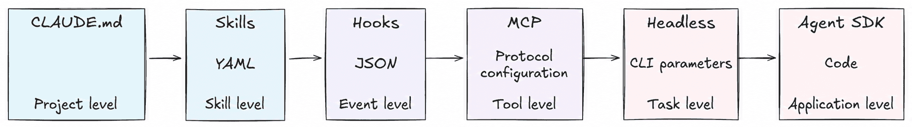
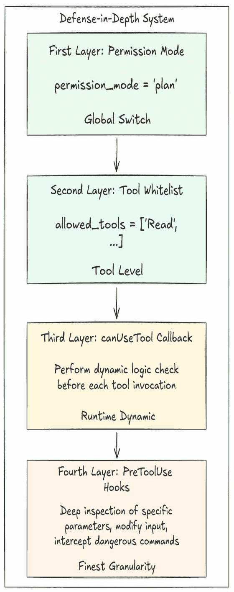
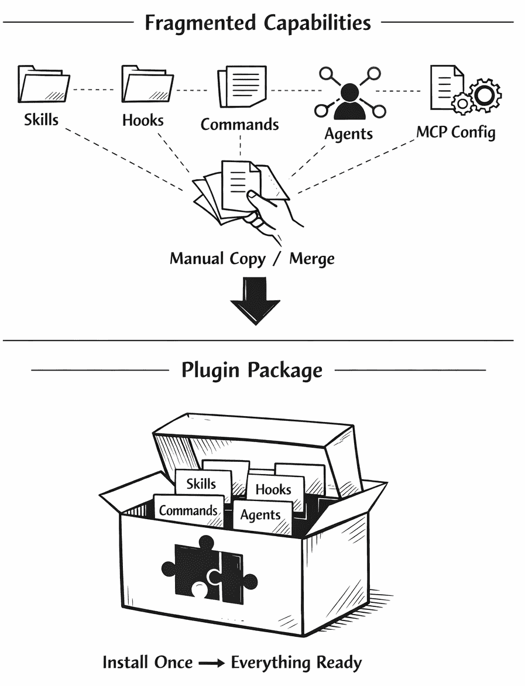
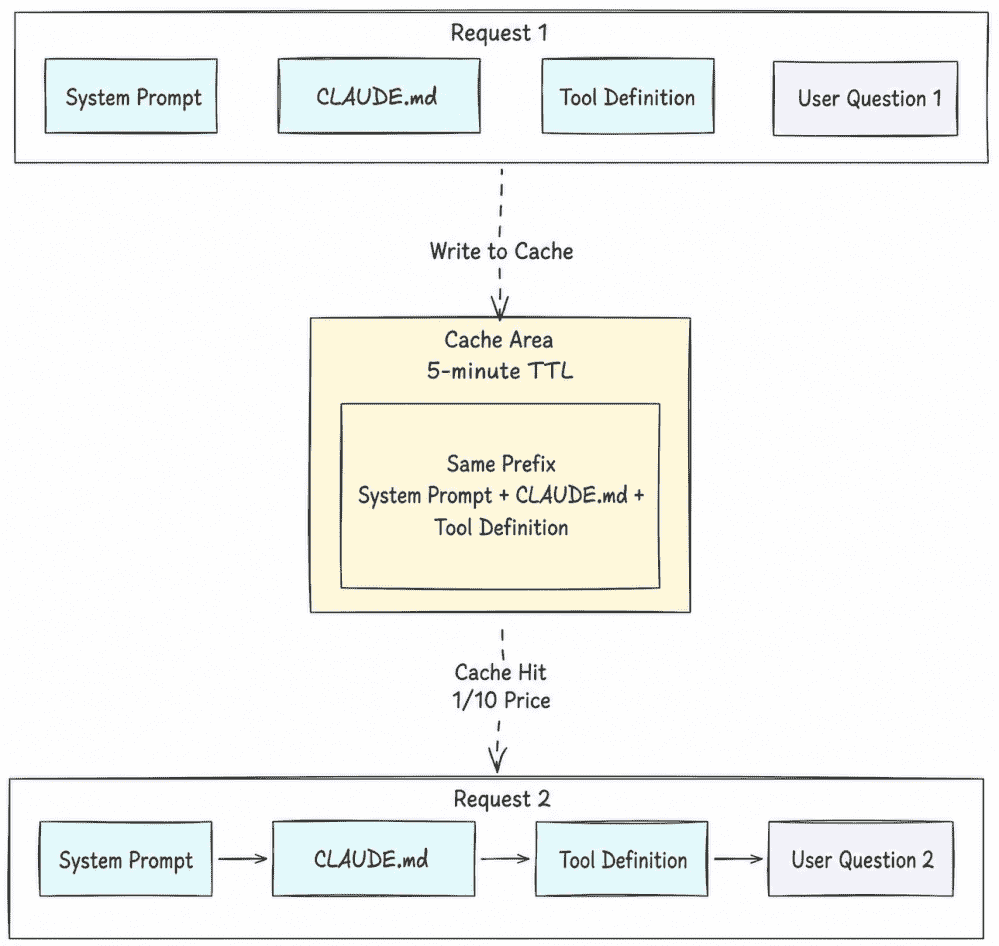
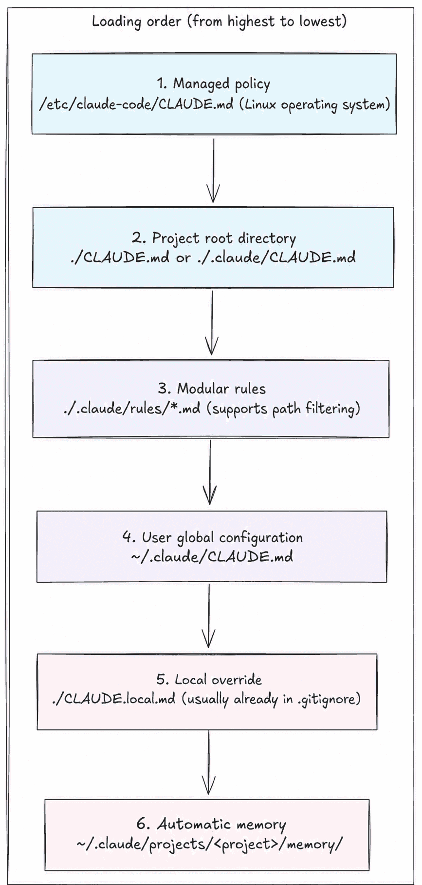

# 第七章：以 Claude 为引擎构建：Agent SDK 智能体开发工具包

> "Give a man a fish and you feed him for a day; teach a man to fish and you feed him for a lifetime." — Proverb

自小雪将 Claude Code 接入公司 CI/CD 流水线、实现 PR 自动评审与报告生成后，团队反响热烈。产品经理据此提出更前瞻性构想：

> "*Can we develop an internal tool that allows non-technical colleagues to use Claude Code to analyze code? For example, a product manager only needs to enter a user story, and the system can automatically locate the relevant code modules, assess implementation complexity, and list the files to be modified.*"

小冰沉吟片刻。Headless mode 虽能部分满足需求，但本质上是命令行工具，对不熟悉终端操作的产品经理门槛过高。他们真正需要的是带表单输入、进度反馈、历史记录的 Web 界面。这意味着不再是简单的 "using a tool（使用工具）"，而是 "building a product（构建产品）"。

> "*Headless mode drives Claude through parameters, while the Agent SDK orchestrates Claude through code,*" Kage 补充道。"*The difference is like 'using a calculator' versus 'programming a calculator': the former relies only on preset function buttons, while the latter allows you to customize its behavior logic.*"

# Positioning of the Agent SDK: From Tool to Component（Agent SDK 定位：从工具到组件）

前文介绍的机制（含 `CLAUDE.md`、sub-agents、Skills、Hooks、MCP、Headless mode）均聚焦 "using Claude Code"。该范式下，开发者作为用户，在既定框架内通过配置拓展 Claude Code 行为边界。

Agent SDK 则基于完全不同前提出发。它假定开发者是 **application builder（应用构建者）**，旨在将 Claude Code 核心能力深度嵌入自有应用。何时启动 Claude、传递何参数、如何编排中间执行步骤、如何管理多轮对话状态——这一切完全由开发者代码掌控。此时你不再是 "using" 现成产品，而是以 Claude 为智能引擎 "building" 全新应用。

这种演进路径如 *Figure 8.1* 所示，清晰展示了控制粒度从 "configuration（配置）" 向 "code（代码）" 的转移。



Figure 8.1: Evolution of control granularity from CLAUDE.md to Agent SDK

每深入一层，控制粒度愈细，定制化程度随之提升。Agent SDK 处于演进链末端：在赋予开发者最大灵活性的同时，也带来最高工程复杂度。

Agent SDK 提供 Python 与 TypeScript/JavaScript 两个版本，功能完全等价。值得注意的是，截至 2025 年底，其包名已正式从 `claude‑code‑sdk` 变更为 `claude‑agent‑sdk`，以更精准反映其定位。安装说明如下。

```
```


# Python

```bash
pip install claude-agent-sdk
```

# TypeScript/Node.js

```bash
npm install @anthropic-ai/claude-agent-sdk
```

# 核心 API：`query` 函数

Agent SDK 的入口点是 `query` 函数。如果无头模式的入口点是 `claude -p "prompt"`，那么 `query` 函数就是其编程等价物——不过，它不返回最终结果，而是返回一个**异步消息流**。

SDK 实际上提供了两个入口点，值得弄清你要用哪一个。`query()` 是无状态的：每次调用都会开启一个新会话，这正是一次性任务以及本章所有示例所需要的。`ClaudeSDKClient` 是有状态的：它在多轮对话中保持会话，因此适用于构建需要记住三轮前所说内容的交互式进程内助手。两者都支持自定义工具和钩子；区别在于会话生命周期，而非能力。此处的示例均使用 `query()`，因为每个示例都是自包含的。

## Python 版本

以下代码演示如何使用 Agent SDK 通过 Python 以编程方式调用 AI 代理，以执行分析代码库架构的任务。

```python
import asyncio

from claude_agent_sdk import query, ClaudeAgentOptions

async def analyze_code():

    options = ClaudeAgentOptions(
        max_turns=5,
        allowed_tools=["Read", "Grep", "Glob"],
        system_prompt="You are a code architecture analyst",
    )

    async for message in query(
        prompt="Analyze the implementation architecture of the src/auth/ directory",
        options=options
    ):
        if isinstance(message, AssistantMessage):
            for block in message.content:
                if hasattr(block, 'text'):
                    print(block.text, end="", flush=True)
        elif isinstance(message, ResultMessage):
            print(f"\n\nCompleted. Cost: ${message.total_cost_usd:.4f}")

asyncio.run(analyze_code())
```

## TypeScript 版本

以下代码演示如何使用 Agent SDK 通过 TypeScript 以编程方式调用 AI 代理，以执行分析代码库架构的任务。

```typescript
import { query, ClaudeAgentOptions } from '@anthropic-ai/claude-agent-sdk';

const options: ClaudeAgentOptions = {
    maxTurns: 5,
    allowedTools: ['Read', 'Grep', 'Glob'],
    systemPrompt: 'You are a code architecture analyst.',
};

async function analyzeCode() {
    for await (const message of query({
        prompt: 'Analyze the implementation architecture of the src/auth/ directory',
        options,
    })) {
        if (message.type === 'assistant') {
            for (const block of message.content) {
                if ('text' in block) {
                    process.stdout.write(block.text);
                }
            }
        } else if (message.type === 'result') {
            console.log(`\n\nCompleted. Cost: $${message.totalCostUsd}`);
        }
    }
}

analyzeCode();
```

`query` 函数是一个**异步生成器**。它不需要等待 Claude 完成整个任务才返回；相反，它会在 Claude 生成每条消息时实时**产出**。在 Web 应用中，这意味着你可以将 Claude 的思考过程流式传输到前端，重现类似 Claude.ai 的打字机效果。在 CI/CD 场景中，它允许你在 Claude 仍在运行时就开始处理生成的输出。

# 消息类型：解读 Claude 的输出流

> “理解消息类型是使用 Agent SDK 的基础，”Kage 强调道。“正如使用 HTTP API 的开发者必须掌握状态码一样，Agent SDK 开发者需要彻底掌握每种消息的含义。”

`query` 函数生成的消息流是一个有序序列，其中每条消息通过 `type` 字段标识其确切类型。

## system/init — 会话初始化

以下代码展示了一个用于会话初始化的系统消息示例。

```json
{
  "type": "system",
  "subtype": "init",
  "session_id": "550e8400-...",
  "model": "claude-sonnet-4-6",
  "tools": ["Read", "Grep", "Glob"],
  "mcp_servers": []
}
```

消息流中的第一条消息报告当前会话的配置详情，包括模型版本、可用工具集和 MCP 服务器状态。这在调试时尤为关键：如果你发现 Claude 没有按预期调用某个特定工具，首先应检查该工具是否定义在 `init` 消息中。

## assistant — Claude 的响应

以下代码展示了 Claude 每轮响应的消息示例。

```json
{
  "type": "assistant",
  "message": {
    "role": "assistant",
    "content": [
      {"type": "text", "text": "Let me first take a look at the directory structure..."},
      {"type": "tool_use", "id": "toolu_xxx", "name": "Glob", "input": {"pattern": "src/auth/**/*"}}
    ]
  }
}
```

在上述代码中，`content` 字段是一个数组，可包含文本块（即 Claude 的“思考”过程或最终输出）和工具调用块（即 Claude 决定执行的动作）的混合内容。值得注意的是，单条 assistant 消息可能包含多个工具调用，这意味着 Claude 可以并发请求读取多个文件或执行其他并行操作。

## user — 工具执行结果

以下代码展示了工具执行完成后的结果示例。

```json
{
  "type": "user",
  "message": {
    "role": "user",
    "content": [
      {"type": "tool_result", "tool_use_id": "toolu_xxx", "content": "src/auth/\n├── login.ts\n├── session.ts\n└── middleware.ts"}
    ]
  }
}
```

请注意，`tool_use_id` 必须与 assistant 消息中的工具调用 ID 严格对应。这种映射关系由 Agent SDK 自动维护，开发者通常无需手动处理。

## result — 任务完成

以下代码展示了任务完成时的终止消息示例。

```json
{
  "type": "result",
  "subtype": "success",
  "session_id": "550e8400-...",
  "num_turns": 5,
  "total_cost_usd": 0.0342,
  "duration_ms": 12345,
  "duration_api_ms": 10000,
  "usage": {
    "input_tokens": 5000,
    "output_tokens": 1500,
    "cache_read_input_tokens": 3000
  },
  "result": "Architecture analysis: src/auth/ adopts a layered design...",
  "structured_output": null
}
```

在上述代码中，`subtype` 是判断任务完成状态的关键字段（详见表 8.1）。

| **subtype** | **含义** |
| :--- | :--- |
| `success` | 任务正常完成 |
| `error_max_turns` | 达到最大轮次限制 (`--max-turns`) |
| `error_max_budget_usd` | 达到成本限制 |
| `error_during_execution` | 执行过程中发生错误 |
| `error_max_structured_output_retries` | 结构化输出验证失败（超过最大重试次数） |

表 8.1：result 消息中的 subtype 类型及含义

以下代码演示了一个实用的消息处理模式，用于在异步消息流中收集文本输出、记录工具调用详情并存储会话元数据。

```python
async def process_query(prompt: str, options: ClaudeAgentOptions) -> dict:
    # Initialize result container
    result = {"text": [], "tools": [], "metadata": {}, "error": None}

    # Asynchronously iterate over the message stream
    async for message in query(prompt=prompt, options=options):
        if isinstance(message, AssistantMessage):
            # Process content blocks in the assistant's response
            for block in message.content:
                if hasattr(block, 'text'):
                    # Collect text output (thoughts or answers)
                    result["text"].append(block.text)
```


elif hasattr(block, "name"):

    # 记录工具调用（名称和输入参数）

    result["tools"].append({

        "tool": block.name,

        "input": block.input,

    })


elif isinstance(message, ResultMessage):

    # 从终止消息中提取元数据

    result["metadata"] = {

        "session_id": message.session_id,

        "cost": message.total_cost_usd,

        "turns": message.num_turns,

        "duration_ms": message.duration_ms,

    }

    # 检查终止是否由于错误

    if message.is_error:

        result["error"] = message.subtype


return result

```

# ClaudeAgentOptions: 细粒度行为控制

`ClaudeAgentOptions` 是控制 `ClaudeAgent` 行为的核心配置对象（此类名已从上一版本的 `ClaudeCodeOptions` 更新）。它将 Headless CLI 的命令行参数转换为编程接口，实现动态配置和细粒度控制。

以下代码演示了该配置对象的结构化解析。

```python
from claude_agent_sdk import ClaudeAgentOptions

options = ClaudeAgentOptions(

    # === 模型与执行控制 ===

    model="claude-sonnet-4-6",       # 指定使用的模型版本

    max_turns=10,                    # 限制最大交互轮数，防止无限循环

    max_budget_usd=1.0,              # 软性上限：在轮次间检查，

        # 因此进行中的一轮仍会完成

    # === 工具权限管理 ===

    # 白名单：仅允许使用列出的工具

    allowed_tools=["Read", "Grep", "Glob", "Write"],

    # 黑名单：显式禁止使用的工具（通常

        # 优先于白名单或作为补充）

    disallowed_tools=["Bash"],

    # === 权限模式 ===

    # default: 标准模式，危险操作需用户确认

    # acceptEdits: 自动接受文件编辑

    # plan: 仅规划，不执行

    # bypassPermissions: 跳过所有确认（高风险，

        # 仅适用于可信环境）

    permission_mode="default",

    # === 提示工程 ===

    system_prompt={"type": "preset", "preset": "claude_code", "append":

        "Be sure to check for SQL injection vulnerabilities"},

            # Claude Code 预设 + 追加指令

    # === 工作环境配置 ===

    cwd="/path/to/project",           # 设置 Agent 的工作目录

    env={"PROJECT_NAME": "MyApp"},    # 注入自定义环境

        # 变量

    # === 会话管理 ===

    resume="session-id-to-resume",    # 从指定 session_id 恢复上下文

    # === 结构化输出 ===

    # 强制模型输出符合特定 JSON Schema 格式的数据

    output_format={"type": "json_schema", "schema": my_schema},  #

        # 结构化输出

    # === MCP 集成 ===

    # 动态启动并连接到外部 MCP 服务器

    mcp_servers={

        "db": {"command": "python", "args": ["./db_server.py"]},

    },

)

```

## 权限模式详解

权限模式是 Agent SDK 应用中的核心安全防线。它决定了 `Claude` 在遇到潜在风险操作（如写入文件或执行命令）时的行为逻辑（见**表 8.2**）。

| **模式** | **行为逻辑** | **适用场景** |
| :--- | :--- | :--- |
| `default` | **标准交互**：遇到危险操作（如写入文件或运行 Shell）时，等待外部确认（通常通过回调或人工干预） | 面向用户的 Web 应用，交互式 CLI 工具 |
| `acceptEdits` | **半自动**：自动接受文件编辑操作，但仍会对命令执行 (`Bash`)、网络请求等进行提示 | 自动化修复脚本，代码格式化流水线 |
| `plan` | **只读/规划模式**：禁止所有修改。模型只能读取文件、分析代码并输出计划；无法执行写入操作或命令。 | 代码审查，架构分析，漏洞扫描 |
| `bypassPermissions` | **完全信任**：跳过所有权限检查，自动执行所有操作（包括 `rm -rf`、`curl` 等高风险命令） | 严格隔离的 CI 容器，沙箱环境 |

**表 8.2：Agent SDK 权限模式及适用场景**

> "*在 CI/CD 流水线中，*" Kage 说，"*`bypassPermissions` *看似很方便——毕竟它不需要人工确认*，*但请务必记住，这意味着授予 `Claude` 执行任何命令的权限，包括删除文件、修改配置，甚至发起网络请求。因此，仅当您确定执行环境完全隔离时（如容器化部署、只读文件系统、无网络连接），才启用此选项。*"

## 工具权限的模式匹配

`allowed_tools` 支持与 Headless CLI 相同的模式匹配语法。请参见以下代码示例。

```python
options = ClaudeAgentOptions(

    allowed_tools=[

        "Read",

        "Grep",

        "Glob",

        "Bash(git diff *)",       # 仅允许执行 git

                                  # diff 命令

        "Bash(npm test *)",       # 仅允许执行

                                  # npm test 命令

        "mcp__database__query",   # 仅允许使用

                                  # MCP 数据库查询工具

    ]

)

```

# 会话管理：跨调用的上下文连续性

`query` 函数适用于单任务场景。然而，许多实际应用需要多轮交互：用户首先指示 `Claude` 分析问题，然后在收到结果后指定修复方向，最后在修复完成后要求 `Claude` 进行验证。

## 基于 session_id 的会话连续性

以下代码演示了如何使用支持会话连续性的异步 AI Agent 接口，分两步完成一个复杂的安全分析任务。

```python
# 第一次调用：分析问题

session_id = None

async for message in query(prompt="Analyze the security issues

    in src/auth", options=options):

    if isinstance(message, SystemMessage) and message.subtype == "init":

        session_id = message.session_id    # [关键] 获取会话 ID

    if isinstance(message, ResultMessage):

        print(message.result)

# 第二次调用：基于上一轮上下文深入探究

resume_options = ClaudeAgentOptions(**options.__dict__, resume=session_id)

async for message in query(

    prompt="Focus on analyzing the first SQL injection risk

        you identified",

    options=resume_options

):

    if isinstance(message, ResultMessage):

        print(message.result)

```

`resume` 参数使 `Claude` 能够“记住”上一轮对话的完整上下文（包括已读取的文件、执行的分析步骤和得出的结论）。与在第二个提示词中重复描述上下文相比，这种方式不仅更高效，还能确保分析的准确性和连贯性。

## 对话分叉

以下代码演示了如何使用对话分叉技术，基于相同的初始分析结果探索多个不同的解决方案或假设场景，同时确保每个分支保持独立。

```python
# 基于相同的分析结果探索不同方向

# 创建分叉配置：复用原始会话状态，
```


但要开始一个新的分支

```
options_fork = ClaudeAgentOptions(**options.__dict__, resume=session_id, fork_session=True)
```

# 方向 A：探索微服务重构方案

```
async for message in query(
    prompt="如果重构为微服务架构，需要修改哪些组件？",
    options=options_fork
):
...
```

# 方向 B：探索现有架构的安全加固方案

# 基于相同的 session_id 再次分叉，以确保两个方向保持完全独立

```
async for message in query(
    prompt="如果维持现有架构，应如何加强安全性？",
    options=options_fork
)
```

设置 `fork_session=True` 将从指定会话的特定点位“分叉”出一个全新的会话副本，而原会话的状态保持不变。这种机制在需要进行“假设性分析”或对比多个技术方案的场景中极具价值。

# 自定义工具：扩展 Claude 的能力边界

Claude 原生自带 `Read`、`Write`、`Bash` 和 `Grep` 等基础工具。然而，在实际应用场景中，开发者往往需要集成领域特定的能力，例如查询数据库、调用内部 API、发送通知或执行复杂的业务逻辑。

Agent SDK 中的自定义工具本质上是**进程内 MCP 服务器**。与 第 6 章 中介绍的独立部署的 MCP 服务器不同，这些工具不需要启动单独的进程，而是直接在应用程序进程中运行。这种架构消除了进程间通信的开销，从而显著提高了工具调用的效率和响应速度。

## 使用 `@tool` 装饰器定义工具

以下代码演示了如何使用 Agent SDK 构建一个**进程内 MCP 服务器**，将两个具体的业务功能（数据库查询和发送通知）封装为供 AI Agent 调用的安全工具。

```
from claude_agent_sdk import tool, create_sdk_mcp_server
import json

# 工具 1：数据库查询（只读）

@tool(
    name="query_database",
    description="在应用数据库上执行只读 SQL 查询",
    input_schema={
        "query": str,
        "limit": int
    }
)
async def query_database(args):
    sql = args["query"]
    limit = args.get("limit", 100)
    # [安全关键] 强制验证：仅允许 SELECT
    if not sql.strip().upper().startswith("SELECT"):
        return {
            "content": [{"type": "text", "text": "Error: Only SELECT queries allowed"}],
            "isError": True
        }
    results = await db.execute(f"{sql} LIMIT {limit}")
    return {
        "content": [{"type": "text", "text": json.dumps(results, indent=2)}]
    }

# 工具 2：发送通知

@tool(
    name="send_notification",
    description="向团队 Slack 频道发送通知",
    input_schema={"channel": str, "message": str}
)
async def send_notification(args):
    await slack.post_message(args["channel"], args["message"])
    return {
        "content": [{"type": "text", "text": f"Notification sent to #{args['channel']}"}]
    }

# 创建一个 MCP 服务器来托管这些工具

tools_server = create_sdk_mcp_server(
    name="app-tools",
    version="1.0.0",
    tools=[query_database, send_notification]
)
```

## 在 Agent 配置中注册并启用自定义工具

以下代码演示了如何在 Agent 配置中注册并启用自定义工具。

```
options = ClaudeAgentOptions(
    mcp_servers={
        "app-tools": tools_server
    },
    allowed_tools=[
        "Read", "Grep", "Glob",                         # 内置工具
        "mcp__app-tools__query_database",               # 自定义工具
        "mcp__app-tools__send_notification",
    ]
)
```

自定义工具的名称必须严格遵循 `mcp__{server_name}__{tool_name}` 格式。这种带前缀的命名约定不仅避免了与内置工具（如 `Read` 和 `Bash`）的命名冲突，还为日志审计和监控仪表板提供了天然的分类标签。

## 使用 Pydantic 模型进行参数验证

对于超出简单字符串集合的场景，请将参数定义为 Pydantic 模型，而不是裸字典。其优势体现在字典无法表达的情况：嵌套对象、带默认值的可选字段、将值限定在固定集合内的枚举，以及数值范围。下面的模型涵盖了这四种情况 —— 其中 `where` 默认为 `None`，`limit` 通过 `ge` 和 `le` 进行边界约束 —— 每一项约束都会成为 Claude 所见 schema 的一部分，因此格式错误的调用会在你的函数运行前被拒绝。

```
from pydantic import BaseModel, Field
from claude_agent_sdk import tool

# 定义结构化参数模型

class DatabaseQueryParams(BaseModel):
    table: str = Field(
        ...,
        description="表名"
    )
    columns: list[str] = Field(
        default=["*"],
        description="要选择的列"
    )
    where: str | None = Field(
        default=None,
        description="SQL WHERE 子句条件（可选）"
    )
    limit: int = Field(
        default=100,
        ge=1,
        le=1000,
        description="返回的最大行数"
    )

# 直接将模型定义为工具参数

@tool(
    name="safe_query",
    description="执行安全的、参数化的数据库查询",
    input_schema=DatabaseQueryParams
)
async def safe_query(args: DatabaseQueryParams):
# 参数已由 Pydantic 模型验证，确保类型安全
...
```


**Kage 的备注**

自定义工具的设计必须以极高的谨慎态度对待。Claude 可能会以意想不到的方式调用工具，例如传入极端的参数值、在短时间内连续发起数十次调用，或将一个工具的输出作为另一个工具的输入。因此，请遵循以下三项原则：**单一职责**（确保每个工具仅专注于特定任务）、**清晰描述**（`description` 字段充当给 Claude 的“使用指南”，必须明确界定“何时可以使用”以及“何时应禁用”）和 **零信任验证**（绝不信任 Claude 传入的任何参数；所有输入必须在工具内部经过严格验证）。

具体而言，需要权限控制而非仅靠良好描述的工具，是指其效果无法通过重复运行来撤销的工具：任何执行删除操作、写入生产环境、发送邮件或 Slack 消息，或涉及资金支出的工具。

# Agent SDK 中的钩子：程序化拦截

第 5 章 中介绍的钩子机制依赖于 JSON 配置文件。在 SDK 中，你可以将相同的拦截点注册为代码内回调，这消除了此处展示的用例中配置文件的往返开销。在规划之前，有一个值得注意的注意事项：在 Python SDK 中，`SessionStart` 和 `SessionEnd` 不可作为代码内回调使用 —— 其 `HookEvent` 类型省略了它们，在 Python 中你只能通过在设置文件中声明的 Shell 命令钩子来获取它们。它们可以在 TypeScript 中注册为 SDK 回调。下面的示例所用的 `PreToolUse` 和 `PostToolUse` 在两者中均可用。

## PreToolUse：执行前拦截

以下代码演示了一个细粒度的运行时安全拦截系统。该系统利用钩子机制，在 AI Agent 实际执行工具（如运行 Bash 命令或修改文件）之前，对操作进行深度检查和过滤。如果检测到任何危险行为，系统将立即拒绝执行，从而有效防止 AI 造成危害。

```python
from claude_agent_sdk import ClaudeAgentOptions, HookMatcher

async def block_dangerous_bash(input_data, tool_use_id, context):
    """拦截危险的 Bash 命令"""

    # 仅处理 Bash 工具调用
    if input_data["tool_name"] != "Bash":
        return {}

    command = input_data["tool_input"].get("command", "")

    # 定义危险命令特征列表
    dangerous = ["rm -rf", "sudo", "chmod 777", "> /dev/",
        "mkfs", "dd if="]

    for pattern in dangerous:
        if pattern in command:
            return {
                "hookSpecificOutput": {
                    "hookEventName": "PreToolUse",
                    "permissionDecision": "deny",
                    "permissionDecisionReason": f"Blocked: {pattern}"
                }
            }

    return {}

async def protect_config_files(input_data, tool_use_id, context):
    """保护关键配置文件不被修改"""

    tool_name = input_data["tool_name"]

    # 仅处理文件写入工具
    if tool_name not in ["Write", "Edit"]:
        return {}

    file_path = input_data["tool_input"].get("file_path", "")

    # 定义受保护的路径或文件名特征
    protected = [".env", "secrets", "production.yaml",
        "database/migrations"]

    for p in protected:
        if p in file_path:
            return {
                "hookSpecificOutput": {
                    "hookEventName": "PreToolUse",
                    "permissionDecision": "deny",
                    "permissionDecisionReason": f"Protected file: {file_path}"
                }
            }

    return {}

# 配置 Agent 选项并注册安全拦截钩子
options = ClaudeAgentOptions(
    hooks={
        "PreToolUse": [
            HookMatcher(matcher="Bash", hooks=[block_dangerous_bash]),
            HookMatcher(matcher="Write", hooks=[protect_config_files]),
            HookMatcher(matcher="Edit", hooks=[protect_config_files]),
        ]
    }
)
```

## PostToolUse：执行后处理

以下代码演示如何使用 `PostToolUse`（工具使用后）钩子来实现自动化工作流增强和端到端审计。

```python
import subprocess
import json
from datetime import datetime
from claude_agent_sdk import ClaudeAgentOptions, HookMatcher

async def auto_format_on_write(input_data, tool_use_id, context):
    """写入文件后自动触发代码格式化"""

    # 仅处理文件写入工具
    if input_data["tool_name"] not in ["Write", "Edit"]:
        return {}

    file_path = input_data["tool_input"].get("file_path", "")

    # 根据文件扩展名选择相应的格式化工具
    if file_path.endswith(".py"):
        # 使用 Black 格式化 Python 代码
        subprocess.run(["black", file_path], capture_output=True)
    elif file_path.endswith((".ts", ".js", ".tsx", ".jsx")):
        # 使用 Prettier 格式化前端代码
        subprocess.run(["prettier", "--write", file_path],
            capture_output=True)

    return {}

async def audit_all_tools(input_data, tool_use_id, context):
    """记录所有工具调用的审计日志"""

    audit_entry = {
        "timestamp": datetime.now().isoformat(),
        "tool": input_data["tool_name"],
        "input": input_data["tool_input"],
        "tool_use_id": tool_use_id,
    }

    # 将审计日志追加写入 JSONL 文件
    with open("agent-audit.jsonl", "a") as f:
        f.write(json.dumps(audit_entry) + "\n")

    return {}

# 配置 Agent 选项并注册执行后钩子
options = ClaudeAgentOptions(
    hooks={
        "PreToolUse": [...],  # 可在此连接前面定义的
            # 安全拦截钩子
        "PostToolUse": [
            HookMatcher(matcher="Write", hooks=[auto_format_on_write]),
            HookMatcher(matcher="Edit", hooks=[auto_format_on_write]),
            HookMatcher(matcher="*", hooks=[audit_all_tools]),
        ]
    }
)
```


## Agent SDK Hooks 与 Shell Hooks 的关系

表 8.3 对比了 Agent SDK Hooks 与 Shell Hooks 的核心差异，清晰地展示了从可配置脚本到原生编程接口的演进。

| Hook 机制 | Shell Hooks | Agent SDK Hooks |
| --- | --- | --- |
| 定义方式 | `settings.json` 配置 + Shell 脚本文件 | 原生 Python/TypeScript 函数 |
| 执行环境 | 独立子进程 | 当前进程内 |
| 数据交换 | 通过 `stdin`/`stdout` 传递 JSON 字符串 | 直接通过函数参数和返回值对象 |
| 异步支持 | 不支持（同步阻塞） | 原生支持 async/await |
| 调试体验 | 困难（依赖 echo 打印或写日志文件） | 高效（支持 IDE 断点、单步调试） |
| 适用场景 | Claude Code 交互模式/Headless CLI | 基于 Agent SDK 构建的嵌入式应用 |

**表 8.3：Shell Hooks 与 Agent SDK Hooks 对比**

如果您希望直接使用 **Claude Code**（无论是终端交互模式还是 Headless CLI 模式），建议使用 **Shell Hooks**；如果您正在开发自定义应用、集成服务或使用 Agent SDK 构建复杂的自动化工作流，建议使用 **Agent SDK Hooks**。

## 四层安全防御体系

Agent SDK 建立了由四层安全防御组成的纵深防御体系，如图 8.2 所示。

权限模式设定默认姿态，工具白名单限定可用工具范围，`canUseTool` 回调凭借完整的参数上下文充当逐次调用的守门人，而 `PreToolUse` Hooks 是执行前最后的确定性检查点；在典型应用中，白名单和权限模式承担了大部分防护重任。



**图 8.2 Agent SDK 的纵深防御体系**

运行时权限回调是 SDK 独有的机制。请注意拼写差异：Python 中参数名为 `can_use_tool`，TypeScript 中为 `canUseTool`。本章正文在泛指该机制时采用 TypeScript 形式，但 Python 代码示例中注册的是 `can_use_tool`——编写代码时请以代码为准，而非正文。

以下代码演示了如何构建一个智能“守门人”，在工具执行前根据具体内容动态决定是否授予访问权限。

```python
async def can_use_tool(tool_name: str, tool_input: dict) -> dict:
    """运行时权限检查回调"""

    # 场景 1：文件写入保护
    # 防止敏感配置文件被篡改
    if tool_name in ["Write", "Edit"]:
        file_path = tool_input.get("file_path", "")
        if ".env" in file_path or "secrets" in file_path:
            return {
                "allowed": False,
                "reason": "Access to sensitive files denied"
            }

    # 场景 2：拦截网络命令
    # 即使 Bash 在白名单中，特定网络操作仍须禁止
    if tool_name == "Bash":
        command = tool_input.get("command", "")
        if any(cmd in command for cmd in ["curl", "wget", "ssh"]):
            return {
                "allowed": False,
                "reason": "Network commands are not permitted"
            }

    return {"allowed": True}

options = ClaudeAgentOptions(
    permission_mode="acceptEdits",
    allowed_tools=["Read", "Write", "Edit", "Grep", "Glob"],
    can_use_tool=can_use_tool,
    hooks={
        "PreToolUse": [HookMatcher(matcher="*", hooks=[audit_all_tools])]
    }
)
```

四层安全的协同逻辑如下：`permission_mode` 确立全局基线，`allowed_tools` 剔除冗余工具，`canUseTool` 在运行时对每次调用执行动态校验，`PreToolUse` Hooks 负责最细粒度的参数审查、输入修正与审计日志记录。

## 结构化输出：强制遵循 JSON Schema

构建应用时，往往需要 **Claude** 输出结构化数据而非自由文本。Agent SDK 通过 `output_format` 参数支持基于 JSON Schema 的校验，示例如下。

```python
from pydantic import BaseModel

# 安全报告模型
class SecurityReport(BaseModel):
    summary: str
    issues: list[dict]     # 结构示例：[{severity, file, line, description}]
    risk_score: float       # 取值范围：0.0~10.0

options = ClaudeAgentOptions(
    output_format={
        "type": "json_schema",
        "schema": SecurityReport.model_json_schema()
    },
    max_turns=10,
    allowed_tools=["Read", "Grep", "Glob"],
)

async for message in query(prompt="Conduct a security review of src/",
    options=options):
    if isinstance(message, ResultMessage) and message.structured_output:
        report = SecurityReport.model_validate(message.structured_output)
        # report 是类型安全的 Pydantic 对象
        print(f"Risk score: {report.risk_score}")
        for issue in report.issues:
            print(f"  [{issue['severity']}] {issue['file']}:{issue.get('line', '?')} - {issue['description']}")
```

在 TypeScript 环境中，可使用 Zod 库实现相同功能，示例如下。

```typescript
import { z } from 'zod';

const SecurityReport = z.object({
    summary: z.string(),
    issues: z.array(z.object({
        severity: z.enum(['critical', 'high', 'medium', 'low']),
        file: z.string(),
        description: z.string(),
    })),
    riskScore: z.number().min(0).max(10),
});

const options: ClaudeAgentOptions = {
    outputFormat: {
        type: 'json_schema',
        schema: z.toJSONSchema(SecurityReport),
    },
};
```

Claude 会自动按上述 Schema 格式化输出 JSON。若首次生成的内容校验不通过，Agent SDK 会自动触发重试机制（最大重试次数由内部策略控制）；若超限仍校验失败，系统将返回 `error_max_structured_output_retries` 错误。

## 实战：构建代码分析 Web 服务

下面给出一个完整的代码分析 Web 服务示例，集成了前文所有知识点。该脚本演示如何配置 Claude Agent、以流式方式接收分析结果，并在 Web 服务场景中（此处通过命令行模拟）输出实时反馈。

```python
#!/usr/bin/env python3
"""代码分析 Agent 服务 —— 完整可运行示例"""

import asyncio
import json
from datetime import datetime
from claude_agent_sdk import query, ClaudeAgentOptions

async def analyze_codebase(directory: str, focus: str = "general"):
    """
    分析指定目录下的代码库。

    Args:
        directory: 待分析的本地目录路径
        focus: 分析侧重点 - "security" / "performance" / "quality" / "general"
    """

    # 定义不同侧重点的 System Prompt
    focus_prompts = {
        "security": "Focus on security vulnerabilities: SQL injection, XSS, hardcoded sensitive information, lack of access control, etc.",
        "performance": "Focus on performance issues: N+1 queries, memory leaks, redundant computations, missing caching strategies, etc.",
        "quality": "Review naming, duplication, and test coverage. Skip anything the linter already enforces.",
        "general": "Conduct a comprehensive code review: covering security, performance, code quality, and architectural soundness."
    }
```


# 代码示例

```python
options = ClaudeAgentOptions(
    model="claude-sonnet-4-6",
    max_turns=15,
    max_budget_usd=0.50,
    allowed_tools=["Read", "Grep", "Glob"],
    permission_mode="plan",       # 只读模式
    cwd=directory,
    system_prompt={
        "type": "preset",
        "preset": "claude_code",
        "append": focus_prompts.get(focus, focus_prompts["general"])
    },
)

# 初始化收集器
output_text = []
tools_used = []
metadata = {}

# 执行流式查询
async for message in query(
    prompt=f"Analyze the code of the current project, {focus_prompts.get(focus, '')}. Please output the analysis report directly in Markdown format.",
    options=options,
):
    if isinstance(message, AssistantMessage):
        for block in message.content:
            if hasattr(block, 'text'):
                output_text.append(block.text)
                # [关键点] 流式输出：在实际 Web 服务中，这应该产出 SSE 事件
                print(block.text, end="", flush=True)
            elif hasattr(block, 'name'):
                tools_used.append(block.name)
    elif isinstance(message, ResultMessage):
        metadata = {
            "session_id": message.session_id,
            "cost_usd": message.total_cost_usd,
            "turns": message.num_turns,
            "duration_ms": message.duration_ms,
            "success": not message.is_error,
        }

# 返回结构化结果
return {
    "report": "\n".join(output_text),
    "tools_used": tools_used,
    "metadata": metadata,
}

async def main():
    import sys

    directory = sys.argv[1] if len(sys.argv) > 1 else "."   # 真正的工具应该解析此路径并检查其是否存在
    focus = sys.argv[2] if len(sys.argv) > 2 else "general"

    print(f"Analyzing {directory} (focus: {focus})...\n")

    result = await analyze_codebase(directory, focus)

    print(f"\n\n--- Session Statistics ---")
    print(f"Status: {'Success' if result['metadata']['success'] else 'Failure'}")
    print(f"Cost: ${result['metadata'].get('cost_usd', 0):.4f}")
    print(f"Duration: {result['metadata'].get('duration_ms', 0) / 1000:.1f}s")
    print(f"Number of Turns: {result['metadata'].get('turns', 0)}")
    print(f"Tools Used: {', '.join(result['tools_used'])}")

if __name__ == "__main__":
    asyncio.run(main())
```

在实际的 Web 服务架构中，查询的异步生成器可以直接连接到 `SSE`（`Server-Sent Events`），以实现低延迟的实时数据推送。

下面是一个基于 `FastAPI` 的完整示例。关键点在于：一个异步请求处理器迭代 Agent 的消息流，并在每个数据块到达时立即将其转发给客户端，而不是等待运行完成。这正是适合产出消息而非一次性返回的 SDK 的特性，它让前端能够随着工作的进行进行渲染，而不是显示一个加载动画。

```python
from fastapi import FastAPI
from fastapi.responses import StreamingResponse

app = FastAPI()

@app.post("/api/analyze")
async def analyze(request: AnalyzeRequest):
    async def event_stream():
        async for message in query(prompt=request.prompt, options=options):
            if isinstance(message, AssistantMessage):
                for block in message.content:
                    if hasattr(block, 'text'):
                        yield f"data: {json.dumps({'type': 'text', 'content': block.text})}\n\n"
            elif isinstance(message, ResultMessage):
                yield f"data: {json.dumps({'type': 'done', 'cost': message.total_cost_usd})}\n\n"

    return StreamingResponse(event_stream(), media_type="text/event-stream")
```


# Agent SDK 与 Headless CLI：如何选择

尽管 Agent SDK 和 Headless CLI 都允许 Claude 在无人值守的环境中运行，但它们的适用场景有着明确的界限（参见表 8.4）。选择错误的工具往往会导致架构过度复杂或功能受限。

| 场景 | 推荐方案 | 理由 |
| --- | --- | --- |
| CI/CD 流水线中的单步任务 | Headless CLI | 零依赖部署，直接嵌入 YAML 配置，无需安装 Python/Node 运行时 |
| Shell 脚本自动化 | Headless CLI | 完美契合流水线组合，简单直接 |
| 构建 Web/桌面 AI 应用 | Agent SDK | 支持流式输出（SSE）、细粒度状态管理和前端交互 |
| 需要自定义工具 | Agent SDK | 支持 `@tool` 装饰器注册本地函数，实现复杂业务逻辑的闭环 |
| 多轮对话/持续会话 | Agent SDK | 内置会话管理，自动维护上下文历史，无需手动拼接消息 |
| 需要细粒度控制消息流 | Agent SDK | 基于异步生成器，允许逐块拦截、修改或路由消息 |
| 并发管理多个实例 | Agent SDK | 编程式并发控制（如 `asyncio.gather`），轻松应对高并发请求 |

表 8.4：Agent SDK 与 Headless CLI 的场景对比

一个经验法则，附带一个注意事项：bash 能做的事情比人们想象的要多：当逻辑只需一两条 shell 命令即可完成时，请使用 CLI；当你需要复杂的分支、循环、批量数据处理，或与其他可执行代码紧密耦合时，请使用 Agent SDK —— 此时继续留在 shell 中付出的代价将大于收益。

**Kage 备注**

Agent SDK 降低了构建 AI 应用的门槛，但“易用”并不等于“简单”。将 Claude 嵌入真实产品时，开发者必须妥善解决以下关键问题：错误重试（应对网络波动和 API 限流）、成本追踪（监控每次调用的 Token 消耗）、用户隔离（确保不同用户的对话互不干扰）、响应超时（为长时间运行的任务建立中断策略）以及熔断机制（连续失败后自动熔断调用）。掌握这些工程细节，是将 Agent SDK 演示原型升级为生产级应用的必经之路。

# 总结

Agent SDK 将 Claude Code 从一个独立的终端工具转变为可嵌入任何应用的 AI 组件。这一转变建立在两个核心 API 之上——`query` 函数和 `ClaudeAgentOptions`。

`query` 函数是 Agent SDK 的入口，功能上等同于 Headless 模式的 `claude -p` 命令，但返回消息流作为异步生成器，支持实时处理 Claude 输出的每一步。该消息流包含四种核心类型：system/init（初始化信号）、assistant（Claude 的回复，可能包含文本内容和工具调用请求）、user（工具执行后的反馈结果）和 result（任务终止信号，携带成本、轮数、耗时等元数据）。

`ClaudeAgentOptions` 提供了与 Headless CLI 参数等效的编程接口，涵盖模型选择、工具权限、权限模式、提示词自定义、会话管理和结构化输出。与命令行相比，编程接口的核心优势在于动态配置：开发者可根据用户角色动态调整权限模式、根据任务类型灵活切换模型，或根据上一轮结果实时优化下一轮提示词。

自定义工具通过 `@tool` 装饰器和进程内 MCP 服务器实现，使 Claude 能够调用任意自定义函数，无论是查询数据库、调用内部 API 还是发送通知。同时，四层安全机制（权限模式、工具白名单、`canUseTool` 回调和 `PreToolUse` Hooks）确保 Claude 在应用中仅执行预期操作。

从 `CLAUDE.md` 配置、Skills 定义和 Hooks 拦截，到 MCP 集成，最后到 Headless 模式和 Agent SDK 的全面控制，每一层深入都让你更接近构建成熟的“产品”，而非仅仅是“工具”。在第 9 章中，我们将探讨如何打包和分发这些能力，并深度解析 Plugins 生态系统。

# 思考题

1.  如果你需要为公司构建一个内部“代码影响分析”工具（输入需求描述，输出受影响的代码模块列表及修改难度评估），你会如何设计其系统架构？此场景中应重点利用 Agent SDK 的哪些核心特性？
2.  自定义工具的 `description` 字段是 Claude 在决定是否调用该工具前阅读的操作指南。写出一个优秀的 description 应回答的内容：工具做什么、何时使用及何时不使用、每个参数的含义和格式、返回什么，以及任何副作用或前置条件。然后推算一个糟糕的 description 会带来什么代价 —— 顶多是错误的工具调用、参数格式错误、或本应使用的工具被跳过；最坏的情况是本不该发生的调用导致不可逆的副作用。
3.  四层安全机制（权限模式、工具白名单、`canUseTool` 回调、`PreToolUseHooks`）之间是什么关系？在你的应用场景中，哪些层是必不可少的，哪些可以省略？

# 9

# 从个人技艺到共享资产：Plugin 生态系统

“如果我看得更远，是因为站在了巨人的肩膀上。” —— 艾萨克·牛顿

最近，小雪在开源社区发现了一个名为“React 全栈团队的 Claude Code 最佳实践”的 GitHub 仓库，极具吸引力。仔细查看后，她发现其中包含一组精心设计的 Skills，涵盖代码审查、组件文档生成和测试用例编写；此外，该仓库还提供了用于自动格式化和 PR 规范化的 Hooks 脚本，以及一个完整的 `.mcp.json` 配置文件，预集成了 GitHub API 和 Linear 项目管理工具。

“真希望这套方案能开箱即用，”小雪感叹道。

然而现实并不顺遂。在该仓库中，Skills 位于一个目录，Hooks 脚本在另一个目录，`.mcp.json` 是一个独立文件，还有几个自定义命令定义文件散落在别处。要使用这套配置，她必须手动将所有文件复制到指定位置，弄清每个部分的安装方法，并祈祷没有遗漏任何依赖。最后她放弃了 —— 仅仅搞清安装顺序就花了她整整一个下午。

“这正是 Plugins 要解决的问题，”Kage 说道。“它们将一整套 Claude Code 能力打包成一个可一键安装的单元。就像 JavaScript 生态的 `npm` 或 Python 的 pip，Plugins 是 Claude Code 能力的标准化分发机制（见图 9.1）。”



图 9.1：Plugins 作为 Claude Code 能力的标准化分发机制

# Plugin 的角色：能力的封装与分发

在深入探讨 Plugins 之前，有必要回顾一下我们迄今构建的工具栈。到目前为止，我们讨论了六种独立的扩展机制：用 `CLAUDE.md` 管理项目记忆、通过子代理进行任务委派、用 Skills 封装领域工作流、通过 Hooks 提供事件驱动控制、用 MCP 连接外部服务、以及通过 Headless 模式/Agent SDK 进行程序化调用。尽管各机制各司其职，但它们有着共同的短板 —— **彼此孤立，难以作为一个整体进行分发**。

当你花费数周为团队打磨一套完整的开发工作流，并试图分享给另一个团队时，现实令人沮丧：Skills 需要复制到 `.claude/skills/` 目录，Hooks 配置必须合并到 `settings.json`，MCP 服务器需要单独配置，自定义命令须移至 `.claude/commands/`，子代理定义则散落在别处。接收方不仅要逐一摸索每个组件的安装步骤，还要处理潜在的命名冲突。这不再是简单的知识分享，而变成了一项繁琐的迁移任务。

Plugins 本身不引入新功能，但提供了**统一的打包格式和安装机制**。一个 Plugin 可以包含 Skills、Hooks、Commands、Agents 和 MCP 配置，通过一条命令即可将所有组件就绪。


# 插件的物理结构

插件本质上是一个遵循特定目录结构的文件夹（通常作为 Git 仓库托管），其核心是位于 `.claude‑plugin/` 子目录下的 `plugin.json` 清单文件。

下面展示了一个典型的 `Plugin` 目录结构示例（以 `react‑workflow` 为例）。

```
react-workflow/                                        ← 插件根目录
├── .claude-plugin/
│   └── plugin.json                                ← [必需] 插件清单文件
├── commands/                                     ← 斜杠命令定义
│   ├── review.md
│   └── deploy.md
├── agents/                                        ← 子代理定义
│   ├── security-scanner.md
│   └── quick-fix.md
├── skills/                                       ← 技能领域知识包
│   └── react-patterns/
│       ├── SKILL.md
│       └── chapters/
│           ├── hooks.md
│           └── performance.md
├── hooks/                                     ← 钩子配置和脚本
│   ├── hooks.json
│   ├── check-bash.sh
│   └── auto-format.sh
├── .mcp.json                                   ← MCP 服务器配置引用
└── README.md                               ← 文档
```

有一个重要的物理约束需要特别注意：**只有** `plugin.json` **必须放置在特定的** `.claude‑plugin/` **子目录中**。所有其他功能目录（如 `commands`、`agents`、`skills`、`hooks`）和配置文件（`.mcp.json`）都应直接位于插件的根目录下。

这种结构设计确保了 `Plugin` 根目录本身就是一个有效的 Claude Code 项目目录。这意味着开发者可以直接在插件目录中进行开发和测试，而无需切换到特殊的**开发模式**。

## plugin.json：插件的身份证

以下展示了一个 `plugin.json` 片段。它位于插件自身仓库根目录下的 `.claude‑plugin/` 目录中 — 既不在你项目的 `.claude/` 目录中，也不在仓库根目录。

```json
{
  "name": "react-workflow",
  "version": "1.2.0",
  "description": "Complete React/TypeScript development workflow for Claude Code",
  "author": "YourName",
  "repository": "https://github.com/yourname/react-workflow",
  "license": "MIT",
  "keywords": ["react", "typescript", "workflow", "code-review"]
}
```

**表 9.2** 详细列出了 `plugin.json` 中所有字段及其说明。

| **字段** | **必需** | **说明** |
| :--- | :---: | :--- |
| `name` | 是 | 插件的唯一标识符，用于安装命令和内部引用 |
| `version` | 是 | 语义化版本号 (SemVer) |
| `description` | 是 | 简短描述，将显示在插件列表中 |
| `author` | 否 | 作者姓名或团队名称 |
| `repository` | 否 | 源代码仓库地址 |
| `license` | 否 | 开源许可协议 |
| `keywords` | 否 | 用于检索的搜索关键词 |

应特别关注 `name` 字段。它不仅是一个显示名称 — 它决定了插件的命名空间，插件附带的每个命令、代理和技能都会以它为前缀，以避免冲突。请选择具体的名称。像 `tools` 这样过于通用的名称，一旦市场上有了十几个条目，就无法消除歧义；它仅在团队整体安装的广泛内部工具包中才说得通，即便如此，带有团队前缀的名称读起来也更好。

## 组件的具体格式

### 命令文件

命令文件位于 `commands/` 目录，采用 Markdown 格式。核心规则如下。

*   **文件名即命令名**：例如 `review.md` 对应 `/review` 命令。
*   **前置元数据**：文件顶部必须包含 YAML 格式的 `FrontMatter`，定义命令的元数据。
*   **内容即指令**：文件主体是发送给 AI 的具体指令。

`commands/review.md` 的内容示例如下。

```markdown
---
name: review
description: Conduct a code review of the current file or directory
---

When the user runs `/review [target]`, please follow the code review process below.

## Review Focus Points

1. Code Quality: Check naming conventions and adherence to the DRY principle.
2. Security Issues: Identify missing input validation and potential injection risks (such as SQL injection, XSS).
3. Performance Issues: Detect unnecessary loops, potential memory leaks, or inefficient algorithms.

## Output Format

Please strictly categorize the review results as follows:

- Critical (issues that must be fixed immediately)
- Warning (potential risks that are recommended to be fixed)
- Suggestion (optional code optimizations or improvements)
```

### 子代理文件

子代理文件位于 `agents/` 目录，用于定义具有特定角色、权限和模型配置的专用 AI 代理。与命令文件类似，它们也使用 Markdown 格式，但其 Front Matter 提供了更强大的配置能力，允许精确控制代理的工具权限和底层模型。

`agents/security‑scanner.md` 的内容示例如下。

```markdown
---
name: security-scanner
description: Scan for security vulnerabilities in code
tools: Read, Grep, Glob
model: sonnet
---

You are a seasoned security expert specializing in identifying potential security vulnerabilities in codebases.

## Core Responsibilities

Please pay special attention to the following risk points:

*   Injection Attacks: Detect risks such as SQL injection and command injection.
*   Cross-Site Scripting (XSS): Check for unescaped user input and output.
*   Credential Leakage: Search for hardcoded API keys, passwords, or private keys.
*   Access Control: Verify whether access control logic is robust.
```

### 钩子配置文件

钩子配置文件位于 `hooks/` 目录，用于定义插件在特定生命周期事件期间的自动化行为。其格式与**第 5 章**介绍的全局 `settings.json` 中的 Hooks 配置完全兼容，允许开发者通过脚本拦截和增强工具的执行流程。

`hooks/hooks.json` 的内容示例如下。

```json
{
  "hooks": [
    {
      "event": "PreToolUse",
      "matcher": "Bash",
      "command": ["bash", "./hooks/check-bash.sh"]
    },
    {
      "event": "PostToolUse",
      "matcher": "Write",
      "command": ["bash", "./hooks/auto-format.sh"]
    }
  ]
}
```


### MCP 配置文件

MCP 配置文件通常位于项目根目录，名为 `.mcp.json`。该文件遵循与项目级全局 MCP 配置完全相同的格式，用于声明插件所需的外部服务连接。

`.mcp.json` 的内容示例如下。

```json
{
  "mcpServers": {
    "postgres": {
      "command": "npx",
      "args": ["-y", "@anthropic/mcp-server-postgres"],
      "env": {
        "DATABASE_URL": "${DATABASE_URL}"
      }
    }
  }
}
```

# 安装与生命周期管理

## 安装来源

插件安装通过 `/plugin` 命令统一管理，支持以下三种来源。

```bash
# 从社区市场安装。市场是托管在 Git 仓库中的插件目录；
# 必须先用 /plugin marketplace add 添加市场，才能从中安装。
/plugin install react-workflow@community

# 从 GitHub 仓库安装
/plugin install github.com/username/react-workflow

# 从本地目录安装（用例：插件开发与调试期间，允许代码修改后实时测试，无需重新发布）
/plugin install ./path/to/my-plugin
```

执行安装命令时，Claude Code 会读取并解析插件目录下的 `plugin.json` 文件，将定义的 Commands、Agents 和 Skills 注册到系统，将定义的 Hooks 配置合并到当前用户的 Hooks 链中，并将 MCP 服务器添加到可用列表。所有这些操作均可完全逆向：执行卸载命令（如 `/plugin uninstall <name>`）时，系统将精确追踪并撤销安装期间所做的所有更改。

## 日常管理

可使用以下命令查看、卸载和更新已安装的插件。

```bash
/plugin list                        # 列出所有已安装的插件
/plugin uninstall react-workflow      # 卸载指定插件（如 react-workflow）
/plugin update react-workflow      # 将指定插件更新至最新版本
```

## 本地开发与测试

开发插件时，可使用 `--plugin-dir` 参数直接加载本地目录，从而跳过标准安装流程。

```bash
claude --plugin-dir ./my-plugin-dev
```

这种方式的优势在于：修改代码后可立即重启并测试结果；无需反复执行安装与移除循环，显著提升了开发调试效率。

## 存储位置

默认情况下，插件存储在 `~/.claude/plugins/` 下。该位置不可配置——安装时插件会被复制到缓存目录，不存在重定向该路径的设置。`CLAUDE_PLUGIN_ROOT` 有时会被误认为是此类设置；其实不是。它是 Claude Code 在运行时为每个插件自动设置的变量，解析为该插件自身的安装目录，其用途是插件内部路径引用——在 Hook 命令或 MCP 服务器配置中写入 `${CLAUDE_PLUGIN_ROOT}/scripts/check.sh`，以便插件无论安装在何处都能找到自己的文件。

# 命名空间：多插件共存

当多个插件同时安装且包含同名的 Skills 或 Commands 时会发生什么？插件系统通过 **命名空间机制** 自动解决冲突。

通过插件安装的 Commands、Agents 和 Skills 会自动获得 `plugin-name:component-name` 形式的全限定名，从而保证全局唯一。以 react-workflow 为例，`review` 是一个斜杠命令，`code-reviewer` 是一个子 Agent；二者均获得插件名前缀。

*   原 `review` Command 变为 `/react-workflow:review`。
*   原 `code-reviewer` Skill 变为 `react-workflow:code-reviewer`。
*   原 `security-scanner` Agent 变为 `react-workflow:security-scanner`。

若不存在命名冲突，可直接使用短命令名（如 `/review`）。Claude Code 会自动将其解析为唯一对应的组件。仅当系统检测到多个插件提供了同名组件时，才需使用完整的命名空间限定符（如 `/plugin-a:review`）显式指定。

该机制的工程价值在于：消除协作顾虑，使团队能放心安装并组合多个插件，无需提前协调或担心命名冲突；同时降低维护成本，插件开发者在开发时无需避开其他插件的名称。

# 实战：构建团队能力包

理论无法替代实践。假设你属于一个使用 React、TypeScript 和 PostgreSQL 技术栈的团队，现需构建一个内部插件，集成代码审查、安全扫描和自动格式化功能。

## 完整目录结构

内部插件的完整目录结构如下。

```text
team-toolkit/
├── .claude-plugin/
│   └── plugin.json
├── commands/
│   ├── review.md                   # 代码审查命令定义
│   └── test.md                     # 测试运行命令定义
├── agents/
│   ├── security-scanner.md         # 安全扫描子 Agent 配置
│   └── quick-fix.md                # 快速修复子 Agent 配置
├── skills/
│   └── react-patterns/
│       └── SKILL.md                # React 最佳实践知识库
├── hooks/
│   ├── hooks.json                  # Hook 触发配置
│   ├── check-bash.sh               # Bash 命令安全检查脚本
│   └── auto-format.sh              # 自动格式化执行脚本
├── .mcp.json                       # MCP 配置（数据库与 GitHub 链接）
└── README.md                       # 项目文档
```

## plugin.json

`plugin.json` 的内容如下。

```json
{
  "name": "team-toolkit",
  "version": "2.0.0",
  "description": "Team standardized development toolkit: integrates code review, automated testing, and security scanning features",
  "author": "Platform Team",
  "repository": "https://github.com/our-company/team-toolkit",
  "license": "MIT",
  "keywords": ["team", "devops", "code-review", "security"]
}
```

## 安全扫描子 Agent

安全扫描子 Agent `agents/security-scanner.md` 的内容如下。

```markdown
---
name: security-scanner
description: Scan for security vulnerabilities in the codebase and generate structured reports
tools: Read, Grep, Glob
model: sonnet
---

You are a senior security expert specializing in identifying potential security vulnerabilities in code.

## Scan Scope

1. Injection Vulnerabilities: Including SQL injection, command injection, and XSS.
2. Authentication Issues: Covering weak password policies, hardcoded credentials, and session management flaws.
3. Data Exposure: Involving sensitive information logged in outputs and insecure data transmission.
4. Access Control: Including missing permission checks and path traversal vulnerabilities.

## Workflow

1. File Discovery: Use `Glob` to obtain all source code files.
2. Pattern Matching: Use `Grep` to search for suspicious code patterns (such as `eval`, `dangerouslySetInnerHTML`, `exec`, etc.).
3. In-depth Analysis: Use `Read` to examine the context of suspicious code and confirm the authenticity of vulnerabilities.
4. Report Generation: Output a structured report clearly listing each issue's file name, line number, and risk level.

## Execution Principles

- Conclusive Evidence: Only report issues with concrete code evidence; subjective speculation is strictly prohibited.
```


- **修复导向**：不仅指出问题，还提供具体且可行的修复建议。

- **严谨标记**：对于无法完全确认的潜在风险，明确将其标记为“疑似”。

## Hooks：安全检查脚本

安全检查脚本 `hooks/check-bash.sh` 的内容如下。

```bash
#!/bin/bash

# Bash 命令安全拦截脚本

# 用于在 Claude Code 运行前拦截危险命令的执行

INPUT=$(cat)

COMMAND=$(echo "$INPUT" | jq -r '.tool_input.command // empty')

DANGEROUS_PATTERNS=("rm -rf /" "rm -rf ~" "sudo rm" "> /dev/" "chmod 777")

for pattern in "${DANGEROUS_PATTERNS[@]}"; do
    if echo "$COMMAND" | grep -qF "$pattern"; then
        cat << EOF
{"decision": "deny", "reason": "Blocked dangerous pattern: $pattern"}
EOF
        exit 0
    fi
done

echo '{"decision": "allow"}'
```

## 发布流程

插件本质上是一个标准的 Git 仓库。发布新版本的过程包括提交代码、打标签并推送到远程仓库。

要将插件发布到 Git 仓库以便团队成员安装，请在插件根目录 (`team-toolkit`) 下运行以下命令。

```bash
cd team-toolkit
git init
git add .
git commit -m "v2.0.0: Integrated security scanning and auto-formatting features"
git tag v2.0.0
git remote add origin https://github.com/our-company/team-toolkit
git push -u origin main --tags
```

随后，团队成员可以使用以下命令进行安装。请注意，使该插件成为内部插件的关键在于仓库权限，而非插件系统本身的任何机制。安装者需要已具备该仓库的读取权限 —— 如果仓库是公开的，则该插件根本不算内部插件。

```bash
/plugin install github.com/our-company/team-toolkit
```

# 私有市场与企业管理

当插件或团队数量足够多、以至于没人能说清有哪些插件存在时，逐个传递仓库 URL 的方式就不再适用。插件系统为此提供了私有市场支持：一个目录、一个添加或移除条目的场所、以及对索引本身的版本控制。市场本身只是一个 Git 仓库，因此无需购买任何东西。

## 构建私有市场

私有市场本身也是一个标准的 Git 仓库，其清单文件位于与插件清单相同的位置：`.claude-plugin/marketplace.json`，而非仓库根目录。这与*插件的物理结构*一节所述的约定保持一致。若放在根目录，市场将无法被发现。

示例结构如下。

```json
{
  "name": "our-company",
  "description": "Internal Plugin Marketplace",
  "plugins": [
    {
      "name": "team-toolkit",
      "description": "Team Standardized Development Toolkit",
      "repository": "https://github.com/our-company/team-toolkit",
      "version": "2.0.0"
    },
    {
      "name": "db-tools",
      "description": "Database Operations Toolkit",
      "repository": "https://github.com/our-company/db-tools",
      "version": "1.2.0"
    }
  ]
}
```

## 使用私有市场

团队成员只需执行一条命令，即可将公司的私有市场添加到其本地配置中。

```bash
/plugin marketplace add our-company/claude-plugins
```

注册完成后，成员可直接使用 `插件名@市场源` 的格式从公司市场安装指定插件，无需记忆完整的仓库地址。

```bash
/plugin install team-toolkit@our-company
```


## 组织级插件管理

在企业版中，管理员可以在组织层面预安装插件。配置完成后，所有成员均可直接使用，无需人工干预。该机制的核心能力如下：

*   **统一分发**：管理员仅需在后台配置，插件将自动分发至所有成员环境。此功能对于强制执行团队标准（如集成安全检查 Hook 或统一代码审查标准）尤为关键。
*   **版本控制**：组织级插件可锁定至特定版本，防止成员随意升级至不兼容的新版本导致团队工作流中断。更新和推广版本的权限严格限制在管理员手中。
*   **审计可见性**：系统提供组织级插件安装状态和使用情况的完整追踪，满足企业合规审计和安全监控要求。

# 插件设计原则

## 单一职责

每个插件应专注于解决特定类型的问题，避免创建臃肿的“全能工具箱”。保持功能聚焦有助于降低维护成本并提升用户体验。

推荐设计如下：

*   `react-workflow`：专注于优化 React 开发工作流。
*   `security-scanner`：专注于代码安全扫描。
*   `db-tools`：仅提供数据库操作辅助。

反面案例：

*   `everything-plugin`：试图包揽一切却深度不足，导致定位模糊、难以维护。

## 增量迭代

遵循最小可行性产品理念：从核心能力出发，以小步快跑的方式迭代改进。采用语义化版本控制，并明确每个版本级别对插件的含义 —— 主版本号用于命令接口或 Hook 契约的破坏性变更，次版本号用于新增组件，修订号用于不改变接口的修复。

*   `v1.0.0`：发布核心功能（如单个高效的代码审查命令）。
*   `v1.1.0`：扩展子能力（如集成安全扫描子智能体）。
*   `v1.2.0`：深化领域专长（如增加 React 最佳实践指南）。
*   `v2.0.0`：深化自动化（如引入 MCP 集成和自动化 Hook 工作流）。

不要为了等待“功能完备”而延迟初始发布。仅包含一个高效命令的插件，远胜过拥有十个半成品功能的臃肿插件。尽早发布可用版本，并通过用户反馈驱动后续迭代。

## 最小权限

子智能体应严格遵循仅请求完成核心任务所需权限的原则。

若子智能体仅负责代码审查和分析，其权限应严格限制为只读操作（如 `Read`、`Grep`、`Glob`）。严禁授予此类智能体写入文件（`Write`）或执行系统命令（`Bash`）的权限。

过大的权限范围会显著增加用户的信任成本。用户必须完全信任开发者才会安装高权限插件，这直接导致安装转化率降低。

## 文档必不可少

没有文档的插件不会被采用。`README` 是队友决定是否安装的关键，它必须在无需阅读源码的情况下回答三个问题：每个组件的作用、如何调用、以及对安装项目的假设。以下要素涵盖了这些内容：

*   **快速安装**：提供一键安装命令，降低准入门槛。
*   **功能列表**：清晰列出所有可用的命令、子智能体和技能，并附简要说明。
*   **配置指南**：详细解释所需环境变量（特别是 MCP 服务器连接配置），防止用户因配置缺失而受阻。
*   **更新日志**：记录每个版本的变更、新增功能和修复，帮助用户评估升级影响。

# 何时将能力打包为插件

并非所有技能或 Hook 都需要打包为插件。选择分发方式的核心标准是目标受众的范围。请参考 *表 9.3* 进行决策。

| **分发范围** | **推荐方式** | **核心优势** |
| --- | --- | --- |
| 单个项目 | 项目级配置（`.claude/` 目录） | **代码共置**：配置与代码共同版本化，变更可追溯 |
| 个人跨项目 | 用户级配置（`~/.claude/` 目录） | **个性化**：适配个人偏好，不影响其他团队成员 |
| 跨团队/组织 | 公开/私有插件 | **标准化**：支持一键安装，易于跨项目复用 |
| 企业级全量推广 | 组织级插件 | **强制管理**：管理员集中部署，员工无需手动操作 |

**表 9.3：推荐分发方式**

若仅需服务于当前项目的团队成员，最简单的方案是将技能和 Hook 配置文件直接放置在项目的 `.claude/` 目录下并提交至 Git。此方式不仅能让成员在克隆仓库后自动获得配置，实现“零摩擦”入门，重要的是配置与代码共置，其修改过程自然纳入代码审查工作流，历史变更清晰可追溯。

然而，当需求超出单一项目范围 —— 如在组织内跨团队共享能力、发布至开源社区，或作为标准化工具链在企业级推广时，插件才是正确的载体。

**Kage 备注**

插件的价值 = 其效用 × 用户群体规模。仅个人使用的技能只能提升个人效率；但将其打包为插件并推广给 20 人的团队，同等开发投入创造的价值将放大 20 倍。插件是将知识转化为可复用资产的关键步骤 —— 它将个人积累的最佳实践转化为可持续复用、赋能全组织的核心资产。

# LSP 支持与未来演进

除了技能、Hook 和 MCP，插件还支持一种更高级的扩展类型 —— **语言服务器协议（LSP）**。

LSP 是 VS Code 等现代编辑器实现语法检查、代码补全、跳转定义等功能的标准协议。在插件中集成 LSP 支持，意味着 Claude 可获得 **实时代码诊断能力**。

以 TypeScript 插件为例：用户通过 Claude 编写代码时，插件可调用 TypeScript 编译器，将实时类型错误信息直接注入 Claude 的上下文。这使 Claude 能在生成代码的同时检测并修正潜在类型错误。

这一演进将插件能力的维度从“指导 Claude 如何行动”提升至“让 Claude 感知代码的实时状态”。尽管 LSP 集成仍处于早期阶段，但其指向的未来已清晰可见：插件不仅是封装知识的容器，更是让 Claude 感知代码世界的感官延伸。

从宏观视角看，插件生态正逐步构建起类似 `npm` 的去中心化分发网络：社区市场（如 `claude-plugins.dev`）已聚合数千个公开插件；企业通过私有市场协调内部工具链；个人开发者通过 GitHub 仓库分享最佳实践。该生态的成熟度将直接决定 Claude Code 能否从“高效工具”进化为“繁荣平台”。

# 总结

插件使前四种机制具备了分发能力。插件本身不创造新能力 —— 它包含的命令、智能体、技能和 Hook 均可手工编写 —— 但它将一堆来之不易的配置转化为队友可通过一条命令安装的成果，而非重新构建。

结构上，插件是一个遵循特定目录约定的 Git 仓库。其核心是位于 `.claude-plugin/` 目录下的 `plugin.json` 清单文件，而功能模块目录（如 commands、agents、skills、hooks）直接位于仓库根目录。安装通过 `/plugin install` 命令执行，支持三种来源：社区市场、GitHub 仓库和本地目录。此外，命名空间机制确保多个插件可无冲突共存。

在团队实践中，插件的价值不在于技术复杂度，而在于它对知识的处理：将知识转化为可复用资产。一个代码审查标准、一个安全 Hook、或一个某人花费一周调优的格式化配置，一经打包，全团队即可在一秒内安装使用。

前几章中，技能、Hook、MCP 和自定义命令是独立的扩展工具；插件机制将它们整合为一个可版本化、可分发、易维护的整体。这一转变使 Claude Code 中的知识积累能像代码本身一样高效流通。

*第 10 章* 将是本书的最后一章。我们将从工程实践视角回顾上述机制的协同工作方式，并深入探讨调试策略、成本控制及团队级落地方法论。

# 讨论题

1.  在你当前的团队中，哪些 Claude Code 相关配置（如技能、Hook、MCP）分散在不同位置？若将其整合为单个插件，你会如何规划其目录结构？
2.  组织级插件与项目级 `.claude/` 目录配置各有优劣。你会在何种场景优先选择前者？
3.  结合你的领域，设计一个专用插件：命名为何？核心组件包含哪些（如命令、智能体、技能、Hook 或 MCP）？主要用户群体是谁？

# 10

# 从个人到团队：Claude Code 的工程实践

> “工欲善其事，必先利其器。”
> —— 孔子

工程团队全面采用 Claude Code 已恰逢三个月。

初期体验堪称“神奇”：个人生产力飙升，原本需两天交付的功能现可在一天完成，代码审查中捕获的低级错误显著减少。工程师们热情高涨，争相分享使用技巧。

然而，三个月后问题逐渐浮现。

首先，账单震惊了财务部门；上月 API 费用超预期三倍。查阅日志发现，系于某工程师用 Claude 分析全量数据库历史日志，单次会话持续近五小时。

其次，团队协作出现裂痕。不同工程师生成的文档风格差异巨大：有人精心编写精确的 `CLAUDE.md` 规范，有人却只字未留。新入职成员面对散落的实践记录毫无头绪，无法辨识团队的 Claude Code 最佳实践。

更令人担忧的是可追溯性缺失。当 Claude 做出错误决策时，团队常因缺乏透明推理过程陷入“黑箱”困境，不知如何溯源根因。

> “我们拥有了工具，却尚未建立与之匹配的工程实践，”公司 CTO 指出，“这是两码事。”

小冰问：“那么，工程实践究竟是什么样子的？”

Kage 沉吟片刻，写下六个关键词：**成本、调试、安全、规模、指令、协作**。

> “前文聚焦于 Claude Code 的功能边界与操作方法，”他解释道，“本章将转换视角，**探讨如何在真实工程环境中高效、稳健、安全地使用这些能力，并最终在全团队推广落地。**”

# 成本：让 Token 为你所用，而非烧钱

> “Claude Code 的费用究竟如何计算？”小冰问道。

这个问题远比表面看起来复杂。Claude Code 的 API 调用费用本质上基于 Token 用量：每次调用发送的提示词 Token 与生成的回复 Token 之和，乘以对应模型的单价。然而，一次用户请求背后，Claude Code 可能发起十余次甚至数十次 API 调用，涵盖读取文件、执行搜索、逻辑推理、代码生成、二次验证等环节，每一项均计费。

## 理解定价结构

截至 2025 年底，Claude 模型定价如 *表 10.1* 所示。

模型定价会定期调整；上述数据为快照。最新定价请以 Anthropic 官方定价页面（[anthropic.com/pricing](https://anthropic.com/pricing)）为准。

| **模型** | **输入价格** | **输出价格** | **缓存写入** | **缓存读取** |
| --- | --- | --- | --- | --- |
| Haiku 4.5 | 1.00 | 5.00 | 1.25 | 0.10 |
| Sonnet 4.6 | 3.00 | 15.00 | 3.75 | 0.30 |
| Opus 4.6 | 5.00 | 25.00 | 6.25 | 0.50 |

**表 10.1：Claude 模型定价（单位：美元/百万 Token）**

从 *表 10.1* 可得出几个关键洞察：

*   **输出成本远高于输入成本**。以 Opus 为例，输出单价是输入的 5 倍。这意味着，相比控制输入长度，严格限制 Claude 的输出长度能更显著地降低成本。
*   **模型间价差巨大**。Opus 定价是 Haiku 的 5 倍。因此，并非所有任务都需要最强模型；应按场景选择。
*   **缓存读取具显著成本优势**。其价格仅为普通输入价格的十分之一。应尽可能最大化缓存命中率以节省开支。

另一个易被忽视的成本驱动因素是 **思考（thinking）**。本章定价表所用模型的调节杠杆是 effort 等级，默认为高，通过 `/effort` 或 `/config` 设置。降低它是削减无需深度推理任务的思考开销最直接的方式。由于此处控制项变更快于印刷，请在将固定 Token 预算写入自动化流程前，查阅当前模型配置文档。

在不需要深度推理的场景下，用户可通过设置环境变量 `MAX_THINKING_TOKENS=8000` 限制思考预算，从而大幅降低成本。

## 模型选择策略

并非所有任务都需要最强模型。实用的分层策略见 *表 10.2*。

| **任务复杂度** | **推荐模型** | **理由** |
| --- | --- | --- |
| 格式化、重命名 | Haiku | 规则明确，无需复杂推理 |
| 文档生成、简单测试 | Haiku | 固定模式，成本最优 |
| 功能开发、Bug 修复 | Sonnet | 需理解上下文，但范围有限 |
| 代码审查、重构 | Sonnet | 需专业判断，但有标准遵循 |
| 架构设计、安全审计 | Opus | 需深度思考与全局视野 |
| 疑难排查、跨模块重构 | Opus | 需创造性思维与综合推理 |

**表 10.2：按任务复杂度的模型选择策略**

在无头模式下，模型选择通过 `‑‑model` 参数显式指定。以下是两个典型场景的示例。

```


# 简单任务：使用 Haiku 并设置极低的预算上限

```bash
claude -p "Check the variable names in this function" --model claude-haiku-4-5 --max-budget-usd 0.05
```

# 复杂任务：执行架构分析，使用 Opus，并允许较高预算

```bash
claude -p "Analyze the design issues of the entire payment system" --model claude-opus-4-6 --max-budget-usd 2.00
```

此处，`--max-budget-usd` 是一项硬性限制，旨在防止成本失控。在 CI/CD 自动化场景中，应将该参数作为标准配置强制执行。若无此限制，一旦脚本逻辑出错（如陷入无限循环或导致无限递归调用），可能会在一夜之间烧掉数百甚至数千美元。

## 上下文管理是成本控制的核心

为何我们反复强调子代理与上下文隔离？除了提升信噪比的技术收益外，还存在纯粹的经济动因。

Claude API 是无状态的；每次调用都必须携带完整的对话历史。想象一下，若你直接将一份 5,000 行的日志文件加载到主对话中，这 5,000 行内容将随每一次后续的 API 调用被重复发送。这意味着每当 Claude 做出一次决策，你就要为这 5,000 行日志再付一次费。反之，若将日志分析委派给子代理，海量日志内容将被隔离在子进程的上下文中，主对话仅需接收寥寥数条关键结论。因此，子代理并非奢侈的附加功能，而是关键的经济决策工具。

同样的逻辑适用于精简 `CLAUDE.md`。官方指引建议每个 `CLAUDE.md` 文件控制在 200 行以内 —— 过长的文件会消耗更多上下文，且正如文档所述，会降低模型的遵循度。其中的每一行，在会话的每一次请求中都需要付费。

## 提示词缓存

Claude Code 默认启用提示词缓存。其核心原理如 *图 10.1* 所示：若当前请求的输入前缀（通常包含系统提示词、`CLAUDE.md` 及工具定义）与过往请求匹配，该部分数据即可从缓存复用，价格仅为正常价格的十分之一。



**图 10.1：提示词缓存机制，前缀复用**

为最大化缓存命中率，请遵循以下三大核心策略：

*   **保持 `CLAUDE.md` 稳定**：频繁修改配置文件会改变前缀，导致缓存失效。
*   **在会话内聚合任务**：尽量在同一会话中完成关联任务，避免为每个琐碎小任务另起新会话。
*   **延续现有会话**：善用 `--resume` 或 `--continue` 参数延续现有会话；切勿每次都从头创建新会话。

## 成本监控

Headless 模式下的 JSON 输出提供精确的成本数据，便于自动化采集。请见下方代码示例。

```bash
result=$(claude -p "review this PR" --output-format json)

cost=$(echo "$result" | jq -r '.total_cost_usd')

echo "PR_REVIEW_COST: $cost" >> /var/log/claude-costs.log
```

在交互模式下，只需输入 `/cost` 命令即可查看当前会话的详细成本统计。请见下方代码示例。

```
Total cost:            $0.55
Total duration (API):  6m 19.7s
Total duration (wall): 6h 33m 10.2s
```

通过在团队监控看板上聚合这些数据，管理者能清晰洞察各项目、各工程师、各任务类型的成本分布，从而实现精细化的资源管理与预算控制。

### Kage 备忘录

成本控制的终极目标是效率，而非单纯省钱。若某任务用 Opus 仅需 5 分钟即可完成，而用 Haiku 却需反复调试 30 分钟，那么多花的 $0.5 Opus 费用绝对物超所值。请记住此公式：*真实成本 = API 成本 + 人力时间成本*。因为工程师的时间成本远超 API 开销，更贵的模型通常反而是总成本更低的选择。若你的时薪为 $50，Haiku 方案总成本为 $25.03，而 Opus 方案仅需 $5.50（人力时间：5 分钟 × $50/小时 = $4.17，加上约 $1.33 API 费用；对比 Haiku：30 分钟 × $50/小时 = $25.00 加上约 $0.03 API 费用）。结论显而易见：选择 Opus。

# 调试：打开黑箱

“为什么 Claude 要这么做？”是使用 AI 工具时最令人抓狂的问题之一。当 Claude 产出非预期结果（如反复读取同一文件、执行未提示的操作、或在无输出的循环中消耗大量 Token）时，传统的调试本能 —— 如设置断点、检查调用栈、查看变量值 —— 往往失效。

然而，这个“黑箱”并非完全不透明。Claude Code 提供了多层级的调试工具，助你洞悉其决策逻辑。

## `--debug` 模式：执行过程的“X 光片”

`--debug` 是 Claude Code 中最核心的调试工具。它如同为 Claude 的执行过程拍了一张“X 光片”，输出极其详尽的运行时信息，包含每一轮对话的完整上下文、每次工具调用的具体入参与返回结果、实时 Token 消耗统计，以及 API 请求与响应的时序。

可通过以下命令启用调试模式。

```bash
claude --debug -p "List the files in the current directory"
```

启用 `--debug` 模式后，你将看到如下结构化日志，清晰重现 Claude 的思考与行动轨迹。

```
[DEBUG] Starting session: abc123
[DEBUG] Model: claude-sonnet-4-6
[DEBUG] Turn 1
[DEBUG] User message: "List the files in the current directory"
[DEBUG] Tokens: input=150, output=0
[DEBUG] Tool call: Glob
[DEBUG]   pattern: "*"
[DEBUG]   path: "."
[DEBUG] Tool result: Glob
[DEBUG]   files: ["file1.js", "file2.py", ...]
[DEBUG]   duration: 45ms
[DEBUG] Turn 1 complete
[DEBUG] Total tokens: 500
[DEBUG] Estimated cost: $0.0015
```

`--debug` 模式不仅提供全量日志，还支持灵活的类别过滤。若仅需显示 API 请求与 Hook 执行相关的日志，可用 `claude --debug "api,hooks"`；若想隐藏统计信号与文件操作日志以聚焦核心逻辑，可用 `claude --debug "!statsig,!file"`。

当交互式会话中出现异常时，无需重启或重跑命令。只需按下 `Ctrl` + `O` 快捷键，即可随时切换详细模式。开启后，你可在对话过程中实时查看 Hook 执行进度、工具调用的详细参数与返回信息，以及模型当前的思考过程。

## `stream-json`：实时洞察“思维流”

在 Headless 模式下，`--output-format stream-json` 是将 Claude 的决策过程转化为机器可读数据的关键。它以 **NDJSON**（**换行分隔的 JSON**）格式实时输出每一步的思考过程与工具调用详情。核心用法如下。

```bash
claude -p "Analyze the architecture issues in the src/ directory" --output-format stream-json | jq '.'
```

配合 `--include-partial-messages` 参数，可获取更细粒度的流式数据，包括正在生成中的文本片段。此法在排查“为何 Claude 在某处突然停下？”或“它是否陷入了生成相同内容的无限循环？”等问题时尤为有用。

## `PostToolUse` Hook：构建持久化审计日志

若需生成持久且可追溯的审计记录，而非依赖一次性的调试输出，`PostToolUse` Hook 是更佳选择。

1.  **创建审计脚本**

    在 `.claude/hooks/audit-log.sh` 新建文件，写入以下内容。

    ```bash
    #!/bin/bash
    ```


# `.claude/hooks/audit-log.sh`

```
INPUT=$(cat)

TOOL=$(echo "$INPUT" | jq -r '.tool_name')

TIMESTAMP=$(date -u +"%Y-%m-%dT%H:%M:%SZ")

echo "$TIMESTAMP | $TOOL | $(echo "$INPUT" | jq -c '.tool_input')" >> .claude/audit.log

exit 0
```

## 2. **配置** `settings.json`

将以下配置添加到 `.claude/settings.json` 中以启用此 Hook。

```
{
  "hooks": {
    "PostToolUse": [{
      "matcher": "*",
      "hooks": [{"type": "command", "command": "bash .claude/hooks/audit-log.sh"}]
    }]
  }
}
```

配置完成后，Hook 将自动记录 Claude 调用的每一个工具及其参数。在事后分析期间，你可以利用日志重构 Claude 的行动序列。

# 会话归档与断点调试

Claude Code 将所有会话记录存储在 `~/.claude/projects/{project}/{sessionId}.jsonl` 中。如果涉及子代理，其独立记录保存在 `subagents/agent-{agentId}.jsonl` 中。这些文件不仅仅是简单的聊天记录；它们是包含完整对话上下文、工具调用详情和执行结果的权威数据源，为深度事后分析提供了坚实基础。

`--resume` 和 `--continue` 参数不仅用于方便恢复工作，它们也是强大的调试工具。当自动化流程遇到错误时，你可以使用 `claude --resume <session-id>` 精确地“倒带时光”到问题发生的那一刻。这使你能够检查 Claude 当时接收到的确切信息，并基于当时可用的信息回顾 Claude 使用的推理和工具调用逻辑。

# 诊断异常的 Claude 行为

绝大多数异常的 Claude 行为均可追溯至三大原因之一。建议按此顺序调查，通常能快速定位问题根源。

## 第一类：上下文缺失

*   **根本原因**： Claude 无法获取完成任务所需的关键信息。
*   **典型症状**： 反复读取同一文件、给出模糊答案，或明显缺乏上下文依据。
*   **诊断方法**： 使用 `--debug` 检查 Claude 实际接收到的文件内容和上下文范围。
*   **解决方案**： 在 `CLAUDE.md` 中添加清晰的项目导航指引，或直接在提示词中提供必要的上下文信息和代码片段。

## 第二类：指令冲突

*   **根本原因**： `CLAUDE.md` 中存在两条或多条相互矛盾的规则。
*   **典型症状**： 行为在两种模式间摇摆，或直接无视某些既定规则。
*   **诊断方法**： 全面审查 `CLAUDE.md` 中的所有规则，识别逻辑冲突点。
*   **解决方案**： 明确规则优先级。使用显式声明消除歧义，例如，“当规则 X 与规则 Y 冲突时，规则 X 优先。”

## 第三类：工具权限不足

*   **根本原因**： Claude 尝试执行某操作，但缺乏必要的工具支持或授权。
*   **典型症状**： 在某特定操作上反复失败，或被迫使用不合适的替代工具完成任务。
*   **诊断方法**： 检查 `--allowedTools` 配置，并查看 Hook 的拦截日志以确认是否有请求被阻断。
*   **解决方案**： 授予必要的工具权限，或调整任务描述以引导 Claude 使用当前可用的替代方案。

**Kage 的备注**

调试 Claude 与调试传统代码的根本区别在于：代码执行是确定性的，相同输入始终产生相同输出。而 Claude 的行为是概率性的；相同的提示词在不同语境下可能引发完全不同的响应。因此，你不能依赖传统的“复现 Bug”方法来解决问题。相反，你必须依赖日志分析、审计追踪回顾和 `CLAUDE.md` 规则检查来推断问题根因。

# 安全准则：最小权限是底线

> “*Claude Code 功能强大，但也能执行高风险操作，*” 小兵问道。 “*我们如何有效约束它，防止未授权操作？*”

这没有一劳永逸、放之四海而皆准的解决方案。唯有严谨的工程纪律方能助力。安全不是一个简单的开关，而是一个分层的、纵深的防御体系。

## 权限模式：第一道防线

Claude Code 提供五种权限模式（见 *表 10.3*）。

| **模式** | **行为特征** | **适用场景** | **限制级别** |
| --- | --- | --- | --- |
| `plan` | 只读模式，禁止文件修改或命令执行 | 代码审查、架构分析 | 非常严格 |
| `default` | 首次使用各类工具时请求授权 | 日常开发（默认设置） | 严格 |
| `acceptEdits` | 自动接受文件编辑请求，其他操作仍需确认 | 专注编码阶段 | 相对严格 |
| `dontAsk` | 仅执行预先批准的操作 | 受限环境 | 宽松 |
| `bypassPermissions` | 跳过所有权限提示 | 仅限容器或虚拟机环境 | 非常宽松 |

**表 10.3：五种权限模式及适用场景**

在任何自动化场景中（如 CI/CD 流水线、定时任务或无头模式调用），必须显式指定权限模式。

如果在 `CI/CD` 流水线中使用 `bypassPermissions` 模式，必须确保运行环境是完全隔离的容器或虚拟机。切勿在开发者的本地机器上启用此模式，以免引发不可控的安全风险。

## 工具权限：细粒度控制

`--allowedTools` 和 `--disallowedTools` 参数支持模式匹配，可实现工具级别的细粒度控制。

以下是一些命令行示例。

```
# 场景 1：CI/CD 流水线中的代码审查（需要只读权限）
claude -p "Review PR changes" \
--allowedTools "Read" "Grep" "Glob" \
--max-turns 5

# 场景 2：允许特定的 Bash 命令模式
claude -p "Run tests and analyze results" \
--allowedTools "Read" "Grep" "Bash(npm run test *)" "Bash(npm run lint)"
```

在团队共享的 `.claude/settings.json` 文件中，你可以使用三级规则 `deny`、`allow` 和 `ask` 进行精确控制。见下方代码示例。

```
{
  "permissions": {
    "allow": [
      "Bash(npm run lint)",
      "Bash(npm run test *)",
      "Bash(git commit *)"
    ],
    "deny": [
      "Bash(curl *)",
      "Bash(wget *)",
      "Read(./.env)",
      "Read(./.env.*)",
      "Read(./secrets/**)",
      "Bash(git push --force *)"
    ],
    "ask": [
      "Bash(git push *)"
    ]
  }
}
```

权限规则的评估顺序为 **deny** → ask → **allow**。其中，deny 规则优先级最高。这意味着即使某操作匹配了 allow 规则，只要它同时也匹配 deny 规则，该操作将被直接拒绝。该机制体现了“安全第一”的核心设计理念。

## `.claudeignore` 与文件访问控制

`.claudeignore` 文件可用于防止 Claude 索引特定文件，但须注意其已知局限性，即在某些场景下可能被绕过。因此，更可靠的安全策略是在 `permissions.deny` 配置中显式禁止对敏感文件的读取操作。

推荐配置示例如下。

```
{
  "permissions": {
    "deny": [
      "Read(./.env)",


# 安全配置与大型代码库管理

## 双层文件保护

建议将这两种机制结合使用，构建双层防护：

*   **`.claudeignore`**: 作为第一层优化，减少不必要的文件索引开销。
*   **`permissions.deny`**: 作为第二层刚性防线，确保即使索引被绕过，敏感文件也无法被读取。

### `permissions.deny` 配置示例

```json
{
  "permissions": {
    "deny": [
      "Read(./.env.*)",
      "Read(./secrets/**)",
      "Read(**/*.pem)",
      "Read(**/*.key)"
    ]
  }
}
```

## Hook 安全扫描

在 第 5 章 中，我们深入探讨了 Hook 的事件驱动机制。`PreToolUse` Hook 可以在工具实际执行前拦截潜在的危险操作，为系统增加一道动态安全屏障。

下面是一个 Shell 脚本示例，用于解析传入的工具调用请求并阻止特定的危险模式。

```bash
#!/bin/bash

# .claude/hooks/security-check.sh

INPUT=$(cat)
TOOL=$(echo "$INPUT" | jq -r '.tool_name')
TOOL_INPUT=$(echo "$INPUT" | jq -r '.tool_input')

if [ "$TOOL" = "Bash" ]; then
    COMMAND=$(echo "$TOOL_INPUT" | jq -r '.command')

    # 正则匹配高风险命令模式
    if echo "$COMMAND" | grep -qE 'rm\s+-rf\s+/|sudo\s+rm|chmod\s+777|curl.*\|\s*bash'; then
        echo '{"decision": "block", "reason": "Dangerous command blocked by security policy"}' >&2
        exit 2
    fi
fi

exit 0
```

除了基于规则的脚本，Claude Code 还支持 **Prompt** 类型的 **Hook**（通过 `type: "prompt"` 配置），它通过调用大语言模型来评估当前工具调用的上下文和意图。这种方法可以识别简单正则匹配无法覆盖的复杂安全威胁或逻辑漏洞。

## MCP 服务器的信任评估

每个 MCP 服务器都充当 Claude 与外部系统交互的代理。如果 MCP 服务器存有恶意意图或存在安全漏洞，攻击者可能利用它将 Claude 的工具调用能力提升为对内部网络资源的未授权访问。因此，在引入 MCP 服务器时，必须强制执行严格的审查清单，包括：

*   **来源可信度**：确认是否来自官方或信誉良好的开发者。
*   **代码透明度**：确保代码开源且可审计。
*   **权限合理性**：评估请求的权限范围是否符合最小权限原则。

一个常被忽视的风险是，一旦 MCP 服务器被授权，系统在后续更新时将不再征求用户同意。这意味着一个最初安全的 MCP 服务器可能在自动更新过程中被注入恶意代码。

**版本固定** 是必要的防御手段。你可以强制使用特定的、经过验证的版本，以防止自动升级到不受信任的版本。

在 CI/CD 等自动化环境中，始终传递 `--strict-mcp-config`。它使运行仅加载你在命令行中指定的 MCP 配置并忽略所有其他来源，从而消除开发者本地服务器被流水线意外拾取的可能性。将该配置保存在一个受版本控制的文件中 —— 即在 CI 作业中显式引用的项目 `.mcp.json` —— 而不是内联组装标志，这样流水线的工具面就能在与代码相同的拉取请求中接受审查。

## API 密钥生命周期管理

随着 Claude Code 更深度地集成到开发工作流中，项目中对 `ANTHROPIC_API_KEY` 的引用日益增多。为确保安全，必须建立严格的 API 密钥生命周期管理机制。核心管理原则如下：

*   **隔离性**: 为不同项目和环境（如开发、测试、生产）分配独立的 API 密钥，避免“一把钥匙开所有锁”。
*   **定期轮换**: 建立计划定期更新密钥，降低长期泄露的风险。
*   **应急响应**: 建立快速响应机制，一旦怀疑或确认密钥泄露，能立即撤销并重新生成。

单一措施不足以确保安全；建议同时实施以下四层防护：

*   **存储隔离**: 严格将密钥存储在 `.env` 文件中。
*   **版本控制排除**: 在 `.gitignore` 中显式排除 `.env` 文件。
*   **运行时阻断**: 在 `.claude/settings.json` 中配置 `permissions.deny` 规则，显式禁止 Claude 读取 `.env` 及相关文件。
*   **预提交拦截**: 部署 `PreToolUse` Hook，在代码提交或执行相关命令前进行扫描，检测并阻断任何意图意外提交密钥的行为。

# 大型代码库：在有限上下文窗口中导航百万行代码

代库越大，对 Claude Code 的挑战就越大。这并非因为 Claude 能力不足，而是受限于有限的上下文窗口。

尽管 Claude 的标准上下文窗口为 200,000 token，但这并不意味着你能用等量的代码填满它。扣除 System Prompt（约 5,000 token）、`CLAUDE.md` 配置文件（约 2,000 token）、对话历史（约 20,000 token）、工具定义与返回结果（约 10,000 token）以及必要的安全缓冲（约 20,000 token）后，实际可用于代码的空间仅剩 143,000 token，折合约 35,000 至 40,000 行代码。然而，一个中型电商后端系统轻易就能超过 50,000 行，企业级 SaaS 项目动辄超 200,000 行。结论显而易见：**对于大型项目，不可能一次性将整个代码库加载进上下文；必须采用分块策略**。

## 分层 CLAUDE.md

在 Monorepo 架构中，`CLAUDE.md` 的分层布局是管理大型代码库的核心基础设施。Claude Code 在加载配置文件时遵循严格的优先级顺序（见图 10.2）。



*图 10.2：CLAUDE.md 的 6 级分层加载顺序*

子目录中的 `CLAUDE.md` 文件仅在 Claude 处理这些目录内的文件时才会被触发加载（“按需加载”）。相比之下，父目录中的 `CLAUDE.md` 文件会从当前工作目录开始向上递归查找，并在每一层级累积加载。

这种机制使 Monorepo 中的配置管理极具灵活性：根目录的 `CLAUDE.md` 可定义整体架构与跨模块约定，而子模块目录下的 `CLAUDE.md` 专注于模块内部细节。两者在运行时自动合并，兼顾全局一致性与局部特异性。

`.claude/rules/` 目录支持基于路径过滤的模块化规则配置。典型示例如下：

```markdown
---
paths:
- "src/api/**/*.ts"
---

# API 开发规范

- 所有 API 端点必须包含输入验证逻辑。
- 错误响应必须统一使用 `ErrorResponse` 类型。
- 认证中间件已全局配置，无需在每个端点重复引入。
```

该机制实现了规则的“按需激活”：当 Claude 修改 API 相关文件时，系统自动加载对应的 API 规范；当处理前端组件时，自动切换至前端开发规范。

## 引导搜索，而非穷尽阅读

管理大型代码库的核心策略是“引导 Claude 去搜索，而非盲目阅读”。缺乏明确方向时，Claude 可能会尝试阅读所有相关文件的全貌，这不仅效率低下，还会显著增加成本。因此，必须在 `CLAUDE.md` 中建立清晰的导航策略。例如，考虑以下代码库导航原则。


# 代码库导航原则

在处理涉及多文件的任务前，请严格遵循以下步骤。

1.  使用 `Grep` 搜索关键函数名、类名或错误代码，以精准定位相关文件。
2.  使用 `Glob` 列出目标目录的文件结构，快速了解整体组织情况。
3.  仅阅读 2 到 3 个最相关的核心文件的具体内容。
4.  严禁在没有明确目标的情况下进行大规模文件阅读。

```text
对于可能产生大量输出的任务（如日志分析或大文件搜索），请将其委托给子代理。
```

Claude Code 自带专用的 **Explore** 子代理，专为代码库探索设计。该子代理使用成本最低的 Haiku 模型，拥有只读工具权限，并提供快速、中等和非常彻底三种探索模式。所有搜索和读取操作均在子代理的独立上下文中完成，主对话仅接收最终摘要。此机制不仅有效保留了主对话中宝贵的上下文空间，还能显著降低运行成本。

## 子代理：构建模块化上下文边界

正如*第 3 章*所述，子代理的上下文隔离机制在大型代码库管理中发挥着更关键的作用：按模块拆解海量任务，分配给不同的子代理，确保每个子代理仅持有其负责模块的上下文。

开发者可在 `.claude/agents/` 目录下自定义子代理，为每个代理指定专用工具集、模型版本，甚至持久化记忆。

以下是一个专门针对支付模块的审查代理配置示例。

```yaml
---
name: payment-reviewer
description: 审查支付模块的代码变更
tools: Read, Grep, Glob
model: sonnet
memory: project
---

你是支付模块的专职审查员。审查标准如下。

1. 所有货币计算必须使用 `Decimal` 类型；严禁使用浮点数。
2. 任何支付状态的变更必须在数据库事务中原子性完成。
3. 调用外部支付网关时，必须实现重试机制和超时控制。
```

## 上下文压缩与精细化管理

随着对话轮数增加，上下文窗口逐渐逼近上限。Claude Code 具备自动压缩机制（通常在容量达到约 95% 时触发），但为更精确地控制信息保留，开发者可使用 `/compact` 命令手动触发压缩，并附带指令以显式保留关键信息。

```text
/compact 保留所有修改文件的完整路径和测试命令
```

压缩规则也可预设在 `CLAUDE.md` 中，确保子代理在压缩过程中始终保留核心状态。

### 压缩策略

执行上下文压缩时，必须始终保留以下内容。

- 所有修改文件的完整路径列表。
- 失败的测试用例及其具体的错误堆栈信息。
- 当前未完成任务的剩余步骤。

通过设置环境变量 `CLAUDE_AUTOCOMPACT_PCT_OVERRIDE`，可自定义自动压缩的触发时机。默认在约 95% 容量时触发。将其设为 50 会导致压缩提前发生，有助于避免上下文近乎耗尽时处理大量数据导致的性能下降或响应延迟。

# 提示工程：编写高效的 CLAUDE.md 与提示词

> “*为什么同样是做这个任务，别人一次就能让 Claude 给出完美答案，而我却要反复拉扯好几轮？*” 小冰问道。

答案通常不在于 Claude 能力的差异，而在于指令的质量。优秀的指令如同一份完美的需求文档：清晰、具体、无歧义。

## CLAUDE.md 编写原则

`CLAUDE.md` 是 Claude Code 中最关键的配置文件。实测数据表明，优化该文件可使通用编码性能获得可衡量的提升——在我们内部测试中约为数个百分点，在某些代码库中提升幅度更大。

建议包含以下内容。

*   **关键命令**：构建、测试、部署的具体指令（Claude 无法自行推断此类信息）。
*   **自定义规范**：与默认值不同的代码风格规则。
*   **架构约束**：项目特有的架构决策与设计限制。
*   **环境要求**：开发环境的特殊配置（如必需的环境变量、非标准工具链等）。
*   **避坑指南**：常见陷阱与微妙的系统行为。

应避免包含以下内容。

*   **可推断信息**：Claude 通过读取代码即可推导的内容。
*   **通用惯例**：标准语言规范（Claude 内置了这些知识）。
*   **易失性信息**：频繁变动的内容（会导致缓存失效）。
*   **文件描述**：文件的代码描述（应由搜索工具处理）。
*   **模糊建议**：不证自明的原则，如“写整洁的代码”。

一个违反直觉的原则是：少即是多。`CLAUDE.md` 遵循“越简洁越有效”原则。冗长的配置文件不仅增加每次 API 调用的成本（因需完整加载整个文件），还可能将关键规则淹没在信息噪音中。详细的领域知识应迁移至 Skills 模块以实现按需加载。这种架构设计能显著提升效率与相关性。

## 精准表达技巧

指令的核心是**以最少的 Token 消耗传达最完整的信息**。以下是三个实用技巧。

### 量化一切

避免模糊描述，始终使用具体数据。例如，“处理大量数据”可写为“处理 100 万条记录”，“响应要快”可写为“P99 响应时间 <200 ms”，“代码要简洁”可写为“函数不超过 20 行，参数不超过 4 个”。

### 以例代述

对于复杂需求，一个示例胜过十句描述。

```text
需求：将 camelCase 转换为 snake_case

示例：

输入："getUserName" → 输出："get_user_name"

输入："HTTPRequest" → 输出："http_request"
```

### 明确边界

定义“禁止项”与定义“必做项”同等重要，防止 Claude 越界。

**范围限制**：仅修改 `auth` 模块，不得触动任何其他文件。

**工具约束**：必须使用项目现有的 logger；禁止使用 `console.log`。

**依赖管理**：严禁新增任何依赖。

**失败处理**：遇到无法解决的问题立即上报并停止；不要持续重试。

## 分步确认

对于复杂任务，分步执行远优于一次性提交。通过将大需求拆解为独立的验证循环，可显著降低偏离风险。

以下展示一个执行流程示例。

```text
第一步：“请分析该 Bug 的根因，暂不要修改代码。”

（确认分析逻辑无误后，进入第二步）

第二步：“基于上述分析，仅修改必要代码以修复该 Bug。”

（确认修复无误后，进入第三步）

第三步：“为该修复编写对应的测试用例。”
```


这种方法的优势在于每一步都可以独立验证，防止 Claude 在错误方向上过度执行。在无头模式下，建议使用 `--max-turns` 参数来限制每步的轮数，从而消除失控执行的风险。

# 团队采用：从个人到组织的跨越

在个人层面，Claude Code 的采用门槛很低。一旦工程师亲身体验到效率提升，他们就会主动继续使用。但在团队层面，不能依赖自发形成。统一团队使用标准、配置规范和工作流，需要主动的工程设计和制度化管理。

## 共享配置：团队统一的基石

`.claude/` 目录是团队协作的核心基础设施。为了在保留个人灵活性的同时确保统一的团队标准，必须明确区分纳入 Git 版本控制的文件（共享）和本地保留的文件（个人）。*表 10.4* 列出了 `.claude/` 目录中文件的共享策略。

| **文件路径** | **共享 (Git)** | **用途说明** |
| --- | --- | --- |
| `.claude/settings.json` | 是 | **团队共享配置**：定义团队级模型参数、工具权限等。 |
| `.claude/settings.local.json` | 否 | **个人覆盖设置**：允许成员根据个人习惯覆盖部分配置（如偏好模型）。 |
| `.claude/agents/*.md` | 是 | **团队子代理**：定义团队共享的专业角色代理（如 `Code Reviewer`、`Testing Expert`）。 |
| `.claude/skills/*.md` | 是 | **团队技能库**：存储项目特定的领域知识和复杂操作指南，按需加载。 |
| `.claude/rules/*.md` | 是 | **模块化规则**：将大型规则拆分为模块，便于维护和组合。 |
| `CLAUDE.md` | 是 | **项目记忆**：项目的核心上下文、架构概览和关键约束。 |
| `CLAUDE.local.md` | 否 | **个人偏好**：成员的个人提示词偏好或临时笔记。 |

表 10.4：`.claude/` 目录文件共享策略

Claude Code 会自动向项目根目录的 `.gitignore` 文件添加规则，以排除 `.claude/settings.local.json` 和 `CLAUDE.local.md`。

## CLAUDE.md 的治理标准

`CLAUDE.md` 应被视为核心代码，并纳入严格的代码审查流程。对 `CLAUDE.md` 的任何更改必须通过 PR 提交，并经至少一位资深工程师批准后方可合并。

理由很简单：`CLAUDE.md` 中的每一行都直接决定了所有团队成员使用 Claude 时的行为模式。作为团队最高层级的“AI 行为准则”，其重要性和影响力不亚于核心业务代码，因此必须接受同等级别的审查。

通过使用 Claude Code 提供的 **ConfigChange Hook（配置变更钩子）**，可以在会话期间监控配置文件（如设置文件）的变更，从而实现自动审计，甚至阻止未授权的修改。

以下配置示例展示了如何记录配置变更。

```json
{
  "hooks": {
    "ConfigChange": [{
      "matcher": "*",
      "hooks": [{
        "type": "command",
        "command": "echo '[AUDIT] Config changed: $CONFIG_FILE' >> ~/.claude/config-audit.log"
      }]
    }]
  }
}
```

## 组织级策略管理

对于组织范围内的控制，托管设置提供了开发者无法覆盖的策略。它们位于 IT 部署到机器上的托管设置文件中，是放置不可协商事项的正确位置：权限模式、被拒绝工具列表，以及是否允许添加 MCP 服务器。任何团队应自行决定的事项应放在项目配置中——托管设置在冲突时始终生效，因此将偏好设置放在那里可以使其在设计上不可覆盖。

下面是在 Linux 操作系统上部署全局策略的示例配置文件。

```json
// /etc/claude-code/managed-settings.json (Linux)
{
  "disableBypassPermissionsMode": "disable",
  "allowManagedPermissionRulesOnly": true,
  "allowManagedHooksOnly": true,
  "permissions": {
    "deny": [
      "Bash(curl *)",
      "Bash(wget *)",
      "Read(./.env)",
      "Read(./.env.*)"
    ]
  }
}
```


托管设置优先于用户本地配置、项目级配置，甚至命令行参数。当 `disableBypassPermissionsMode` 设置为禁用时，用户将被完全禁止在本地使用 `‑‑dangerously‑skip‑permissions` 标志，从根本上消除了权限绕过的风险。当 `allowManagedPermissionRulesOnly` 设置为 `true` 时，系统将仅强制执行组织定义的权限规则，忽略来自其他来源的规则定义。上述配置为安全团队构筑了一条坚实的“防线”。

## 渐进式能力建设路线图

一次性向所有人推广 Claude Code 往往会失败，原因与工具本身无关：此时还没有人学会在你的代码库中什么是良好的用法，因此无人可供咨询。分批次逐个团队推广能在下一个团队开始前产出答案。团队通常会经历四个成熟度阶段。

*   **第一阶段：个人探索**（发布后前两周）：工程师独立探索并识别高价值应用场景，但尚未建立系统性规范。战略目标是积累实证案例。该阶段鼓励自由实验，以收集真实用户反馈和成功范式，避免过早标准化扼杀创新 223
- 输出流结果，工具执行后 224
- 输出流 system/init，用于会话初始化 223
- 输出流终止消息，任务完成时 224，225
- output-format 参数 186

P
- PermissionRequest133
- 插件安装来源 258
- 插件本地开发与测试 259
- 插件 LSP 支持与未来演进 268，269
- 插件机制 21，22
- 插件组织级插件管理 265
- 插件封装能力作为 267，268
- 插件物理结构 253
- 插件私有市场，构建 264
- 插件私有市场，使用 265
- 插件角色 252
- 插件日常管理 259
- 插件存储位置 259
- 插件团队能力包，构建 260
- 插件，设计原则文档 267
- 插件，设计原则增量迭代 266
- 插件，设计原则最小权限 266
- 插件，设计原则单一职责 266
- 插件，物理结构命令文件 256
- 插件，物理结构钩子配置文件 257
- 插件，物理结构标识卡 255
- 插件，物理结构 MCP 配置文件 258
- 插件，物理结构子代理文件 257
- 插件，团队能力包完整目录结构 261
- 插件，团队能力包 plugin.json261
- 插件，团队能力包发布流程 263，264
- 插件，团队能力包安全检查脚本 263
- 插件，团队能力包安全扫描子代理 262
- PostToolUse133
- PostToolUse 钩子 278
- PostToolUseFailure133
- PreCompact132
- PreToolUse132，133
- 最小权限原则 97
- Prompt 类型钩子 284
- Python 数据项目配置 46 – 48
- 权限模式 281，282
- acceptEdits228
- default228
- plan228
- plugin.json255，261
- 私有市场构建 264
- 私有市场使用 265
- 处理器，类型 139
- 代理类型 140，141
- 命令类型 139
- prompt 类型 140
- 编程层 14，15
- 提示工程 CLAUDE.md，编写原则 290，291
- 提示工程逐步确认 292
- 提示工程技巧，用于精准表达 291，292
- 拉取请求 1

Q
- 查询函数 221

R
- React 前端项目配置 43 – 45
- 参考技能与任务技能 67

S
- SDD，生态系统与工作流集成 298
- SDD 层级 298，299
- SDD 推荐组合，工作流工具 299，300
- SKILL.md 内容设计 69
- 500 行规则 71，72
- 契约式引用 71
- 路由思维 69 – 71
- 服务器发送事件 165，246
- SessionEnd132
- SessionStart131
- 单一职责原则 11，124
- 技能，软件工程视角缓存优化与懒加载 88
- 技能，软件工程视角依赖倒置 88
- 技能，软件工程视角开放标准 89
- 技能，软件工程视角最小权限原则 89
- 技能，软件工程视角关注点分离 88
- Skills $ARGUMENTS74，75
- 技能构建 78 – 81
- 技能协作，与子代理 113 – 120
- 技能设计模式 85 – 87
- 技能目录结构 55，56
- 技能剖析 55
- 技能动态上下文注入 75 – 77
- 技能金融分析 83 – 85
- 技能软件工程视角 87
- 技能位置参数 74，75
- 技能作用域与优先级 77，78
- 技能任务导向 81，82
- 技能与 CLAUDE.md52 – 55
- 技能 YAML 前置元数据 57 – 59
- 技能系统渐进式披露 59
- 技能系统，渐进式披露预算机制，描述 62，63
- 技能系统，渐进式披露库模型 60 – 62
- 规范驱动开发 298
- 标准输入/输出 164
- Stop 钩子 150，151
- SubagentStart134
- SubagentStop134
- 会话管理 对话分叉 230
- 会话管理 会话连续性，基于 session-id229，230
- 会话级事件 131
- 会话级事件 PreCompact132
- 会话级事件 SessionEnd132
- 会话级事件 SessionStart131
- Shell 钩子与 Agent SDK 钩子 238
- 软件工程经典原则 96，97
- 标准作业程序 54
- stream-json 格式 188，278
- 子代理文件 257
- 子代理钩子 152
- 子代理钩子 全局与前置元数据 152，153
- 子代理钩子 SubagentStart153
- 子代理钩子 SubagentStop153，154
- 子代理事件 134
- 子代理事件 SubagentStart134
- 子代理事件 SubagentStop134
- 子代理协作，与技能 113 – 120
- 子代理定义与配置 98 – 102
- 子代理本质 95 – 97
- 子代理软件工程视角 123
- 子代理模式 103
- 子代理 Token 经济学 120 – 123
- 子代理，软件工程视角 隔舱模式 124
- 子代理，软件工程视角 责任链模式 125
- 子代理，软件工程视角 MapReduce 模式 124
- 子代理，软件工程视角 实践考量 125
- 子代理，软件工程视角 单一职责原则 124
- 子代理，模式 执行模式 104
- 子代理，模式 并行子代理模式 105，106
- 子代理，模式 流水线模式 107 – 112
- 子代理，模式 只读模式 103
- 系统执行层 130

T
- 任务技能与参考技能 68，69
- TaskCompleted135
- TeammateIdle135
- 测试驱动开发 299
- 文本格式 186
- 工具调用事件 132
- 工具调用事件 PermissionRequest133
- 工具调用事件 PostToolUse133
- 工具调用事件 PostToolUseFailure133
- 工具调用事件 PreToolUse132，133
- 工具调用事件 UserPromptSubmit134
- 触发机制，技能 63
- 触发机制 双通道激活机制 63
- 触发机制 过度触发，预防 66，67
- 触发机制 参考技能，与任务技能 67 – 69
- 触发机制 单一信号 64，65
- 触发机制 欠触发，预防 66
- 触发机制对比 18，19

U
- UserPromptSubmit134

W
- WorktreeCreate135
- WorktreeRemove135

X
- X-ray277，278

Y
- YAML 前置元数据 57 – 59

