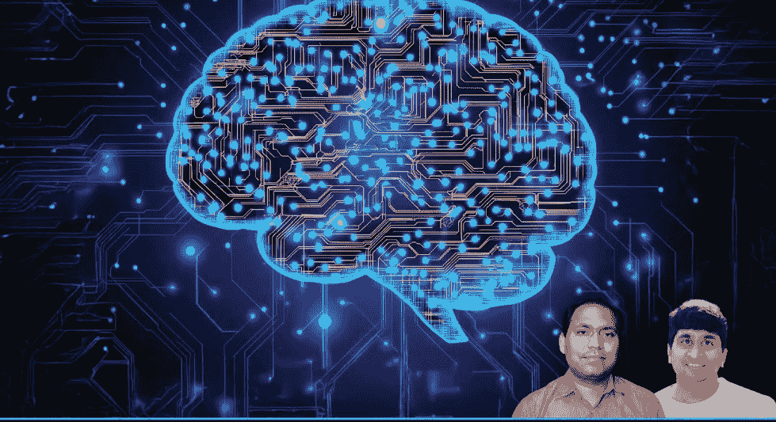

# Azure OpenAI 解锁创意：使用 Azure OpenAI 释放生成式 AI 创新的实用指南

序言由 Marco Casalaina，Microsoft Azure AI 产品副总裁兼 AI 未来主义者

- **组合总监:** Gebin George
- **客户关系负责人:** Deepesh Patel
- **项目经理:** Prajakta Naik
- **内容工程师:** Joseph Sunil
- **技术编辑:** Rahul Limbachiya
- **文案编辑:** Safis Editing
- **校对员:** Tanya D'ruz
- **索引员:** Hemangini Bari
- **制作设计人员:** Vijay Kamble
- **营销协调员:** Vignesh Raju

感谢全能者，在这段旅程中赐予我恩典、智慧力量。

感谢我亲爱的父母，故 Ashutosh Mukherjee 和 Pratima Mukherjee，感谢他们无尽的爱、坚定的支持和牺牲。你们一直是我的指路灯，成就了今天的我。

感谢我出色的妻子 Sujata，感谢她一如一日的爱、耐心和支持。她不仅是我生活的伴侣，更是让一切运行顺畅的人，即使当我的脑子被复杂的算法和无尽的想法占据时也是如此。没有她，我就就像一个没有适当训练数据的 AI——断开且不完整。你的耐心、爱和不断的鼓励改变了一切——Sujata。

感谢我两个漂亮的女儿，Adrija，她为我的生活带来了快乐、笑声和无限的奇心。她提醒我，最大的学习往往来自最意想不到的地方。感谢我的岳父母 Madhusudan Som 和 Tapati Som，他们的爱和鼓励，让我们的家庭变得更加强大。

感谢我的一生之交 Indranath Mitra、Avik Biswas 和 Biswajit Mondal，感谢他们无论发生什么始终如友谊和支持。

衷心感谢 Microsoft 医疗与生命科学技术专家社区以及指导过我的优秀领导者：Tyler Bryson、Patty Carrollo、Joyce Gottbetter、Austin Walsh、Carl Bender、Ian Morrison、Camille Whicker、Laura Robinson、Annita McDonald 和 Gene Buckley。你们的知识、激情和领导力激励我达到新的高度并突破极限。

这本书是我在沿途中收到的所有爱、支持和指导的成果。感谢每一位参与这段旅程的人。

— Amit Mukherjee

首先我想向我的父母 Krishna Priya Saladi 和 Rama Mohan Saladi 表达诚挚的谢意，感谢他们为我和妹妹提供最好的教育和生活条件所付出的牺牲。他们持续的支持、纠正我错误的指导以及他们带给我的灵感，对我的旅程至关重要。没有他们，我不会有今天的成就。我也想感谢我的妹妹 Yogitha Saladi，感谢她在所有挑战中始终支持我。感谢我的表亲和亲属的持续支持。特别感谢我的大学朋友 Praveen、Mount、Neha、Lokesh、Tara 和 Likhitha，感谢他们在无论顺境还是艰难的时刻一直在我身边并支持我。

我非常感激我的第一位导师，来自 Keka 的 Trinath Mallavarapu，他教会了我一个无价的教训：“即使是第一次做，也要做对。”这句建议塑造了我工作和生活的方式。我也向我的导师 Michael Stocker 表示最深的谢意，他的信任和相信让我在 UnternehmerT 的 DPS 期间获得了学习和成长的机会。我感谢 Thomas Zeller 在这段旅程中支持我。我非常感激 Grabon 的创始人 Ashok Reddy，感谢他带我进入公司并在各种情况下始终支持我。Grabon 为我提供了一个观察初创世界的独特视角，Ashok 对探索新想法的鼓励是无价的。

在微软，我首先想感谢我的经理 Pavani Anne，感谢她在职业生涯的这一新阶段做我的导师。从初创公司的背景转到微软这样的大型机构是一个巨大的飞跃，而 Pavani 的指导改变了一切。我也感谢我的经理 Amit Agarwal 和 Durga Prasad Rai 的持续支持。特别感谢我的领导 Subhendu Singh 和 Ajay Kumar S。感谢 Tajesh Singh、Prashant Kalalit 以及微软的所有同事每天给予我的灵感和鼓励。作为一个内向者，我经常感到被排除在外，直到感到舒适时才保持沉默。我将这本书献给那些让我感到包容、向我展示爱与信任并帮助我找到声音的人。特别感谢我的父母，他们的牺牲和坚定支持成就了今天的我。

感谢每一个参与这段旅程的人。

— Adithya Saladi
