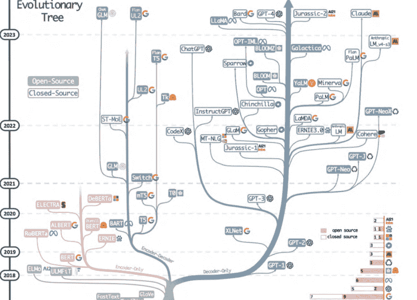
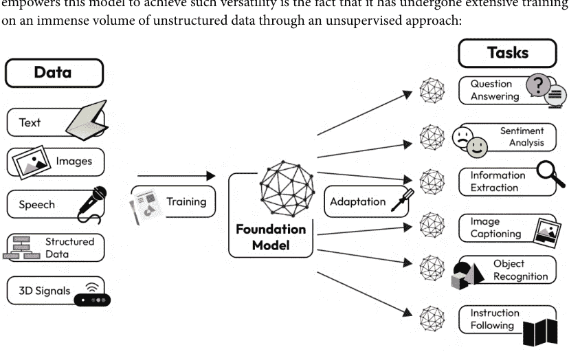

# 大语言模型简介

对于人类来说，文本是一组词汇的组合。我们阅读句子，句子组成段落，段落构成文档的章节。但对于计算机来说，文本仅仅是一系列字母和符号。为了让计算机能够理解，我们可以使用所谓的循环网络来创建一个模型。该模型一次处理一个单词或一个字符，并在读完所有内容后给出答案。这个模型很好，但有时当它读到一段文本的末尾时，很难回想起该段文本开头的内容。这正是 Transformer 架构大放异彩的地方。Transformer 架构的关键创新在于使用了自注意力机制，这使其能够比之前的模型更有效地捕捉序列中不同部分之间的关系。

2017 年，Ashish Vaswani 和他的团队写了一篇名为[注意力就是你所需要的](https://arxiv.org/pdf/1706.03762.pdf)的论文，引入了一种名为 Transformer 的新模型。该模型使用了注意力机制。与循环网络处理文本的老方法不同，注意力机制允许你一次查看整个句子或整个段落，而是一次只处理一个单词。这有助于 Transformer 根据增加的上下文更好地“理解”单词。如今，大多数大语言模型（LLMs）都是构建在 Transformer 之上的。

当你使用 Transformer 模型来理解文本时，必须将其拆分为单独的单词或标记（`tokens`）。这些标记随后被转换为数字，并映射到称为嵌入（`embeddings`）的特殊代码，这些嵌入就像存储标记语义含义的特殊地图。最后，Transformer 的编码器获取这些嵌入并将它们转换为表示。这种“表示”是一个捕捉了输入标记上下文含义的向量，允许模型更有效地理解和处理输入。简单来说，你可以将其构结为将所有碎片组合在一起以理解整个故事。

这里有一个文本字符串、其分词及其向量嵌入的示例。注意，分词可以将单词转换为子词。例如，单词“`generative`”可以被分词为“`gener`”和“`ative`”。

让我们来看输入文本：

> 生成式 AI 是一项由复杂算法和机器学习驱动的突破性技术，具有在各个领域独立创建内容的卓越能力。通过细致分析海量数据集并发现复杂的模式，它能生成文本作品、艺术创作以及许多反映人类智慧的输出。这种创新能力正在重塑各行各业，推动了语言生成、创意艺术和数据合成等领域前所未有的进步。

# 什么是大语言模型？

这里是分词后的文本：

```
['Gener', 'ative', ',', 'AI', ',', ' ', 'a', ',', 'Groundbreaking', ',', ' ', 'technology',
['fuelled', ',', ' ', 'by', ',', ' ', 'intricate', ',', ' ', 'algorithms', ',', ' ', 'and', ',', ' ', 'machine'],
['learning', ',', ' ', 'possesses', ',', ' ', 'the', ',', ' ', 'remarkable', ',', ' ', 'ability'],
['to', ',', ' ', 'independently', ',', ' ', 'craft', ',', ' ', 'content', ',', ' ', 'across', ',', ' ', 'diverse'],
['domains', ',', 'By', 'meticulously', ',', ' ', 'analyzing', ',', ' ', 'vast'],
['datasets', ',', ' ', 'and', ',', ' ', 'discern', ',', ' ', 'ing', ',', ' ', 'intricate', ',', ' ', 'patterns'],
['', ',', ' ', 'textual', ',', ' ', 'compositions', ',', ' ', 'artistic'],
['creations', ',', ' ', 'arts', ',', ' ', 'myriad', ',', ' ', 'other', ',', ' ', 'outputs'],
['that', ',', ' ', 'mirror', ',', ' ', 'human', ',', ' ', 'in', ',', ' ', 'entity', ',', ' ', 'This'],
['innovative', ',', ' ', 'capability', ',', ' ', 'is', ',', ' ', 'reshaping', ',', ' ', 'industries'],
['far', ',', ' ', 'and', ',', ' ', 'wide', ',', ' ', 'driving', ',', ' ', 'unprecedented'],
['advancements', ',', ' ', 'in', ',', ' ', 'fields', ',', ' ', 'such', ',', ' ', 'as', ',', ' ', 'language'],
['generation', ',', ' ', 'creative', ',', ' ', 'and', ',', ' ', 'and', ',', ' ', 'data'],
['synthesis']
```

现在，看嵌入：

```
[-0.0247799065783024, -0.01380225385737491, 0.014264720492064953,
-0.02029823826471297126, 0.0898031626496836, 0.0171310584992217033,
0.0422450006081428, 0.02088187656995296, -0.028950852396774292,
0.0418062725067139, 0.0201751936886948, 0.034369271248597025,
0.00537555034030074, -0.01920752003788948, 0.002707283245399543,0.0
081034330651166405, 0.0354079884867414, 0.01543007129907608,
]
```

```
[-0.028271631402176, -0.009549995884299278, 0.02203330025076866,
-0.015215701423585415, 0.02339498312336653, -0.0089673520999711666,
0.0176113824591111, 0.0111111111111111111111111111,
.0011111111111111, 0.0011111111111111, 0.0111111111111111,
]
```


现在我们已经学习了大语言模型（LLM）背后的基本概念，让我们关注一些顶尖的行业案例。

# LLM 示例

许多公司都开发了前沿的 LLM，包括 OpenAI（GPT-4）、Meta（Llama 3.1）、Anthropic（Claude）和 Google（Gemini）等。OpenAI 在 LLM 领域一直保持着主导地位。让我们来看看写作时所使用的模型：

- **生成式预训练 Transformer（GPT）：** OpenAI 创建了各种 GPT 模型，包括 GPT1（11.7 亿参数）、GPT2（15 亿参数）、GPT-3（1750 亿参数）、GPT 3.5、GPT-4-turbo、GPT-4o 以及 GPT-4o mini。GPT-4o 是全球范围内最先进的 LLM 之一。这些模型从海量文本中学习学习并能够对许多主题和问题提供类人类的回答。它们还能记住对话的部分内容。

- **Anthropic：** Anthropic 的模型是一系列先进的 LLM，旨在高效地处理复杂任务。最新的迭代版本 Claude 3 包含了 Opus、Sonnet 和 Haiku 等模型，每个模型都针对不同的性能需求定制。Opus 是最强大的，擅长复杂分析和高阶任务；而 Sonnet 平衡了速度和智能，Haiku 为轻量级操作提供最快的响应速度。这些模型的构建重点关注安全性、可靠性和伦理实践。

- **Llama 3.1：** 一种前沿的 LLM，代表了 AI 研究的重大里程碑。凭借其先进的架构和巨大的规模，Llama 3.1 能够以前所未有的准确细微差别理解并生成类人类文本。这一强大的工具对各种应用具有深远影响，包括自然语言处理（NLP）、文本生成和对话 AI。

- **Llama 2：** 由 Meta 开发的第二代 LLM。它是开源的，可以用于创建 ChatGPT 或 Google Bard 这样的聊天机器人。Llama 2 的训练数据比 Llama 1 多了 40%，以生成逻辑性且自然的回答。Llama 2 可供任何人用于研究或业务。

Meta 表示 Llama 2 理解的上下文是 Llama 1 的两倍。这使其成为更智能的语言模型，可以提供像人类一样的答案。

- **Gemini：** Gemini 是由 Google DeepMind 开发的一系列先进多模态 LLM。于 2023 年 12 月 6 日发布，包含了 Gemini Ultra、Gemini Pro、Gemini Flash 和 Nano 等变体。旨在无缝地理解和跨不同类型的信息，包括文本、图像、音频、视频和代码。作为 OpenAI GPT-4 的竞争对手，Gemini 为 Google 的 AI 聊天机器人驱动，旨在提升创造力和效率。

- **PaLM 2：** 最后，PaLM 2 是 Google 更新的 LLM。它擅长处理复杂任务，如代码和数学、分类和回答问题、语言翻译、精通多种语言以及创建类人类句子。它优于之前提到的模型（包括原始 PaLM）。Google 对创建和使用 AI 非常谨慎，PaLM 2 是这种方法的一部分。它经过了彻底的评估，可以检查潜在的问题偏见。PaLM 2 不仅孤立使用，还被用于其他高级模型，如 Med-PaLM 2 和 Sec-PaLM。它还负责 Google Google AI 功能和工具，如 Bard 和 PaLM API。

现代 LLM 的进化树（见图 1.2）说明了这些模型在近几年中是如何演变的，并突出了一些最著名的模型。关系密切的模型位于同一分支上。使用 Transformer 架构的模型用不同颜色表示：仅解码的在蓝色分支，仅编码的在粉色分支，同时进行编码和解码的模型在绿色分支上。模型在时间轴上的位置显示了它们发布的时间。开源模型用填充方框表示，而非开源模型用空方框表示。右下角的状图显示了来自不同公司和组织的模型数量：



图 1.2：进化树（来源：https://arxiv.org/abs/2304.13712 ）

在探索一些案例后，让我们讨论一下基础模型（`foundation models`）的概念及其优势。

# 基础模型的概念

近年来，LLM 作为基础模型引起了巨大的轰动。“基础模型”一词最初由斯坦福大学的一个团队引入。从本质上说，这些模型属于生成式 AI，因为它们能够生成文本。赋予这些模型实现多功能能力的是它们在海量数据上经过广泛训练，涵盖了 NLP 任务（见图 1.3）：



考虑一种场景，你向模型提出了一个分类任务。假设你给模型提供了一个句子，并接着问道：“这句话带有积极还是消面的情绪？”模型随后将施展它的魔力，通过生成的词来完成句子。它生成的下一个词将作为你分类问题的答案。根据它对句子情绪的感知判断，模型将回答“积极”或“消面”。这种方法利用了模型生成上下文相关文本的能力来解决特定的分类挑战。

即使在数据有限的情况下，基础模型也可以非常有效。通过称为提示（`prompting`）或提示工程的过程，零样本（`zero-shot`）、单样本（`one-shot`）和少样本学习（`few-shot learning`）等技术可以用于处理下游任务。虽然这些模型主要设计用于生成预测（特别是 NLP 任务），但它们提供了巨大的能力。通过添加少量的标注数据，我们可以调整这些模型以获得异常性能。这种转换是通过称为微调（`fine-tuning`）的过程实现的。

让我们谈谈一些优势：

- **性能：** 这些模型在海量内容上进行了训练，数据量通常达到 TB 级。在执行小型任务时，这些模型表现出的卓越性能超过了在少数数据点上训练的模型。

- **生产力提升：** LLM 可以极大地提高生产力。对于通常需要大量精力的任务，它们就像极其高效的人类。在客户服务中，LLM 可以快速回答常见问题，释放出人类员工处理更复杂的问题。在业务中，它们比人类更快地处理和组织数据。使用 LLM，公司可以节省时间和金钱。这让他们能够专注于更重要的任务。

然而，这些基础模型也面临着关键挑战和局限性：

- **成本：** 由于需要海量数据，这些模型的训练通常非常昂贵。这对于尝试训练自己基础模型的小型企业带来了挑战。此外，随着模型规模的增大（达到数十亿参数），进行推理的成本也会变得非常昂贵。

微软等云提供商提供了名为 Azure OpenAI 的服务。该服务允许企业按需使用这些模型，并根据实际使用付费。这类似于短时间租用一台强大的计算机，而不是购买一台。通过利用这种基于服务的能力，公司可以在模型训练和使用方面都节省费用，特别是考虑到这些模型所需的强大基于 GPU 的硬件。

总而言之，使用此类服务可以在不花费巨额资源和基础设施的情况下，利用先进模型的优势。

- **可信度：** 正如数据是这些模型的巨大优势一样，也有其反面：LLM 是在海量的互联网抓取数据上训练的，这些数据可能包含偏见、仇恨言论或毒性内容，从而损害了它们的可靠性。这将是一项艰巨的任务。此外，挑战在于甚至不知道数据包含哪些内容。对于许多开源项目，训练许多 LLM 所使用的数据并不明确，这使得评估人们对模型可信度和潜在偏见的担忧变得困难。LLM 训练数据的巨大规模使得人工标注员几乎无法彻底审查每一个数据点，这增加了产生无意后果的风险，例如延续有害偏见或生成毒性内容。

大型机构充分意识到这些技术所含的巨大可能性。OpenAI、微软、谷歌和 Anthropic 共同宣布成立了[前沿模型论坛](https://microsoft.com/on-the-issues/2023/07/26/anthropic-google-microsoft-openai-launch-frontier-model-forum)，这是一项全新的行业倡议，旨在确保前沿 AI 模型的安全和负责任的发展。这项新的协作努力将利用其成员公司的集体技术和运营流程，促进更广泛的 AI 领域的进步。其核心目标之一是推动技术评估和基准测试的发展。此外，该论坛将构建一个公开的解决方案库，以加强整个 AI 领域对最佳实践和标准的采纳。

- **幻觉：** 有时，LLM 可能会产生完全不准确的信息或答案。这就像你做了一个看起来真实的梦，但它并不是基于实际发生的事情。LLM 可能会生成听起来正确但并非完全真实或准确的文本。因此，虽然 LLM 非常智能，但它们有时会犯错或提供非真实的内容。

LLM 的应用通常需要人工监督，以确保输出是可信的。

然而，有一种名为“模型对齐（`grounding the model`）”的技术，旨在改善这种情况。对齐意味着将 LLM 的理解与真实世界的信息和上下文联系起来。这就像确保模型稳根于现实。在本书中，我们将更多讨论如何使用这种技术来防止模型编造事实，并仅根据给上下文提供答案。

- **有限的上下文窗口：** LLM 有有限的上下文窗口或 `token` 大小。上下文窗口或 `token` 大小可以看作模型一次处理的内存量。LLM 一次只能理解一定数量的信息。例如，ChatGPT（GPT-4）可以处理 128k 输入 `token`。这意味着如果你给它太多的阅读内容，它将无法处理并报错。因此，将输入保持在此限制范围内对于模型的良好运行至关重要。

在理解基础模型概念的基础上，让我们深入探讨 LLM 的一些实际用例。

# 探索 LLM 用例

由于 LLM 具有理解和生成类文本的能力，它们在各个领域和行业中都有广泛用用。让我们来看看一些：


**内容生成：** LLM 可以为博客、文章、营销材料和社交媒体帖子生成书面内容。它们可用于自动化内容创建并提供创意构思。

**客户支持：** LLM 可以对客户查询和支持工单提供自动回复，从而处理常见问题和事项，释放人工坐勤人员来管理复杂案例。

**语言翻译：** LLM 可用于翻译不同语言之间的文本，使全球范围内的通信变得更加容易且无障碍。

**文本摘要：** LLM 可以快速总结长文本，让人更容易掌握文章、报告和其他书面材料的重点。

**聊天机器人和虚拟助手：** LLM 可以驱动能够自然语言对话的聊天机器人和虚拟助手，帮助用户完成任务、查询和信息检索。

**内容个性化：** LLM 可以分析用户偏好和行为，在社交媒体和流媒体服务等平台上提供个性化的推荐、广告和内容投放。

**数据输入和提取：** LLM 可以从非结构化文本（如文档或电子邮件）中提取相关信息，并将其输入到结构化数据库或电子表中。

**创意写作：** LLM 可以通过生成故事构思、对话、角色描述甚至整个叙事来协助作家。

**医疗聊天机器人：** 由 LLM 驱动的聊天机器人可以回答健康相关问题，提供急救建议，并提供有关常见疾病的信息。

**医学诊断：** LLM 可以通过分析患者症状和医疗记录来协助诊断疾病，提供潜在的诊断方案和治疗建议。

**心理健康支持：** LLM 可以为寻求心理健康问题支持的个人提供共情式的回复和资源。

**旅游和旅行规划：** LLM 可以通过建议行程、推荐以及提供有关当地习俗和美食的信息来帮助旅行者。

**食谱创作：** LLM 可以根据食材和饮食偏好设计创新的食谱，提供新的烹饪体验。

**网络安全分析：** LLM 可以分析网络安全威胁，并建议用于保护数字系统和数据的策略。

**时尚推荐：** LLM 可以根据个人风格偏好和当前时尚趋势推荐服装和配饰搭配。

**法律文件审查：** LLM 可以审查法律文件、合同和案例历史，以识别相关信息、异常和潜在问题。

**学术研究：** LLM 可以通过提供学术论文摘要、帮助文献综述以及生成进一步研究的想法来协助研究人员。

**财务分析：** LLM 可以处理和分析财务数据，生成报告，并对市场趋势和投资机会提供见解。

**语言学习：** LLM 可以通过进行对话、提供解释和提供练习来帮助学习者练习并提高语言技能。

**无障碍工具：** LLM 可用于为视障人士创建音频描述、为视频生成字幕，并为有阅读困难的人将文本转换为语音。

虽然这些只是一些用例示例，但 LLM 无限的灵活性使得它们随着技术的发展，被应用到更多的场景中。

## 总结

在本章中，我们首先介绍了大语言模型（LLMs）以及它们如何受到 Transformer 网络的影响。然后，我们探索了组成 LLM 的各个部分。接下来，我们深入研究了由 OpenAI、Meta 和 Google 创建的一些顶级 LLM 模型，并讨论了这些模型是如何演变的。我们还涵盖了基础模型概念，包括它们的优势和局限性。最后，我们查看了 LLM 显示出潜力的各种业务应用。

在章节，我们的重点将放在 Azure OpenAI 服务。我们将学习如何访问此服务，包括 GPT-3.5、GPT-4、Embeddings 和 DALL-E 2 等模型。我们还将解释定价工作原理，讨论诸如按需付费和预留容量等选项。

## 延伸阅读

- AI 解释器：基础模型与 AI 的下一个时代 (https://www.microsoft.com/en-us/research/blog/ai-explainer-foundation-models-and-the-next-era-of-ai/)

- Orca：从 GPT-4 的复杂解释轨迹中渐进式学习 (https://www.microsoft.com/en-us/research/publication/orca-progressive-learning-from-complex-explanation-traces-of-gpt-4/)

- Florence：用于计算机视觉的新基础模型 (https://www.microsoft.com/en-us/research/publication/florence-a-new-foundation-model-for-computer-vision/)

- 加速基础模型研究 (https://www.microsoft.com/en-us/research/collaboration/accelerating-foundation-models-research/)

- 注意力机制就是一切 (https://arxiv.org/abs/1706.03762)

- 基础模型的机遇与风险 (https://arxiv.org/abs/2108.07258)
