# 2 Azure OpenAI 基础知识

在上一章中，我们讨论了大语言模型（LLMs）、LLM 概念以及不同的企业级 LLM 示例。我们还讨论了基础模型概念，并探讨了 LLM 的不同用例。在本章中，我们将深入研究 Azure OpenAI (AOAI) 服务、不同模型类型、如何部署模型以及各种定价方面。

我们将在本章中学习以下章节：

- 什么是 AOAI 服务？

- AOAI 模型类型

- 访问 AOAI 资源

- 创建 AOAI 资源

- 部署 AOAI 模型

- 利用 AOAI 模型

- 定价

在进入这些之前，让我们稍微更好地了解微软与 OpenAI 的合作伙伴关系。

微软对 OpenAI 投入了数十亿美元的投资，以确保他们能够开发先进的 AI 技术并与所有人共享其成果。这种合作伙伴关系建立在微软 2019 年和 2021 年之前的投资的基础上。这使得微软和 OpenAI 能够将他们创建的先进 AI 技术用于自己的业务。微软还投资了强大的超级计算机，帮助 OpenAI 进行其重要的研究。

微软与 OpenAI 建立了战略合作伙伴关系，在此过程中整合了他们先进的 LLM。我们在各种产品中使用 OpenAI，并创造创新的数字体验。微软有一项名为 AOAI 的服务，开发者可以在那里利用尖端模型的力量，结合微软强大的工具。微软是唯一为 OpenAI 提供云服务的公司，这意味着他们将处理 OpenAI 研究、产品和服务的所有计算工作，以构建复杂的 AI 应用。这种协作能够实现变革性解决方案的创造，开启了 AI 驱动开发的新可能。在下一节中，我们将深入探讨 AOAI 服务以及如何使用它。

## 什么是 AOAI 服务？

微软提供广泛的 AI 工具和解决方案，帮助处于 AI 旅程每个阶段的客户，无论团队的专业知识如何。无论你是 AI 新手还是有特定的用例，微软都有许多涵盖的方案。他们为初学者提供了易于使用的选项，同时也支持具有更高级需求的数据科学家。当你探索 AI 产品时，你可以自由地从高层 AI 服务开始，并深入 Azure Machine Learning 平台，以规模构建、训练、调优和部署深度学习模型。整个 Azure AI 栈如图所示：

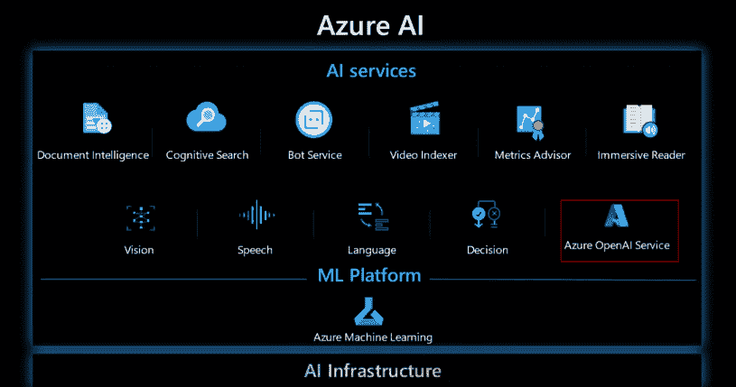

图 2.1 - Azure AI 栈

在顶层，你拥有用于特定应用的 AI 服务，例如认知搜索（Cognitive Search）、机器人服务（Bot Service）和文档智能（Document Intelligence）。还有特定领域的预训练模型，如视觉（Vision）、语音（Speech）、语言（Language）、决策（Decision）和 Azure OpenAI 服务。这些都是在 Azure Machine Learning 作为托管端点的基础上构建的。如果你在使用 AI 服务，你就不需要担心基础层。然而，如果你想访问基础层以获得控制权，你可以使用底层：Azure Machine Learning。它是一个托管的端到端机器学习平台，用于负责任且安全地规模化构建、训练、部署和运行机器学习模型。

### AOAI 模型类型

AOAI 服务（图 2.1 中红色文本框标记）是一项新的 Azure 服务，为 OpenAI 强大的语言模型提供 REST API 访问，包括 GPT-4 Turbo、GPT-4o、GPT-4o mini、GPT-3.5 Turbo、Whisper、DALL-E 3 和 Embedding 模型。它们提供了安全性、私有网络、合规性、区域可用性和负责任 AI 等功能。

### Azure OpenAI 基础

**GPT-3.5**：GPT-3.5 代表系列构建在 GPT 之上的模型。这些模型擅长理解和生成自然语言以及代码。在 GPT-3.5 模型中，最强大且成本效益的是 GPT-3.5 Turbo。它专门针对交互进行了微调，并在处理常规任务时表现良好。GPT-3.5 的最新版本还有两种口味：

- `gpt-3.5-turbo-1106`：该模型支持最大 16385 个 token 窗口和 4096 个输出。

- `gpt-3.5-turbo-0125`：该模型支持最大 16385 个 token 窗口和 4096 个输出。

- `gpt-3.5-turbo-instruct`：该模型支持最大 4097 个 token 窗口。该模型经过微调。

**GPT-4**：这是最新的，并且能够解决复杂问题。作为一种高度优化的模型，GPT-4 最适合交互式聊天。GPT-4 类：

- **GPT-4 Turbo**：该模型支持最大 128000 个 token 窗口和 4096 个输出。

- **GPT-4o**：该模型支持最大 128000 个 token 窗口和 4096 个输出。

- **GPT-4o mini**：该模型支持最大 128000 个 token 窗口和 16384 个输出。

这是一个可以采用 GPT-3.5 或 GPT-4 的交互示例。通常，你作为用户输入提示词（prompt），模型做出响应（model output）。这可以是连续的对话：

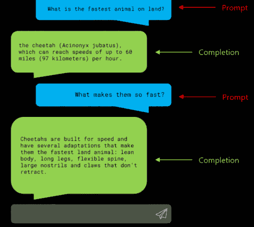

图 2.2: 基础提示词和完成示例

除了提示词补全，你还需要理解一个关于令牌（tokens）的概念。当你向 GPT-3.5 或 GPT-4 发送提示词时，它通过嵌入（embedding）过程进行分词，在此过程中，单词或更常见的词片段会被转换为数值向量表示。使用数值令牌而不是完整的单词或句子来处理信息。这种设计允许 GPT 模型处理相对大量的文本。然而，GPT-3.5 和 GPT-4 对令牌都有限制（取决于你之前提到的所选的模型），该限制适用于输入提示词和生成的内容的总和。

为了确保你在令牌限制范围内，你可以估计提示词及结果生成内容所需的令牌数量。作为一个粗略的指南，在英语中，每四个字符通常对应一个令牌。因此，你可以通过将提示词的字符数与所需的响应长度相加，然后将总和除以四来计算所需的令牌。这种计算可以为你提供一个所需令牌数量的粗略估计，这对于必须考虑令牌限制的任务规划非常有价值。图 2.3 显示了给定句子的令牌计数示例：

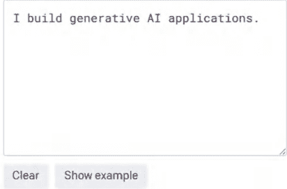

| 令牌 (Tokens) | 字符 (Characters) |
|---|---|
| 7 | 35 |

图 2.3：令牌计数器

在这个示例中，共有七个令牌。注意的是，"generative"由两个不同的令牌表示，而其余单词每个由一个令牌表示。

**嵌入模型**：嵌入是浮点数的向量列表。当我们衡量这些向量之间的距离时，它告诉我们它们有多相似或差异。如果距离很小，它们非常相似；如果距离很大，意味着它们差异很大。当你将原始文本输入嵌入模型时，它会为提供的文本生成一个向量表示列表：

### Azure OpenAI 基础

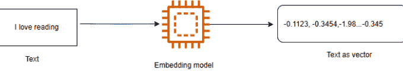

图 2.4：基础嵌入过程

实践中，你将一组文档单词作为输入提供嵌入模型，模型使用这些单词创建一个嵌入向量。该向量通常存储在向量数据库中，例如 Azure Cognitive Search 或 Azure Cosmos DB。随后，当用户提交查询时，它会通过相同的嵌入模型生成查询向量，并用于在向量数据库中搜索相似的向量。这种模式被称为检索增强生成（RAG）。

下面的图说明了这一过程：

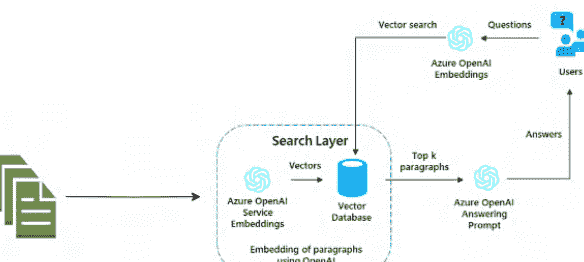

图 2.5：文档嵌入过程

在编写时，AOAI 服务提供四种嵌入模型：

**`text-embedding-ada-002`（版本 1）**：该版本使用 GPT-2/GPT-3 分词器。它可以处理最多 **2,046** 个输入令牌，并提供 **1,024** 维的输出。

**`text-embedding-ada-002`（版本 2）**：此版本使用 `c100k_base` 分词器。它支持大四倍的输入，最多 **8,191** 个令牌，并返回 **1,536** 维的输出。这是第二代嵌入模型。我们强烈建议使用 `text-embedding-ada-002` 版本2，因为它在能力和性能方面与 OpenAI 的 `text-embedding-ada-002` 模型平相当。该模型不仅更具成本效益，而且更简单高效。

### AOAI 模型类型

**`text-embedding-3-small`**：新的 `text-embedding-3-model` 显著优于其前身 `text-embedding-ada-002`，多语言检索的基准分从 31.4% 提高到 44.0%，英语任务则从 61.0% 提高到 62.3%。此外，它的成本效益提高了五倍，每 1k 令牌的价格从 $0.0001 降至 $0.00002。虽然 `text-embedding-ada-002` 仍然可用，但由于其提高的效率和性能，推荐 `text-embedding-3-small`。新模型 `text-embedding-3-large` 提供了更大的容量，嵌入维度高达 3,072 维。

**`text-embedding-3-large`**：新的 `text-embedding-3-large` 是性能最好的嵌入模型，相比 `text-embedding-ada-002` 有巨大的改进。它在 MIRACL 基准测试中获得 54.9% 的平均分，在 MTEB 基准测试中获得 64.6%，分别高于之前的 31.4% 和 61.0%。`text-embedding-3-large` 的价格为每 1k 令牌 $0.00013，在所有其他嵌入模型中提供了最高性能，超越了 `text-embedding-3` 和 `text-embedding-ada-002`。

要创建一个生成式 AI 应用，你主要需要的密钥是之前提到的那些。需要注意的是，这些模型仅在截至 2021 年 9 月的大量数据集上进行过训练。因此，它们不具备该日期之后的任何知识或信息。

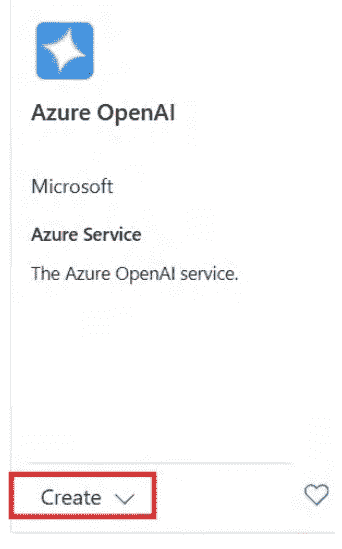

图 2.8：创建 AOAI 资源

3. 在 AOAI 创建页面上，在"基础"（Basics）选项卡的字段中提供以下详细信息：

| 字段 | 说明 |
| --- | --- |
| 订阅 (Subscriptions) | 用于接入 AOAI 服务而在应用程序中提到的 Azure 订阅。 |
| 资源组 (Resource Group) | 将包含 AOAI 资源的 Azure 资源组。您可以创建一个新组或使用现有的组。 |
| 区域 (Region) | 实例的地理位置。不同的位置可能会引入延迟，但不会影响资源的可用性。 |
| 名称 (Name) | 您的 AOAI 服务资源的描述性名称。 |
| 定价分层 (Pricing Tier) | 资源的定价分层。在编写时，AOAI 服务仅提供标准（Standard）层级。 |

表 2.1：AOAI 资源创建详情

4. 现在，让我们通过"基础"选项卡中提供这些详细信息来创建 AOAI 资源：

# 创建 Azure OpenAI

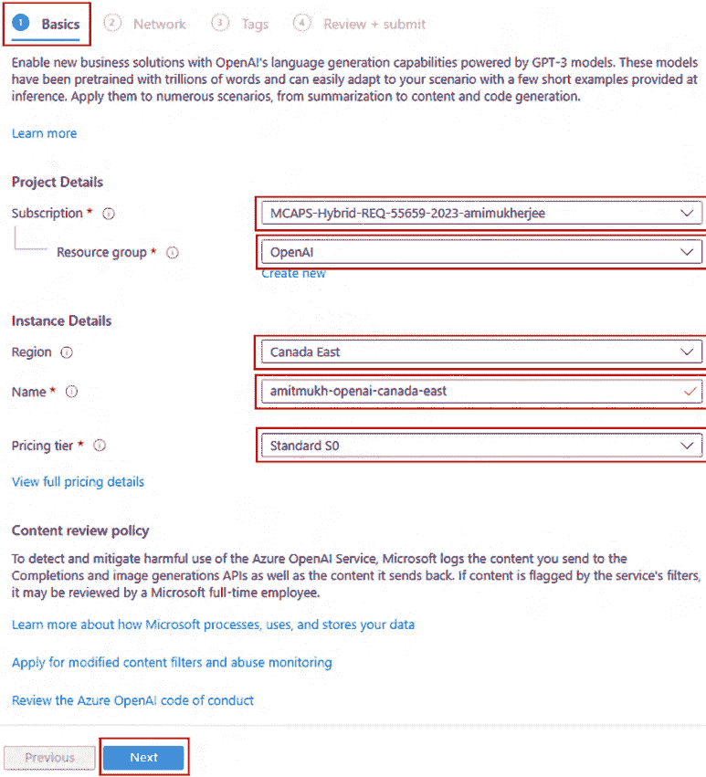

图 2.9：创建 AOAI 资源的基本信息

5. 点击"下一步"。

### Azure OpenAI 基础

6. "网络"（Network）选项卡提供了三个安全选项。如果您在部署期间需要增强安全性，可以在网络中选择选项 2 或 3。此选择允许您配置 AOAI 以提高安全性，通过 Azure 虚拟网络集成和私有端点连接进行访问。在本书后续章节，我们将重点探讨选项 2 和 3。现在，请选择选项 1（包括互联网在内的所有网络都可以访问此资源）。

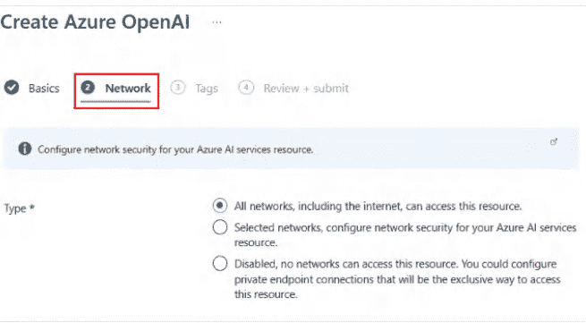

图 2.10：用于配置 AOAI 资源的公共访问网络设置

7. 点击"下一步"继续，并根据需要为资源配置任何标记（tags）。

8. 点击"下一步"进入流程的最后一个阶段：审核 +提交（Review + submit）。

9. 验证您的配置设置，然后点击"创建"启动过程。请耐心等待；此过程可能需要 2-3 分钟完成。

Azure 门户将在新资源可用后通知您。点击"转到资源"访问新创建的资源。

现在，我们已设置 AOAI 服务。在下一节中，我们将部署模型。

### 部署 AOAI 模型

在上一节中，您创建了一个 AOAI 资源。通过现在，您可以通过各种方式（例如 Azure AI Foundry、REST API 或 SDK）部署并利用您的模型。本节将引导您如何从 Azure AI Foundry 部署这些模型，并通过 Studio 和 Python SDK 访问它们：

1. 在 Azure 门户（https://portal.azure.com/）中登录您的 Azure 订阅。

2. 在资源搜索栏中搜索 Azure OpenAI。找到您在上一节中创建的 AOAI 资源：

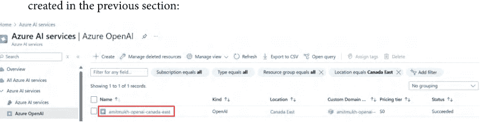

3. 点击正确的服务名称（如上一图中红色矩形所示）。


## 使用 Azure OpenAI 服务构建您自己的安全 Copilot 并生成 AI 应用

部署 OpenAI 模型并开始进行 API 调用。连接您的数据、调用和函数以生成个性化的智能响应。通过 REST API、Python SDK 或 Azure AI Foundry 门户中的 Web 界面部署服务。

了解更多

### 部署模型

设置部署对提供的模型或自定义模型进行 API 调用。当部署完成并准备就绪时，您的部署状态将变为“成功”（Succeeded）。

1. 点击“Azure AI Foundry 门户”或“转到 Azure AI Foundry 门户”导航到 Azure Foundry：

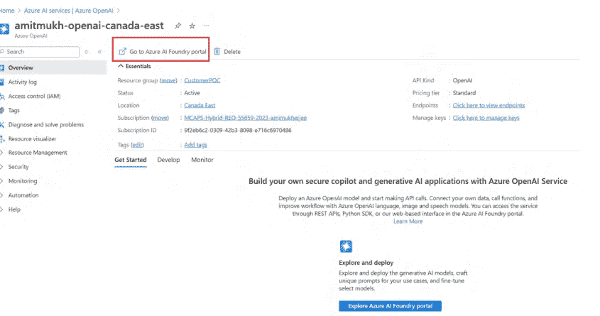

2. 在“管理”（Management）部分中，选择“部署”（Deployments）：

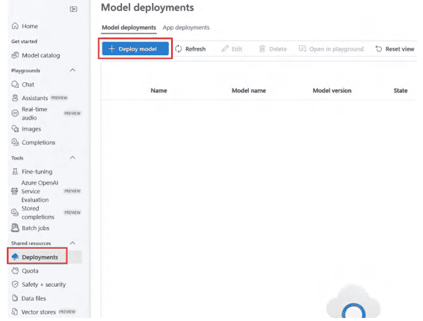

3. 选择模型并继续配置以下字段：

| 字段 | 说明 |
| --- | --- |
| 选择模型 (Select a model) | 从下拉列表中选择模型。模型可用性取决于区域差异。要查看可用模型列表，请参考模型摘要和区域可用性：`https://learn.microsoft.com/en-us/ai-services/openai/concepts/models#summary-table-region-availability` |
| 部署名称 (Deployment name) | 选择部署名称时要考虑。部署名称至关重要，因为它将在您的代码中使用客户端库和 REST API 调用模型。 |
| 高级选项（Advance Options）（可选）：你有选项配置资源所需的高级设置，例如内容过滤、每分钟令牌数（TPM）等。 | 对于您的初始部署，保持高级选项不变。有关内容过滤和 TPM 的更多细节将在后续章节提供。 |

选择模型

`gpt35-turbo`

部署名称

`gpt35-turbo`

高级选项


4. 点击“创建”继续。

5. “部署”表将显示与您创建的模型对应的条目，状态为“成功”（Succeeded）：

模型部署


（可选）：如果您可以访问 GPT-4，可以重复所有之前的步骤来部署 GPT-4 或基础模型。

等等，让我们重新阅读文本以修复流程：“现在您已成功使用 Azure AI Foundry 部署了模型，让我们在 Azure AI Foundry 和通过 Python SDK 探索这些模型。”

### 利用 AOAI 模型

为了有效使用模型，理解与模型相关的某些元素很重要。这些概念对于正确利用模型至关重要。GPT-3.5 Turbo 和 GPT-4 模型是针对对话界面优化的大语言模型（LLM）。它们在运行方式上与旧模型不同。这些模型是文本输入文本输出，意味着它们接受输入（提示词）并返回完成结果；虽然这种格式主要为多轮对话设计，也可以用于非聊天场景。在 OpenAI 中，与 GPT-3.5 Turbo 和 GPT-4 等模型交互有两种不同的选项：

- **聊天完成 API（Chat Completion API）：** 聊天完成 API 是专门为与 GPT-3.5 Turbo 和 GPT-4 交互设计的 API，它是访问这些模型的推荐且首选的方法，并为与 LLM 交互提供了精简且优化的方法。为了构建它，你应该使用 `messages` 参数，它接受消息对象数组。当使用 API 与这些模型交互时，通常提供一个字典列表表示对话格式。列表中的每个字典应包含消息的角色和内容，使您能够与模型进行有意义的交流。基本聊天完成 API 的格式如下所示：

```python
response = openai.ChatCompletion.create(
  engine="gpt35-turbo",
  messages=[
    {"role": "system", "content": "你是一个帮助人们寻找信息的有用助手"},
    {"role": "user", "content": "谁在 2011 年获得了 ICC 赛冠军？"},
    {"role": "assistant", "content": "印度在 2011 年获得了 ICC 冠军."},
    {"role": "user", "content": "决赛在哪里举行的？"},
    {"role": "assistant", "content": "2011 年 ICC 赛决赛在印度孟买的万科德球场举行的"}
  ]
)
```

与这些模型交互的主要输入是 `messages` 参数，它接受消息对象数组。每个消息对象由一个角色类型（`system`、`user` 或 `assistant`）和内容组成。对话可以短到单条消息，也可以是多次往返交流。让我们仔细查看这些不同的角色：

- `system`：系统角色（也称为系统消息）放置在消息数组的开头。它充当模型的初始指令，用于引导模型的响应和交互。这些角色由开发者设置，并塑造模型处理各种任务和与用户通信的方式。在系统角色中，你可以灵活地提供不同类型的信息：

  - **交互引导：** 系统角色定义了模型应该如何与用户交互。例如，模型可能有一个优先考虑提供帮助和相关信息的角色，或者一个保持中立不偏不立场的角色。

  - **行为约束：** 该角色为模型应该做和不该做什么建立了边界。这可能包括避免某些主题、遵守隐私指南，或拒绝提供医疗或法律建议。

  - **性格特征：** 你可以自定义助手的性格特征，使其更适合您的特定情况。

  - **响应风格：** 系统角色可以影响响应的语气和风格。例如，模型可能会在专业背景下以正式方式回复，或在非正式交互中采用随意的语气。

  - **任务管理：** 该角色有助于模型有效地处理特定类型的查询。例如，如果系统角色是为客户支持设计的，模型可能会针对故障排除和提供特定产品或服务的帮助进行优化。

  - **伦理和安全考虑：** 系统角色通常包含确保响应符合伦理准则和安全协议的参数，防止生成有害内容。

  总之，系统角色有助于调整 LLM 的行为以更好地满足用户需求并符合预期的用例，无论是特定的详细指令还是基础指导。虽然系统角色是可选的，但通常建议至少包含一条基础消息，以获得最佳结果并有效引导助手的行为。

- `user`：用户角色指的是用户在交互期间承担的功能或背景。它影响了用户如何提问以及他们从模型中寻求什么（例如信息、建议或创意帮助）。用户角色通过提供交互背景来影响模型的响应，并根据用户的需求和预期塑造答案的风格和细节。它还会影响模型如何适应以实现用户的目标，无论是出于目的、技术支持还是闲聊对话。用户角色有助于定制交互，使其更有效并更符合您的特定需求。

- `assistant`：助手角色代表与用户聊天的模型。它用于将由模型编写的消息与用户编写的消息区分开来。助手角色还用于指示聊天中是由哪种模型在发言。例如，如果聊天记录中的最后一条消息是助手角色，那么模型将像继续与用户对话一样生成响应。

通常情况下，对话的结构是开头有一个系统消息（`system message`），随后是交替的用户（`user`）和助手（`assistant`）消息。系统消息在设定助手行为方面起着至关重要的作用。它可以用于自定义助手的个性，或提供关于在对话过程中如何响应的特定指令。用户消息用于向助手传递请求或信息。助手消息不仅提供回复，还可以用于提供您期望在对话过程中助手表现出的预期行为示例。这种结构化格式允许在受控的情况下进行有效的通信。

图 2.16 展示了此类对话的结构：

```python
### 定义系统角色
role="system",
content="You are a technical support assistant for a software application called Techsupport Pro.\nYou can only provide help related to this software.\nKeep your answers concise and avoid technical jargon where possible.\nYour response should not be more than 3 points in bulleted form"

### 定义用户角色（输入）
role="user",
content="I'm having trouble saving my document in Techsupport Pro.\nI'm getting an error saying 'file could not be saved'.\nWhat should I do?"

### 将消息合并为对话
messages=[system_message, user_message]

### 使用消息调用 OpenAI API
response = client.chat.completions.create(
    messages=messages
)

### 提取助手的响应
assistant_message = response.choices[0].message.content

### 输出助手的响应
print(assistant_message)
```

- 检查文件权限：确保您对尝试保存文档的目录具有写入权限。如果问题仍然存在，请尝试保存到其他位置。
- 磁盘空间：确认您的驱动器上有足够的磁盘空间。磁盘空间不足可能会导致文件无法保存。
- 软件更新：验证您正在使用最新版本的 Techsupport Pro。如果不是，请更新到最新版本，因为它可能包含对已知问题的修复，包括保存问题。

图 2.16：系统、用户和助手角色/消息的结构

第一个方框代表系统消息，它设定了您期望 LLM 响应的行为。第二个方框是用户消息，用户在此提问。最后一个方框是助手消息，它对用户的查询提供响应。

### 利用 AOAI 模型

- **带有聊天标记语言（ChatML）的 Completion API：** ChatML 采用与您用于其他 GPT-3 模型（如 `davinci-002` 或 `babage-002`）相同的 Completion API，但它使用了独特的基于标记的提示词格式。虽然 ChatML 提供了对专用聊天完成（Chat Completion）API 的更低级访问，但它带来了一些限制和考虑因素：

  - **输入验证：** 使用 ChatML 时，必须执行额外的输入验证，以确保消息的格式和结构正确。

  - **模型兼容性：** ChatML 仅兼容 GPT-3.5 Turbo 模型，不支持新的 GPT-4 模型。

  - **潜在的格式变化：** ChatML 的底层格式可能会随着时间而变化。

因此，虽然 ChatML 提供了灵活性，但在使用 GPT-3.5 Turbo 模型时，意识到这些限制以及探索其他格式的可能性是非常关重要的。

现在您已经对聊天完成 API 及其结构有了基础理解，让我们探索如何从 Azure AI Foundry 和 Python SDK 使用模型。

## Azure AI Foundry 体验

要利用 Azure AI Foundry 中的模型，请按照以下步骤操作：

1. 在 Azure 门户 (`https://portal.azure.com/`) 中登录您的 Azure 订阅。

2. 在资源搜索栏中搜索 Azure OpenAI。找到您在上一节中创建 AOAI 资源：

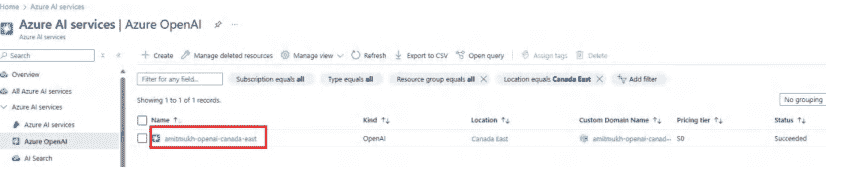

图 2.17：查找之前创建的 AOAI 实例

3. 点击上一图中红色框内亮的服务名称。

4. 点击“Explore Azure AI portal”或“Go to Azure AI Foundry portal”进入 Azure AI Foundry：

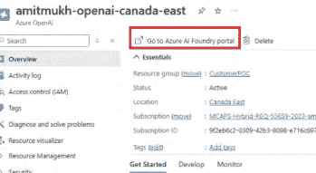

图 2.18：启动 Azure AI Foundry

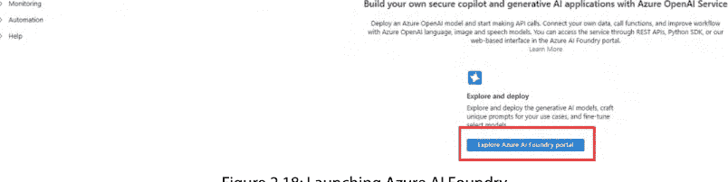

5. 在操场（playground）中，选择：Chat

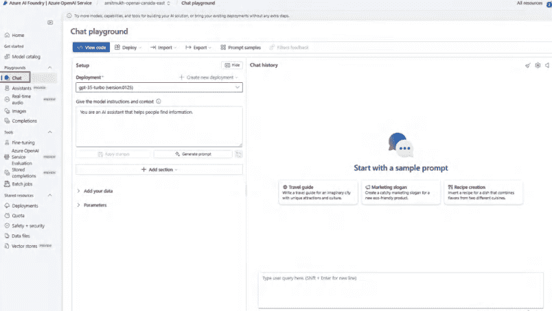

图 2.19：使用 Azure AI Foundry 的聊天操场测试提示词

### 利用 AOAI 模型

在聊天操场中，您可以灵活提供根据特定业务需求定制的自定义系统消息。我们将深入探讨各种提示技术。

导航到 Configuration 中的 Parameters（参数）选项卡。选择默认设置：

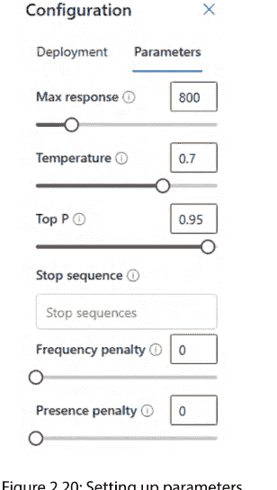

- **Max response（最大响应）：** 聊天完成中生成的最大标记数。

- **Temperature（温度）：** 在采样温度时，范围从 0 到 1，这是一项关键决策。选择较高的值（如 0.9）将引入更大的随机性，而选择较低的值（如 0.1）将增强其聚焦性。需要注意的是，设置为 0 不会使模型变成确定；相反，它会减少整体变异性。

- **Top P：** 利用温度的替代方案是核采样（nucleus sampling），范围从 0 到 1，模型会考虑落在概率质量内的标记。在此背景下，将 Top P 设置为 0 意味着仅考虑最可能的标记。通常建议调整 Top P 参数或 Temperature 参数之一，但不要同时调整两者。

- **Stop sequence（停止序列）：** 这有助于在特定点结束模型的响应，并确保它不包含后续的用户查询。通过这种方式，您可以防止模型生成不必要的文本。您可以选择使用最多四种不同的停止序列。

- **Frequency penalty（频率惩罚）：** 该数值范围在 0 到 2 之间。它根据标记在文中先出现的次数按比例降低重复概率，从而减少响应中重复文本的几率。

- **Presence penalty（存在惩罚）：** 该数值范围在 0 到 2 之间。它最小化了重用文中已使用的任何标记的概率，从而增加了响应中引入新话题的几率。

### 利用 AOAI 模型

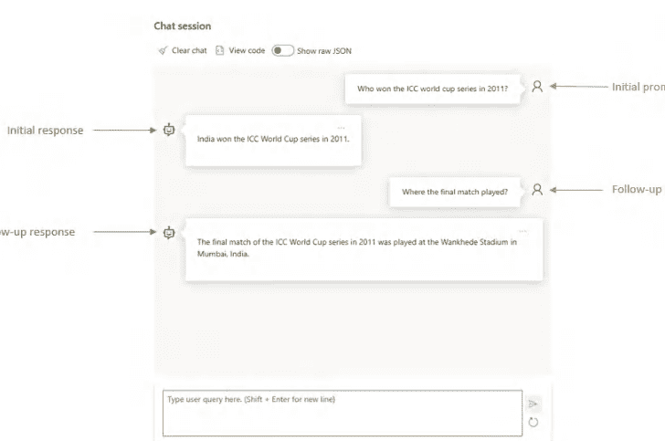

图 2.21：描述代理与用户之间的对话交互

至此，你已经有效地利用 AOAI 模型进行了类 ChatGPT 风格的对话。在下一小节中，我们将讨论如何使用 Python SDK 使用相同的 GPT-3.5 Turbo 或 GPT-4 模型。

### 程序化体验

在本节中，我们将引导你完成使用 Python SDK 首次进行 AOAI 调用的过程。

1. 在你的机器上安装 Python 3.7.1 或更高版本。或者，你也可以利用 Azure 机器学习笔记本（notebook）来获取 Python 环境。在示例中，我们使用了配合 Visual Studio Code 的 Anaconda。

2. 通过运行 `pip install openai` 安装 OpenAI Python 客户端库。

### Azure OpenAI 基础

3. 要向 AOAI 服务发送请求，你需要以下输入项：

| 变量名 | 值 |
| :--- |--- |
| ENDPOINT | 你可以在 Azure 门户中检查 AOAI 资源时，在“密钥和节点”部分找到此值。 |
| API-KEY | 你可以在 Azure 门户中查看资源时，在“密钥和节点”部分找到此值。你可以使用 KEY 1 或 KEY 2。 |
| DEPLOYMENT-NAME | 此值将对应于“部署 AOAI 模型”部分模型部署过程中为部署指定的自定义名称。 |

要获取前两个值，请导航到 Azure 门户中的相应资源。你可以在“资源管理”部分下找到“密钥和节点”。确保你同时复制了终点和访问密钥；你进行 API 调用身份验证时都需要两者。你可以选择使用 KEY 1 或 KEY 2。两个密钥的存在允许在不中断服务的情况下进行安全的密钥轮换和重新生成，如下：

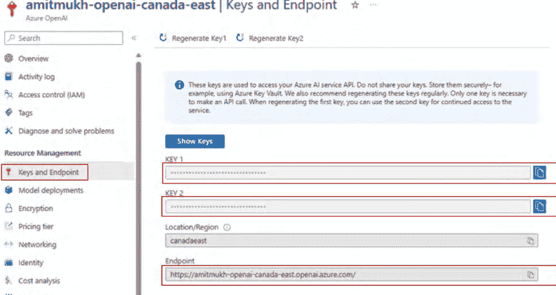

图 2.22：检索 AOAI 密钥和终点信息

### 利用 AOAI 模型

4. 在你偏好的 IDE 中，创建一个名为 `quickstart.py` 的 Python 文件并执行以下代码：

- I. 导入必要的 Python 包并设置 AOAI 密钥和终点信息。确保你将部署名称的值更改为在创建部署时提供的自定义名称：

```python
import os
import requests
import json
import openai
openai.api_key = "<ENTER YOUR API KEY>
openai.api_base = "<ENTER YOUR ENDPOINT>
openai.api_type = 'azure'
openai.api_version = '2023-08-01-preview' # 未来 API 版本可能会发生变化
deployment_name='gpt-35-turbo' # 输入你的部署名称。
```

- II. 调用 AOAI Chat Completion API，并提供 AOAI 部署名称以及系统和用户消息详情：


### 发送聊天完成调用以生成答案

```python
response = openai.ChatCompletion.create(
  engine="gpt-35-turbo", # 这是你的部署名称
  messages=[
  {"role": "system", "content": "你是一个帮助人们寻找信息的 AI 助手。"},
  {"role": "user", "content": "谁得了 2011 年 ICC 世界杯赛赛？"},
  {"role": "assistant", "content": "印度赢得了 2011 年 ICC 世界杯赛。"},
  {"role": "user", "content": "昨天的决赛比赛在哪里打的？"}
  ]
)
```

#### 打印模型的响应

```python
print(response['choices'][0]['message']['content'])
```

输出应该类似于以下内容：

2011 年 ICC 世界杯决赛赛在印度孟买的万肯德德体育场馆（`Wankhede Stadium`）举行。

### 注意事项

在生产环境中，建议使用安全方法存储和访问你的凭据，例如 `Azure Key Vault`。这可以确保你的敏感信息具有最高级别的安全保障。

至此，你已经了解了如何利用 `AOAI GPT-3.5` 和 `GPT-4` 模型。我们尚未讨论的是如何使用嵌入（`embedding`）模型：我们将在下一章中介绍这一点。在下一小节中，我们将讨论 `AOAI` 的定价。

### 定价

在本节中，我们将讨论各种 `AOAI` 定价方案，并帮助你根据需求选择最适合的计划。

`AOAI` 有两种不同的定价方案：

- **按需计费（`Pay-As-You-Go`）**：在此定价模型下，根据提示（`prompts`）和完成（`completions`）消耗的每千个 token 进行计费。请注意，每个模型的提示和完成都有不同的定价。此计划更适用于开发和测试环境，以及 `API` 调用次数和处理的 token 数量巨大的特定生产工作负载。有关完整的定价表，请参阅 `https://azure.microsoft.com/en-us/pricing/details/cognitive-services/openai-service/`。需要注意的是，这些费用在未来可能会发生，因此建议检查提供的链接以获取最新的定价信息：

| 模型 | 上文窗口 | 提示（每 1,000 Tokens） | 完成（每 1,000 Tokens） |
|---|---|---|---|
| `gpt-35-turbo` | 4K | $0.015 | $0.002 |
| `gpt-35-turbo` | 16K | $0.02 | $0.006 |
| `gpt-4` | 8K | $0.03 | $0.06 |
| `gpt-4` | 32K | $0.06 | $0.12 |
| `text-embedding-ada-002` | 8K | $0.0001 | $0.0002 |

*（注：由于原文文本中表格部分存在大量重复和乱码，此处已根据逻辑进行了清理和对齐以保持格式整洁）*

### 重要说明

需要注意的是，你无法像购买其他服务那样直接从 Azure 门户购买 `PTU`。要为你的订阅获取 `PTU`，必须联系微软账户代表，他们将帮助你获得订阅内 `PTU` 的批准。一旦获得批准，你就可以继续购买 `PTU`。`PTU` 的价格未来可能会发生变化。因此，建议始终咨询微软账户代表以获取最新的定价信息。

### 总结

本章深入探讨了 `AOAI` 服务。我们首先定义了它提供的 `AOAI` 服务类型。我们还引导你学习了访问此服务的步骤，从创建 `AOAI` 资源到部署模型，再到将其应用于实际场景。最后，我们阐明了定价结构，确保你清晰了解如何在 Azure 生态系统中利用这一强大的服务。掌握了这些知识，你已经完全准备好利用 `AOAI` 服务的能力来开展你的 AI 和机器学习项目。

展望下一章，我们的注意力将转向深入研究 `AOAI` 的高级主题。我们将探索嵌入（`embeddings`），并发现如何在 `Azure Cognitive Search` 服务的帮助下将这些嵌入存储在向量数据库中。此外，我们将深入研究模型落地（`model grounding`）的概念以及满足特定要求的微调（`fine-tuning`）的复杂性。

此外，我们将参与对一些最新功能的讨论，例如函数调用（`function calling`）、助手 `API`（`assistant API`）、微调和批量 `API`（`Batch API`）。这些高级主题将让你对 `AOAI` 的能力有更深入的理解，并能够充分利用其潜力。我们将强调 `LangChain` 和 `Semantic Kernel` 等 `LLM` 应用开发框架的重要性。这些框架在简化应用创建方面起着至关重要的作用。通过利用这些框架的能力，开发者可以简化开发流程，利用 `LLM` 的力量轻松构建创新且智能的应用程序。随着我们在 AI 和语言处理领域的不断进步，这些框架是充分挖掘 `LLM` 潜力以应用于各种场景的重要工具。

### 延伸阅读

如需了解更多关于本章涵盖的主题，请参考以下资源：

- `AOAI` 服务简介 (`https://learn.microsoft.com/en-us/training/modules/explore-azure-openai/`)
- `AOAI`：生成式 AI 模型及如何使用它们 (`https://www.linkedin.com/learning/azure-openai-generative-ai-models-and-how-to-use-them`)
