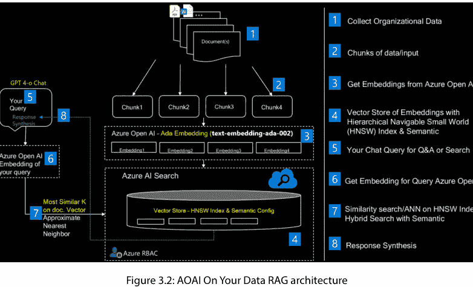
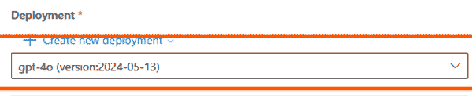
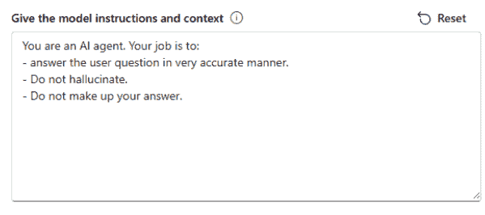
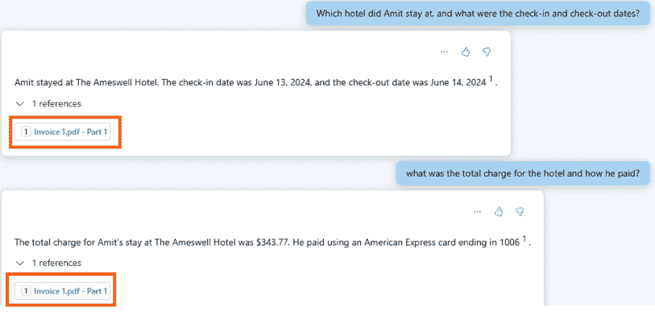
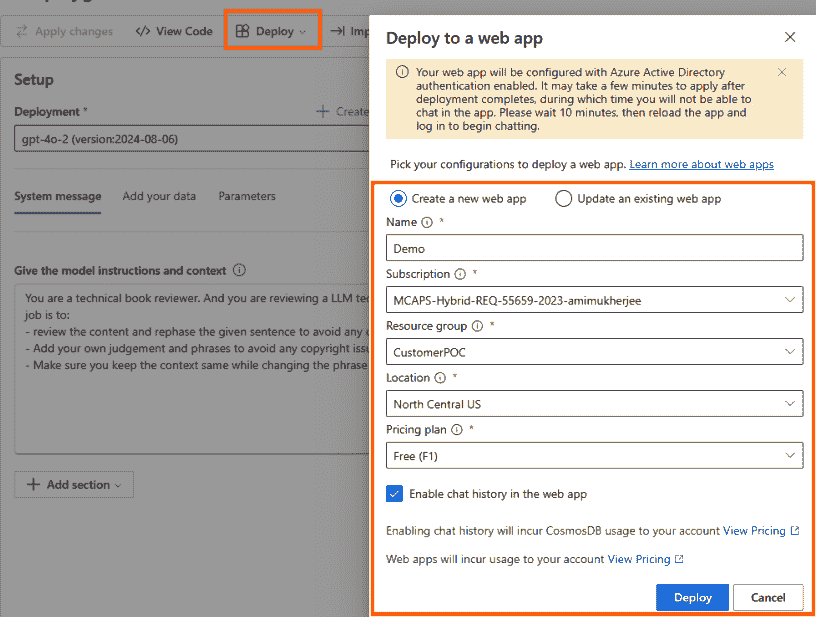
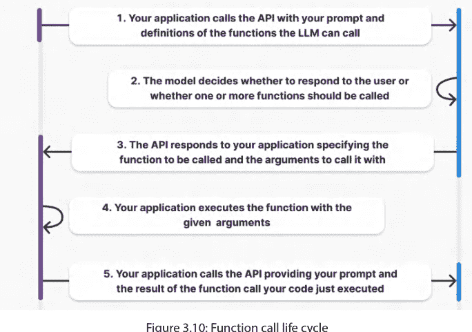
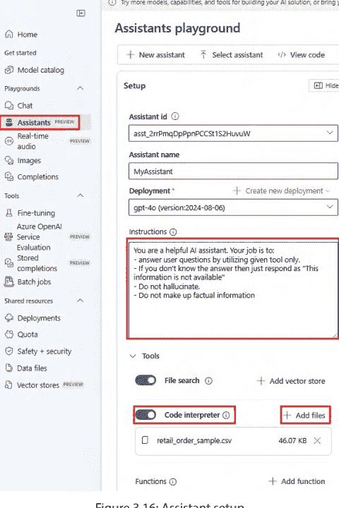
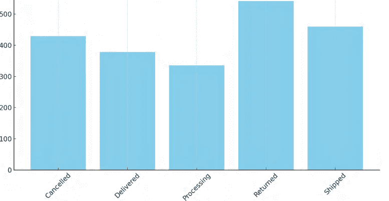
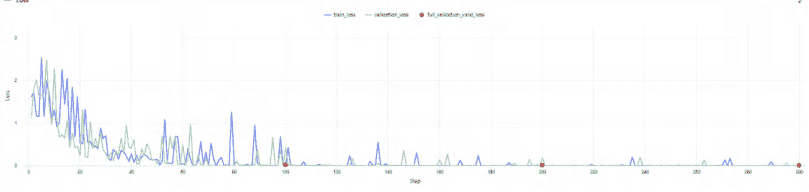
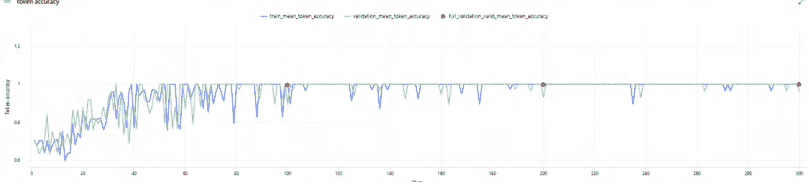

# Azure OpenAI 高级主题

在前面的章节中，我们涵盖了 Azure OpenAI (`AOAI`) 服务的基础知识，包括模型部署和各种定价结构。现在，我们的注意力将转向探索 `AOAI` 的高级主题。

在本章中，我们将深入研究以下高级 `AOAI` 主题：

- `AOAI` 模型上下文窗口
- `AOAI` 嵌入模型
- Azure 向量数据库
- `AOAI` 你的数据 (`On Your Data`)
- `AOAI` 多模态模型
- `AOAI` 函数调用
- `AOAI` 助手 `API`
- `AOAI` 微调

## `AOAI` 模型上下文窗口

在大语言模型 (`LLMs`) 世界中，上下文窗口定义了模型一次可以处理的文本量，这影响了它生成和理解语言的方式。该窗口通过 token（整个单词或片段）的数量来衡量，直接影响模型在预测下一个 token 时所使用的信息量。简单来说，它决定了模型在形成预测或编写响应时考虑了多少上下文。

例如，`GPT-3.5-Turbo (0125)` 模型的上下文具有 16,385 个输入 token 和 4,096 个输出 token，而 `GPT-4o` 和 `GPT-4o mini` 模型具有更大的数字，分别为 128,000 个输入 token 和 16,384 个输出 token。有关 `AOAI` 模型上下文窗口的信息，请访问 `https://learn.microsoft.com/en-us/azure/ai-services/openai/concepts/models?#gpt-4-and-gpt-4-models`。

`LLM` 的趋势是向着更大的上下文窗口发展，这能够产生更详细、更连贯的输出。然而，这也是有代价的：更大的上下文窗口需要更多的计算能力和内存。在实践中，上下文窗口定义了模型在交互期间可以“记住”多少之前的对话。当对话超过上下文窗口时，模型会丢失对话的最早期部分，可能会影响其在长时间交互或复杂任务中的一致性。因此，在考虑构建利用 `LLM` 的应用程序时，上下文窗口的大小是一个关键因素。

虽然更大的上下文窗口让 `LLM` 能处理更多数据，但它们也带来了巨大的计算和财务成本。处理极长的上下文非常昂贵且速度极慢，这只在有限的情况下是可以接受的。例如，一个百万 token 的上下文窗口可能需要近一分钟才能产生一个包含数百万 token 的单个响应。

相比之下，检索增强生成 (`RAG`) 更高效，因为它只为每个查询获取最相关的信息，减少了模型需要处理的 token 数量。这种效率使得 `RAG` 成为更具成本效益的解决方案，特别是对于需要频繁或大量查询以及数据密集型任务的应用程序。我们将在后面的章节详细解释 `RAG`。

文本被分成 token 后，每个 token 会被转换为名为嵌入（`embedding`）的数值形式。嵌入是稠密向量表示，旨在捕捉 token 的含义。这些向量存在于高维空间中，向量之间的距离和方向可以代表它们所代表单词之间的语义和语法关系。

在下一节中，我们将讨论 `AOAI` 用于将 token 转换为嵌入向量的模型。

## `AOAI` 嵌入模型

`AOAI` 有以下几种嵌入模型，每个模型都有特定的输入限制：

- `text-embedding-ada-002` (版本 2)：8191 个输入 token，1536 个输出维度
- `text-embedding-3-small`：8191 个输入 token，1536 个输出维度
- `text-embedding-3-large`：8192 个输入 token，3072 个输出维度

文本被分成 token 后，每个 token 被转换为名为嵌入的数值形式。嵌入是稠密向量表示，旨在捕捉 token 的含义。这些向量存在于高维空间中，向量之间的距离和方向可以代表它们所代表单词之间的语义和语法关系。

在下一节中，我们将讨论 `AOAI` 用于将 token 转换为嵌入向量的模型。

```python
from openai import AzureOpenAI

client = AzureOpenAI(
  api_key = os.getenv("AZURE_OPENAI_API_KEY"),
  api_version = "2024-04-preview",
  azure_endpoint = os.getenv("AZURE_OPENAI_ENDPOINT")
)

response = client.embeddings.create(
    input="INPUT>",
    model="text-embedding-3-small"
)
print(response.data[0].embedding)
```

*（注：提供的 OCR 文本末尾有一些重复/碎片化。我已根据提供的内容重构了逻辑流。）*

### 重要说明

需要注意的是，你无法像购买其他服务那样直接从 Azure 门户购买 `PTU`。要为你的订阅获取 `PTU`，必须联系微软账户代表，他们将帮助你获得订阅内 `PTU` 的批准。一旦获得批准，你就可以继续购买 `PTU`。`PTU` 的价格未来可能会发生变化。因此，建议始终咨询微软账户代表以获取最新的定价信息。

### 总结

本章深入探讨了 `AOAI` 服务。我们首先定义了它提供的 `AOAI` 服务类型。我们还引导你学习了访问此服务的步骤，从创建 `AOAI` 资源到部署模型，再到将其应用于实际场景。最后，我们阐明了定价结构，确保你清晰了解如何在 Azure 生态系统中利用这一强大的服务。掌握了这些知识，你已经完全准备好利用 `AOAI` 服务的能力来开展你的 AI 和机器学习项目。

展望下一章，我们的注意力将转向深入研究 `AOAI` 的高级主题。我们将探索嵌入（`embeddings`），并发现如何在 `Azure Cognitive Search` 服务的帮助下将这些嵌入存储在向量数据库中。此外，我们将深入研究模型落地（`model grounding`）的概念以及满足特定要求的微调（`fine-tuning`）的复杂性。

此外，我们将参与对一些最新功能的讨论，例如函数调用（`function calling`）、助手 `API`（`assistant API`）、微调和批量 `API`（`Batch API`）。这些高级主题将让你对 `AOAI` 的能力有更深入的理解，并能够充分利用其潜力。我们将强调 `LangChain` 和 `Semantic Kernel` 等 `LLM` 应用开发框架的重要性。这些框架在简化应用创建方面起着至关重要的作用。通过利用这些框架的能力，开发者可以简化开发流程，利用 `LLM` 的力量轻松构建创新且智能的应用程序。随着我们在 AI 和语言处理领域的不断进步，这些框架是充分挖掘 `LLM` 潜力以应用于各种场景的重要工具。

### 延伸阅读

如需了解更多关于本章涵盖的主题，请参考以下资源：

- `AOAI` 服务简介 (`https://learn.microsoft.com/en-us/training/modules/explore-azure-openai/`)
- `AOAI`：生成式 AI 模型及如何使用它们 (`https://www.linkedin.com/learning/azure-openai-generative-ai-models-and-how-to-use-them`)

# Azure OpenAI 高级主题

在前面的章节，我们涵盖了 Azure OpenAI (`AOAI`) 服务的基础知识，包括模型部署和各种定价结构。现在，我们的注意力将转向探索 `AOAI` 的高级主题。

在本章中，我们将深入研究以下高级 `AOAI` 主题：

- `AOAI` 模型上下文窗口
- `AOAI` 嵌入模型
- Azure 向量数据库
- `AOAI` 你的数据 (`On Your Data`)
- `AOAI` 多模态模型
- `AOAI` 函数调用
- `AOAI` 助手 `API`
- `AOAI` 微调

## `AOAI` 模型上下文窗口

在大语言模型 (`LLMs`) 世界中，上下文窗口定义了模型一次可以处理的文本量，这影响了它生成和理解语言的方式。该窗口通过 token（整个单词或片段）的数量来衡量，直接影响模型在预测下一个 token 时所使用的信息量。简单来说，它决定了模型在形成预测或编写响应时考虑了多少上下文。

例如，`GPT-3.5-Turbo (0125)` 模型的上下文具有 16,385 个输入 token 和 4,096 个输出 token，而 `GPT-4o` 和 `GPT-4o mini` 模型具有更大的数字，分别为 128,000 个输入 token 和 16,384 个输出 token。有关 `AOAI` 模型上下文窗口的信息，请访问 `https://learn.microsoft.com/en-us/azure/ai-services/openai/concepts/models?#gpt-4-and-gpt-4-models`。

`LLM` 的趋势是向着更大的上下文窗口发展，这能够产生更详细、更连贯的输出。然而，这也是有代价的：更大的上下文窗口需要更多的计算能力和内存。在实践中，上下文窗口定义了模型在交互期间可以“记住”多少之前的对话。当对话超过上下文窗口时，模型会丢失对话的最早期部分，可能会影响其在长时间交互或复杂任务中的一致性。因此，在考虑构建利用 `LLM` 的应用程序时，上下文窗口的大小是一个关键因素。

虽然更大的上下文窗口让 `LLM` 能处理更多数据，但它们也带来了巨大的计算和财务成本。处理极长的上下文非常昂贵且速度极慢，这只在有限的情况下是可以接受的。例如，一个百万 token 的上下文窗口可能需要近一分钟才能产生一个包含数百万 token 的单个响应。

相比之下，检索增强生成 (`RAG`) 更高效，因为它只为每个查询获取最相关的信息，减少了模型需要处理的 token 数量。这种效率使得 `RAG` 成为更具成本效益的解决方案，特别是对于需要频繁或大量查询以及数据密集型任务的应用程序。我们将在后面的章节详细解释 `RAG`。

文本被分成 token 后，每个 token 被转换为名为嵌入（`embedding`）的数值形式。嵌入是稠密向量表示，旨在捕捉 token 的含义。这些向量存在于高维空间中，向量之间的距离和方向可以代表它们所代表单词之间的语义和语法关系。

*（注：提供的 OCR 文本末尾包含大量的重复/碎片化。我已清理了冗余部分并保留了核心内容。）*

```python
def normalize(x):
    x = np.array(x)
    if x.ndim == 1:
        norm = np.linalg.norm(x)
        if norm == 0:
            return x
        return x / norm
    else:
        norm = np.linalg.norm(x, 2, axis=1, keepdims=True)
        return np.where(norm == 0, x, x / norm)
```

```python
response = client.embeddings.create(
    model="<DEPLOYMENT NAME>",
    input="<INPUT TEXT>",
    encoding_format="float"
)
```

```python
cut_dim = response.data[0].embedding[:256]
norm_dim = normalize(cut_dim)
```

```python
print(norm_dim)
```

动态调整维度允许了灵活的使用。例如，如果向量数据库支持高达 1,536 维的嵌入，开发者仍然可以通过维度 `API` 参数设置为 1536 来使用最佳模型 `text-embedding-3-large`。这会将嵌入从 3,072 维减少，通过牺牲一定的精度来换取更小的向量尺寸。引导我们在下一节中讨论 `Azure AI Search` 服务中的向量搜索功能。

## Azure 向量数据库

在上一节中，我们探索了用于生成向量嵌入的 `AOAI` 嵌入模型。创建这些向量后，一个针对存储和管理它们优化的数据库至关重要。向量数据库与其他类型数据库的主要区别在于它处理高维数据的能力。向量数据库专门设计用于将数据存储为高维向量，这些向量是各种特征或属性的数学表示。每个向量包含多个维度，根据数据的复杂性和细节，从几十到几千不等。这些向量通常通过对文本、图像、音频和视频等原始数据应用转换或嵌入函数生成。此类数据库可以使用评估向量距离或相似性的向量搜索算法对嵌入进行索引和查询。为了确保检索相关信息，需要一种健壮的机制。常见的向量搜索算法包括层次导航小世界 (`HNSW`)、倒排文件 (`IVF`) 和 `DiskANN` 等。

### Azure OpenAI 高级主题

向量数据库的主要优势在于能够进行快速且精确的相似性搜索和数据检索，与依赖精确匹配或预定义查询标准的传统数据库不同，向量数据库允许根据语义或语境含义识别最相似或最相关的数据。以下是一些实际应用：


# 向量数据库的应用场景

- **搜索引擎**：向量数据库通过启用高效的相似性搜索改变了搜索引擎。它们可以找到相似项，改进搜索检索并增强用户体验。
- **图像检索**：根据视觉内容和风格识别与给定图像相似的图像。
- **文档搜索**：考虑主题和情感等因素，定位与给定文档相似的文档。
- **产品推荐**：根据特征和评分发现与给定产品相似的产品。
- **语义搜索**：向量数据库增强了语义搜索能力，允许应用程序找到语境相关。这使得它们对于信息检索、聊天机器人和问答系统非常有价值。
- **推荐系统**：这些系统受益于向量数据库，根据用户偏好提供个性化的产品推荐或建议，从而提高推荐的准确性。
- **医学和科学研究**：在基因组学和化学等领域，向量数据库促进了基因组数据分析、化学化合物相似性的识别，并加速了科学发现。

要在向量数据库中执行相似性搜索和检索，需要一个封装了你所需信息或标准的查询向量。该查询可以源自与存储向量相同类型的数据（例如，使用图像查询图像数据库），也可以源自不同类型的数据（例如，使用文本查询图像数据库）。下一步是使用相似性度量来确定向量空间内向量之间的接近程度或距离。为此可以使用向量指标，例如余弦相似度、欧式距离、汉明距离和 `Jaccard` 指数。相似性搜索和检索过程的结果通常是一个向量列表，这些向量与查询向量具有最高的相似性。随后，你可以从原始源或索引中检索每个向量关联的数据。

# Azure 向量数据库选项

Azure 为不同的用例提供了六种类型的向量数据库选项：

- **Azure AI Search**：`Azure AI Search` 是一种具有强大搜索能力的工具。它利用 `HNSW` 算法进行向量搜索，并使用最佳匹配 25 (`BM25`) 算法进行全文搜索。此外，它还提供了一种混合搜索选项，合并了全文查询和向量查询的结果，每种查询都使用不同的排序方法（如 `BM25` 和 `HNSW`）。采用倒数排名融合 (`RRF`) 算法来整合这些结果，确保形成单一、连贯的结果集，突出显示搜索索引中最相关的匹配项。事实上，OpenAI 利用 `Azure AI Search` 来增强其 ChatGPT 应用的能力。通过集成 `Azure AI Search`，OpenAI 受益于向量搜索、全文搜索和混合搜索等高级搜索功能，这些功能结合了 `BM25` 和 `HNSW` 算法的优势。这种集成允许 ChatGPT 通过从搜索索引中高效检索和排序信息，提供更准确、更相关的响应。

然而，重要的是 `Azure AI Search` 并不会为你的内容生成向量嵌入；你需要自己提供这些嵌入。生成这些嵌入的一种可行方案是通过 AOAI 嵌入模型。

从架构角度来看，`AI Search` 服务充当存储你未索引数据的外部存储与向搜索索引发送查询并管理响应的客户端应用程序之间的中介。


`AI Search` 服务充当存储你未索引数据的外部存储器与向搜索索引发送查询并管理响应的客户端应用程序之间的中介。


`AI Search` 服务充当存储你未索引数据的外部存储器与向搜索索引发送查询并管理响应的客户端应用程序之间的中介。


`AI Search` 服务充当存储你未索引数据的外部存储器与向搜索索引发送查询并管理响应的客户端应用程序之间的中介。


`AI Search` 服务充当存储你未索引数据的外部存储器与向搜索索引发送查询并管理响应的客户端应用程序之间的中介。


# pgvector

或直接在 `PostgreSQL` 中运行深度学习模型。`pgvector` 特别引人入胜之处在于它提供了熟悉的基于 SQL 的界面，镜像了传统的 `PostgreSQL` 操作，用于诸如创建向量列、定义带有向量列的表以及使用 `L2` 距离执行最近邻搜索等任务。无论你是在开发 AI 应用、创建推荐系统，还是处理高维数据，`pgvector` 都能在熟悉的数据库框架内简化向量管理，消除了对专有存储解决方案和海量向量数据库专业知识的需求。

- **Azure SQL**: SQL Database 现在支持在数据库中直接进行向量操作，实现高效的向量相似性搜索。此功能结合全文搜索和 `BM25` 排名，可以开发出适用于各种应用程序的强大搜索引擎。执行向量操作有两种方法：原生选项和经典选项：
  - **原生选项 (Native option)**：利用 Azure SQL Database 新引入的向量函数（Vector Functions）。这些函数旨在直接在内执行向量操作，提供了一种简洁高效的方法。
  - **经典选项 (Classic option)**：使用传统的 `T-SQL` 进行向量操作，利用列存储索引来实现高性能。

这两种选项为实现向量搜索提供了稳健的解决方案，使 Azure SQL Database 成为高级搜索场景的通用功能工具。

微软最近宣布 SQL Server 2022 标志着数据库演进的重要一步，将其作为一种企业级向量数据库推出。此版本引入了内置的安全性和合规性，强调了其对支持企业级 AI 解决方案的关注。一个突出特性是原生向量存储和索引，它由 `DiskANN` 驱动，并利用磁盘存储在海量数据集上执行高性能搜索。此功能是语义搜索的基础，实现了高效的分块（chunking）和准确的数据检索——这是 AI 驱动洞察的关键特征。这一进展能够高效处理高维数据，使其适用于推荐系统、自然语言处理和图像搜索等 AI 工作负载。

- **Azure Managed Redis**: Azure Managed Redis 由 Redis Enterprise 软件驱动，可以作为高效的向量数据库，用于嵌入向量和执行向量相似性搜索。企业层级的 `RedisSearch` 模块提供了全面的搜索能力，包括欧几里得、余弦相似度和内点积等多种距离度量，并支持使用 `FLAT` 索引的 KNN 和使用 `HNSW` 索引的 ANN。它允许以哈希或 JSON 格式存储向量，并支持 top-K 和范围查询，以在特定向量空间内查找项目。此外，Redis 通过高级功能增强了搜索功能，例如地理空间过滤、数值和文本过滤、前缀和模糊匹配、语音学匹配以及布尔查询。Redis 通常被认为是一种成本效益的解决方案，广泛用于缓存或会话存储，使其能够处理传统的缓存角色和

# Azure OpenAI 进阶主题

大多数 Azure 向量数据库（如 `AI Search`、`CosmosDB` 和 `Azure Managed Redis`）已与 Semantic Kernel、LangChain 和 LlamaIndex 等 LLM 框架集成，以便于轻松创建向量并将其摄取到各自的服务中。这些集成简化了嵌入生成、存储和检索流程，能够高效处理向量数据并增强生成式 AI 应用的能力。

Azure 提供了一种无代码解决方案，用于创建向量嵌入并将其作为其原生功能的一部分自动摄取到 Azure AI Search 或 Cosmos DB 中。在下一节中，我们将作为 AOAI On Your Data（AOAI 你的数据）的一部分来探索这一能力。

## AOAI On Your Data

各行业中的一个常见应用是利用生成式 AI 通过自身的企业数据创建个性化聊天机器人。传统，客户必须手动编写代码过程来从非结构化数据中提取文本、生成嵌入并将其存储在向量数据库中，这对于开发者来说既耗时又费力。然而，Azure OpenAI On Your Data 功能显著简化了这一工作流，允许开发者以极少或无需代码即可实现相同的结果。这意味着只需点击几次即可完成聊天机器人。

此功能在后台使用 RAG 技术运行，如图 3.2 所示。



当你上传一组各种格式的文档时，这些文档会被分成更小的分块（chunks）。每个分块都会使用 AOAI 的嵌入模型转换为嵌入（例如 `text-embedding-ada-002`）。这些嵌入被存储在 AI 搜索数据库中，利用配置了语义搜索的 `HNSW` 索引。用户可以通过 GPT-4 输入查询进行聊天，这些查询也会使用相同的嵌入模型转换为嵌入。通过 ANN 技术在 `HNSW` 索引上进行相似性搜索，以找到最相关的向量文档。接下来，将检索到的上下文和原始用户查询提供给 GPT 模型，以对用户问题生成回复。

此外，Azure RBAC 确保了整个系统的安全访问和权限。整个过程是精简且用户友好的，允许你专注于利用洞察，而无需处理技术复杂性。

> **重要说明**
> 确保在利用 On your Data 功能之前已设置好 AI Search 资源。要设置 Azure AI search，请参考 https://microsoft.com/en-us/azure/search/search-create-service-portal 提供的说明。

现在，让我们演示如何轻松地使用此功能，而无需编写任何代码：

1. 登录 Azure AI Foundry 门户。
2. 如果你尚未设置，请先进行设置。
3. 选择分块大小（Chunk size）。分块是将文档划分为更小的片段以便进行高效搜索和检索，分块大小以 token 为单位衡量。
4. 点击“下一步”。在后续屏幕上，选择验证类型。
5. 索引所需可能会随文档的大小而增加。
6. 选择要使用的部署选项，并如图 3.5 所示填写系统消息（System message）字段。然后点击“应用更改”。

# 设置 *






图 3.5：您的数据（On Your Data）设置

7. 现在你已经准备好从聊天操场（Chat playground）开始聊天了。
8. 参考图 3.6 的示例问题。你可以根据提供的文档提问，以获得准确的答案。你可以点击引用项查看答案的来源处。



图 3.6：带有引用的示例问题和答案

你已经观察到使用 AOAI 的“您的数据”功能，答案是如何基于你的数据的。如果你想开发 Web 应用程序并将其部署到生产环境，只需点击“部署为 Web 应用”并如图 3.7 所示填写应用服务详情。然后点击“部署”为用户创建一个 Web 。

# Azure OpenAI 高级主题

## 聊天操场



图 37：您的数据 Web 应用设置

部署后，你将获得应用程序的公共 URL，使用户能够能够与他们上传的文档进行交互，如下所示：


Amit 住在哪个酒店？总费用是多少？

Amit 住在 Ameswell Hotel。他入住的总费用为 343.77 美元。

1 处引用 >

AI 生成的内容可能不准确

他住了几天？

根据检索到的文档，未指定 Amit 住在 Ameswell Hotel 的天数。

AI 生成的内容可能不准确

他是哪天办理入住和退房的？

Amit 于 2024 年 6 月 13 日入住 Ameswell Hotel，于 2024 年 6 月 14 日退房。

1 处引用 >

AI 生成的内容可能不准确

输入新问题...

## 图 3.8：Web 视图

这简化了流程，使你只需点击一下即可让终端用户可以使用你的聊天应用程序，而无需编写任何代码。这是快速部署和共享应用程序的高效方法。然而，需要注意的是，虽然此功能对于小型概念验证效果良好，但开发健壮的生产应用需要仔细考虑各种因素以提高准确性。这些策略包括分块、查询重写和设计自定义模板。这些能力在这方面受到一定限制，通常需要采用代码优先的方法来创建更复杂、定制的解决方案。

到目前为止，我们利用 AOAI 模型处理文本相关的场景。然而，在某些情况下需要图像理解。在下一节中，我们将探索 AOAI 的多模态能力，这种方法通过结合视觉数据分析，扩展了 AOAI 的适用范围。

# AOAI 多模态模型

AOAI 多模态能力可以应用于各种现实场景，例如：

- **图像描述**：自动为图像生成描述性文本，这对于组织数字照片集或帮助视觉受障用户很有用。
- **音频处理**：需要用户与模型之间进行实时交互的低延迟对话用例，例如客户支持机器人、语音助手和实时翻译服务。
- **视觉问答**：回答有关图像的问题，可以增强互动教育工具或客户支持系统。
- **内容审核**：分析图像以检测不适当或有害内容，提高社交媒体平台的安全性。
- **电子商务**：根据图像提供产品描述，帮助分类并改善用户搜索体验。
- **医疗健康**：通过解释医学图像和提供初步报告协助医疗诊断。

这些案例展示了集成视觉和文本数据处理的灵活性。为了实现此类功能，AOAI 提供了一个具有内置多模态功能的 GPT-4 类模型。目前，AOAI 在 GPT-4 系列中提供了三个支持这些原生多模态能力的模型：

- `GPT4-Turbo`
- `GPT4-o`
- `GPT4-o-mini`

现在，让我们从**聊天操场**测试 `GPT4-o` 的多模态能力：

1. 登录 Azure Foundry 门户。
2. 导航到**操场聊天（Chat from Playgrounds）**菜单。
3. 向聊天上传一张图像并就它提问。或者，你也可以通过 SDK 将 base64 编码的图像作为输入提供给模型来实现。为了说明，我使用了**图 3.9**。

# AOAI 多模态模型 65


你可以提问如下问题：

“它的尺寸是多少？”

虽然 AOAI 的视觉功能非常多功能且适用于各种应用程序，但需要注意以下关键限制：

- **医学图像**：该模型并未设计用于处理医学图像。
- **非英语文本**：在处理非拉丁字母文本（如日语或韩语）时，性能可能会下降。
- **小文本**：为了提高可读性，需要放大图像中的小文本。
- **空间推理**：对于需要精确定位的任务可能存在困难。
- **准确性**：在某些情况下，模型可能会产生错误的描述。
- **元数据**：模型可能无法处理元数据。
- **验证码**：出于安全考虑，系统配置为阻止验证码。

了解这些限制有助于客户设定合理的预期。既然我们已经看到了 `GPT4-o` 的视觉功能及其限制，让我们了解图像成本。

## 图像 Token 费用

图像输入像文本输入一样按 token 计算。图像成本受两个因素影响：尺寸和细节级别。以下是详细细分：

- **低细节**：设置为低细节的图像费用为 85 token。
- **高细节**：对于高细节图像，过程更为复杂。首先，将图像缩放到适应 2048x2048 正方形，同时保持其宽高比。然后再次缩放，使其短边为 768 像素。组成图像的 512 像素网格的数量会被计算，每个网格花费 170 token。最后总是额外添加 85 token。

让我们看一些示例：

- **高细节下的 1024x1024 图像**：由于 1024 小于 2048，不需要初始缩放。图像被缩放到 768x768，因为短边是 1024。这需要四个 512 像素的网格。Token 费用计算如下：`170 token/网格 * 4 网格 + 85 token = 765 token`。
- **高细节下的 2048x4096 图像**：图像首先被缩放到 1024x2048 以适应 2048 正方形。短边仍为 1024，因此进一步缩放到 768x1536。这需要 6 个 512 像素的网格。Token 费用计算如下：`170 token/网格 * 6 网格 + 85 token = 1105 token`。

理解这种 token 成本结构可以帮助在处理图像输入时有效管理资源使用。

因此，我们探索了 AOAI 模型的自包含能力。然而，在某些企业级用例中，客户需要将 LLM 与外部系统或工具集成。这可以将自然语言查询转换为这些系统可执行的结构化输入。在下一节中，我们将讨论如何使用 AOAI 的函数调用（function calling）功能来实现这一功能。

# AOAI 函数调用

AOAI 函数调用允许你将 GPT-4o 及其他 GPT 模型连接到外部工具。这对于增强 AI 助手的能力或在你的应用程序与模型之间创建无缝集成等任务非常有益。

此功能不会直接替你运行函数。相反，你在 API 调用中定义函数，模型将决定如何创建所需的参数。生成这些参数后，你可以使用它们在你的代码中执行函数。

函数调用对许多应用都有益处，例如：

- **允许助手检索信息**：AI 助手可能需要从内部系统（如 Azure Cosmos DB 或 Azure SQL）访问最新的客户数据，以回答用户关于最近订单的查询。
- **使助手能够执行任务**：AI 助手可以通过考虑用户偏好和日历可用性安排会议。
- **辅助计算**：数学导师助手可以根据需要进行计算。
- **创建复杂的工作流**：例如，数据提取过程可以收集原始文本，将其转换为结构化数据并存储在数据库中。
- **更改应用程序的用户界面**：函数调用可以根据用户操作更新 UI，例如在地图上显示图钉。

现在，让我们讨论 AOAI 函数调用的生命周期。

## 函数调用生命周期

函数调用有五个不同的阶段，如*图 3.10*所示：

1. 你的代码通过带有 prompt（提示词）和 LLM 可以访问的函数的 API 调用启动过程。
2. 模型评估是直接回复用户，还是需要调用一个或多个函数。
3. API 回复你的应用程序，指定应该调用哪个函数以及必要的参数是什么。
4. 你的应用程序使用提供的参数运行指定的函数。
5. 你的应用程序将初始 prompt 和执行函数的结果传回 API 通信。

### 你的代码

### LLM




在使用带有函数功能的 OpenAI API 时，模型本身并不执行函数。相反，在步骤 3 中，模型为你的函数生成参数，你的应用程序可以使用这些参数。你的代码决定如何处理这些参数，通常是通过调用指定的函数。这确保了你的应用程序对执行过程保留完全控制权。

`Chat Completions`、`Assistants` 和 `Batch API` 都支持函数调用。本节重点介绍使用 `Chat Completions API` 进行函数调用。`Assistant` 和 `Batch API` 将在下一节介绍。

让我们开始吧。

## 步骤 1 – 定义函数

从指定你打算调用的函数开始。该函数应该是一个能够接受输入并提供输出的 Python 函数。函数的输入将由模型生成。

在本示例中，假设你希望模型执行代码库中的 `get_weather` 函数。该函数接受一个城市作为参数，从天气 API 获取天气信息。你的函数可能看起来如下：

```python
def get_weather(city):
    base_url = "http://api.openweathermap.org/data/2.5/weather?"
    api_key = 'API-KEY'
    params = {
        'q': city,
        'appid': api_key,
        'units': 'metric' # 使用 'imperial' 华氏度
    }

    response = requests.get(base_url, params=params)

    if response.status_code == 200:
        data = response.json()
        weather_condition = response.json()["weather"][0]["description"]
        temperature = response.json()["main"]["temp"]
        return f"""Here is some information about the weather in {city}:\n
        The weather is: {weather_condition}.\n
        The temperature is: {temperature} Degrees Celsius.\n\n"""
    else:
        return {'error': response.json().get('message', 'Failed to retrieve data')}
```

图 3.11：`get_weather` 函数定义

## 步骤 2 – 为模型描述函数

现在我们已经确定了想要模型调用的函数，我们将编写一个函数定义。这将解释函数的作用、何时可能使用以及调用它需要哪些参数。

函数定义中的参数部分应使用 JSON Schema 进行列出。当模型生成函数调用时，它将引用此模式来相应地创建参数。

## Azure OpenAI 高级主题

在这个示例中，它看起来像图 3.12。

```json
{
  "name": "get weather",
  "description": "Set the weather information for a given city. Call this whenever you need to know the wetter information for a given location",
  "parameters": {
    "type": "object",
    "properties": {
      "city": {
        "type": "string",
        "description": "The city, e.g. Seattle"
      }
    },
    "required": ["city"],
    "additionalProperties": false
  }
}
```

图 3.12：作为模型“工具”的 JSON schema 定义

## 步骤 3 – 为模型提供函数定义

现在我们已经确定了想要模型调用的函数，我们将开发一个函数定义。这将解释函数完成了什么、何时可能被使用以及调用它需要哪些参数。

函数定义中的参数部分应使用 JSON Schema 进行列出。当模型生成函数调用时，它将引用此模式来相应地创建参数。

当你在请求中包含函数时，该函数的详情（如定义和参数）将成为系统消息的一部分，随后模型将其连同用户输入一起进行处理。这种集成使模型能够根据提示词上下文评估是否应该调用函数。

此过程确实会消耗 token，因为函数定义和参数会增加总的 token 计数。此外，采用提示词工程策略（例如保持简洁、排除不必要的细节以及关注提示词的核心部分）可以提高函数调用效率。

以下是优化函数调用效率的更多方法：

- **为你的函数定义添加更多细节**：包含具有意义描述的函数定义对于清晰和高效调用函数至关重要。在定义函数时，对每个参数的描述都应让模型和任何审查代码的人员轻松理解。以下是如何让函数更全面的说明。

- **提供上下文系统消息**：系统消息可以为模型的行为提供额外的上下文。例如，如果你有一个像 `search_hotels` 的函数，你可以设置如下系统消息：

```json
{"role": "system", "content": "你是一个旨在帮助用户搜索酒店的 AI 助手。当用户请求帮助寻找酒店时，你应该调用 search_hotels 函数。"}
```

这会告知模型根据用户输入何时调用该函数。

- **当用户输入不明确时指示模型进行提问**：当用户输入不完整时，指示模型提问澄清性问题以避免做出假设。例如，在 `search_hotels` 中，如果用户请求缺少位置详情。在你的系统消息中包含如下指令，以引导模型：

```json
{"role": "system", "content": "避免对函数值进行假设；相反，当用户请求不明确时，寻求澄清。"}
```

- **错误处理**：提示词工程的另一个方面是尽量减少函数调用中的错误。虽然模型经过训练，可以根据你定义的 schema 生成函数调用，但它们有时可能会创建与 schema 不符的调用，或尝试调用未包含在内的函数。

为了解决这个问题，你可以在系统消息中添加如下语句：

```json
{"role": "system", "content": "仅使用向你提供的函数。"}
```

这有助于确保模型严格遵守你定义的函数。

现在你已经了解了如何调用 `AOAI` 函数，下一节将重点介绍 `AOAI Assistants API`，它为开发者简化了应用程序开发流程。

## AOAI Assistants API

`AOAI Assistants API` 允许创建 AI 驱动的助手，这些助手可以直接集成到你的应用程序中。这些助手根据一组预定义的指令运行，并利用模型、工具和文件等各种能力与用户交互。目前，`Assistants API` 支持三种类型的工具：

- **代码解释器 (Code Interpreter)**：这使助手能够在一个安全的多租户 Kubernetes 环境中编写并运行 Python 代码，从而处理用户对计算或脚本执行的需求。Kubernetes 沙箱需要超视器技术来隔离每个容器，提供独特的用户空间内核而非传统的内核。这种设置通过隔离环境增强了安全性，通过防止跨容器干扰降低了风险，并提高了灵活性。通过在安全的虚拟化环境中执行代码，助手可以动态处理复杂的计算、数据处理和文件处理。

由于支持多种格式（[https://learn.microsoft.com/en-us/azure/ai-services/openai/how-to/code-interpreter?tabs=supported-file-types](https://learn.microsoft.com/en-us/azure/ai-services/openai/how-to/code-interpreter?tabs=supported-file-types)），该工具可以处理各种结构的文件，根据需要提取信息。代码解释器支持迭代式代码执行，使得助手在初始尝试失败时能够调整代码并重试执行，这对于复杂的编码和数学问题特别有用。常见用例包括从 CSV 文件中提取数据、创建图表和图形等结构化数据可视化，以及解决数学题。

- **文件搜索 (File Search)**：`AOAI` 文件搜索工具允许助手通过访问和检索用户提供文档中的信息来增强基于文件的查询。它作为一个外部知识库，让助手能够搜索模型训练的数据，以包含属性内容或其他基于文档的信息。`AOAI` 的系统会自动执行分块（chunking）策略，并通过创建向量嵌入并将其存储在 Azure AI 管理的向量存储中进行索引。这使得基于向量和关键词的搜索成为可能，促进了更精确、上下文驱动的信息检索，并支持多种格式，详见 [https://learn.microsoft.com/en-us/azure/ai-services/openai/how-to/file-search?tabs=python](https://learn.microsoft.com/en-us/azure/ai-services/openai/how-to/file-search?tabs=python)。通过将文档内容转换为向量嵌入，文件搜索通过搜索来理解上下文和含义，而不仅仅是匹配精确的关键词。这种能力对于诸如详细问答、摘要和数据提取等需要细致理解和快速检索的任务特别有用。该工具还非常多功能，可以处理各种文档格式，使其能够轻松集成到需要复杂文档交互的工作流中。

- **函数调用 (Function calling)**：该工具允许助手调用应用程序内的特定函数，使其能够通过 API 接口执行任务或检索数据。我们之前详细介绍过函数调用，强调了它在增强助手交互能力方面的作用。

这些工具使得构建针对应用程序内特定用例定制的动态且响应迅速的 AI 助手变得更加容易。

现在，让我们讨论助手的流程流。

## 助手流程流 (Assistant process flow)

设置和运行 AI 助手作为财务机器人通常涉及四个关键步骤。以财务机器人为例，如图 3.15 所示，步骤如下：


### 第 1 步 – 创建助手 (create Assistants)

助手（Assistant）是一个可以使用模型、指令和工具自定义的实体。要创建一个助手，需要指定模型、指令和工具。助手将根据这些内容进行响应。你还可以指定 `tool_choice` 参数来强制助手使用特定工具。

### 第 2 步 – 创建线程 (create a Thread)

线程（Thread）作为对话的记录。当用户发起对话时，会创建一个新线程。虽然线程可以存储 100,000 条消息，但系统通过截断旧消息来管理内存。

### 第 3 步 – 向线程添加消息 (add a message to the Thread)

对话期间的消息（来自用户或应用程序）都作为消息对象存储在线程中。在运行（Run）期间，你可以设置 `max_prompt_tokens` 和 `max_completion_tokens`。例如，如果 `max_prompt_tokens` 设置为 500，`max_completion_tokens` 设置为 1000，助手将会将提示词截断到 500 token 以内，并将输出限制在 1000 token。如果提示使用了 200 个 token，完成使用了 300 个 token，则下次完成将消耗 300 个 token，并剩余 700 个可用 token。

如果完成达到 `max_completion_tokens` 限制，运行将以未完成状态停止，并将包含在运行的 `incomplete_details` 字段中。

在使用文件搜索工具时，建议将 `max_prompt_tokens` 设置为不少于 20000。对于更广泛的对话或多次文件搜索交互，考虑将其增加到 50000 甚至直接移除以获得最佳结果。

### 第 4 步 – 创建运行 (create a Run)

在用户消息被添加到线程后，通过启动运行（Run）来处理对话。运行利用模型和工具让助手生成响应。助手的响应随后将作为新消息添加到线程中，继续对话流。

## AOAI 助手 – 代码解释器 (code interpreter)

在本节中，我们将引导您完成在 Azure AI Foundry Portal 中设置助手的步骤，并演示如何使用代码解释器工具处理对 CSV 数据的查询。您也可以通过 API 方法实现相同的功能：

1. 登录 AI Foundry Portal。

2. 如果您尚未设置聊天模型，请进入共享资源（Shared resources）菜单中的部署（Deployments）部分。从那里，开始部署名为 `GPT-4o` 的新聊天模型。

3. 从游场（Playgrounds）菜单导航到助手（Assistants），选择 `GPT-4o` 部署，并点击创建助手（Create an assistant）。

4. 在设置（Setup）页面上，您将看到助手已创建。您可以为助手命名并编写自定义指令来清晰地定义其目标，如下：



5. 在工具（Tools）部分，使用代码解释器（Code Interpreter）并上传一个 CSV 进行查询。此处显示了片段：

| 订单 ID | 客户 ID | 产品类别 | 数量 | 价格 | 支付方式 | 运输方式 | 订单日期 | 发货日期 | 送货日期 |
|---|---|---|---|---|---|---|---|---|---|
| `00dc19a3-e5b6-482f-b22c-0c5e6a2b860` | `CUST148` | 园艺 | 9 | 17.4 | 156.68 | 借记卡 | 隔日 | 已退 | 2023-02-20 22:00:00 | |
| `58b4a5d7-7774-4933-9999-99999999999` | `CUST149` | 园艺 | 7 | 22.5 | 157.50 | 借记卡 | 隔日 | 已退 | 2023-02-20 22:00:00 | 2023-02-23 08:06:00 | |
| `36d0a140-77e3-4ae6-94f2-63152251990` | `CUST216` | 运动 | 8 | 38.88 | 311.04 | 银行转账 | 隔日 | 已退 | 2023-02-19 23:00:00 | |
| `79f095f7-f5c4-4971-9676-76767676767` | `CUST217` | 电子 | 5 | 45.0 | 225.00 | 借记卡 | 标准 | 已退 | 2023-02-19 23:00:00 | |
| `a1b2c3d4-e5f6-4a5b-8c9d-e0f1a2b3c4d5` | `CUST22` | 书籍 | 10 | 45.44 | 454.40 | 借记卡 | 标准 | 已发 | 2023-02-21 13:00:00 | 2023-02-23 03:30:00 | |
| `d5e6f7a8-b9c0-4d1e-f2a3-d5e6f7a8b9c0` | `CUST229` | 家用 | 2 | 24.7 | 49.40 | 礼品卡 | 标准 | 已达 | 2023-03-04 13:00:00 | 2023-03-06 03:06:00 | 2023-03-11 09:00:00 |
| `1b2c3d4-e5f6-47a8-b9c0-d1e2f3a4b5c6` | `CUST231` | 玩具 | 4 | 50.0 | 200.00 | 借记卡 | 标准 | 已发 | 2023-02-22 10:00:00 | |
| `e1f2a3b4-c5d6-47f8-a9b0-c1d2e3f4a5b6` | `CUST232` | 书籍 | 6 | 36.05 | 216.30 | 借记卡 | 标准 | 已取消 | 2023-02-25 19:00:00 | |
| `f9e8d7c6-b5a4-4321-8123-456789012345` | `CUST233` | 电子 | 8 | 36.05 | 288.40 | 借记卡 | 快递 | 已取消 | 2023-02-25 19:00:00 | |
| `a2b3c4d5-e6f7-48a9-b0c1-d2e3f4a5b6d7` | `CUST234` | 园艺 | 5 | 26.28 | 131.40 | 借记卡 | 标准 | 已发 | 2023-10-20 15:00:00 | 2023-10-23 20:00:00 | |
| `b3c4d5e6-f7a8-49b0-c1d2-e3f4a5b6d7` | `CUST235` | 玩具 | 5 | 49.92 | 249.60 | 借记卡 | 标准 | 已退 | 2023-02-21 13:00:00 | 2023-02-23 08:06:00 | |
| `c4d5e6f7-a8b9-40c1-d2e3-f4a5b6d7f9` | `CUST236` | 园艺 | 3 | 72.60 | 217.80 | 借记卡 | 标准 | 已发 | 2023-02-25 19:00:00 | |
| `d5e6f7a8-b9c0-41d2-e3f4-a5b6c7d89f0` | `CUST237` | 玩具 | 7 | 37.65 | 263.55 | 借记卡 | 快递 | 已发 | 2023-02-25 19:00:00 | |
| `e6f7a8b9-c0d1-42e3-f4a5-b6c7d89f0a1` | `CUST238` | 园艺 | 6 | 26.28 | 157.68 | 借记卡 | 标准 | 已取消 | 2023-02-18 19:00:00 | |
| `f7a8b9c0-d1e2-43f4-a5b6-c7d8e9f01b2` | `CUST239` | 电子 | 2 | 49.21 | 98.22 | 借记卡 | 隔日 | 已发 | 2023-03-09 15:00:00 | 2023-03-10 03:06:00 | 2023-03-11 09:00:00 |
| `a8b9c0d1-e2f3-44a5-b6c7-d8e9f0a12c3` | `CUST240` | 美容 | 1 | 49.21 | 49.21 | 借记卡 | 隔日 | 已发 | 2023-02-26 10:00:00 | |


# CSV 数据示例

以下表格展示了示例 CSV 文件中的部分数据记录：

| 字段 | 字段 | 字段 | 字段 | 字段 | 字段 | 字段 | 字段 | 字段 | 字段 | 字段 |
|---|---|---|---|---|---|---|---|---|---|---|
| `b9c0d1e2-f3a4-45b6-c7d8-e9f0a1b23d4` | `CUST241` | 园艺 | 3 | 102.00 | 306.00 | 借记卡 | 隔日 | 已发 | 2023-02-27 23:00:00 |  |  |
| `c0d1e2f3-a4b5-46c7-d8e9-f0a1b2c34e5` | `CUST242` | 电子 | 2 | 15.59 | 31.18 | 借记卡 | 隔日 | 已发 | 2023-03-11 23:00:00 |  |  |

图 3.17：示例 CSV 文件

# 数据分析与查询

6. 一旦数据上传，你就可以开始提出相关查询。例如，你可以问：“目前为止有多少订单发货了？”或者，你也可以使用以下提示词：“创建一个以订单状态为 x 轴、数量为 y 轴的图表。”

对于此类查询，代码解释器将在托管沙箱环境中执行 Python 代码并为你提供结果，如下：



图 3.18：代码解释器的输出

# Azure OpenAI 高级主题

在下一节中，我们将介绍如何使用 SDK 方法将文件搜索（File Search）功能集成到助手。

## AOAI 助手 – 文件搜索

使用 OpenAI SDK，你可以让助手搜索文档并根据需要提取特定的函数签名。文件搜索允许助手利用 SDK 对文档进行解析、分块和索引，以实现高效检索。你可以在应用程序中无缝配置这些工具，增强助手的检索和交互能力：

1. 首先，我们需要创建一个将文件搜索作为其工具之一的新助手，如下：

```python
assistant = client.beta.assistants.create(
  name="Healthcare assistant",
  instructions="你是一个乐于帮助的医疗助手。仅根据你在给定工具中搜索到的信息回答问题，\n始终遵循以下步骤进行响应：\n  1. 在回答问题之前搜索知识库。\n  2. 在回答问题之前搜索知识库。",
  tools=[{"type": "file_search"}]
)
```

2. 使用文件搜索，你必须先将文件上传到向量存储。例如：

```python
# 将文件上传到 API
file = client.files.create(
  file=open("medical_data.pdf", "rb"),
  purpose="assistants"
)

## 创建向量存储
vector_store = client.beta.vector_stores.create(
  name="Medical data store"
)

## 将文件添加到向量存储
client.beta.vector_stores.files.add_and_poll(
  vector_store_id=vector_store.id,
  file_ids=[file.id]
)
```

3. 将向量存储关联到助手：

```python
assistant = client.beta.assistants.update(
  assistant_id='as_123',
  tool_resources={"vector_store_ids": [vector_store.id]}
)
```

图 3.19：创建向量存储

4. 配置助手后，你就可以创建一个线程并运行消息：

```python
thread = client.beta.threads.create(
  messages=[
    {"role": "user", "content": "糖尿病的常见症状有哪些？"}
  ]
)

run = client.beta.threads.runs.create_and_poll(
  thread_id=thread.id,
  assistant_id=assistant.id
)

messages = client.beta.threads.messages.list(thread_id=thread.id)
```

图 3.20：关联向量存储

# AOAI 批量 API (Batch API)

某些应用程序需要同步请求处理，即实时推理，这需要即时响应。然而，在许多情况下，响应是可以延迟的，或者速率限制限制了多个查询的处理速度。在这种情况下，批处理作业变得非常有用，特别是对于以下任务：

- 大规模数据处理
- 生成大量内容、大规模转换数据
- 评估 LLM 模型并评估其综合性能

AOAI 批量 API 提供了一组易于使用的端点。这些端点允许您将多个请求打包到一个文件中，启动批处理作业异步处理这些请求，在任务运行期间检查批状态，最后在处理完成后检索合并的结果。

与传统的 PAUG 部署相比，批量 API 提供了以下优势：

- **成本效益**：与标准 PAUG 部署相比降低了 50% 的成本
- **专用配额**：使用独立的入队 Token 配额运行，与在线端点配额分开，确保在线工作负载不受影响；且批处理配额要大得多
- **24 小时周转**：每个批处理任务会在 24 小时内完成，通常能更快获得结果

提交批任务并检索结果涉及六个步骤。让我们详细介绍每个步骤：

## 1. 创建批处理部署

你首先需要为批处理创建一个单独的部署。要做到，请按照以下步骤操作：

I. 登录 Azure AI Foundry。
II. 导航到共享资源（Shared resources）下的“部署”（Deployments）。
III. 点击“部署模型”（Deploy model）并选择“部署基础模型”（Deploy base model）。
IV. 选择任何对话完成模型作为 `gpt-4o-mini` 并点击“确认”（Confirm）。
V. 在“部署名称”（Deployment name）下提供值，将“部署类型”（Deployment type）设置为“全局批量”（Global Batch），将“入队令牌”（Enqueued tokens）值调整为最大限制，并点击“部署”（Deploy）。

**部署模型 `gpt-4o-mini`**

部署名称 *

`gpt-4o-mini-batch`

部署类型

| 全局批量 (Global Batch) |
| --- |
| 全局标准 (Global Standard) |
| 数据区域标准 (Data Zone Standard) |
| 标准 (Standard) |
| 全局批量 (Global Batch) |
| 数据区域批量 (Data Zone Batch) |
| 全局托管型 (Global Provisioned-managed) |
| 数据区域托管型 (Data Zone Provisioned-managed) |
| 托管型 (Provisioned-managed) |

> 你的部署可使用 950M 入队令牌配额

**入队令牌配额 (limit)**

950M

> 当你创建此部署时，你所做的资源更改将贯穿整个 Azure Foundry。

内容过滤器 (Content filter)

`DefaultV2`

启用动态配额 (Enable dynamic quota)

已启用 (Enabled)

> 模型将部署到所选资源。已预选支持该模型的资源。

部署到所选资源

取消 (Cancel)

图 3.24：批部署

你也可以切换“启用动态配额”，这允许在有额外容量可用时利用额外的配额。

在完成上述步骤后，你的全局批量部署将被创建。该部署将随后用于运行批处理作业。

## 2. 批创建过程

批处理从一个 json 文件开始，每行指定单个 API 请求的详细信息。目前支持的端点是 `/chat/completions`（用于对话完成 API）。

在此输入文件中，每行 `body` 字段中的参数应与对应端点的参数匹配。每个请求必须包含一个唯一的 `custom_id` 值，这将有助于在处理完成后引用结果。文件中的模型名称应与你在上一步骤中创建的部署名称匹配。

以下是一个输入文件的示例（如下），包含三个请求。每个输入文件必须限制为针对单个模型的请求：

```json
{"custom_id":"request-1","method":"POST","url":"/chat/completions","body":{"model":"gpt-4o-batch","messages":[{"role":"system","content":"You are a helpful medical AI assistant. Your job is to find the correct answer to provider questions."},{"role":"user","content":"Can you explain the symptoms of hypothyroidism?"}]}}
{"custom_id":"request-2","method":"POST","url":"/chat/completions","body":{"model":"gpt-4o-batch","messages":[{"role":"user","content":"What lifestyle changes are recommended for patients with hypothyroidism?"}]}}
{"custom_id":"request-3","method":"POST","url":"/chat/completions","body":{"model":"gpt-4o-batch","messages":[{"role":"system","content":"You are a helpful medical AI assistant. Your job is to find the correct answer to provider questions."},{"role":"user","content":"Can you explain the symptoms of hypothyroidism?"}]}}
```

图 3.25：批输入 json 文件

## 3. 上传批输入文件

准备输入文件后，你需要在启动批处理作业之前上传它。你可以通过编程方式或通过 Studio 界面上传文件。在本例中，我们使用 Python SDK 从本地驱动器上传文件。请参考图 3.26。

```python
### Initialize the Azure OpenAI client
client = AzureOpenAI(
    azure_endpoint = '<AOAI ENDPOINT',
    api_key = '<API-KEY',
    api_version = "2024-07-01-preview"
)
```

```python
### Upload a file with a purpose of "batch"
file = client.files.create(
    file=open("batch-sample.jsonl", "rb"),
    purpose="batch"
)
file_id = file.id
print(file.model_dump_json(indent=2))
```

```json
{
  "id": "0a27a5cd4d94440789971497e6d80391",
  "bytes": 1041,
  "created_at": 173110416,
  "filename": "batch-sample.jsonl",
  "object": "file",
  "status": "pending"
}
```

图 3.26：文件上传

## 4. 提交批作业

上传输入文件后，你可以找到 File 对象来启动批处理。在本例中，文件 ID 为 `0a27a5cd4d94440789971497e6d1`。目前完成窗口固定为 24 小时。你还可以包含元数据，如图 27 所示。这将返回一个带有批 ID 和状态的批对象。你可以在 `https://learn.microsoft.com/en-us/azure-services/openai/how-to-batch` 查找详细信息。

```python
### Submit a batch job with the file
batch_response = client.batches.create(
    input_file_id=file_id,
    endpoint="/chat/completions",
    completion_window="24h",
    metadata={
        "description": "Sample batch"
    }
)
```

```python
### Save batch ID for later
batch_id = batch_response.id
print(batch_response.model_dump_json(indent=2))
```

```json
{
  "id": "batch_91d0b296-7241-474a-b081-4d958abc",
  "completion_window": "24h",
  "created_at": 1721104599,
  "endpoint": "/chat/completions",
  "input_file_id": "file_0a27a5cd4d94440789971497e6d80391",
  "object": "batch",
  "status": "validating",
  "cancelled_at": null,
  "cancelling_at": null,
  "completed_at": null,
  "errors": null
}
```

图 3.27：批作业提交

## 5. 跟踪批状态

成功创建批作业后，你可以通过 Studio 或通过编程方式监控其进度。在检查状态时，建议每次状态调用之间至少等待 60 秒，如图 28 所示。

```python
import time
import datetime

status = "validating"
while status not in ("completed", "failed", "canceled"):
    time.sleep(60)
    batch_response = client.batches.retrieve(batch_id)
    status = batch_response.status
    print(f"{datetime.datetime.now()} Batch: {batch_id}, Status: {status}")
    if batch_response.status == "failed":
        for error in batch_response.errors:
            print(f"{error.code} Message: {error.message}")
```

```
2024-11-08 22:28:56.04656 Batch: 91d0b296-7241-474a-b801-4de9e5a6bbc, Status: validating
2024-11-08 22:29:57.28649 Batch: 91d0b296-7241-474a-b801-4de9e5a6bbc, Status: validating
2024-11-08 22:30:57.78837 Batch: 91d0b296-7241-474a-b801-4de9e5a6bbc, Status: validating
2024-11-08 22:31:58.41926 Batch: 91d0b296-7241-474a-b801-4de9e5a6bbc, Status: in_progress
2024-11-08 22:32:58.69005 Batch: 91d0b296-7241-474a-b801-4de9e5a6bbc, Status: in_progress
2024-11-08 22:33:00.66410 Batch: 91d0b296-7241-474a-b801-4de9e5a6bbc, Status: finalizing
2024-11-08 22:36:01.34154 Batch: 91d0b296-7241-474a-b801-4de9e5a6bbc, Status: finalizing
```

图 3.28：批作业状态检查

给定的 Batch 对象的状态可以是表 3.1 所示的任何一种。

| 状态 | 描述 |
|---|---|
| `validating` (验证中) | 在批启动之前对输入文件进行验证 |
| `failed` (失败) | 输入文件未通过验证过程 |
| `in_progress` (进行中) | 输入文件验证通过，批处理正在运行 |
| `finalizing` (最终中) | 批处理已完成，结果已准备绪 |
| `completed` (已完成) | 批处理已完成，结果已就绪 |
| `expired` (过期) | 批处理未在 24 小时内完成 |
| `cancelling` (取消中) | 批处理正在取消过程中（可能需要 10 分钟） |
| `cancelled` (已取消) | 批处理已取消 |

表 3.1：批作业状态表

## 6. 获取结果

批处理完成后，你可以通过 Batch 对象中的 `output_file_id` 向 Files API 发起请求以下载输出。将其保存到机器上的文件，例如 `batch_output.jsonl`。输出的 `.jsonl` 文件将包含来自输入文件中每个成功请求的响应。任何失败的请求将对其错误详情包含在单独的文件中，可以通过批的 `error_file_id` 访问。

# 重要笔记

输出行的顺序可能与输入顺序不匹配。不要依赖序列，请使用每行输出中存在的 `custom_id` 字段将输入请求与其对应的结果相关起来。


```python
import json

output_file_id = batch_response.output_file_id

if not output_file_id:
    output_file_id = batch_response.error_file_id

if output_file_id:
    file_response = client.files.content(output_file_id)
    raw_responses = file_response.strip().split('\n')

    for raw_response in raw_responses:
        json_response = json.loads(raw_response)
        formatted_json = json.dumps(json_response, indent=2)
        print(formatted_json)
```

图 39：检索输出文件

通过遵循概述的步骤，你可以手动地提交批处理。

虽然这些策略适用于演示目的，但如果 blob 存储账户中有数百万个文件，则需要一种自动化解决方案来高效地提交批处理并检索结果。对于此类情况，你可以使用以下加速器：

`https://github.com/Azure-Samples/aoai-batch-api-accelerator`

`AOAI Batch API` 有服务限制，可以在 `https://learn.microsoft.com/en-us/azure-services/openai/how-to/batch?tabs=standard-input%2Cpython-key&pivots=programming-language-python#global-batch-limits` 处找到。额度在 `https://learn.microsoft.com/en-us/azure/ai-services/openai/how-to/batch?tabs=standard-input%2Cpython-key&pivots=programming-language-python#global-batch-quota` 处概述。这些限制可以根据你的工作负载进行增加；如需请求增加，你需要联系微软。

你还可以使用 `AOAI Batch API` 批量处理图像。此功能适用于特定的多模态模型，目前只有 GPT-4o 支持在批请求中使用图像。图像可以通过 URL 或 base64 编码数据的形式提供。请注意，GPT-4 Turbo 目前不支持用于批处理的图像输入。

AOAI 批处理本质上是全球性的，这意味着数据处理可能发生在世界上任何地方。这可能会引起具有严格监管要求的行业的顾虑。然而，你可以为 AOAI Batch 选择一个数据区域，将数据处理限制在特定的地理区域。通过选择美国数据区域，处理将在美国的一个区域进行；通过选择欧盟数据区域，处理将在欧盟的一个区域进行。这确保了企业能够遵守数据合规性和监管要求。

现在我们已经涵盖了 AOAI Batch API，下一节将重点介绍微调，它允许你针对特定任务自定义你的模型。

## AOAI 微调

微调允许你通过提供以下内容，最大限度地通过 Azure AI Foundry 或 API 可用模型的潜力：

- 与基础提示相比，改进了响应质量
- 具有在更大数据集上训练的能力，超越了模型上下文窗口的限制
- 通过最小化提示长度来减少 token 使用
- 低延迟请求具有更快的响应时间

AOAI 的文本生成模型在大量的文本数据语料上进行了预训练。为了有效率使用它们，用户在提示中包含指令和示例——这种方法被称为**少样本学习**（few-shot learning）。少样本学习通过在提示本身中显示少量示例来演示如何完成任务。

微调通过在比单个提示能容纳的多得多的示例上进行训练，增强了少样本方法，从而提高了更广泛任务的性能。在模型经过微调后，提示中通常需要更少的示例，这减少了 token 成本并进一步降低了响应延迟。

## 利用微调的理想情况

在评估微调是否是特定用例的合适方法时，理解基础概念是有益的：

- **提示工程**（Prompt engineering）：这种技术涉及精确地为自然语言处理模型编写提示。通过仔细设计提示，用户可以提高相关性模型的准确性，提升整体性能。第 13 节深入探讨了各种提示技术。

- **RAG**：RAG 通过将外部数据集成到提示中来增强 LLM 的有效性。通过从外部源检索相关信息，RAG 允许企业创建既具有成本效益又符合上下文的定制解决方案。

- **微调**（Fine-tuning）：微调涉及通过在特定示例数据上重新训练来适应现有的 LLM，产生一个经过微调的自定义模型，以反映所提供示例集的细微差别和要求。

AOAI 微调是一个监督微调过程，而不是持续预训练或通过人类反馈进行强化学习（RLHF）。监督微调涉及在精心选择的数据集上重新训练预训练模型，以增强在特定任务上的性能。我们建议从提示工程、提示链（将任务分解为更小、易于管理的提示）以及利用函数调用（function calling）等技术开始以获得结果。

AOAI 使用低秩近似（LoRA）通过在对性能影响最小的情况下降低复杂度来高效微调模型。这种方法使用低维矩阵近似模型的原始高维矩阵。

## 为什么要微调模型？

当你需要模型产生特定的风格、语气或格式，或者所需的指令或数据复杂到无法放入提示中时，微调是合适的。以下是你可能尚未准备好微调的一些迹象：

- **用例不明确**：如果你无法阐述除“我想改进模型”之外的明确目的，微调可能不是正确的步骤。
- **成本驱动动机**：微调在允许缩短提示的情况下可以降低成本。然而，它涉及训练和托管的预付成本。请注意这些费用并参考 AOAI 定价页面了解更多关于微调的细节。
- **领域知识需求**：如果你的主要目标是引入模型范围之外的信息，请考虑使用 RAG。AOAI 的 RAG 功能（如基于嵌入的检索）可以根据你的数据和目标提供更灵活且通常更负担得起的解决方案。

## 你到为止尝试了什么？

微调是一项高级能力，通常不是处理生成式 AI 的步。熟悉 LLM 的基础知识并从提示工程和/或 RAG 开始是至关重要的。这些技术可以帮助你建立基准，这对于评估微调是否真的改进了你的模型至关重要。

没有微调的性能基准也可以作为一种保护：它有助于检测微调带来的任何负面影响。

## 当其他方法无效时你该怎么办？

识别提示词工程（prompt engineering）或检索增强生成（RAG）的局限性有助于明确是否有必要进行微调（fine-tuning）。问自己以下问题：

- 基础模型在处理边界情况或异常时是否存在困难？
- 它生成的格式是否一致，且你无法在上下文窗口放入足够的示例来引导它？

基础模型或提示词工程不足的示例可以指导你为微调收集正确的数据，并确定如何评估微调后模型的有效性。

让我们来看一个示例场景。假设某用户希望使用 GPT-4o-mini 将自然语言问题转换为非标准语言的查询。虽然他们在提示词中指定了返回 SQL，并使用 RAG 获取数据库架构（schema），但模型经常产生错误的语法，特别是在边界情况情况下。为了解决这个问题，他们收集了数千个问题及其对应数据库查询的示例（包括模型之前的失败案例），并使用这些数据对模型进行微调。最终微调后的模型结合他们工程化的提示词和检索设置，实现了实际应用所需的准确率。

以下是你已准备好进行微调的一些指标：

- **记录过的以往尝试示例**：你测试了各种提示词工程或 RAG 解决方案，并记录了具体的局限性。
- **识别出的模型缺点**：这些可能包括对边界情况的处理不一致、无法在上下文窗口内包含足够的样本提示（few-shot prompts），或延迟问题。

另一方面，以下是你可能需要在微调前等待的某些迹象：

- 缺乏对模型局限性和所需数据的深度理解
- 难以识别能够有效训练模型的合适数据

## 你将使用什么进行微调？

即使有强大的用例，微调的成功在很大程度上取决于你提供的数据质量。投入必要的时间和资源来收集高质量、经过人工筛选的数据至关重要。模型可能需要不同量的数据，但在大多数情况下，你需要提供大量经过精心挑选的示例以获得有意义的改进。

除了数据质量，数据的格式也同样重要。即使是高质量的数据也可能需要投入大量精力才能为微调进行适当的格式化。这可能涉及分配工程资源以确保数据结构正确。

你已准备好进行微调的一些指标包括以下：

- **已确定的数据集**：你已经选择了打算用于微调的数据集
- **正确的格式**：数据集的结构符合所选模型的相应格式
- **筛选工作**：已对数据集进行了某种程度的筛选，以确保数据质量

另一方面，以下是你可能尚未准备好进行微调的常见迹象：

- **未确定数据集**：你尚未选择用于微调的数据集
- **格式错误**：数据集的格式与你打算微调的模型的要求不符。

## 你将如何衡量微调后模型的质量？

衡量微调模型成功没有通用的方法，但拥有清晰、定义良好的指标至关重要。成功不应仅通过定性评估，还应通过量化指标评估。很好的方法是使用*留存*（holdout）验证数据集来客观地评估性能。此外，你可以通过进行用户验收测试或执行 A/B 测试来增强评估，将微调后的模型与基础模型进行比较，查看改进是否符合你的预期。

为了优化模型的上下文，你应该探索提示词工程和 RAG 等技术，由于 LLM 本身也应关注提示词工程，然后进行微调，如图 3.30 所示。

## AOAI 微调

一旦你确定微调是适当的策略，就可以按照后续章节中详细说明的步骤有效地微调模型。

## 微调步骤

从层次来说，微调过程包括以下步骤：

1. 准备并上传训练数据。
2. 训练一个新的微调模型。
3. 进行安全性评估。
4. 进行模型性能评估。
5. 部署微调后的模型。

让我们详细介绍每个步骤：

1. **准备并上传训练数据**：你的训练和验证数据集应包含展示所需行为的输入和输出。这些数据集必须格式化为 JSON Lines (JSONL) 文档。对于 gpt-3.5-turbo（所有版本）、gpt-4、gpt-4o 和 gpt-4o-mini 等模型，微调数据应遵循 Chat completions API 使用对话格式。以下是示例格式：

```json
{"messages": [ {"role": "system", "content": "你是一个 Ontoso 客户支持代理，帮助客户解决与其 Ontoso 账户和服务相关的相关问题。你友好且简洁。你只对与 Ontoso 的查询提供事实性回答。"}, {"role": "user", "content": "我需要关于我的 Ontoso 账户的帮助。我忘记密码了。"}, {"role": "assistant", "content": "你好！我很乐意提供帮助。请提供你的注册邮箱地址，我将引导你重置密码。"}]}

{"messages": [ {"role": "system", "content": "你是一个 Ontoso 客户支持代理，帮助客户解决与其 Ontoso 账户和服务相关的相关问题。你友好且简洁。你只对与 Ontoso 的查询提供事实性回答。"}, {"role": "user", "content": "我需要关于我的 Ontoso 账户的帮助。我忘记密码了。"}, {"role": "assistant", "content": "你好！我很乐意提供帮助。请提供你的注册邮箱地址，我将引导你重置密码。"}]}
```

表 3.2：示例数据

除了 JSON 格式外，训练和验证文件必须以无 BOM 的 UTF-8 编码。此外，文件大小不能超过 512 MB。

你可以在单行中包含对话的多个回合。为了从微调中排除助手消息，你可以添加可选的键值对。目前，权重可以设置为 0 或 1。这里是另一个多轮示例：

```json
{"messages": [{"role": "system", "content": "你是一个 CentOS 客户支持代理，友好且简洁，但带有讽刺语气。"}, {"role": "user", "content": "你们的工作时间是什么时候？"}, {"role": "assistant", "content": "我们的工作时间是周一至周五上午 9 点到下午 5 点。"}, "weight": 0}, {"role": "user", "content": "你可以讽刺一下吗"}, {"role": "assistant", "content": "我们在周一至周五上午 9 点到下午 5 点这种非常不寻的时间开放。真令人震惊。", "weight": 1}}, {"role": "system", "content": "你是一个 Azure 客户支持代理，友好且简洁，但带有讽刺语气。"}, {"role": "user", "content": "我如何重置密码？"}, {"role": "assistant", "content": "你可以点击登录页面上的密码链接来重置密码。", "weight": 0}, {"role": "user", "content": "你可以讽刺一下吗"}, {"role": "assistant", "content": "噢，你只需要点击密码链接。这是一个已经存在许多年的突破性功能。", "weight": 1}}
```

表 3.3：多轮训练数据

I. 开始之前，打开 Azure Foundry (`https://oai.azure.com/`) 并使用具有 AOAI 访问权限的凭据登录。

您选择了与您的账户相关的正确目录、Azure 订阅和 AOAI 资源。

II. 在 Azure AI Foundry 中，导航到左侧菜单中的工具（Tools）部分，然后选择微调（Fine-tuning）面板。在那里，点击微调模型（Fine-tune model）开始微调过程。

## 通过使用自己的数据进行训练来微调模型

通过在较小的、特定任务的数据集上训练预训练模型来优化其性能和准确性。这种方法所需的投资比每次调用微调（fine-per-call）更少。

``

图 3.31：AOAI 微调向导

III. 创建自定义模型的第一步是选择基础模型。在基础模型（Base model）面板中，您可以从基础模型类型（Base model type）下拉菜单中选择基础模型。您的选择将同时影响所创建自定义模型的性能和成本。一旦选择了基础模型，点击“下一步”（Next）继续微调过程，如图 3.31 所示：

## Azure OpenAI 高级主题

### 选择一个模型进行微调

某些模型可以在特定区域进行微调。了解更多关于微调的区域限制。

``

图 3.32：选择要微调的基础模型

AOAI 支持增量微调，这意味着您可以对已经微调过的模型再次微调。这允许您通过在新的或更新的数据集上进一步训练来提高模型性能，增强其处理更特定任务或响应不断变化的需求。

IV. 如需继续，您可以根据特定的自定义需求从之前上传的数据集中选择或上传新的数据集。**训练数据**（Training Data）部分将显示所有可用数据集，允许您检查并在现有选项中进行选择，或上传新的数据用于训练。在示例中，我们演示了直接从本地驱动器上传新数据集的过程，如**图 3.32**所示。

对于处理大型数据文件，建议直接从 Azure Blob Storage 导入。通过多表单（multipart forms）上传大文件可能会导致不稳定性，因为这些上传依赖于原子请求，这意味着如果被中断，将无法恢复或重试。使用 Azure Blob Storage 进行此类传输可以确保更高的可靠性和容错能力，特别是在处理大型数据集时。

## 微调 gpt-4o

``

图 3.33：训练数据上传

V. 在下一步中，您将找到为模型训练设置验证数据的选项。如果不需要验证数据，只需选择“下一步”直接进入高级配置设置。但是，如果您希望包含验证数据，可以从现有的数据集中选择，或者上传专门为此目的准备的验证数据集。

## Azure OpenAI 高级主题

验证数据（Validation Data）部分显示所有可用的训练和验证数据集，提供了根据模型自定义所需的灵活性，即可以使用现有数据或根据需要添加新的验证数据。在示例中，我们演示了直接从本地驱动器上传新验证数据集的过程，如下所示：

``

VI. 创建自定义模型向导允许您在任务参数（Task parameters）部分为训练微调后的模型配置各种参数。以下是可用参数的概述：

- `batch_size`（整数）：这指定了单次正向和反向传播过程中处理的训练示例数量。通常，对于大型数据集建议使用较大的批大小，因为它可以稳定训练过程。较大的批大小会减少模型参数更新的频率，导致更新的方差较低。
- `learning_rate_multiplier`（数字）：这是一个应用于预训练学习率的乘数（学习率因子），用于设置微调学习率。较大的值配合较大的批大小可以提高训练效率，但如果值过高，可能会有过拟合风险。尝试 0.02 到 0.2 之间的值以寻找最佳率通常是有效的。
- `n_epochs`（整数）：这指的是轮数（epochs），即对数据集的完整遍历次数，每个 epoch 代表从数据集中学习的一个完整周期。
- `seed`（整数）：它控制训练运行的可重复性。设置特定的种子值可以确保在假设相同作业参数的情况下，训练结果在多次运行之间保持一致。如果没有指定，将自动生成种子。

选择“默认”（Default）使用微调作业的默认值，或选择“自定义”（Custom）显示并编辑超参数值。当选择默认时，Microsoft 将根据您的训练数据通过算法确定正确的值，如下：

``

图 3.35：超参数选择

如果您配置了高级选项，点击“下一步”查看您的选择并训练您的微调后模型。


- VII. 在检查（Review）面板中，如果您已确认所有配置都是正确的，请点击“提交”（Submit）启动微调。提交后，您将被重定向到模型（Models）页面。

- VIII. 模型页面提供了您的微调任务的概述。您可以监控过程状态并查看性能指标。一旦任务完成，您就可以部署您的微调后模型。

- IX. 为了确保模型的安全和质量，`Azure OpenAI` 包含了评估步骤。这些步骤有助于在微调过程中识别并降低潜在风险。

- X. 微调完成后，您可以使用不同的提示词（prompts）测试您的模型。这允许您在部署模型之前验证其是否符合您的要求。

## Azure OpenAI 进阶主题

与数据评估类似，模型在微调过程中作为微调作业的一部分自动评估。服务仅记录最终的评估结果——即模型是否可以部署。如果由于在模型输出中检测到有害内容导致微调后的模型部署失败，你将不会收取训练会话的费用。

XII. 模型性能评估：微调作业完成后，`AOAI` 为每个作业提供一个名为 `results.csv` 的结果文件。该文件可帮助你分析自定义模型在训练和验证期间的性能。你可以在 `Azure AI Foundry` 中“模型”（Models）下的“结果文件 ID”（Result file id）处找到结果文件的 ID，从而从“数据”（Data files）窗格下载该文件。

`results.csv` 文件包含以下列，如表 3.5 所示：

| 列名 | 说明 |
| :--- | :--- |
| `step` | 训练步数，代表对批训练数据进行的一轮遍历（正向和反向传播）。 |
| `train_loss` | 训练批次的损失值，衡量模型误差的指标。 |
| `train_mean_token_accuracy` | 训练中预测正确的标记百分比。例如，如果批大小为 3 且数据包含内容 `[[1, 2], [0, 5]]`，准确率可能为 `0.83`。 |
| `valid_loss` | 验证批次的损失值，与训练损失类似，但在验证数据上进行评估。 |
| `validation_mean_token_accuracy` | 验证批次中预测正确的标记百分比。 |
| `full_valid_loss` | 每个 epoch 结束时计算的总体验证损失。损失降低表示训练良好。 |
| `full_valid_mean_token_accuracy` | 每个 epoch 结束时验证的总体平均标记准确率。准确率上升表示训练有效。 |

表 3.5：模型训练与验证性能

在 `Azure AI Foundry` 中，你可以将来自 `results.csv` 的数据视觉化为图表。通过选择你已训练模型的链接，你可以查看两个关键图表：损失值（Loss）和标记准确率（Token accuracy）。如果你提供了验证数据，训练和验证数据集的结果将显示在同一张图表上，如下：

## 微调指标





图 3.37：微调指标

图中需要关注的点：

- 损失值应随时间推移而降低，表明模型随着学习不断改进。
- 准确率应该增加，显示模型在预测标记方面变得更好。
- 如果你注意到训练数据和验证数据之间存在差异（即训练损失持续下降，而验证损失增加或处于平台期），这可能是过拟合的迹象。在这种情况下，你可能希望执行以下操作：
  - 使用较少的 epoch 训练模型
  - 使用较小的学习率倍数，以防止模型过拟拟合训练数据

在微调模型时，还有其他几个考虑因素以确保最佳性能：

- **缺失系统消息（system message）**：在微调以及使用微调后的模型期间，提供一致的系统消息至关重要。如果系统消息发生变化，模型产生的结果可能与你微调时预期的不符。因此，你部署时使用的系统消息应与训练过程中使用的匹配，以保持一致性。

- **数据不足**：虽然微调流水线运行的最少数据为 10 个示例，但建议使用数百或数千个数据点来教导新模型。数据点过少存在过拟合的风险，即模型会记住特定示例而不是泛化模式。这可能导致在应用于真实的未见数据时性能不佳。为了获得最佳结果，目标是准备一个包含数百或数千个多样化数据点集。

- **数据质量**：训练数据的质量直接影响微调后模型的质量。策划不当或有偏差的数据集会导致模型学习不准确的模式。例如，如果你只用一种场景（例如退货）训练机器人，它将难以处理其他情况。此外，如果训练数据包含错误或误导性信息，模型将学习到错误或偏见的回答。始终确保你的数据集具有多样性、准确性，并代表你期望它处理的任务。

3. **部署微调后的模型**：一旦微调作业成功，你就可以使用 `Azure AI Foundry` 中的“模型”（Models）窗格部署你的自定义模型。部署对于使微调后的模型能够在完成任务中使用是必要的。要部署模型，请选择自定义模型并点击“部署”（Deploy），如下所示：

通过在你的数据上进行训练来微调模型：


图 38：微调后模型的部署

当你打开“部署模型”（Deploy model）对话框时，你需要为自定义模型输入一个部署名称。输入名称后，点击“部署”以启动微调后模型的部署过程。你可以在 `Azure AI Foundry` 的“部署”（Deployments）窗格中跟踪部署进度。

`AOAI` 微调还支持将你的自定义模型部署到与训练地不同的区域。然而，存在一些局限性：

- 目标区域必须支持微调
- 部署的账户必须具有访问权限

**重要说明**：一旦你部署了模型，如果它保持闲置状态 15 天，将会被自动删除。请注意，闲置部署的删除不会影响底层模型，模型可以随时重新部署。

一旦你的自定义模型完成部署，就可以像使用其他部署的模型一样使用它。你可以通过 `Foundry` 中的 Playground（Playgrounds）对你的新部署进行实验。相同的参数（如 `temperature` 和 `max_tokens`）可以应用于你的自定义模型，就像与其他模型一样：

- 对于微调后的 `babbage-002` 和 `davinci-002` 模型，你将使用 Complet 聊天场和 Completions API
- 对于微调后的 `gpt-4` 模型，你将使用 Chat 聊天场和 Chat Completion API

这些工具允许你对微调模型进行的定制进行交互和测试。

## 总结

在本章中，我们关注了 `AOAI`，它提供了一套全面的工具和服务，旨在增强 AI 模型的能力和集成。这些功能的核心是 `AOAI` 上下文窗口（context window），它定义了模型一次处理的信息量。我们了解到它对于在复杂任务中保持连性和理解至关重要。我们了解到 `AOAI` 嵌入模型有助于将文本转换为数值向量，实现更好的语义理解和相似性搜索。这些嵌入可以使用 `Azure` 数据库进行高效存储和查询，数据库对处理高维数据进行了优化，从而提升了 AI 应用的性能。我们还讨论了 RAG 模式，概述了其分步骤的过程。此外，我们了解到 `AOAI` 使用数据（On Your Data）允许组织创建原型并在其私有数据集上利用这些模型，确保 AI 解决方案符合特定的业务需求。

学习了 `AOAI` 调优后，用户可以自定义预训练模型，以更好地适应特定任务或领域，从而提高在专业应用中的性能和准确性。正如我们在本章中学到的，这些工具共同提供了一个强大且灵活的平台，用于开发满足多样化业务需求的高级 AI 解决方案。

在接下来的章节中，我们将关注生成式 AI 应用的实际示例，并辅以编程练习，帮助你轻松地构建这些应用程序。通过实操实现，你将全面理解如何将生成式 AI 技术应用于现实用例。主题将包括各种场景，例如基于文档的问答和呼叫中心分析、查询结构化数据、使用 `AOAI` 生成代码、创建推荐系统、生成文本到视频的内容，以及使用 `Assistant API` 构建多模态多代理系统。每个示例将包含逐步指导和代码段，以支持你将这些功能集成到你的项目中。
