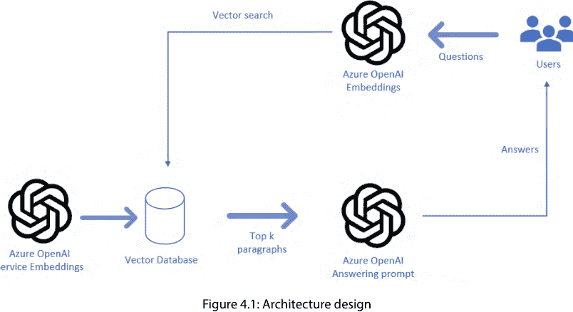
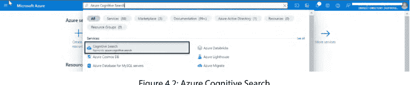
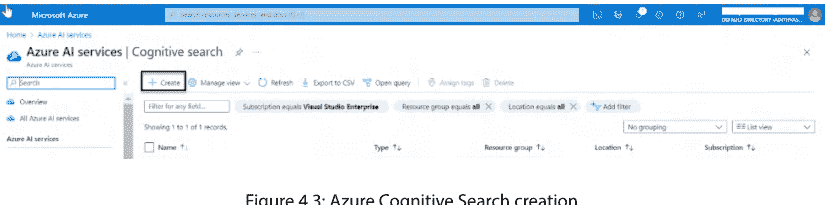
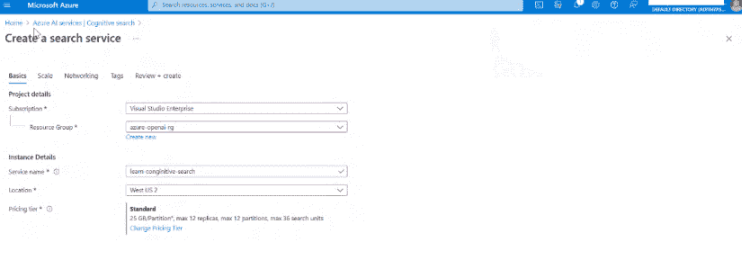
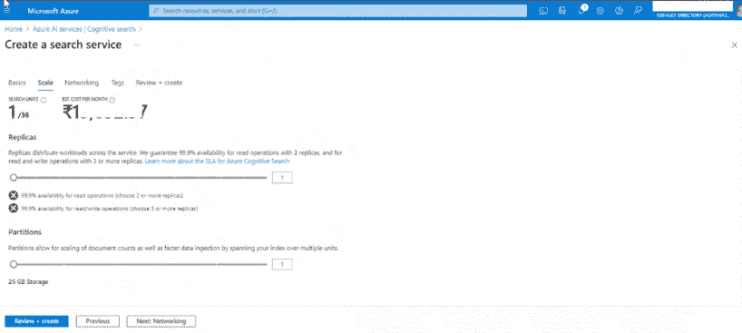
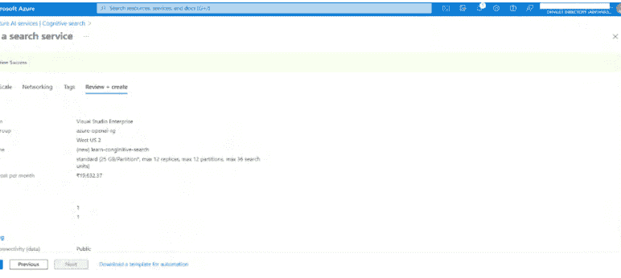
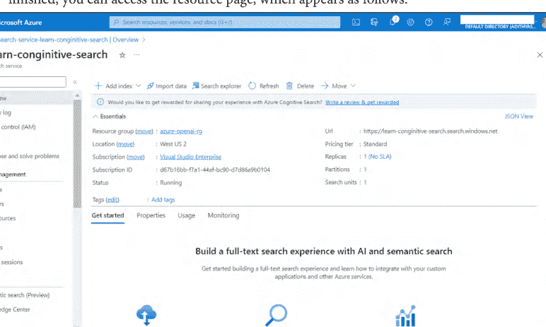
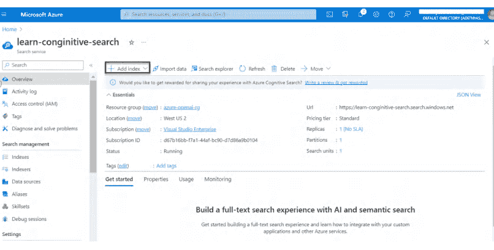
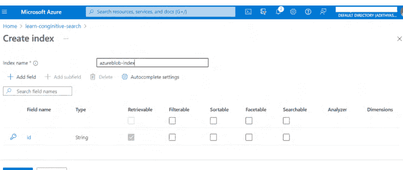
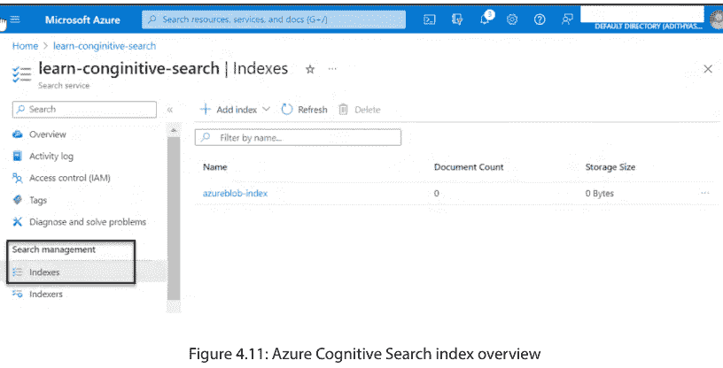

# 4 开发企业级文档问答解决方案

在上一章中，我们深入研究了扩展我们对语言模型理解的高级主题。我们熟悉了如嵌入（embedding）等概念，它涉及将单词或短语转换为数值形式以供语言模型处理，并将嵌入存储在 `Azure Cognitive Search` 中用于相关性搜索。此外，我们探索了模型上下文窗口（Model Context Window），它决定了语言模型在生成预测时考虑的上下文量。我们还发现了诸如 `Azure OpenAI On Your Data` 这样的功能，它允许自定义聊天、微调和 `OpenAI` 函数调用，从而在语言模型内部执行特定函数。该章进一步介绍了 `OpenAI` 插件，为增强语言模型的功能提供了扩展选项。最后，我们还被引入了 `LangChain` 和 `Semantic Kernel`，这是一种用于大语言模型的应用开发框架。

本章涵盖了以下主题：

- 使用非结构化文档的企业级用例
- 架构设计
- 使用 `Azure OpenAI` 和 `Azure Cognitive Search` 索引开发问答解决方案

在深入研究非结构化文档的企业级用例之前，让我们先解决许多人面临的一个共同挑战：在海量文档中寻找特定信息。每个主题或项目通常伴随着大量的文档，这些文档由各种来源慷慨提供。这些文档掌握着成功的关键，但它们可能让人眼目缭乱且毫无无章。

当需要寻找特定信息时，任务可能会变得艰巨。人们一页一页、一个文档一个文档地翻找，寻找关键信息。这个过程可能是非常耗时且令人沮丧的。

然而，并非希望。想象有一种可以简化这一过程的解决方案，让你更轻松、更快速地找到所需的信息。今天，我们将探索使用 `Azure OpenAI` 的这种改变规则的解决方案，旨在高效地解决这些问题。

企业拥有大量的非结构化文档，这些文档包含了回答特定问题的丰富知识。这种挑战对企业来说并不陌生；它是各行业组织面临的困境。让我们进入一个真实世界的场景来感受这种情况的严重性。

假设你是一家蓬勃旅游公司的老板，专门为冒险爱好者打造旅行体验。多年来，你的公司一直在为旅行者策划独特的行程，导致积累了大量的非结构化文档。

在这个数字宝库中，你会发现一系列材料：详细的行程、旅游指南、客户评价、预订记录，以及与世界各地目的地酒店、航空公司和当地旅游运营商之间的海量通信。这些文档封装了丰富的信息，从旅行者的偏好到隐藏的宝藏，再到打造难忘旅程的物流细节。

现在，让我们聚焦于一个特定场景。一位忠实的客户曾体验过你提供的几次精彩冒险，他们现在向你提出了一个特殊请求。他们寻求一次精心规划的旅行，以满足他们的特定兴趣：在原始风光中徒步、通过镜头捕捉野生动物，并沉浸在真实的文化体验中。他们的要求非常明确——他们想要一份详细的行程，将这些独特元素无缝地织入一段难忘的旅程。

当你和你的团队开始这项任务时，挑战变得显而易见。手动筛选数千份非结构化文档以发现相关的旅游目的地、住宿选择、旅游活动和物流细节的过程，不仅耗时，而且面临着遗漏关键细节的风险。这种艰辛的努力可能会持续数周，即使如此，结果可能也不像你所希望的那样精确。

旅游公司面临的困境并非孤例。企业也挣扎于类似的情况，他们收集了大量的非结构化文档，每份文档都掌握着开启卓越体验的关键。在本章中，我们将看到如何使用 `Azure OpenAI` 和 `Azure Cognitive Search` 索引来解决这一问题。

## 技术要求

为了跟随本章的实际练习，请访问源码：`https://github.com/PacktPublishing/Azure-OpenAI-Essentials/main/Chapter4.ipynb`。

在你的本地机器上安装以下工具以开始工作：

- `Python 3.9`、`3.10` 或 `3.11` - `https://www.python.org/downloads/`
- `Azure` 开发者 `CLI` - `https://learn.microsoft.com/en-us/azure/developer/azure-cli/install-azd?tabs=winget-windows%2Cmac%2C-linux&pivots=os-windows`
- `Node.js 14+` - `https://nodejs.org/en/download`
- `Git` - `https://git-scm.com/downloads`
- `PowerShell 7 (pwsh)` - `https://github.com/powershell/powershell`
- `Azure` 账户 - 如果你是 `Azure` 新手，免费获取 `Azure` 账户并将获得一些用于的额度
- 已启用 `Azure OpenAI` 服务嵌入功能的 `Azure` 订阅（可以通过此表单申请访问：`https://learn.microsoft.com/en-in/legal/cognitive-services/openai/limited-access`）
- `Azure OpenAI` 连接和模型信息：
  - `OpenAI API` 密钥
  - `OpenAI` 嵌入模型名称
  - `OpenAI API` 版本

## 架构设计

为了构建此系统，我们需要以下服务：

- `Azure Cognitive Search`
- `Azure OpenAI Service`

我们的主要目标是将非结构化数据转换为嵌入，并存储在向量数据库中。当用户提交查询时，系统利用 `Azure OpenAI` 嵌入进行处理。随后，在向量数据库上执行向量搜索以检索前 K 个段落。这些选定的段落将被发送到 `Azure OpenAI` 回答提示词中，由其提取答案并交付给用户。

以下是使用 `Azure OpenAI` 的问答解决方案简单架构图：



在前面的图中，我们将 `Azure OpenAI` 服务的嵌入（embeddings）发送到向量数据库，用户提出的问题会被发送到这些嵌入，并从中提取结果。现在，我们将使用此设计为我们的问题开发一个解决方案。

## 使用 Azure OpenAI 和 Azure Cognitive Search 索引开发问答解决方案

现在我们已经熟悉了创建此解决方案所需的架构元素，让我们在 `Azure` 门户中开始这些组件的实现。如之前提到的，拥有活跃的 `Azure` 账户是构建此应用程序的前提。

### Azure 订阅前提条件

以下前提条件已在第 2 章中建立，可以复用：

- `Azure` 订阅
- `Azure OpenAI` 资源
- 已部署的 `Azure OpenAI` 模型

创建以下工具（排除第 2 章中已建立的工具）。

## 使用 Azure OpenAI 和 Azure Cognitive Search 索引开发问答解决方案

我们已经设置了 `Azure OpenAI` 及其部署，下一步是在与建立 `Azure OpenAI` 相同的资源组内创建 `Azure Cognitive Search`：

1. 访问顶部导航栏中的搜索框并搜索 `Azure Cognitive Search`，如图所示：



当你访问 `Azure OpenAI` 服务页面时，你将看到一个“创建”（Create）选项，如下所示：



2. 点击“创建”选项后，将出现一个表单，类似于图 4.4。选择资源组（Resource Group）——在我的情况下，我选择了之前创建的 `azure-openaiai-rg`。在本节的最后一步中，选择定价层级；我选择了 `Standard S0`。这是完成步骤 1 后的显示方式：



3. 完成步骤 2 后，点击“下一步”（Next）按钮进入后续步骤，在此处你可以根据所选层级查看定价详情。你可以保持默认设置不变并点击“下一步”按钮继续：



4. 点击“下一步”后，你将被重定向到网络（Networking）选项卡，其中端点连接性默认设置为“公共”（Public）。请保持为公共并点击“下一步”继续：


5. 点击“下一步”按钮后，你将进入“标签”（Tags）步骤。你可以暂时忽略此部分。标签是键值对，允许你对资源进行分类，并通过对多个搜索和资源组应用相同的标签来方便统一计单。你可以在“标签”步骤找到类似的细节。点击“下一步”继续，然后进入“查看并创建”（Review + create）步骤。

在这里将显示你在之前步骤中选择的详情。检查所有信息并点击**创建**（Create）按钮：



图 4.7：`Azure Cognitive Search` 标签


# 创建 Azure Cognitive Search 实例

创建 Cognitive Search 可能需要几分钟时间。一旦搜索部署完成，你可以访问资源页面，其显示如下：



图 4.8：Azure Cognitive Search 概述

## 创建索引并添加文档

要创建一个用于向量搜索的索引并向向量存储添加文档，请点击“添加索引”（Add index）链接。或者你也可以从“索引”（Indexes）选项卡创建：



图 4.9：Azure Cognitive Search 索引创建

当你点击“添加索引”选项时，将出现一个表单，如图 4.10 所示。为你的发布填写必要的字段，包括索引名称（Index name）：



图 4.10：Azure Cognitive Search 索引创建

## 使用 Azure OpenAI 和 Azure Cognitive Search 索引开发问答解决方案

点击**创建**，将花费几分钟来创建索引。你可以验证其创建情况。



图 4.9：Azure OpenAI

## 环境变量配置

以下环境变量需要在 `.env` 文件中配置：

```
OPENAI_DEPLOYMENT_NAME = "gpt-35-turbo"
OPENAI_DEPLOYMENT_VERSION = "2023-07-01-preview"
OPENAI_MODEL_NAME = "gpt-35-turbo"
OPENAI_EMBEDDING_DEPLOYMENT_NAME = "text-embedding-ada-002"
OPENAI_EMBEDDING_MODEL_NAME = "text-embedding-ada-002"
OPENAI_EMBEDDING_DEPLOYMENT_VERSION = "2023-07-01-preview"
OPENAI_VERSION = "2023-03-15-preview"
LOCATION = "westeport"
OPENAI_API_VERSION = "2023-07-01-preview"
VECTOR_STORE_ADDRESS = "(cognitive-search-url)"
VECTOR_STORE_PASSWORD = "(cognitive-search-adminekey)"
OPENAI_SIMILARITY_DEPLOYMENT_NAME = "text-embedding-ada-002"
SERPER_API_KEY = '(serper_api_key)'
AZURE_COGNITIVE_SEARCH_SERVICE_NAME = "(cognitive-search-servicename)"
AZURE_COGNITIVE_SEARCH_INDEX_NAME = "{index-name}"
AZURE_COGNITIVE_SEARCH_API_KEY = "{cognitive-search-key}"
```

我们已经提供了一个 `.env` 文件，需要在其中填充连接字符串详情。请按照以下步骤进行设置：

- **步骤 I**：调整 `OPENAI_API_BASE` 和 `OPENAI_DEPLOYMENT_ENDPOINT` 的值以匹配您的 Azure OpenAI 资源名称。例如，如果您将 Azure OpenAI 命名为 `oai-documents-qna`，则 `OPENAI_API_BASE` 的值应设置为 `https://oi-documents-qna.azure.com/`。
- **步骤 II**：更新 `OPENAI_API_KEY` 的值为在 Azure OpenAI 资源“密钥”（Keys）部分找到的访问密钥。
- **步骤 III**：修改 `AZURE_COGNITIVE_SEARCH_SERVICE_NAME` 和 `AZURE_SEARCH_INDEX_KEY` 的值以匹配您的 Azure Search 资源详情，这些详情可以从 Azure Cognitive Search 获取。

通过完成这些配置，您将拥有资源所需的连接字符串。

## 测试连接性

我们现在将如下测试与 Azure OpenAI 的连接性：

```python
# 使用 model 引擎测试 OpenAI 的连接性
llm = AzureOpenAI(engine=OPENAI_MODEL_NAME, temperature=0)
print('tell me about yourself')
```

语言模型（称为 `llm`）正在使用 `AzureOpenAI` 类初始化，并指定指定的引擎（假设为 OpenAI 模型）`OPENAI_MODEL_NAME` 以及设置为 0 的温度参数，该参数控制着模型响应的随机性。它使用初始化的模型对“tell me about yourself”输入提示生成响应，并通过生成该响应来测试 OpenAI 语言模型的连接性和功能。

## 使用 AzureOpenAI 和 Azure Cognitive Search 索引开发问答解决方案

这是输出内容：

```
WARNING! engine 不是默认参数。
engine 已传递到 model_kwargs。
请确认 engine 是否为您的意图。
```

> 我是一个 AI 数字助手，旨在协助并与用户交流。我不断学习并提高我的能力，以提供有用且准确的回答。我没有物理形态或情感，但我被设定为友好且易于交流。我的目的是让任务变得更简单，并为与我交互的人提供信息。您有什么具体的想知道的吗？

图 4.2：连接输出

## 加载文档并创建向量索引

我们将加载文档、创建嵌入并将它们添加到搜索中：

```python
## 加载文档
loader = DirectoryLoader('data/', glob='*.pdf', show_progress=True)
documents = loader.load()
```

在之前的代码中，我们从文件夹中加载了所有 `.pdf` 扩展的文件到加载器中。在下一行中，我们将它们加载到 `documents` 对象中：

```python
## 将文档切分成块
text_splitter = CharacterTextSplitter(chunk_size=1000, chunk_overlap=0)
docs = text_splitter.split_documents(documents)
```

我们正在初始化 `CharacterTextSplitter` 并使用它将文档切分为大小为 1,000 的块：

```python
## 向量搜索
index_name: str = "azureblob-index"
embeddings: OpenAIEmbeddings = OpenAIEmbeddings(deployment=model, chunk_size=1)
vector_store: AzureSearch(
    azure_search_endpoint = vector_store_address,
    azure_search_key_vector = vector_store_password,
    index_name = index_name,
    embedding_function = embeddings.embed_query,
)
list_of_docs = vector_store.add_documents(documents=docs)
```

在之前的代码中，我们用 `AzureSearch` 初始化了向量存储，并将文档添加到向量存储中。

让我们回顾一下到目前为止编写的代码。代码首先使用 `DocumentLoader` 从指定目录加载 PDF 文档，然后使用 `CharacterTextSplitter` 将其切分为较小的块。随后使用 `OpenAIEmbeddings` 模块创建嵌入，最后设置 Azure Search 服务用于基于向量的文档搜索，并使用 `vector_store` 实例将之前切分的文本文档（`docs`）添加到向量存储中。

输出：


## 执行相似性搜索

现在，我们对向量数据库执行相似性搜索：

```python
## 执行相似性搜索
docs_search = vector_search.similarity_search
```

相似性搜索对 `vector_search` 对象进行。它根据“What are some places in Goa to visit”查询提示检索相似的文档。

## 总结

在本章中，我们探索了如何利用 Azure OpenAI 和 Azure Cognitive Search 开发企业级文档问答解决方案。我们解决了组织在管理包含价值信息的海量非结构化文档时的常见挑战，并强调了此类解决方案的变革性潜力。我们概述了搭建开发环境所需的各种工具和软件，确保为实施做好就绪。我们还详细介绍了架构，解释了 Azure Cognitive Search 和 Azure OpenAI 服务如何协同工作，将非结构化数据转换为嵌入以进行高效搜索。最后，我们提供了构建该解决方案的实用指南，包括设置 Azure OpenAI 部署和 Azure Cognitive Search 组件。

在下一章中，我们将集成 OpenAI 和 Azure Communications Services 来构建一个高级分析解决方案。
