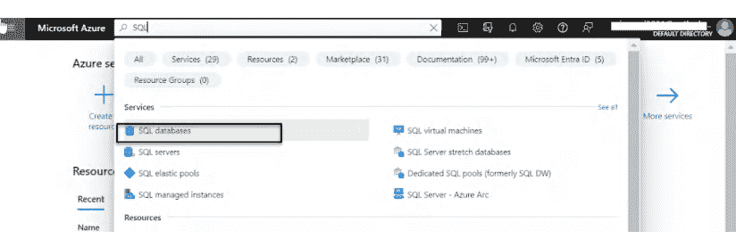
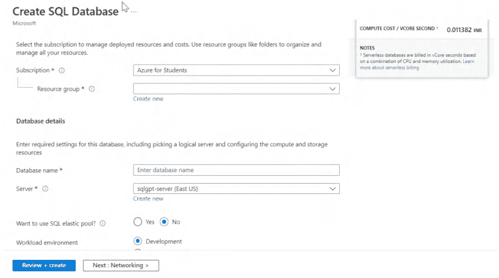
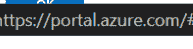
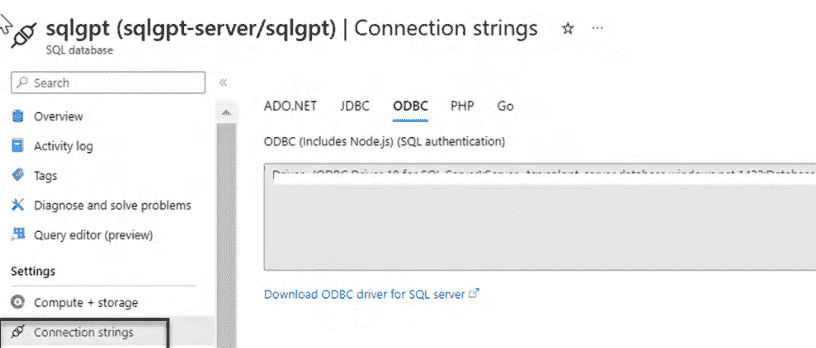

# 6 从结构化数据库中查询

在上一章中，我们学习了如何使用 `ChatGPT` 分析客户对话并获取有用信息。现在，让我们想象已经将所有这些宝贵信息存储在 SQL 数据库中。正如你可以想象的，这个数据库就像装满了各种重要细节的宝箱。

来认识 Sarah，我们优秀的客户服务经理。她的工作是揭示隐藏在数据海洋中的故事。在过去，寻找这些故事意味着要精通 `SQL` 查询，这是一种并不是所有人都能理解的语言。编写这些查询就像在解谜，即使对于经验丰富的用户来说也需要大量时间。

但现在，一个新篇章开启了——SQL GPT 的诞生。Sarah 不再受限于复杂的 SQL 规则，她现在有一个理解简单语言的工具。她不再编写复杂的查询，而是像和朋友聊天一样与数据库对话。

使用 SQL GPT，Sarah 使用简单的英语提示词探索数据库的分析。对上个月的满意度评分或音频对话的数量好奇？问问！

在本章中，我们开启了一项为所有人简化数据的任务。SQL GPT 充当复杂数据库世界与各种技能水平用户之间友好的桥梁，将日常问题转化为强大的 `SQL` 查询。我们将共同探索该工具如何让数据易于获取，并赋予像 Sarah 这样的人轻松发现有意义见解的能力。虽然 SQL GPT 是学习 `SQL` 的初者的很好的资源，但它对经验丰富的用户来说也无价之，帮助他们轻松编写即使是最复杂的查询。让我们开启这段令人兴奋的之旅，解锁数据的真正潜力！

# 从结构化数据库中查询

本章涵盖了以下主题：

- 架构设计

- SQL GPT 章节

## 技术要求

为了跟进本章的练习，请访问 `https://github.com/PacktPublishing/Azure-OpenAI-Essentials/blob/Chapter6.ipynb` 以下是在第 4 章中已经配置的要求：

- Python 3.9, 3.10 或 3.11 `https://www.python.org/downloads/`

- Azure 命令行界面 (Azure CLI)

- Node.js 14+ `https://nodejs.org/en/download`

- Git `https://git-scm.com/`

- PowerShell 7+ (pwsh) `https://github.com/powershell/powershell`

- Azure 账户 如果你是 Azure 新手，可以免费获取 Azure 账户并获得一些额度来开始。

- 已启用 Azure OpenAI 的 Azure 订阅

Azure OpenAI 连接和模型信息：

- `OpenAI API` 密钥

- 部署名称

- `OpenAI API` 版本

- 一个带有连接字符串的 SQL Server

## 从结构化数据库查询



图 6.2：选择 SQL 数据库

- 4. 点击“创建”

- 5. 在创建资源表单中选择订阅和资源组（例如：azure-openai-rg）。



图 6.3：输入数据库详情

- 6. 现在为数据库输入所需的数据库名称和服务器。

- 7. 对于服务器，选择“创建新”，并使用以下值填写新服务器表——服务器名称、位置、身份验证方法、服务器管理员登录、密码，并点击“确定”。

首页 > SQL 数据库 > 创建 SQL 数据库

## 创建 SQL 数据库服务器

使用 Microsoft 订阅和资源组作为数据库。

| 服务器名称 * | .database.windows.net |

| :--- | :--- |

| 位置 * | (US) East US |

| 身份验证 | |

Azure Active Directory (Azure AD) 现在已更 Microsoft Entra ID。[了解更多]

为访问此服务器选择您偏好的身份验证方法。创建一个服务器管理员登录和密码，以便使用 SQL 身份验证访问您的服务器。如果使用现有的 Microsoft Entra 用户、组或应用程序作为 Microsoft Entra 管理员，请仅选择 Microsoft Entra 身份验证[了解更多]，或同时选择 SQL 和 Microsoft Entra 身份验证。

- 仅使用 Microsoft Entra 身份验证

- 同时使用 SQL 和 Microsoft Entra 身份验证

- 使用 SQL 身份验证

| 服务器管理员 * | | |

| :--- | :--- |

| 密码 * | | |

| 确认密码 * | | |



图 6.4：输入 SQL Server 详情

服务器创建完成后，我们需要选择该服务器来创建 SQL 数据库。

- 8. 选择工作负载环境、计算+存储并点击“下一步”。在“网络”选项卡中，将“添加当前客户端 IP 地址”切换为“是”：

## 创建 SQL 数据库

Microsoft

- 基础 网络 安全 其他设置 标签 审核 + 创建

为您的服务器配置网络访问和连接。下方选择的配置将应用于所选服务器 'sql-server-onqliktgt2tns' 及其管理的所有数据库。[了解更多]

## 防火墙规则

显示的设置为只读。在创建数据库后，它们可以从所选服务器的“防火墙和虚拟网络”窗格进行修改。[了解更多]

允许 Azure 服务和资源访问此服务器

添加当前客户端 IP 地址 *


- 9. 在网络页面上点击“下一步”，将安全、其他设置、标签保持默认值，并进入“审核 + 创建”页面：

## 创建 SQL 数据库

Microsoft

我上方 (b) 授权 Microsoft 使用我的当前支付方式支付与服务相关的费用，计费频率与我的 Azure 订阅相同，并 (c) 同意 Microsoft 可以将我的联系方式、使用和交易信息与服务的提供商共享，用于支持、计费和其他交易活动。Microsoft 不提供第三方服务的权利。更多详情请参阅 Azure 市场服务条款。

| 所选最大存储 (GB) | 41.6 |

| :--- | :--- |

| 预估存储成本 / 每 | 375.71 mn |

| 计算成本 / 每秒 | 0.011382 |

| 基础 | 学生版 |

| :--- | :--- |

| 订阅 | communication-service |

| 资源组 | East US |

| 区域 | sqljgt |

| 数据库名称 | (new) sqlserver |

| 身份验证方法 | SQL 身份验证 |

| 服务器管理员登录 | azureserver |

| 计算 + 存储 | 通用 - 无服务器：标准系列 (Gen5), 1 vCore | 32 GB 存储，禁用区域冗余 |

| 备份存储冗余性 | 本地冗余备份存储 |

备注 1. 服务器数据库根据您的实际使用情况按 vCore 秒计费。[了解更多关于服务器计费]

## 网络

允许 Azure 服务和资源访问此服务器 


- 10. 检查所有详情并点击“创建”按钮以创建 SQL Server 和数据库。

## 开发 SQLGPT 解决方案

现在我们已经在 Azure 门户中设置了所有基本服务，可以开始构建我们的解决方案了。

## 使用 Azure SQL 和 ChatGPT 的解决方案

在开发代码时，我将在 Jupyter 笔记本中工作，其余安装内容与第 4 章相同。您可以在本书 GitHub 仓库的第 6 文件夹中找到所有必要项目，包括 Python 笔记本，路径为 `https://github.com/PacktPublishing/Azure-OpenAI-Essentials/blob/main/Chapter6.ipynb`

除了第 4 章安装的库外，此代码还需要安装一个额外的 Python 库。创建一个新的 Jupyter Notebook 并安装以下包：

```
pip install pyspark
```

我们的代码包含以下章节，我们将在这些章节中开发解决方案

- 1. 导入包

- 2. 设置数据库连接字符串

- 3. 示例查询

- 4. 使用 ChatGPT

- 5. 创建 代理

### 导入包

在开发解决方案之前，我们需要导入所需的包。

```python
import pyodbc
import pandas as pd
from langchain.llms import AzureOpenAI
import openai
import os
from dotenv import load_dotenv
from langchain_experimental.agents.toolkits import create_pandas_agent
```

您可以在上方看到各种库。让我们在这里详细介绍这些：

| 导入包 | 描述 |

| :--- | :--- |

| pyodbc | 用于 ODBC（数据库连接）的模块。 |

| pandas | 强大的数据处理和分析库。 |

| langchain.llms.AzureOpenAI | "langchain" 中的语言模型。 |

| openai | 提供 GPT 模型的库。 |

| os | 提供与操作系统交互的方法，包括读取或设置环境变量。 |

| dotenv.load_dotenv | 从 .env 文件加载环境变量。 |

| langchain_experimental.agents.toolkits | 创建 Spread DataFrame 代理的工具。 |

| create_pandas_agent | 创建 Pandas 代理的函数。 |

表 6.1：导入包的用法

## 初始化常量


现在，使用 `.env` 文件提供的密钥初始化所有必要的常量。我们将第 4 章中的 `DATABASESERVER`、`DATABASE`、`DATABASEUSERNAME` 和 `DATABASEPASSWORD` 添加到我们的 `.env` 文件中。

## Azure

`load_dotenv()`

```python
OPENAI_API_KEY = os.getenv("OPENAI_API_KEY")
OPENAI_DEPLOYMENT_ENDPOINT = os.getenv("OPENAI_DEPLOYMENT_ENDPOINT")
OPENAI_DEPLOYMENT_NAME = os.getenv("OPENAI_DEPLOYMENT_NAME")
OPENAI_MODEL_NAME = os.getenv("OPENAI_MODEL_NAME")
OPENAI_API_VERSION = os.getenv("OPENAI_API_VERSION")
OPENAI_DEPLOYMENT_VERSION = os.getenv("OPENAI_DEPLOYMENT_VERSION")

server = os.getenv("DATABASESERVER")
database = os.getenv("DATABASE")
username = os.getenv("DATABASEUSERNAME")
password = os.getenv("DATABASEPASSWORD")

#init Azure OpenAI
openai.api_type = "azure"
openai.api_version = OPENAI_DEPLOYMENT_VERSION
openai.api_base = OPENAI_DEPLOYMENT_ENDPOINT
openai.api_key = OPENAI_API_KEY
```

将此内容添加到我们在第 4 章创建的 `.env` 文件中，包含连接字符串和端点：

```
DATABASESERVER = 'tcp:{server}'
DATABASE = '{name}'
DATABASEUSERNAME = '{username}'
DATABASEPASSWORD = '{password}'
```

## 从结构化数据库查询



图 6.7：连接字符串

我们得到以下输出：

| Out [2] : | True |

## 设置数据库连接字符串

这段代码是在 Python 中使用 `pyodbc` 连接 SQL Server 数据库的常用模式，在 `connectionString` 中指定连接参数。生成的连接 (`cnxn`) 和游标 (`cursor`) 可通过 SQL 查询与数据库交互。

```python
connectionString = f'DRIVER={{ODBC Driver 18 for SQL Server}};DATABASE={database};UID={username};PWD={password};Encrypt=yes;TrustServerCertificate=no;Connection Timeout=30'
cnxn = pyodbc.connect(connectionString)
cursor = cnxn.cursor()
```

现在我们已经将连接字符串整合到 SQL 数据库中，是时候通过执行示例查询来验证它们了。根据我的经验，我遇到过多次开发者在获取正确连接字符串方面挣扎的情况，最好的方法直接从源门户复制并粘贴。如果你是自行格式化，请注意密码或用户名中是否存在特殊字符。

此代码段有助于从指定的 SQL 表中提取数据子集并并在 Pandas Dataframe 中进行可视化，这是 Python 中处理数据时的典型流程。

```python
# 从 SQL 表中选择 10 行插入到 dataframe。
query = "select * from [SalesLT].[Address]"
df = pd.read_sql(query, cnxn)
print(df.head(10))
```

## 开发 SQLGPT 解决方案

我们得到以下输出：

| AddressID | AddressLine1 | AddressLine2 | City | StateProvince |

| :--- | :--- | :--- | :--- | :--- | :--- |

| 0 | 9 | 8713 Yosemite Ct. | None | Bothell | Washington |

| 1 | 11 | 1318 Lasalle Street | None | Bothell | Washington |

| 2 | 25 | 9178 Jumping St. | None | Dallas | Texas |

| 3 | 28 | 9228 Del Sol | None | Phoenix | Arizona |

| 4 | 32 | 26910 Indela Road | None | Montreal | Quebec |

| 5 | 185 | 2681 Eagle Peak | None | Bellevue | Washington |

| 6 | 297 | 7041 New West Ave | None | Anton | Washington |

| 7 | 445 | 6388 Lake City Way | None | Burnaby | British Columbia |

| 8 | 446 | 52600 Free Street | None | Toronto | Ontario |

| 9 | 447 | 22500 Free Street | None | Toronto | Ontario |

| CountryRegion | PostalCode | rowguid | ModifiedDate |

| :--- | :--- | :--- | :--- |

| 0 United States | 98011 | 268AF621-76D7-47C8-9441-144FD3982A1 | 2007-07-01 |

| 1 United States | 98011 | C9B1B303-ACA2-47C9-B6F7078B5269 | 2007-04-01 |

| 2 United States | 75201 | C0BD3B09-48F0-4654-A8DD-6A7A8AB4D3C6 | 2006-09-01 |

| 3 United States | 85004 | A2E5E11-FC3E-4562-B9B2-397DB169774 | 2005-09-01 |

| 4 Canada | H1J 2H5 | 8A495F62-32E8-47E7-BDD5-5A6F00C9D9B2 | 2006-08-01 |

| 5 United States | 98004 | 4C41C422-27E8-466C-8472-14C4C414BC | 2006-09-01 |

| 6 United States | 98095 | 5241A0D6-27F1-4B1D-A959-9764C26E5DE0 | 2006-08-01 |

| 7 Canada | VSA 3A6 | 53572F25-7F13-4A68-A8E5-102FF35416EE | 2005-08-01 |

| 8 Canada | M4B 1V7 | 80A1DDFC-5125-46B8-A4B4-CCBD2EC57CA4 | 2005-08-01 |

| 9 Canada | M4B 1V7 | 88CEE379-D8B8-A33E-A35E09435500 | 2006-08-01 |

图 6.8：SQL 查询输出概述

## 使用部署的 ChatGPT 模型

通过上一个输出，我们确认 SQL 连接已成功建立，使我们能够在 Python 代码中执行数据库查询。

提供的代码段初始化了 `AzureOpenAI` 类实例，假设 `OPENAI_DEPLOYMENT_NAME` 和 `OPENAI_MODEL_NAME` 分别是存储用于使用的部署和模型名称的变量。

```python
llm = AzureOpenAI(deployment_name=deployment_name, 
                  model_name=model_name)
```

## 创建 Pandas 代理并提问

接上一步操作，代码初始化了一个可以与 Pandas DataFrame 和语言模型进行自然交互的实验性代理。它提出了问题“有多少行？”，预期代理会根据 DataFrame 进行解释并回答。

```python
agent = create_pandas_dataframe_agent(llm, df, verbose=True)
```

我们得到以下输出：

```
> Entering new AgentExecutor chain...
Thought: use the len() function in Python
Action: python
```
