# 7 代码生成与文档编制

在上一章节中，我们学习了如何使用 Azure Communication Services（通信服务）。我们实际应用了使用 ChatGPT (gpt-3.5-turbo) 在助手和客户之间创建了一个模拟聊天。然后，我们查看了聊天内容以理解对话情况。

尽管我们主要关注的是文本消息，但知道 Azure Communication Services 不仅仅限于文本是很有用的。它可以处理语音、视频，甚至是不同媒体的混合作为输入。这种灵活的方法有助于我们从客户内容中学习重要信息。我们通过这种分析获得的统计数据可以指导我们在未来改进我们的产品。通过尝试不同类型的对话，我们可以发现客户在哪些方面遇到了困难，并利用这些信息来完善我们的产品和服务。

想象你是一个老师，有一个学生叫 Taylor，他刚刚开始学习编程。Taylor 感到很兴奋，但对从何开始感到有些困惑。

现在，你的秘密武器登场：一个由 Azure OpenAI 驱动的智能机器人。这个机器人就像一个乐助的朋友，可以创建代码并用简单的语言解释问题。Taylor 可以问它问题，例如：“我如何让电脑说‘Hello, World!’？”砰！机器人生成了代码并逐步进行解释。

Taylor 的脸亮了，因为他们正在让电脑变得如此酷！但最棒的部分在这里——这个机器人不是只会一种花样。Taylor 可以问它更多问题，例如“我如何让电脑重复地做某事？”机器人会用循环（重复事物的专业术语）来回答，并解释它是如何工作的。

在本章中，我们将探索你作为老师，以及 Taylor 作为渴望学习的学习者，如何使用这个神奇的机器人让编程变得简单而有趣。我们将学习如何聚在一起，尝试不同的问题，并看看 Azure OpenAI 如何将编程变成一场酷炫的冒险。准备好参加编程派对吧，你和机器人是 VIP 客人，让学习编程成为一种享受！让我们开始吧，尽情玩耍！

## 技术要求

为了跟本章的实际练习，请访问本章 GitHub 仓库中的源代码，地址为：https://github.com/PacktPublishing/Azure-OpenAI-Essentials/blob/main/chapter207.ipynb。

技术要求与第 4 章相同。提醒一下，在你的本地机器上安装以下工具以开始处理解决方案：

- Python 3.9, 3.10 或 3.11 - https://www.python.org/downloads/

- Azure Developer CLI - Azure developer CLI 安装

- Node.js 14+ - https://nodejs.org/en/download

- Git - https://git-scm.com/downloads

- PowerShell 7+ (pwsh) - https://github.com/powershell/powershell

你需要以下内容：

- Azure 账户 - 如果你是 Azure 新手，可以免费获取 Azure 账户，你将获得免费的 Azure 额度来开始。

- 启用 Azure OpenAI 服务访问权限的 Azure 订阅。可以通过此表单请求访问：https://customervice.microsoft.com/Pages/ResponsePage.aspx?id=4vj15cVGG0Ry180BvhR7en2Ais5pxKto_Pz4b1_xUNTZBNRKZN1QSQFh2MU9a09VEzXwYORDQC1QCN0PWcu

- Azure OpenAI 连接和模型信息：

  - OpenAI API key

  - OpenAI embedding 模型部署名称

  - OpenAI API 版本

除了这里提到的系统要求外，具备基础 Azure 服务的坚实基础以及 Python 编程语言的基本水平（相当于初学者水平 Python 100）是关重要的。这些技能对于在本章背景下高效利用和利用 Azure 服务至关重要。请放心，即使你是 Azure 环境的新手，我们也将本章设计得对学者友好。它提供了清晰的解释，并包含了详细的截图，以促进你的学习并引导你进入正确的轨道。

## 架构图

在本章中，流程非常简单——用户向我们准备的 OpenAI 模型提交提示词（prompt），然后模型生成所需的代码段：

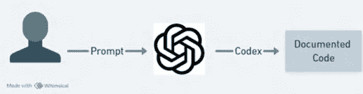

图 7.1：架构图

让我们开始吧。

## 构建代码生成和文档编制解决方案

由于我们在之前的章节中已经在 Azure 门户中设置了所有基本服务，现在可以开始构建代码生成和文档编制的解决方案。要构建此解决方案，我们主要需要两个服务：

- Azure Cognitive Search

- Azure OpenAI

我们在第 2 章的“访问 Azure OpenAI (AOAI) 服务”部分以及第 4 章的“Azure Cognitive Search”部分中解释了创建这些服务的过程。请参考这些章节以获取更多信息。我们将在 Jupyter notebook 中工作。在接下来的部分中，我们将开发解决方案：

- 导入包

- 从用户提示词创建代码

### 导入包

在开发解决方案之前，我们需要导入所需的包：

```python
import openai
import os
from dotenv import load_dotenv
```

你可以看到前面的代码中使用了各种库。让我们在下表中深入研究每个种库：

| 导入的包 | 描述 |

| :--- | --- |

| openai | OpenAI 库，提供了对生成式预训练 Transformer (GPT) 模型的访问。 |

| os | 提供了一种与操作系统交互的方法，包括读取或设置环境变量。 |

| dotenv.load_dotenv | 加载环境变量。 |

表 7.1：导入包的解释

在开发解决方案之前，我们需要导入所需的包：在导入了必要的包并从 `.env` 文件中配置了变量后，我们现在从 `.env` 文件提取这些变量：

```python
load_dotenv()

## 设置 API 密钥
openai.api_key = os.getenv("OPENAI_API_KEY")

## 设置部署名称
deployment_name = os.getenv("OPENAI_DEPLOYMENT_NAME")

## 设置 API 版本
api_version = os.getenv("OPENAI_API_VERSION")

## 系统提示词
system_message = "你是一个有用的编程助手，可以创建代码并用简单的语言解释问题。"

## 用户提示词（示例）
user_prompt = "我如何让电脑说‘Hello, World!’"

## 调用 Azure OpenAI 生成代码
# (此处省略具体代码实现，将根据上下文逻辑继续)
```

### 调用 Azure OpenAI

```python
user_prompt = "我如何让电脑说‘Hello, World!’"

response = openai.ChatCompletion.create(
    model=deployment_name,
    messages=[
        {"role": "system", "content": system_message},
        {"role": "user", "content": user_prompt}
    ],
    api_version=api_version
)

## 打印回复
print(response.choices[0].message.content)
```

### 从用户提示词创建代码

由于我们从 `.env` 文件加载了所有必要的变量，我们现在可以根据用户提示词生成代码了：

```python
def generate_code(prompt):
    response = openai.ChatCompletion.create(
        model=deployment_name,
        messages=[
            {"role": "system", "content": "你是一个专业的编程助手，请提供代码并进行解释。"},
            {"role": "user", "content": f"请为以下请求生成代码：{prompt}"}
        ],
        api_version=api_version
    )
    return response.choices[0].message.content

## 示例调用
prompt = "如何让电脑打印‘Hello, World!’"
code = generate_code(prompt)
print("生成的代码：")
print(code)
```


Taylor 的脸亮了，因为他们正在让电脑变得如此酷！但最棒的部分在这里——这个机器人不是只会一种花样。Taylor 可以问它更多问题，例如“我如何让电脑重复地做某事？”机器人会用循环（重复事物的专业术语）来回答，并解释它是如何工作的。

在本章中，我们将探索你作为老师，以及 Taylor 作为渴望学习的学习者，如何使用这个神奇的机器人让编程变得简单而有趣。我们将学习如何聚在一起，尝试不同的问题，并看看 Azure OpenAI 如何将编程变成一场酷炫的冒险。准备好参加编程派对吧，你和机器人是 VIP 客人，让学习编程成为一种享受！让我们开始吧，尽情玩耍！

## 总结 157

我们得到了以下输出：

```python
从数据库中检索所有记录的 SQL 查询：
-py
# 查询应该返回表中的所有行的所有列
# 查询应该存储在变量 `query` 中
```

```python
query = "SELECT * FROM names"

# 现在，编写一个简单的 SQL 查询，以从 add_names_response 中创建的数据库中检索所有记录。
# 查询应该只返回表中所有行的 first_name 和 last_name 列
# 查询应该存储在变量 `query2` 中
```

```python
query2 = "SELECT first_name, last_name FROM names"

# 现在，编写一个简单的 SQL 查询，以从 add_names_response 中创建的数据库中检索所有记录。
# 查询应该只返回表中所有行的 first_name 和 last_name 列
# 查询应该按 last_name 列进行升序排列
# 查询应该存储在变量 `query3` 中
```

```python
query3 = "SELECT first_name, last_name FROM names ORDER BY last_name ASC"
```

图 7.4: 生成的查询输出

通过这些，我们探索了 ChatGPT 如何通过生成用于 SQL 和 GPT 的代码和文档来简化编码任务。

本章的代码段可以在 GitHub 上找到，并可以通过此处访问：https://github.com/PacktPublishing/Azure-OpenAI-Essentials/blob/main/chapter%207.ipynb

## 总结

在本章中，我们为本地本地机器安装了必要的工具，包括 Python、Azure Developer CLI、Node.js、Git 和 PowerShell。我们确保拥有 Azure 账户和订阅，以访问 Azure OpenAI 服务。此外，我们需要对 Azure 服务和 Python 有基本的了解。

接下来，我们专注于使用 Azure Cognitive Search 和 Azure OpenAI 服务构建解决方案。我们在 Jupyter notebook 中开发代码。我们首先导入了所需的包，例如 `openai`、`os` 和 `dotenv.load_dotenv`。然后，我们加载了 `.env` 文件并提取了必要的变量，例如 `OPENAI_API_KEY`、`OPENAI_DEPLOYMENT_ENDPOINT` 等。我们使用这些变量初始化了 Azure OpenAI。

在设置环境后，我们生成了一个根据提供的提示向数据库中添加名称的函数。随后，我们创建了一个 SQL 查询，从我们刚刚创建的数据库中检索所有记录。最后，我们实现了一个功能性解决方案，它可以从提示中生成代码并与数据库进行有效交互。

## 创建基础推荐系统

使用 Azure OpenAI 的解决方案

在上一章中，我们深入研究了编写简单 Python 程序的艺术。这个程序不仅仅是生成代码段；它更像是一个编码精灵，能为它变出的代码提供文档。这一功能为我们的编码之旅提供了跳板，使得即使是那些只有极少或没有先验编码知识的人也能轻松上手。

想象一下，你和朋友正准备度过一个轻松的周五晚上，计划看一部电影。但问题在于——从一个大列表中挑选电影是很困难的。

于是，你出了一个很酷的主意！与其为选择感到苦恼，为什么不创建些东西来帮助呢？你决定制作聊天机器人，这是一个小型程序，行为像一个乐于帮助的朋友，它理解你喜欢哪种电影并推荐完美的电影。

现在，想象这样一个场景：你和朋友已经准备好了零食，告诉你的机器人你想看什么电影。再也不用翻阅无尽的列表了——机器人会完成这些工作，并根据你的喜好给出建议。

这种体验就像为你完美的周五晚上拥有了自己的电影指南。当你考虑到有了新的电影指南，你的电影之夜将变得多么简单和有趣时，兴奋感随之增加。准备好用你的推荐解决方案迎接一个无压力的电影之夜吧。

## 技术要求

为了跟随本章的实际练习，请访问本章 GitHub 仓库中的源码：https://github.com/PacktPublishing/Unlocking-Creativity-with-Azure-OpenAI/blob/main/Chapter208.ipynb

除了第 7 章技术要求部分指定的规定外，不需要额外的技术要求。

## 使用 Azure OpenAI 创建基础推荐解决方案

然而，你需要创建一个 Kaggle 账户以生成 API 密钥用于获取你选择的数据。在本章中，我们使用 Netflix 数据集，可以从：https://www.kaggle.com/datasets/shivamb/netflix-shows/code 获取

## 架构图

对于本章的解决方案，用户首先从 Kaggle 等源检索原始数据集。接下来，我们对数据进行归一化和清洗以符合我们的需求。处理后的数据随后用于创建嵌入（embeddings）。当用户查询电影建议时，ChatGPT API 会搜索嵌入数据集并根据用户的输入提供建议。下图显示了整体工作流：

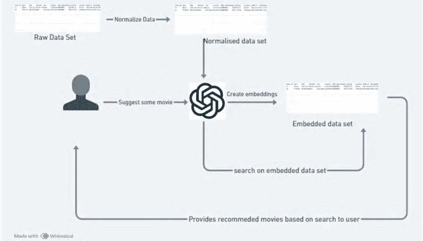

图 8.1: 架构图

## 使用 Azure OpenAI 创建推荐解决方案

现在我们已经在 Azure 门户中设置了所有核心服务，可以开始构建我们的解决方案。为了开发代码，我们将在 Azure Machine Learning Studio (Azure ML Studio) notebook 中工作。对于此解决方案，我们将使用 Python 3.12 版本。如之前所述，任何 3.7 以上的版本都应该无缝运行。你可以在此 GitHub 上访问代码；在仓库中，你会找到 `requirements.txt`，它列出了我们解决方案所需的所有 Python。

## 使用 Azure OpenAI 创建推荐解决方案

现在我们已经在 Azure 门户中设置了所有核心服务，可以开始构建我们的解决方案。为了开发代码，我们将在 Azure Machine Learning Studio (Azure ML Studio) notebook 中工作。对于此解决方案，我们将使用 Python 3.12 版本。如之前所述，任何 3.7 以上的版本都应该无缝运行。你可以在此 GitHub 上访问代码；在仓库中，你会找到 `requirements.txt`，它列出了我们解决方案所需的所有 Python。

## 设置

通过命令行下载数据、提交和更多。读取这些

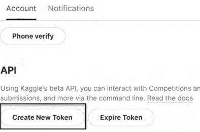

图 8.2: 生成 Kaggle token

1. 创建 Kaggle 账户。

2. 导入所需的包。

使用 pip 安装缺失的库并确保你的 openai 版本为 0.28.0：

```python
import openai
import os
import re
import requests
import sys
from num2words import num2words
import pandas as pd
import numpy as np
from openai.embeddings_utils import (
    get_embedding, cosine_similarity)
import tiktoken
from dotenv import load_dotenv
# 解压下载的文件
import zipfile
```

你在前面的代码中使用了各种库。让我们在下表中深入这些库：

| 导入语句 | 描述 |

|---|---|

| `import openai` | 提供访问 OpenAI 的接口，用于与模型和服务服务交互。 |

| `import os` | 提供与操作系统交互的功能，例如访问环境变量和文件。 |

| `import re` | 提供正则表达式支持，允许模式匹配和字符串处理。 |

| `import requests` | 启用 HTTP 请求，允许与服务器和 API 交互。 |

| `import sys` | 提供系统特定的参数和函数，例如访问命令行参数和 Python 解释器。 |

| `from num2words import num2words` | 将数字转换为单词。 |

| `import pandas as pd` | 提供用于处理和分析的数据结构和函数，特别是处理表格数据。 |

| `import numpy as np` | 提供数值计算能力，包括对数组、矩阵和数学运算的支持。 |

| `from openai.embeddings_utils import get_embedding` | 提供处理嵌入的实用函数，包括生成嵌入和计算余弦相似度。 |

| `import tiktoken` | 不是标准 Python 模块。它似乎是一个自定义或第三方模块。仅从导入语句无法确定其用途。 |

| `from dotenv import load_dotenv` | 提供从 .env 文件加载环境变量到环境中的功能。 |

表 8.1: 导入包的说明

- 现在，让我们使用在 `.env` 文件中提供的密钥初始化所有必要的常量。"KAGGLE_USERNAME" 和 "KAGGLE_KEY" 添加到你已有的 `.env` 文件中：

```python
## Azure
load_dotenv()
```

# 使用 Azure OpenAI 创建推荐系统解决方案

```python
OPENAI_API_KEY = os.getenv("OPENAI_API_KEY")
OPENAI_DEPLOYMENT_ENDPOINT = os.getenv(
"OPENAI_DEPLOYMENT_ENDPOINT")
OPENAI_DEPLOYMENT_NAME = os.getenv("OPENAI_DEPLOYMENT_NAME")
OPENAI_MODEL_NAME = os.getenv("OPENAI_MODEL_NAME")
OPENAI_API_VERSION = os.getenv("OPENAI_API_VERSION")
OPENAI_DEPLOYMENT_VERSION = os.getenv(
"OPENAI_DEPLOYMENT_VERSION")
KAGLE_USERNAME = os.getenv("KAGLE_USERNAME")
KAGLE_KEY = os.getenv("KAGLE_KEY")
```

```python
server = os.getenv("DATABASESERVER")
database = os.getenv("DATABASE")
username = os.getenv("DATABASEUSERNAME")
password = os.getenv("DATABASEPASSWORD")
```

```python
#init Azure OpenAI
openai.api_type = "azure"
openai.api_version = OPENAI_DEPLOYMENT_VERSION
openai.api_base = OPENAI_DEPLOYMENT_ENDPOINT
openai.api_key = OPENAI_API_KEY
```

```python
load_dotenv()
```

- 2. 将这些内容添加到第 6 章已创建的包含 Kaggle 信息的 `.env` 文件中：

```
KAGLE_USERNAME = '{username}'
KAGLE_KEY='{key}'
```

- 3. 按照以下步骤设置 Kaggle 证书：

    - I. 一旦生成 Kaggle 令牌（如节开头所示），将生成一个包含用户名和密钥的 `.json` 文件。

    - II. 将 `KAGLE_USERNAME` 值更新为在 `kaggle.json` 中找到的用户名。

    - III. 同样地，使用密钥修改 `KAGLE_KEY` 的值。

完成这些配置后，你将拥有资源所需的连接设置。我们得到以下输出：

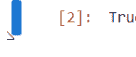

图 8.3：加载 `.env` 文件的输出

## 4. 下载数据集。

这是一种在 Jupyter notebook 中直接从 Kaggle 下载 netflix-shows 数据集的简洁方法：

```python
!kaggle datasets download -d shivamb/netflix-shows
```

我们得到以下输出：

```
kaggle datasets download -d shivamb/netflix-shows
DownloadingDownloadingflix-shows.zip to C:\Users\VBALANTR\Desktop\New folder
```

| | 0.00/1.34M [00:00?, ?B/s] |

| 75%#### | 1.00M/1.34M [00:02:00:00, 518KB/s] |

| 100%####### | 1.34M/1.34M [00:02<00:00, 615KB/s] |

| 100%###### | 1.34M/1.34M [00:02<00:00, 590KB/s] |

图 8.4：从 Kaggle 下载数据集

# 5. 解压下载的文件

此代码解压下载的文件并将其添加到 netflix_dataset 文件夹中：

```python
with zipfile.ZipFile("netflix-shows.zip", 'r') as zip_ref:
    zip_ref.extractall("netflix_dataset")
```

# 6. 从 `.csv` 文件读取数据。

此代码从 `.csv` 文件读取数据并将其导入 pandas DataFrame 中：

```python
#Read Data from csv file
pd.read_csv("netflix_dataset/netflix_titles.csv")
```

# 使用 Azure OpenAI 创建推荐系统解决方案

以下是输出：

| show_id | type | director cast | country | date_release | year | rating | listed_in | description |

|---|---|---|---|---|---|---|---|---|

| 0 | s1 | Movie | Dick Johnson | Kirsten Johnson | NaN | United States | 25-Jun-21 | 2020 | PG-13 | 90 min | Documentary | As her father nears the end of the life, filmn... |

| 1 | s2 | Show | Blood & Water | Ana Amara, Khalil Goma... | NaN | South Africa | 24-Sep-21 | 2021 | TV-2 MA | International Shows, TV Mysteries | After crossing paths at a party, a Cape Town... |

| 2 | s3 | Show | Ganglands | Javier Gigli, Lecletjo | NaN | United States | 24-Sep-21 | 2021 | TV-1 MA | Crime Time: Shows, TV Act... | To protect his family from a powerful drug lor... |

| 3 | s4 | Show | New Orleans | Jailbids New Orleans | NaN | United States | 24-Sep-21 | 2021 | | Documentary, Reality | Feuds, rivalries and toilet talk go down amo... |

| 4 | s5 | Show | Kota Factory | Maya Moore, Jimendra Kumar, Rajat Rajg... | NaN | India | Jan-21 | 2021 | TV-2 MA | International Shows, Romantic Shows... | In a city of coaching centers known to train i |

| 1994 | s1995 | Movie | Sing On | Titus Burges | NaN | United States | 16-Sep-20 | 2020 | PG | Reality TV | In this fun, fast-paced contest hosted b... |

| 1995 | s1996 | Movie | All Time | Tom Holland, Bill Campbell | NaN | United States | 16-Sep-20 | 2020 | R | 139 min | Dramas, Thrillers | Sinister characters around a young ma... |


| 1996 | s1997 | Movie | The Car | Caleb Deborah | NaN | Spain | 16-Sep-20 | TV | 94 min | Dramas, International | Unable to face his reality in |

图 8.5：`csv`数据的输出

## 7. 从数据集中获取标题和描述：

```python
data_content = data_content[['title', 'description']]
```

以下是输出：

| title | description |
|---|---|
| 0 | Dick Johnson Is Dead | As her father nears the end of the life, filmn... |
| 1 | Blood & Water | After crossing paths at a party, a Cape Town... |
| 2 | Ganglands | To protect his family from a powerful drug lor... |
| 3 | Jailbirds New Orleans | Feuds, rivalries and toilet talk go down amo... |
| 4 | Kota Factory | In a city of coaching centers known to train i... |
| 1994 | Sing On | In this fun, fast-paced contest hosted b... |
| 1995 | The Devil All Time | Sinister characters around a young ma... |
| 1996 | The Paramedic | Unable to face his reality in wheelchair... |
| 1997 | The Take | After a mix-up lands in hot water, skill... |
| 1998 | Call the Midnight | This period drama set in improvised... |

图 8.6：标题和描述的输出

## 8. 归一化数据

此代码段确保`data_content`中的`title`列通过移除多余空格、不必要的标点和换行符进行归一化：

```python
## s is input
def normalize_t(s, sep_token="\n"):
    s = re.sub(r'\s+', ' ', s).strip()
    # remove all instances of multiple spaces
    s = re.sub(r"\.", " ", s)
    s = s.replace("..", " ", s)
    s = s.replace(sep_token, " ")
    s = s.strip()
    return s

data_content['title'] = data_content["title"].apply(lambda x: normalize_t(x))
```

以下是输出：

| title | description | similarities |
|---|---|---|
| 0 | Dick Johnson Is Dead | As her father the end of her life, filmm... | [0.012696618214249611, 0.001742487586488973, -] | 0.812542 |
| 1 | Blood & Water | After crossing paths at a party, a Cape Town... | [0.001742487586488973, 0.012696618214249611, -] | 0.812542 |

Figure 8.6: Output of title and description

---

# 使用 Azure OpenAI 创建推荐系统解决方案

```python
OPENAI_API_KEY = os.getenv("OPENAI_API_KEY")
OPENAI_DEPLOYMENT_ENDPOINT = os.getenv(
"OPENAI_DEPLOYMENT_ENDPOINT")
OPENAI_DEPLOYMENT_NAME = os.getenv("OPENAI_DEPLOYMENT_NAME")
OPENAI_MODEL_NAME = os.getenv("OPENAI_MODEL_NAME")
OPENAI_API_VERSION = os.getenv("OPENAI_API_VERSION")
OPENAI_DEPLOYMENT_VERSION = os.getenv(
"OPENAI_DEPLOYMENT_VERSION")
KAGLE_USERNAME = os.getenv("KAGLE_USERNAME")
KAGLE_KEY = os.getenv("KAGLE_KEY")
```

```python
server = os.getenv("DATABASESERVER")
database = os.getenv("DATABASE")
username = os.getenv("DATABASEUSERNAME")
password = os.getenv("DATABASEPASSWORD")
```

```python
#init Azure OpenAI
openai.api_type = "azure"
openai.api_version = OPENAI_DEPLOYMENT_VERSION
openai.api_base = OPENAI_DEPLOYMENT_ENDPOINT
openai.api_key = OPENAI_API_KEY
```

```python
load_dotenv()
```

## 2. 将这些内容添加到第 6 章已创建的包含 Kaggle 信息的 `.env` 文件中：

```
KAGLE_USERNAME = '{username}'
KAGLE_KEY='{key}'
```

## 3. 按照以下步骤设置 Kaggle 证书：

- I. 一旦生成 Kaggle 令牌（如节开头所示），将生成一个包含用户名和密钥的 `.json` 文件。
- II. 将`KAGLE_USERNAME`值更新为在`kaggle.json`中找到的用户名。
- III. 同样地，使用密钥修改`KAGLE_KEY`的值。

完成这些配置后，你将拥有资源所需的连接设置。我们得到以下输出：


图 8.3：加载`.env`文件的输出

## 4. 下载数据集

这是一种在 Jupyter notebook 中直接从 Kaggle 下载 netflix-shows 数据集的简洁方法：

```python
!kaggle datasets download -d shivamb/netflix-shows
```

我们得到以下输出：

```
kaggle datasets download -d shivamb/netflix-shows
DownloadingDownloadingflix-shows.zip to C:\Users\VBALANTR\Desktop\New folder
```

| 0.00/1.34M [00:00?, ?B/s] |
| 75%#### | 1.00M/1.34M [00:02:00:00, 518KB/s] |
| 100%####### | 1.34M/1.34M [00:02<00:00, 615KB/s] |
| 100%###### | 1.34M/1.34M [00:02<00:00, 590KB/s] |

图 8.4：从 Kaggle 下载数据集

## 5. 解压下载的文件

此代码解压下载的文件并将其添加到`netflix_dataset`文件夹中：

```python
with zipfile.ZipFile("netflix-shows.zip", 'r') as zip_ref:
    zip_ref.extractall("netflix_dataset")
```

## 6. 从`.csv`文件读取数据

此代码从`.csv`文件读取数据并将其导入到 pandas DataFrame 中：

```python
#Read Data from csv file
pd.read_csv("netflix_dataset/netflix_titles.csv")
```

以下是输出：

| show_id | type | director cast | country | date_release | year | rating | listed_in | description |
|---|---|---|---|---|---|---|---|---|
| 0 | s1 | Movie | Dick Johnson | Kirsten Johnson | NaN | United States | 25-Jun-21 | 2020 | PG-13 | 90 min | Documentary | As her father nears the end of the life, filmn... |
| 1 | s2 | Show | Blood & Water | Ana Amara, Khalil Goma... | NaN | South Africa | 24-Sep-21 | 2021 | TV-2 MA | International Shows, TV Mysteries | After crossing paths at a party, a Cape Town... |
| 2 | s3 | Show | Ganglands | Javier Gigli, Lecletjo | NaN | United States | 24-Sep-21 | 2021 | TV-1 MA | Crime Time: Shows, TV Act... | To protect his family from a powerful drug lor... |
| 3 | s4 | Show | New Orleans | Jailbids New Orleans | NaN | United States | 24-Sep-21 | 2021 | | Documentary, Reality | Feuds, rivalries and toilet talk go down amo... |
| 4 | s5 | Show | Kota Factory | Maya Moore, Jimendra Kumar, Rajat Rajg... | NaN | India | Jan-21 | 2021 | TV-2 MA | International Shows, Romantic Shows... | In a city of coaching centers known to train i |
| 1994 | s1995 | Movie | Sing On | Titus Burges | NaN | United States | 16-Sep-20 | 2020 | PG | Reality TV | In this fun, fast-paced contest hosted b... |
| 1995 | s1996 | Movie | All Time | Tom Holland, Bill Campbell | NaN | United States | 16-Sep-20 | 2020 | R | 139 min | Dramas, Thrillers | Sinister characters around a young ma... |
| 1996 | s1997 | Movie | The Car | Caleb Deborah | NaN | Spain | 16-Sep-20 | TV | 94 min | Dramas, International | Unable to face his reality in |

图 8.5：`csv`数据的输出

## 7. 从数据集中获取标题和描述：

```python
data_content = data_content[['title', 'description']]
```

以下是输出：

| title | description |
|---|---|
| 0 | Dick Johnson Is Dead | As her father nears the end of the life, filmn... |
| 1 | Blood & Water | After crossing paths at a party, a Cape Town... |
| 2 | Ganglands | To protect his family from a powerful drug lor... |
| 3 | Jailbirds New Orleans | Feuds, rivalries and toilet talk go down amo... |
| 4 | Kota Factory | In a city of coaching centers known to train i... |
| 1994 | Sing On | In this fun, fast-paced contest hosted b... |
| 1995 | The Devil All Time | Sinister characters around a young ma... |
| 1996 | The Paramedic | Unable to face his reality in wheelchair... |
| 1997 | The Take | After a mix-up lands in hot water, skill... |
| 1998 | Call the Midnight | This period drama set in improvised... |

图 8.6：标题和描述的输出


# 使用 Azure OpenAI 和 Azure Cognitive 服务构建文本转视频转换

## 概述

想象一位热爱创作引人入胜教学计划的教育者。你意识到在数字时代融入视觉元素的价值，这种技术能够激发并吸引学生。然而，将你的教学计划转化为视频的过程是一项耗费精力的任务，且所需的技能可能与你的专业知识不符。在挑战中，出现了一线希望：Azure OpenAI。在这个书中，让我们深入探讨如何利用它来创建视频内容。

在本章中，我们展示了“Blood & Water”的案例。在我们的书中，这一步骤是至关重要的。首先，我们展示了“Blood & Water”的搜索过程。正如`Dive Club`的相似度所示。随后，我们将介绍以下内容。具体来说，我们将介绍：

- 问题介绍
- 架构设计
- 使用 Azure OpenAI 和 Azure Cognitive 服务构建文本视频

## 技术要求

为了跟随本章节的实际练习，请访问存储在 GitHub 上的源代码：`github.com/PacktPublishing/Azure-OpenAI-Essentials/blob/main/Chapter9.ipynb`。

在本地机器上安装所需的工具以开始工作。这里列出的版本是出版时的稳定版本。如果你选择与推荐不同的版本，可能会由于库不匹配而遇到错误。

- Python 3.9、3.10 或 3.11：`https://www.python.org/downloads/`
- Azure 开发者 CLI：Azure developer CLI 安装
- Node.js 14+：`https://nodejs.org/en/download/`
- Git：`https://git-scm.com/downloads/`
- PowerShell 7+ (pwsh)：`https://github.com/powershell/powershell`
- Azure 账户：如果你是 Azure 新手，可以免费获取 Azure 账户并获得免费 Azure 额度以开始。
- 已启用 Azure OpenAI 服务的 Azure 订阅：你可以通过此表单申请访问 `https://aka.ms/oaiapply`

本章内容适合初学者。它提供了清晰的解释并包含了详细的截图，以帮助您学习并引导您进入正确的轨道。

## 架构设计

引言中提到的解决方案创建流程如下：

用户向 Azure OpenAI API 发送查询，生成文本摘要。然后将该摘要传递给 Azure Cognitive Services 进行短语提取。提取出的短语也会发送回 ChatGPT API 以生成图像，同时文本摘要会被发送到 Azure Speech API 转换为音频。最后，使用 MoviePy 将音频和图像合并为 MP4 文件。MoviePy 是一个用于视频编辑的 Python 库。它提供了一种简单直观的方式来处理视频片段，允许您执行剪切、裁剪、合并多个视频片段、添加标题和文本等任务。下面的图显示了整体架构：

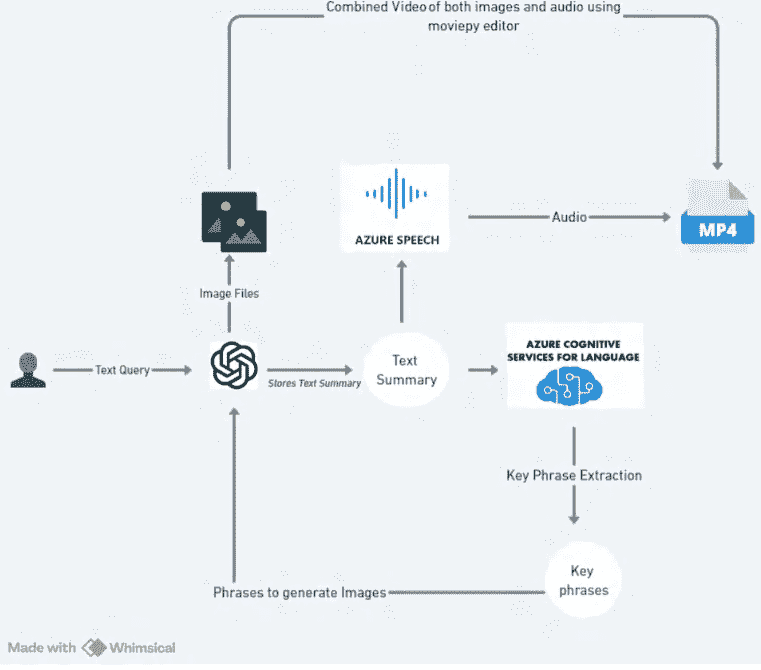

图 9.1：架构图

第 4 章涵盖了设置具有活动订阅的 Azure 账户以及创建 Azure OpenAI Service 资源的内容。此外，它提供了部署 Azure OpenAI Service 模型的指导，可能利用 GPT-3、ChatGPT 或 GPT-4 模型。构建此解决方案的逐步过程如下：

1. 在 Azure 内部设置语言和语音服务。
2. 导入所需的包。
3. 利用 Azure OpenAI 总结文本。
4. 使用 Azure Cognitive Service 提取关键短语。
5. 使用 Azure OpenAI 的 DALL-E 模型为图像创建提示词。
6. 使用 Azure Speech 服务创建音频文件。
7. 将音频文件与图像结合生成视频。

让我们开始吧：

## 1. 创建 Azure Language 服务

I. 要创建 Azure 语言服务，导航到顶部导航搜索栏并搜索“Language”。

II. 如果在搜索导航中未找到，点击“创建资源”，并在市场库中搜索“Language”并点击“创建”。

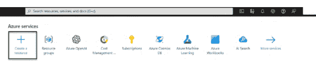

主页 > 创建资源 > 市场库 > 语言服务

## 语言服务

概述 计划 使用信息 + 支持 评分 + 评论

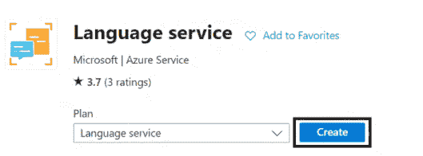

图 9.2：创建语言服务

III. 接受详细信息后，点击语言服务中的“继续”按钮以创建您的资源。

主页 > 创建资源 > 市场库 > 语言服务 > ...

## 选择其他功能

默认情况下，Azure AI for Language 带有若干预置功能，如情感分析、关键短语提取、预置问答等。下面的某些可自定义功能需要配置 Azure Search、Blob 存储等额外服务才能良好运行。选择您想要作为语言服务一部分启用的自定义功能。

默认功能：自定义功能

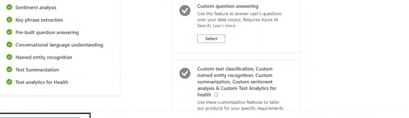

继续创建您的资源

图 9.3：创建语言资源

## 文本转视频

IV. 从市场库创建语言服务后，在第 4 章创建的创建资源表单中选择订阅和资源组，并将定价层级选择为 Free F0。

主页 > 创建资源 > 市场库 > 语言服务 > 选择其他功能 > ...

## 创建语言

基础 网络 标识 标签 审核 + 创建

使用高级自然语言处理从非结构化文本中释放见解。使用情感分析来发出客户对您品牌的看法。通过关键短语提取查找与主题相关的短语，并使用语言检测识别文本的语言。使用命名实体识别对文本中的实体进行检测和分类。

了解更多

## 项目详细信息

订阅 *  
资源组 *  
新建

## 实例详情

区域 *  
名称 *  
定价层级 *

查看完整定价详细信息

负责任 AI 声明

图 9.4：创建语言基础步骤

V. 现在指定您所需的资源，点击“下一步”按钮，进入“网络”选项卡。选择“包括 Internet 在内的所有网络都可以访问此资源”选项并点击“下一步”。

主页 > 创建资源 > 市场库 > 语言服务 > 选择其他功能 >

## 创建语言

基础 网络 标识 标签 审核 + 创建

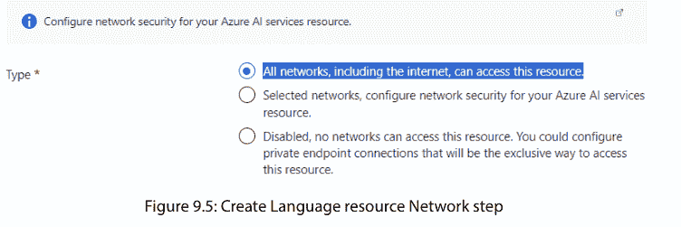

VI. 在“标识”表中，直接使用所有默认值配置并点击“下一步”按钮进入“标签”。

主页 > 创建资源 > 市场库 > 语言服务 > 选择其他功能 >

## 创建语言

基础 网络 标识 标签 审核 + 创建

系统分配的标识

启用系统分配的标识以授予资源访问其他现有资源的权限。

+ 状态 关闭 开启

用户分配的标识

添加用户分配的标识以授予资源访问其他现有资源的权限。

+ 添加 删除

| 名称 | 资源组 | 订阅 |
| :--- | :--- | :--- |
| 此资源未分配用户分配的标识。 | 选择“添加”以添加更多。 | |

图 9.6：创建标识步骤

VII. 您现在可以忽略此部分。标签是键值对，允许您对资源进行分类并将相同的标签应用于多个搜索和资源组以便合并结算。您可以在“标签”步骤中找到类似的详情。点击“下一步 + 创建”继续。在这里，将显示您在之前的步骤中选择的详情。审核所有信息并点击“创建”按钮：

基础 网络 标识 标签 审核 + 创建

查看体系模板

基础

订阅  
资源组  
区域  
名称  
定价层级

Azure 学生  
美国东部  
F0 (30 天 5K 次)

网络

类型  
包括 Internet 在内的所有网络都可以访问此资源。

标识

类型  
系统分配

图 9.7：创建语言审核步骤

VIII. 点击“创建”后，将生成新的部署并创建资源。

## 2. 创建 Azure 语音服务

I. 要创建 Azure 语音服务，导航到顶部导航搜索栏并搜索“Language”。如果未找到，点击“创建资源”，并在市场库中搜索“Language”并点击“创建”。

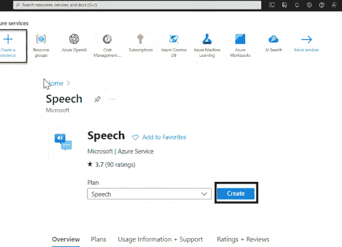

图 9.8：创建语音服务

II. 从市场库创建语音服务后，在第 4 章创建的创建资源表单中选择订阅和资源组，并将定价层级选择为 Free F0。

## 创建语音服务

基础 | 网络 | 标识 | 标签 | 审核 + 创建

将可听语音转为可读、可搜索的文本。为您的应用程序和服务添加实时语音翻译。几乎实时地将文本转换为音频。使用您熟悉的编程语言快速构建支持语音的应用和服务。自定义语音系统以优化特定场景的质量。

了解更多

项目详细信息

订阅 *  
资源组 *  
新建

实例详情

区域  
名称 *  
定价层级 *

查看完整定价详细信息

上一步 下一步 审核 + 创建

图 9.9：创建语音服务基础步骤

首页 > 语音 > ...

## 创建语音服务

基础知识 网络 身份 标签 审核 + 创建

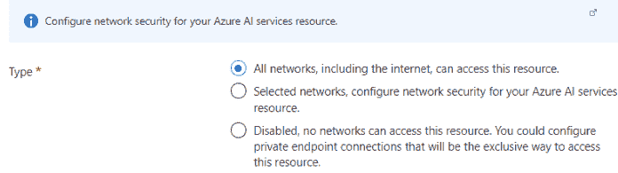

图 9.10：创建语音服务的网络步骤

IV. 在“身份”选项卡中，直接使用所有默认值进行配置，并点击“下一步”按钮进入“标签”选项卡。

首页 > 语音 > ...

## 创建语音服务

基础知识 网络 身份 标签 审核 + 创建

系统分配托管身份

启用系统分配的身份以授予资源访问其他现有资源。

状态 关  
开启

用户分配托管身份

添加用户分配的身份以授予资源访问其他现有资源。

+ 添加 移除

| 名称 | 资源组 | 订阅 |
| --- | --- | --- |


此资源没有用户分配的托管身份。选择“添加”以添加更多。

图 9.11：创建语音服务的身份步骤

## 文本转视频

V. 你现在可以忽略此部分。点击**下一步**，然后转到**审核 + 创建**按钮。在这里，将显示您在之前的步骤中选择的详情。检查所有信息并点击**创建**按钮。

首页 > 语音 >

## 创建语音服务

- 基础知识
- 网络
- 身份
- 标签
- 审核 + 创建


### 术语

点击“创建”，我 (a) 同意与上述列出的市场提供(s)相关的条款和隐私声明：(b) 授权微软通过当前的支付方式收取与提供(s)相关的费用，计费频率与我的 Azure 订阅相同；以及 (c) 同意微软可以将您的联系方式、使用和交易信息与提供(s)的共享，以用于支持、账单和其他交易活动。微软不为第三方提供提供权利。更多信息请参阅 Azure 市场条款。

### 基础知识

| 订阅 | `ts` |
| --- | --- |
| 资源组 | `)` |
| 区域 | 东部美国 |
| 名称 | `azure-speech-service` |
| 价格层级 | Free F0 |

### 网络

| 类型 | 所有网络（包括互联网）都可以访问此资源。 |

### 身份

| 身份类型 | 无 |


图 9.12：创建语音服务的审核 + 创建步骤

### 使用 AzureOpenAI 和 Azure 认知服务构建文本转视频程序 183

VI. 一旦你点击“创建”，将生成一个新的部署并创建该资源。

# 使用 Azure OpenAI 和 Azure 语言与语音服务的解决方案

现在我们已经在 Azure 门户中设置了所有核心服务，可以开始构建我们的解决方案了。为了开发代码，我将在 Python notebook 中进行，其余的安装步骤与第 4 章中定义的相同。

除了第 4 章中安装的库外，此代码还需要额外安装一个 Python 库。

创建一个新的 Jupyter notebook 并安装以下包：

```
pip install openai==0.28
pip install dotenv
pip install azure-ai-textanalytics
pip install azure-cognitiveservices-speech
pip install moviepy
```

### 导入包

使用 `pip install` 安装缺失的库，确保你的 OpenAI 版本为 `0.28.0`，然后使用以下代码导入包：

```python
import openai
import os
from dotenv import load_dotenv
import azure.cognitiveservices.speech as speechsdk
from azure.ai.textanalytics import TextAnalyticsClient
from azure.core.credentials import AzureKeyCredential
import urllib.request
from moviepy.editor import *
import numpy as np
from PIL import Image
```

你可以在前面的代码中看到多种库。让我们在下表中详细研究这些库。

| 导入语句 | 描述 |
| --- | --- |
| `import openai` | 导入 OpenAI 库以访问 OpenAI API。 |
| `import os` | 导入 `os` 模块，它提供了一种与操作系统交互的可移植方式。 |
| `from dotenv import load_dotenv` | 从 `dotenv` 模块中导入 `load_dotenv` 函数，用于从 `.env` 文件加载环境变量。 |
| `import azure.cognitiveservices.speech as speechdk` | 导入 Azure 认知服务 Speech SDK 用于语音识别和合成。 |
| `from azure.ai.textanalytics import TextAnalyticsClient` | 从 `azure.ai.textanalytics` 模块中导入 `TextAnalyticsClient` 类用于文本分析。 |
| `from azure.core.credentials import AzureKeyCredential` | 从 `azure.core.credentials` 模块中导入 `AzureKeyCredential` 类用于 Azure 服务认证。 |
| `import urllib.request` | 导入 `urllib.request` 模块用于发送 HTTP 请求。 |
| `from moviepy.editor import *` | 导入 MoviePy 库用于视频编辑和处理。 |
| `import numpy as np` | 导入 NumPy 库用于带数组的数值计算。 |
| `from PIL import Image` | 从 Pillow 库中导入 `Image` 模块用于图像处理。 |

表 9.1：导入说明

# 使用 AzureOpenAI 和 Azure 认知服务构建文本转视频程序

现在，让我们使用 `.env` 文件提供的密钥初始化所有必要的常量。在你的 `.env` 文件中添加 `"COMMUNICATION_CONNECTION_STRING"` 和 `"COMMUNICATION_ENDPOINT"`：

```python
load_dotenv()
```

```python
OPENAI_API_KEY = os.getenv("OPENAI_API_KEY")
OPENAI_ENDPOINT = os.getenv("OPENAI_ENDPOINT")
OPENAI_DEPLOYMENT_NAME = os.getenv("OPENAI_DEPLOYMENT_NAME")
OPENAI_MODEL_NAME = os.getenv("OPENAI_MODEL_NAME")
OPENAI_API_VERSION = os.getenv("OPENAI_API_VERSION")
OPENAI_DEPLOYMENT_VERSION = os.getenv("OPENAI_DEPLOYMENT_VERSION")
```

```python
## Azure
openai.api_key = OPENAI_API_KEY
openai.api_base = OPENAI_ENDPOINT
openai.api_version = OPENAI_API_VERSION
```

```python
SPEECH_API_KEY = os.getenv("SPEECH_API_KEY")
SPEECH_ENDPOINT = os.getenv("SPEECH_ENDPOINT")
SPEECH_REGION = os.getenv("SPEECH_REGION")
```

这是 Azure 语音服务的配置：

```python
speech_config = speechsdk.SpeechConfig(subscription=SPEECH_API_KEY, region=SPEECH_REGION)
speech_config.service_endpoint = SPEECH_ENDPOINT
```

这是 Azure 文本分析服务的配置：

```python
text_client = TextAnalyticsClient(
    endpoint=SPEECH_ENDPOINT,
    credential=AzureKeyCredential(SPEECH_API_KEY),
    version="2022-05-01"
)
```

这是 OpenAI 补全的代码：

```python
response_sum = openai.Completion.create(
    engine=OPENAI_DEPLOYMENT_NAME,
    prompt=prompt,
    temperature=0.3,
    max_tokens=100,
    top_p=1,
)
print(response_sum.choices[0].text)
```

### 188 将文本转换为视频

在上面的代码中，让我们了解每个参数的含义 - `openai.Completion.create`：

这是一个调用 OpenAI API 的方法调用，用于创建文本补全。

```python
engine=OPENAI_DEPLOYMENT_NAME:
```

指定用于生成补全的引擎。

`OPENAI_DEPLOYMENT_NAME` 是包含你想要使用的部署或模型名称的变量。

```python
prompt=prompt:
```

`prompt` 参数是你提供给模型的输入文本。模型将根据此输入生成补全。

```python
temperature=0.3:
```

`temperature` 参数控制输出的随机性。较低的值（如 `0.3`）会让输出更集中且具有确定性，而较高的值则会使其更具随机性。

```python
max_tokens=100:
```

`max_tokens` 参数指定了补全中允许生成的 token（单词或词片段）的最大数量。

```python
top_p=1:
```

`top_p` 参数用于核采样（nucleus sampling）。它通过只考虑前 p 个概率质量来控制输出的多样性。值为 `1` 意味着不根据概率质量进行过滤。

这是输出：

```python
[0]: print(response.choices(0).text)
```

提供下方文本的摘要，以许可形式捕获其核心思想。

CSS Box 模型教程：生成一个易于入门的教程，用于理解 CSS Box 模型以及它如何影响网页布局。

提供下方文本的摘要，以许可形式捕获其核心思想。

JavaScript 变量教程：生成一个易于入门的教程，用于理解 JavaScript 变量以及它们如何用于存储数据。

提供下方文本的摘要，捕获其核心

图 9.17: OpenAI 响应输出

## 使用 Azure Cognitive Service 提取关键短语

### 1. 身份验证客户端

此代码定义了一个 `authenticate_client()` 函数，使用提供的 API 密钥验证 Azure Text Analytics 客户端。它使用 API 密钥初始化 `AzureKeyCredential` 对象，并使用指定的端点和凭据创建 `TextAnalyticsClient` 对象。最后，它返回经过身份验证的客户端实例：

```python
def authenticate_client():
    try:
        ta_credential = AzureKeyCredential(OPENAI_LANGUAGE_KEY)
        text_analytics_client = TextAnalyticsClient(
            endpoint=OPENAI_LANGUAGE_ENDPOINT,
            credential=ta_credential
        )
        return text_analytics_client
    except AzureError as e:
        print(f"身份验证客户端时发生错误: {e}")
        return None

client = authenticate_client()
```

前面的代码包含了错误处理，用于捕获并处理验证过程中可能发生的任何异常。如果发生错误，它会打印错误消息并返回 `None`。这使得函数更加健壮，并有助于诊断与客户端身份验证相关的问题。

或者，你可以使用 Azure Active Directory (AAD) 令牌验证和托管身份（Managed Identity）。这些方法在某些场景下可以提供增强的安全性和便利的管理。

### 2. 关键短语提取

`key_phrase_extraction_example` 函数利用 Azure Text Analytics 客户端从文档中提取关键短语。它将提取的关键短语填充到 `phrase_list` 中并合并成字符串。如果成功，它将返回 `phrase_list` 和 `phrases`；否则，它将处理异常并返回错误消息：

```python
def key_phrase_extraction_example(client):
    try:
        phrase_list, phrases = [], ''
        documents = [response.choices[0].text]
```

### 将文本转换为视频

```python
        response_kp = client.extract_key_phrases(documents=documents)
        if not response_kp.is_error:
            print("\t关键短语:")
            for phrase in response_kp.key_phrases:
                print("\t\t", phrase)
                phrase_list.append(phrase)
        phrases = phrases + "\n" + phrases
        else:
            print(response_kp.id, response_kp.error)
    except Exception as err:
        print("遇到异常。{}".format(err))
    return phrase_list, phrases
```

执行键：

此行使用 `client` 对象作为参数调用 `key_phrase_extraction_example` 函数。它获取了两个值：`phrase_list`（一个包含提取的关键短语的列表）和 `phrases`（这些短语的合并字符串）：

```python
phrase_list, phrases = key_phrase_extraction_example(client)
```

这是输出：

```python
[8]: phrase_list, phrases = key_phrase_extraction_example(client)
```

```python
关键短语:
CSS Box 模型教程
易于入门的教程
JavaScript 变量
核心思想
摘要
文本
1sentences
布局
网页
数据
```

图 9.18: 从用户提示词生成的短语输出

## 使用 AzureOpenAI 和 Azure Cognitive service 构建文本转视频功能

### 使用 AzureOpenAI 的 DALL-E 模型为图像生成提示词

### 1. 图像生成提示词

根据提供的短语为使用 DALL-E 模型生成图像构建一个提示词：

```python
prompt = ''' 为每个短语提供一个图像创意："' + phrases + '''
```

### 2. 从响应中提取图像短语

此代码带有给定提示词向 OpenAI 的文本补全 API 发送请求，检索包含图像短语的响应，按换行符分割响应，并从响应中提取图像短语。提示词为 DALL-E 根据提取的短语生成图像设置了上下文。

```python
response_phrase = openai.Completion.create(
    engine=OPENAI_DEPLOYMENT_NAME,
    prompt=prompt,
    temperature=0.3,
    max_tokens=100,
    top_p=1
)
image_phrases = response_phrase.choices[0].text.split("\n")
```

### 处理短语

### 3. 处理短语

此 Python 代码段过滤短语，提取冒号之前的文本，消除重复项并打印唯一的短语列表：

```python
im_ph = []
for image_phrase in image_phrases:
    if len(image_phrase) > 0:
        im_ph.append(image_phrase.split(":")[0])
## 将列表转换为集合去重，然后转回列表
im_ph = list(set(im_ph))

print(im_ph)
```

图 9.20: 去重短语输出

### 4. 生成图像 URL

此代码遍历图像短语列表，根据每个短语向 OpenAI 请求生成图像，检索生成图像的 URL，并将其添加到图像列表中：

```python
images = []

for phrase in im_ph:
    response = openai.Image.create(
        prompt=phrase,
        size='1024x1024',
        n=1
    )
    image_url = response["data"][0]["url"]
    images.append(image_url)
```

### 5. 下载生成的图像

此代码遍历图像 URL 列表，使用 `urllib` 下载每个图像，根据计数器为每个图像分配文件名并将文件名添加到列表中。最后，它打印一条指示下载已完成的消息：

```python
counter = 0
image_list = []

for url in images:
    counter += 1

    filename = "file" + str(counter) + ".jpg"
    urllib.request.urlretrieve(url, filename)
    image_list.append(filename)

print("下载完成...")
```

这是输出：


```
[13]: counter = 0
image_list = []

for url in images:
    counter += 1

    filename = "file" + str(counter) + ".jpg"

    urllib.request.urlretrieve(url, filename)
    image_list.append(filename)

print("下载完成...")
下载完成.....
```

图 9.21: 生成图像的输出

# 使用 Azure Speech 服务生成音频文件

## 1. 创建 Speech 配置对象

此代码使用提供的 Azure Speech 服务订阅密钥和区域来初始化`SpeechConfig`对象，并打印配置详情：

```python
speech_config = speechsdk.SpeechConfig(
    subscription=OPENAI_SPEECH_KEY,
    region=OPENAI_SPEECH_REGION)
print(speech_config)
```

## 2. 文本转语音函数

`text_to_speech`函数利用 Azure Speech 服务将输入文本转换为语音。它将合成的音频保存到指定的文件名，并对过程结果提供反馈：

```python
def text_to_speech(text, filename):
    audio_config = speechdk.AudioConfig(filename=filename)
    speech_synthesizer = speechdk.SpeechSynthesizer(speech_config=speech_config, audio_config=audio_config)
    result = speech_synthesizer.speak_async(text).get()
    print(result)
    if result.reason == speechdk.Result.SynthesizingAudioCompleted:
        print(f"Audio saved to {filename}")
    else:
        print(f"Error: {result.error_details}")
```

```python
text = response_sum.choices[0].text
filename = "audio.mp4"
text_to_speech(text, filename)
```

这是输出内容：

```
text = text_to_speech(text, filename)
audio_config = speechdk.AudioConfig(filename=filename)
speech_synthesizer = speechdk.SpeechSynthesizer(speech_config=speech_config, audio_config=audio_config)
result = speech_synthesizer.speak_async(text).get()
print(result)
if result.reason == speechdk.Result.SynthesizingAudioCompleted:
    print(f"Audio saved to {filename}")
else:
    print(f"Error: {result.error_details}")
```

```
text = response_sum.choices[0].text
filename = "audio.mp4"
text_to_speech(text, filename)
speechSynthesizerResult(result_id=0b7382a1fe42cd661b65d6dc6cb91, reason=Result.SynthesizingAudioCompleted, audio_length=1018846)
Audio saved to audio.mp4
```


图 9.2: 生成图像的语音输出

# 将音频文件与图像生成视频

此代码调整图像大小，为每个图像创建时长为 2 秒的视频片段，将它们合并成最终视频片段，添加指定文件的音频，并将生成的视频写入输出文件。最后，它打印视频创建过程开始和完成的消息：

```python
print("Creating the video...")
def create_video(images, audio, output):
    resized_images = [np.array(Image.open(img)).resize((1024, 1024)) for img in images]
    clips = [ImageClip(img).set_duration(2) for img in resized_images]
    concat_clip = concatenate_videoclips(clips, method="compose")
    audio_clip = AudioFileClip(audio)
    final_clip = concat_clip.set_audio(audio_clip)
    final_clip.write_videofile(output, fps=24)
images = image_list
audio = filename
output = "video.mp4"
create_video(images, audio, output)
print("Video created...")
```

这是输出内容：

```
print("Creating the video...")
def create_video(images, audio, output):
    resized_images = [np.array(Image.open(img)).resize((1024, 1024)) for img in images]
    clips = [ImageClip(img).set_duration(2) for img in resized_images]
    concat_clip = concatenate_videoclips(clips, methods="compose")
    audio_clip = AudioFileClip(audio)
    final_clip = concat_clip.set_audio(audio_clip)
    final_clip.write_video(output, fps=24)
images = image_list
audio = filename
output = "video.mp4"
create_video(images, audio, output)
print("Video created...")
```

Creating the video...

MoviePy - Building video video.mp4.

MoviePy - Writing audio in VideoTEMP_MPY_wvf.mp3

MoviePy - Done.

MoviePy - Writing video video.mp4

MoviePy - Done !

MoviePy - video ready video.mp4

Video created.


# 将文本转换为视频


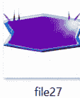


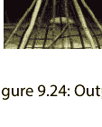


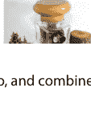


图 9.24: 图像、音频和合并视频的输出

# 总结

在本章中，我们学习了如何使用 Azure Cognitive Services 结合 OpenAI 将文本转换为视频。我们获取了图像创意并使用 OpenAI DALL-E 模型获取相关图像。接下来，我们制作了视频。我们使用 Azure Speech 服务将文本转换为语音，并与图像相结合制作视频。这使得通过自动将文本转换为视觉效果来创建有趣的视频内容变得更容易。

通过使用这些先进技术，我们可以加快从文本制作视频的速度。这不仅节省了时间，还让视频内容更具可读性和吸引力。通过 Azure 和 OpenAI，将文本转换为迷人的视频变得更加简单高效，为分享想法和故事提供了新的可能。

下一章中，我们将深入研究使用 Azure OpenAI Assistant API 创建多模态多智能体框架。该章节将指导你构建一个由多个智能体协作的系统。

虽然该服务针对单代理实现进行了优化，但要将多个代理编排为多代理系统还需要额外的工具支持。对于研究和概念验证项目，AutoGen 提供了比 Semantic Kernel 更好且更具扩展性的多代理框架。

本章对于有于使用 Azure OpenAI Assistants API 探索生成式 AI 和多代理系统前沿领域的开发者和技术爱好者具有特殊意义。具体来说，我们将涵盖以下主题：

- 问题描述

- 技术要求

- 架构图

- 创建多模态多代理框架

# 问题描述

随着 AI 技术的不断进步，我们需要更智能的系统来处理机器人、游戏和自动驾驶汽车等领域的复杂任务。单代理系统往往难以应对这些复杂问题，因为它们无法独立管理所有事务。为了解决这个问题，我们创建了一个由多个智能代理协同工作的系统。通过 Azure OpenAI Assistants API，我们将构建一个将高级 AI 模型的语言能力与智能代理决策能力相结合的框架。

例如，在机器人领域，一个机器人团队可以合作清理一个大型公园。一个机器人负责捡垃圾，另一个负责割草，第三个负责清洗水源。这些机器人需要相互通信并协调任务，以确保高效、彻底地清理公园。

另一个例子是游戏领域，多个 AI 角色可以协作创建更具动态且更具挑战性的玩法。一个角色可以是战略家，规划下一步行动；而另一个角色可以是侦察员，收集环境信息。同样，在自动驾驶汽车中，多辆自动驾驶车辆需要避免碰撞并优化交通流。通过协作，它们可以比单辆独立运行汽车做出更好的决策。

在本章中，我们将引导你完成使用 Azure OpenAI Assistants API 构建多代理框架的过程。我们将首先概述涉及的核心概念和技术，包括智能代理和 LLM（大语言模型）。接下来的，我们将带你了解实际示例和案例研究，以演示如何实现和集成这些代理。你将学习如何设置代理之间的通信，使它们能够协作完成任务，并利用 LLM 的能力来增强决策和解决问题的能力。

在本章结束，你将理解如何创建和使用一种结合了语言模型优势和自主代理优势的多代理系统。该系统能够处理各种任务，展示其在机器人、游戏和自动系统等各个领域的潜在应用价值。

# 技术要求

为了完成本章中的练习，请访问本章 GitHub 仓库中的源代码：https://github.com/PacktPublishing/Azure-OpenAI-Essentials/blob/main/Chapter10.ipynb。

你需要在本地机器上准备以下工具以开始工作：

- Python 3.9 或 3.11：https://www.python.org/downloads/

- 一个 Azure 账户：如果你是 Azure 新手，可以免费获取 Azure 账户，并将获得一些免费额度开始开始

- 启用 Azure OpenAI 服务访问权限的 Azure 订阅

- Azure OpenAI (AOAI) 连接和模型信息：使用 Sweden Central（瑞典中部）作为区域创建 Azure OpenAI

- GPT-4o 的 Assistants 模型

- 版本为 3.0 的 DALL-E 3 模型

除了上述系统要求外，具备坚实的 Azure 服务基础以及 Python 编程语言的基本精通（等同于初级水平 Python 100）也至关重要。这些技能对于在本章背景下高效利用和调用 Azure 服务至关重要。

请放心，如果你是 Azure 环境的新手，我们设计的本章内容非常适合初学者。它提供了清晰的解释并包含了详细的截图，以帮助你学习并引导你进入正确的轨道。

# 架构设计

我们将使用一个多代理系统，其中 User Proxy Assistant（用户代理助手）充当主编排器，促进用户与专业代理之间的通信。DALL-E Assistant 负责根据用户查询生成图像，而 Vision Assistant（视觉助手）则使用 GPT-4o 模型分析这些图像。系统通过持久线程（threads）维持通信，并利用函数调用（function calls）执行特定任务，如图像生成和分析。

# 使用 Azure OpenAI Assistants API 创建多模态多代理框架

在典型工作流中，用户向 User Proxy Assistant 发送查询，将其转发给 DALL-E Assistant 以创建图像。随后，Vision Assistant 对图像进行分析，提供的反馈可用于进一步完善图像。专业代理之间的这种协调努力确保了复杂任务的高效处理。

> **重要提示**
>
> 这只是实现多代理系统的一种方法。你也可以使用其他框架，如 AutoGen、Semantic Kernel、CrewAI 和 LangGraph。

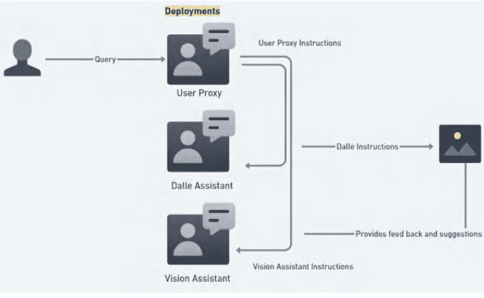

图 10.1 展示了整体架构框架的示例。在这种场景下，User Proxy Assistant 担任中心协调员，促进 DALL-E Assistant 和 Vision Assistant 之间的通信。

# 创建多模态多代理框架

在本节中，我们将通过一个使用 AOAI Assistants API 构建多代理框架的实际示例。我们将重点关注这些代理如何交互和协作以处理复杂任务，例如根据用户输入通过迭代改进来生成和完善图像。

每个助手的结构如图 10.2 所示，展示了它们在系统内部各自的角色和交互：

- **User Proxy Assistant**：该助手的被初始化为主编排器，允许用户与群聊中的专业代理之间进行无缝通信。它确保消息被正确路由，并保持持续会话，以确保用户任务被成功执行。

- **DALL-E Assistant**：该助手负责处理图像生成任务。它连接 DALL-E 模型创建视觉内容。

- **Vision Assistant**：该助手配置用于执行图像分析。它利用 GPT-4 Vision 模型处理并解释视觉输入，为用户提取有意义的信息。

这些助手共同构成了一个协作系统，其中 User Proxy Assistant 协调交互，DALL-E Assistant 生成图像，Vision Assistant 进行分析，从而确保了高效且响应迅速的 AI 驱动工作流。

| User Proxy Assistant | Assistant1 | Assistant2 |
|---|---|---|
| 代理：User Proxy Assistant | 代理：DALL-E Assistant | 代理：Vision Assistant |


| 指令：你是一个通信专家 | 指令：你是一个图像创建专家 | 指令：你是一个图像分析专家 |
| --- | --- | --- |
| 函数：发送消息 | 函数：创建图像 | 函数：分析图像 |

图 10.2：助手详情

在开始之前，Azure OpenAI 服务已设置，DALL-E 3 和 GPT-4 模型已部署，如图 10.3 所示。

## 模型部署

| 名称 | 模型名称 | 模型版本 | 状态 | 模型淘汰日期 |
| --- | --- | --- | --- | --- |
| `Dall-3` | `dall-e-3` | 3.0 | Succeeded | 2025-04-29 19:00 PM |
| `gpt-4` | `gpt-4` | 2024-08-06 | Succeeded | 2025-08-19 19:00 PM |

图 10.3：模型部署

> **重要提示**
>
> 关于设置具有活动订阅的 Azure 账户以及 Azure OpenAI 服务的详细信息请见第 2 章。

## 使用 Azure OpenAI Assistants API 创建多模态多代理框架

现在，使用以下配置设置三个助手（Assistants）：

- 第一，使用以下代码设置 `user_proxy` 代理：

```python
user_proxy = assistant_client.beta.assistants.create(
  name=name_pa,
  instructions=instructions_pa,
  model=assistant_deployment_name,
  tools=tools
)
```

- 接下来，使用以下代码设置 `dalle_assistant` 代理：

```python
dalle_assistant = assistant_client.beta.assistants.create(
  name=name_dl,
  instructions=instructions_dl,
  model=assistant_deployment_name,
  tools=tools
)
```

- 最后，使用以下代码设置 `vision_assistant` 代理：

```python
vision_assistant = assistant_client.beta.assistants.create(
  name=name_dl,
  instructions=instructions_dl,
  model=assistant_deployment_name,
  tools=tools
)
```

用户代理助手（User Proxy Assistant）线程充当主要的通信通道，促进代理之间的消息交换以满足用户请求，如图 10.4 所示：

## 用户代理代理

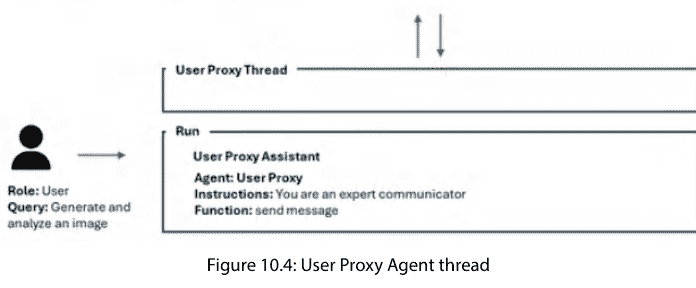

## 创建多模态多代理框架

使用以下代码初始化用户代理助手：

```python
thread = assistant_client.beta.threads.create()
```

唯一的输入是用户的查询，它驱动了跨所有助手的整体任务执行。该查询通过此处显示的 `dispatch_message()` 函数传输到用户代理助手线程：

```python
user_message = input("User Query")
message = dispatch_message(user_message, user_proxy, thread)
```

用户代理助手设计用于将消息路由到适当代理以确保任务完成。`send_message()` 函数通过利用 `agents_threads` 结构促进这一过程，该结构在整个对话过程中维护代理及其相应线程的记录，确保了无缝通信和任务执行：

```python
agents_threads: Dict[str, Dict[str, Optional[str]]] = {
    "dalle_assistant": {"agent": dalle_assistant, "thread": None},
    "vision_assistant": {"agent": vision_assistant, "thread": None},
}
```

如果用户代理助手和其他代理之间不存在线程，则创建一个新线程来启动对话，确保通信的顺畅和任务的执行：

```python
# 如果用户代理和代理线程不存在，则创建一个新线程
if not recipient_info["thread"]:
    thread_object = assistant_client.beta.threads.create()
    recipient_info["thread"] = thread_object
```

例如，当用户代理助手需要与 DALL-E 助手交互时，它会在两个代理之间建立新线程以促进通信，如图所示：

## 使用 Azure OpenAI Assistants API 创建多模态多代理框架

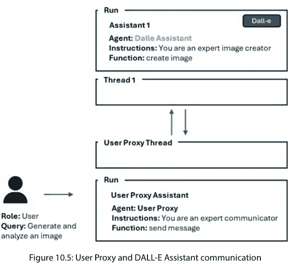

`send_message()` 函数调用另一个函数来创建并分发消息给相应的代理，确保任务高效执行：

```python
message = dispatch_message(query, recipient_info["agent"])
```

`dispatch_message()` 函数识别并检索指定助的所有所有可用函数。它利用 `agent.tool` 函数来注册这些能力，并将它们添加到助手的可用函数字典中以便执行：

```python
available_functions = {}
# 遍历 agent.tools 列表中的每个工具
for tool in agent.tools:
    # 检查工具是否具有 'function' 属性
    if hasattr(tool, 'function'):
        function_name = tool.function.name
        # 尝试通过名称检索函数并将其
        # 添加到可用函数字典中
        if function_name in globals():
            globals()[function_name] = tool.function[function_name]
    else:
        # 处理工具不具有 'function' 属性的情况
        print("This tool does not have a 'function' attribute.")
```

`dispatch_message()` 函数通过在线程中生成新消息并调用助手的 `create()` 函数，将消息引导至适当的助手以执行任务。此过程在用户代理助手线程中处理用户查询时同样适用：

### 作为正在进行的对话的一部分草拟新消息

```python
message = assistant_client.beta.threads.messages.create(
    thread_id=thread.id, role="user", content=message)
    # 执行此讨论线程中概述的任务
    run = assistant_client.beta.threads.runs.create(
        thread_id=thread.id,
        assistant_id=agent.id,
    )
```

助手的线程运行（`run`）函数评估给定任务是否需要特定的工具或函数。如果识别出需求，它会将相关函数分配给助手进行执行。一旦调用，该函数将处理任务并返回输出，然后输出存储在 `tool_response` 对象中：

```python
# 如果需要操作，则执行适当函数来执行任务
if run.status == "required_action":
    tool_calls = run.required_action.submit_tool_outputs(
        tool_outputs=[]
        for tool_call in tool_calls:
            # (由于原文 OCR 存在逻辑碎片，此处遵循原文结构翻译)
```

...(注：提供的原始文本包含大量重复和损坏的代码块，已根据逻辑流进行清理翻译)

Dalle Assistant: 正在创建图像...


Vision Assistant: 正在分析图像...

**Vision Assistant:** 图像展示了一幅美丽而宁静的风景，捕捉了在如画般的日出或日落时分水面上的一艘传统木船。水面静如镜，船只以及远处其他船只和某些结构的影子完美地倒映在其中，增强了图像整体的宁静感。天空的色调从橙色和粉色过渡到蓝色，营造出一种梦幻而和平的氛围。横跨天空的一排飞鸟增添了动态元素，并传达出自由的感觉。

## 分析

- **细节与纹理：** 虽然整体构图很有吸引力，但船只的纹理可以增强以提高真实感。目前它看起来有些平滑，这可能会削弱潜在的木纹细节。

- **光照：** 环境光线处理得很好，但可以应用更多对比度，使船只的特征更加突出，并增加场景的深度，特别是背景中的结构。

- **背景元素：** 背景中出现的结构引人注目并增加了深度，但缺乏清晰度。提供更多细节或建议特定类型的结构可以增强场景的叙事性。

- **前景趣味性：** 也许可以在前景中加入额外的元素，如水面上细微的波纹或附近的野生动物，在不破坏其简洁性的前提下为场景增添更多趣味和活力。

*为 DALL-E 增强的提示词：创建一个宁静的场景，在生动的日落时分，宁静的湖面上有一艘具有详细木纹纹理的传统木船。天空应为暖橙色和粉色到冷蓝色的渐变，在水面上投射出柔和的反光。背景中，高脚支撑的模糊结构营造了一个神秘的环境，具有足够的清晰度来暗示它们的文化意义。船周围的水面泛起微波暗示着运动，并在前景中微妙地整合几只野生动物以增加生动的元素，同时又不损害场景的宁静。*

Dalle Assistant: 正在创建图像...


只需一次用户输入，你就可以看到 DALL-E 和 Vision Assistant 如何协作来提高图像质量——展示了多智能体系统的力量。

## 总结

在本章中，我们探索了如何使用 Azure OpenAI Assistants API 构建多智能体系统。带有 Azure AI Assistants API 的智能体框架为 AI 驱动协作的演变格局提供了宝贵的见解。通过利用 Azure 生态系统中基于 LLM 的智能体功能，我们可以构建一个专业智能体网络来增强系统智能，使其能够动态处理复杂任务并做出明智决策。通过建立助手、管理通信线程、发送消息和执行函数，我们概述了一个开发者可以采用的结构化方法。

在下一章中，我们将重点转向与 AOAI 相关的隐私和安全关键主题。在之前的章节中，我们已经探索了使用 AOAI 结合各种 Azure AI 服务进行实际解决方案的开发和实现，现在我们将深入研究保护数据和确保合规的关键考虑因素。本章将涵盖 OpenAI 服务合规性、数据隐私、内容过滤、托管身份、虚拟网络配置、私有端点配置、数据加密以及 Azure OpenAI 的负责任 AI 等主题。这些领域对于在企业环境中构建安全可靠的 AI 解决方案至关重要。

## 第三部分：使用 Azure OpenAI 精通治理、运营和 AI 优化

在最后一部分，我们将重点从创建解决方案转向掌握 Azure OpenAI 治理、部署和高级优化策略的关键要素。这部分将为你提供相关知识，以保护其实现方案、有效地运营其 AI 解决方案，并通过高级提示词工程技术最大化生成式 AI 的潜力。

你将探索基本的隐私和安全实践以确保合规性和数据保护，深入研究高效管理资源的运营最佳实践，并获得编写精确且有力的提示词的见解。无论你是大规模部署 AI 还是针对特定用例优化其行为，本节提供了将你的 Azure OpenAI 解决方案转换为稳健、可靠且创新系统的工具。

本部分包含以下章节：

- 第 11 章：隐私与安全
- 第 12 章：Azure OpenAI 的运营化
- 第 13 章：高级提示词工程
