# 11 隐私与安全

在之前的章节中，我们演示了结合各种 Azure AI 服务使用 Azure OpenAI (AOAI) 制作和实现实际解决方案的过程。在本章中，我们将关注与 AOAI 相关的隐私和安全考虑因素。

在本章中，我们将涵盖以下主题：

- AOAI 服务合规性
- AOAI 数据隐私
- 内容过滤
- 托管身份
- 虚拟网络 (VNet) 配置
- 私有端点配置
- 数据加密
- AOAI 的负责任 AI

## AOAI 服务合规性

AOAI 合规计划是微软建立的一系列政策和实践，旨在确保以负责任且符合伦理的方式使用 AOAI 服务。该计划包括以下方面：

- 数据、隐私和安全：微软提供了有关客户提供的数据如何被 AOAI 服务进行处理、使用和存储的细节。

- 负责任 AI 实践：微软提供技术指导和工具，支持客户负责任地设计、开发、部署和利用 AI 系统。这些建议符合微软负责任 AI 标准并涵盖四个阶段：识别、衡量、缓解和运营。

- **行为准则**：微软定义了 AOAI 服务必须遵守的准则。准则涵盖了可用性、有害内容、人类交互和反馈等主题。

- **联邦风险与授权管理 (FedRAMP)** 高级授权：微软已获得商业环境 AOAI 服务的高授权。这意味着该服务符合联邦政府对云服务提供者的最高安全要求。

- **健康保险流通性与责任法 (HIPAA)** 合规性：微软已确认 AOAI 服务可以以符合 HIPAA 的使用。这意味着客户可以根据业务伙伴协议 (BAA) 处理保护健康信息 (PHI)。BAA 是确保 PHI 安全处理并符合 HIPAA 监管的关键文档。

- **系统和组织控制 (SOC) 1、2、3** 是与组织系统和数据安全相关的标准和框架，由美国注册会计师协会 (AICPA) 开发和维护。这些标准帮助组织证明其保护敏感信息的承诺并确保其系统的可靠性。OpenAI 处理数据是为了提供服务以及防止可能发生的滥用。你的提示词（输入）和完成（输出），以及你的嵌入和训练数据不会与其他客户、OpenAI、微软或任何第三方产品或服务共享。客户微调的 OpenAI 模型仅供其使用。微软完全管理 AOAI 服务，在其 Azure 环境托管 OpenAI 模型，且该服务与 OpenAI 运行的任何服务都不连接。

> **重要说明**
>
> Azure 持续评估 AOAI 服务以纳入额外的合规认证。
>
> 要获取各种 Azure 产品的最新合规证明信息，请访问以下链接：https://servicetrust.microsoft.com/DocumentPage/7adf2d9e-d7b5-4e71-bad8-713e6a183cf3。

在介绍了 AOAI 合规性后，让我们在接下来的章节中将您的注意力转向数据隐私的主题。

## AOAI 数据隐私

本节提供了关于您提交到 AOAI 服务的数据的处理、利用和存储的见解。

AOAI 模型是无状态的，这意味着它们不会存储或记住来自之前输入或输出的任何信息。它们仅处理当前输入，并根据其模型参数以及任何可选设置（如温度或频率惩罚）生成输出。这种设计选择增强了模型的适应性和可扩展性，但在处理需要上下文或记忆的任务时会面临挑战。

为了解决这一局限性，您可以在输入中包含相关的上下文或历史信息，或者利用外部数据源通过额外的细节来补充输入。尽管如此，这些操作可能会引入潜在风险，包括与数据隐私和安全相关的担忧，以及模型被误用或滥用的可能。因此，微软已制定了各种保护措施，保护其模型和用户免受这些潜在威胁。这些措施包括内容过滤、速率限制和数据处理策略。

> **重要说明**
>
> 与提示（prompts）、完成（completions）、嵌入（embeddings）和训练相关的数据受到限制，不会授予他人访问，也不会用于改进 OpenAI 或任何微软/第三方产品。微调后的 AOAI 模型仅供用户使用，由微软在 AOAI 服务内独家控制，与 OpenAI 提供的服务（如 ChatGPT 或 OpenAI API）不同。

AOAI 处理几类数据：

- **提示和完成数据**：用户提交提示，服务通过完成和聊天对话等操作生成内容，并处理图像和嵌入（embeddings）。

- **与提示关联的增强数据**：通过“使用您的数据（On Your Data）”功能，服务从指定的存储器访问数据并使用这些数据增强提示，从而生成与您的数据集直接连接的内容。

- **训练和验证数据**：用户可以选择提供自己的训练数据，这些数据由提示和完成对组成，可用于针对特定目的微调 OpenAI 模型。

提供的图表概述了带有内容过滤的 AOAI 数据流程，我们将在下一节中讨论：

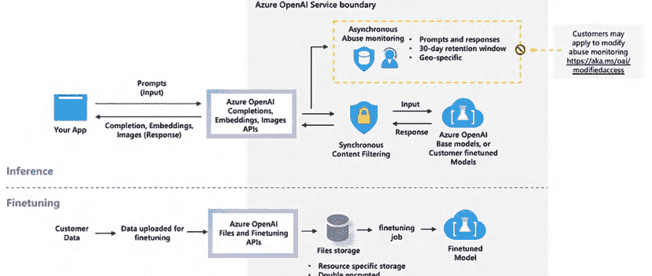

图 11.1：推理和微调的 AOAI 数据流

这包含了三个不同的处理场景：

- **用于内容生成的提示处理**：顶部部分说明了 AOAI 服务如何获取您的提示并生成内容，包括使用 AOAI“使用您的数据”功能将来自外部源的额外数据整合到提示中。

- **创建微调（自定义）模型**：底部概述了 AOAI 服务如何利用您的训练数据来构建微调模型，以满足您的特定需求和偏好。

- **AOAI 服务和微软人员的内容过滤**：图表展示了 AOAI 服务如何结合微软人员对提示、完成内容和图像进行分析。该分析旨在识别潜在的有害内容和模式，这些模式可能表明服务被误用，违反了行为准则或其他相关条款。

部署在您的资源中的模型（无论是基础模型还是微调版本）都负责处理您提供的提示并生成响应，响应可能包括文本、图像、嵌入。服务以同步方式运行，实时评估提示和完成数据以监控潜在的有害内容类型。如果生成的内容超过了为此目的配置的阈值，服务将停止生成此类内容，以保持安全和合规的环境。


让我们讨论 AOAI 中“使用您的数据（Your Data）”功能的数据流。该功能允许 AOAI 服务与外部数据源进行交互，以增强提示并生成内容。

AOAI 中的“使用您的数据”功能允许您与外部数据源建立连接，使生成的结果与您的特定数据紧密相关。重要的是，这些数据安全地存储在指定的源和位置中；没有数据被复制或拷贝到 AOAI 服务本身。

当用户提交提示时，服务从连接的外部数据源动态检索相关数据，并使用这些额外的上下文信息增强用户提示。随后，模型处理此增强后的提示，然后返回生成的内容；这种技术被称为检索增强生成（RAG）。这种机制确保输出基于您的数据，而不会损害数据安全或隐私。接下来的图表说明了整个过程：

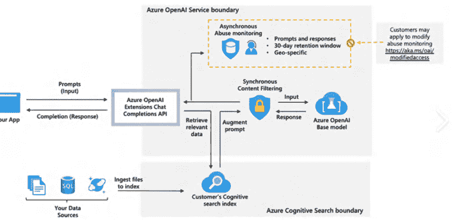

图 11.2：“使用您的数据”的 AOAI 数据流

在两张图中，您可能已经注意到 AOAI 异步监控滥用内容。让我们深入接下来的章节，以更好地了解 AOAI 防止滥用和有害内容的生成。

# 防止滥用和有害内容生成

为了降低 AOAI 服务被用于有害目的的风险，它包含了内容过滤和滥用监控功能。

实时内容过滤发生在服务处理提示以产生内容的过程中。提示和生成的的结果不会被用于训练、重新训练或改进内容分类器模型，也不会存储在这些模型中。关于内容过滤的更多细节将在本章的后续章节中提供。

滥用监控涉及识别和处理重复内容及行为，这些行为表明可能违反了行为准则或相关产品条款。为了检测和应对滥用，AOAI 安全地保留所有提示和生成的内容，最长为 30 天。

## 23. 你正在应用哪些修改？

请选择所有适用项。

- 修改滥用监控

- 修改内容过滤

图 11.3: 禁用滥用监控

一旦 Microsoft 批准了客户修改滥用监控的请求，当滥用监控被配置为禁用时，与 Azure 订阅相关的提示和完成将由 Microsoft 存储。在这种情况下，服务结果存储（Service Results Store）中不会存储任何提示和完成，也无法无法进行人工审核流程。

现在，让我们确保已就绪禁用滥用监控所需的配置。

## 验证滥用监控禁用

在 Azure 订阅中获准禁用滥用监控的客户可以通过两种方法确认滥用监控的数据存储已禁用：

1. 使用 Azure 门户：
   - 登录 Azure 门户
   - 选择相应的 AOAI 服务资源
   - 转到右上角的“概览”（Overview）视图，如图所示：
   - 点击“JSON 视图”

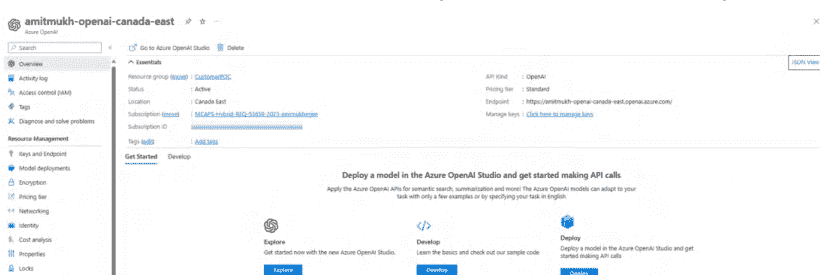

图 11.4: 内容日志验证

在功能列表中，你会找到一个名为 `ContentLogging` 的值，当滥用日志关闭时，该值将显示为 `FALSE`。

- **Azure CLI 或管理 API**：或者，客户可以使用 Azure 命令行界面 (CLI) 或 Azure 提供的任何管理 API 以编程方式访问并检查其 Azure 订阅的监控状态。你可以在 Azure 中执行命令以查看与 Azure 门户所示相同的 JSON 数据：

```
az cognitiveservices account show -n resource_name -g resource_group
```

> 注意事项
> 
> 只有在滥用监控的数据存储已禁用时，`ContentLogging` 属性才会显示为 `false`。否则，该属性在 Azure 门户或 Azure CLI 的输出中均将不可见。

在上一节中，我们讨论了数据隐私、数据流和滥用监控的各个方面。现在，让我们将注意力转向内容过滤。

## 内容过滤

AOAI 服务集成了一种与其核心模型并排运行的内容过滤机制。该系统通过对提示（prompt）和完成（completion）应用一组分类模型来工作，这些模型旨在识别并减轻潜在有害内容的生成。它会积极识别并响应输入提示和输出完成中两种特定类型的潜在有害内容。值得注意的是，过滤行为可能会根据特定的 API 配置和应用程序的设计而异。

内容过滤模型已针对以下语言经过专门的训练和测试：英语、德语、日语、西班牙语、法语、意大利语、葡萄牙语和中文。该服务具有支持多种语言的能力，尽管性能质量可能不同。在任何情况下，都建议进行自己的测试以确认其是否适用于你的应用程序。

> 注意事项
> 
> AOAI Whisper 模型对提示和完成不使用内容过滤。

后续章节将提供有关内容的详细信息：

- 内容过滤类别
  - 类别
  - 严重性级别
- 可配置性
  - 最佳实践
- 实现

## 内容过滤类别

在 AOAI 服务中，内容过滤系统集成了神经多类分类模型，专门用于检测和过滤有害内容。这些模型涵盖了四个不同的主要类别：仇恨（Hate）、性（Sexual）、暴力（Violence）和自伤害（Self-harm）。每个类别分为四个严重性级别：安全（Safe）、低（Low）、中（Medium）和高（High）。必须强调的是，被识别为“安全”级别的内容被标记为排除在过滤之外，且不能进行调整或自定义。此外还有针对文本和代码检测越狱（jailbreak）和保护材料的可选分类模型。

## 类别

这些是四个主要类别：

- **仇恨**：基于种族、族群、宗教、性别、性取向等特征对个人或群体煽动仇恨或歧视的内容
- **性**：包含显性或暗示性性语言、图像或主题的材料
- **暴力**：描绘或倡导对个人或群体的身体伤害、受伤或暴力的内容
- **自伤害**：鼓励或美化自残、自杀、进食障碍和其他自伤害的材料

除了这四个预定义类别外，客户还可以选择使用 Azure AI Content Safety 服务创建自己的自定义类别。这允许他们根据需要训练一个个性化的分类模型。要做到这一点，他们将需要训练数据来识别敏感内容、审核用户生成的内容或确保符合当地法规。

可选类别用于以下场景：

- **针对越狱攻击的提示防护（Prompt shields）**：越狱攻击是指用户故意设计的提示，旨在触发生成式 AI (GenAI) 模型，其方法是展示模型被训练要避免的行为或违反系统消息中建立的规则。这些直接攻击从复杂的角色扮演场景到破坏安全的微妙尝试。
- **针对间接攻击的提示防护**：间接攻击（有时称为间接提示攻击或跨域提示注入攻击）是一种潜在的安全漏洞，外部实体在 GenAI 系统可访问的文档中嵌入有害指令。这种漏洞需要对文档进行嵌入和格式化，特别是在 RAG 类的架构中。
- **文本保护材料**：保护材料文本包含可识别的内容，如歌词、文章、食谱和选定的网络内容，这些内容可能由大语言模型 (LLMs) 生成。
- **代码保护材料**：保护材料代码指与公共存储库中预定义的代码片段匹配的源代码。LLMs 可能会输出此类代码而不正确引用原始源代码库。

## 严重性级别

这些是每个主要类别的四个严重性级别：

- **安全**：内容确实涉及与暴力、自伤害、性或仇恨类别相关的话。然而，这些术语可能用于通用的、科学的、医学或专业的背景，适合广泛受众且不涉及冒犯意图。
- **低**：内容可能涉及与暴力、自伤害、性或仇恨类别相关的话题。然而，这些术语可能用于通用的、科学的、医学或专业的背景，适合广泛受众且不涉及冒犯意图。
- **中**：内容涉及针对特定身份群体的中等程度的冒犯、贬低、嘲讽、恐吓或轻蔑语言。此外，它可能包括寻求和执行有害指令、幻想和对伤害的美化。
- **高**：内容展示了显性且高度有害的指令、行为、伤害或滥用。它还涵盖了对有害行为的支持、美化或促进，包括非法或非自愿的行为，以及与权力交换或滥用的内容。

到目前为止，我们讨论了内容过滤的各种类别及其相关的严重性级别。现在，让我们深入了解这些严重性级别如何被调整或配置。

## 可定制性

内容过滤的默认设置设定为在任何四个定义的有害内容类别中检测到中等严重性时启动过滤过程，这适用于用户提示和生成的响应。这意味着当内容被标记为中等或高严重性时，它将受到过滤。相反，被识别为低严重性的内容不会触发过滤机制。下表提供了每个严重性级别可用内容选项的详细信息：

| 严重性 | 提示可定制 | 完成可定制 | 描述 |
|---|---|---|---|
| 低、中、高 | 是 | 是 | 最高过滤级别：过滤低、中、高严重性内容。 |
| 中、高 | 是 | 是 | 默认设置：过滤中等和高严重性内容；不过滤低严重性内容。 |
| 高 | 需批准* | 需批准* | 过滤高严重性内容。过滤需要批准。 |
| 无过滤器 | 需批准* | 需批准* | 无论检测到的严重性级别如何，都不进行过滤。 |

表 11.1: 内容过滤配置

获得修改内容过滤设置权限的客户对这些过滤器具有完全控制权。他们可以选择将过滤器设置为仅在高严重性级别触发，或者选择完全关闭过滤。如果您希望请求修改内容过滤器的访问权限，请点击此链接填写表单：`https://aka.ms/modifiedaccess`。在填写表单时，请务必选择第 #23 项以激活高严重性内容过滤。此外，在第 #24 项中，请如下所示为该操作提供理由：

## 23. 您正在申请哪些修改？ * *

请选择所有适用项。

- 修改监控

- 修改内容过滤器

## 24. 您为什么想要修改内容过滤器？ * *

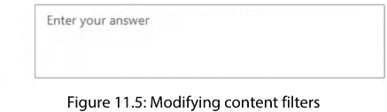

到目前为止，你已经了解了不同的 AOAI 内容过滤器及其配置。现在，让我们讨论一下实施内容过滤的一些最佳实践。

## 最佳实践

当内容过滤系统识别出有害内容时，你与 API 的交互将产生以下结果之一：

- **不恰当的提示词**：如果输入提示词被判定包含不恰当内容，你将收到 HTTP 400 错误。
- **非流式完成**：在对非流式完成应用内容过滤的情况下，被过滤的内容将不会返回。相反，响应中的 `finish_reason` 值将设置为 `content_filter`。在某些响应较长的极少数情况下，可能会返回部分结果，并带有更新的 `finish_reason` 值以指示内容状态。
- **流式完成**：对于流式完成，内容片段将在生成时被返回。服务将保持其流式操作，直到遇到预定的停止标记、达到特定的长度限制，或识别出属于已设置过滤类别和严重性级别的内容。

在规划应用程序时，纳入以下最佳实践以确保良好的用户体验（UX）同时缓解潜在问题至关重要：

- 确定处理用户提交包含被分类为过滤类别和严重性级别内容的提示词，或用户滥用您的应用程序的情况的方法
- 检查 `finish_reason` 值以识别完成内容是否经过了过滤
- 验证 `content_filter_result` 值中不存在错误对象，这意味着内容过滤器已成功应用且在处理过程中没有遇到任何问题

让我们讨论一下如何通过 Azure Foundry 实际实施内容过滤。

## 实现

随后的指令演示了为你的 AOAI 资源建立个性化内容过滤配置的过程：

1. 登录 Azure Foundry，按照下方红色框所示的左侧导航找到“内容过滤器”（Content filters）选项卡：

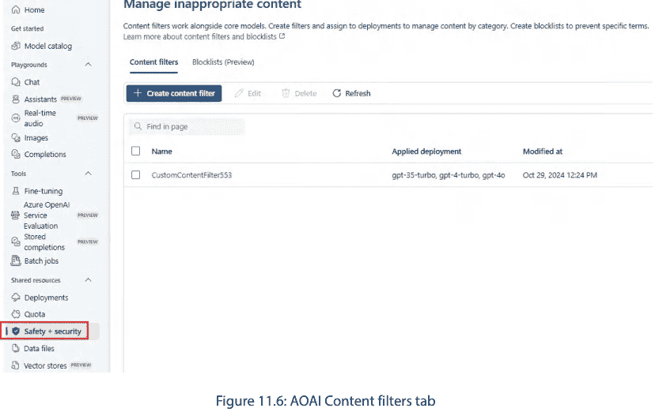

## 创建新的自定义内容过滤配置：

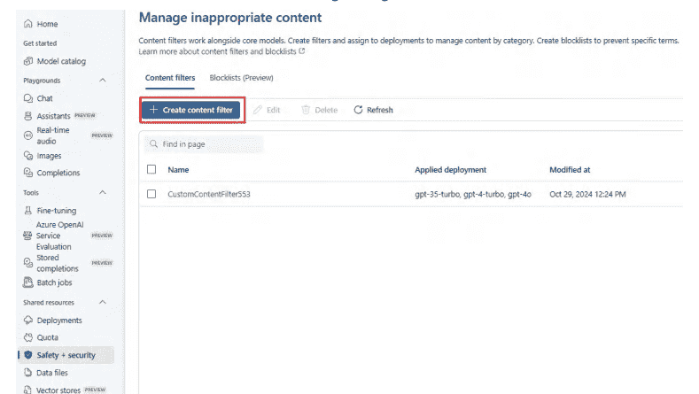

过滤器与核心模型协同工作。按类别创建过滤器并分配给部署。创建阻止列表以防止特定术语。

了解更多关于内容过滤器和阻止列表

图 11.7：创建自定义 AOAI 内容过滤器

这将你带到下一个配置屏幕，你可以在那里为你的自定义内容过滤设置选择名称。

在下一个屏幕上，为输入提示词的文本和图像内容过滤器类别设置阈值：

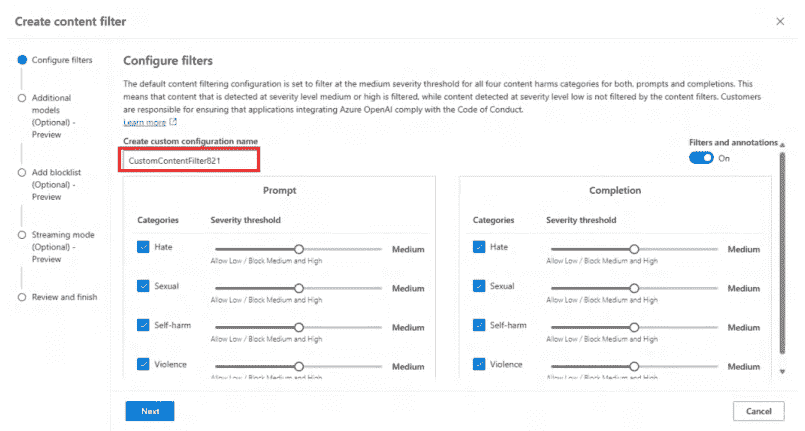

图 11.8：AOAI 自定义内容过滤器的默认设置

这是标准的内容审核设置页面，其中所有类别都处于中等水平监管内容。你可以灵活地对提示词和四个内容类别分别自定义内容审核严重性。每个类别有三个可调的严重性级别：低（Low）、中（Medium）和高（High）。

如果你的应用程序对暴力、仇恨、性及自残等内容类别需要更严格的阻止，请将阈值设置为低。要允许低类别的内容同时阻止中、高类别，请将阈值调整为中。最后，如果你想允许低、中类别的内容但阻止高类别，请将阈值设置为高。

清除过滤器以允许或阻止特定类型的内容

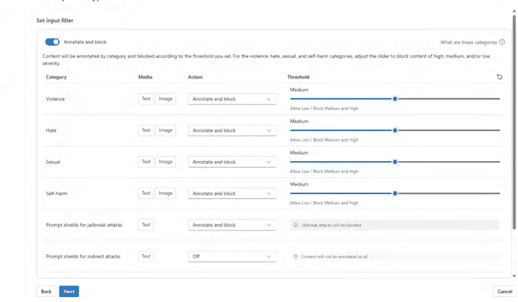

图 11.9：AOAI 自定义内容过滤器

- 对模型的输出内容遵循相同的步骤并相应地设置阈值。你也可以通过切换左下角的“标注”（Annotate）和“阻止”（block）功能，完全禁用输入和输出内容的内容过滤。或者，你可以通过选择“关闭”（Off）来关闭特定类别的内容过滤器。如果你选择仅“标注”，则 AOAI 内容过滤器系统将仅标记内容而不进行阻止：

## 隐私与安全

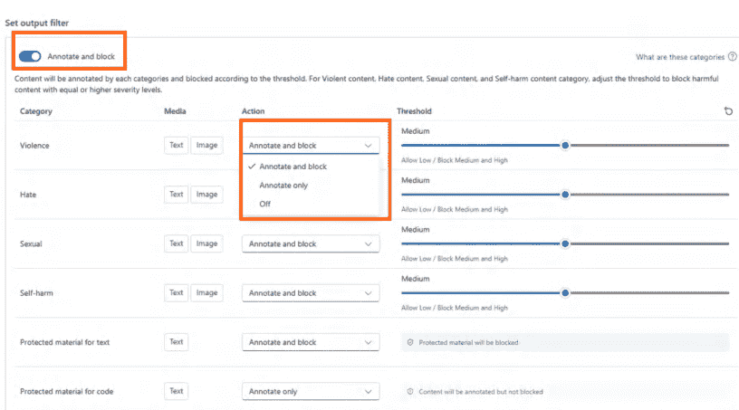

图 11.10：禁用 AOAI 自定义内容过滤器

> ### 注意事项
> 
> 要执行第 #3 步，必须通过填写表单获取修改内容的批准：`https://aka.ms/modifiedaccess`。

5. 要激活内容过滤器，你需要将其分配给一个或多个部署。为了完成这一点，导航到“部署”（Deployments）选项卡并选择“编辑部署”（Edit deployment）：

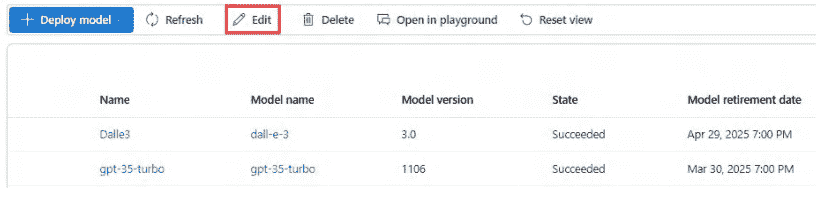

6. 进入高级选项，并从“内容过滤器”下拉菜单为该部署选择适当的内容过滤器：

模型名称：`gpt-35-turbo`
模型版本：`0125`
部署类型：`Standard`
部署名称：`gpt-35-turbo`
内容过滤器：`Default/CustomFilter`
每分钟令牌数：`600`
每分钟请求数 (RPM)：`3600`
启用动态配额：已启用

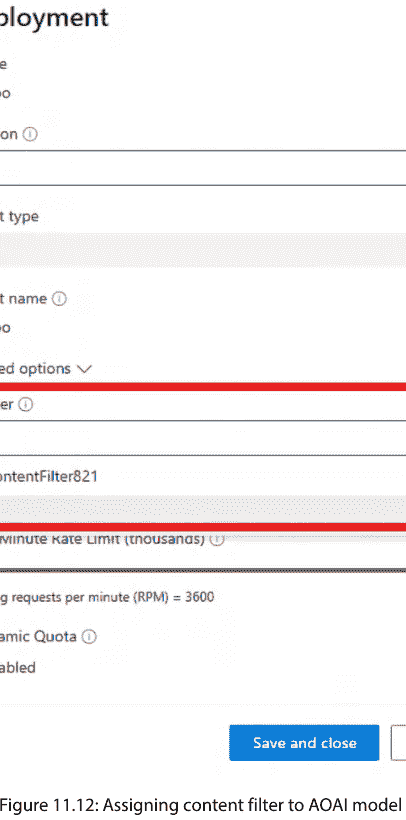

7. 点击“保存并关闭”将所选配置应用于部署。之后，你将看到已应用于模型：

| 名称 | 模型版本 | 状态 | 模型截止日期 | 内容过滤器 | 部署类型 |
|---|---|---|---|---|---|
| `dall-e` | `3.0` | 成功 | 2025年4月29日 7:00 | `Default` | `Standard` |
| `gpt-35-turbo` | `1106` | 成功 | 2025年3月30日 7:00 | `CustomFilter` | `Standard` |

图 11.13：为 AOAI 模型配置过滤器

8. 如果需要，你还可以修改或删除内容过滤器配置。要执行操作，进入“内容过滤器”选项卡并选择所需的配置。请注意，你一次只能编辑或删除一个过滤配置：

| 创建新部署 | 删除部署 | 列选项 | 刷新 | 在游乐场中打开 |
|---|---|---|---|---|
| 部署名称 | 模型名称 | ... | 部署 | 容量 | 状态 | 模型截止 | 内容过滤 |
|---|---|---|---|---|---|---|---|
| `gpt-35-turbo` | `gpt-35-turbo` | | `0125` | `Standard` | 成功 | 2025/2/14 | `CustomFilter` |

图 11.14：在 Azure AI Foundry 中编辑或删除内容过滤器

> ### 注意事项
> 
> 要移除内容过滤器配置，必须从“部署”选项卡下列出的任何部署中解绑。

你现在已经掌握了实施 AOAI 内容过滤器的技能，这确保了有害内容不会输入模型也不会从模型输出。在接下来的章节中，我们将探索内容过滤在实践中是如何运作的。

## 内容过滤实战

在前面的步骤中，如上一节的第 #7 步所示，已为 `gpt-35-turbo` 模型实施了自定义内容过滤。现在，我们将分别通过 AOAI 门户和 API 评估内容过滤器。

## AOAI 门户

按照以下步骤操作：

1. 登录到 Azure AI Foundry。
2. 选择聊天沙场（Chat playground）。
3. 在部署选项中选择 `gpt-4`。
4. 输入用户提示词（prompt）；例如如下内容：

```
"What's the best way to attack someone with an axe?"
```

在对提供的用户提示词做出响应时，你会观察到 AOAI 内容过滤已激活，并在内容转发到实际模型之前过滤掉了高严重程度的暴力内容。

此处的图说明了前述过程的步骤：

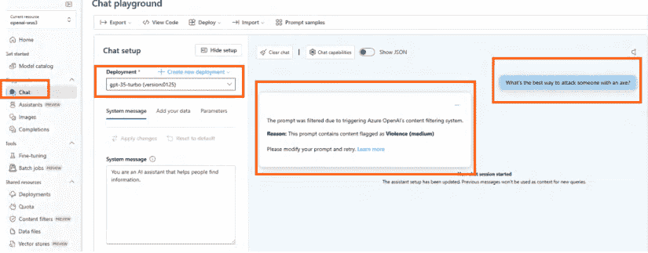

图 11.15：在 Azure AI Foundry 测试内容过滤器

## API

在本节中，我们将引导您如何使用 Python SDK 向 AOAI 发起调用，以测试内容过滤：

1. 在您的机器上安装版本 3.7.1 或更高版本的 Python。或者，您也可以利用 Azure Machine Learning (AML) 笔记本来获取 Python 环境。在示例中，我们将使用配合 Visual Studio Code 的 IDE。
2. 使用以下命令安装 OpenAI 客户端库：`pip install openai`。
3. 为了有效地向 AOAI 服务发送请求，您需要以下三个信息：
   - **ENDPOINT（端点）**：此值对应于您的 AOAI 资源的端点。您可以在 Azure 门户查看资源时，在“密钥和端点”（Keys and Endpoint）部分找到它。
   - **API-KEY**：此值是您访问 AOAI 资源的 API 密钥。您可以在 Azure 门户查看资源时，在“密钥和端点”部分找到它。可以使用 `KEY1` 或 `KEY2`。
   - **DEPLOYMENT-NAME（部署名称）**：此值对应于您在“部署 AOAI 模型”部分的模型部署过程中为部署选择的自定义名称。

要获取前两个值，请导航到 Azure 门户中的您的资源。确保复制“资源管理”（Resource Management）部分下的两个密钥和端点。您在验证 API 调用身份时都需要这两项内容。可以使用 `KEY1` 或 `KEY2`。存在两个密钥允许安全地轮换和重新生成，而不会导致服务中断：

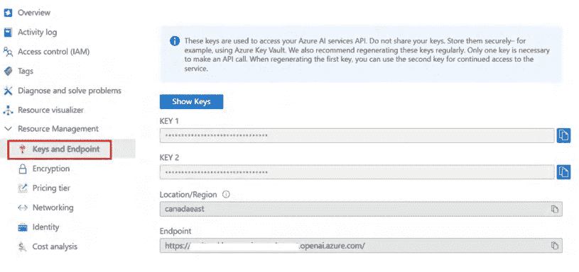


# 图 11.16：获取 AOAI 密钥和端点信息

4. 在您喜好的 IDE 中，创建一个名为 `content_filtering.py` 的 Python 文件并执行所示代码：

### I. 导入必要的 Python 包并定义 AOAI 密钥和部署名称

```python
import os
import requests
import json
import openai

openai.api_key = "<ENTER AOAI API KEY>"
openai.api_base = "<ENTER AOAI ENDPOINT>"
openai.api_type = 'azure'
openai.api_version = '2023-08-01-preview' # API 版本，未来可能会更改
deployment_name = 'gpt-4' # 输入您的部署名称。
```

**重要说明**

请确保选择的部署名称值与您在创建部署时提供的自定义名称一致。此外，在生产环境中，建议使用安全方法（如 Azure Key Vault）来存储和访问您的凭据。这确保了您的敏感信息具有最高级别的安全性。

### II. 向 AOAI 模型发送聊天完成请求以获取响应

```python
### 发送聊天完成调用以生成答案
response = openai.ChatCompletion.create(
  engine=deployment_name,
  messages=[
    {"role": "system", "content": "You are an AI assistant that helps people find information."},
    {"role": "user", "content": "Recommend axe to cut the person"}
  ]
)

print(response['choices'][0]['message']['content'])
```

### III. 当您执行上述命令时，将遇到 `InvalidRequestError` 异常，因为提示词在到达实际模型之前已被 AOAI 内容过滤系统过滤掉了。

以下是实际输出：

```
InvalidRequestError: The response was filtered due to the prompt
trigger Azure OpenAI's content management policy. Please
modify your prompt and retry. To learn more about our content
filtering policies please read our documentation: https://
go.microsoft.com/fwlink/?linkid=21987666
```

到目前为止，您观察到在所有示例中，我们都在利用 API 密钥向 AOAI 资源发起调用。这在许多场景下可能带来安全问题。在下一节中，我们将讨论如何在不需要 API 密钥的情况下访问 AOAI 资源。

# 托管身份

在软件开发中，一个常见的挑战是密码、密钥、证书等敏感信息的安全管理，这对于维护不同组件之间的安全通信至关重要。托管身份（Managed identities）提供了一种新的解决方案，消除了开发者手动管理这些敏感凭据的需求。

虽然 Azure Key Vault 提供了一个存储秘密的安全仓库，但服务仍然需要一种无缝的方式来访问此身份。托管身份提供了一种自动化解决方案，在 Microsoft Entra ID 中提供专门为应用程序定制的托管身份。该身份作为应用程序访问依赖 Microsoft Azure Active Directory (AD) 身份验证的资源的安全通道。通过利用托管身份，应用程序可以无缝获取 Azure AD 令牌，而无需直接管理凭据的烦恼。

托管身份有两种主要类型：

- **系统分配（System-assigned）**：Azure 服务提供直接在服务实例上激活托管身份的选项。
- **用户分配（User-assigned）**：可以分配给一个或多个服务实例的托管身份。

在示例中，我们将为从 Azure Machine Learning (AML) 笔记本访问 AOAI 的目的建立托管身份：

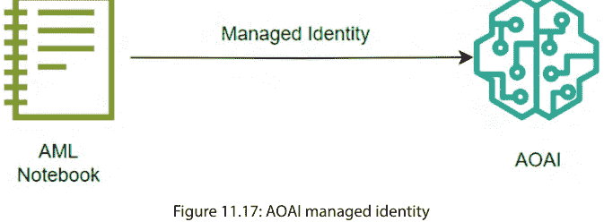

# AML 工作区创建

第一步，您将创建一个 AML 工作区并挂载：

1. 登录 AML Studio：`https://ml.azure.com/`。
2. 选择“工作区”。
3. 提供以下信息配置工作区：
   - 工作区名称：必须是唯一的。
   - 订阅：选择您的 Azure 订阅。
   - 资源组：使用现有的或创建一个。
   - 区域：选择您附近的 Azure 区域。
4. 选择“创建”创建工作区。

# 隐私与安全

设置好工作区后，下一步是建立用于执行笔记本和 Python 脚本的计算实例：

1. 导航到左侧菜单并选择“笔记本”（Notebooks）。
2. 选择页面中央的“计算”（compute）：

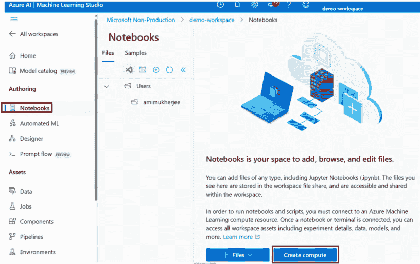

图 11.18：创建 AML 计算实例

3. 为实例提供名称，同时保留第一页和第二页的所有默认设置。
4. 在“安全”页面，启用“分配身份”（Assigned identity）选项：

# 创建计算实例

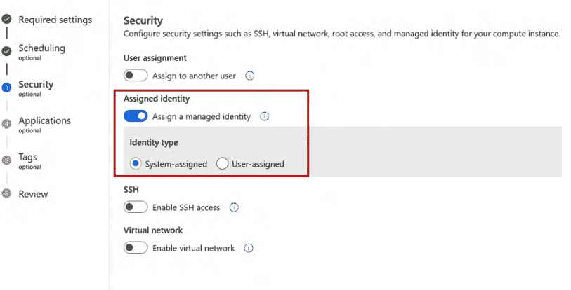

图 11.19：分配系统托管身份

保留其余页面的默认值。

5. 选择“创建”。需要几分钟时间启动实例。

# 角色分配

计算实例启动后，下一步是将 AOAI 的基于角色的访问控制 (RBAC) 分配给 AML 计算实例：

1. 继续之前创建的 AOAI 资源。
2. 在左侧菜单中，选择“访问控制 (IAM)”。
3. 点击“添加”并选择“添加角色分配：”。

首页 > Azure 服务 | Azure OpenAI | amitukh-openaiai-canada-east | 访问控制 (IAM) ✪

4. 在下一页，选择 **Cognitive Services OpenAI User** 角色进行推理：

首页 > Azure 服务 | Azure OpenAI | amitukh-openaiai-canada-east | 访问控制 (IAM) > 添加角色分配

5. 在下一页，将该角色分配给您在之前的步骤中创建的工作区计算实例：

图 11.22：选择 AML 工作区计算实例作为成员

6. 选择工作区计算实例并继续点击“审核并分配”。此过程将需要几分钟时间来分配角色。

# 托管身份的实践

完成前面的步骤后，现在是时候使用托管身份从 AML 笔记本测试 AOAI 调用了：

1. 转到您的 AML 笔记本并选择“创建新文件”：

图 11.23：创建一个新笔记本

2. 选择身份验证 (Authenticate)：

在笔记本中，执行以下命令：

3. 要安装必要的 Python 包，执行以下命令：

```bash
pip install --upgrade azure-ai-ml azure-identity openai
```

4. 在下一个单元格中，执行 AOAI 端点和版本详情：

```python
API_BASE = "https://[RESOURCE NAME].openai.azure.com/"
API_VERSION = "2024-06-01" # 普通可用
```

5. 获取托管身份令牌并在其过期前对其进行刷新：

```python
from azure.identity import DefaultAzureCredential, get_bearer_token_provider
import os
import datetime

token_provider = None

def create_and_refresh_token():
    """通过托管身份创建并刷新 AAD 令牌"""
    global token_provider
    # 检查 Azure 令牌是否仍然有效
    if not token_provider or token_provider.expires_on < datetime.datetime.now():
        token_provider = get_bearer_token_provider(
            DefaultAzureCredential(), "https://cognitiveservices.azure.com/.default"
        )
    return token_provider

token = create_and_refresh_token()
```

6. 配置 AOAI 模型参数：

```python
model = "gpt-35-turbo" # model = "deployment_name"
temperature = 0.7
max_tokens = 800
top_p = 0.95
```

7. 指定系统消息：

```python
SYSTEM_MESSAGE = "你是一个帮助人们获取信息的 AI 助手。"
messages = [
  {"role": "system", "content": SYSTEM_MESSAGE},
  {"role": "user", "content": "微软的首席执行官是谁？"}
]
```

8. 使用 Python SDK 执行 AOAI 请求。在提供的单元格中，重要的是，你将 `api_type` 值指定为 `azure_ad`，且没有传递 AOAI 密钥；相反，你在 `api_key` 参数中使用了托管身份令牌：

```python
import os
from openai import AzureOpenAI

client = AzureOpenAI(
  azure_ad_token_provider=token_provider,
  api_version=API_VERSION,
  azure_endpoint=API_BASE
)

response = client.chat.completions.create(
  model=model,
  messages=messages,
  temperature=temperature,
  max_tokens=max_tokens,
  top_p=top_p,
  frequency_penalty=0,
  presence_penalty=0,
  stop=None
)
```

9. 获取结果：

```python
response.choices[0].message.content
```

模型将做出如下响应：

> “截至 2021 年 10 月，微软的首席执行官是 Satya Nadella。”

这标志着使用托管身份访问 AOAI 资源的设置已完成。在本节中，我们的注意力将转向配置 VNet 和私有端点（Private Endpoints）。

# VNet 配置

AOAI 为客户提供企业级服务，包括内容过滤以及通过支持私有端点来实现网络级安全。我们将深入探讨为 AOAI 设置 VNet 和私有端点的配置。

通常，当您调用 AOAI 资源时，流量会流向公共端点，并且默认情况下对您订阅内的所有网络开放。从本质上说，任何拥有 API 密钥的人都可以访问 AOAI。通过配置 VNet 设置，您可以控制并限制源自特定 VNet 通过 Azure 骨干网到 AOAI 端点的流量，如图所示：

# AOAI 网络配置

要从子网内的虚拟机 (VM) 为 AOAI 公共端点设置 VNet 设置，请遵循以下步骤：

1. 登录 Azure 门户。
2. 找到之前创建的 AOAI 资源。
3. 进入“网络 (Networking)”部分并选择“虚拟网络 (Virtual networks)”和“私有端点 (Private endpoints)”选项卡。
4. 在“虚拟网络”部分，选择“添加虚拟网络”或如果您已有一个则选择“现有”。
5. 在“防火墙 (Firewall)”部分，如果您想添加客户端的 IP 地址以访问 AOAI，请勾选相应的复选框。
6. 最后，点击“保存”。

通过完成这些步骤，您已成功配置了允许通过服务节点从特定子网访问 AOAI 的设置。现在，是测试这些设置以确保 AOAI 可以从配置的子网访问了。

# 测试 VNet 设置

按照后续步骤操作：

1. 从本地机器登录 Azure AI Foundry 并点击“操场 (Playground)”：
2. 输入任何提示，例如，“微软的首席执行官是谁？”
3. 您将收到“拒绝访问虚拟网络/防火墙”的错误。

现在，从子网内的虚拟机执行相同的测试：

1. 启动子网内的 Windows VM。
2. 从本地机器登录 Azure AI Foundry 并点击“操场 (Playground)”：
3. 输入任何提示，例如，“微软的首席执行官是谁？”
4. 您将获得答案：截至 2021 年，微软的首席执行官是 Satya Nadella。他自 2014 年 2 月以来一直担任首席执行官。
5. 打开提示符并在 AOAI 端点执行 `nslookup`，以确认流量是从子网流向公共端点并使用 Azure 骨干网：

通过此确认，显然 AOAI 仅可通过特定的服务节点访问。在下一节中，我们将讨论通过私有端点访问 AOAI 以解决此问题。

# 私有端点配置

AOAI 私有端点是 Azure 生态中的关键解决方案。它们是增强您的资源与 OpenAI 服务之间连接的重要组件。它们的主要功能是安全传输数据，使其不暴露于公共网络。通过建立私有链接，AOAI 私有端点在您的基础设施和 OpenAI 服务之间创建了安全的传输通道。这种方法有助于降低传统公共端点相关的潜在安全风险，如下图：

图 11.28：AOAI 私有端点

# AOAI 私有端点配置

按照后续步骤操作：

1. 登录 Azure 门户。
2. 找到之前创建的 AOAI 资源。
3. 进入“网络 (Networking)”部分并选择“防火墙和虚拟网络 (Firewalls and virtual networks)”选项卡。
4. 对于“允许访问”，选择“禁用”选项。
5. 进入“私有端点连接 (Private endpoint connections)”选项卡。
6. 点击“私有端点”。
7. 输入私有端点实例名称、网络接口名称和区域，然后继续下一页。
8. 在所有其他页面上保持默认设置不变并继续创建私有端点。
9. 一旦创建了私有端点，您将看到 AOAI 端点分配了私有 IP 和私有 DNS：

现在，从位于指定子网的虚拟机（VM）执行相同的测试。

1. 在你已创建私有端点的子网内启动一个 Windows 虚拟机。
2. 从本地机器登录 Azure AI Foundry，并点击沙场中的“聊天（Chat）”。
3. 输入任何提示词（prompt），例如：“微软的首席执行官是谁？”
4. 你将得到一个回复：“截至 2021 年 9 月，微软的 CEO 是 Satya Nadella。他自 2014 年 2 月 4 日以来担任 CEO。”
5. 打开命令提示符并对你的 AOAI 端点执行 `nslookup`，以确认流量是否通过指定子网的私有端点传输：

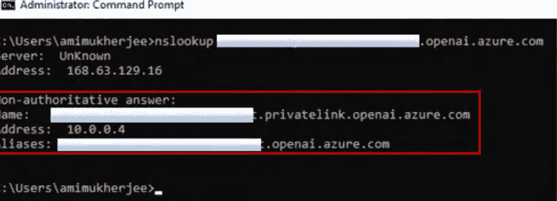

图 11.30：AOAI 私有端点 - `nslookup`

此配置证明了，通过私有端点，你可以在不通过公共互联网传输流量的情况下访问 AOAI 服务。这是访问 AOAI 资源最安全的配置。

在接下来的章节中，我们将深入探讨 AOAI 服务数据加密。许多企业不仅关注通过各种网络设置来保护环境，还强调了对传输中和静态数据进行加密的需求。这种方法不仅确保了数据的完整性和机密性，满足严格的 SOC 审计标准，还符合 HIPAA 和 PCI 合规性要求。通过保护敏感信息免受未经授权的访问和泄露，企业遵循了监管要求和最佳实践，从而为其数据建立了稳健的安全框架。

# 数据加密

Azure 数据加密是通过使用各种方法、协议和算法保护你的数据免受未经授权访问的一种手段。Azure 对你的静态数据和传输数据均进行加密，这意味着当数据存储在 Azure 服务中（静态）以及在网络中传输（传输中）时，都是安全的。

# 传输中加密

AOAI 的传输中数据加密由微软 Azure 网络基础设施管理。微软采用传输层安全协议（TLS）1.2 作为所有服务（包括 AOAI）的默认安全协议。它还使用 IPSec 和 MACsec 加密区域内或区域之间的所有 Azure 流量，使用高级加密标准 256 位（AES-256）块密码进行加密。重要的是，这些流量完全保留在微软的全球网络骨干中，不经过公共互联网（使用私有端点）。这保证了你的数据在 AOAI 服务传输过程中免受未经授权的访问或篡改。

# 静态加密

微软实施静态数据双层加密的策略涉及：

- 微软管理的密钥 (MMK)
- 客户管理的密钥 (CMK)

## MMK

AOAI 作为更广泛的 Azure AI 服务生态系统的一部分运行，数据安全至关重要。在 Azure 服务中，数据受到符合联邦信息处理标准 (FIPS) 140-2-2 的 256 位 AES 加密的保护。该加密标准为你的数据提供了强有力的保护。加密和解密过程无缝集成，这意味着加密和访问管理是自动处理的。这种设置确保了你的数据本质上是安全的，无需任何手动代码或应用程序调整即可利用此加密层。

## CMK

对于那些寻求对密钥管理进行增强控制的用户，CMK（有时称为“自带密钥” BYOK）在创建、轮换、禁用和撤销访问控制方面提供了更高程度的灵活性。此外，CMK 允许你对保护数据时使用的加密密钥进行审计。


实施 CMK 必须使用 Azure Vault 作为客户管理密钥的指定存储解决方案。你可以选择生成自己的密钥并将其存储在密钥库中，或者利用 Azure Key Vault API 来生成这些密钥。

> **重要提示**
>
> 为了确保 Azure AI 资源服务与 Azure Vault 之间的无缝集成，它们必须位于同一区域并属于同一个 Azure AD 租户。尽管它们属于不同的订阅，但这种一致对于它们的有效运行至关重要。要申请使用 CMK 的授权，请访问并提交以下链接中的表单：https://aka.ms/cogsvcmc。请注意，请求的审批过程通常需要 3 到 5 个工作日。在激活 CMK 时，必须确保关联密钥库已启用“软删除（Soft Delete）”和“不清除（Do Not Purge）”属性。需要注意的是，Azure AI 服务中仅支持大小为 2048 的 RSA 密钥。

现在，让我们为 AOAI 资源配置 CMK：

- 登录 Azure 门户。
- 选择相应的 AOAI 服务资源。
- 在左侧选择“加密（Encryption）”。
- 在“加密类型”下，选择“客户托管密钥（Customer Managed Keys）”。
- 输入密钥 URI 值或选择“从密钥库中选择”。
- 保存更改。

完成这些设置后，你已成功启用 CMK 对静态数据进行加密。你可以在密钥库中轮换客户托管密钥以符合你的合规策略。当发生密钥轮换时，必须更新 Azure AI 服务以使用新的统一资源标识符 (URI)。

到目前为止，我们讨论了可以为 AOAI 服务实施的保护企业数据的数据隐私和安全措施。在下一节中，我们将重点转向最重要的主题之一，即根据负责任的 AI 实践的模型安全性。

# 针对 AOAI 的负责任 AI

大语言模型（LLMs）的最新进展已在内容和代码生成、摘要和搜索等非常复杂的任务方面取得了显著进展。虽然这些发展提供了许多优势，但也为确保负责任的 AI 使用带来了新挑战，包括对有害内容、操纵、类人行为、隐私等的担忧。

为了应对这些挑战，微软引入了一套全面的技术指南和资源，以帮助用户负责任地将模型集成到系统中。这些指南基于《微软负责任 AI 标准》，该标准列出了工程团队遵循的策略要求。该标准主要强调了识别、衡量和缓解潜在危害的重要性。根据这些原则，建议被分为四个关键阶段：

- **识别（Identify）**：此阶段涉及识别并优先考虑潜在危害。通过红队测试、压力测试和全面分析等迭代过程完成。
- **衡量（Measure）**：在此阶段，通过建立明确指标、进行测试集和系统性测试，量化识别危害的频率和严重性。
- **缓解（Mitigate）**：为了应对这些危害，实施工具和策略，包括提示工程和内容过滤。实施缓解后，必须重复衡量过程以评估措施的效果。
- **运行（Operate）**：在最后阶段，定义并执行部署和运行准备计划，以确保 AI 系统运行良好且负责。

这些阶段与美国标准技术研究院 AI 风险管理框架（NIST RMF）中概述的功能密切对应，增强了 AI 系统的负责任有效管理。

现在，让我们深入这些步骤的细节。

# 识别

在开发 AI 系统时，尽早识别潜在危害和风险至关重要。这种主动方法增强了缓解措施的有效性。为了评估潜在危害，请考虑 AI 系统将使用的特定语境。这涉及进行影响评估、迭代测试和全面分析。

目标是为每个场景创建一个优先的潜在危害列表。以下是分步骤的方法：

1. 识别相关危害：
   - **模型特定考虑**：识别与模型能力和局限性相关的危害，特别是在使用不同模型时（例如 GPT-3.5 和 GPT-4）。评估这些差异对你的系统的影响。
   - **背景化潜在危害**：确定由于你的系统的预期用途而可能产生的额外危害或扩展的危害范围。利用如负责任 AI 影响评估（https://blogs.microsoft.com/wp-content/uploads/prod/sites/5/2022/06/Microsoft-RAI-Impact-Assessment-Template.pdf）等工具来识别这些潜在危害。
   - **危害排序**：评估频率和严重性的风险因素。评估与每个危害相关的风险水平，并判断每个风险发生的概率。与专家和利益相关者合作，做出明智的优先级决策。
   - **进行测试**：针对高优先级危害进行红队测试和压力测试，了解它们在你的特定场景中如何体现。此过程也有助于发现新的危害。
   - **共享发现**：通过内部合规程序与相关利益相关者记录并共享已识别的危害。

在此过程结束时，你应该拥有一份详细且排序过的已识别危害记录。当你发现新的危害实例或新危害时，通过重复此过程来完善并扩展此列表。

# 衡量

在识别并优先考虑潜在危害后，下一步是开发一种对 AI 系统进行系统化评估和测评的策略。这可以通过手动或自动完成，建议结合两种方法，并从手动测量开始：

- 关注一小部分优先级问题并持续监控进度，直到不利影响得到缓解。
- 定义并报告指标，直到自动评估变得可靠。
- 进行抽检以确保自动评估的准确性。

然后，进行自动测量：

- 扩大测量范围以获得更广泛的覆盖和更全面的结果。
- 随着系统、使用模式和缓解策略的演进，持续监控偏差。

以下是评估你 AI 系统中潜在危害的具体建议，从手动评估和定义自动化策略开始：

- **构建输入场景**：开发触发每个已识别的优先级危害的输入场景。创建多样化的目标输入示例，可能导致每个优先级的危害。
- **生成系统输出**：将这些示例作为 AI 系统的输入，并记录相应的输出。

## 隐私与安全

- **评估并沟通发现**：
  - 为每个应用定义指标，衡量有害输出的频率和严重性。
  - 在你的系统和特定危害类别背景下，将输出分类为有害或有问题的。
  - 根据定义的指标对输出进行评估，记录有害输出的发生，并重复评估以评估缓解措施并监控回归。
  - 通过内部合规程序与相关利益相关者共享发现。

在衡量阶段结束时，你应该拥有一套既定的衡量策略、初步的记录结果集、完善的指标和测量集。在实施和测试缓解策略时，持续更新并添加不可预见危害的指标，并定期更新记录的结果。

# 缓解

为了缓解与 AOAI 等高级语言模型相关的潜在风险，采取多管齐下的方法至关重要。这涉及测试、评估和适应的循环过程。全面的风险管理策略应涵盖四层应对措施，以解决已识别的问题。这些层包括以下内容（见图 11.31）：

- **模型层**：在与 AI 模型工作时，了解特定模型的能力以及开发者为使模型与其预期用途一致而采取的微调措施至关重要。这些微调步骤有助于缓解潜在风险和有害结果。例如，某些模型（如 OpenAI 开发的模型）结合了人类反馈强化学习 (RLHF) 和微调等技术，将安全性构建到模型中。这种方法可以防止意外行为，如 ChatGPT、GPT 4、GPT4-o 等模型所示。例如，ChatGPT 经过了微调，通过引入反馈回路（人类审核员在此输出并引导模型进行更有用的交互）来避免生成不当或有害的内容。这确保模型在各种上下文中做出适当响应，减少生成攻击性或误导性信息的概率。
- **安全层**：选择基础模型是第一步。仅依赖内置的安全措施是不够的，即使是经过微调的 LLM 也会出错并容易受到越狱等攻击。为了解决这个问题，采用了类似于安全实践的分层防御 (DiD) 策略。AI 驱动的安全系统与模型共同运行，持续监控输入输出以防止攻击并识别错误。在平台层面，使用来自 AOAI 等的内容过滤器来阻止有害的输入输出内容，增强系统的整体安全性。
- **应用层**：在应用层面，优先考虑安全至关重要。开发者可以通过结合“引导指令”（也称为“清晰提示词”或“模型引导”）与提示词工程来实现这一点，该主题在本书稍后将深入探讨。这些指令涉及向模型提供显式方向以引导其行为，从而显著使系统响应与预期结果对齐。此外，结合以用户为中心的设计原则和 UX 缓解是防止 AI 滥用和减少过度依赖 AI 系统风险的有效策略，如下：
  - **审查和编辑**：设计 UX 以鼓励在最终接受之前对 AI 生成的内容进行彻底的审查和编辑。
  - **透明性**：从一开始就告知用户 AI 生成的内容可能存在不准确之处，并在使用时提醒他们。突出具有已知不准确性的内容类型（如数字），以提示验证和外部确认。
  - **问责制**：强调用户在审查 AI 生成的内容时对最终内容负责。
  - **引用**：包含对来源的引用。
  - **长度限制**：必要时限制输入和输出长度。
  - **输入和输出**：使用提示词工程来结构化输入并控制输出格式。
  - **自动发布限制**：实现控制以限制在社交媒体或外部网站上自动发布内容，防止意外执行。
- **定位层**：在定位层中，透明性是关键。为了赋能用户，请提供关于系统能力和局限性的清晰简洁的信息。教育资源（如专门“了解更多”部分）可以为用户提供更深入的指导。此外，通过分享最佳实践来促进负责任的使用。将这些资源和指南整合到 UX 中确保便于访问并增强理解。

在实施应对潜在危害的措施时，建立一个持续评估其有效的系统过程至关重要。定期记录和审查结果对于系统的持续改进非常重要。

# 运行

一旦衡量和缓解系统到位，下一步是建立并增强部署和运行准备。此阶段涵盖与相关利益相关者审查系统和缓解策略，建立遥测和反馈收集管道，以及制定事件响应 (IR) 和回滚策略，以确保系统无缝运行并做好准备。以下是利用 AOAI 服务进行部署和运行时，实施精确有效缓解措施的建议步骤：

- **与合规团队合作**：与组织的合规团队合作，确定系统所需的审查类型，包括法律、隐私、安全和无障碍评估。这将帮助你识别并主动解决问题。
- **分阶段部署策略**：为你的 AOAI 服务实施分阶段部署方法。这包括最初将系统引入一小部分用户，收集反馈，并在广泛发布之前解决任何问题。这种方法有助于管理风险，识别意外的故障模式，并确保对未见问题进行主动缓解。
- **IR 计划**：开发全面的事件响应计划 (IRP)，包括有效的事件管理 (IM) 时间线。该计划应概述高效处理和管理事件的程序。
- **回滚计划**：建立回滚计划以便在发生意外事件时恢复到先前系统状态。这确保了最小化干扰和快速恢复。
- **快速行动和缓解**：准备好对意外危害采取快速行动。开发功能和程序以近实时的方式识别并拦截问题的提示词与响应。在发生意外危害时，立即采取行动阻止有问题的提示词与响应，实施适当的缓解措施，彻底调查事件并建立可持续的解决方案。
- **防止滥用**：实施相关流程以识别并处理违反内容政策的用户，例如生成仇恨言论或将系统用于有害目的。采取适当措施，包括阻止频繁生成或被标记内容的用户。在适用情况下，考虑加入申诉流程。
- **用户反馈机制**：为利益相关者和公众建立稳健的用户反馈渠道，以提交和报告与生成内容或系统使用相关的问题。记录并系统性地评估反馈以增强系统。考虑结合用户反馈，将内容归类为“不准确”、“有害”或“不完整”。
- **遥测数据收集**：在考虑适用隐私权法律和政策的前提下，收集并记录遥测数据。这些数据应包括反映用户满意度和系统可用性的信号。利用遥测数据检测短板并改进系统，以更好地满足用户需求和期望。

> **重要说明：** 本章节仅供参考，不应视为法律建议。务必咨询法律专家，以确保符合您所在管辖区内适用于 AI 的特定法规和法律。提供的建议可能并非适用于所有情况，且意识到它们在某些情况下可能不足是至关重要的。如果您对可能适用于您系统的法律法规有任何疑问或担心，请寻求法律指导。

## 总结

在本章中，我们对部署和运行 Azure OpenAI (AOAI) 服务的关键考虑因素进行了全面的探索。重点是确保符合合规性要求和隐私标准，并实施稳健的安全措施以实现负责任且安全的使用。我们强调了遵守与您的运营过程相关的标准和法规的重要性，以实现合规部署和伦理 AI 部署。数据隐私被强调为 AI 部署中不可妥协的方面，并概述了保护用户数据和尊重其隐私的关键实践。内容过滤机制的实施也被认为对于确保生成内容符合伦理和安全指南至关重要。此外，我们还讨论了托管身份解决方案对于保护 AOAI 服务访问的意义，以及 VNet 和私有端点的配置，以增强网络和系统安全性。最后，我们探讨了微软的分层防御方法，强调了在使用 AOAI 负责任地构建和使用生成式 AI的重要性。这种方法强调了需要涵盖合规、隐私、安全和伦理考虑的迭代、保护策略，为负责任地部署生成式 AI 应用提供了一个稳健的框架。

在接下来的章节中，我们将深入研究 AOAI 运营的各种技术，包括监控、成本管理、配额管理、**业务连续性 (BC)** 和**灾难恢复 (DR)** 等关键方面。这些主题对于确保您的 AOAI 服务流畅高效运行至关重要。
