# 12 运营 Azure OpenAI

在之前的章节中，我们演示了如何在确保数据安全和私密的情况下使用 Azure OpenAI (AOAI)。在本章中，我们的重点将转向 Azure OpenAI 的运营化。这意味着我们将会探索如何有效地部署、管理和优化 Azure OpenAI 服务。我们将讨论日志记录和监控的最佳实践，确保您能够跟踪和分析 AOAI 服务的性能。此外，我们还将涵盖各种服务配额和限制，帮助您理解如何高效地管理和分配资源。我们还将讨论如何请求单元以支持更大的工作负载。此外，我们将解释如何配置吞吐量单元，以确保您的 AI 服务能够处理所需的负载。最后，我们将研究扩展 Azure OpenAI 服务以满足不断增长的需求的策略。在本章中，我们将涵盖以下主要主题：

- Azure OpenAI 默认日志记录和监控
- Azure OpenAI 服务配额和限制
- Azure OpenAI 配额管理
- Azure OpenAI 提供的吞吐量单元
- Azure OpenAI 扩展

# Azure OpenAI 默认日志记录和监控

Azure OpenAI 服务收集监控数据的方式与其他 Azure 资源类似。您可以设置 Azure Monitor 来收集活动日志、资源日志、虚拟机日志和平台指标中的数据。

指标和 Azure Monitor 活动日志都会自动收集并存储。要将这些数据重定向到其他目标地，您可以使用诊断设置。然而，只有在您创建诊断设置并将日志路由到一个或多个指定位置时，Azure Monitor 资源日志才会收集和存储。在配置诊断设置期间，您可以决定收集哪些类型的日志。需要注意的是，使用诊断设置并将数据发送到 Azure Monitor Logs 可能会产生额外费用。后续章节提供了可以收集的指标和日志的详细信息。

# Azure OpenAI 指标

您可以使用 Azure 门户中的 Monitor 工具查看您的 Azure OpenAI 服务资源的指标。

1. 登录 Azure 门户。
2. 转到您的 Azure OpenAI 资源的概览页面。
3. 从左侧的监控部分选择“指标”(Metrics)，如图 12.1 所示：

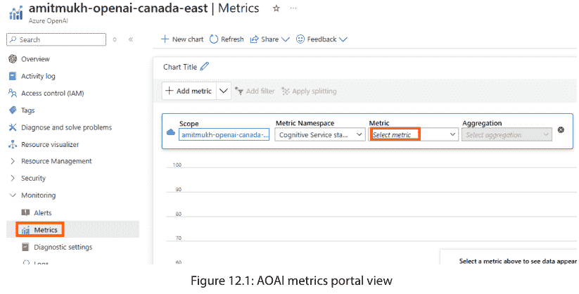

Azure AI 包含 Azure AI 服务的子集。Azure OpenAI 服务提供了几个关键指标，帮助用户监控和优化其使用。Azure OpenAI 请求（Azure OpenAI Requests）是一项基础指标，用于跟踪对服务的 API 调用次数。这有助于用户理解其使用模式，并对于管理成本和确保高效利用资源至关重要。响应时间（Time to Response）衡量处理请求所需的时间，这对于评估服务的性能和响应能力至关重要。高延迟可能表明存在潜在瓶颈或需要解决的问题，以维持流畅的用户体验。

# Azure OpenAI 默认日志记录和监控 263

另一个重要指标是提示 Token 缓存命中率（Prompt Token Cache Match Rate），它监控 TPU-M 中的 KV 缓存命中。键值 (KV) 缓存是生成式 Transformer 模型（包括大语言模型 LLM）中使用的一种技术，用于提高推理过程的效率。KV 缓存的主要功能包括：

- 减少计算开销：它消除了在生成的每一步中都重新计算之前 token 的键和值张量的需求，从而加快了速度。
- 内存与计算平衡：通过将这些张量存储在 GPU 内存中，KV 缓存优化了内存使用与计算性能之间的平衡。

为了在提示词中使用 KV 缓存，请应用以下优化策略：

- 动态元素位置：将动态组件（如基础数据、日期和时间）放在提示词的末尾。这确保了频繁变化的部分不会破坏静态部分的缓存。
- 保持静态元素：将安全指南、示例和工具或函数定义等静态元素放在提示词的开头，并保持一致的顺序。这可以最大化这些部分的重用和缓存效率。
- 专用部署：将您的提示词调优单元 (PTU) 部署专注于有限数量的用例。这增加了请求的统一性，增强了缓存命中率和整体性能。

处理推理 Token（Processed Inference Tokens）跟踪请求和响应中处理的 token 数量。这对于理解交互的复杂性和长度特别有用。监控 Token 使用情况有助于优化提示词并有效管理成本。最后，托管管理利用率 V2（Provisioned-managed Utilization V2）指标监控 TPU-M 的利用率%。预留部署的利用率百分比使用公式计算：(已消耗 PTU / 已部署 PTU) x 100%。当此利用率达到或超过 100% 时，调用将被限流，并返回错误代码 429。这些指标共同提供了性能的全面视图，帮助用户识别改进领域并确保最佳性能。

对于有关 Azure Monitor 为 Azure OpenAI 及类似的 Azure AI 服务收集的所有平台指标列表，请参考以下链接：https://learn.microsoft.com/en-us/azure/ai-services/openai/monitor-openai-reference。

## Azure OpenAI 的落地实施

你可以使用 Azure Monitor 中的诊断设置来导出指标。要使用 Azure Log Analytics 中的查询来检查日志和指标数据，有必要为你的 Azure OpenAI 资源和 Log Analytics 工作区都设置诊断设置。现在，让我们设置诊断设置。

1. 转到你的 Azure OpenAI 资源，并在左侧选择**监控**下的**诊断设置**。在**诊断设置**页面上，选择**添加诊断设置**。

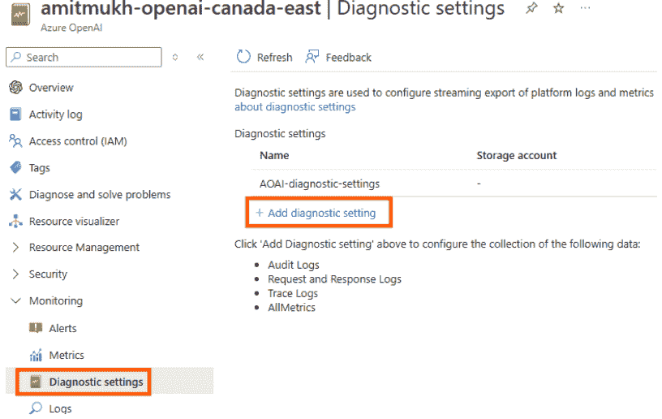


## 诊断设置

诊断设置指定了你想从资源收集的平台日志和/或指标的类别列表，以及你希望将它们流向的一个或多个目的地。目的地将产生正常的使用费用。了解更多关于不同的日志类别和这些日志的内容。

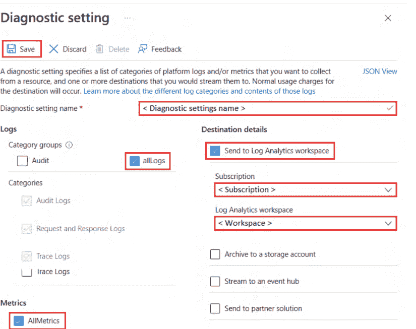

**图 12.3：** 配置诊断设置。

在**诊断设置**页面上，执行以下步骤：

- i. 选择**发送到 Log Analytics** 工作区。
- ii. 选择你的 Azure 账户订阅。
- iii. 选择你的 **Log Analytics** 工作区。
- iv. 在**日志**下，选择 **allLogs**。
- v. 在**指标**下，选择 **AllMetrics**。

为**诊断设置**选择一个名称以存储配置，然后点击**保存**。

一旦设置好诊断设置，你就可以在 Log Analytics 工作区中使用你的 Azure OpenAI 资源的指标和日志数据了。

接下来，我们将学习如何使用 Kusto 查询来跟踪日志。

## 使用 Kusto 查询监控日志

为了创建我们将监控的日志，我们首先需要进行 API 调用。执行以下步骤以生成日志。

1. 转到 Azure AI Foundry 中的聊天完成（chat completion）。
2. 在门户中提问任何问题。

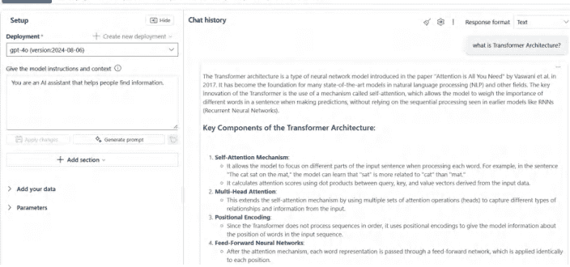

当你使用聊天操场（Chat playground）输入任何文本时，它会产生你的 Azure OpenAI 资源的指标和日志数据。你可以使用 Kusto 查询语言查询你的资源 Azure Analytics 工作区中的监控数据。

接下来，我们将使用 Kusto 搜索日志。

3. 在你的 Azure OpenAI 资源上，从屏幕左侧的**监控**部分选择**日志**。
4. 选择为你 Azure OpenAI 资源设置了诊断的 Log Analytics 工作区。
5. 从左侧格的 Log Analytics 工作区页面选择**日志**。
6. 默认情况下，Azure 门户显示带有建议的窗口。
7. 要运行以下示例，在顶部编辑器区域输入 Kusto 查询，然后运行。

```kusto
AzureDiagnostics
| take 100
| project TimeGenerated, ResourceId, OperationName,
DurationMs, ResultSignature, properties_s
```

此查询显示了审计记录的示例。Azure Monitor 中的审计日志捕获了系统内的对象。它们提供了查询何时运行、执行查询的用户身份、使用的工具以及与查询相关的性能指标。

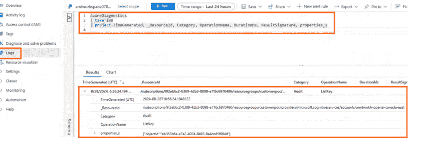

**图 12.5：** 使用 Kusto 查询分析日志。

现在我们已经展示了如何检查 AOAI 日志，下一节将介绍对于设计生成式 AI 解决方案至关重要的限制。

## Azure OpenAI 服务配额与限制

Azure OpenAI 按需付费共享共享 GPU 基础设施进行推理。因此，`AOAI` 服务对你使用该资源有一些限制。在本节中，我们将描述各种模型的各种限制和配额，以及如何通过某些实践来避免限制。

在编写期间，每个 Azure 订阅可以在每个区域访问 30 个 OpenAI 资源。对于 DALL-E 模型，默认配额为 DALL-E 2 的 2 个并发请求，DALL-E 3 的 2 个容量单元（每分钟 6 次请求）。然而，另一个模型的限制为每分钟 3 次请求。每个请求的最大 Token 数，更多详细信息可以在提供的链接 Azure OpenAI 服务文档中找到：<https://microsoft.com/en-us/azure/ai-services/openai/concepts/models?tabs=python-standard%2C-completions#gpt-4-and-gpt-4-turbo>。微调能力上限为 5 个模型部署，每个资源最多支持 100 个训练作业。然而，每个资源只能同时运行一个作业，并可以排队 20 个作业。每个资源可以包含最多 50 个用于微调的文件，总大小限制为 1 GB，且每个训练作业不得超过 720 小时或包含超过 20 亿个 Token。

额外的限制还包括 Azure OpenAI 你的数据中所有文件的最大上传大小为 16 MB。

## Azure OpenAI 配额管理

配额（Quota）允许你控制速率限制在订阅内部署之间的分布。在本节中，我们将展示如何管理你的 Azure OpenAI 配额。

Azure OpenAI 的配额功能允许你为部署分配速率限制，最高可达到称为“配额”的总限额。该配额按区域、按模型分配给你的订阅，并以每分钟令牌数（TPM）为衡量单位。当你创建 Azure OpenAI 服务时，你将获得大多数可用模型的默认配额。

当你创建部署时，你会为每个部署分配 `TPM`，该模型的可用配额将根据分配量相应减少。你可以继续创建并为部署分配 `TPM`，直到达到你的配额限制。一旦达到配额，你将只能通过从相同模型的现有部署中重新分配 `TPM`，或在所需区域申请增加配额来创建新部署。例如，在美东地区拥有 GPT-35-Turbo 模型 240,000 `TPM` 配额的客户可以在不同的配置下利用此配额。他们可以选择一个具有 240K `TPM` 限制的单个 GPT-35-Turbo 部署，也可以选择两个各具有 120K `TPM` 的独立部署。或者，他们可以将配额以任何组合分配到多个部署中，只要在美东地区内的总 `TPM` 不超过 240K 即可。

从本质上，Azure OpenAI 的配额管理系统帮助你高效地分配和管理 `API` 使用情况，确保你在分配的限额内最大化部署的效用。

AOAI 模型部署的推理请求将根据部署分配的 `TPM` 具有相应的速率限制。`TPM` 分配还决定了每分钟请求数（`RPM`）速率限制的值，其遵循以下比例：每 1000 `TPM` 对应 6 个 `RPM`。

接下来，我们将讨论如何从 `AOAI` 门户分配配额。

## 分配配额

在创建 `AOAI` 模型部署时，你可以选择想要分配多少 `TPM`。`TPM` 可以每次以 1000 为单位进行更改，并如上一节所述，它将决定适用于部署的 `TPM` 和 `RPM` 速率限制。

要分配配额，请执行以下步骤：

1. 登录 Azure OpenAI 门户。
2. 点击“共享资源”（Shared resources）下的“部署”（Deployments）。
3. 选择现有部署。
4. 点击“编辑部署”（Edit deployment）。
5. 设置所需的 `TPM`。
6. 点击“保存并关闭”。

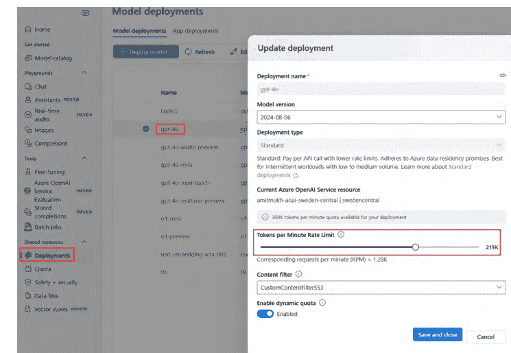

**图 12.6：** 为 `AOAI` 部署分配配额。

根据你选择的模型类型，你可以导航到“Azure OpenAI 标准”（Azure OpenAI Standard）或“Azure OpenAI Global 标准”（Azure OpenAI Global-Standard）标签页。一旦配置了各种部署的配额，你可以访问“共享资源”下的“配额”（Quotas）页面，查看配额是如何分配到不同区域或全局部署的。

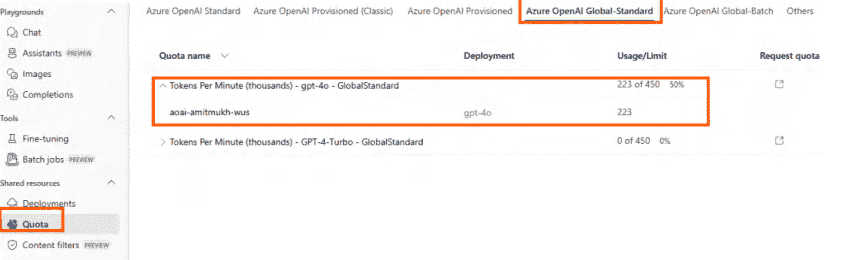

**图 12.7：** `AOAI` 部署的总配额分配。

此配额页面有四个字段：

- **配额名称（Quota Name）**：每个模型类型在每个区域都有一个配额值。该配额适用于此模型的所有版本。UI 中的配额名称可以较大，用于显示使用该配额的部署。

- **部署（Deployment）**：按模型类分组的模型部署。

- **使用量/限制（Usage/Limit）**：显示在该配额名称下，部署消耗的配额量以及为此订阅和区域分配的配额量。

- **请求配额（Request quota）**：该字段中的链接指向一个表单，可在那里申请更多特定的 `AOAI` 模型配额。

现在，你已经学会了如何在 `AOAI` 资源中管理配额，下一节我们将探索预计吞吐量单元（Provisioned Throughput Unit）概念。

## Azure OpenAI 预留吞吐量单元

预留吞吐量单元（PTU）允许你设置应用程序所需的吞吐量。你对大规模使用和配置 OpenAI 大语言模型有了更多控制。它为 OpenAI 模型提供了具有保证吞吐量的专用计算资源。你可以设置所需的总吞吐量单元（PTU），并有能力按你偏好分配对 OpenAI 的承诺。每个模型运行需要不同数量的 `PTU`，例如，与 GPT4 相比，GPT-3.5 需要较少的 `PTU`。你可以从各种承诺选项中进行选择。通过 1 个月或 1 年的承诺，你可以获得预留吞吐量并获得价格上的优惠。预留吞吐量为工作负载需求提供了更多的控制和活性，确保系统在较高负载出现时已就绪。

此功能实现：

- **一致性能**：为稳定的工作负载提供可靠的峰值延迟和容量。

- **固定性能容量**：部署设置吞吐量水平。部署后，无论实际需求如何，吞吐量即可使用。

- **节省成本**：高吞吐量工作负载的成本可能低于基于令牌的使用。

`AOAI` 提供两种 `PTU`：

- **经典 PTU（Classic PTU）**：由于特定模型对最小 `PTU` 的要求，此类 `PTU` 的入门槛较高，导致初始成本巨大。此外，未来的成本增量也很大。新客户已无法购买此类 `PTU`。微软建议客户从这种 `PTU` 迁移到托管 PTU（PTU Managed）。

- **托管 PTU（PTU Managed）**：也称为部分 PTU。建议大多数客户使用托管 PTU，因为它提供了更低的入门点和更小的增量。

购买 `PTU-M` 的过程完全是自助的，无需联系微软的客户团队。你可以通过预留实例（`RI`）购买 `PTU-M`。在本书编写时，选择 `PTU-M`，你可以在指定区域内从每月 `RI` 或年度 `RI` 中进行选择。有关每个模型 `PTU-M` 的详细信息，请参阅图 12.8。

| | 数据区域 | | | | | | | |
|---|---|---|---|---|---|---|---|---|
| | 入口 | 增量 | 入口 | 增量 | 入口 | 增量 | 入口 | 增量 |
| GPT 4o | 5 | 5 | 15 | 5 | 15 | 5 | 50 | 50 |
| GPT 4 mini | 15 | 5 | 15 | 5 | 15 | 5 | 25 | 25 |
| 4T | | | | | | | 100 | 100 |
| | | | | | 旧版模型 * | | | |
| GPT 4-32k | | | | | | | 200 | 200 |
| GPT 4-8k | | | | | | | 100 | 100 |
| GPT 3.5 0125 | | | | | | | 50 | 50 |

**图 12.8：** 每个模型的最小 `PTU-M`。

如果你在美东地区获取了 200 个单位的每月承诺 `PTU-M` 预留，你可以将 100 个单位分配给 GPT4-Turbo，50 个分配给 GPT4-o，50 个分配给 GPT4-o-mini。分配可以在第二天根据需要进行调整，无需等待续约期。然而，一旦你有了特定区域的 `PTU-M` 预留，你就无法增加、减少或交换它。若要修改预留，你需要购买额外的预留或取消现有的预留，这可能会导致提前终止费用。

`AOAI` `PTU` 提供三种部署选项：

- **全局部署（Global Deployment）**：数据可以在全球任何 Azure 区域进行处理，并包含内置的数据平面高可用性（HA）。

- **数据区域部署（Data Zone Deployment）**：目前仅限于欧盟和美国区域，数据处理被限制在所选区域（美国或欧盟）。这种部署在设计上也提供了数据平面高可用性。

- **区域部署**：数据处理受限于托管 `AOAI` 服务的特定 Azure 区域，且不内置数据面高可用性（HA）。不过，你可以使用 Azure API Management (APIM) 实现高可用性，这将在随后的章节中介绍。

在所有部署类型中，你的数据都保留在 `AOAI` 服务所在的区域内。

到目前为止，你已经探索了各种 `AOAI` `PTU` 选项及其购买和部署方案。接下来，我们将讨论在承诺 `PTU-M` 之前如何合理地确定 `PTU` 的规模。

## PTU-M 规模估算

`PTU-M` 是一种基于承诺的定价模型，目前尚不支持自动扩展功能。因此，如果你的工作负载需要额外的计算资源，你必须在使用之前提前获取。因此，在购买之前准确估算 `PTU` 规模至关重要。`AOAI` 在 Azure AI Foundry 中提供了 `PTU-M` 计算器，帮助估计适用于你特定工作负载的 `PTU-M` 规模。

要使用该计算器，请按照以下步骤操作：

- 登录你的 Azure 门户。
- 为你要请求 `PTU-M` 的指定区域选择 `AOAI` 资源。
- 打开 Azure AI Foundry。
- 导航至“管理”下的“配额”（Quotas）。
- 选择“Azure OpenAI 预留”（Provisioned）选项卡。
- 选择“容量计算器”（Capacity calculator）。
- 选择使用的模型。
- 选择模型版本。
- 提供你的工作负载名称、每分钟调用次数。
- 对于多模态情况（仅适用于 GPT-4o 和 GPT-4o-mini），指定提示调用中文本和图像输入的 token 使用数量。这通常包括输入问题的总 token 数以及文本的上下文大小。此外，指定响应中使用的 token 数量。
- 点击“计算”以计算每种工作负载需要多少 `PTU`。

## 容量计算器

Azure OpenAI 计算器允许你估算工作负载所需的 `PTU` 数量。计算器假设提示和生成大小以及调用率是静态的，且仅供估计。这些值的波动会导致收到的总 `PTU` 变化。为了获得更准确的结果，请通过部署代表性工作负载运行基准测试，并在指标表中查看预留托管（Provisioned-Managed）利用率值。

| 选择模型 | 模型版本 |
|---|---|
| gpt-4o-min | 2024-07-18 |

通过在 `PTU` 计算中添加更多工作负载来提高准确性。每个工作负载都将被计算并显示，如果两者同时运行部署，还会显示聚合总和。阅读文档中的[使用场景](#)以了解更多不同的估算策略。

| 工作负载名称 | 每分钟峰值次数 | 提示调用中的 tokens | 模型响应中的 tokens | 输出 |
|---|---|---|---|---|
| | | 文本输入 tokens | | |
| RAG 聊天 | 10 | 3500 | 300 | PTUs: 2S (3.2) 每分钟令牌: 38,000 (35,000 提示, 3,000 生成) |
| | | 图像输入 tokens | | |
| | | 文本输入 tokens | | |
| 基础聊天 | 10 | 500 | 100 | PTUs: 25S (0.582) 每分钟令牌: 6,000 (5,000 提示, 1,000 生成) |
| | | 图像输入 tokens | | |
| | | 文本输入 tokens | | |
| 摘要 | 10 | 5000 | 300 | PTUs: 25S (4.291) 每分钟令牌: 53,000 (50,000 提示, 3,000 生成) |
| | | 图像输入 tokens | | |

**图 12.9：** `PTU-M` 规模计算。

一旦你确定了应用程序的 `PTU-M` 需求，就可以通过 Azure 预留或按需计费的 `PTU` 选项进行购买。我们将在下一节中详细讨论这一过程。

## PTU-M 购买模型

`AOAI` 为 `PTU-M` 提供两种不同的购买模型。

- **按需小时小时 PTU：** 这种针对预留部署的按小时付费非常适用于短期场景。这包括对新模型的质量和性能进行基准测试，或为黑客松等活动临时提升 `PTU` 容量。该模型费用为每个 `PTU` 每小时 2 美分。例如，如果你部署了 300 个 `PTU`，产生的费用将是小时率乘以 300，即 2 * 300 = 600 美元/小时。如果部署运行时间不足一小时，将根据部署的分钟数按比例收费。例如，如果部署在一个小时内运行了 15 分钟，小时率为 600 美元，那么 15 分钟的费用为 150 美元。

默认情况下，客户拥有某些配额（通常为 100 个）用于部署模型。你可以利用它来部署按小时 `PTU`。你可以按照以下步骤部署按小时 `PTU`。

1. 登录 Azure 门户。
2. 为你要请求按小时 `PTU-M` 的指定区域选择 `AOAI` 资源。
3. 打开 Azure AI Foundry。
4. 点击“共享资源”下的“部署”（Deployments）。
5. 点击“部署模型”（Deploy model）。
6. 选择“部署基础模型”。
7. 选择所需的模型。
8. 点击“确认”。
9. 设置部署名称和模型版本。
10. 将部署类型选择“预留托管”（Provisioned-managed）。
11. 设置预留吞吐量单元（PTUs）。
12. 如果你有自定义内容筛选，则选择 `DefaultV2`。
13. 点击“确认”购买。

**图 12.10：** 按小时 `PTU` 部署。

> **重要提示**
>
> 如果你在指定区域部署模型的当前配额已耗尽，你需要使用以下表格提交请求：<https://aka.ms/oai/ptuearequest>。少于 1000 个的请求通常会在工作日内批准。对于超过 1000 个的请求，你需要联系你的微软代表以获取必要的分配。
>
> 仅分配配额并不保证模型容量。因此，在特定区域，如果你拥有配额但微软缺乏容量，你将收到该区域没有容量的通知。

**图 12.11：** 容量不可用。

## 选择您想要购买的产品

Azure OpenAI 服务预留实例（Provisioned reservations）允许您预先购买期 1 年或 6 个月的 Azure 预留吞吐量，从而为预留部署提供比按需付费价格大幅大的折扣。


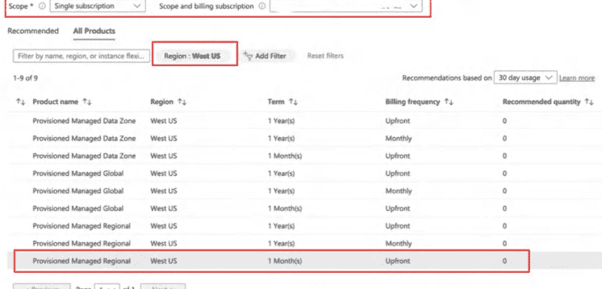

图 12.13：AOAI 预留购买

27. 在接下来的屏幕上，如图 12.14 所示，指定您想要为预留指定的 PTU 数量。

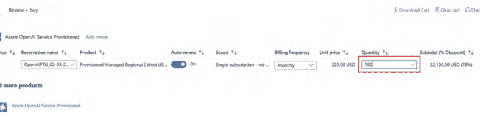

图 12.14: 设置 AOAI 预留 PTU 数量

28. 点击“下一步：查看并购买”

29. 购买预留后，预留使用情况可能需要最多 12 小时才会在预留门户中报告。

购买 PTU-M 后，如果您希望评估其性能并确定如平均延迟、最大 TPM 或 RPM 等指标，可以使用微软提供的基准测试脚本进行精确的分位数计算。可以通过链接获取基准脚本：`https://aka.ms/aoai/benchmarking`。

AOAI 保证 99.9% 的可用性 SLA 和 99% 的 Token 生成延迟 SLA，确保了稳定且可预测的吞吐量。相比之下，`gpt-4o`模型支持 50 个部署增量（区域部署），每个 PTU 的最大输入吞吐量为 2,500 TPM，输出限制为 833 TPM，延迟目标为每秒 25 个 tokens。`gpt-4o-mini`模型提供 25 个可部署（区域部署）增量，但提供了更高的输入和输出速率，每个 PTU 为 30,000 TPM 和 12,333 TPM，延迟目标为每秒 33 个 tokens。这些性能指标适用于所有三个部署选项。有关每个模型的吞吐量和 Token 延迟的详细信息，请访问：`https://microsoft.com/en-us/azure/ai-services/openai/concepts/provisioned-throughput#how-much-throughput-per-ptu-you-get-for-each-model`

当您进行测试或在生产环境中运行 PTU 时，可以使用 Azure OpenAI “provisioned-managed Utilization V2”指标来跟踪 PTU 使用情况。该指标仅适用于 PTU-M，不适用于经典 PTU。

如果您决定不再继续 AOAI PTU 预留，只需关闭图 12.15 所示的预留自动续订选项，并确保按照前文说明删除 PTU 部署即可。如果预留未续订而您忘记删除 PTU 部署，将产生按小时的费用。以下是购买后避免续订预留的方法：

1. 登录您的 Azure
2. 搜索“预留”（Reservations）
3. 选择您希望防止自动续订的特定预留。
4. 导航到设置菜单并选择“续订”（Renewal）选项。
5. 选择“不续订”

## Azure OpenAI 运营化

6. 点击“保存”

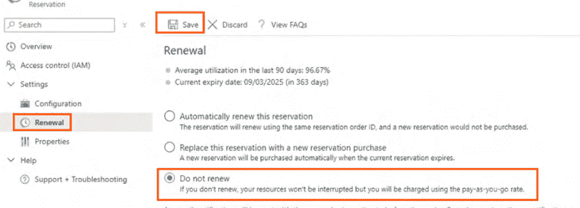

图 12.15：关闭 AOAI PTU 预留续订

我们已经讨论了企业业务生产应用所需的 AOAI 各组件。接下来，我们将探索 AOAI 的某些扩展技术以克服局限性。

## Azure OpenAI 扩展

AOAI 通常会对调用量进行限制。在 Azure OpenAI 中，这些限制表现 Token 限制（TPM，每分钟 Token 数）和每分钟请求限制（RPM）。然而，这些配额限于单个订阅、区域和特定模型。因此，许多客户选择跨区域使用多个 Azure OpenAI (AOAI) 资源来实现最大吞吐量。虽然“PAUG”设置中的这种配置没有解决延迟问题，但后续章节将使用 PTU 解决延迟问题。

当 PAUG 达到容量限制时，AOAI 会返回 429 或 `TooManyRequests`状态码，其 `Retry-After`响应头指定了在尝试下次请求之前应等待的秒数。处理这些错误通常由客户端 SDK 管理，但在使用多个 OpenAI 端点以获取最大吞吐量时，需要在客户端管理 URL 列表，这可能并不理想。为了解决这个问题，需要一种复杂的负载均衡机制，能够智能地决定流量何时以及路由到哪个 AOAI 端点。

APIM 为开发者提供了一个稳健的解决方案，可以向外部和内部用户安全地暴露 API。通过此平台，您可以实现智能负载均衡策略，考虑“Retry-After”和 429 错误响应，动态将流量路由到备选的 OpenAI 后端。此外，您可以灵活为 AOAI 端点建立优先级顺序，确保在高优先级端点未被限流时优先使用。在发生限流时，当高优先级端点恢复后，API 管理会自动切换到低优先级后端。这优化了资源利用率并最大限度地减少了服务交付的中断。让我用一个例子来解释：

**正常情况**：假设您在不同区域建立了多个 AOAI 端点，每个端点都分配了优先级。例如，您在不同区域建立了多个 AOAI 端点，每个端点都分配了优先级。


图 12.16：正常场景下的 APIM 负载均衡

## Azure OpenAI 运营化

**限流情况**：当优先级 1 发生限流并产生 429 错误时，流量将路由到优先级 2。这确保了服务直到优先级 1 恢复。通常，优先级 1 将在“Retry-After”指定的时间后重新激活。

在定义优先级组时，您可以根据业务需求选择策略。例如，您可以实施基于地理位置的优先级方法，将所有美国 AOAI 资源组合为优先级 1，同样将所有加拿大 AOAI 资源组合为优先级 2。如果优先级 1（美国资源）发生限流，流量可以路由到加拿大区域作为备用。这确保了跨位置的资源利用率并维持了服务可用性。

## Azure OpenAI 扩展

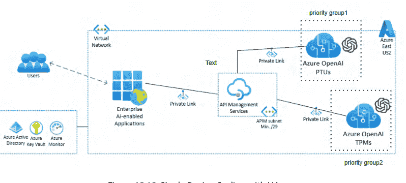

图 12.18：单区域 HA 扩展

有时，客户在使用 AOAI 的业务应用程序除了高可用（HA）还需要灾难恢复（DR）解决方案。在这种情况下，建议跨区域部署 AOAI PTU 和 PAUG 实例。根据各自的区域将特定的 AOAI 资源分配到不同的优先级组。以下是此类设置的架构。

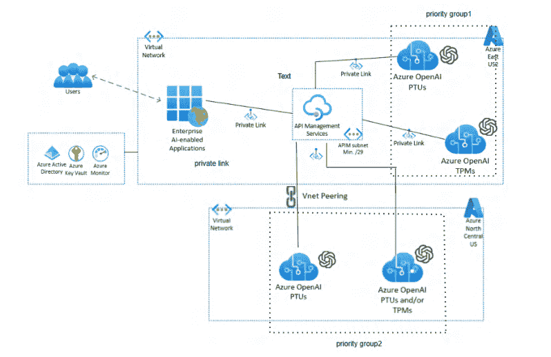

图 12.19：多区域 HA 与 DR 扩展

## 286 Azure OpenAI 的运营

在提供的参考架构中，重点是主备 DR 策略，其中只有主区域的优先级 1 组处于激活状态。当该区域发生故障时，备区域的优先级 2 组将变为激活状态。然而，对于更主动的双活 DR 配置，可以将两个区域的 PTU 实例都指定为优先级组 1，并将 PAUG 实例分配到优先级组 2。这种配置确保了 PTU 得到有效利用，同时由 PAUG 实例处理任何额外的分流流量。

## 总结

本章涵盖了 AOAI 的关键方面，包括监控各种指标，如 API 调用次数、延迟、prompt token 总和以及 completion token 总和等。此外，还讨论了 AOAI 资源配额，概述了不同资源之间的限制以及如何有效管理和分配配额。此外，本章深入探讨了 AOAI 的预留实例概念——PTU，这对于任何生产工作负载至关重要。最后，它探索了如何使用多个端点扩展 AOAI，以及高可用（HA）和灾难备（DR）策略，这些都是构建企业级生成式 AI 的核心组件。

在接下来的章节中，我们将讨论 prompt 工程的概念，这是开发和优化生成式 AI 模型的重要基石。prompt 工程涵盖了多种技术，旨在精炼和定制提供给这些模型的 prompt 输入，从而影响其生成输出的质量、贯性和相关性。在整个章节中，我们将探索 prompt 工程中最流行的技术和具有影响力的策略。通过深入研究这些技术，我们旨在为您提供全面的见解和实用知识，这些对于在各种应用和领域中有效利用生成式 AI 模型的能力关重要。

## 13
