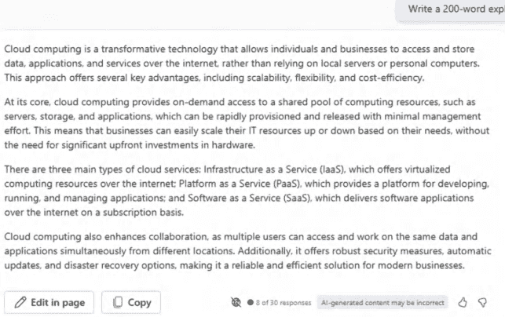
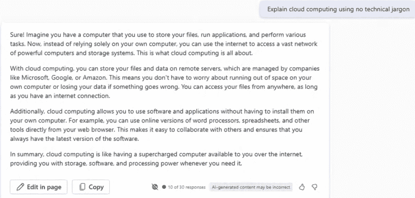

## 高级 prompt 工程

在上一章中，我们涵盖了 Azure OpenAI (AOAI) 运营的关键方面，重点关注监控 API 调用量、延迟和 token 使用等关键指标以优化性能。我们还讨论了 AOAI 资源配额，强调了管理和分配配额的策略。此外，本章引入了生产吞吐量单元（PTU）的概念，这是处理生产工作负载至关重要的预留实例。为了构建具有韧性的 AI 应用，我们探索了使用多个端点结合高可用（HA）和灾难备恢复（DR）策略来扩展 AOAI。

到为止，我们探索了生成式 AI 可以简化工作流的各种场景，并研究了如何优化模型以增强其性能和可靠性。在本章中，我们将深入研究 prompt 工程——一种允许我们有效塑造 AI 响应行为和质量的关键技能。

学习 prompt 工程是至关重要的，因为我们表述 prompt 的方式会影响输出的相关性、创造性和清晰度。例如，使用一个通用的 prompt 如“总结这篇文章”让模型总结文章，可能会得到一个宽泛的回答，如“文章讨论了风能和太阳能等能源”。然而，将其改写得更具体，例如“总结这篇文章，重点关注可再生能源在发展中国家的经济效益”，将产生针对性的输出，如“文章强调了可再生能源如何通过减少对进口燃料的依赖，在发展中国家降低成本并创造就业机会”。这表明 prompt 如何有效地定制响应以满足特定需求。通过掌握这些技术，你将释放生成式 AI 的全部潜力，使其不仅成为强大的自动化工具，还成为解决复杂任务的协作伙伴。

在本章中，我们将涵盖以下主要主题：

- 什么是 prompt 工程？
- Prompt 元素
- Prompt 策略
- Prompt 技巧

## 什么是 prompt 工程？

- prompt 工程对比微调
- 优化 LLM 准确性
- LLM 中的 prompt 注入攻击

prompt 工程是一种用于引导大语言模型 (LLM) 的响应指向特定结果的方法，而无需修改模型的权重或参数。相反，它完全依赖于精心设计的上下文提示（prompt）来达到所需的结果。本质上，它是与 AI 进行有效通信，以提取你想要的信息或行为。

这种技术对于增强 LLM 和视觉语言模型 (VLM) 的能力至关重要。通过使用特定任务的指令（即 prompt），它在不改变模型核心参数的情况下提高了模型性能。prompt 通过通过提供的提示词驱动模型行为，使模型能够无缝集成到各种下游任务中。

prompt 工程是一个相对较新的领域，专注于开发和优化 prompt，以便在广泛的应用和研究领域中高效利用语言模型。精通 prompt 工程有助于理解 LLM 的优势和局限性。研究人员利用 prompt 工程来提升 LLM 在从回答问题到解决算术题等各种多样任务上的表现。开发者则利用这种技术设计稳健且有效的 prompt，与 LLM 及其他工具进行交互。

然而，prompt 工程不仅仅是编写和开发 prompt。它涵盖了与 LLM 交互和开发至关重要的各种技能和技术。它是与 LLM 接口、在其基础上构建以及理解其能力的关键技能。此外，prompt 工程可增强 LLM 的安全性并开发新功能，例如将领域知识和外部工具集成到 LLM 中。

prompt 工程的一个重要方面是理解用户提示（user prompt）和系统提示（system prompt）的角色，这些角色会显著影响 LLM 的行为和输出。系统角色设定了模型的整体基调和行为，例如将其定义为乐于助人的助手（例如，“你是一个提供支持的导师或特定领域的专家（例如‘你是一个根据当前市场趋势提供投资建议的财务顾问’”）。另一方面，用户角色是终端用户提供的直接输入，例如问题或任务（例如，“用例子解释复利”）。这些角色在定义良好的当时，可以极大地影响生成的响应的质量和相关性。即使一些现代模型在演进过程中尽量减少或消除这些角色之间的显式区分，理解它们的影响对于优化 LLM 交互仍然至关重要。

现在我们理解了什么是 prompt 工程，让我们讨论 prompt 的关键元素。

## Prompt 元素

Prompt 元素是用于引导和构建 AI 系统响应的关键组件，能够生成特定的或所需的输出。这些元素可以应用于各种语境，从编程 AI 到起草写作任务。虽然这些元素没有通用标准，且并非每个 prompt 都包含它们，但各种资源的共识确定了七个要素。理解并利用这些元素可以有效地塑造 AI 的输出，增强其相关性和质量。

在构建 prompt 时，有几个关键元素塑造 AI 的输出。每个元素在引导响应方面都起到特定作用，理解使用或不使用这些元素至关重要。让我们逐一探索这些元素，并说明它们的存在与否如何影响结果。（你在 Microsoft Copilot 中看到的截图，它内部使用 ChatGPT。）

## 上下文或场景

此元素的主要目的是为任务设定场景或背景，让 AI 对设定或目的有清晰的。让我们看看如何在 prompt 中实现这一点：

- 没有上下文：“解释云计算”

## 高级提示词工程

- **带有上下文：** “想象你正在为小企业主撰写一篇关于云计算的博客文章。”

好的，这里有一篇为小企业定制的关于云计算的博客文章：

# 为小企业解锁云计算的力量

在当今快速发展的数字世界中，小企业需要保持敏捷和竞争优势。实现这一目标的最有效方法之一就是利用云计算。但云计算究竟是什么？它能如何为你的小企业带来收益呢？让我们深入探索一下。

## 什么是云计算？

云计算是一种允许你通过互联网访问数据和应用程序的技术，而不是在本地计算机或服务器上。将其想象为租赁一个虚拟办公空间，你可以在那里存储所有重要文档和工具，并随时随地从任何地方访问它们。

## 为什么小企业应该考虑云计算？

1. **成本效益：** 云计算的优势之一是其成本效益。你不需要投资昂贵的硬件和软件，而是根据订阅模式按需付费。这意味着更低的预付成本和可预测的每月支出。

2. **可扩展性：** 随着业务的增长，需求也会之增长。云计算允许你根据需求轻松扩大或缩小规模。无论你需要更多存储空间、处理能力还是额外的服务，都可以毫无压力地调整资源。

如你所见，没有上下文的回复会更加通用且缺乏特定的方向。有了上下文，回复会变得更有针对性，并为特定受众（小企业主）定制，从而影响语气和复杂程度。

## 指令 (Instructions)

该元素的主要目的是为 AI 应该应该做什么或生成什么提供清晰的指导，形成提示词的骨干，例所示：

- **没有指令：** “云计算”（这会给出与第一个元素类似的回复）

- **带有指令：** “写一段 200 字关于云计算的解释。”

云计算是一项变革性技术，它允许个人和企业通过互联网访问和存储数据、应用程序和服务，而不是依赖本地服务器或个人计算机。这种方法提供了许多优势，包括可扩展性、灵活性和成本效益。

云计算提供了对共享计算资源池的按需访问，例如服务器、存储和应用程序，这些资源可以以最少的管理工作快速配置和释放。这意味着企业可以根据需要轻松扩大或缩小 IT 资源，而无需对硬件进行大量的预付投资。

云服务主要有三种类型：基础设施即服务 (IaaS)，在互联网上提供虚拟化计算资源；平台即服务 (PaaS)，提供用于开发和运行应用程序的平台；以及软件即服务 (SaaS)，以订阅方式在互联网上交付软件应用程序。

云计算还增强了协作，因为多个用户可以从不同的位置同时访问并处理相同的数据和应用程序。此外，它提供了稳健的安全措施、更新和灾难恢复选项，成为现代企业可靠且高效的解决方案。

图 13.3：带有指令的回复

当提供指令时，回复将遵循特定的准则（例如 200 字）。如果没有指令，AI 可能会产生过短、过长或重点模糊回复。

## 约束 (Constraints)

这些定义了限制，如语气、长度或必须包含的特定词汇，缩小了回复的范围。让我们来看一个例子：

- **没有约束：** “解释云计算。”（这给出与第一个元素类似的回复。）

- **带有约束：** “使用非技术术语解释云计算”

## 高级提示词工程

当然！想象你有一台计算机，可以在其中存储文件、运行应用程序并执行各种任务。现在，你不再依赖于自己的计算机，而是可以使用互联网访问庞大的计算机和存储系统网络。这就是云计算的本质。

通过云计算，你可以将文件和数据存储在远程服务器上，这些服务器由微软、谷歌或亚马逊等公司管理。这意味着你不需要担心自己计算机空间用尽，也不会在出现问题时丢失数据。只要有互联网连接，你就可以从任何地方访问你的文件。

此外，云计算允许你使用软件和应用程序，而无需在自己的计算机上安装它们。例如，你可以直接从网络浏览器使用文字处理器、电子表格和其他工具的在线版本。这使得协作变得容易，并确保你始终拥有最新版本的软件。

总而言之，云计算就像是随时随地在互联网上供你的超级计算机。

图 13.4：带有约束的回复

约束确保输出符合特定的语气或格式。如果没有约束，AI 可能会产生不符合受众的语言回复，或者以段落而非总结的形式呈现。

## 变量或输入 (Variables or inputs)

这些指定了需要包含的数据点或占位符。例如：

- **没有变量：** “解释云计算。”（这给出与第一个元素类似的回复。）

- **带有变量：** “在解释中使用‘Azure’和‘成本效益’”

> 

当然！想象你有一台计算机，可以在其中存储文件、运行应用程序并执行各种任务。现在，你不再依赖于自己的计算机，而是可以使用互联网访问庞大的计算机和存储系统网络。这就是云计算的本质。

通过云计算，你可以将文件和数据存储在远程服务器上，这些服务器由微软、谷歌或亚马逊等公司管理。这意味着你不需要担心自己计算机空间用尽，也不会在出现问题时丢失数据。只要有互联网连接，你就可以从任何地方访问你的文件。

此外，云计算允许你使用软件和应用程序，而无需在自己的计算机上安装它们。例如，你可以直接从网络浏览器使用文字处理器、电子表格和其他工具的在线版本。这使得协作变得容易，并确保你始终拥有最新版本的软件。

Azure 等云服务最大的优势之一是它们具有成本效益的。你只需为你使用的资源付费，这意味着与构建和维护自己的硬件相比可以节省资金。这使得云计算成为所有规模企业的经济型且灵活的解决方案。

图 13.5：带有变量的图

使用变量确保关键信息或概念被包含。如果没有它们，细节可能会遗漏，导致回复不完整或不相关。

## 预期输出 (Desired output)

这指定了预期的回复格式或类型，引导模型相应调整，如下：

- **没有预期输出：** “解释云计算。”（这给出与第一个元素类似的回复。）

- **带有预期输出：** “为云计算生成一个简洁的要点总结。”

图 13.6：带有预期输出的图

指定预期输出可以确保回复符合目标格式（例如要点）。如果没有它，AI 可能会产生不符合用户需求或预期的回复，例如以段落而非总结。

## 语气或风格 (Tone or style)

这指示了回复听起来如何，影响语言、正式程度和整体风格。让我们来看一个例子：

- **没有语气或风格：** “解释云计算。”（这给出与第一个元素类似的回复。）

- **带有语气或风格：** “用友好的方式解释云计算

## 高级提示词工程

用友好、对话式的口调解释云计算

图 13.7：带有语气或风格的图

当定义了语气时，AI 会调整语言以匹配所需的情绪。如果不指定语气，AI 可能会提供更中立或正式的回答，这可能不符合上下文或受众。

## 示例和模板

这些提供了示例响应，以说明预期的输出格式或类型，为 AI 提供了遵循的模型。让我们看看如何使用这些：

- *没有示例或模板*：“解释云计算。”（这给出的响应与第一个元素相似。）

- 带有示例或模板：“这里有一个例子：云计算允许你将数据存储在他人的服务器上，而不是自己的服务器上。现在，写一个类似的解释”

图 13.8：带有示例的图

示例和模板引导响应的结构和语气。没有它们，AI 可能会生成不遵循特定格式或风格的响应，可能导致输出过于通用或偏离目标。

将这些元素整合到提示词中，可以确保 AI 提供定制的、聚焦且符合预期结果的响应。如果没有这些元素，响应可能会变得模糊、通用或误导。通过提供上下文、指令、限制条件、变量、预期输出、语气和示例，你本质上是在塑造 AI 的理解，并引导它产生特定的、相关的且高质量的回答。

然而，通常最好将指令放在最后，以确保模型专注于执行任务，而不是扩展内容。随着提示词工程领域的不断演进，这些原则为编写高效的提示词提供了坚实的基础。

在了解了提示词的要素后，让我们现在探索设计高效提示词的不同策略。这些策略将帮助你结合这些元素，从 AI 处获得更相关、更准确的响应。

## 提示词策略

提示词策略是指编写请求或指令的技巧或方法，使其从 AI 模型（如语言模型）激发特定或预期的响应。这些策略旨在引导 AI 的输出根据用户需求变得更相关、准确或更有用。它们具有以下几个核心作用：

- **增强准确性**：通过巧妙地构建提示词，你可以鼓励 AI 产生更精确、更相关的响应。

- **增加特定性**：定制提示词可以帮助你获得更详细、更具体的答案，最大限度地减少模糊性或无关信息。

- **激发创造力**：在需要创造力的任务中，这些策略可以引导 AI 探索非传统的想法，或关注特定的风格和格式。

- **提高效率**：精心设计的提示词可以减少多次迭代的需求并减少错误，节省实现所需结果的时间。

让我们深入研究六种关键策略，以增强你与语言模型的交互：

- 提供精确且清晰的指令

- 利用参考材料

- 将复杂任务分解为可操作的步骤

- 允许模型处理或“思考”

- 利用外部工具以增强能力

- 系统地测试并衡量变化的影响

在上一节中，我提供了每个提示词结果的截图来证明它们的有效性。然而，对于接下来列出的策略，我不建议提供截图，而是鼓励你亲自去探索它们。打开任何 LLM 应用（例如 ChatGPT、Microsoft Copilot 或 Azure OpenAI Playground），并尝试实验提供的提示词示例。尽管混合组合不同的策略，以观察它们如何影响输出。这种通过上手的方法将帮助你更好地理解提示词工程的细微差别，并发现针对你的特定用例优化结果的方法。

让我们深入每种策略，并检查具体的技巧以更有效地处理它们。

## 编写清晰的指令

语言模型虽然强大但不直观。为了获得理想的结果，你必须明确你的期望。如果模型的回答太长，请要求简洁的回答。如果它们缺乏深度，请请求更详细或专家级的内容。清晰的指令可以减少猜测，增加获得更准确响应的概率。我们将查看一些帮助你编写清晰指令的技巧：

- **在查询中包含细节**：

  包含特定细节可确保响应与你的需求相关。

  这里有一个例子：

  > 好的：“总结云计算的主要优势，特别是对小企业的优势。”

  > 坏的告诉我关于云计算的知识。”

- **要求模型采用特定角色**：

  通过定义目标受众来定制模型的响应，可以确保解释符合所需的语气和复杂度。

  这里有一个例子：

  > 好的：“就像你在教一个没有 IT 经验的初学者一样解释 Kubernetes。”

  > 坏：“解释 Kubernetes。”

- **使用分隔符指示输入的的不同部分**：

  将输入分为清晰的章节可以防止信息混合在一起，确保结构化的响应。

  这里有一个例子：

  **好**：“写一段 AI 的介绍。然后，解释它对医疗保健的影响。”

  **坏**：“谈谈医疗保健。”

- **指定完成任务的步骤**：

  将任务分解为可操作的步骤使输出更具实用性。

  这里有一个例子：

  **好**：“概述在 Azure 上部署 Node.js 应用的步骤，从设置到部署。”

  **坏**：“如何部署应用？”

- **提供示例**：

  提供示例可以为模型提供上下文，从而提高响应质量。

  这里有一个例子：

  **好**：“DevOps 集成了开发和 IT 团队以简化部署。”

  **坏**：“什么是 DevOps？”

- **指定输出长度**：

  通过指定字数，你可以确保响应简洁明了。

  这里有一个例子：

  **好**：“用 50 字解释云存储。”

  **坏：“解释云存储。”

## 提供参考文本

语言模型有时会生成错误或虚假的答案，特别是对于冷门话题。提供参考文本可以通过事实提高响应的可靠性。这里是一些技巧：

- **指示模型使用参考文本回答**：

  引导模型参考来源可以确保响应是准确且相关的。

  这里有一个例子：

  **好**：“使用此 Azure 文 [link]，解释 Azure Policy 如何实施治理。”

  **坏：“Azure Policy 如何实施治理？”

- **指示模型使用参考文本中的引用**：

  要求引用可以通过回溯到可验证的来源来增加响应的可信度。

  这里有一个例子：

  **好**：“根据提供的论文，总结 AI 的伦理挑战并引用相关章节。”

  **坏**：“AI 有哪些伦理挑战？”

## 将复杂任务拆分为更简单的任务

将任务分解为更小、易管理的步骤可以减少错误并增加结果的清晰度。复杂任务通常可以结构化为序列，一个子任务的输出作为下一个任务的输入。让我们来看一些技巧：

- **使用意图分类识别相关指令**：

  划分任务更容易专注于每一个具体的步骤，从而获得更好的结果。

  这里有一个例子：

  **好**：“将设置 CI/CD 流水线的过程拆分为不同的阶段：开发、测试和部署。”

  **坏：“解释如何设置 CI/CD 流水线。”

- **在长对话中对之前的对话进行总结或过滤**：

  对冗长的对话进行总结有助于保持上下文，而不会让模型过载。

  这里有一个例子：

  **好**：“在继续之前，总结一下我们关于云迁移的对话的第一部分。”

  **坏：“继续讨论云迁移。”

- **分章节总结长文档**：

  分章节总结可以确保不会在长文档中遗忽略重要细节。

  这里有一个例子：

  **好**：“总结这篇论文的第 1-3 章，然后总结第 4-6 章。”

  **坏：“总结整篇论文。”

## 给模型留出思考时间

鼓励模型采取分步进行的方法可以提高准确性，特别是在涉及推理的任务中。这类似于人类在回答复杂问题之前可能会停顿进行计算或反思。以下是一些技巧：

- 指令模型推导出它自己的解决方案：

通过遍历每一个步骤，模型有更大的机会提供正确答案。

这里有一个示例：

**好的：** “请列出计算 25 x 17 的步骤，然后给出最终答案。”

**不好的：** “25 x 17 是多少？”

- 使用“内心独白”对推理进行反思：

鼓励模型在回答之前进行内部反思，以确保回答更具深思熟虑。

这里有一个示例：

**好的：** “大声思考出来：你会采取哪些步骤来评估 API 的安全性？”

**不好的：** “你如何评估 API 安全性？”

- 询问模型是否遗漏了任何内容：

提示模型检查其答案可以增加获得全面回答的概率。

这里有一个示例：

**好的：** “在列出无服务器架构的优势之后，检查是否遗漏了关键点。”

**不好的：** “无服务器架构的优势是什么？”

## 使用外部工具

为了弥补语言的局限性，你可以通过提供来自其他工具的数据来增强其能力。外部工具可以协助计算、文档检索或其他专门功能，例如这些示例：

- 使用基于嵌入的搜索进行高效知识检索：

使用外部工具可以确保响应是最新且准确的。

这里有一个示例：

**好的：** “使用文档检索系统搜索 Azure 安全最佳实践的最新更新。”

**不好的：** “Azure 安全的最新更新是什么？”

- 使用代码执行进行计算：

将复杂的计算外载给外部工具不仅提高了精确度，还减少了语言模型本身的计算负载。这种策略允许模型专注于其擅长的领域（例如推理和语言生成），将更适合专门工具的任务委托出去。良好的提示词显式地引导系统利用外部资源进行计算，确保了准确性和效率。这种方法对于需要高精度或特定领域计算的任务特别有用，让语言模型保持响应能力和可靠性。

这里有一个示例：

**好的：** “使用代码执行工具计算在 Azure Blob Storage 上存储 500 GB 数据的月成本。”

**不好的：** “在 Azure 上存储 500 GB 需要多少费用？”

- 给模型访问特定函数的权限：

使用外部 API 允许进行实时、准确的数据检索。

这里有一个示例：

**好的：** “访问 API 获取最新的天气数据并进行总结。”

**不好的：** “今天天气如何？”

## 系统地测试更改

为了提高模型的性能，系统地测试对提示词（prompt）的更改至关重要。根据全面的标准对结果进行评估可以确保一致性并避免意外的性能下降。让我们来看一种技巧：

- 根据金标准答案评估模型输出：

使用大型数据集进行系统化测试可以确保提示词是稳健且具有通用性的。

这里有一个示例：

**好的：** “在 20 个不同的用例测试此提示词，将响应与预定义的正确答案进行比较。”

**不好的：** “测试此提示词是否有效。”

在理解提示策略时，可以明显看出精心设计的输入如何塑造 LLM 的行为，在功能性和安全性之间取得平衡。随着我们的进展，让我们探索利用这些策略的特定技巧，深入研究其实应用和潜在风险。

## 提示技巧

提示技巧是用于结构化或表述你的输入（提示词）的策略，旨在引导语言模型（如 GPT）提供更准确、相关且实用的回答。这些技巧至关重要，因为你提问或指示模型的方式决定了输出的质量。

以下是一些常见的提示技巧。

### 零样本提示 (Zero-shot prompting)

零样本提示是一种用于 LLM 的技术，要求模型在没有针对该任务的任何特定训练或示例的情况下执行任务。相反，模型依靠其预有的知识和通用语言理解能力来生成响应。通过直接给出任务或问题，零样本提示利用了模型在通用训练期间学到的模式来应对新任务。虽然这种方法可以产生准确的结果，但如果模型缺乏明确预期输出格式的示例，有时会面临挑战。

在这个示例中，我们希望模型将餐厅评论分类为正面或负面：

- 提示词：“食物毫无滋味且冰冷。”

- 输出：模型可能由于缺乏上下文或示例而错误地分类（例如，说评论是正面的）

- 提示词：“对这条评论的情绪分类：‘食物毫无滋味且冰冷。’”

- 输出：模型尝试根据通用知识对评论进行分类，但如果没有示例，准确性可能较低（例如，取决于训练，它可能是正面或负面）

零样本提示的一些优势如下：

- 无需示例：这种方法不需要准备示例，实施快速。

- 任务灵活性：模型可以尝试各种任务，即使这些任务是新的或不熟悉的。

一些实际应用如下：

- 文本分类：将产品评论分类为正面或负面，将电子邮件分类为“垃圾邮件”或“非垃圾邮件”，或按紧急程度组织支持工单

- 问答：回答关于通用主题的查询，例如“法国的首都是哪里？”或为技术术语提供定义

- 翻译任务：在没有先接触的情况下将“你好，你好吗？”等简单短语翻译成另一种语言

- 摘要：将新闻文章浓缩为简短摘要，例如将一份关于气候变化的 500 字报告总结为一句话。

通过利用零样本提示，用户可以用最少的设置探索广泛的任务，展示了 LLM 在不同场景下的适应性和实用性。然而，重要的是，虽然零样本提示具有高度通用性，但与少样本提示相比，它更容易出现错误。少样本提示通过为模型提供示例，可以显著增强输出的关联性和准确性，使其成为更复杂或敏感任务的首选方案。我们将在下一部分深入探讨少样本提示，探索其优势和策略。

### 少样本提示 (Few-shot prompting)

少样本提示是一种用于 LLM 的策略，涉及向模型提供一小组示例以引导其生成准确的回答，允许在不需要对大量数据集进行重新训练或微调的情况下进行上下文学习。这种方法涉及在提示词中包含几个代表性的输入-输出对，帮助模型理解如何处理它可能难以应对相似的任务。通过利用这种上下文学习能力，少样本提示通过有限数量的示例建立模式，使模型能够在回答查询时应用学到的结构。

假设你希望模型将餐厅评论分类为正面或负面：

- 无少样本提示：

- 提示词：“食物毫无滋味且冰冷。”

- 输出：正面（错误）

- 有少样本提示：

- 提示词：

“示例 1：‘服务太棒了！’ -> 正面

示例 2：‘我不推荐这个地方。’ -> 负面

对这条评论的情绪分类：‘食物毫无滋味且冰冷。’”

- 输出：负面（正确）

在这种情况下，包含两个先前的示例显著提高了模型的理解能力，导致了更准确的分类。

以下是少样本提示（few-shot prompting）的某些优势：

- **增强性能**：通过提供示例，可以最大限度地减少歧义，帮助模型更好地理解上下文并提供相关的答案。

- **快速适应**：模型仅需使用几个示例即可快速适应新任务，这使其在不同应用中具有极高的通用性。

- **无需大量的微调**：不需要进行大规模训练，因为提示词中的示例充当了某种微训练的形式。

以下是一些实际应用：

- **文本分类**：通过提供几个分类示例来对文本进行分类，例如检测邮件是否为垃圾邮件。

- **翻译**：提供示例翻译，可以帮助模型准确地翻译新句子。

- **摘要生成**：演示如何总结文章，使模型能够在未来的摘要中复制该格式。

- **问答系统**：格式化问题和答案，以引导模型为用户的查询生成相关的答案。

少样本提示是让大语言模型（LLMs）适应新挑战的一种非常有效的手段，使其能够以极少的输入生成更精确、更符合上下文的响应。

## 思维链提示 (CoT)

思维链（Chain-of-thought，CoT）提示是增强大语言模型推理能力的有效方法。CoT 不让模型直接生成答案，而是鼓励它解释得出解决方案所需的涉及的步骤。这反映了人类处理复杂问题的方式，即将其拆解为易于管理的组件。

CoT提示本质上是引导模型通过逐步解决问题来“大声思考”，从而得出更清晰、更准确的答案。这种技术对于需要多步推理的任务（如逻辑谜题或计算）特别有用，并能增强模型避免错误的能力。

与其期望一个即时输出，不如提示模型解释解决方案的每个阶段。这一过程通过引导模型完成准确回答所需的推理步骤，降低了错误发生的概率。

比方说，你正在解决一个涉及识别质数的问题。

以下是一个没有使用 CoT 提示的示例：

- 提示词：“29 是质数吗？”

- 输出：是的。

这里是使用 CoT 提示的示例：

- 提示词：“29 是质数吗？请说明推理过程以确定答案。”

- 输出：要确定 29 是否为质数，需要检查它是否能被 1 和自身以外的任何数字整除。从较小的质数开始测试：2、3、5。这些数中没有一个能整除 29 的。因此，29 是质数。

通过提示模型执行每一步操作，它避免了捷径，并提供了逻辑严密的解释，增加了对答案的信赖。

CoT 提示的益处如下：

- **提高准确性**：引导模型通过一个过程有助于防止推理错误，尤其是在复杂任务中。

- **更好的问题解决能力**：这种技术分步执行的特性非常适用于需要逻辑推演的场景，例如数学题或谜题。

- **增加透明度**：这种方法让用户更清楚地理解模型是如何得出结论的，从而增强了对输出的信任。

在处理可能因跳过中间步骤产生错误答案的任务时，CoT 提示非常有价值。它对于技术领域的用户特别有用，例如软件开发、调试、数学运算和逻辑推理在这些领域是核心：

- **数学与计算**：将多步方程拆解为更小、更容易处理的部分。

- **逻辑推理与谜题**：演练谜题或逻辑问题的步骤，以确保获得准确的解决方案。

- **代码调试**：通过要求模型拆解代码的每个部分，可以轻松识别错误。

- **语言翻译**：通过带有中间解释的翻译复杂句子，确保最终翻译更准确。

CoT 提示增强了大语言模型在涉及推理和多步过程任务中的可靠性，使其成为用户在挑战性场景下寻求高质量输出的强大工具。

## 思维树 (Tree of Thoughts)

