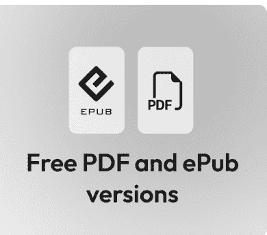
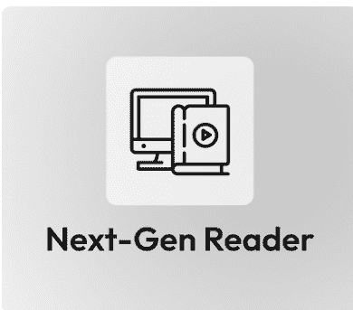

# Microsoft Power Automate 工作流自动化

献给每一位希望技术能再多提供一点点帮助的人。

# 贡献者

# 关于作者

**Aaron Guilmette** 是一位技术副总裁，利用现代身份识别和生产力解决方案引导国防工业基础进入 21 世纪。此前，他是微软客户体验高级计划经理，帮助客户采用 Microsoft 365 平台。他主要关注协作和自动化技术，包括 Microsoft Teams、Exchange Online、Power Automate 和 Entra ID。Aaron 住在密歇根州底特律，带着五个孩子。当他不忙于解决技术问题、在中西部地区赛车、写作或教他的孩子在高峰交通中驾驶的“黑艺术”时，他正在制作墨西哥饼。你可以访问 Aaron 的博客：https://aka.ms/aaronblog 或在 LinkedIn 上（https://www.linkedin.com/in/aaronguilmette）与他联系。

*本书献给我的孩子们，他们教会了我在编程和育儿中错误处理都是至关重要的——同时也献给我的女朋友 Megan，她证明了“需要人工干预”并不总是一件坏事。*

# 关于评审员

Steve Miles 是微软 MVP、MCT 和作者，在安全、网络、计算、数据和 AI 基础设施方面拥有超过 25 年的经验。他在一家领先的欧洲多云分销商担任高级技术赋能职位，以通过清晰的类比和白板叙述故事来简化复杂技术而闻名。自 1999 年获得首个 Windows NT 微软认证以来，他获得了各个层级的 Azure、安全、数据、AI 和 M365 认证，以及主流云平台的厂商认证。Steve 曾与 Packt 合作编写并技术评审了 10 多本关于微软的书。

你可以在 LinkedIn 上找到他：`linkedin.com/in/stemiles7`

Benedikt Bergmann 是 CRMK Deutschland 的 CEO，居住在德国法兰克福附近。2017 年至 2024 年间，他与妻子家人住在瑞典斯德哥尔摩。期间，他在斯德哥尔摩的 CRM Konsulterna 担任 5 年的解决方案架构师和开发者。

Benedikt 的背景是 .NET 开发者，带有一些前端元素。自 2014 年以来，他一直在 Dynamics 和 Dataverse 中工作，现在实施基于 Dynamics 和 Power Platform 的解决方案。Benedikt 通过他的博客、YouTube 频道和演讲积极与社区分享他的知识。他是 Power Platform 应用生命周期管理领域的领先负责人之一，也是关于该主题的首批专业级书籍之一的作者。2021 年初，Benedikt 被评为微软业务应用领域最有价值专业人士（MVP）。

## 前言

曾有那么一段时间，“自动化”意味着编写一个只在你笔记本电脑上运行、每个周五都会崩溃、并要求你在别人察觉之前修复它的脚本。坦率地说，那些日子（大多）已经结束了。自本书上一版出版以来，Microsoft Power Automate 一直在进化。它已经从仅仅是生产力的“胶胶带”（只是更智能、更干净且粘性稍小一点），转变为一种可以用于简化你的业务和日常任务的工具。

这本《使用 Microsoft Power Automate 实现流自动化》第三版更进了一步。机器人流程自动化（RPA）让你能够自动化以前无法自动化的内容——那些拒绝退役的老应用程序以及自 2003 年以来一直存在的屏幕。Copilot 现在可以让你仅通过用简单的英语解释你的需求，就能帮助你构建流，这意味着你终于可以停止与语法争斗了（再次，大多是如此）。而且通过访问平台内置的 AI 工具和模型，你的自动化流程分析、预测和响应速度将比你让 ChatGPT 吐出燕麦片的速度快得多。

你将发现上一版中熟悉的基础：如何连接云端和本地系统、简化重复性工作，并夺回你捐献给手动任务的时间。但这次，我们将以更智能、更有个性的方式来实现。希望你在这个过程中能学到一些关于低代码自动化和 AI 如何让一切变得更简单的点子。

## 本书适用读者

本书适用于任何曾想过“一定有更好的方法来这样做”的人。如果你是 Microsoft Power Platform 的新手——无论是 Power Automate、Power Apps 还是 Power BI——你都来对地方了。你不需要知道如何编码、构建企业系统或精通技术术语。你只需要健康的好奇心，也许是对重复性工作的轻微挫败感，来激励你寻找新方法。

前言

我们将从基础知识开始：简单、实用的任务将教你平台各个部分是如何工作的。从那里开始，你可以直接学习更复杂的技能，甚至可能获得一些如何开始解决你当前问题的灵感。在此过程中，你将构建真实的流——你可以导出、使用并向他人展示你的成果的东西。

到最后，你将看到 Power Platform 如何将常规工作变得更智能、更快速，并且（我们敢说吗？）有点趣。

## 本书涵盖内容

第 1 章：介绍 Microsoft Power Automate，介绍了流和自动化的基本概念。

第 2 章：入门 Power Automate，深入研究 Power Automate 界面和应用程序组件。

第 3 章：处理电子邮件，解释如何配置 Power Automate 以处理和交互电子邮件及附件。

第 4 章：复制文件，探索如何使用 Power Automate 在基于云的服务之间复制文件。

第 5 章：创建按钮流，演示了如何使用按钮流（也称为手动或即时流），并展示了如何从移动设备执行它们。

第 6 章：生成推送通知，解释了如何配置带有移动设备推送通知的流。

第 7 章：处理共享流，涵盖了如何与同事共享和共同管理流。

第 8 章：使用条件，解释了如何根据标准评估为流启用多种输出结果。

第 9 章：理解表达式和函数，描述了函数和表达式等更复杂组件的概念。

第 10 章：开始审批，讨论了如何使用审批流处理文档。

第 11 章：处理多个审批，在上一章获取的知识基础上，使用条件、分支和顺序审批对其进行扩展。

第 12 章：向 Teams 发布审批，演示了如何将审批工作流集成到 Microsoft Teams。

第 13 章：使用数据库，涵盖了连接数据库并将其作为流的一部分来存储或检索信息。

第 14 章：处理 Microsoft Forms，演示了如何使用 Power Automate 处理来自 Microsoft Forms 的响应。

第 15 章：发布到 Slack，涵盖了使用 Power Automate 连接 Slack 和 Teams。

第 16 章：接受用户输入，探索了配置按钮流以接受各种用户输入类型。

第 17 章：自动化 Entra ID，介绍了用于 Microsoft Graph 和 Entra ID 的连接器。

第 18 章：介绍机器人流程自动化，讨论了捕捉屏幕、键盘和鼠标数据。

第 19 章：通过 RPA 向 Access 数据库贡献，解释了如何使用 Power Automate Desktop 在 Microsoft Access 中进行数据输入。

第 20 章：使用 RPA 自动化网页，演示了通过屏幕抓取和屏幕捕捉实现网页自动的概念。

第 21 章：介绍 AI 模型和生成式 AI，介绍了 Power Platform 的 AI Builder 组件以及生成式 AI 能力。

第 22 章：创建情感分析流，探索了如何使用情感 AI Builder 模型将文本评估为积极、中性或负面情感并并此采取行动。

第 24 章：使用生成式 AI 总结文档，通过使用 OpenAI 工具处理文档并根据上传的文件生成文档摘要。

第 25 章：导出、导入和分发流，展示了如何在环境之间移动流。

第 26 章：流监控与故障排除，包含了在出现问题时的故障排除技巧。

第 27 章：Power Platform 中的治理，介绍了使用卓越中心和数据防泄露（DLP）实施的一些安全和治理控制。

第 23 章：使用 Copilot 创建和管理流，涵盖了部分新的 Copilot 功能。

# 如何充分利用本书

为了充分利用本书的内容，您应该拥有 Microsoft 365 订阅，并可以访问高级 Power Automate 计划，以启用高级连接器、AI 模型和**机器人流程自动化**（RPA）。

您还应该拥有一台连接了网络的计算机，并使用现代浏览器（如 Microsoft Edge 或 Google Chrome）。您可以从 https://www.microsoft.com/en-us/microsoft-365/try 获取免费的 Microsoft 365 订阅。

# 下载示例文件

本书的代码包托管在 GitHub 上，地址为 https://github.com/PacktPublishing/Workflow-Automation-with-Microsoft-Power-Automate-Third-Edition。我们还在丰富的书籍和视频目录中提供了其他代码包，您可以在 https://github.com/PacktPublishing 找到它们。快去看看吧！

# 下载彩色图像

我们还提供了一个 PDF 文件，其中包含了书中用到的截图/图表的彩色图像。您可以在此处下载：https://packt.link/gbp/9781836649632。

# 使用的规范

本书中使用了多种文本规范。

`CodeInText`：表示文本中的代码词、数据库表名、文件夹名、文件名、扩展名、路径名、虚拟 URL、用户输入以及 X/Twitter 账号。例如：“在 **Search connectors and actions** 框中，输入 SharePoint Create new **folder** 并选择 **Create new folder** SharePoint 操作。”

代码块设置如下：

```
if [condition equals true], then [do action];else [do other action]
```

## 前言

**粗体：**表示一个新术语

> 警告或重要注释显示如下所示。

> 提示和技巧如下所示。

# 与我们联系

我们随时欢迎读者的反馈。

**一般反馈：** 如果您对本书的任何方面有疑问或有任何一般反馈，请发送电子邮件至 `customer@packt.com` 联系我们，并在邮件主题中注明书名。

**勘误：** 尽管我们尽力确保内容的准确性，但错误仍然不可避免的。如果您在书中发现错误，请向我们报告，我们将不胜感激。请访问 http://www.packt.com/submit-errata，点击 **Submit Errata**（提交勘误）并填写表格。

**盗版：** 如果您在互联网上遇到任何形式的我们作品的非法副本，请向我们提供您的所在地地址或网站名称。请通过 `copyright@packt.com` 联系我们并附上材料链接。

**如果您对成为作者感兴趣：** 如果您在某个领域拥有专长并对编写或贡献书籍感兴趣，请访问 http://authors.packt.com/。

# 分享您的观点

一旦您阅读了《Workflow Automation with Microsoft Power Automate, Third Edition》，我们非常想听听您的想法！请点击此处直接进入该书的 Amazon 评论页面并分享您的反馈。

您的评论对我们和技术社区都非常重要，并将帮助我们确保交付高质量的内容。

# 书籍提供的免费福利

本书附带了支持您学习的免费福利。现在激活它们即可立即访问（指令请参阅“如何解锁”章节）。

以下是您购买后可以立即解锁的内容快速概览：

## PDF 和 ePub 副本

## 下一代网络读者





- 访问本书的无 DRM PDF 副本，可在任何地方、在任何设备上阅读。

- 使用您喜喜欢的电子阅读器使用无 DRM 的 ePub 版本。

- 多设备进度同步：在任何设备上从上次离开的地方继续。

- 高亮和做记：捕捉想法并将阅读转化为持久的知识。

- 书签：在需要时随时保存并重新访问章节。

- 深色模式：通过切换到深色或深褐色主题来减轻眼睛疲劳。

# 如何解锁

扫描二维码（或访问 `packtpub.com/unlock`）。按名称搜索本书，确认版本，然后按照页面上的步骤操作。

注意：请妥善您的发票。直接从 Packt 购买的不需要发票。


