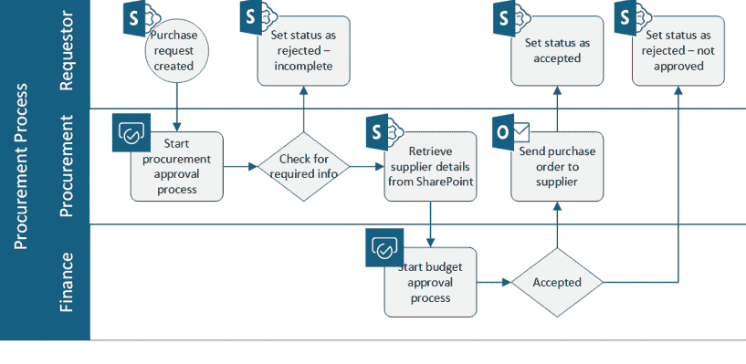
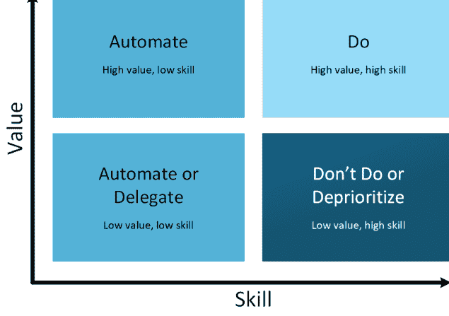
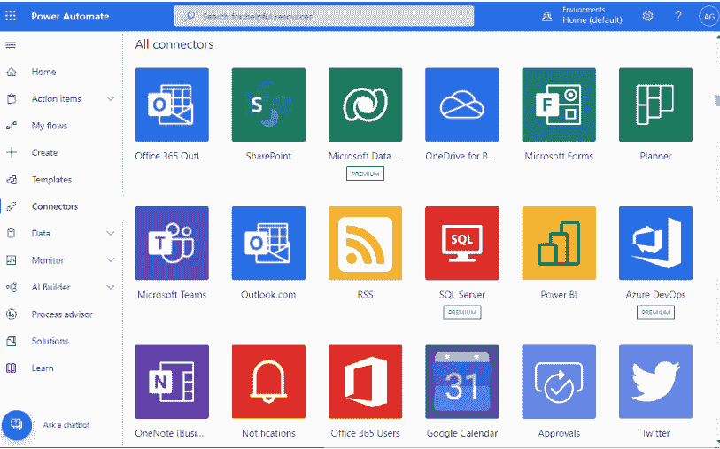
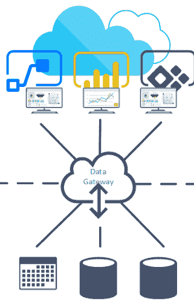
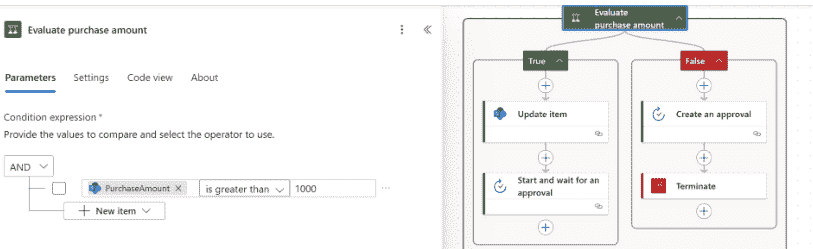

# 第一部分

## 基础

在本书的第一部分中，您将对 Power Platform 的基础建立坚固的理解，包括术语和基础组件（如流和操作）。

本书的en包含以下章节：

- 第 1 章：介绍 Microsoft Power Automate

- 第 2 章：开始使用 Power Automate

- 第 3 章：处理电子邮件

- 第 4 章：复制文件

- 第 5 章：创建按钮流

- 第 6 章：生成推送通知

- 第 7 章：处理共享流

# 1

## 介绍 Microsoft Power Automate

信息时代的业务活动充满了重复性任务：接收电子邮件、生成采购订单、发送消息、路由文档、批准休假请求等。在许多情况下，这些活动并没有产生真正的价值，尽管它们确实需要完成以帮助支持业务目标。

计算机引入了帮助我们做更多事的承诺，但很大程度上导致了为了获得同样的价值，需要做的事情更多了。如果我们能利用技术来处理常规任务，并将我们的精力留给那些需要技能和思考的事情，该有多好？

在书中，我们将学习 Microsoft Power Automate 的基础，该工具旨在帮助您自动化重复性任务并回归价值创造。这个新修订的第三版扩展了**机器人流程自动化（RPA）、人工智能（AI）、生成式 AI（GenAI）和治理。**

本章重点在于理解 Power Automate 的一些基本概念以及如何获取它：

- 什么是 Power Automate？

- 选择要自动化的

- 熟悉通用术语

- 扩展到 Power Automate 术语

- 获取 Power Automate

到本章结束时，您将了解 Power Automate 的组件，以及我们何时使用它们来简化日常运营——从电子邮件管理的基础到更复杂的业务操作，再到使用最新的 AI 技术帮助决策。

# 书籍提供的免费福利

您的购买包含一本书的免费 PDF 副本以及其他专属福利。请查看前言中的“书籍提供的免费福利”章节以立即解锁它们，并最大化您的学习体验。

# 什么是 Power Automate？

Power Automate 是 Power Platform 产品家族的一部分，它是一个工作流引擎，可以根据条件或场景自动化业务流程或序列。Power Automate（以前称为 Microsoft Flow）主要是一个基于 Web 的工具，旨在与来自微软和其他供应商日益增长的软件库建立接口。

由于其无代码/低代码的设计，任何技术水平的人都可以接触 Power Automate——包括没有编码经验的办公或业务用户、系统管理员和分析师。Power Automate 还允许更高级的编程人员（有时被称为 pro-code）使用复杂的集成并开发自定义代码。

# Power Automate Desktop

2021 年，微软引入了 Power Automate Desktop——该产品可以使用一种名为“机器人流程自动化”的新功能来帮助自动化遗留应用程序和流程。微软已将 Power Automate Desktop 作为 Windows 11 的原生组件。我们将在第 18 章“介绍机器人流程自动化”中开始探索 RPA。

许多读者可能熟悉 SharePoint 工作流的概念。在 SharePoint 平台上，您可以使用 SharePoint Designer 和 Workflow Manager 等产品，根据工作活动启动业务流程，例如文档被签入到特定的库中。SharePoint 工作流的巨大优点之一是，它们可以在 SharePoint 环境内实现业务流程和任务。

# 第 1 章

然而，SharePoint 工作流的缺点之一是它们只能自动化 SharePoint 环境内部的业务流程和任务。任何需要扩展到 SharePoint 的内容可能都需要大量的自定义开发。

虽然某些供应商已经创建了集成包来连接 SharePoint 工作流，或者开发了 SharePoint Designer 和 Workflow Manager 的完全替代方案，但其中许多方案仍然限于与 SharePoint 内部的数据进行交互。

这正是 Power Automate（以及整个 Power Platform）能力大放异彩的地方——Power Platform 开箱提供了对数百应用程序的原生连接，并且不依赖 SharePoint。它不仅对全球最流行的应用程序具有原生集成，而且具有扩展性：你可以开发自己的连接解决方案来与你组织的自定义应用程序协作。

Power Automate 的能力仅限于你的想象以及你想要集成的应用程序所提供的服务。

你可以从下面的图中看到，示例采购订单工作流将 SharePoint、Outlook 和 Microsoft Approvals 应用连接在一起：

这个基础工作流连接了 Microsoft 365 生态系统中的三个独立应用程序，这只是 Power Automate 为你和你的业务所能做的开始。

### 选择要自动化的内容

人们经常做他们不需要做的工作。然而，区分“完全不需要做的工作”和“需要做但不需要你来做的工作”是非常重要的。

从管理人员和终端用户的角度来看，Office 365 以及其他业务应用程序中的许多活动、流程和任务都可以通过 Power Automate 实现自动化。

自动化是一项关键的业务技术，可以减少重复性、低技能任务对劳动力的影响。在考虑业务流程时，它们通常可以分为以下四个象限之一：

 

这些象限构成了一个优先级矩阵（有时称为努力-影响-价值-技能矩阵）。以下是每个区域含义的详细说明：

- **高价值，低技能**：需要极少的专家技能，但至关重要或能产生高价值输出。此类任务是自动化的理想选择，并能产生最大的收益。
- **高价值，高技能**：需要人类智能或处理来确定价值、技能和关系；输出是关键的或高价值的。由于其高度个性化的性质，这些流程或任务通常是最不适合自动化的。
- **低价值，低技能**：需要极少的专家技能，同时产生价值很小的输出。与高价值/低技能任务相比，这些通常也适合自动化。
- **低价值，高技能**：需要高度的专注或技能，但产生的输出价值很小。这些任务是你通常应该尝试降低优先级，或者确定它们是否真的需要执行。

当你检查日常工作中的任务时，可以根据先验矩阵对其进行评估，以帮助理解它是否是可以或应该自动化的。你甚至可能会发现某些业务价值存疑且完全可以放弃的任务。落在**低技能**象限的项目是自动化的很好的候选者。

考虑以下示例：

- 运行前一天的销售总额报告是一项需要低专家技能的重复任务。如果可能，你应该寻求自动化此任务。
- 给客户致电跟进已发出的演示机是一项高接触、高价值的活动，但需要人类关系管理的个性化和复杂性才能有效执行。这项任务可能不是自动化的良好候选者。

正如你可以想象的，使用使用 `Power Automate` 等工具来减少重复的数据处理任务，可以为人们腾出时间，为业务流程和关系增加真正的价值。

接下来，我们将熟悉 `Power Automate` 的术语和界面，然后学习如何连接到常用应用程序以解决问题。

### 熟悉通用术语

你已经看到了一些术语，如果你熟悉 `SharePoint` 或协作工具，它们可能是你所熟悉的。但为了确保我们有一个坚实的基础，我们将回顾一些基础术语，然后开始进入特定的 `Power Automate` 术语。

### 业务流程

业务流程是完成业务目的所需的任何任务序列。这可能是非常简单的操作，如提交工时卡或在采购订单上签名。业务流程通常分为三类：

- **主要流程或运营流程**：这些流程通常会导致某种客户价值的交付，例如客户下单和企业发货。它们还可能包括产品设计和工程等内容。
- **支持**：这些流程对于主要或运营流程的发生是必要的。例如，购买制造火车所需的材料或培训员工被视为支持流程。
- **管理**：这些流程用于监督运营和支持流程，或用于改进这些流程。管理流程的示例可能是对采购或员工入职进行审查并提出建议。

自动化可以用于所有这些类别的流程。`Power Automate` 可用于自动化许多类型业务流程的部分或全部。

### 流程挖掘

流程挖掘是一种使用真实数据来理解业务流程实际运行方式的方法。流程挖掘不是猜测或依赖过时的图表，而是查看事件日志（发生情况的数字记录）来发现真实情况。

它可以帮助发现减缓、效率低下或无意义的步骤：

- **收集数据**：从企业资源计划（`ERP`）软件、客户关系管理（`CRM`）工具或物联网（`IoT`）设备等系统收集日志
- **绘制流程**：将这些数据转换为显示所采取步骤的视觉地图
- **分析流程**：寻找延迟、额外步骤或显示此处可以改进运行的模式

这就像使用手机的 `GPS` 历史记录查看你每天如何通勤——然后找到更快的路线。

### 工作流

工作流可以被视为实现业务流程的单个任务或组件步骤。例如，员工入职可能是一个业务流程，而订购新电脑或创建用户账户可能是完成员工入职流程的工作流任务。

`Power Automate` 可用于自动化工作流的部分或全部。

### REST

`REST` 是 `REpresentational State Transfer` 的行业缩写。它用于描述与计算机系统交互的方法。在基于 `REST` 的系统中，客户端设备通常向目标系统的统一资源标识符（`URI`）发送 `HTTP` 操作（称为动词），以输入或检索数据。

> 有关 `REST` 架构的历史和设计原理的信息，请参考 `https://restfulapi.net/`。与 `Microsoft 365` 上的许多技术一样，`Power Automate` 利用 `REST` 实现高性能大量的交易。

### 扩展 Power Automate 术语

在我们开始使用 `Power Automate` 时，理解所使用的核心术语是非常重要的。同样重要的是，术语会定期更改，因此如果你在几年前开始使用 `Power Automate`（当时它还被称为 `Flow`），你可能需要阅读一遍，并确保你使用的是当前的术语和概念。

以下术语通常按照你在书中遇到的顺序排列，这与它们复杂性和使用程度的增加相对应。你需要理解这些术语，以便选择在何处应用正确的业务逻辑和流程。在阅读本书的过程中，如果你遇到不认识的术语，可以返回此章节以帮助你重新定位。

### 流程 (Flow)

流程简单来说是用于自动化过程的任务或操作的逻辑分组。可以通过多种特征来识别流程，例如它们的来源（云端或桌面）、它们执行的活动类型（技术自动化或业务流程）、发生的时间（自动或计划性），或它们采用的工具和技术类型（机器人流程自动化或人工智能）。

以下是你可以描述或分类流的某些示例：

- **自动化 (Automated)**：根据触发器或事件发生的流。它们可以是基于云端的，也可以基于桌面的。
- **按钮 (Button)**：也称为即时或手动流，在用户启动时发生（例如，通过点击图标或磁片启动流）。
- **云流 (Cloud flows)**：从 `Power Automate` Web 界面创建的流，通常不需要本地计算能力或访问权限。
- **计划 (Scheduled)**：配置为按特定的时间间隔发生。
- **审批 (Approval)**：一种过程请求，其中请求通过审批链进行路由。
- **业务流程 (Business process)**：由较小任务和工作流组成的高级流程。
- **机器人流程自动化 (Robotic Process Automation)**：也称为 `RPA` 或用户界面 (`UI`) 流，`RPA` 通常用于自动化非 `REST` 应用程序。机器人流程自动化于 2020 年宣布广泛可用，并利用了 `Power Automate Desktop` 应用程序。
- **AI 生成器 (AI Builder)**：用于在流执行期间帮助决策的人工智能 (`AI`) 技术。`AI Builder` 也于 2020 年宣布广泛可用。

每个流都有不同的用例、触发器和配置功能。

### 连接器 (Connectors)

连接器是用于直接与源系统和目标系统交互的组件。连接器包含了与应用程序交互所需的配置信息。你可以在下面的图中看到连接器的一些示例：

# 第 1 章

# 11

图 1.3 – Power Automate 连接器

连接器通常分为两个层级：标准 (`standard`) 和高级 (`premium`)。标准连接器通常包含在所有 `Power Automate` 计划中（例如适用于 `Office 365` 的 `Power Automate`），而高级连接器则有额外的成本（来自微软或连接器供应商）。

> 扩展 Power Automate
>
> 除了使用内置的标准和高级连接器外，你还可以构建自己的连接器来与你自己的应用程序和服务进行交互。虽然此类开发不在本书的涵盖范围内，但你可以在 `https://learn.microsoft.com/en-us/connectors/custom-connectors` 了解更多信息。

### 连接 (Connections)

在 `Power Automate` 术语中，连接（`connection`）是与连接器关联的保存凭据（认为用户名和密码）。

### 连接引用 (Connection references)

连接引用用于解决方案（流和应用的集合）以替代连接。连接引用本质上是到连接的链接——它允许你更新使用相同连接配置的解决方案中的所有连接流。连接引用仅仅是如此——它是实际连接的快捷方式或占位符。它们用于将设计与特定的存储凭据分离。

### 解决方案 (Solutions)

解决方案是构建和运行流所需的所有对象的集合。解决方案可能包含流本身、连接以及任何其他支持组件。解决方案还实现了应用周期管理功能。

作为解决方案部分的流被称为解决方案感知云流 (`solution-aware cloud flows`)。书中的大多数流都是作为非解决方案流构建的，但也可以添加到解决方案中。从企业的角度来看，解决方案优于独立流。出于本书的目的，我们将主要关注构建流并探索其功能。

`Power Automate Desktop` 流只能导出为解决方案。

### 触发器 (Triggers)

触发器是导致流开始的活动。触发器经常用于分类正在使用的流类型。触发器的核心类型如下：

- **自动化 (Automated)**：自动化流根据特定类型的事件发生（例如，向网站上传新文件或接收到电子邮件）。
- **即时 (Instant)**：也称为手动触发流或按钮流，即时流由用户按需触发。
- **计划 (Scheduled)**：这种基于时间的选项定期循环发生。

虽然可用的触发器取决于正在使用哪些连接器，但你的业务需求极有可能决定你需要什么种类型的流和触发器。

### 步骤 (Steps)

步骤由流执行的各个单独评估和操作组成。步骤以有规律的方式排列。步骤经常使用之前执行的操作的输出数据或变量。以下是步骤的一些示例：

- 在 `Teams` 频道发布消息
- 读取电子邮件
- 保存文件
- 执行计算
- 评估条件
- 转换时间或日期
- 在数据库中输入值

每个流都由一个或多个步骤组成。流中的每个活动或过程（触发器、操作或条件）都被视为一个步骤。

### 操作 (Actions)

操作描述了流执行的活动类型（例如复制文件、向 `Teams` 频道发布或发送电子邮件）。从技术角度来看，一个步骤是一个或多个操作的组。然而，许多人交替使用“操作”和“步骤”这两个词。

### 条件 (Conditions)

条件用于评估和选择执行操作的情况。条件可以对多种数据类型运行，例如时间或计划限制、通过用户输入或解析文件接收的数据、从先前的操作填充的变量或其他计算值。当评估结果用于确定应该执行哪种系列操作时，经常会使用条件。

### Dataverse

`Dataverse`（以前称为 `Common Data Service` 或 `CDS`）是一种类似于数据库表的存储机机制，允许组织存储业务数据。术语也发生了几次变化，因此确保大家的理解一致是有关重要的。

下表显示了旧的 `CDS` 术语以及当前对应的 `Dataverse` 术语：

| 旧版 CDS 术语                    | 当前 Dataverse 术语       |
| -------------------------------- | ------------------------- |
| 实体 (Entity)                    | 表 (Table)                |
| 字段或属性 (Field or attribute)  | 列 (Column)               |
| 记录 (Record)                    | 行 (Row)                  |
| 选项集或选择列表 (Option set or picklist) | 选项 (Choice)    |
| 多选 (Multi-select)              | 多选 (Choices)            |
| 两个选项 (Two options)           | 是/否 (Yes/No)            |

表 1.1 - 术语更新

多种应用程序，如 `Dynamics 365`、`Power Apps`、`Power Automate` 和 `Power BI` 可以与 `Dataverse` 中的数据交互。高级 `Power Automate` 场景（例如处理 `Dynamics 365` 实体，它对不同类型的数据元素复用了旧 `CDS` 术语）可能需要访问 `Dataverse`。

### 网关

网关（也称为数据网关）是安装在本地计算机上的软件应用程序。该应用程序用于方便 `Power Platform` 服务访问位于本地环境的数据源。例如，可以使用数据网关允许 `Power Automate` 从本地 `SharePoint` 服务器列表中读取项目。下面的图显示了数据网关向 `Power Automate`、`Power BI` 和 `Power Apps` 服务提供本地数据：

图 1.4 - 数据网关概述

图 1.4 显示的数据网关充当本地数据源与 `Power Platform` 服务（如 `Power Automate`、`Power BI` 和 `Power Apps`）之间的通道。

### 模板 (Templates)

模板由一组旨在实现预定义目的的连接器、触发器和操作组成。模板允许标准化部署以及常用组件和配置的复用。模板通常发布到 `Power Automate` 模板库（`https://us.flow.microsoft.com/en-us/templates/`）。

### 包 (Packages)

与模板类似，包允许你保存并导出流以便复用。你可以内部或外部共享包。如果你在测试环境中开发流，然后需要一种机制将其部署到生产环境，包也是非常有用的。

### 分支

分支用于描述可能发生的不同系列步骤或操作的概念。

你可能决定通过使用条件来调用分支，例如采用 **if-then 结构：如果是，则执行操作 1；如果否，则执行操作 2**。如果评估结果需要你的流程根据答案采取不同的路径，那么这种方法可能非常有用。

在其他情况下，如果你有长时间运行的进程，或者一个分支的输出不需要继续另一个分支的工作流，或者没有其他依赖于特定操作集完成的项，那么你可能决定使用并行分支（可以同时执行的不同动作或逻辑集合）。

图 1.5 - 基于条件的分支示例

在探索 `Power Automate` 的过程中，理解这些术语将有助于我们在创建流的过程中有所帮助。

> **进阶阅读**
>
> 虽然我们在本节中涵盖了在书中会遇到的 `Power Automate` 术语基础，但在 `https://learn.microsoft.com/en-us/power-automate/glossary` 还有更多内容可以发现。

### 获取 Power Automate

在开始之前，你需要确保你拥有支持你想要创建的流类型的许可证。

如前所述，`Power Automate` 包含了标准连接器和高级连接器的概念。标准连接器适用于所有 `Power Automate` 计划，包括随 `Microsoft 365` 提供的 `Power Automate` 计划（也称为种子许可证）。高级连接器（或 `AI Builder` 和机器人流程自动化等功能）可能需要使用独立的 `Power Automate` 许可证。此外，`Power Automate` 支持用户许可和容量许可。用户许可直接应用于用户，而容量许可则分配给自动化程序（例如流）：

- `Power Automate Premium`（用户许可）
- `Power Automate Process`（容量许可）
- `Power Automate Mining`（用户许可）
- `Power Automate Hosted RPA`（容量许可）
- `Power Automate` per user attended `RPA` 附加组件计划（容量许可）
- 旧版 `Power Automate P1`、`P2`、每用户和每流计划

高级计划最适合广泛采用和大量使用 `Power Automate` 的组织。对于只有少数流被组织内所有人使用的组织来说，基于容量的计划可能更合适。有关有关最新的许可证详细信息和指导，请参阅 `https://learn.microsoft.com/en-us/power-platform/admin/power-automate-licensing/types` 和 `https://learn.microsoft.com/en-us/power-platform/admin/powerapps-flow-licensing-faq`。

既然这些都介绍了，让我们进入平台吧！

### 总结

在本章中，我们讨论了 `Power Automate` 的高层概念，包括它与解决问题（如业务流程或工作流）的关系。我们还涵盖了操作、触发器和条件等介绍性知识概念。理解触发器和连接器的类型将帮助你设计减少重复工作并为组织创造价值的流和业务流程。

除了理解功能和术语外，我们还涵盖了 `Microsoft Power Automate` 自本书上次修订以来的一些更新和更改，包括 `Power Automate Desktop` 的引入以及机器人流程自动化和 `AI Builder` 的通用可用（以及生成式 `AI` 功能的扩展和包含）。

我们还提到了利用 `Power Automate` 功能所需的许可证。

在下一章中，我们将开始探索 `Power Automate` 界面并使用它创建简单的流。

#### 获取本书的 PDF 版本和独家额外福利

扫描二维码（或访问 `packpub.com/unlock`）。按书名搜索此书，确认版本，然后按照页面上的步骤操作。

注意：请妥善保存发票。直接从 `Packt` 购买不需要发票。
