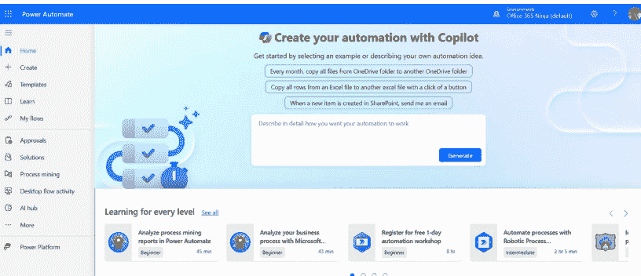
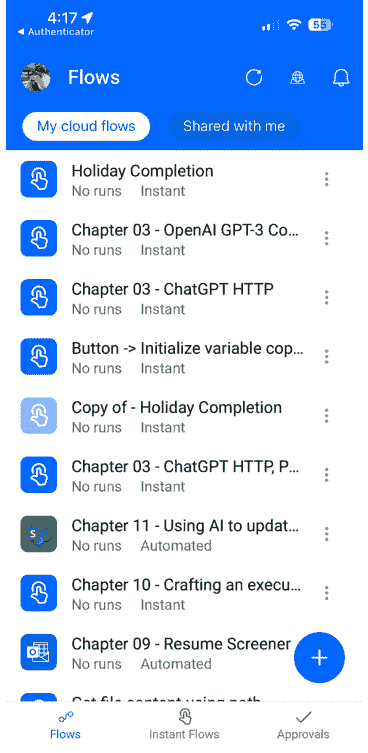
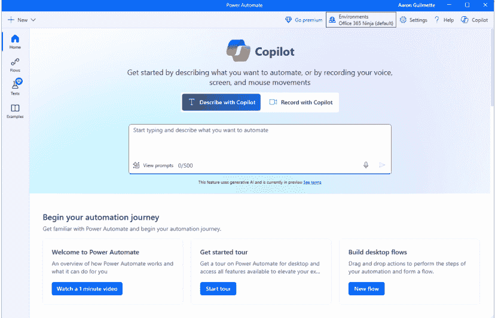
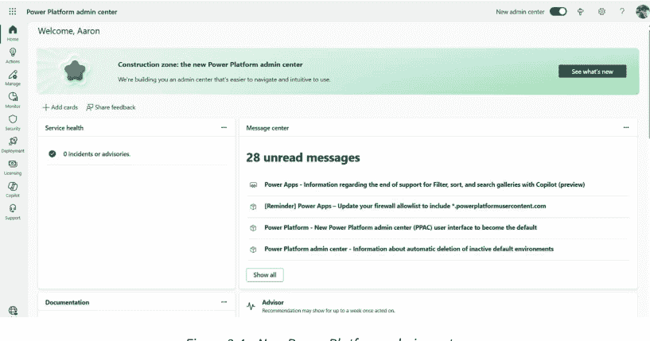
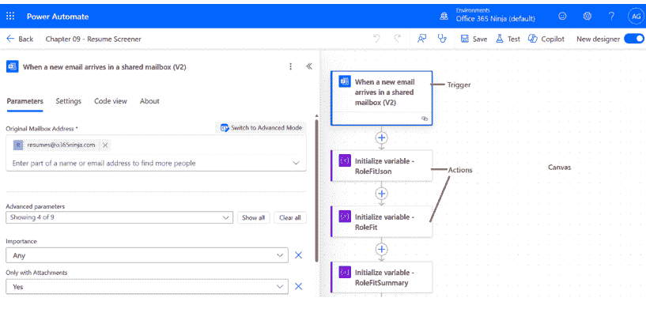
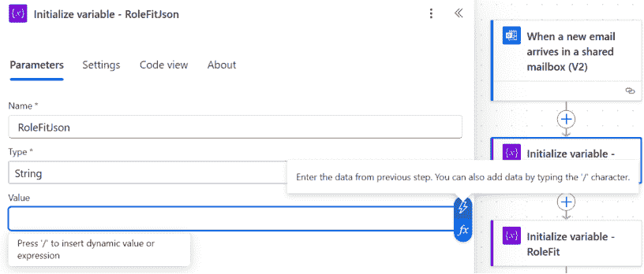
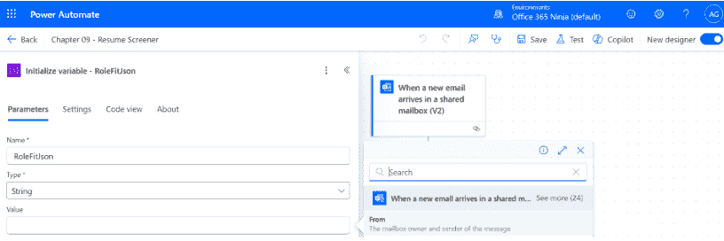
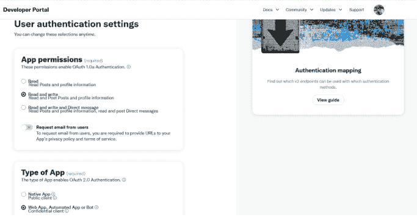

## 2

## 开始使用 Power Automate

在第一章中，我们介绍了 `Microsoft Power Automate` 的一些基本概念。现在你已经熟悉了 `Power Automate` 背后的一些思想和术语，让我们来看看如何导航界面。

作为 `Power Automate` 用户，你将可以访问 Web 门户界面（最常用）以及桌面和移动界面。如果你管理 `Microsoft 365` 租户，你还将获得一些管理功能的权限。

在本章中，我们将探索以下概念：

- 登录 `Power Automate`
- 学习流是如何运作的
- 创建你的第一个流

你将学习各个界面的功能，然后我们将创建一个基础流并发布到 `Teams` 频道。

让我们开始吧！

## 登录 Power Automate

`Power Automate` 有四种不同的体验：

- 用户端 Web 门户：用户或创建者界面，用于设计、导入、保存、导出和执行流。
- 移动端应用：用户或创建者界面，用于设计、导入、导出和执行流，专为移动设备定制。
- 桌面端：最用于创建机器人流程自动化 (`RPA`) 流。
- 管理端：对租户的 `Power Automate` 环境进行整体管理，包括执行或运行次数以及数据网关配置。


# Power Automate 租户管理概述

`Power Automate` 租户管理很大程度上超我们从设计角度学习的范围，但如果你需要管理 `Power Automate` 环境，你将知道从哪里开始。

无论你使用哪种界面，你都需要访问 `Power Automate` 才能充分利用本书的内容。如果你在组织内部无法访问 `Microsoft Power Automate`，你可能需要开始 `Microsoft 365` 试用以获取访问。要开始订阅，请访问 https://www.microsoft.com/en-us/microsoft-365/trial 并点击“Start your free trial”链接。

另外需要注意的是，`Microsoft Power Automate` 是一个纯云解决方案——没有要求的本地服务器对应项（尽管你可以安装服务器端组件，如数据网关，或在 `Windows 10` 和 `11` 计算机上使用 `Power Automate Desktop`）。`Microsoft Power Automate` 可在以下 `Microsoft 365` 云可用：

- 全球商业版：https://make.powerautomate.com
- 美国政府社区云（中级）：https://gov.microsoft.us
- 美国政府社区云（高级级）：https://high.flow.microsoft.us

就本书而言，我们将关注全球商业解决方案的功能。政府社区云中级用户（如州和地方政府）或政府社区云高级用户（如联邦员工）可能拥有略不同的功能集。

## 用户端门户界面

用户端门户界面是你设计、管理和执行大部分流的地方。要访问它，你可以登录 `http://make.powerautomate.com`，或者登录 `Microsoft 365` 用户端门户 (https://portal.office.com) 并点击 `Power Automate` 磁贴。如果你使用主权云之一，请使用上一节中的链接或联系你的经销商获取特定链接。

Web 门户界面如图 2.1 所示：



图 2.1 - `Power Automate` 首页

页面左侧部分具有默认导航菜单，包括创建和管理自己的流以及搜索模板和连接器的选项。以下列表描述了可用选项：

- 首页 (Home)：首次登录时显示的仪表板
- 创建 (Create)：创建新流的界面
- 模板 (Templates)：仅需自定义的连接器预设流
- 学习 (Learn)：指向 `docs.microsoft.com` 上 `Power Automate` 落地页的链接 (https://learn.microsoft.com/en-us/power-automate)
- 我的流 (My flows)：你创建或分享给你的流
- 审批 (Approvals)：列出你的待处理或过去的审批活动
- 解决方案 (Solutions): 用于管理 `Power Platform` 应用程序和生命周期的容器
- 流程挖掘 (Process mining): 用于探索业务流程（如 `ERP` 或财务工作流）的模板操作
- 桌面流活动 (Desktop flow activity): 查看有关桌面流、托管机和机组的数据
- AI Hub纽 (AI Hub): 访问 `AI Builder` 模型和生成式 `AI` 提示词
- 更多 (More): 顶层菜单项，包含指向可以固定到导航菜单的其他项的链接
- Power Platform: 指向其他 `Power Platform` 组件的链接，例如 `Power Apps`、`Power BI`、`Power Pages`、`Copilot Studio` 和 `Power Platform` 管理中心

在本书中，我们将探索在构建自己的流时会用到的一些组件。

进阶阅读

> 你可能想花些时间查看[连接器](https://www.microsoft.com/en-us/power-platform/connectors)和[模板](https://www.microsoft.com/en-us/power-platform/connectors)，以开始了解你可以与 `Power Automate` 集成的各种类型的应用程序和服务。你可能希望关注能够帮助你集成组织经常使用的应用程序的连接器和模板。

## 移动应用界面

`Power Automate` 移动应用分别适用于 `iOS` (https://apps.apple.com/us/app/microsoft-flow/id1094928825) 和 `Android` (https://play.google.com/store/apps/details?id=com.microsoft.flow) 平台，提供类似的设计审美和体验，如下截图所示：



图 2.2 – 用于 `iOS` 的 `Power Automate`

登录后，主屏幕上将提供以下选项：

- 我的云 (My clouds): 显示你创建的流列表
- 与我共享 (Shared with me): 显示他人创建并共享给你的流列表
- 流 (Flows): 显示你有权访问的流，并按 `我的云流` 和 `与我共享` 选项卡进行过滤
- 即时流 (Instant flows): 显示过滤后的即时流或按钮流列表
- 审批 (Approvals): 显示需要关注的审批列表
- + (创建流): 允许你使用 `Power Automate` 移动应用创建新流

移动应用侧重于展示专门为移动设备定制的流组件和操作。本书的大部分将关注端用户网络门户体验，但我们也鼓励你与移动应用交互。

## Power Automate Desktop 界面

如第 1 章“介绍 `Microsoft Power Automate`”所述，`Power Automate Desktop` 是一种与流交互的新方式。你只能通过 `Power Automate Desktop` 创建机器人流程自动化流。

`Power Automate Desktop` 应用程序本身供 `Windows 10` 用户免费下载。但是为了使用高级功能（如 `RPA` 流），你可能需要获得额外的许可。

图 2.3 显示了 `Windows 11` `Power Automate Desktop` 应用：



图 2.3 – 用于 `Windows 11` 的 `Power Automate Desktop`

`Power Automate Desktop` 允许你查询系统资源，并与文件、浏览器实例、`Outlook` 和 `Excel` 等应用程序、命令提示符甚至打印机进行交互。

我们将在第 18 章“介绍机器人流程自动化”中开始使用 `Power Automate Desktop`。

## 管理员界面

此前，管理员需要同时使用 `Power Automate` 管理中心和 `Power Platform` 管理中心来管理他们的环境。2021 年，所有功能已合并到 `Power Platform` 管理中心中。

> 注意：除非你是 `Microsoft 365` 租户的全局管理员或被专门授予了 `Power Platform` 管理员角色，否则你对 `Power Platform` 管理中心仅有只读权限。

`Power Automate` 管理中心 (https://admin.powerplatform.microsoft.com) 允许你跟踪整个租户执行的运行，查看许可证信息、整体环境数据并配置数据丢失防护 (DLP)策略。

管理中心还允许你管理流水线（`Power Platform` 应用生命周期管理/持续交付的一部分），以实现开发运维 (DevOps) 和持续集成/持续交付 (CI/CD)软件开发生命周期工作流。

此外，`Power Platform` 管理中心允许你管理整个 `Power Platform` 的功能，包括 `Power Automate`，以及 `Dynamics 365`、`Power BI`、`Power Pages`、`Copilot` 和 `Power Apps`，如图 2.4 所示：



虽然本书不会广泛使用管理员界面，但你应该了解它的存在，整个 `Microsoft 365` 环境的管理员可以配置注册并查看跨组织的统计数据。

现在你已经看到了 `Power Automate` 的各种界面，让我们来看看流是如何工作的吧！

## 学习流的工作原理

正如你在第 1 章“介绍 `Power Automate`”中所学到的，流可以包含许多组件，例如触发器（或步骤）、条件、分支和变量。这些组件在通常称为“画布”的设计区域按逻辑模式排列。



图 2.5 – 探索 `Power Automate` 设计画布

触发器是流中的第一个操作。触发器通常连接到资源。触发器可以是自动、手动或基于计划的。

每个操作将其结果存储在动态内容中。动态内容用于在步骤之间传递数据。动态内容可以表示各种数据类型，如字符串、数字、数组等。

动态值可以用于操作中填充字段，如图 2.6 所示：



图 2.6 – 使用动态值

除了动态内容，你还可以使用表达式。表达式是用于进一步处理变量的代码（例如转换时间或替换文本）。表达式可以结合函数（类似于 `Excel` 语言）以及动态内容来创建新的对象。



图 2.7 – 探索函数

我们将在第9 章进一步探讨一些常用函数和表达式。现在你只需按照示例选择正确的选项。

## 创建你的第一个流

查看 `Power Automate` 作用的最佳方法是创建一个流。在示例中，我们将创建一个监控 `X` 标签并向通道发送通知的流。此类流对于尝试衡量或捕捉产品或服务的情绪、追踪公共健康话题、监控参与度或其他社交媒体平台上的其他主题警报非常有用。

## 理解流组件

此特定的流将依赖于几个组件：

- `X` 的 API 密钥和密钥（类似于用户名和密码）
- 监控 `X` 特定单词或短语的触发器
- `Microsoft 365` 身份（用户名和密码）
- `Microsoft Teams` 团队
- 向 `Microsoft Teams` 发布的操作

要完成此流，你需要 `Microsoft 365` 身份（或你在测试环境中使用的身份），以及带有 API 密钥的 `X` 身份。你还需要访问一个发布消息的 `Microsoft Teams` 团队。

## 获取 X API 密钥

`X` 更改了用户与其交互的方式，现在需要 API 密钥才能通过编程读取和发布推文。你需要在 https://developer.x.com 注册。

拥有免费开发者帐户，你可以创建一个包含单个应用程序的项目。要创建应用程序，请按照以下步骤操作：

1. 登录 `X` 开发者门户 (https://developer.x.com)。
2. 选择“免费开始”。
3. 在“开发者协议与策略”页面，提供你想使用开发者 API 的原因。勾选复选框同意条款，然后点击“提交”。
4. 展开项目和应用程序并选择默认项目。
5. 在“密钥和令牌”选项卡上，点击“重新生成”以创建新的 API 密钥和 API 密钥。
6. 点击“是，重新生成”。
7. 将它们复制到安全位置以备后后用。完成后，点击“是的，我已保存它们”。

您保存了 `API Key` 和 `API Key` 密钥吗？

- 将将它们保存在安全的地方
- 像对待密码或一组密钥一样对待它们
- 如果安全性已破坏，请重新生成它们
- 不要将它们存储在公共场所或共享文档中

`API Key`

```
H9i... Copy
```

`API Secret`

```
IEML Copy
```

是的，我已保存它们

图 2.10 - 查看 OAuth 密钥和密钥

8. 选择“设置”（Settings）选项卡。
9. 在“用户身份验证设置”（User authentication settings）下，点击“设置”（Set up）。
10. 在“应用权限”（App permissions）下，选择如读取和写入之类的的权限级别。
11. 在“应用类型”（Type of App）下，选择“Web 应用”（Web App）、“自动化应用”（Automated App）或“机器人”（Bot）。



图 2.11 - 配置身份验证参数

12. 在“应用信息”（App info）下，在“回调 URI / 重定向 URL”（Call-back URI / Redirect URL）字段中输入 `https://global.consent.azure-apim.net/redirect`。
13. 在“网站 URL”（Website URL）下，输入任何网站（例如个人博客或工作区、`x.com` 或网站——这不会影响 `Power Automate`）。


14. 滚动到页面底部并点击“保存”（Save）。
15. 如果提示，点击“是”以确认更改权限。
16. 最后，将客户端 ID 和客户端密钥复制到安全位置以备后用。


17. 点击“完成”（Done）。

在 Web 开发术语中，API 密钥和密钥类似于用户名和密码。您需要这些从您的 `Power Automate` 流向 `X` 进行身份验证。

### 创建 Microsoft Teams 团队

如果您不熟悉 `Microsoft Teams`，它是一个现代协作软件平台，将多项 `Microsoft` 技术整合到一个单一的统一用户界面中。您可以在这里学习如何创建团队：https://learn.microsoft.com/en-us/microsoftteams/get-started-with-teams-create-your-first-teams-and-channels。

延伸阅读

> 您也可以在另一本 Packt 书籍《Expert Microsoft Teams Solutions》（ISBN: 978-1810075558）中学习更多关于 `Microsoft Teams` 的知识。您可以在此处购买该书：https://packpub.com/en-us/product/expert-microsoft-teams-solutions-9781810075558。

一旦您配置了所需的身份、团队和 API 密钥，我们将开始创建流！

### 创建流

一旦我们准备好了创建流所需的先决组件（即前面提到的身份和团队），就可以开始配置了。要构建此示例流，请遵循以下步骤：

1. 登录 `Power Automate` Web 门户（https://powerautomate.microsoft.com）。
2. 在页面左侧，点击“创建”（Create）。
3. 在“我的流”（My Flows）页面上，点击“新建流”（New flow），然后选择“从空白开始创建流”，选择“自动化云流”（Automated cloud flow）。


4. 输入流名称姓名。

## 第 2 章

5. 在“选择流触发器”（Choose your flow's trigger）中，输入 `X` 以过滤与 `X` 相关的触发器。选择“发布新推文时”（When a new tweet is posted）并点击“创建”（Create）。

构建自动化云流


通过连接您已使用的应用程序，从重复性工作中解放出来——自动化警、报告和其他任务。

示例：

- 自动在业务解决方案中收集并存储数据
- 通过对 SQL 数据库的自定义查询生成报告

图 2.15 – 创建新的云流

6. 点击“发布新推文时”触发器。


图 2.16 - 查看触发器

7. 在“发布新推文时”弹出窗中，点击“更改连接”（Change connection）以调出“创建”（Create）弹出窗，您可以在其中输入您的 API 密钥和密钥详情。


图 2.17 - 管理弹出窗

8. 在“创建连接”弹出窗中，输入连接名称。粘贴您在在一个节节中重新生成的消费者密钥（consumer secret）并点击“登录”（Sign in）。


图 2.18 - 配置连接

9. 提示时，点击“登录”（Sign In）授权您的 `X` 应用代表您访问 `X`，如图 2.19 所示。


图 2.19 - 登录 `X` 应用

10. 如果提示，使用您的用户名和密码登录 `X`。
11. 点击“授权”（Authorize）。
12. 在重定向到 `X` 弹出窗后，在“搜索”（Search）文本框中输入一个值。您可以输入术语、标签或其他支持的搜索查询。见图 2.20。


图 2.20 - 配置搜索文本

## 开始使用 Power Automate

注意

> 所有带有标签的 `X` 交互都将使用 `X` API 进行查询，而不仅仅是提供凭据的账户发布的推文。然而，由于 `X` 新的速率限制和 API 功能，您将需要 Pro 订阅才能看到搜索产生的任何推文数据。


13. 关闭弹出窗。

14. 在触发器后点击“+（添加操作/Add action）”按钮调出“添加操作”弹出窗。


图 2.21 - 添加操作

15. 搜索 Teams 操作并选择它。


图 2.22 - 选择操作

16. 在“参数”（Parameters）选项卡下，在“以...身份发布”（Post as）下，选择“机器人”（bot）。

17. 在“发布到”（Post in）下，选择。

18. 在“团队”（Team）下，选择您创建的团队。

19. 在“通道”（Channel）下，选择可用通道。见图 2.23。


图 2.23 – 配置操作

20. 填充“消息”（Message）字段。在例例中，动态内容将由 X 提供。使用动态内容完成。


图 2.24 – 填充消息

21. 使用动态内容完成流。见图 2.25。


图 2.25 – 使用动态内容

22. 完成后，点击菜单栏上的“保存”（Save）。

就是这样！您创建了第一个流。现在，为了查看它是如何工作的：

### 测试流

通过测试流，您将能够发现它是否正常工作。生成的任何错误消息将为您提供问题所在以及如何修复的起点。

要开始测试流，请遵循以下步骤：

1. 点击菜单栏上的“测试”（Test）图标。


2. 在“测试流”中，选择“手动”（Manually）按钮并点击“测试”。

3. 打开浏览器窗口，导航到 X，然后使用您在流中的文本发送推文。

4. 等待流处理。

现在流已经创建并保存，可以通过生成内容并检查它是否如预期发布到 Teams 频道：


图 2.27 – 推文后检查 Teams

### 查看流

任何您都可以可以使用“查看代码”（Peek code）的功能，该功能允许您查看控制步骤函数的底层 JavaScript 对象表示（JSON）代码。

要访问步骤或操作的 JSON 视图，点击步骤调出其弹出窗并选择“代码”（Code）选项卡，如图 2.28 所示：


虽然您无法在 Power Automate 用户界面中直接编辑代码，但可以将其导出或复制，然后在 Visual Studio 或 Visual Studio Code (VS Code) 等工具中编辑。

### 总结

在本章中，您学习了各种 Microsoft Power Automate 界面（Web、移动、桌面和应用）以及每个界面中的可用功能。通过一些非常基础的 Power Automate 工作流概念，我们构建了一个简单的流，根据 X 关键词生成 Teams 频道消息。

在下一章中，我们将开始使用 Power Automate 执行常见的电子邮件任务，例如过滤消息和处理附件。

## 获取本书的 PDF 版本和独家额外

扫描二维码（或访问 `packtub.com/unlock`）。按名称搜索此书，确认版本，然后按照页面上的步骤操作。

注意：请妥善保存发票。直接从 Packt 购买的不需要发票。


