# 4 复制文件

在上一章“处理电子邮件”中，你看到 Power Automate 可以处理附件。需要自动化附件的流程也可以从自动化这些文件中受益。在本章中，我们将关注一些文件相关概念：

- 学习文件连接器和操作

- 处理文件

在本章结束时，你应该熟悉常用的文件连接器和操作，并能够使用它们在 Microsoft 365 环境和外部存储之间复制数据。

### 学习文件连接器和操作

在第 3 章“处理电子邮件”中，你看到 Power Automate 可以处理附件。需要自动化附件的流程也可以从自动化这些文件中受益。文件可能需要复制或移动、上传到新服务、导入另一个平台、存档、分析或需要审批。引用文件及其属性是构建复杂流的重要构建模块。

可用文件存储机制简述如下：

- SharePoint Online

- OneDrive for Business

- OneDrive

- Azure File Storage

- Google Drive

- Box

- Dropbox

- FTP/SFTP

许多用户和组织主要通过 Power Automate 在 SharePoint Online 和 OneDrive for Business 中处理文件。然而，大多数组织在与合作伙伴、客户或供应商合作时，也会访问或使用其他文件托管和共享机制，因此能够与尽可能平台交互是非常重要的。许多组织，特别是工程、制造、电子数据交换（EDI）或物流领域的组织，可能依赖需要 FTP 或 SFTP 协议的旧系统。Power Automate 的文件处理功能适用于许多这种情况。

文件连接器通常具有以下类型的触发操作，允许你创建自动化流：

- 文件创建时

- 文件修改时

- 文件属性被修改时

文件连接器通常允许执行以下类型的操作（取决于连接器以及所连接的服务提供的 API）：

- 更新文件

- 复制文件

- 获取文件元数据

- 删除文件

- 列出文件或文件夹

- 创建或删除文件夹

- 提取归档文件

- 创建文件共享链接

- 检入或检出文件

最后，连接器允许你提取、管理或操作内容和元数据（关于文件的信息），例如以下内容：

- 文件或文件夹的名称或显示名称（DisplayName）

- 文件或文件夹的唯一 ID

- 文件路径

- 最后修改时间（LastModified）日期和时间

- 文件的媒体类型（MediaType）

除了可以使用文件本身的可用元数据外，你可能还可以包含来自流中其他部分的动态属性，并将其作为文件处理过程的一部分包含其中。

基于我们在第 3 章“处理电子邮件”中看到的动态内容概念，我们将引入一个新概念：**表达式（expressions）**。虽然在 Power Automate 的语文中，动态内容被用于描述源自对象元数据的内容属性，但表达式可以用于以程序化方法执行进一步的处理。如果你熟悉 Microsoft Excel 公式，那么你会发现这些概念和格式是相似的。

表达式经常用于计算和格式化值。在下一节中，我们将使用表达式（或公式）来创建自定义文件夹名称，作为处理文件工作的一部分。

### 处理文件

从 Microsoft Power Automate 的角度来看，文件是既可以是工作流的产或结果（正如我们在第 3 章“处理电子邮件”中查看费用报表流时看到的那样），也可以通过工作流移动。在本节中，我们将基于第 3 章的费用报表流，将文件从费用报表文档库复制到另一个 SharePoint 站点以便归档。

我们还将使用 Power Automate 处理另一个业务场景：将内容发布到外部存储服务。

### 将文件复制到 SharePoint

假设你的组织有一项要求，对通过特定工作流程的所有内容进行存档备份。在本例中，我们将基于第 3 章“处理电子邮件”中创建的流，保存电子邮件附件并将这些文件附件复制到新的子文件夹。我们将执行一系列步骤来为文件夹计算唯一名称：

- 提取电子邮件的接收时间和日期

- 使用表达式将日期格式化为 `yyyy-MM-dd`（四位数字年份、两位月份、两位日期）

- 将表达式的结果作为文件夹名称的一部分，以指示处理文件的时间

为了完成这些活动，你需要一个带有文档库的 SharePoint 站点，以及文档库内部的一个文件夹。我们将从保存费用报表文件的 SharePoint 站点开始，但你可以使用任何喜欢的站点。

> 取决于你的租户中可用的功能（或取决于你阅读此书的时间），你可能需要启用或禁用 Power Automate 的实验功能。如果你需要禁用实验功能，请点击制作门户右上角的设置图标（齿轮形状），选择“查看所有 Power Automate 设置”，并切换“实验性功能”滑块。

按照以下步骤更新流：

- 导航到 Power Automate 网页门户 (`https://make.powerautomate.com`) 并选择“我的流”（My flows）。

- 选择你在第 3 章“处理电子邮件”中创建的“费用报表”流旁边的三个点，并点击“编辑”。

- 展开“每一个”（For each 或 Apply to each）循环步骤以展开，如图 4.1 所示：

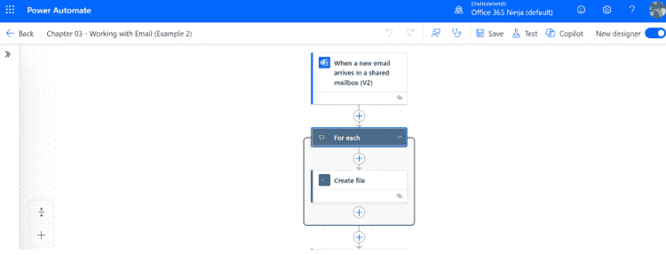

图 4.1 – 展开步骤

- 4. 在循环步骤内部，点击 `+` 图标（或操作），取决于你的用户界面。

- 5. 在“搜索连接器和操作”框中，输入 `SharePoint Create new folder` 并选择 `Create new folder Sharepoint` 操作。

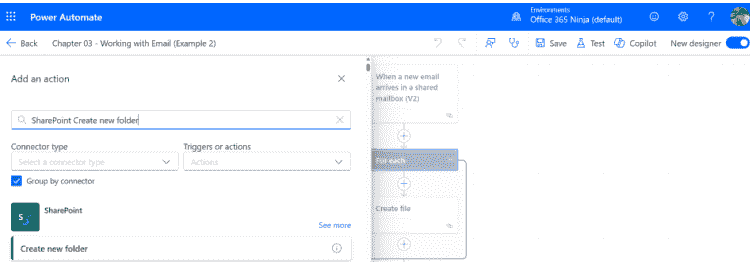

图 4.2 – 定位 SharePoint 创建新文件夹操作

- 6. 在“站点地址”（Site Address）框中，输入目标 SharePoint 站点。如果你在使用“费用报表”站点，它将显示在下拉列表中。如果你没有在流中使用过此站点，则需要手动输入。

- 7. 在“列表或库”（List or Library）字段中，选择你想要存储文件的文档库。

> 注意：如果你点击文件夹浏览到文档库，根据你的用户界面设置，你可能会看到名为“Shared Documents”（共享文档）的文件夹。然而，在浏览 SharePoint 站点本身时，站点将显示库的显示名称“Documents”（文档）。库路径在 URL 栏中也显示为 `Shared%20Documents`。它们都指向同一个目标。

- 8. 在“文件夹路径”（Folder Path）字段中，输入文件夹结构。根据你的界面版本，你可能会看到用于定位文件夹的浏览选项。如果没有，你只需输入文件夹路径，从文件夹名称开始。如果你正在使用“费用报表” SharePoint 站点，可以使用之前创建的 `ExpenseReports` 文件夹名称。带有两个结尾斜杠（`/`）的顶层文件夹路径。

- 9. 选择“插入”（Insert insertion）。见图 4.3。

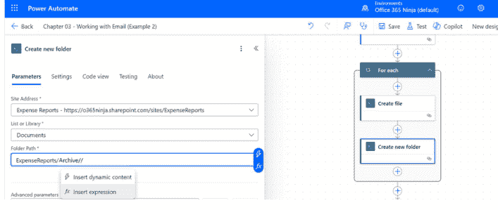

图 4.3 – 填充文件夹路径字段

- 10. 在此示例中，我们将根据接收消息的日期时间创建一个文件夹，并将其作为文件夹名称。开始输入 `date` 并选择 `formatDateTime` 函数。然后输入尾随括号 `()`，如图 4.4 所示。

> 你可以将函数看是可以执行任务的微型内置过程。函数是可用于构建复杂表达式的组件。

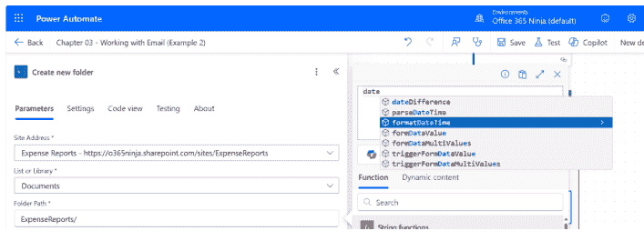

图 4.4 – 在表达式字段中添加 dateTime 函数

- 11. 点击“动态内容”选项卡。在搜索字段中，找到来自“当共享邮箱箱收到新邮件 (V2)”操作的“接收时间”（Received Time）内容对象并选择它。

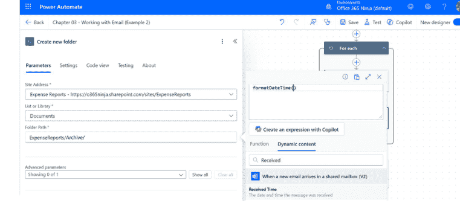

图 4.5 – 添加接收时间动态内容标记

- 12. 表达式字段将更新。将光标移动到方括号 `[` 和闭合括号 `]` 之间行的行末尾，并添加 `,'yyyy-MM-dd'`。

- 13. 表达式字段现在应显示 `formatDateTime(triggerOutputs()?['body/receivedDateTime'],'yyyy-MM-dd')`。完成后点击“添加”。见图 4.6。

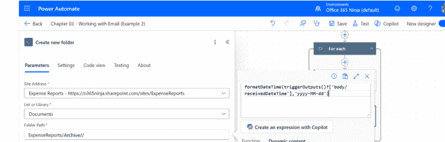

图 4.6 – 编辑表达式

如果你想模拟原始文件的创建路径，还可以添加来自“当共享邮箱箱收到新邮件 (V2)”操作的“发自”（From）字段。

### 复制文件

- 14. 悬停在“文件夹路径”字段中的表达式上，确保其已正确输入。同时，确保文件夹名称由正斜杠分隔。如果缺少正斜杠，点击文件夹名称和表达式之间并添加它。见图 4.7。

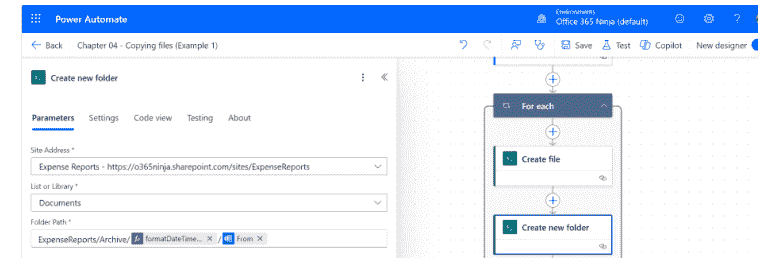

图 4.7 – 自定义文件夹路径

- 15. 接下来，我们将文件从 ExpenseReports 主文件夹复制到新位置。在“创建新文件夹”操作之后插入一个操作。

- 16. 在搜索连接器和操作字段中，输入 `SharePoint Copy file` 并从列表中选择 `Copy file` 操作。

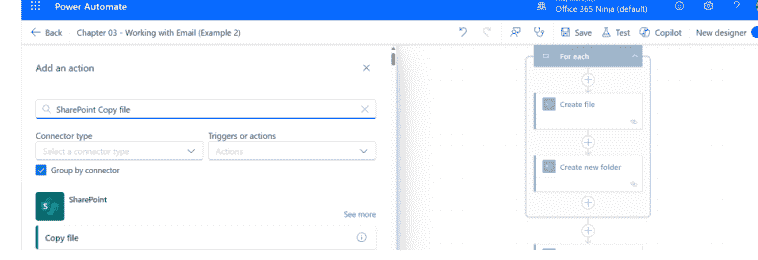

图 4.8 – 添加复制文件操作

- 17. 在“当前站点地址”（Current Site Address）字段中，选择流配置保存文件的 SharePoint 站点。

- 18. 在“要复制的文件”（File to Copy）字段中，选择代表原始创建文件操作中保存的文件 ID 的动态内容标记。根据你的用户界面，它可能被称为 `body/Id`。

> 注意：有两个类似的标记：`ItemId` 和 `Id`。选择 `Id` 那个。

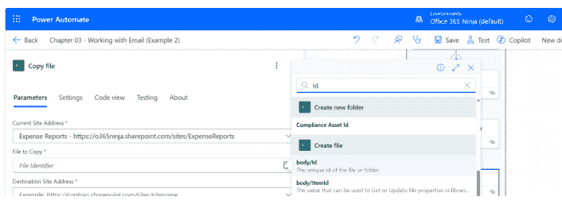

图 4.9 – 选择文件标识

- 19. 在“目标站点地址”（Destination Site Address）下拉列表中，选择你想保存此新归档副本的 SharePoint URL。如果你以前没有在流中使用此 URL，可能需要手动输入。在本例中，你可以直接使用我们已经在使用的“Expense Reports”站点，尽管你可能想创建一个新文件夹（例如“Archive”），以表示这是不同或新的。

- 20. 在“目标文件夹”（Destination Folder）下拉列表中，添加来自“创建新文件夹”操作的“完整路径”（Full Path）动态内容标记。

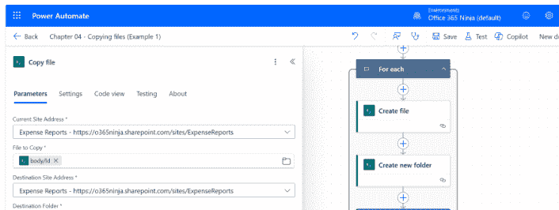

图 4.10 – 配置目标文件夹路径

21. 在“如果文件已存在”（If another file is already there）字段中，你可以从四个选项中进行选择：重命名复制（Copy with a new name）、失败此操作（Fail this action）、替换（Replace）和输入自定义值（Enter a custom value）。哪种选项取决于你的业务需求？情况下，我们将选择“重命名复制”。你可以使用“输入自定义值”选项，像我们在上一步中所做的那，使用表达式和动态内容构建自己的命名规范。

22. 在标题栏中，根据需要重命名该流。

23. 点击“保存”（Save）保存更新后的流。

接下来，我们将验证更改的结果。

## 通过测试验证结果

在每次进行更新时，确保语法正确非常重要。虽然流的验证过程非常健壮，但测试以确保你获得预期结果仍然很重要。为此，你可以像在之前的章节中那样使用页面顶部的“测试”（Test）函数。按照以下步骤操作：

1. 点击“测试”打开测试飞出窗口。

2. 你可以选择手动触发此操作或重用之前运行的数据。在示例中，我们将仅使用成功运行的结果，然后点击“测试”。

3. 结果应返回成功。如果不是，请检查流的配置并进行任何必要的更新。

图 4.11 – 测试更新后的流

## 验证结果

虽然看到成功横通常是一个好信号，但它仅表示流没有报错。验证输出是否符合预期同样重要。我们将在下一步查看这一点。

## 验证结果

虽然“测试”函数可能显示成功，但这并不一定意味着它是正确的。它只是在没有错误的情况下完成了。当涉及格式化表达式或函数时，许多是区分大小写敏感的。例如，如果你正在处理像 2025 年 3 月这样的日期，并在表达式中使用 `YYYY-MM-DD` 而不是 `yyyy-MM-dd`，你将得到一个名为 `YYYY-MM-DD` 的文件夹，而不是 `2025-03-02`。若要验证你是否实现了预期结果，可以展开并检查每一步生成的值。或者，你可以直接导航到目标库，如下所示：

图 4.12 – 验证测试结果

## 验证值和文件是否存在

至此，附加在最近处理的费用报告上的文件已存入命名正确的文件夹中（在我们的示例中，文件夹路径包含了日期和电子邮件地址）。接下来，我们将查看用于处理文件的 Dropbox 连接器。

## 将文件发布到 Dropbox

另一个流行的文件复制场景是将文件移动到 SharePoint Online 之外的存储。SharePoint Online 的公共站点在多年前已弃用，这使得广泛发布信息变得更加困难。例如，假设你的组织托管了一个 SharePoint 站点，个人在该站点保存准备好用于投标的报价请求 (RFP)，而你需要让这些文件在面向潜在供应商的站点上自动可用。你可以创建一个流来监控该 SharePoint 站点，并将内容复制到 Dropbox 站点以实现此任务。

如果你想按照此流的步骤操作，你需要一个要监控的 SharePoint 站点以及一个 Dropbox 账户。你可以在 https://www.dropbox.com 注册免费 Dropbox 账户。

要开始操作，请遵循以下步骤：

1. 导航到 Power Automate 制作门户 (https://make.powerautomate.com) 并选择“创建流”（Create flow）。

2. 选择“自动化云流”（Automated cloud flow）。

3. 为流输入名称并搜索 SharePoint 触发器“当文件夹中创建或修改文件”（When a file is created or modified in a folder）。选择它并点击“创建”。

## 构建自动化云流

通过连接你已使用的应用程序从重复工作中解放出来——自动化警报、报告和其他任务。示例：

- 在业务解决方案中自动收集并存储数据

- 通过对 SQL 数据库的自定义查询生成报告

图 4.14 – 使用 SharePoint 触发器创建新的云流

4. 在画布上，选择该触发器。

5. 在“站点地址”（Site Address）字段中，输入要监控新文件的 SharePoint 站点 URL。在这种情况下，我们将监控一个名为 `PublishedRFPs` 的站点。

6. 在“文件夹 ID”（Folder Id）字段中，选择要监控的文件夹。选择文件夹图标开始浏览，然后选择文件夹名称以选择高亮文件夹，或使用箭头导航到子文件夹。见图 4.15。

图 4.15 – 选择要监控的文件夹

7. 添加操作（Add an action）。

8. 在“搜索操作或连接器”字段中，搜索 Dropbox 并选择它。

9. 在标题栏中，根据需要重命名该流。

10. 在“文件路径”（File Path）字段中，使用动态内容。

11. 在“文件名”（File Name）字段中，使用动态内容。

12. 在“内容”（Content）字段中，使用动态内容。

13. 点击“保存”保存更新后的流。

可以通过三种不同的方式创建按钮或即时流：

- 从按钮流模板创建

- 从空白模板创建

- 从包导入

开始的最好方法之一（特别是在处理常见任务时）是查看他人的示例和模板。如果你认为你可能正在做别人以前做过的事情，那么模板是一个极佳的起点。你还可以导入之前保存和导出的流（你将在第 25 节“流的导出、导入和分发”中学习更多内容）。

按钮流可以通过 Power Automate 应用程序或 Power Automate Web 门户创建。虽然你可以在移动设备和 Web 平台上创建复杂的流，但通常在桌面电脑上创建会更简单（也更快速）。你可以在下面的截图看到按钮流模板的示例：

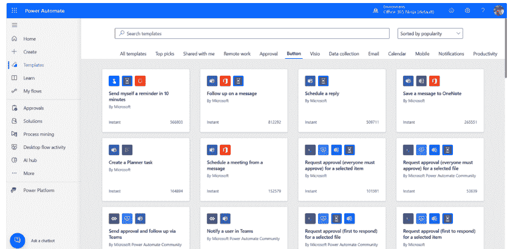

图 5.1 – 按钮流模板

虽然大多数按钮流的设计是为了简单地执行一次任务，但更复杂的即时流或按钮流可以与 SharePoint 列表、文档或存储在 Dataverse（以前称为 Common Data Service）中的数据进行交互。

在下一节中，我们将从 Web 门户创建一个按钮流。

## 创建一个向经理发送电子邮件的按钮流

有时，你只需要一个快速表单来回答问题或向某人发送通知，例如由于假期或生病不在办公室。在本节中，我们将配置这个简单的按钮流，向你的经理发送电子邮件，告知你不在办公室。

与你在上几个章节中创建的流一样，我们将利用动态内容来确保检索到 Office 365 账户中经理（manager）属性中存储的值。

为了实现这一点，我们将引入一个新的连接器和一些有趣的操作：

- Office 365 Users 连接器：此连接器允许你连接到 Entra ID 以获取与用户数据相关的信息。你可以在此处了解更多关于 Office 365 连接器的信息：https://learn.microsoft.com/en-us/connectors/office365users/

- `Get my profile (V2)` 操作：此操作将从 Entra ID 获取你的特定详细信息。你可以在此处了解更多关于此操作可以访问的属性：https://learn.microsoft.com/en-us/graph/api/resources/user?view=rest-1.0#properties。

- `Get manager (V2)` 操作：此操作检索所选用户的经理属性。为了使用此操作，必须配置 Exchange 属性。你可以在此处了解更多关于 `Get manager (V2)` 操作：https://learn.microsoft.com/en-us/connectors/office365users/#get-manager-(v2)。

通过这些新组件，你将能够检索你的用户对象的经理值并发送一封预填充的电子邮件。在完成示例的过程中，请仔细注意处理 Office 365 数据时步骤的顺序——即：先检索你的个人资料数据，然后检索你的经理值。

将在 Power Automate 门户中创建流，并在移动设备上执行它——这样你就可以在多个平台上与流进行交互。

要执行这些步骤，你需要一个配置了经理属性的 Exchange Online 邮箱箱。大多数企业环境已经通过与 Entra ID 的同步设置了这一点。

> 提示
>
> 如果你不确定在何处为用户账户配置经理属性，请参阅 https://learn.microsoft.com/en-us/exchange/recipients-in-exchange-online/manage-mail-users。

按照以下步骤完成示例：

1. 导航到 Power Automate 制作门户 (https://make.powerautomate.com)。点击 **Create**（创建）并选择 **Instant cloud flow**（即时云流）。

2. 输入流名称并选择 **Manually trigger a flow**（手动触发流）。然后点击创建：

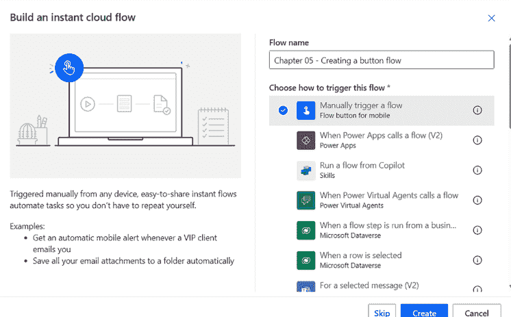

从任何设备手动触发的易共享即时流任务，无需重复。

示例：

- 每当 VIP 客户给你发送电子邮件时，获取自动手机警报

- 自动将所有电子邮件附件保存到文件夹中

图 5.2 – 创建即时云流

3. 添加操作。

4. 在 **Add an action**（添加操作）弹出窗口中，搜索 Office 365 **Get my profile (V2)** 操作，如**图 5.3** 所示：

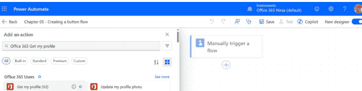

图 5.3 – 添加 Get my profile (V2) 操作

# 5 

如果你在 Power Automate 内部没有创建任何连接或对 Office 365 进行身份验证，你需要通过点击 `Get profile (V2)` 操作上的链图标 🔗 来配置身份验证。

一旦身份验证成功，添加新操作。

5. 在 `Add an action` 弹出窗口中，搜索 Office 365 `Get manager (V2)` 操作并从列表中选择它。

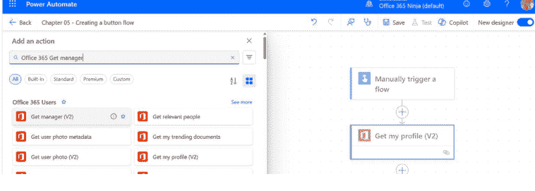

图 5.4 – 添加 Get manager (V2) 操作

6. 在 `Get manager (V2)` 操作上，配置 Exchange 属性以使用它。

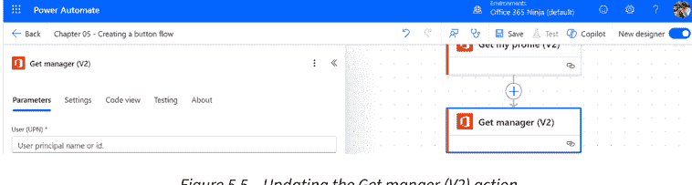

图 5.5 – 更新 Get manager (V2) 操作

7. 在 `Add an action` 弹出窗口中，搜索 Office 365 `Get manager (V2)` 操作并从列表中选择它。

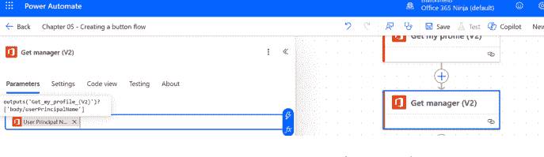

图 5.6 – 添加 Get manager (V2) 操作

8. 在 `Get manager (V2)` 弹出窗口中，点击 `User` 字段。

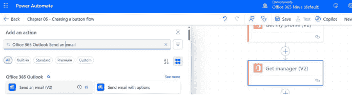

图 5.7 – 在 Get manager (V2) 操作

9. 在 `Get profile (V2)` 操作下添加 `UserName` 动态令牌。

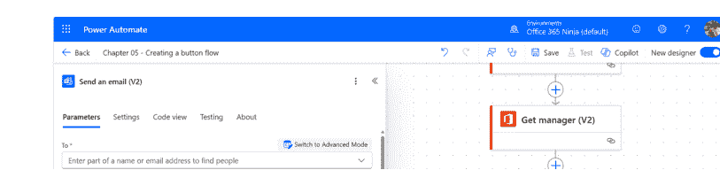

图 5.8 – 添加 UserName 令牌

10. 悬停以查看底层代码——它应该是 ``outputs('Get_profile_(V2)')['body/userName']``。

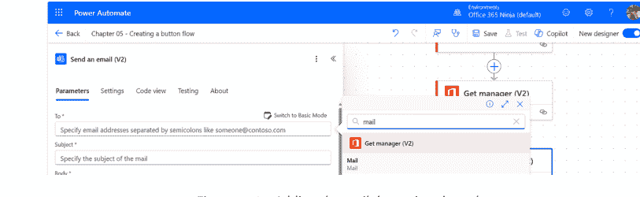

图 5.9 – 悬停查看代码

11. 添加操作。

12. 在 `Add an action` 弹出窗口中，搜索 Office 365 `Send email (V2)` 操作，如**图 5.10** 所示。

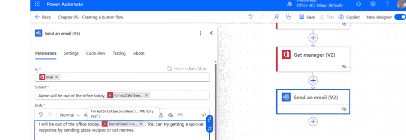

图 5.10 – 添加 Send email (V2) 操作

13. 在 `Send email (V2)` 流中，点击 `To` 字段并添加 `Get manager (V2)` 下的 `Mail` 动态令牌。

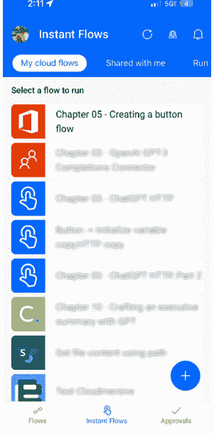

图 5.11 – 添加 Mail 动态令牌

14. 通过填写 `Subject` 和 `Body` 字段完成流。这可以尝试新表达式的好机会。例如，你可以使用 `formatDateTime()` 表达式检索今天的日期并将其格式化为月/日/年。选择 `utcNow()` 表达式作为第一个参数，并将日期作为第二个参数：`formatDateTime(utcNow(), 'MM/dd/yyyy')`

2. 点击流名称以打开流的属性。

3. 点击“运行流”以执行流。

图 5.13 - 运行流

4. 在启动流后，您应该收到一条关于流初始执行状态的应用内通知，如图 5.14 所示：

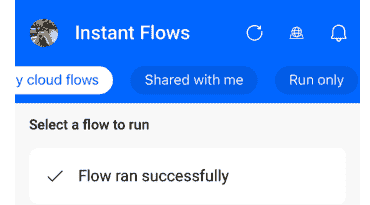

图 5.14 - 流执行状态

关于图 5.14 显示的确认横幅，更有趣的一点是，它只是报告是否成功启动了流，而不是是否实际执行成功。对于这一点，我们需要深入流的运行历史。

## 验证流

你可以从 Power Automate 制作门户 (https://make.powerautomate.com) 和 Power Automate 移动应用查看流的运行历史。由于我们在本章的大部分都在使用移动应用，因此我们将继续使用它。

1. 在 Power Automate 移动应用中，选择“即时流”选项卡。

2. 找到该流并点击三个点图标以展开上下文菜单。点击**详细**显示流的运行历史。

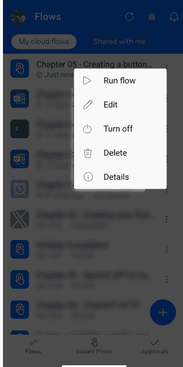

图 5.15 - 展开流的上下文菜单

3. 检查流的输出。在这种情况下，流实际上失败了，因为流用户的账户没有配置经理。参见**图 5.16**。

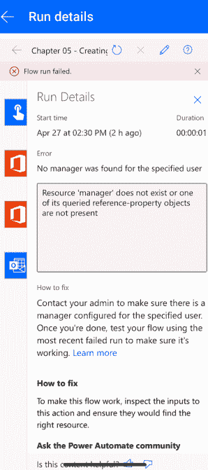

图 5.16 – 查看流的运行历史

4. 解决任何错误并重新运行流。按照步骤 1-3 查看更新后的流运行历史。

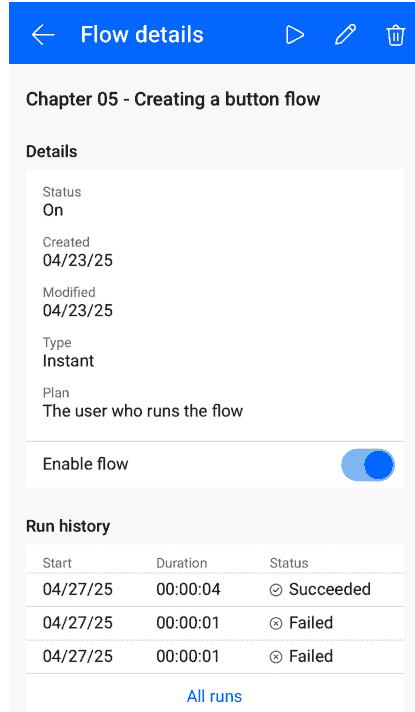

图 5.17 - 检查更新后的流运行历史

流已完成。如果需要，可以通过检查执行流的用户邮箱箱的“已发送”文件夹来执行进一步验证。由于流已通过身份验证，发出的电子邮件将从发送者的邮箱箱发送（并保存到）该邮箱中。

## 总结

在本章中，我们涵盖了新的连接器和操作，以及通过使用 `formatDateTime()` 表达式对 `utcNow()` 的值进行格式化，并将表达式嵌套在另一个表达式中的示例。通过组合多个表达式，你可以以符合流的格式显示变量数据。

正如你所看到的，即时流对于可以从制作 Web门户或移动设备执行的快速任务非常有用。虽然可以在移动设备上创建即时流，但你可能希望考虑在制作界面上创建复杂的流，这样就可以同时在屏幕上看到更多的组件。

在下一章中，我们将学习如何使用推送通知来提高可见性并引起对注意事项的关注。

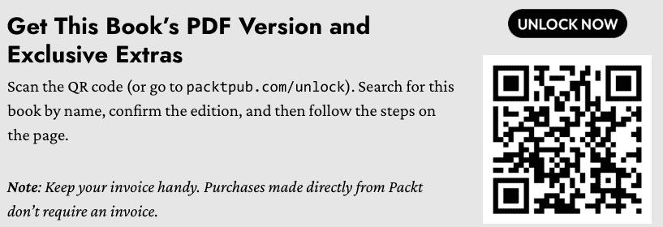
