# 3 处理电子邮件

多年来，已经开发出许多使用电子邮件作为存储、跟踪或处理机制的业务流程。这些流程依赖于手动操作、第三方插件、组件对象模型 (COM) 加项以及 Visual Basic for Applications (VBA) 脚本的结合。随着电子邮件软件版本的更新，技术和方法也必须随之改变。

Power Automate 不使用离散或自定义的代码模块，而是使用基于 REST 的 API 与 Web 服务的数据进行交互。正如你在第 1 章“介绍 Microsoft Power Automate”中所学习到的，连接器被用于连接数据源和端点（以接收、检索、存储或发送数据）。

> 深入探讨
>
> 连接器是结构化的配置文件（通常格式为 JavaScript 对象表示，即 JSON），定义了 Power Automate 如何与其他服务交互以完成自动化任务。Power Automate 操作可以发送、接收和处理各种格式的数据——二进制、图像、字符串、JSON、XML 等。

那么，是什么让 Power Automate 区别于之前的自动化技术呢？

基于 Power Automate 的解决方案优势在于云端，因为对于大多数自动化任务，它不需要安装或运行任何桌面或本地计算机组件（尽管可以安装某些元素来访问本地数据集或操作遗留应用程序）。Power Automate 不依赖于特定版本的桌面客户端，可以使用扩展的组件化架构以无代码（或近无代码）的方式构建。

本章将重点介绍如何使用 Power Automate 管理电子邮件。将涵盖以下主题：

- 学习电子邮件连接器和操作
- 处理电子邮件

在本章结束时，你应该能够将 Power Automate 连接到电子邮件账户，并执行常见任务，如保存附件和发送消息文。

### 学习电子邮件连接器和操作

终端用户自动化最常见的场景之一就是电子邮件。Microsoft Power Automate 可以原生连接到不同类型的电子邮件系统，例如 Office 365、Outlook.com 和 Gmail。

此外，还有如 Mailparser 等第三方插件，它们进一步增强了 Microsoft Power Automate 处理消息的能力。

在处理邮箱时，根据数据源的不同，有多种类型的操作可用。常用操作包括：

- 创建或删除日历事件
- 创建或删除联系人
- 标记电子邮件（例如重要性标记）
- 转发和回复电子邮件或发送新邮件
- 将电子邮件标记为已读
- 下载附件

正如你在上一章中看到的，你可以访问动态内容——与唯一项目相关的属性、元数据和内容。在操作电子信箱内容时，你有许多类型的对象可以作为动态内容参数供使用。

例如，当使用 Get Emails (V3) 操作（`https://docs.microsoft.com/en-us/connectors/office365/#get-emails-(v3)`）检索消息时，你可以处理这些关于消息的常用参数：

- Folder（包含消息的文件夹）
- To（消息的收件人）
- CC（消息的抄送收件人）
- From（消息的发件人）
- Importance（消息重要性）
- Subject（消息主题）
- Search Query（消息过滤查询）

通过在动态内容表单中处理这些参数或字段，你可以创建带有自定义或个性化信息的流，并评估参数以确保流仅在满足某些条件约束时执行。

要查看可用的数百个连接器和操作的完整列表，请访问 `https://docs.microsoft.com/en-us/connectors`。

在下一节中，我们将开始探索 Office 365 电子邮件连接器的某些可能性（尽管在处理 Outlook 或 Gmail 连接器时，许多功能和概念也同样适用）。

### 处理电子邮件

电子邮件自动化的挑战几乎与电子邮件本身一样悠久。正如我们在章开头提到的，多年来已经开发了许多解决方案使用 VBA 脚本、Outlook 规则和 COM 加项等技术来解决这个问题。这些解决方案需要混合编程技能来开发，并依赖于始终运行的桌面计算机来执行命令。

通过 Power Automate 以及 Microsoft 365、Outlook.com 或 Gmail 服务，必要的组件始终处于状态，因此你无需担心断电、软件更新或网络连接问题中断业务流程。在本节中，我们将查看处理电子邮件、处理附件和发送消息的选项。

### 读取电子邮件

许多组织将接收电子邮件（通常发送到共享邮箱）作为启动业务流程的非正式触发器。这可能是销售订单、服务工单或对某些信息的请求。在本文，我们将查看处理传入消息时可用的过滤和选择选项。

要运行此流，我们需要一个 Exchange Online 邮箱和 Microsoft Power Automate 订阅。如果你注册了新的 Microsoft 365 试用，你已经拥有了所需的一切！

对于此场景，我们将通过几个步骤来查看如何使用过滤参数来识别可能与费用报告相关的消息。

### 创建流

要开始操作此流，请遵循以下步骤：

1. 导航到 Power Automate 制作门户（`https://make.powerautomate.com`）。

2. 点击“创建”（Create）并选择“自动化云流”（Automated cloud flow）。

3. 为“流名称”输入值，然后搜索“新邮件到达时”（When a new email arrives）可用触发器：

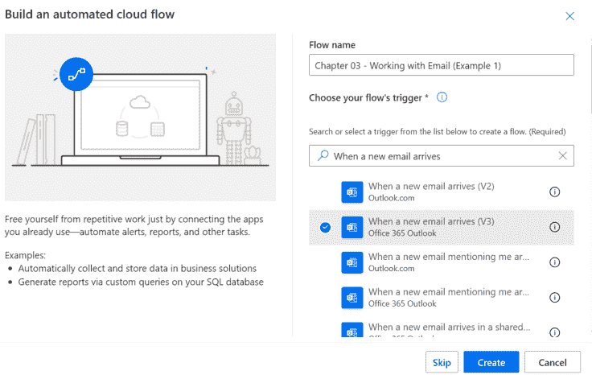

图 3.1 – 创建新的自动化云流

> 还有针对“共享邮箱中有新邮件到达 (V2)”和“群组中有新邮件到达”的触发器。它们中的任何一个都可以使用，但你需要确保用作凭据账户具有访问共享邮箱的权限，或者是被监控群组的成员。当我们在本章稍后创建一个完整的流时，我们将使用共享邮箱。

4. 点击“创建”（Create）。

默认情况下，该流将连接到当前登录账户的 Outlook 邮箱。如果你需要监控不同的邮箱，请选择“新邮件到达 (V3)”触发器，然后点击“连接”（Connection）提供所需的邮箱名称和凭据。

在“新邮件到达 (V3)”弹出窗中，在“参数”（Parameters）选项卡下，点击“显示所有”（Show all）以显示触发器的所有参数。

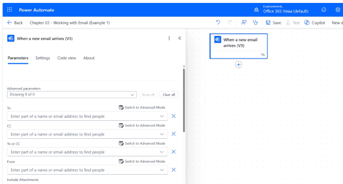

图 3.2 – 显示触发器弹出窗

在高级参数（Advanced parameters）部分，找到“主题筛选”（Subject Filter）字段。在“主题筛选”框中输入如 `report` 之类的文本值。这将确保流仅对符合标准的消息执行操作：

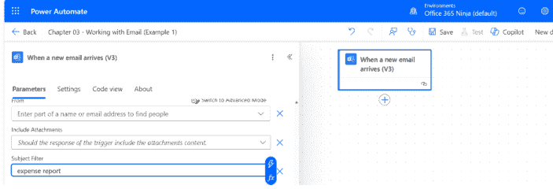

图 3.3 – 添加主题筛选

7. 在触发器后，点击 `+` 或“添加操作”（Add an action）按钮。

8. 在“添加操作”弹出窗中，搜索“操作”（Compose）操作。

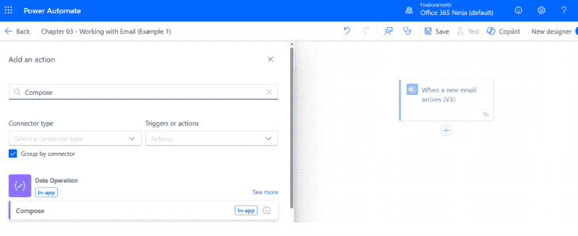

图 3.4 – 添加“操作”操作

> 提示
>
> “操作”（Compose）操作是一个有趣的数据操作，允许你构建新值或变量，或对字符串数据执行中间操作。

9. 在“输入”（Inputs）字段中，选择动态值图标（闪电形状）。

10. 选择一个动态值令牌（例如“主题”Subject），将其添加到“输入”字段中。

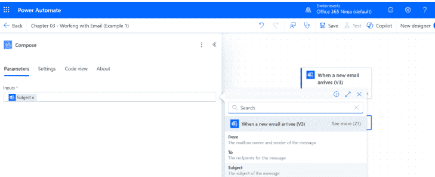

图 3.5 – 选择动态值令牌

11. 点击“保存”（Save）图标保存此流。

# 3 

虽然我们主要通过此流程来学习一些可用选项，但如果你以后需要，可以回来并将其转换为其他用途的内容。

### 执行流程

现在你已经有了一个完整的流程（一个触发器和至少一个其他操作），你可以点击“Test”（测试），然后向被监控的邮箱发送一条消息。我们将检查“Compose”（组合）操作的输出，以查看流程是否执行正确：

- 1. 在菜单栏上，点击 **Test**。
- 2. 在 **Test Flow**（测试流程）弹出窗中，点击 **Manually**（手动）单选按钮，滚动到弹出窗底部，然后点击 **Test**。

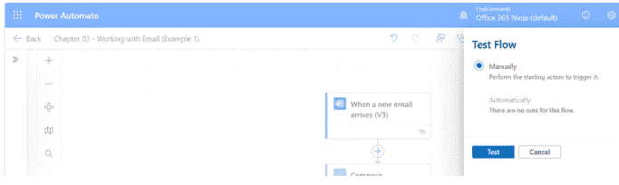

图 3.6 – 测试流程

- 3. 向被监控的邮箱发送一封邮件，包含你配置为过滤器的关键词或短语——例如，**expense report**（费用报表）。
- 4. 点击画布上的任何操作来查看流程的输出。

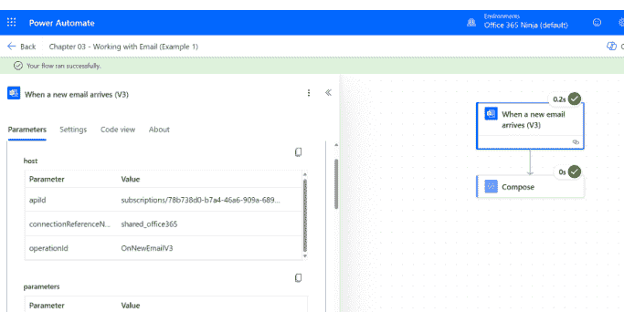

图 3.7 – 查看流程结果

正如在本示例所示，通过使用过滤器，你可以非常快速地缩小流程将要处理的消息范围。“当新邮件到达时 (V3)”触发器有几个合理的过滤选项，包括检查哪些新邮件、特定的发件人或收件人选择、重要性或优先级标记以及附件设置。

### 相似但不匹配

在创建流程时，你可能注意到其他基于电子邮件的触发器，它们看起来很相似：“当提到我的新邮件到达时 (V2)”和“当提到我的新邮件到达时 (V3)”。

“当提到我的新邮件到达时”触发器使用特殊的 Microsoft API 调用来检查包含你身份的 `@mention`（读音为 "at mention"）的消息。它们非常适合寻找专门定制的消息（例如可能被分配任务的消息）。在 Outlook 中创建消息时，使用 `@mention` 作为收件人会将他们添加到“收件人”行。

我们将在第 8 章“处理条件”中查看额外的过滤概念。

### 处理附件

除了能够处理电子邮件中的文本内容外，许多用例还需要保存和处理附件的能力。这种请求常见于用于接收采购订单或费用报表之类的邮箱。你可以使用 Power Automate 将这些项目保存到 OneDrive 或 SharePoint 文档库，通过其他连接器或操作对其进行进一步处理，甚至将其存放在某处以进行痛苦的人工干预。

有时，你可能还会面临需要处理单封邮件中多个附件的情况。幸运的是，Power Automate 对此也有一些内置的智能能力。

# 3 

在下一个示例中，我们将组合一个执行以下操作的示例流程：

- 监控共享邮箱箱中包含 `expense report` 字样的消息
- 将附件保存到名为 Expense Reports 的 SharePoint 站点文档库中
- 将邮件标记为已读
- 将邮件标记为已完成
- 向发件人回复一封确认邮件

为了准备此示例做准备，你需要以下内容：

- 一个带有文档库的 SharePoint 站点，你可以在其中保存文件。如果你不确定如何创建站点或库，可以按照 `https://support.microsoft.com/en-us/office/create-a-document-library-in-sharepoint-306728fe-4b28-b60d-f902e1d75939` 上的步骤来创建一个，或者使用已连接到 Microsoft Teams 团队的现有文档库。
- 一个你已被授予管理权限的共享邮箱。如果你不确定如何创建共享邮箱，可以按照 `https://learn.microsoft.com/en-us/exchange/collaboration-exo/shared-mailboxes` 上的步骤操作，或者直接使用普通用户邮箱。你可能想参考上一个示例中处理普通邮箱的步骤。

如果你为了跟读这本书而注册了新的 Microsoft 365 试用订阅，你将获得所需的一切。在满足这些要求后，你可以开始创建流程。

### 创建流程

为了完成此示例，请遵循以下步骤：

- 1. 导航到 Power Automate 制作门户（`https://make.powerautomate.com`）。
- 2. 点击 **Create**（创建），然后选择 **Automated cloud flow**（自动化云流）。
- 3. 为 **Flow name**（流程名称）输入值，并搜索触发器 **When a new email arrives in a shared mailbox**（当共享邮箱收到新邮件时）：

构建自动化云流

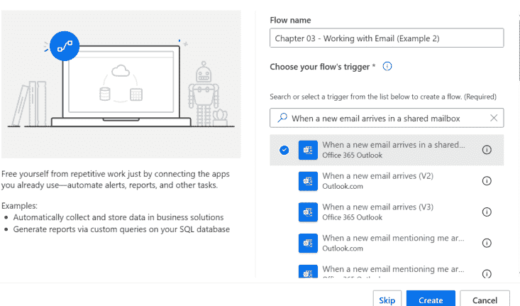

图 3.8 - 创建费用报表流程

- 4. 点击 **Create**。
- 5. 点击 **When a new email arrives in a shared mailbox (V2)** 触发器打开弹出窗。
- 6. 在 **Original Mailbox Address**（原始邮箱地址）字段中，输入你想监控的共享邮箱地址，如图 3.9 所示：

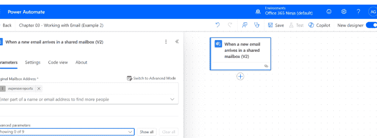

图 3.9 - 添加共享邮箱

- 7. 点击 **Advanced parameters**（高级参数）展开弹出窗，然后在弹出窗内任意位置点击。

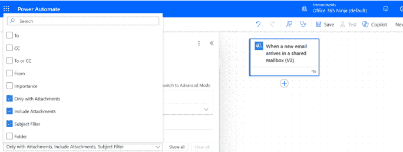

图 3.10 - 选择高级参数

- 在 **Only Attachments**（仅附件）下拉菜单中选择 `Yes`。
- 在 **Include Attachments**（包含附件）下拉菜单中选择 `Yes`。
- 在 **Subject Filter**（主题过滤器）字段中输入 `expense report`。见图 3.11。

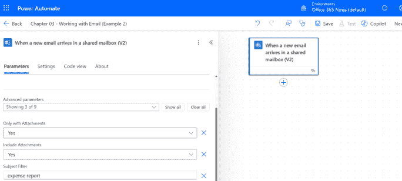

图 3.11 - 设置过滤器选项

- 11. 点击 **Add action**（添加操作）。
- 12. 搜索 **SharePoint**。选择文件操作。

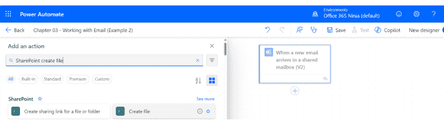

图 3.12 - 选择文件操作

- 13. 点击文件操作打开弹出窗。
- 14. 在文件弹出窗中，选择选项卡。
- 15. 在 **Site Address** 字段中，选择要存储文件的站点。

### 处理电子邮件附件

- 16. 在 **Folder path** 字段中，选择文档库。默认库名为 “Shared”。

- 17. 在 **File Name** 字段中，选择动态值 **Name**。

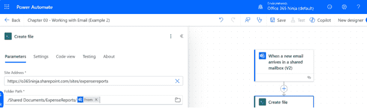

图 3.13 - 选择文件夹路径

- 18. 选择 **Attachments** 令牌后，注意操作被封装在 **Apply to each**（每一个）函数中。Power Automate 知道一封邮件可能有多个附件。

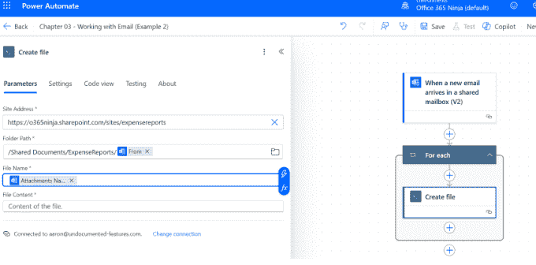

图 3.14 - 每一个

- 19. 在 **File Content** 字段中，选择动态值 **Content**。

- 20. 在 **Apply to each** 函数外部，点击 **Add action**。

- 21. 搜索 **Mark as read** 并选择 **Mark as read or unread** 操作。

- 22. 在 **Message Id** 字段中，选择动态值 **Id**。

- 23. 在 **Advanced parameters** 下，点击 **Show all**（显示所有）以显示所有参数。

- 24. 在 **Original Mailbox Address** 字段中，选择获取邮件的邮箱名称。

- 25. 在 **Mark** 字段中，选择 Yes（将邮件标记为已读）。

- 26. 添加操作。搜索 **Flag email (v2)** 操作并选择它。

- 27. 在 **Message Id** 字段中，选择动态值 **Id**。

- 28. 在 **Original Mailbox Address** 字段中，再次选择共享邮箱地址。

- 29. 在 **Flag Status** 下拉菜单中，选择 **Complete**（已完成）。

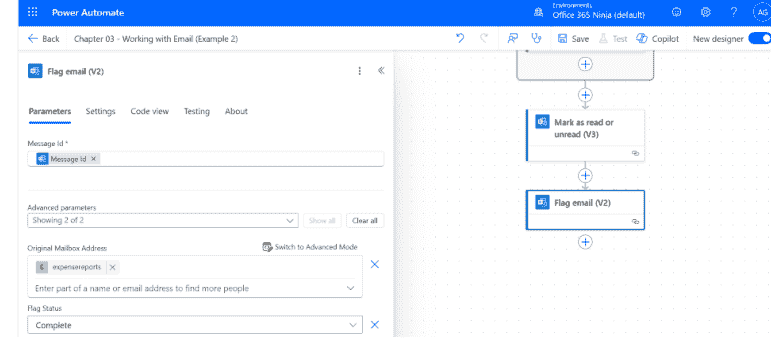

图 3.17 – 更新标记状态

接下来，我们将添加一个确认步骤，让发送者知道他们的消息已收到。

### 添加回复邮件

由于向共享邮箱箱发送内容有时感觉像是在“黑盒”操作，许多组织选择通过回复某种形式的确认邮件，让发送者知道消息已收到并已处理。发送电子邮件也是 Power Automate 的一项常见任务，可以用于许多情况，例如根据某些条件生成基于电子邮件的警报，或者回复发送者（这正是本示例中要做的）。这两种情况的处理流程是相同的。

对于此任务，我们将继续操作当前的费用报告附件流，并回复一条消息，告知发送者文件已收到：

- 1. 导航到流的末并选择“添加操作”（Add action）。

- 2. 由于流使用了共享邮箱箱，请搜索并添加“从共享邮箱箱发送电子邮件 (V2)”（Send email from a shared mailbox (V2)）操作。

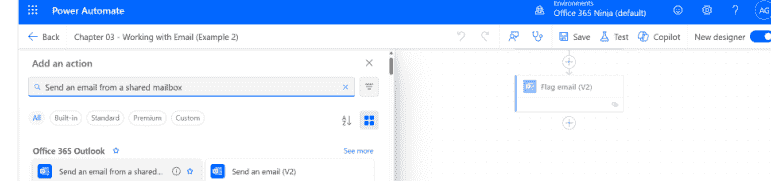

图 3.18 – 添加一个发送邮件的操作

- 3. 在“参数”（Parameters）选项卡中，在“原始邮箱地址”（Original Mailbox Address）下拉菜单中输入共享邮箱箱名称。

- 4. 在“收件人”（To）字段上方，点击“切换到高级模式”（Switch to advanced mode）按钮。这将允许你使用动态值令牌。

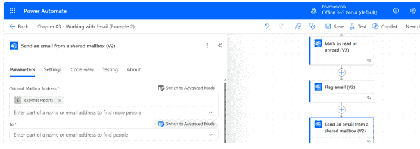

图 3.19 - 为收件人字段启用高级模式

- 5. 在“共享邮箱箱收到新邮件时”操作中插入“发件人”（From）值令牌。这将原始发件者设为新消息的收件人。

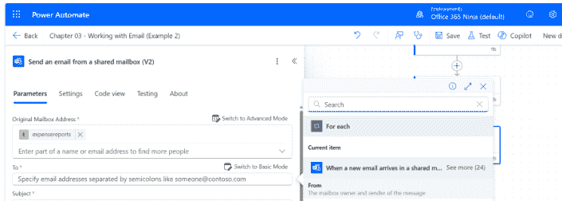

图 3.20 - 添加发件人字段

- 6. 在“主题”（Subject）字段中输入值，例如“已收到：”，然后添加“主题”（Subject）动态内容令牌。

- 7. 在“正文”（Body）字段中输入值。如果需要，你可以在此处使用动态值对象，并使用富文本编辑器更改字体或文本属性。参见图 3.21。

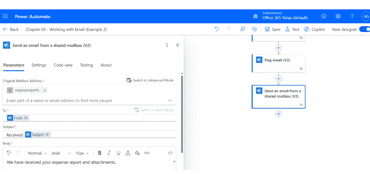

图 3.21 – 配置消息属性

- 如果你想设置额外的选项，例如固定的（或动态的）抄送或密送成员、添加额外的附件，或设置消息重要性，请在“高级参数”（Advanced parameters）下选择相应的选项。

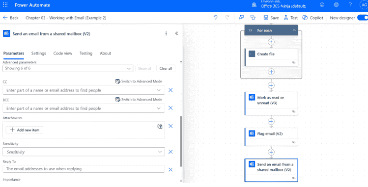

图 3.22 – 配置高级参数

- 点击“保存”（Save）。

是时候测试一下了！

### 执行流

通过执行此流并发送测试消息，你将能够实时检查结果：

- 1. 点击“测试”（Test）打开“测试流”飞出窗口。

- 2. 选择“手动”（Manually）单选按钮，然后点击“测试”。

- 3. 向共享邮箱箱发送符合要求的消息（包含一个附件）且主题包含“费用报告”文本。

接下来，我们将检查流的运行历史和 SharePoint 站点，看看它是否按照我们的预期执行！

### 验证流

在本节中，我们将检查几个地方以确保流运行正常。

首先，你可以查看画布上的流输出。如果成功完成，你将看到一个绿色的通知横幅，显示“您的流已运行成功”，如图 3.23 所示：

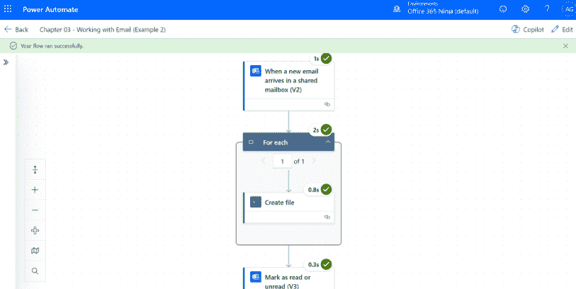

图 3.23 - 查看流运行情况

选择画布上的任何卡片即可显示流在每个步骤中处理的数据详情。例如，通过选择“创建文件”（Create file）操作卡片，你可以查看所处理的电子邮件详情、保存它的站点（包括文件夹路径）以及文件名。

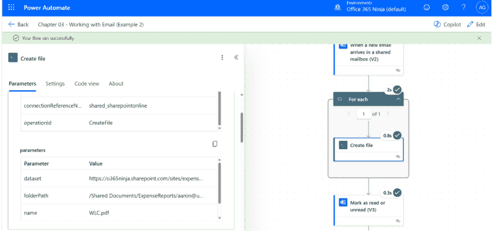

你还可以检查 SharePoint 站点的文档库，查看在你发送邮件的帐户地址之后是否存在新文件夹，并进入该文件夹确保任何附件都已保存。

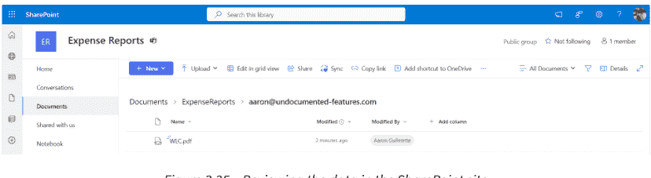

图 3.24 - 查看流的操作卡片详情

图 3.25 - 查看 SharePoint 站点中的数据

### 处理电子邮件

最后，你可以检查共享邮箱箱以验证消息是否已标记为“已读”并设置了“完成”（Complete）标记，如图 3.26 所示：

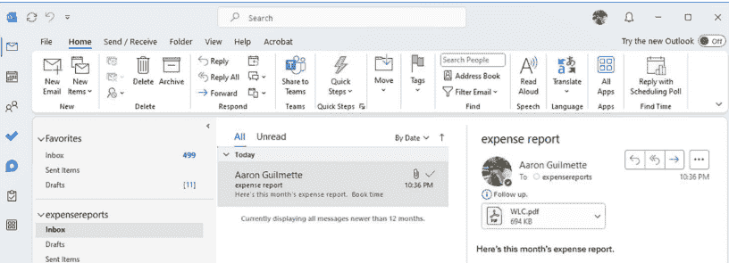

图 3.26 – 查看收件箱

如果你想设置额外的选项，例如固定的（或动态的）抄送或密送成员、添加额外的附件，或设置消息重要性，请在“高级参数”下选择相应的选项。

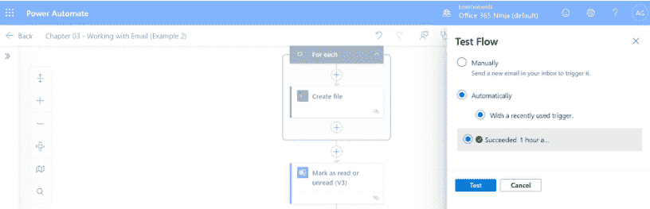

图 3.27 – 配置高级参数

### 总结

在本章中我们了解到 Power Automate 可以处理附件。我们还看到了如何使用文件相关操作。在下一章，我们将关注一些文件相关概念，如复制文件。

