# 第 10 章：开始使用审批

你在前几章中使用的流在很大程度上是自动化的（例如检测新文件或电子邮件），或由用户操作触发的（例如发送模板电子邮件的按钮流）。在本章中，我们将开始探索需要额外的用户操作才能继续的流，例如审批流。

审批流需要一个特殊的服务，用于存储与流相关的状态信息。`Dataverse`（以前称为 `Common Data Service`）是更复杂流（如审批）的基础。

具体来说，本章将涵盖以下主题：

- 了解 `Dataverse`
- 创建审批流
- 使用审批流

在本章结束时，你将拥有 `Dataverse` 的实用知识，并能够创建基本的审批流。

让我们开始吧！

## 了解 Dataverse

`Microsoft Dataverse`（以前称为 `Common Data Service`，或 `CDS`）可以被比作数据库。它由称为表格（tables，以前称为实体）的数据对象组成。就像电子表格一样，表格具有列（以前称为属性）的概念。

微软文档目前对存储在 `Dataverse` 中的对象类型有两种单独的描述。我们已经在第 1 章“Power Automate 简介”中涵盖了新的命名法。然而在某些情况下，取决于用户界面 (`UI`)、协议或使用的技术，`Dataverse` 的术语可能会发生变化。

术语最大的变化之一是将实体（entity）重命名为表格（table）。你将遇到许多 `UI` 组件仍以旧名称引用 `Dataverse` 元素。当我们在 `UI` 中遇到这些内容时，我们会指出它们。

`Dataverse` 拥有涵盖许多使用场景的标准表格。标准表格位于几个组或类别中，如下所示：

| 表格类型 | 描述 |
|---|---|
| 标准 | 也称为开箱即用的表格，这些表格包括账户（`Account`）、部门（`Business Unit`）、联系人（`Contact`）、任务（`Task`）和用户（`User`）。 |
| 活动 | 用于管理在日历上执行的操作。活动表格包括预约（`Appointment`）、电子邮件（`Email`）、信函（`Letter`）、电话（`Phone Call`）、重复预约（`Recurring Appointment`）和任务（`Task`）。 |
| 虚拟 | 将填充来自 `Dataverse` 外部源数据的表格。 |
| 弹性 | 将超过数行的表格。 |

表 10.1 – `Dataverse` 表格类型

除了这些标准表格，`Dataverse` 还允许创建自定义表格以支持特定的业务流程或目标。

有关表格及其可以执行的操作的完整列表，请参考此参考：`https://learn.microsoft.com/en-us/power-apps/developer/data-platform/reference/about-entity-reference`。

涉及审批流，`Dataverse` 用于在流的整个期间在表格中存储状态信息。没有这种数据存储能力，审批流将没有机制来跟踪状态或任何审批分支。

虽然审批流依赖 `Dataverse` 运行，但终端用户不需要直接与 `Dataverse` 交互来创建审批流。有关 `Dataverse` 事务的所有集成和读取操作都是通过流创建过程内部透明地处理的——用户无需处理它们。

接下来，我们将学习创建审批流的步骤。

## 创建审批流

审批流可以涵盖许多场景，例如请求休假、经理签署报销单，或业务所有者签署发布的产品营销材料。审批流通常分为两类：

- **自动：** 例如当向 `SharePoint` 文档库或列表添加新项目时。你可能使用自动流来启动报销单的审批过程，该过程在文档上传到站点时触发。
- **即时：** 例如当用户从现有文档、列表或应用程序手动启动审批。

审批（`Approvals`）连接器具有流可以交互的操作和对象类型，尽管我们主要处理响应和结果。你可以在此处了解更多关于审批连接器的信息：`https://learn.microsoft.com/en-us/connectors/approvals`

在启动审批时，工作流会向审批者发送电子邮件并在审批者的队列中添加项目。审批可以通过电子邮件、`Teams` 审批应用或 `Power Automate` 门户中的审批部分进行响应。在示例中，我们将创建一个休假请求的示例审批。此流具有以下前提条件：

- 具有已填充经理（`Manager`）属性的 `Entra` 用户标识
- 带有现代列表的 `SharePoint` 现代团队站点，包括开始日期和结束日期的日期时间列

在接下来的章节中，我们将设置一个支持审批的环境，然后创建审批流。

## 配置前提条件

首先，我们将创建将用于流的 `SharePoint` 站点和列表。

### 创建 SharePoint 站点和列表

在此例中，请求将添加到 `SharePoint` 列表中。你可以按照以下步骤创建带有列表的站点：

1. 导航到 `Microsoft 365` 管理中心（`https://admin.microsoft.com`），使用管理员身份登录，并导航到 `SharePoint` 管理中心（管理中心 | `SharePoint`）。
2. 选择站点（`Sites`） | 活动站点（`Active sites`）并点击创建（`Create`）。

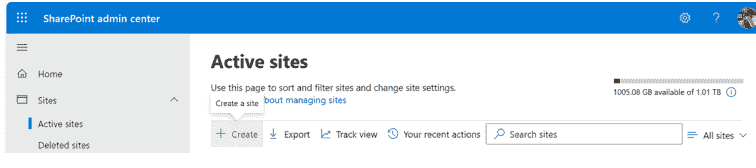

3. 选择团队站点（`Team site`）。
4. 选择标准团队模板（`Standard team template`）。
5. 点击使用模板（`Use template`）。

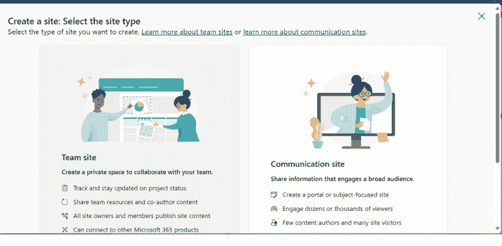

6. 输入站点名称，例如 `Vacation Requests`。
7. 填充站点描述、组电子邮件地址、站点地址、地址和组所有者的其他属性。点击下一步（`Next`）。

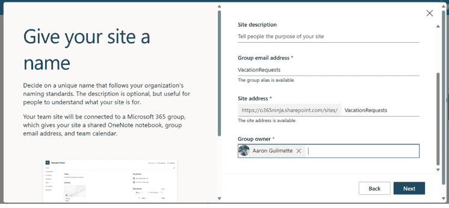

图 10.3 – 配置站点属性

8. 将隐私设置设置为公共（`Public`），选择语言并设置时区。点击创建站点（`Create site`）。
9. 在添加站点所有者和成员页面，添加任何其他成员并点击完成（`Finish`）。
10. 导航到新站点。
11. 展开导航菜单并选择站点内容（`Site contents`）。

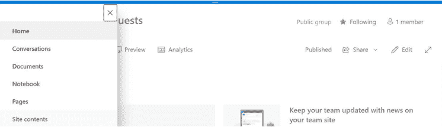

图 10.4 – 访问导航菜单

12. 点击“新建 (`New`) | 列表 (`List`)”，如图 10.5 所示。

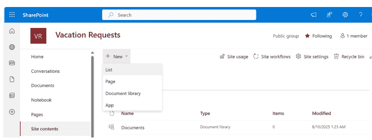

13. 选择“空白”模板类型。
14. 为列表输入名称（例如 `Requests`），并点击“创建 (`Create`)”。

接下来，我们将为列表配置额外的列。

### 配置列

在本节中，我们将配置存储和处理请求数据所需的列。接下来的步骤介绍如下：

1. 点击“添加列 (`Add column`)”。

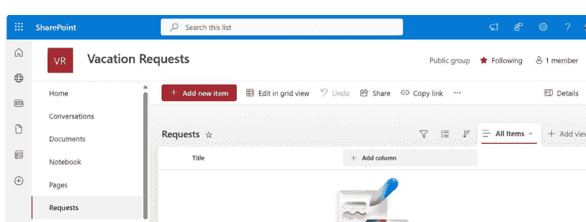

图 10.6 - 查看列表

2. 选择“日期和时间 (`Date and time`)”作为类型并点击“下一步 (`Next`)”。
3. 在“创建列 (`Create column`)”浮窗中，为开始日期列输入名称，例如“从 (`From`)”。

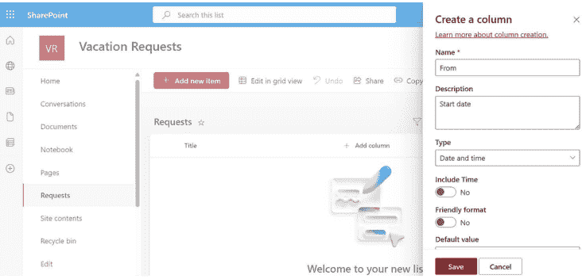

图 10.7 - 创建“从 (`From`)”列

4. 点击“保存 (`Save`)”。
5. 点击“添加列”，选择“选择 (`Choice`)”作为类型，并将名称设置为“状态 (`Status`)”。点击选择选项并将它们重命名为“待处理 (`Pending`)”、“已批准 (`Approved`)”和“已拒绝 (`Denied`)”，如图 10.8 所示。将默认值设置为“待处理 (`Pending`)”，完成后点击“保存”。

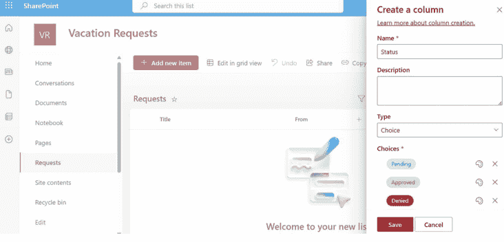

图 10.8 - 配置选择列

6. 根据下表添加额外的列（以及您需要的任何其他详细列）：

| 名称 | 类型 | 可能的值 | 默认值 |
|---|---|---|---|
| 收件人 (`To`) | 日期和时间 | [NA] | [NA] |
| 详情 (`Details`) | 多行文本 | [NA] | [NA] |

表 10.2 – 列表列设置

您可以根据自己的逻辑自由地拖动这些列的顺序。

您的 `SharePoint` 站点和列表现在已准备好接收休假请求！接下来，我们将创建实际的审批流。

### 创建审批

创建 `SharePoint` 站点和列表后，我们需要创建一个实际的审批，以便在请求出现在列表中出现时对其进行处理。按照以下步骤创建审批流：

1. 导航到 `Power Automate` 网页门户（`https://make.powerautomate.com`）。
2. 点击“创建 (`Create`))。在“从空白开始 (`Start from blank`)”下，选择“自动化云流 (`Automated cloud flow`)”.
3. 输入流名称，例如“休假审批 (`Vacation Approval`)”。搜索“`SharePoint` 创建新项时 (`When an item is created`)” 触发器。选择它并点击“创建”。
4. 点击“创建新项时 (`When an item is created`)”触发器。
5. 在“参数 (`Parameters`)”选项卡中，在“站点地址 (`Site Address`)”下拉菜单中，选择您在上一步中创建的 `Vacation Requests` `SharePoint` 站点。如果站点未显示，使用下拉菜单中的“自定义值 (`Custom value`)”选项手动指定地址。
6. 在“列表名称 (`List Name`)”下拉菜单中，选择您在先决条件中创建的列表。如果列表未显示，使用下拉菜单中的“自定义值 (`Custom value`)”选项手动指定列表。

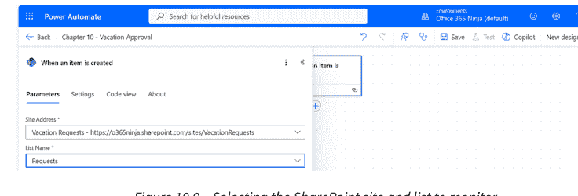

7. 添加操作 (`Add an action`)。
8. 添加“获取配置 (`Get profile (V2)`)”操作.

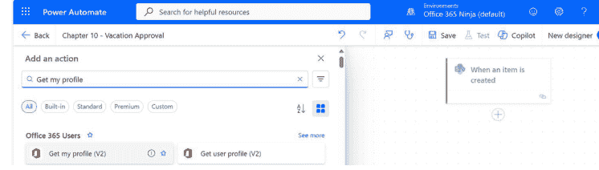

图 10.10 – 添加“获取配置 (`Get profile (V2)`)”操作

9. 添加操作。
10. 在“获取经理 (`Get manager (V2)`)”操作中添加“获取经理”框。
11. 在“获取经理 (`V2`)”操作的“用户 (`UPN`)”值中，添加来自“获取配置 (`V2`)”操作的“用户主体名称 (`User Principal Name`)”动态值令牌：

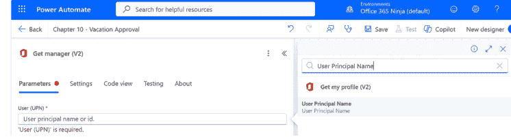

图 10.11 – 添加“用户主体名称”动态内容值

12. 添加操作。
13. 选择“启动并等待审批 (`Start and wait for an approval`)”操作，如图 10.12 所示。

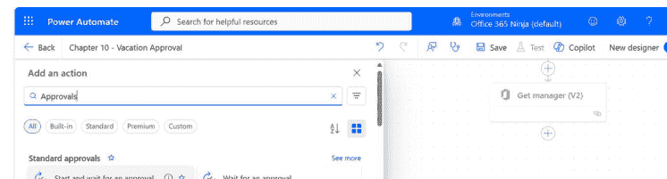

图 10.12 – 添加审批操作

14. 在“参数 (`Parameters`)”选项卡中，展开“审批类型 (`Approval type`)”下拉菜单，并选择“自定义响应 - 等待单个响应 (`Custom Responses - Wait for one response`)”。

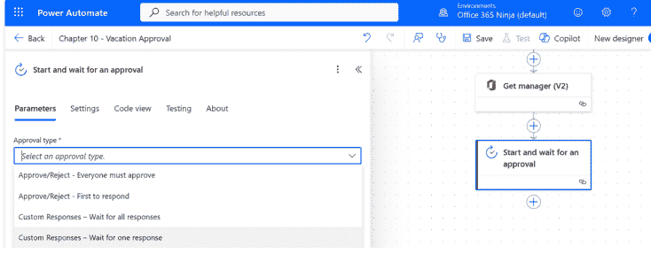

图 10.13 - 选择自定义响应审批类型

15. 在“响应选项 (`Response options`)”下，输入文本“批准 (`Approve`)”。
16. 选择“新建项 (`Add new item`)”并添加另一个文本为“拒绝 (`Deny`)”的选项。这些选项将在审批发送给审批者时显示：

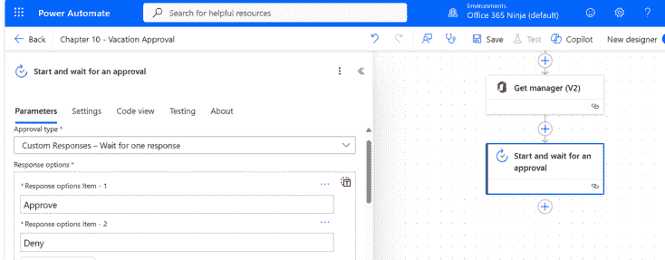

图 10.14 - 配置响应选项

17. 在标题 (`Title`) 字段中，输入将向审批者显示的标题。可以使用来自“获取配置 (`V2`)”操作的“显示名称 (`Display Name`)”动态内容来填充它：

18. 在“分配 (`Assigned`)”框中，添加来自“获取经理 (`V2`)”操作的动态令牌：

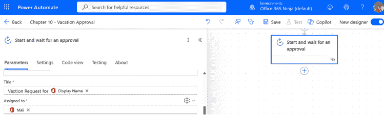

图 10.15 - 配置标题和分配

19. 在**详情 (`Details`)**框中，输入您想要包含的任何额外信息。
20. 在“链接 (`link`)”框中，添加来自“创建新项时”的动态令牌。

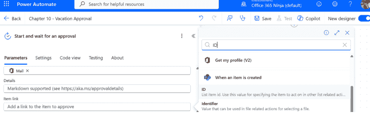

图 10.16 - 配置审批操作

21. 添加操作。
22. 选择“控制 (`Control`)”。
23. 在框中，添加来自“启动并等待审批”的动态令牌。

### 开始审批

一旦创建了站点和列表，我们需要创建一个审批来处理列表中出现的请求。

24. 在“操作符 (`Operator`)”下拉菜单中，选择“等于 (`equal to`)”。
25. 在“是 (`True`)”分支下，添加操作。
26. 选择“更新项 (`Update`)”。
27. 在“站点地址 (`Site Address`)”下拉菜单中，选择您之前创建的 `Vacation Requests` `SharePoint` 站点。
28. 在“列表 (`List Name`)”下拉菜单中，选择您在先决条件中创建的列表。
29. 在“`ID`”字段中，选择来自“创建新项时”的令牌。
30. 在“标题 (`Title`)”字段中，选择来自“创建新项时”的令牌。
31. 在“状态值 (`Status Value`)”下拉菜单中，选择“已批准 (`Approved`)”。

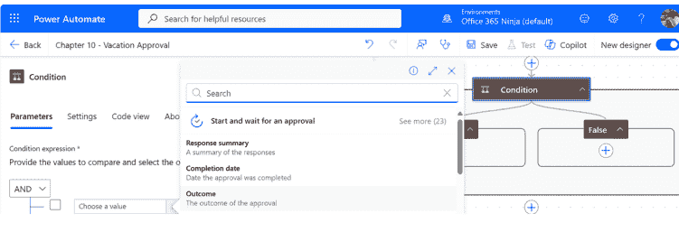

图 10.17 - 配置响应

32. 右键点击“更新项”操作并“复制 (`Copy`)”。

图 10.18 - 复制操作

33. 在“否 (`False`)”分支中，点击 `+` 图标，然后粘贴操作。

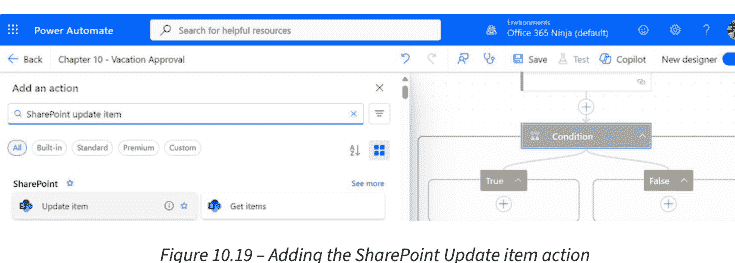

图 10.19 - 粘贴操作

34. 在“状态值 (`Status Value`)”下拉菜单中，选择“已拒绝 (`Denied`)”。
35. 点击“保存 (`Save`)”保存流。

### 添加日历事件和通知

通过在“是”分支中添加日历安排，可以增加此审批的实用性。根据需要在电子邮件中包含额外信息。使用以下可选步骤通过共享日历进行扩展：

1. 在“休假审批”流中，导航到“是”分支的末端。
2. 添加操作。
3. 选择“`Office 365 Groups`”连接器下的“创建组事件 (`Create a group event (V2)`)”操作：

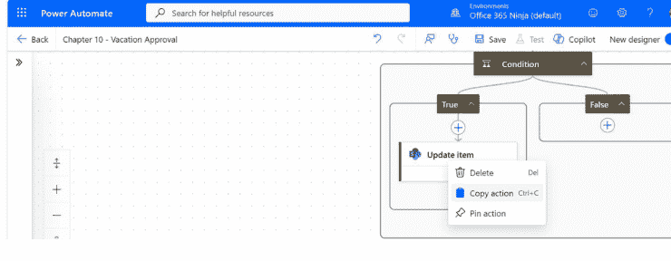

图 10.21 - 添加组事件

4. 在“参数 (`Parameters`)”选项卡中，在“组 `ID` (`Group Id`)”下拉菜单中，选择与审批 `SharePoint` 站点对应的 `Microsoft 365` 组。只要连接账户具有权限，也可以选择其他组。
5. 在“主题 (`Subject`)”字段中，输入动态内容令牌和静态内容组成的任何值，例如来自“`SharePoint` 创建新项时”的“创建者显示名称 (`Created by Display Name`)”令牌。
6. 在“开始时间 (`Start Time`)”字段中，添加来自“创建新项时”的开始时间动态令牌。
7. 在“结束时间 (`End Time`)”字段中，选择来自“创建新项时”操作的结束时间动态令牌。
8. 展开“高级参数 (`Advanced parameters`)”。选择“全天 (`Is All Day`)”和“显示为 (`Show As`)”进行显示。
9. 将“全天”设置为“是 (`Yes`)”并将“显示为”选项设置为“空闲 (`Free`)”。根据您的喜好编辑任何额外选项。

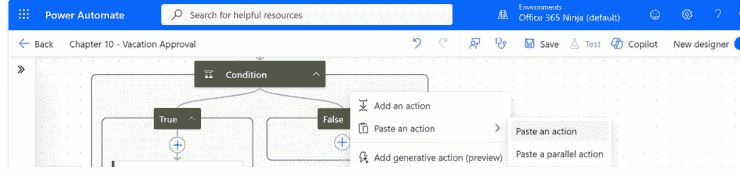

图 10.22 - 配置更新项操作

10. 点击保存保存流。

`Microsoft 365` 组日历现在将更新并显示请求者已批准的休假日历项目。

### 进一步修改

除了在批准后在 `Microsoft 365` 组日历创建条目外，您还可以添加另一个操作来在请求者的日历上配置日历事件。另一个实用的修改可能是向请求者生成电子邮件以进行批准或拒绝。

接下来，我们将开始使用审批。

## 使用审批流

回想一下该流，它包含几个步骤：

- 添加到 SharePoint 列表的请求
- 触发的审批
- 审批响应
- 更新 SharePoint 列表项

让我们从请求者的角度来看审批。

## 开始审批

测试“创建”此流最简单的方法是启动一个休假请求。请按照以下步骤操作：

1. 导航到作为本次练习一部分创建的 SharePoint 列表。
2. 在列表中，点击“新建”以创建一个新的请求项。
3. 填写表单。添加标题，选择开始和结束日期，并点击保存。

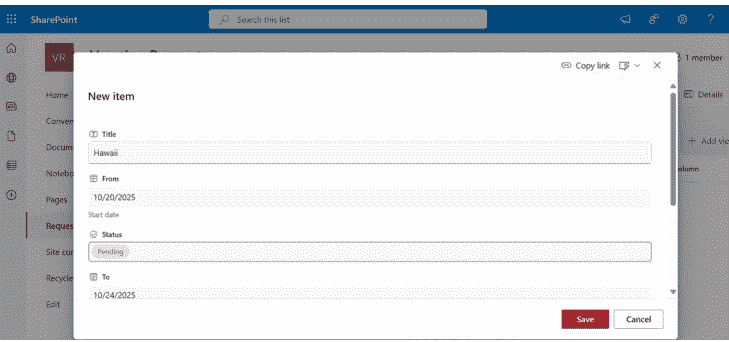

图 10.25 - 创建新的休假请求

4. 点击保存。

此时，您已经创建了一个可以作为审批流触发器的 SharePoint 列表，以及“创建”了审批流本身。最后，您触发了该流。接下来，我们将看到在审批者端看起来是什么样。

## 响应审批请求

作为审批者，您将收到一封电子邮件通知，说明需要采取操作。审批也会出现在 Power Automate 网页门户和移动端应用程序的“审批”部分，以及 Microsoft Teams 中的“审批”应用中。可以从这些位置中的任何一个处理审批。

审批具有根据审批流中选择的各种响应选项项的按钮。在接后的截图中，您可以看到我们在创建审批流时配置的选项显示在电子邮件正文中。审批者可以选择“批准”或“拒绝”，输入任何可选信息，然后点击“提交”。

图 10.26 显示了审批邮件发送给审批者时的样子：

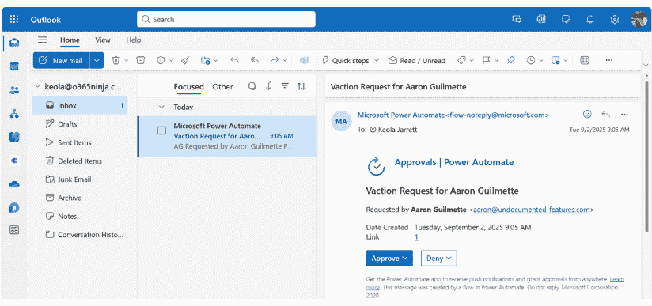

图 10.26 – 审批请求电子邮件

如果您的组织部署了审批 Teams，则该请求在那里可用，如图 10.27 所示：

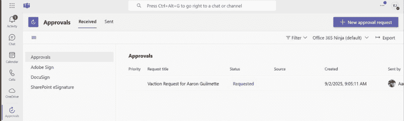

图 10.27 – Microsoft Teams 中的审批应用

最后，审批者还可以登录 Power Automate 网页门户并导航到“审批”，以查看并处理挂起的审批请求：

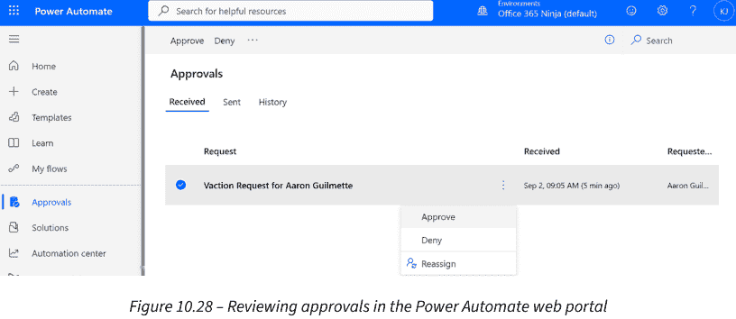

如您所示，可以从任何环境访问并处理审批。由于审批显示在多个位置，审批者可能无需离开应用程序上下文，就可以以最少的中断继续工作。

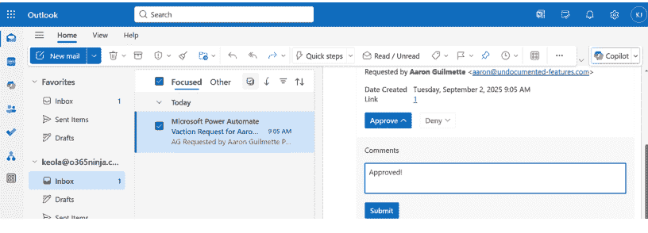

选择选项后，项会在 SharePoint Online 列表中更新，如接下来的截图所示：

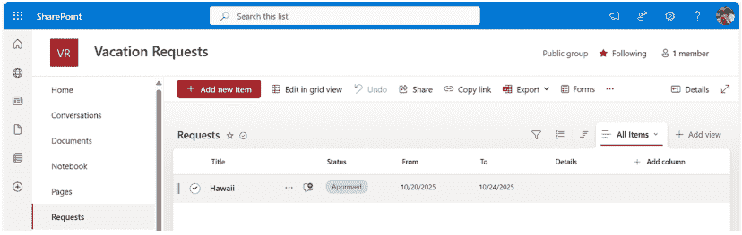

图 10.30 - 更新的列表项

如果您通过日历触发了流，您也将在应用中看到该项：

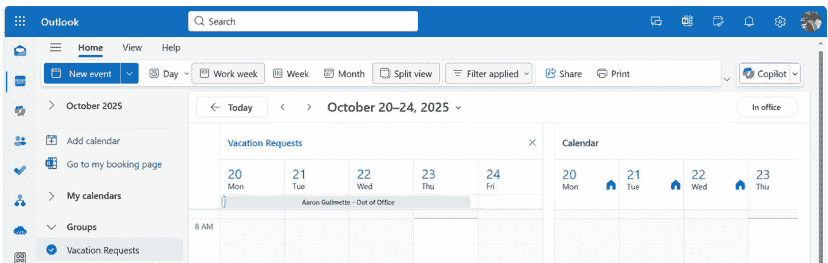

图 10.31 - 审批请求

选择选项后，项会在 SharePoint Online 列表中更新，如接下来的截图所示。

## 总结

在本章中，您学习了最流行且实用的功能之一：审批。您学习了如何创建审批、触发审批并响应。您还学习了如何从多个位置访问审批。在下一章中，我们将探索更复杂的审批场景。

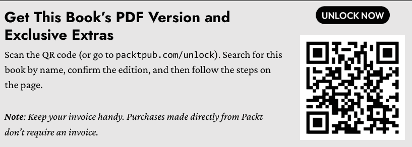
