# 6 生成推送通知

推送通知是一种通信机制，用于将消息（通常是弹窗或横幅）传递到终端用户的设备。推送通知是让用户与数据和活动保持连接、驱动参与场景或提示用户执行操作或相关任务的方便方法。

Microsoft Power Automate 允许用户作为流的一部分配置他们自己的推送通知。例如，除了处理电子邮件附件外，你可能希望在处理完电子邮件附件时向你的设备发送通知。

在本章中，我们将查看推送通知如何工作，以及如何将通知集成到流中。我们将涵盖的主题如下：

- 学习推送通知

- 为来自你经理的邮件配置通知

- 介绍条件

- 创建流

- 检查通知

- 重新制作流

有效使用通知可以帮助你掌握重要任务。让我们开始吧！

## 学习推送通知

推送通知使用基于订阅的平台通知系统 (PNSes) 进行递送。PNS 是移动平台特有的。平台包括 Android 设备的 Firebase、iOS 平台设备的 Apple 推送通知服务 (APNs) 以及基于 Windows 的设备的 Windows 通知服务。开发多平台应用程序的供应商必须与其希望提供推送通知的每个 PNS 集成。

以下图描述了 PNS 的基本概述：

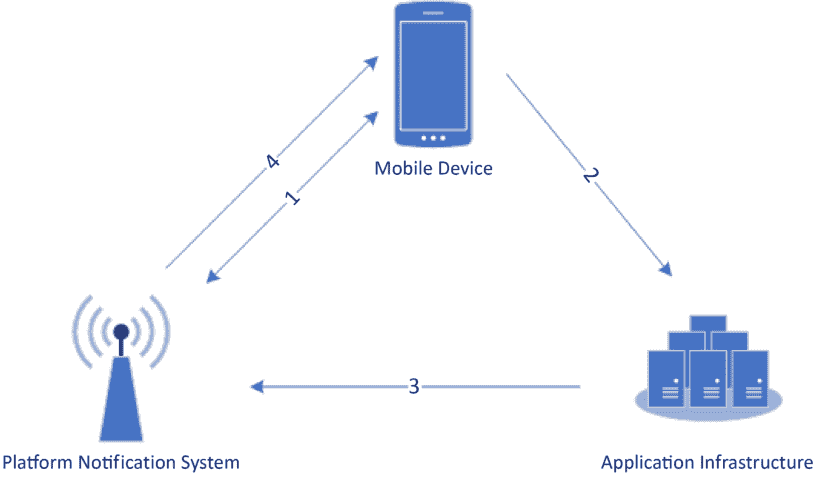

图 6.1 – 推送通知系统概述

为了实现推送通知，开发者必须编写客户端和服务器应用程序，使其能够与推送通知系统通信。推送通知通常包含几个组成部分：

- 移动设备：终端用户设备上的应用程序将在应用程序或服务器基础设施以及平台的推送通知服务注册，在此过程中生成唯一的标识令牌 (token)。

- 应用程序或服务器基础设施：应用程序在终端用户设备上交互的服务或应用程序。

- 平台或推送通知系统：该系统管理应用程序基础设施与用户移动设备之间的通信。PNS 处理网络状况、设备可用性以及由于错误或离线设备导致的重试等事项。

推送通知基于客户端设备与应用程序、应用程序服务器基础设施以及推送通知系统之间的订阅和处理系统。激活时，启用通知的应用程序联系 PNS 并请求一个称为句柄 (handle) 的特殊令牌。该令牌标识请求订阅特定服务的应用程序和单个设备。句柄或令牌代表用户设备和应用程序的唯一配对。它不能用于任何其他应用程序或设备组合。


当用户配置应用程序接收通知时，应用程序向 PNS 请求句柄并将其保存到应用程序服务器的基础中。当应用程序基础设施发生触发通知的事件时，应用程序基础设施联系 PNS，并提供与事件或通知对应的句柄。反之，PNS 使用句柄联系目标设备上的应用程序。

在此语境下，我们将使用 Power Automate 移动应用为通知请求句柄。当满足流条件时，Power Automate 服务将与 PNS 通信以通知你的移动设备。通知是 Power Automate 操作，可以在需要警报时配置，并通过多种方式递送，例如推送通知、电子邮件、Teams 活动馈或 Power Apps 应用。适用于 Power Automate 或 Office 365。

接下来，你将看到如何配置集成推送通知的移动设备。

## 为来自经理的邮件配置通知

配置使用推送通知的流非常简单。你可以向现有流添加通知，也可以创建一个利用推送通知的新流。

在示例中，我们将创建一个新流，当邮箱箱接收来自经理的邮件时发送推送通知。我们将使用在上章中学到的以下组件：

- 连接器：`Office 365 Users` 和 `Outlook`
- 操作：`Get my profile (V2)` 和 `Get manager`

我们还将引入一个新的连接器和新操作：

- **Notifications 连接器**：此连接器允许与通知服务交互。可以在此处了解更多 notifications 连接器：https://learn.microsoft.com/en-us/connectors/flowpush
- **Send me a mobile notification 操作**：此操作向移动设备发送推送通知。可以在此处了解更多 `Send me a mobile notification` 操作：https://learn.microsoft.com/en-us/connectors/flowpush#send-me-an-email-notification

**Condition 控制操作**：允许根据条件（例如属性的值）执行不同的操作。可以在此处了解更多 **Condition** 控制：https://learn.microsoft.com/en-us/power-automate/add

取决于应用程序如何配置，你可能可以配置通知以利用深度链接，深度链接将用户带到相关项目（而不是项目列表）。可以在此处了解更多深度链接：https://www.microsoft.com/en-us/power-platform/blog/powerapps-deep-linking。

你还会注意到我们正在引入一种新类型的项目——**Condition** 控制。它不依赖于特定连接器或服务的功能，该控件可以帮助你的流决定要执行哪些操作。

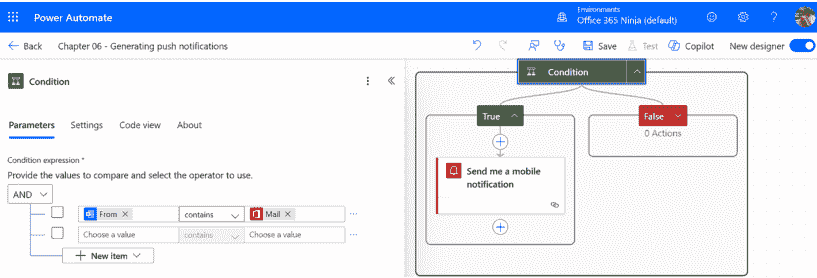

图 6.2 – 条件示例

`if` 语句通常遵循以下示例之一：

```
if [条件为真],则 [执行操作]
```

或者

```
if [条件为真],则 [执行操作];
else [执行其他操作]
```

Power Automate 中的条件控制工作方式与此非常。你可以根据流中存在的值来控制流将执行的一系列操作。

Power Automate 条件可以执行多种不同类型的评估，如下列表的操作符所示：

- 包含 (contains)
- 不包含 (does not contain)
- 等于 (is equal to)
- 不等于 (is not equal to)
- 大于 (greater than)
- 大于等于 (greater than or equal to)
- 小于 (is less than)
- 小于等于 (less than or equal to)
- 开头 (starts with)
- 不开头 (does not start with)
- 结尾 (ends with)
- 不结尾 (does not end with)

在对值进行相互评估时，你需要确保针对你正在评估的数据类型使用了正确的操作符。例如，在比较或测试数值时，你会使用诸如**大于**或**小于等于**等操作符。你可以使用某些操作符（如**等于**和**不结尾**）来评估文本字符串和数值。

Power Automate 条件还允许使用多个条件，以及评估一组条件。Power Automate 甚至支持嵌套条件，如图 6.3 所示：

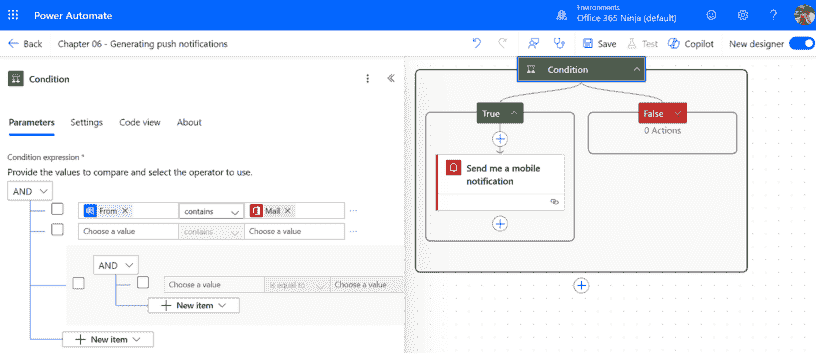

图 6.3 - 嵌套条件示例

任何条件评估的结果都是布尔值：条件要么评估为（真/true），要么为（假/false）。

## 创建流

在示例示例中，我们将使用条件来控制何时发送通知。目标是在当你收到经理的电子邮件时发送推送通知。

按照以下步骤操作，查看如何使用条件控制：

1. 导航到 Power Automate 制作器门户 (https://make.powerautomate.com)。点击“创建”并选择“自动化云流”。
2. 输入名称并选择“当有新邮件到达 (V3) Office 365 Outlook”触发器。点击“创建”。
3. 添加操作。选择“获取我的配置 (V2) Office 365”操作：`Get my profile (V2)`。
4. 添加操作。选择“获取经理 (V2)”操作：`Get manager (V2)`。
5. 在“获取经理 (V2)”面板中，在“用户 UPN”字段中，添加来自“获取我的配置 (V2)”操作的“用户主要名称 (User Principal Name)”动态值。


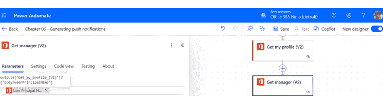

图 6.4 – 配置“获取经理 (V2)”操作控件。

6. 添加操作。在**添加操作**控件中，选择**条件**控制控件。

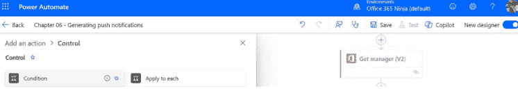

图 6.5 – 添加条件控件

7. 在**条件**控制控件中，选择**参数**选项卡。
8. 在第一个**选择值**字段中，添加“**当有新邮件到达** (V3)”操作下的**发件人 (From)**动态值令牌。
9. 对于评估操作符，选择**包含 (contains)**。
10. 此步的目标是检查电子邮件发件人的值是否匹配**获取经理 (V2)**操作的结果。在第二个**选择值**字段中，添加来自“**获取经理 (V2)**”操作的**邮件 (Mail)**动态值令牌。参见图 6.6。

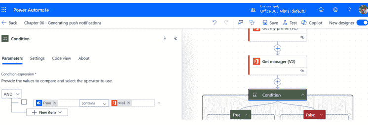

图 6.6 – 配置条件控件评估

11. 在 sometimes的**真 (True)** 分支中，添加一个操作。
12. 在“添加操作”面板中，选择“向发送手机通知”操作。

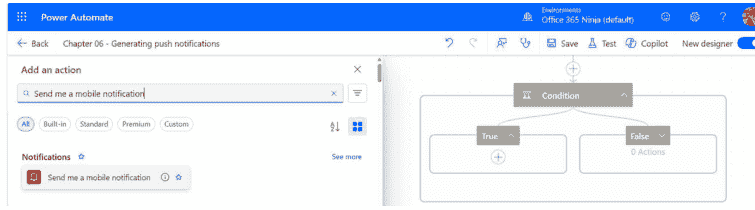

图 6.7 – 添加“向发送手机通知”操作

13. 在“向发送手机通知”操作面板中，添加将作为移动设备上通知一部分显示的文本。

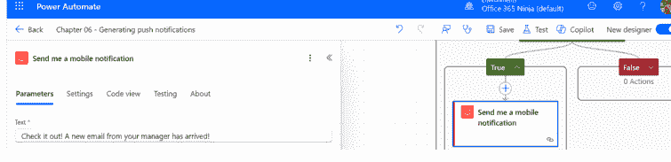

图 6.8 – 配置通知文本

14. 在“高级”下，点击“显示”。
15. 在“链接”字段中，添加来自“**当有新邮件到达**”操作的动态值。
16. 在链接字段中输入描述性文本。参见图 6.9：

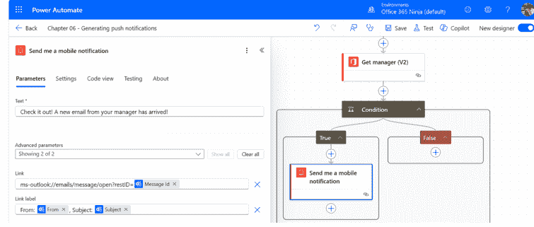

图 6.9 – 配置“向发送手机通知”操作

17. 点击“保存”。

## 审核通知

当你收到符合条件的电子邮件时，你将收到通知。

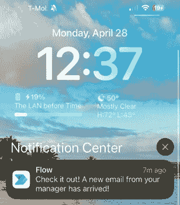

图 6.10 – 电子邮件的推送通知

点击通知将带你进入 Power Automate，如下所示：

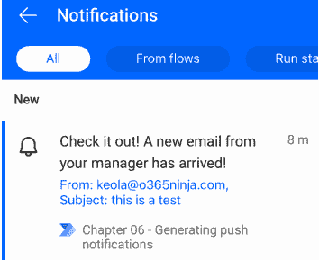

图 6.11 – 查看新通知

如果流未打开，链接可能无法引导你进入消息。


图 6.12 – 打开深度链接

## 重构流

### 理解共享流 (shared flows)

如引言所述，共享流允许多个个人管理流的活动和配置。共享流还允许多个个人查看运行历史、为连接器提供凭据，并添加或删除操作。

云端流和桌面流都可以被共享。

然而，共享流也有一些有趣的特性和注意事项：

- 其他用户、组或 SharePoint 列表可以成为流的共同所有者
- 流创建者不能被任何共同所有者删除
- 如果你正在授予 SharePoint 列表的访问权限，包含列表的站点必须连接到该流（例如用于保存文件）
- 流的共同所有者可以查看流的运行历史
- 流的共同所有者可以添加或删除操作、条件或其他共同所有者
- 流的共同所有者可以管理流的属性（例如启用或禁用、描述和其他常规属性）
- 共同所有者可以删除流
- 流中的连接（称为嵌入连接）只能在共享流或团队流的上下文中使用；它们不能被其他共同所有者在自己的流中复用

任何流都可以转换为共享流或团队流。不需要特殊的设计考虑，但如果共享了桌面流，访问该流的用户需要安装 Power Automate 桌面应用才能处理该流。

凭据和连接信息是共享流的一部分，因此他人可能通过更新流来获取其他信息的访问（例如使用共享数据库凭据执行额外查询），从而利用嵌入凭据。虽然他人无法导出凭据数据本身并在其他处复用，但他们可能会修改流并访问保存的凭据对该连接可以执行的任何操作。

在使用共享流时，你应该确保帐户和连接配置仅具有处理流所需的最少数据访问权限。

接下来，我们将查看如何将普通用户流转换为共享流。

### 共享云端流

现在你已经了解了共享流提供的哪些额外功能，让我们开始与某些团队成员共享流。

在这个示例中，我们将取在第 4 章“复制文件”中创建的“报销费用表 (Expense Reports)”流，并将其更新为作为共享流运行。

- 登录 Power Automate 制作者网页门户 (https://make.powautomate.com) 并选择“我的流 (My flows)
- 点击想要更改为共享流的流旁边的三个点，并选择“另存为 (Save As)”。

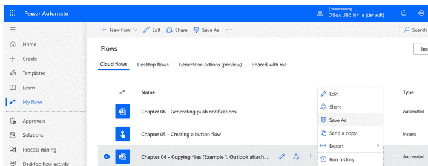

图 7.1 - 定位要转换为共享流的流

在“创建此流的副本”对话框中，更新“流名称”并点击“保存”以完成流副本的创建。

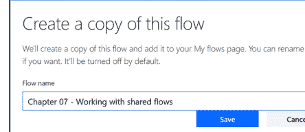

图 7.2 - 创建流的副本

3. 点击新创建流上的“共享”图标开始编辑。

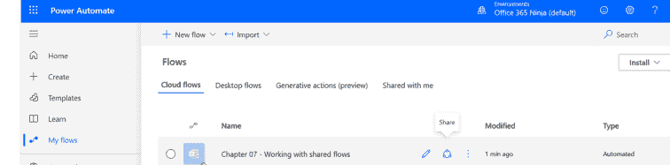

图 7.3 – 共享流

4. 在“所有者 (Owners)”部分，在“用户和组”下，开始输入要与其共享的用户或组的名称或地址，并点击进行选择。

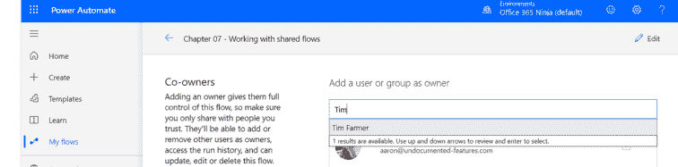

图 7.4 – 添加共同所有者

5. 在添加新成员或共同所有者时，系统将提示你确认将授予共同所有者的连接器和数据访问权限：

**在共享之前...**

请确保你只添加你信任的共同所有者。你正在共享使用下方连接的权限以及更改流可以执行的操作的权限。

[了解更多]

```
aron@undocumented-features.com
Office 365 Outlook
拥有此连接访问权限的共同所有者可以：
读取你的用户配置文件
读取、更新和删除你的邮件
以登录用户（你）的身份发送邮件
创建、读取、更新和删除事件
创建、读取、更新和删除联系人
```

```
aron@undocumented-features.com
SharePoint
拥有此连接访问权限的共同所有者可以：
读取列表和库名称以及列名称
创建、读取、更新、复制和删除文件及元数据
```

图 7.5 – 确认将授予的共享权限

6. 如果你的流连接到 SharePoint 站点，你还可以将 SharePoint 列表或库作为共同所有者添加。选择 SharePoint 选项卡，然后选择列表和文档库。点击“添加 (Add)”：

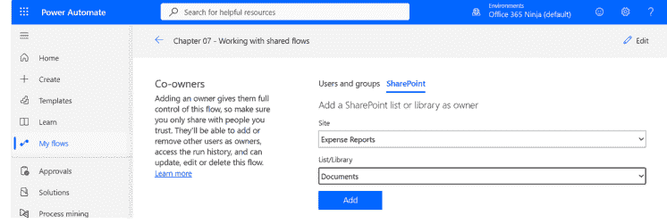

图 7.6 – 授予 SharePoint 站点的访问权限

在“我的流”页面，流将从“云端流 (Cloud flows)（原“我的流”）”选项卡移动到“与我共享 (Shared with me)（原“团队流”）”选项卡，如下屏所示：

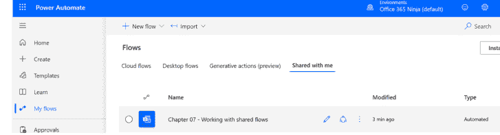

图 7.7 - 查看共享流

流已共享。

接下来，我们将查看在 Power Automate 内部如何工作。

### 共享桌面流

Power Automate，正如第 2 章“入门 Power Automate”中提到的，可以用于创建和管理桌面流。目前有一些限制：

- 共享流中的连接只能在共享流或团队流的上下文中使用；它们不能被其他共同所有者在自己的流中复用
- Power Automate 桌面版显示了一些限制

为了完成此练习，我们首先需要创建一个流。

### 创建桌面流

我们将进入第 18 章“自动化”。要创建桌面流，请遵循以下步骤：

1. 启动 Power Automate 应用，如图 8 所示：

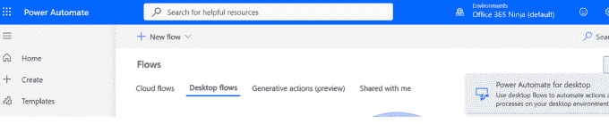

2. 导航到“桌面 (Desktop)”选项卡并点击“新建 (New)”。

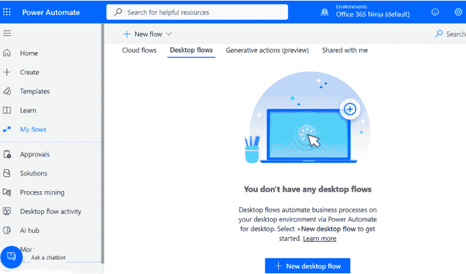

3. 在“创建流”对话框中，输入“流名称”并点击“创建”。

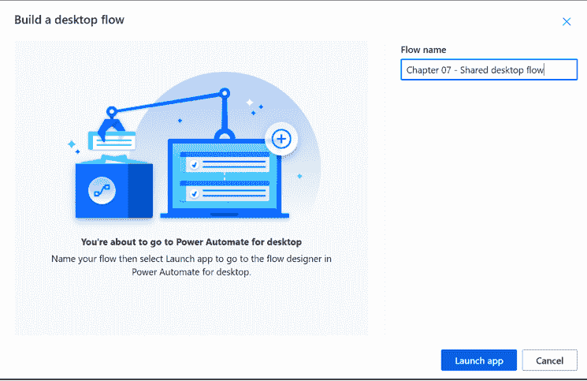

图 7.10 - 填写流对话框

4. 如果提示，点击“打开 (Open)”启动 Power Automate 应用。

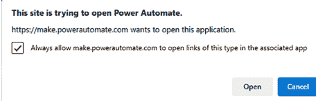

图 7.11 - 启动 Power Automate 应用

5. 登录你的 Microsoft 365 租户。

6. 从主页点击“新建”并选择“流”。

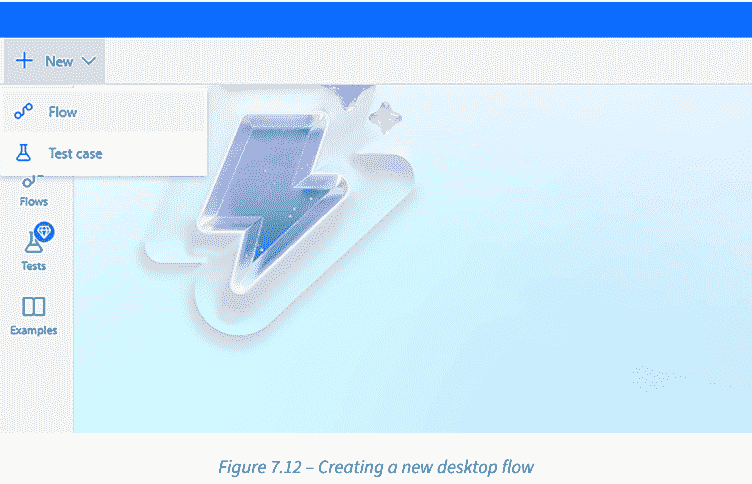

7. 在“创建流”对话框中，输入“流名称”并点击“创建”。

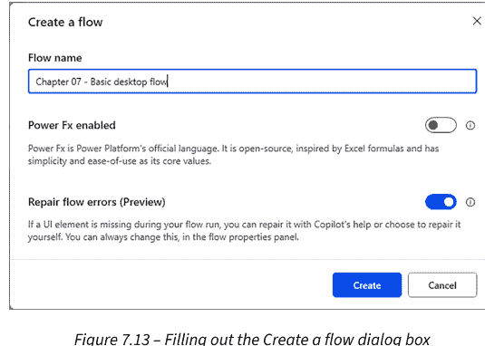

### 使用共享流

**注意**

你可以在“创建流”对话框中启用 Power Fx。Power Fx 是 Power Automate 的原生语言（类似于 Excel 公式使用的宏语言）。Power Fx 语言有一些细微差别，例如从 1 开始的数组索引、变量初始化要求以及变量的大小写敏感性。更多信息请参阅 https://learn.microsoft.com/en-us/power-automate/desktop-flows/power-fx。


8. 在操作面板中搜索“打开”并选择“打开 CMD 会话 (Open CMD session)”。将其拖动到画布区域。

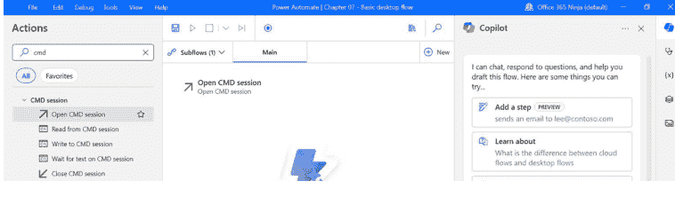

图 7.14 – 选择 CMD 操作

9. 在“工作文件夹”框中输入`C:\`，然后点击“保存 (Save)”。

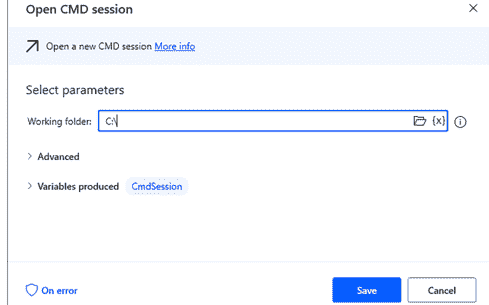

图 7.15 – 指定工作文件夹

# 7 

10. 现在，将“写入 CMD 会话”（Write to CMD session）操作拖到画布区域，位于“打开 CMD 会话”操作下方。

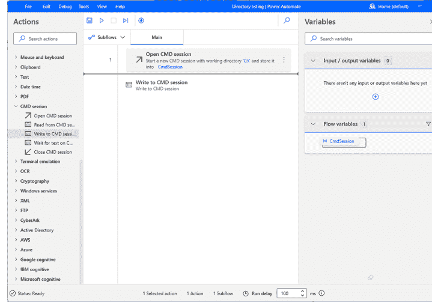

图 7.16 - 添加写入 CMD 会话操作

11. 在命令输入框中，输入`dir c:\ > dir.txt`并点击保存。

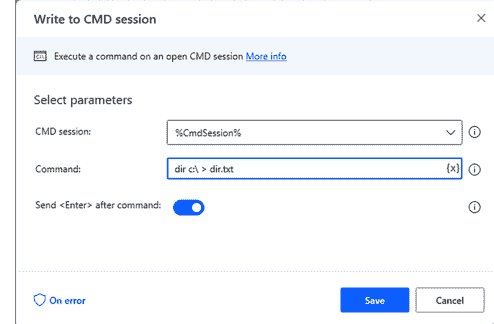

图 7.17 - 指定要执行的命令

12. 最后，将“关闭 CMD 会话”（Close CMD session）操作拖到“写入 CMD 会话”操作下方的。在对话框中点击保存，然后点击 Power Automate 设计器标题栏上的保存图标。

搞定！你已经创建了一个基础桌面流。它功能不多，但足以向你展示共享过程是如何工作的，我们将在下一节中介绍这一点。

## 共享流

要从 Power Automate Web 门户共享桌面流，请按照以下步骤操作：

1. 转到 Power Automate Web 门户 (https://make.powerautomate.com) 并选择“我的流”（My flows）。

2. 选择“桌面流”选项卡。

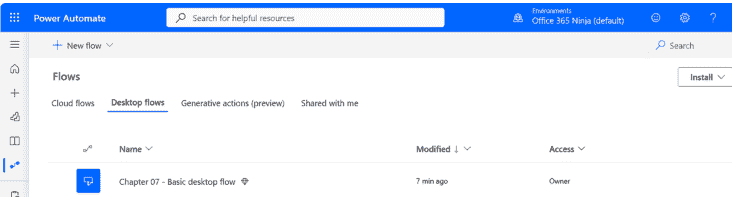

图 7.18 – 查看桌面流

3. 悬停在流上，展开三个点，然后选择“共享”（Share）。

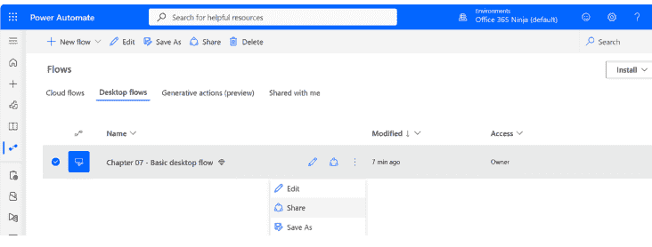

图 7.19 – 访问共享活动

4. 在用户框中开始输入名称或电子邮件地址，选择要添加到流的用户。


5. 在**管理访问**（Manage access）框中，开始输入名称并选择用户。默认情况下，新用户被赋予**用户**（User）权限（可以运行流但不能编辑）。点击名称以显示更多选项。你可以选择**用户**（User）或**共同所有者**（Co-owner）权限。

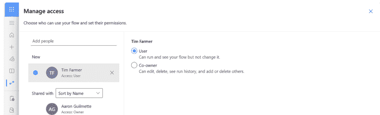

图 7.20 – 添加用户并配置权限

6. 完成添加用户并设置权限后，点击**保存**。

7. 添加的用户可以在 Power Automate 桌面应用程序的“共享”（Shared with me）选项卡下访问该流。

在某些情况下，你可能不想带有完全共同所有者权限共享流，请务必验证谁将使用该流（更重要的是，你是否愿意处理他人编辑时出现的问题）。

接下来，我们将查看如何向具有“仅运行”权限的用户共享云流。

### 共享具有仅运行权限的流

仅运行权限功能允许你为手动触发的流（例如按钮流和即时流）授予非常有限的权限。

> **注意**
>
> 自动化流不支持仅运行权限。

通过此选项，用户只能执行流。他们不能编辑或修改流的任何部分，仅被授予触发流的权限。

### 协作共享流

要向按钮流或即时流授予仅运行权限，请按照以下步骤操作：

1. 登录 Power Automate Web 门户（`https://make.powerautomate.com`）并选择“我的流”。

2. 点击按钮流或即时流旁边的三个点，就像第 5 章“创建按钮流”中的按钮或即时流一样。选择“详情”（Details）打开详情页：

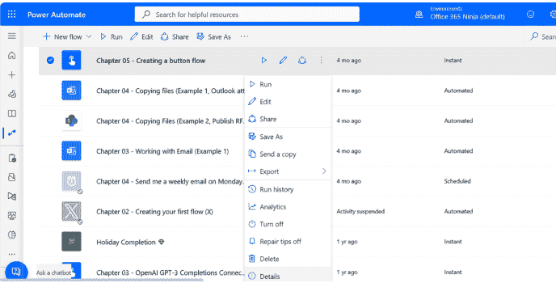

图 7.21 – 打开详情页

3. 在“仅运行用户”部分，点击“编辑”（Edit）：

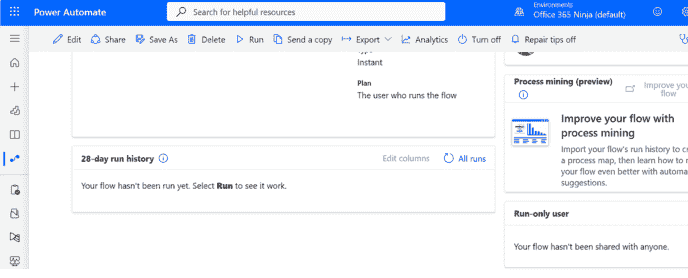

图 7.22 – 查看流详情页

4. 在“管理仅运行权限”飞出面板中，添加你想要授予仅运行权限的用户或组。对于需要数据源凭据的连接，你可以选择使用哪些凭据——由仅运行用户提供的凭据或保存在流中的凭据。提供的凭据是在此流的上下文中，不与用户可能拥有的任何流绑定：

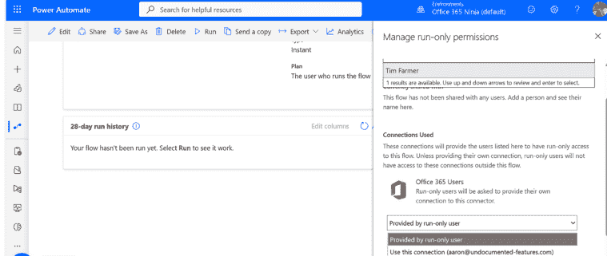

图 7.23 – 管理仅运行用户

5. 滚动到面板底部并点击保存。

6. “详情”选项卡将显示带有仅运行用户的更新配置。

该流已为指定的用户和组配置了仅运行权限。

> **注意**
>
> 当流仅配置了仅运行权限时，它不会显示在“与共享”（Shared with me）选项卡下。只有配置了共同所有者的流才会移动到“共享”选项卡。

接下来，我们将查看一些与管理共享流相关的任务。

### 管理共享流

流的所有共同所有者都可以管理它的各种属性。在练习中，我们将查看团队流对共享接收者来说是种样的。

一旦流共享给您（或者您将流共享给他人），您就可以使用 Power Automate 制作门户的“我的流 | 与共享”页面像管理任何其他流一样管理它。共享流最重要的功能之一是在流的创建者不再可用时（例如，某人离开了组织）。在创建者的账户从组织中删除后，使用该凭据的连接将需要更新。

在下面的截图中，注意 Microsoft 365 消息中心的状态如何带有红色感叹号显示，表示凭据失败：

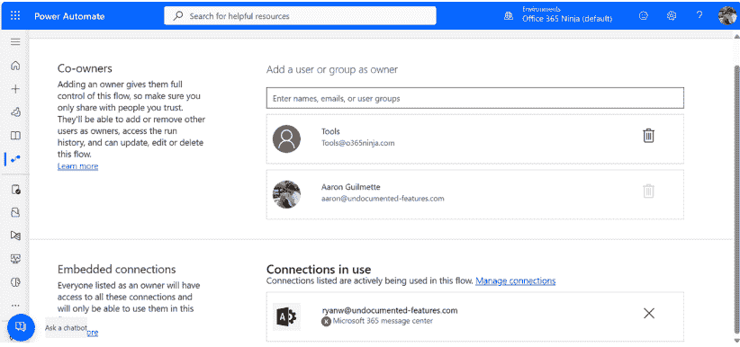

图 7.24 – 更新连接

要解决此情况，请按照以下步骤操作：

1. 在详情页上，在“连接”区域点击“编辑”。

2. 在状态部分，点击“管理”。

3. 点击三个点并选择“所有者”。

4. 选择流进行更新。

5. 在状态部分，点击“所有者”。

6. 选择流进行更新。

7. 在状态部分，点击“所有者”。

8. 选择流进行更新。

9. 在状态部分，点击“所有者”。

10. 选择流进行更新。

11. 在状态部分，点击“所有者”。

12. 选择流进行更新。

13. 在状态部分，点击“所有者”。

14. 选择流进行更新。

15. 在状态部分，点击“所有者”。

16. 选择流进行更新。

17. 在状态部分，点击“所有者”。

18. 选择流进行更新。

19. 在状态部分，点击“所有者”。

20. 选择流进行更新。

21. 在状态部分，点击“所有者”。

22. 选择流进行更新。

23. 在状态部分，点击“所有者”。

24. 选择流进行更新。

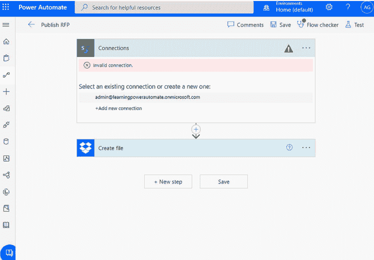

图 7.25 – 显示无效凭据的页面

25. 在状态部分，点击“所有者”。

26. 选择流进行更新。

27. 在状态部分，点击“所有者”。

28. 选择流进行更新。

29. 在状态部分，点击“所有者”。

30. 选择流进行更新。

31. 在状态部分，点击“所有者”。

32. 选择流进行更新。

33. 在状态部分，点击“所有者”。

34. 选择流进行更新。

35. 在状态部分，点击“所有者”。

36. 选择流进行更新。

37. 在状态部分，点击“所有者”。

38. 选择流进行更新。

39. 在状态部分，点击“所有者”。

40. 选择流进行更新。

该流已为指定的用户和组配置了仅运行权限。

### 总结

在本章中，我们引入了共享流（以前称为团队流）的概念。共享流允许您管理流的所有权。共享所有者可以管理流的所有方面，包括添加和删除他人。这一过程对于共享流的继续运行至关重要。

在下一章中，我们将扩展条件的概念。

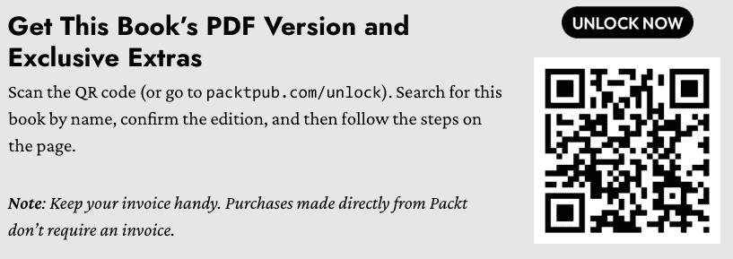

