# 8

正如你在本章中看到的，条件可以用来扩展流的能力，或者可能地将多个流组合成一个更大、更健壮的流。在本章中，我们将通过以下主题来扩展你对条件的理解：

- 理解条件运算符
- 使用表达式和多个条件

本章将帮助你了解条件如何精细地调整你的流。让我们开始吧！

### 理解条件运算符

运算符指示了在评估时将执行的计算类型。你可能对常见的数学运算符熟悉，例如：

- `+`（加法）
- `-`（减法）
- `÷`（除法）
- `×`（乘法）
- `<`（小于）
- `>`（大于）

这些运算符主要用于评估数值值。在流中操作对象和文本时，仅使用数学运算符可能是不够。虽然你可以在某些地方使用表达式，但理解其他用于判断值是否满足条件的运算符也同样重要。

Power Automate 还可以使用以下字符串运算符来评估条件：

- `contains`（包含）
- `does not contain`（不包含）
- `is equal to`（等于）
- `is not equal to`（不等于）
- `is greater than`（大于）
- `is greater than equal`（大于或等于）
- `is less than`（小于）
- `is less than equal to`（小于或等于）
- `starts with`（开头为）
- `does not start with`（不以...开头）
- `ends with`（结尾为）
- `does not end with`（不以...结尾）

其中一些适用于数字（例如大于或等于），而另一些适用于字母（例如开头为）。

### 注意

是的，字符串和文本可以使用大于或等于等比较运算符，但这可能会导致意料之外的结果，或让你的流更难调试。使用数值运算符时的结果将基于字符串的字母顺序，而不是实际值。例如，评估`abc > def`的结果为 False，因为字符串`abc`的第一个字符的字母顺序低于字符串`def`的第一个字符。

回顾你在“生成通知”中创建的流，你可以看到条件如何用于比较动态内容的值：在这种情况下，我们不希望在每次收到电子邮件时都发送通知；我们只想在发件者值相同时生成通知。这是通过`is equal to`实现的，它可以用于评估字符串或数值值。

在接下来的示例中（基于第 2 章“开始使用 Power Automate”中的“创建你的第一个流”部分），你可以看到我们已对其修改以包含一个条件。更新后的流包含一个条件，用于评估发布的推文是否至少有 100 个粉丝，如果是，则向通道启动发布操作：

图 8.2 – 实现计算粉丝数量的条件

如你所见，使用条件评估文本或数值字符串是相当直接的。

### 在 Power Automate 中评估对象

除了能够评估字符串、数字、表达式结果或动态内容值外，Power Automate Desktop 还有特殊的条件来处理不同类型的对象：

- `If file exists`（如果文件存在）：在执行一组操作之前检查文件是否存在。
- `If folder exists`（如果文件夹存在）：在执行一组操作之前检查文件夹是否存在。
- `If window exists`（如果窗口存在）：如果特定窗口处于打开状态，则执行一组操作
- `If window contains`（如果窗口包含）：如果窗口中存在特定文本或 UI 元素，则执行一组操作
- `If image exists`（如果图像存在）：如果在屏幕上找到特定图像，则执行一组操作
- `If web page contains`（如果网页包含）：如果网页包含特定元素或文本值，则执行一组操作

接下来，我们将查看如何将表达式作为条件公式的一部分。

### 使用动态值和多个条件

可能基于单个静态值（例如电子邮件消息的发件者）的条件并不能提供流所需的粒度、灵活性或可移植性。在这种情况下，你也可以同时使用多个条件（包括评估动态内容值的条件）来做出决策。

你已经见过在第 4 章“复制文件”中将表达式作为动态内容一部分的示例，例如使用`dateTime()`和`utcNow()`。在那个示例中，表达式被用于帮助生成存储费用报告的文件夹名称值。你也可以将表达式或函数作为条件的一部分。我们将在下一章中探索更多表达式；你可以将对条件的知识扩展到包含使用表达式。

执行多次评估的条件通常被称为“高级条件”。你可以简单地使用“添加”按钮并继续添加准则。在添加多个待评估的准则时，有两种运算符可用：`AND`和`OR`。选择`AND`要求所有条件都评估为真，控制操作才会评估为真。选择`OR`则只需要其中一个条件评估为真即可。

在接下来的章节中，我们将查看两种利用多个准则创建高级条件的场景。第一个将一起使用多个条件，第二个将使用多个条件组。

### 添加多个条件

现在你已经理解了可以使用哪些内容进行评估，让我们来看看整合一些条件逻辑以增加流的复杂性。使用条件更改流的行为是一个重要概念，它将让你在处理业务场景时变得非常精确。

以下示例了向我们的 Monitor X 中添加一个条件，以评估推文语言是英语还是西班牙语：

1. 从 Power Automate 门户（`https://make.powerautomate.com`），选择“My flows”（我的流），然后选择“Monitor X”进行编辑。

2. 在“发布推文”和“在通道中发布消息”操作之间点击`+`图标以插入新步骤，如图 8.3 所示：

3. 选择“Add action”（添加操作）。

4. 在“Choose operation”框中，搜索并添加“Condition”（条件）控件。

5. 从动态内容菜单中，选择 Tweet language（推文语言）令牌和`is equal to`运算符，然后输入`en`作为值。这添加了英语作为条件，以便控制操作评估为真。

6. 选择“New item”（新建项目），然后点击“Add row”（添加行）：

7. 选择 Tweet language 动态内容令牌和`is equal to`运算符，然后输入`es`作为值（或另一个两位语言代码）。这添加了西班牙语作为条件，以便控制操作评估为。在此时，推文语言必须同时评估为英语和西班牙语，条件才为真。虽然从语法角度来看这是一个有效配置，但它将导致没有内容可以通过条件。

8. 选择“Condition”表达式标题下的下拉框，然后选择`OR`运算符

图 8.6 – 将运算符更新为 OR

9. 点击“Post message in a channel”操作的标题，将其拖到“True”（真）分支框的正文中，如图 8.7 所示。

图 8.7 – 将操作移动到条件分支

10. 点击“Save”（保存）。

此时，需要发布一条语言为英语或西班牙语的推文，条件才能评估为真。这个简单的示例展示了你如何使用条件来帮助过滤或识别符合特定业务准则的内容，并对其进行操作。

在下一节中，我们将介绍条件组（condition groups）的概念以及如何使用它们进一步控制流的处理。

### 添加条件组

在之前的示例中，我们配置了一个条件，只需满足一个标准即可处理流。然而，在某些场景下，你可能需要从一个或多个条件组中选择多个值。组允许你从一个或多个条件集中指定一个或多个需要满足的条件，以满足控制需求。

在本示例中，我们将重新配置流以满足以下条件之一：

- 推文语言必须是英语或西班牙语
- 发送推文的账户累计粉丝数超过 100 人，或点赞数超过 100 个（我们用此作为一种识别和忽略机器人的简单方法）

为了实现这一点，我们将创建两个逻辑组：一个用于评估语言，另一个用于评估粉丝和点赞数。

请按照以下步骤创建条件组：

1. 从 Power Automate 门户（`https://make.powerautomate.com`），选择“流”（Flows），然后选择“Monitor X”流进行编辑。

2. 选择你在上一个练习中创建的“条件”（Condition）控件以将其展开。

3. 勾选两个推文语言条件的复选框，点击其中一行的省略号（...），并选择“创建组”（Make group）。

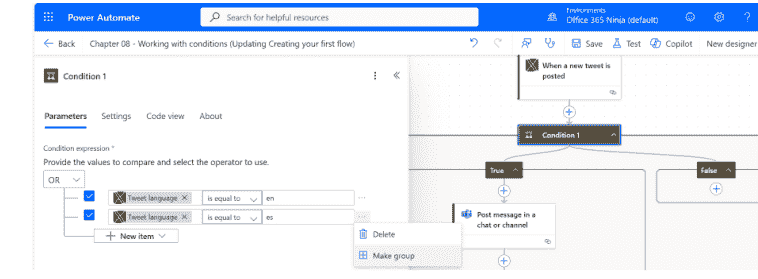

图 8.8 - 将现有条件移动到条件组

4. 情况下，Power Automate 将新条件组的运算符配置为`AND`（与）。选择下拉菜单将其更改为`OR`（或），如图 8.9 所示；

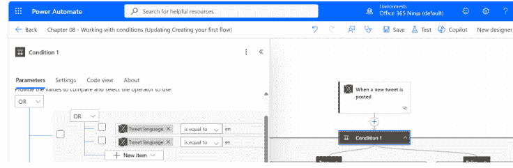

图 8.9 – 更新条件组运算符

5. 如果 Power Automate 在你的新组之外创建了额外的条件（如图 8.9 所示），只需选择并删除它。

6. 点击“条件”控件底部的“添加”（Add）按钮并选择“添加组”（Add group），如图 8.10 所示。

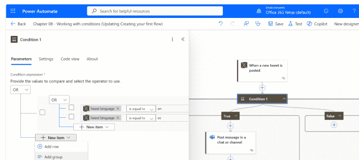

图 8.10 – 添加新的条件组

7. 在新条件组中，将运算符更改为`OR`。

8. 在新条件组中，选择行中的第一个文本框。添加“粉丝数”（Followers count）动态内容值，选择“大于等于”（is greater than equal to）运算符，然后输入值 100。

9. 在新条件组中，点击“添加”按钮并选择“添加行”（Add row）。选择“点赞数”（Favorites）动态内容值，选择“大于等于”运算符，输入值 100。

10. 将整体条件的顶层运算符从`OR`为`AND`。查看图 8.11 查看完成的条件控件。

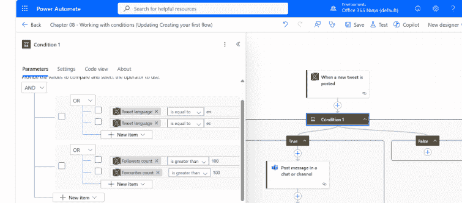

图 8.11 - 检查已完成的条件控件

11. 点击“保存”（Save）。

12. 使用另一个浏览器窗口，准备一条符合触发流标准的推文。如果你没有符合所需粉丝数或点赞数要求的 X 账户，可以更新条件以匹配你可以满足的场景。

13. 在 Power Automate 门户中，点击“测试”（Test），选择“我将触发操作”（I will perform the trigger action）按钮，然后点击“测试”。

14. 回到之前的浏览器窗口并发送推文。

15. 返回 Power Automate 设计器门户，通过展开触发器和条件来验证结果。如果你满足发布到 Teams 频道的条件，你也可以去那里查看你的推文！

你可以从图 8.11 中看到，每个条件组至少有一个条件被成功满足，条件被评估为`true`（真），导致条件的“是”（Yes）分支执行。

### 使用切换条件（switch condition）

在大多数情况下，你可能会使用条件来检查布尔（真/假）值。然而，在某些情况下，流需要能够评估不仅仅是“是/否”、“等于/不等于”或“大于/小于”。你可以通过嵌套条件来实现更复杂的评估，但 Power Automate 提供了另一种结构：切换（switch）。

切换条件允许 Power Automate 从多个分支或路径中选择。如果你熟悉脚本或开发语言，`switch`或`case`语句的函数和语法会让你感到熟悉。

切换条件为流提供了从一组值中进行匹配的机会；如果没有匹配的值，流也有一个可以采取的默认（default）操作或路径。

考虑之前的流，你在其中添加了一个条件来检查推文的语言。与其用英语向 Teams 频道发送消息通知，如果你想根据推文的语言使用不同的语言发送通知会怎样？

让我们编辑该流并进行一些更改：

1. 从上一个练习中打开“Monitor X”流。

2. 展开“真或 / 如果是”（True or If yes）分支。

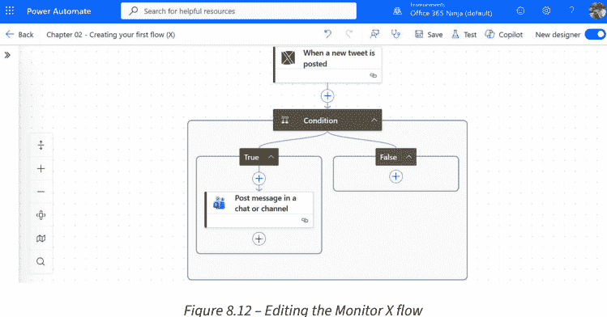

3. 添加操作（Add action）。

4. 选择“切换”（Switch）控件，如图 8.13 所示。

 (注：此处示例图编号可能与原文略有出入，按逻辑翻译)

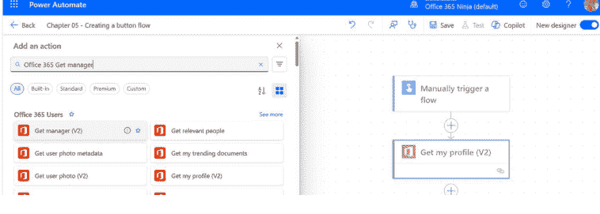 (假设图 8.13)

5. 在操作操作。  ..   14 所示。

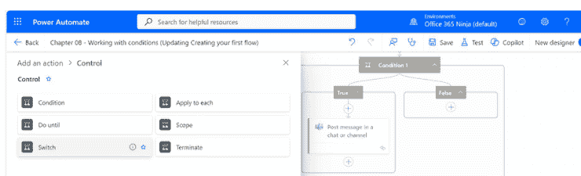

6. 在参数选项卡中，展开下拉菜单，“推推语言”（Tweet language）。这表明我们将根据语言执行操作。

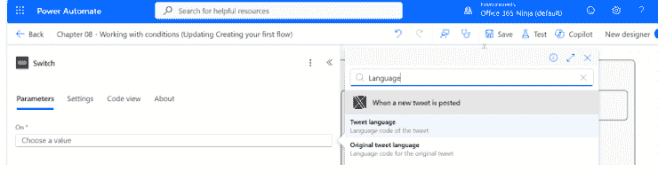

7. 在切换控件内部点击 `+` 图标，如图 8.15 所示。

8. 在 `Equals` 字段中，输入 `en`。这是当语言代码为英语时的操作。

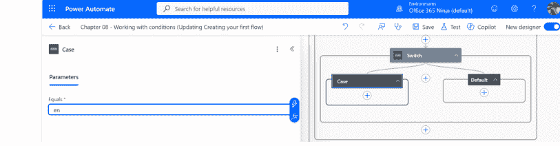

9. 接下来，将“在聊天频道中发布消息”（Post message in a channel）操作拖入 `Case` 主体。这是真分支执行的主组件。

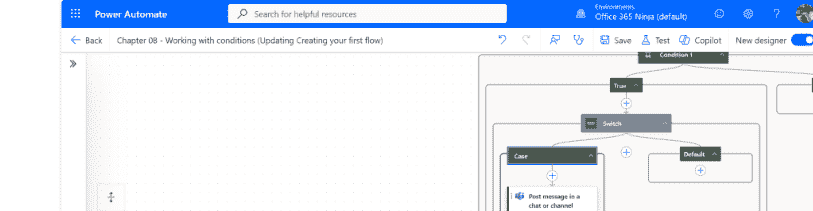

10. 在 `Case` 语句和 `Default` 块之间点击 `+` 添加新用例。默认情况下，新用例命名为 `Case 2`。在 `Case 2` 的 `Equals` 字段中，输入 `es`。这是当语言代码为西班牙语时的操作。

11. 在 `Case 2` 操作中，点击操作。

12. 像上一个练习那样配置操作，选择“机器人”作为发布值，选择“频道”作为发布值。你也可以从第一个用例中复制操作。

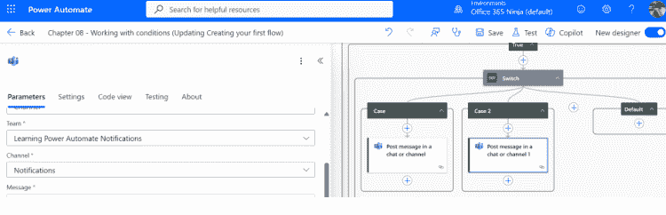

13. 完成团队、频道和消息参数配置。在示例中，我们更新了原始文本以西班牙语显示：

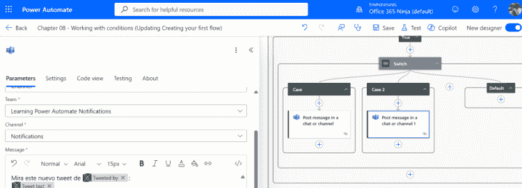

14. 滚动到默认（Default）用例。默认用例是在推文语言无法确定或不匹配任何配置值时将执行的操作集（在这种场景下不太可能，之前的条件组已经评估并过滤了推文语言）。

15. 你可以添加操作，也可以复制粘贴原始用例操作。点击第一个用例中的“在聊天频道中发布消息”操作，在键盘上按 `Ctrl+C`，然后点击 `Default` 用例块中的 `+`，如图 8.21 所示：

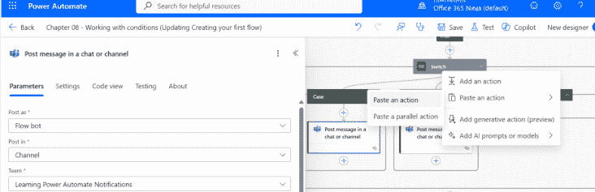

图 8.21 - 配置默认操作

16. 点击“保存”（Save）完成流。

你可以通过发布符合你配置的逻辑条件的推文来测试该流。如果你发送英语推文，英语文本将发布到频道。如果你将 X 配置为使用西班牙语作为语言，推文将显示你输入的相应西班牙语文本。

### 总结

在本章中，你学习了如何使用高级条件。高级条件允许你使用多个动态内容标记和表达式，以限制流处理的数据实体。通过使用 AND（与）和 OR（或）运算符，你可以将多个条件组合成组，为流创建一个复杂的决策过程。

你还接触了切换条件（switch conditions）——一种控制操作类型，允许你的逻辑根据更广泛的评估结果采取不同的路径。

条件处理至关重要，因为它可以用于精炼和过滤数据输入，并确保在流执行之前符合业务标准或需求。条件处理还为你提供了创建满足复杂业务准则的流的机会。

在下一章章节中，我们将开始学习使用表达式和函数，你可以利用这些工具来创建非常强大的流。

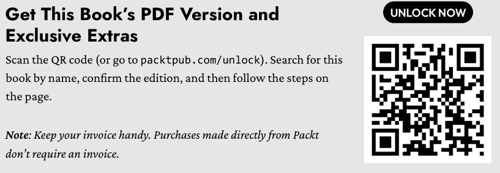

