# 9 理解表达式和函数

在过去的几个章节中，你已经开始使用动态值内容和条件控制来增加流的复杂度。这些都是强大的功能，允许你在数据流过流时对内容进行简单评估或使用基本值。

但你如何操作值呢？如果你需要将某些内容相加、拼接（或连接）值以构建更大的字符串，或者对日期或其他数字进行计算，该怎么办？

这就是本章大显用场的地方在本章中，你将通过以下章节，学习如何开始在 Power Automate 中处理更复杂的对象：

- 学习表达式和函数

- 处理字符串和文本

- 操作时间和日期

- 处理数组

如果你还没有对该平台的功能感到兴奋，那么这一章定会让你大开眼界。

### 学习表达式和函数

那么，什么是表达式和函数呢？

如前提到的，Power Automate 流是由对象和一种类似于 Excel 或 Visual Basic 宏的语言组成的。在这些语言中，**工作流定义语言 (WDL)**、**表达式**和**函数**指的是用于操作数据的内部过程和能力。

函数是一个基础的计算结构——是 Power Automate 提供的最底层处理逻辑。函数是允许你对传递给它的值执行预定义操作的操作。让我们来看 `CONCAT` 函数，它用于将字符串连接：

```
concat(text_1, text_2)
```

如果你使用过 Excel 函数，虽然函数是构建基石，但表达式是函数（包括其参数）、文本字符串和动态内容的应用，用于获取结果。

函数被分为 10 个不同的类别。

### 字符串

字符串或文本函数用于修改或格式化字符串、查找字符或其他其它方式操作文本。你已经见过 `concat` 字符串函数的示例。

### 集合

在编程语言中，集合是可以包含其他对象的类型。常见的集合类型包括数组和哈希表。集合函数可能用于检查数组是否为空、计算数组中对象的数量（或字符串中字符长度），或选择数组中的特定项目。

例如，你可以使用 `length` 函数返回字符串的长度。

```
length('The quick brown fox jumps over the lazy dog')
```

当在流中使用，此函数将返回 43（字符串中文本字符和空白字符的总和）。

### 逻辑

如果你用过其他编程语言，很可能你处理过类似 if/then 语句的结构。这类逻辑函数被用于执行基于逻辑的评估。

```
if(less(14,8),'Yes, it is less than','No, it is not less than')
```

当在流中使用时，如果第一个参数 (14) 小于第二个参数 (8)，此函数将返回文本 `Yes, it is less than`；如果第一个参数大于第二个参数，则返回文本 `No, it is not less than`。

我们在上一章中提到了使用条件，而逻辑上的 `if` 函数可以执行与条件控制相同类型的评估。这取决于你选择哪种方式最适合你的场景。

### 转换

这些函数可以用于更改你正在处理的数据类型。你可能需要将存储为字符串的数值转换为实际整数，以便与数学函数一起使用。或者，你可能需要在 base64 和二进制编码之间移动文件。在这两种情况下，转换函数正是你所需要的。

例如，假设你有一个存储为文本的数字，并想将其转换为可以进行算术计算的数字。你可以通过这样的函数来实现：

```
int('14')
```

### 数学

你可以使用数学函数来执行算术计算，例如将两个数字相加。数学函数还包括查找数据集中最小或最大数字、生成随机数或返回除法余数的能力。

你可以使用以下表达式将两个数字相加：

```
add(14,8)
```

由于数学函数只接受两个参数，你需要将多个函数结合使用来执行额外的计算：

```
add(14,mul(4,8))
```

在此示例中，14 被加上了 4 和 8 乘积的结果。

### 日期和时间

如果不使用这类函数，处理日期和时间可能会非常痛苦。通过日期时间函数，你可以在时区之间转换、以多种方式格式化日期或计算范围。

例如，要返回流执行时的当前时间，可以使用：

```
utcNow()
```

### 引用

引用函数在触发器和操作期间使用。这些通常由 Power Automate 自动调用，尽管你可以自己编写它们。例如，如果你的流包含一个 `GetPoint Item`，你可以使用主体输出的 `Title`。

### 工作流

工作流函数用于引用有关你的流的信息。它们并不常用。

### 统一资源标识符 (URI) 解析

URI 函数用于处理 URI 字符串。你可能需要查找域或主机名、URI 路径，或编码解码 URL 字符串。

例如，`encodeUriComponent` 可以将字符串转换为 URL 编码格式：

```
encodeUriComponent('https://example.com') 将返回 https%3A%2F%2Fexample.com.
```

### 操作

这些函数通常用于处理 XML 对象或 JSON 节点。例如，你可能需要向 JSON 对象添加或设置特定属性。`coalesce` 是另一个你可能会使用的常用函数，用于在一组值查找第一个非空值。你可以这样使用它：

```
coalesce(null, 'Hello', 'world') 将返回字符串 Hello
```

你可以在此处了解更多可用函数：https://learn.microsoft.com/en-us/azure/logic-apps/expression-functions-reference

`coalesce` 函数在 Power Automate 中有时被视为逻辑函数，取决于你阅读的文档。

接下来，我们将查看使用表达式处理字符串和文本值。

### 处理字符串和文本

当你开始使用 Power Automate 函数和表达式时，可能会从处理字符串和文本开始。通过创建一个即时流并仅使用 `Compose` 操作，你可以了解函数的工作原理。

让我们处理一组字符串！

1. 导航到 Power 制作门户 (https://make.powerautomate.com) 并创建一个新的即时云流。

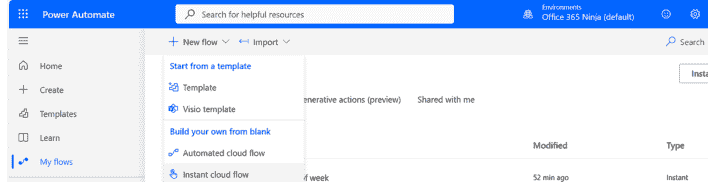

图 9.1 – 创建新的即时云流

2. 选择“手动触发流”并点击“创建”。

3. 点击画布上的“手动触发流”触发器。

4. 在“参数”选项卡上，添加任何输入类型。这并不重要，因为我们将使用 `Compose` 操作来传递值进行实验。

5. 添加操作。

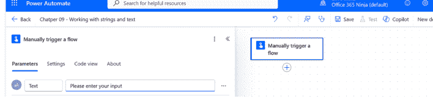

图 9.2 – 添加输入

6. 选择数据操作并进行组合。


图 9.3 – 扩展数据操作操作类型

7. 在“输入”（Inputs）文本区域，添加一个表达式。

8. 输入值 `toLower()` 向表达式编辑器中添加 `toLower()` 函数。

9. 在括号内，输入值 `'HeLLO, wORLD'` 并点击添加（Add）。

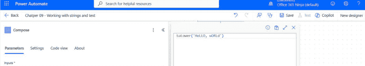

图 9.4 – 手动添加表达式

完成后的表达式应显示为 `toLower('HELLO, wORLD')`。

10. 添加一个操作并选择“组合”（Compose）操作。

11. 在“输入”（Inputs）区域，添加一个表达式。

12. 在表达式编辑器中，输入 `substring('automate', 0, 3)` 并点击添加。

13. 添加一个操作并选择“组合”（Compose）操作。

14. 在“输入”（Inputs）区域，添加一个表达式。

15. 在表达式编辑器中，输入 `slice('automate', 0, 3)` 并点击添加。

16. 添加一个操作并选择“组合”（Compose）操作。

17. 在“输入”（Inputs）区域，添加一个表达式。

18. 在表达式编辑器中，输入 `replace('Brave Old World', 'Old', 'New')` 并点击添加。

19. 添加一个操作并选择“组合”（Compose）操作。

20. 在“输入”（Inputs）区域，添加一个表达式。

21. 在表达式编辑器中，输入 `indexOf('The quick brown fox jumps over the lazy dog', 'fox')` 并点击添加。此表达式应返回 `fox` 开始的字符整数索引。

# 9 

22. **添加操作（Add an action）**并选择**组合（Compose）**操作。

23. 在**输入（Inputs）**区域，添加一个表达式。

24. 在表达式编辑器中，输入 `nthIndexOf('I have an apple, a red apple, and a green apple.', 'apple', 2)` 并点击**添加（Add）**。此表达式应返回第二个单词 *apple* 开始的字符整数索引。

25. **添加操作（Add an action）**并选择**组合（Compose）**操作。

26. 在**输入（Inputs）**区域，添加一个表达式。

27. 在表达式编辑器中，输入 `split('contoso: ENTERPRISEPACK:50:Unassigned', ':')` 并点击**添加（Add）**。此表达式根据冒号分隔符值分割字符串，创建一个包含四个项的数组（`contoso`、`ENTERPRISEPACK`、`50` 和 `Unassigned`）。

28. 可选，根据你正在测试的函数对每个**组合（Compose）**操作步骤重命名。

29. 点击**保存（Save）**然后点击**测试（Test）**。

30. 选择**手动（Manually）**并匹配你为触发器选择的输入类型，点击**运行流（Run flow）**。

31. 输入与你为触发器选择的输入类型匹配的值，点击**运行流（Run flow）**。

检查流中每个步骤的输入和输出。例如，检查 `concat()` 函数步骤，你将看到一段单一文本：**This is a concatenated string**，如图 9.5 所示：

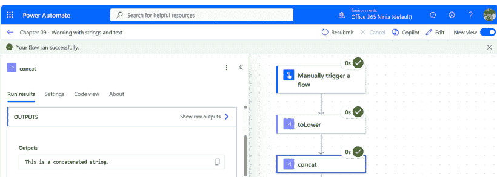

图 9.5 - 检查 concat 函数输出

继续检查操作的输出。你可能想返回并修改表达式的参数，查看它们如何影响文本选择或处理。

接下来，让我们看看如何处理时间和日期值。

### 处理时间和日期

如之前提到的，日期和时间在传统上是非常棘手的处理对象。有多个可用函数可以帮助你在流中使用时间和日期。

### 计算星期几

假设你想使用 Power Automate 流来确定特定日期是星期几。你可以使用 `dayOfWeek()` 函数来解出这个问题：

1. 导航到 Power Automate 门户网站（https://make.powerautomate.com/）并创建一个新的即时流（instant flow）。

2. 在画布上点击“手动触发流”（Manually trigger a flow）。

3. 在“参数”（Parameters）选项卡上，点击“添加输入”（Add input）并选择“日期”（Date）输入类型。

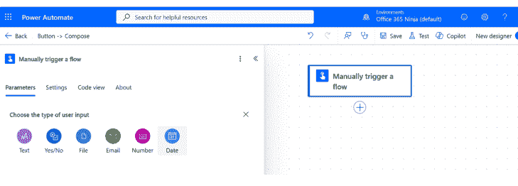

4. 添加操作。

5. 过滤操作找到“组合”（Compose）数据操作并将其添加到画布上。

6. 在“组合”操作的“参数”选项卡上，在“输入”（Inputs）字段中插入一个表达式。

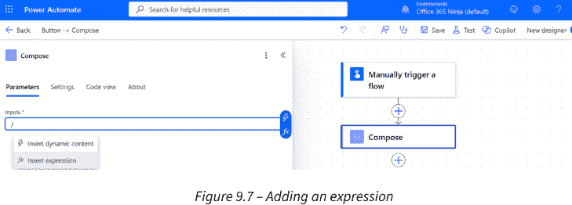

7. 添加 `dayOfWeek` 函数。

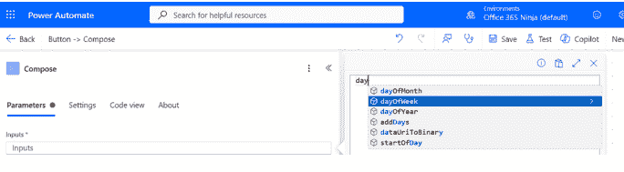

图 9.8 - 添加 dayOfWeek 函数

8. 在函数区域添加一个左括号，然后选择“手动触发流”下“日期内容”（Date content）令牌下的“动态内容令牌”（Dynamic content token）令牌。

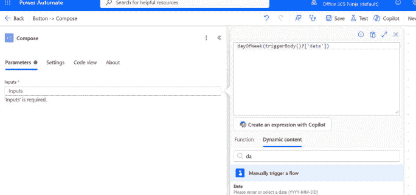

图 9.9 - 添加日期内容值

9. 点击保存。此“组合”操作将返回对应触发器的星期几的整数。

10. 点击测试运行流。

11. 在“测试”浮窗中，选择“手动”（Manually）按钮并点击“测试”。

12. 在“运行流”浮窗中，输入一个日期（或从日期控件中选择），然后点击“运行流”。

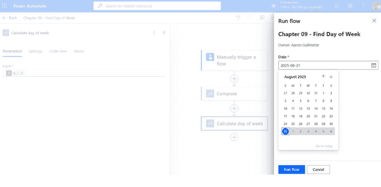

13. 在流运行后，选择“组合”操作，然后选择“显示原始输出”（Show raw outputs）以查看数值。

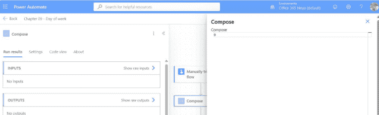

接下来，我们将更新流以显示实际日期。

- 点击“编辑”（Edit）返回编辑流。

- 在“组合”操作之后，添加另一个操作。

- 有多种方法解决此问题，例如使用复杂表达式或使用“切换”（Switch）条件。正如你之前看到复杂数学计算的那样，你可以嵌套多个函数来执行高级评估。在这个示例中，你可以复制并粘贴以下表达式来开始：

```
if(equals(dayOfWeek(), 0), 'Sunday',
if(equals(dayOfWeek(), 1), 'Monday',
if(equals(dayOfWeek(), 2), 'Tuesday',
if(equals(dayOfWeek(), 3), 'Wednesday',
if(equals(dayOfWeek(), 4), 'Thursday',
if(equals(dayOfWeek(), 5), 'Friday',
```

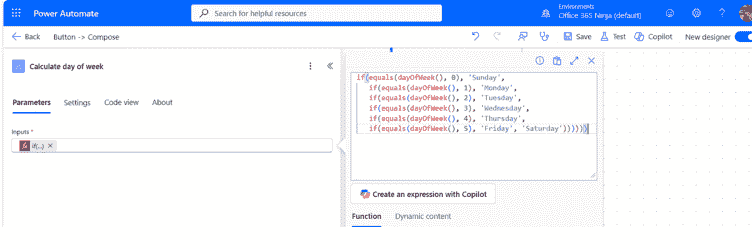

4. 在 `dayOfWeek()` 函数的括号内，选择“手动触发流”下“日期内容”令牌下的“动态内容令牌”下的动态内容。

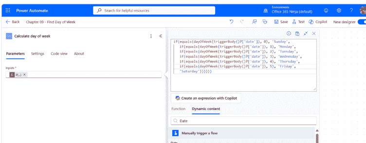

5. 点击保存然后点击测试。

6. 在流运行后，选择“组合”操作，然后选择“显示原始输出”。如下图所示。

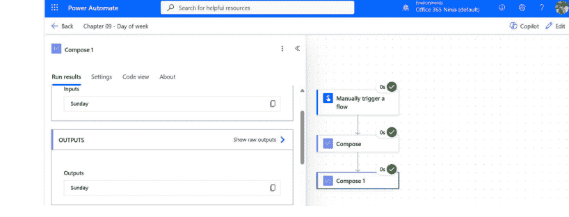

图 9.14 - 检查流的输出

如之前提到的，你可以使用表达式或“切换”（Switch）控件来计算此。由于 `dayOfWeek()` 为每个星期返回不同的整数，你需要创建 7 种情况（除非你使用默认情况）。点击 `+` 号创建情况。


图 9.15 - 使用切换控件修改流

### 计算工作日

在工作环境中，通常使用工作日而非日历日（因为许多企业在周末不进行交易）。为了解决这个问题，我们将使用一系列“组合”操作进行计算。

1. 导航到 Power Automate 门户网站（`https://make.powerautomate.com/`）并创建一个新的即时流。
2. 在画布上点击“手动触发流”。
3. 在“参数”选项卡上，点击“添加输入”并选择“日期”输入类型。
4. 将其命名为“开始日期”。
5. 点击“添加输入”并选择“日期”输入类型。
6. 将其命名为“结束日期”。

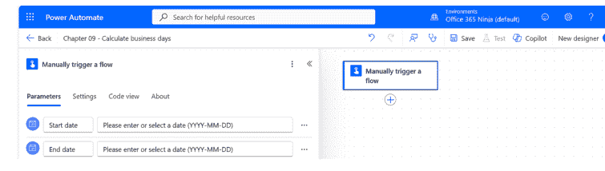

图 9.16 - 配置触发器

7. 添加操作。
8. 选择“组合”操作。
9. 添加一个表达式。
10. 在表达式字段中，输入 `div(sub(ticks(), ticks()), 86400000000)`。此表达式使用了 `ticks()` 函数，对于初学者来说，在 Microsoft .NET 编程中一个 tick 代表 100 纳秒。然后，点击第一个 `ticks()` 的括号并选择“结束日期”动态内容值。
11. 对第二个 `ticks()` 函数重复此过程，选择“开始日期”动态内容值。见图 9.17。

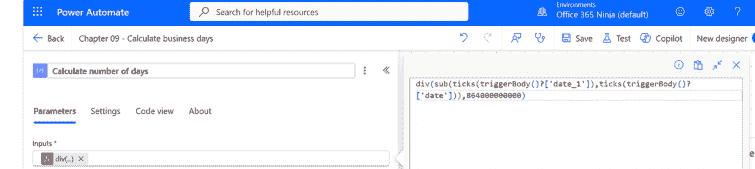

图 9.17 - 添加天数计算

> 提示：如果在运行工作流时遇到超出范围（out of range）错误，请确保结束日期值位于第一个 `ticks()` 函数中，而开始日期参数位于第二个 `ticks()` 函数中。

12. 点击添加。
13. 添加操作。
14. 选择“编写数据”（Compose）操作。
15. 输入以下表达式：`(range(0, add(), 1))`。此表达式将用于构建一个由单个数字组成的数组，每个数字代表一天。此数字范围将用于递增开始日期，通过每个 `dayOfWeek()` 函数返回代表星期几的整数。
16. 点击 `add()` 函数括号内部。添加“编写数据”操作的“输出”（Outputs）动态内容值，这是你计算的两个日期之间的天数。见图 9.18。

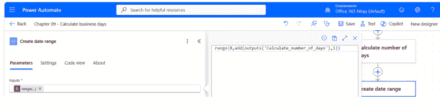

17. 添加操作。
18. 选择“数据操作”（Data operations），然后选择“选择”（Select）操作。
19. 在“参数”（Parameters）选项卡上，从“从”（From）字段添加上一个“编写数据”操作的“输出”动态内容值，该操作创建了日期范围。
20. 在“映射”（Map）部分，在“键”（Key）字段添加如 `my` 的值。然后，在“值”（Value）字段添加以下表达式：`addDays(triggerBody()['date'], item())`。此表达式利用 `addDays()` 函数为“创建日期范围”编写数据函数“输出”动态内容中的每个项为开始日期增加相应的天数。

21. 添加操作。
22. 选择“筛选数组”（Filter array）操作。
23. 在“参数”（Parameters）选项卡上，在“从”（From）字段中，添加来自“选择”（Select）语句的“输出”（Output）动态内容值。可选，可以将操作重命名为具有描述性的名称。
24. 在“筛选查询”（Filter query）字段中，输入 `dayOfWeek(item())['mydate']`。此表达式将评估上一个“选择”（Select）操作的数组项。`item()` 函数用于获取当前数组项。
25. 在“运算符”（Operator）下拉菜单中，选择“不等于”（is not equal to）。
26. 在“值”（Value）字段中输入数字 6。如果你还记得*计算星期几*练习，每周的每一天都被分配了一个数字（在这种情况下，我们选择 6 代表星期六）。

输出将是一个数组，过滤掉所有 `dayOfWeek()` 评估为 6 的日期。

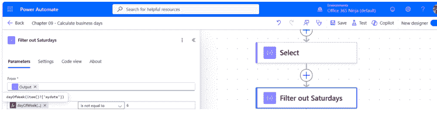

图 9.21 - 过滤掉星期六

接下来，我们将重复过滤过程，只是现在我们要过滤掉 `dayOfWeek()` 函数评估为 0 的项。

27. 添加操作。
28. 选择“筛选数组”（Filter array）操作。
29. 可选，将操作重命名为具有描述性的名称，在“从”（From）字段中，添加来自“过滤星期六”数组的“输出”动态内容值。
30. 在“参数”（Parameters）选项卡上，在“从”（From）字段中，添加“过滤星期六”数组操作的“输出”动态内容值。

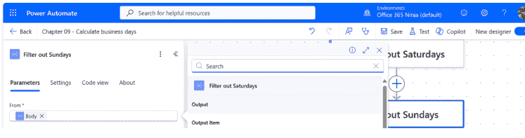

图 9.22 - 选择输出动态内容

31. 筛选查询的构建方式与“过滤星期六”数组的查询相同——只是这次，它应配置为不等于 0。见图 9.23。

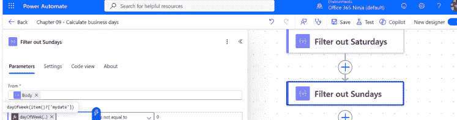

图 9.23 - 构建筛选查询

此表达式的结果应该是所有过滤后的日期的列表（其中 `dayOfWeek` 评估为 6 或 0 的日期已被移除）。最后，我们将对它们进行计数！

32. 添加操作。
33. 选择“编写数据”（Compose）操作，在“输入”（Inputs）字段中添加一个表达式。
34. 在“参数”（Parameters）选项卡上，添加 `length()` 函数。
35. 在括号中，添加“过滤星期日”（Filter out Sundays）操作下的“正文”（Body）动态内容标记。此表达式将计算数组中的项数（这应该是我们过滤掉星期六和星期日后的列表）。完成后的表达式应该类似于 `length(body('Filter_out_Sundays'))`。点击添加。

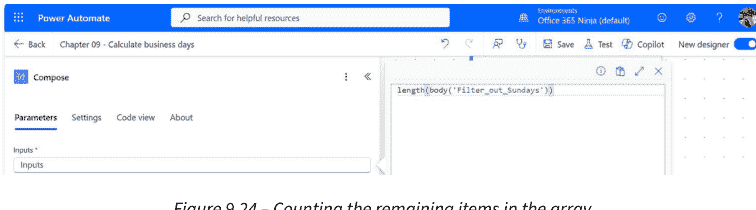

36. 保存并测试工作流。
37. 在查看运行历史时，“输出”（Outputs）区域应包含你的开始和结束日期之间的（非周末）日期。作为验证，你可以打开工作流并计算天数。

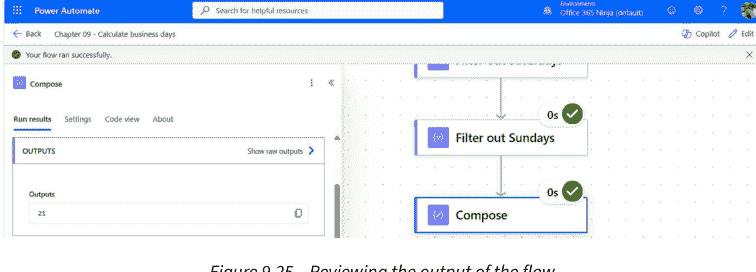

### 处理数组

数组，如前述提到的，是对象的集合。早些演示的 `split()` 函数根据分隔符将字符串拆分为数组。有许多数组函数可以用来处理数据。让我们来看其中几个。首先，让我们使用“编写数据”（Compose）操作创建数组。

1. 添加操作。
2. 选择“编写数据”（Compose）操作。
3. 在“参数”（Parameters）选项卡上，在“输入”（Inputs）字段中添加以下表达式：`split('pepperoni,sausage,mushrooms,olives,tomatoes,cheese',',')`。见图 9.26。

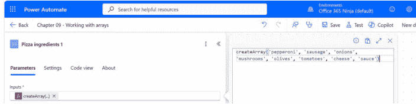

图 9.26 - 创建数组

接下来，我们将使用“选择”（Select）操作将数组中的每个元素添加到一个新数组中。

1. 添加操作。
2. 选择“选择”（Select）操作。
3. 在“参数”（Parameters）选项卡上，从“从”（From）字段，添加上一个“编写数据”操作的“输出”动态内容值，该操作创建了数组。
4. 在“映射”（Map）部分，在“键”（Key）字段添加如 `my` 的值。然后，在“值”（Value）字段添加以下表达式：`item()`。此表达式将返回当前数组项。

接下来，我们将使用 `contains()` 函数检查特定值是否存在于数组中。

1. 添加操作。
2. 选择“编写数据”（Compose）操作。
3. 在“参数”（Parameters）选项卡上，在“输入”（Inputs）字段中添加 `contains()` 函数。此函数可检查特定值是否存在于数组中。结果是布尔值（真或假）。

接下来，我们将使用 `empty()` 函数检查数组是否为空。

1. 添加操作。
2. 选择“编写数据”（Compose）操作。
3. 在“参数”（Parameters）选项卡上，在“输入”（Inputs）字段中添加 `empty()` 函数。此表达式将根据数组是否为空返回一个布尔值（真或假）。由于此数组包含对象，我们预期输出为假。

接下来，我们将使用 `intersection()` 函数获取两个数组的共同值。

1. 添加操作。
2. 选择“编写数据”（Compose）操作。
3. 在“参数”（Parameters）选项卡上，在“输入”（Inputs）字段中添加 `intersection()` 函数。此表达式将返回一个包含两个数组共同值的新数组。完成后的表达式应类似于：`intersection(outputs('Pizza_ingredients_1'),outputs('Pizza_ingredients_2'))`

### 进一步探索

你可以使用“初始化变量”（Initialize variable）操作创建在本节中使用的数组。在“参数”（Parameters）选项卡上，设置“名称”（Name），将“类型”（Type）选择为“数组”（Array），然后在“值”（Value）字段中输入 `["pepperoni", "sausage", "onions", "mushrooms", "olives", "tomatoes", "cheese", "sauce"]`。然后可以使用“操作”（Compose）函数的输出更新此变量。

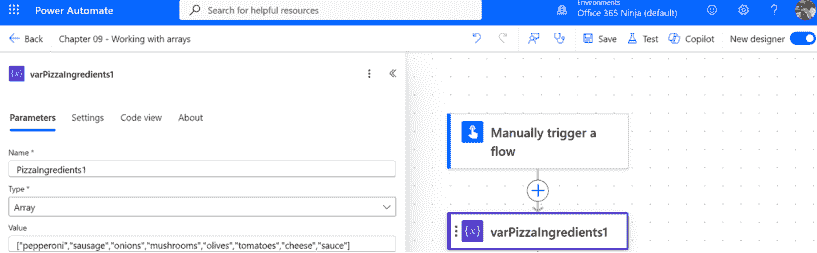


# 图 9.30 - 初始化数组变量

本章有很多新概念，因此你可能想下载示例并开始亲自进行实验！

## 总结

掌握表达式是充分利用 Power Automate 功能的关键。本章介绍了几种你可以直接应用于 Power Automate 流的不同表达式和函数。

字符串和文本的函数与表达式代表了 Power Automate 生态中最简单的类型，而时间和日期处理起来要复杂得多。数组是对象的集合——无论是时间、日期、字符串、整数甚至是其他数组！

接下来，我们将转向在 Microsoft 365 平台上处理审批（Approvals）工作。

## 获取本书的 PDF 版本和独家额外资源

扫描二维码（或访问 packtub.com/unlock）。按名称搜索此书，确认版本，然后按照页面上的步骤操作。

**注意：** 请妥善保留发票。直接从 Packt 购买的不需要发票。


