# 12 向 Teams 发送审批

Microsoft 已将 Teams 定位于“协作枢纽”（`https://learn.microsoft.com/en-us/microsoftteams/teams-overview`；参见 [协作](https://Teamwork)）。考虑到此，我们将应用在第 10 节“开始使用审批”中获得的审批流技能，并用这些技能来为 Microsoft Teams 构建一个审批体验。你将能够使用这些技能，帮助为使用 Teams 作为平台的组织成员简化审批流程。

在本章中，我们将涵盖以下主题：

- 理解工作流
- 配置先决条件
- 配置一个使用 Teams 的审批流
- 测试工作流

在本章结束时，你将能够将 Power Automate 审批流与 Microsoft Teams 集成。

让我们开始吧！

### 理解工作流

在配置审批流程之前，你需要确保支持该流程的所有组件都已存在。在示例工作流中，我们将配置一个采购订单审批，该审批将在文档发布到 SharePoint 站点时开始。如果采购申请获得批准，该文档将移动到“已批准（Approved）”文件夹。如果被拒绝，它将移动到“已拒绝（Rejected）”文件夹。请求者将在结束时收到一封邮件告知其状态。

这个复杂的工作流将使用几个熟悉的组件，包括：

- SharePoint **当文件夹中创建文件时 触发器**
- Office 365 Users **获取用户配置文件 (V2)** 动作
- Office 365 Users **获取经理 (V2)** 动作
- 审批（Approvals） **创建审批 (V2)** 动作
- 条件

在本章中，我们还引入了 **Microsoft Teams 连接器**。通过 Microsoft Teams 连接器，你将能够执行此类操作：

- **作为 Flow 机器人向用户发送你自己的自适应卡片**：自适应卡片是直接在 Microsoft Teams 会话或体验中展示内容的新方法。自适应卡片可以包含图表、图像和格式化文本等组件。
- **作为 Flow 机器人向用户发送消息**：这将允许 Power Automate 和 Flow 机器人与审批请求者进行通信。

这些新操作将允许 Power Automate 与 Microsoft Teams 平台交互。为了提高业务生产力，审批人员应该能够在 Microsoft Teams 应用程序内部响应审批。

现在你已经熟悉了我们将要使用的组件，让我们继续配置先决条件。

### 配置先决条件

此审批流将需要一些组件和先决条件。你已经熟悉其中许多项，但我们将回顾此工作流的准确要求。接下来的两个部分将描述这些要求。

### SharePoint 站点

此审批流的一个输出是根据是否获得批准或拒绝，在 SharePoint 站点上移动文档。这需要一个包含“已提交（Submitted）”、“已批准（Approved）”和“已拒绝（Rejected）”文件夹的 SharePoint 站点，如下所示：

图 12.1 – 创建文件夹

在示例中，我们将使用名为“采购订单”的 SharePoint 站点（参见第 10 节“开始使用审批”），但你可以使用任何站点。

### 用于 Teams 的 Power Automate 应用

Power Automate（原名为 Flow）允许 Teams 与 Power Automate 之间进行双向交互。要安装该应用，请按照以下步骤操作：

1. 启动 Microsoft Teams（桌面版或网页版 `https://teams.microsoft.com`）。
2. 在左侧栏中点击三个点（...），搜索 **Power Automate**：

图 12.2 – 添加 Power Automate

3. 在应用页面上，点击添加，并同意 Workflows 的隐私条款。

图 12.3 – 使用 Power Automate 应用

一旦安装了该应用，你就可以开始配置了。

### 使用 Teams 配置审批流

正如“理解工作流”部分所述，此流将由文件放入 SharePoint 站点触发，并向审批者和请求者发送审批通知。由于这是一个较长的流程，我们将分阶段完成：

- 获取请求者信息
- 创建审批
- 返回响应

让我们开始吧！

### 获取请求者信息

在第一部分中，我们将配置触发器以检测文件并获取请求者的信息。要配置工作流，请遵循以下步骤：

1. 导航到 Automate 门户（`https://make.powerautomate.com`），选择创建，然后从空白开始工作流。
2. 搜索“当文件夹中创建文件时”。
3. 在站点地址字段中，选择 SharePoint 站点。在文件夹字段中，选择“已提交（Submitted）”文件夹。

4. 点击新步骤。
5. 选择 SharePoint 获取文件属性。在站点地址字段中，选择 SharePoint 站点。在库名称字段中，选择文档库。在 ID 字段中，选择来自“当文件夹中创建文件时”的 `ItemId` 令牌。

6. 点击新步骤。
7. 选择 Office 365 获取用户配置文件 (V2) 动作。在 UPN 字段中，选择来自“获取文件属性”的 Created By Email 动态令牌：

8. 点击新步骤。
9. 选择 Office 365 获取经理 (V2) 动作。在用户 (UPN) 字段中，选择来自“获取用户配置文件 (V2)”的用户主要名称令牌。
10. 点击保存。

### 创建审批

此时，你已经创建了收集文件和请求者信息的部分。接下来，我们将配置审批请求。

在本节中，你将通过添加和配置审批动作继续创建上一节的审批。

1. 在“获取经理 (V2)”动作之后添加一个动作。
2. 选择审批 创建审批 动作。
3. 在审批类型下，选择“批准/拒绝 - 响应响应者”。

# 配置审批工作流

4. 在标题下，选择能够唯一标识此请求的文本。在示例中，你可以选择来自“获取文件属性”部分的 `Title` 和 `Created ByDisplayName` 动态值令牌。

图 12.8 – 配置获取用户配置文件 (V2) 动作

在 **Assigned**（分配给）字段中，选择 **Get manager**（获取经理）部分下的 **Mail** 动态内容令牌值：

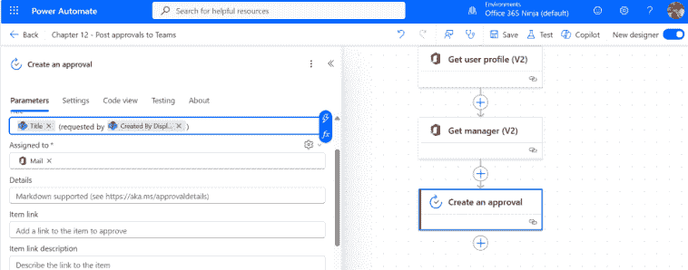

图 12.9 – 配置“创建审批”

在 **Link**（链接）项字段中，添加 **Get file properties**（获取文件属性）部分下的 **Link to item**（项目链接）动态值内容令牌。

添加操作。

选择 Microsoft Teams 操作中的 **Post card in a chat or channel**（在聊天或通道中发布卡片）：

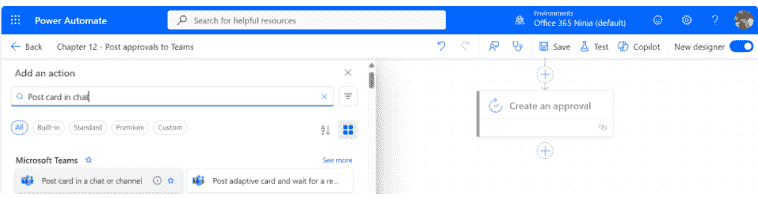

图 12.10 – 添加自适应卡片操作

在 **Post as**（发布者身份）字段中，选择 **Flow bot**。

10. 在 **Post in**（发布位置）字段中，选择 **Chat with Flow bot**（与 Flow bot 聊天）。等待卡片上的操作动态更新，如**图 12.11** 所示：

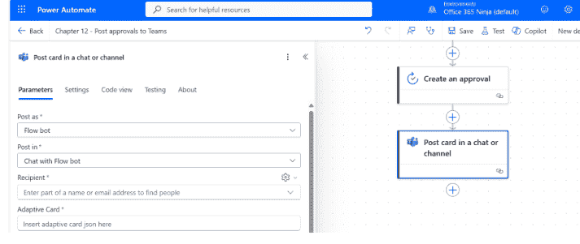

11. 在 **Recipient**（收件者）字段中，选择 **Get manager** 操作下的 **Mail** 动态内容令牌。

12. 在 **Adaptive Card**（自适应卡片）字段中，选择 **Create an approval**（创建审批）部分下的 **Teams Adaptive Card** 动态内容令牌：

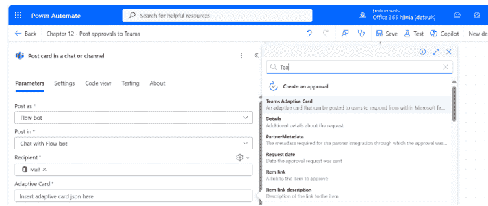

13. 添加操作。

14. 选择 **Wait for an approval**（等待审批）操作。

15. 在 **Approval ID** 字段中，选择 **Create an approval** 下的 **Approval ID** 动态内容令牌：

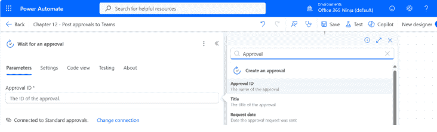

图 12.13 – 配置“等待审批”操作

16. 点击保存。

现在你已经配置好了一个审批工作流，它将启动、向 Teams 用户发送自适应卡片，并等待他们的响应。在下一节中，我们将评估响应并决定采取什么操作。

## 返回响应

在最后一个章节中，我们将根据审批者的响应来配置操作（通知请求者并移动已提交的文件）。由于步骤较多，我们将其分为较小的部分。

首先，我们将配置当审批者决定批准请求时会发生什么。

要完成流的这部分，请确保来自上一个节的流处于编辑状态，并按照以下步骤操作：

1. 在 **Wait for an approval** 操作之后，添加操作。
2. 选择 **Condition**（条件）控制。
3. 在控制器左侧的 **Choose a value**（选择值）框中，选择 **Outcome**（结果）动态内容令牌：

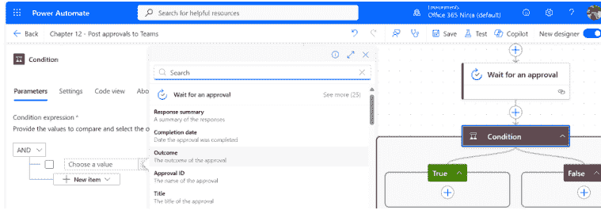

图 12.14 – 配置条件控制器

4. 为条件选择 **is equal to**（等于）评估方法。
5. 在条件的右侧框中输入文本 `Approve`（批准），点击 **Add action**（添加操作）。
6. 在条件的 **True**（真）分支中，点击 **Add action**。
7. 选择 **Post message in a chat or channel**（在聊天或通道中发布消息）操作：

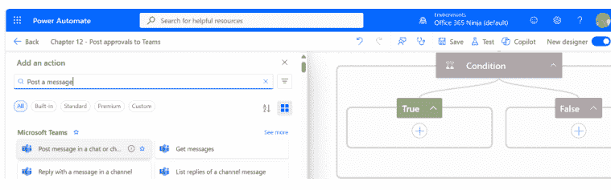

图 12.15 – 添加发布消息操作

8. 在 **Post as** 中，选择 **Flow bot**。
9. 在 **Recipient** 字段中，选择 **Chat with the Flow bot**。
10. 在 **Recipient** 字段中，添加 **Get user profile**（获取用户配置文件）部分下的 **Mail** 动态内容令牌。这将响应发送给请求者。
11. 在 **Message** 字段中，输入将发布在请求者消息正文中的文本。
12. 在 **True** 分支中，添加操作。
13. 选择 SharePoint **Move file**（移动文件）操作。
14. 在 **Current Site Address**（当前站点地址）中，选择流中使用的 SharePoint 站点。
15. 在 **File to Move**（要移动的文件）中，选择 **When a file is created in a folder**（文件夹中创建文件时）部分下的 `headers/x-ms-file-id` 动态内容令牌。

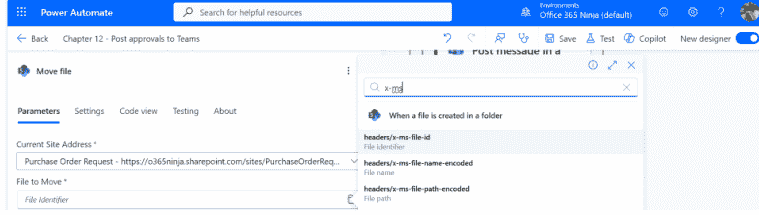

图 12.16 - 添加 x-ms-file-id 动态内容令牌

16. 在 **Destination Site address**（目标站点地址）中，选择你创建 `Approved` 文件夹的 SharePoint 站点。
17. 对于 **Destination Folder**（目标文件夹），选择如果目标文件夹中存在同名文件时要的操作。在 **Another file is already there**（已存在文件）下拉菜单中选择一个选项，例如 **Move with a new name**（重命名移动）操作。完成的分支应该类似于图 12.17。

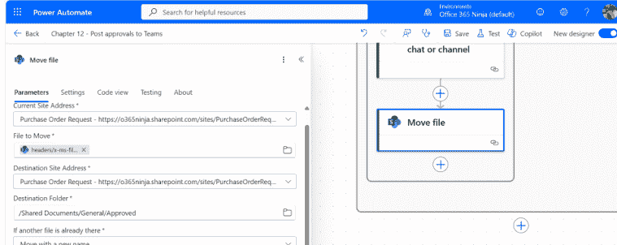

图 12.17 - 配置 SharePoint 移动文件操作

19. 点击保存。

现在，我们将配置当审批者拒绝或否定请求时会发生什么。步骤非常相似——事实上，它们是同一组操作，你可以编辑消息响应和文件目标。你可以重复步骤并进行更新，也可以使用 **Copy action**（复制操作）功能节省时间：

1. 在 **True** 分支中，右键点击 **Post message in a chat or channel** 操作的卡片，并选择 **Copy action**：

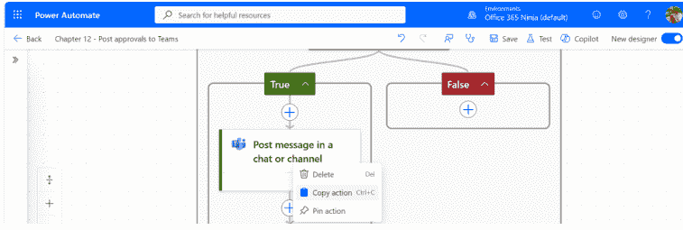

图 12.18 - 复制操作

2. 在 **False** 条件分支中，右键点击 **Add action** `+` 号并选择 **Paste action**（粘贴操作）。
3. 在粘贴操作的浮窗中，更新操作标题以使其唯一且易读。
4. 更新 **Message** 字段，替换现有的发布在请求者消息正文中的值。正如你配置原始操作时一样，你可以使用文本、表达式和动态内容的组合。

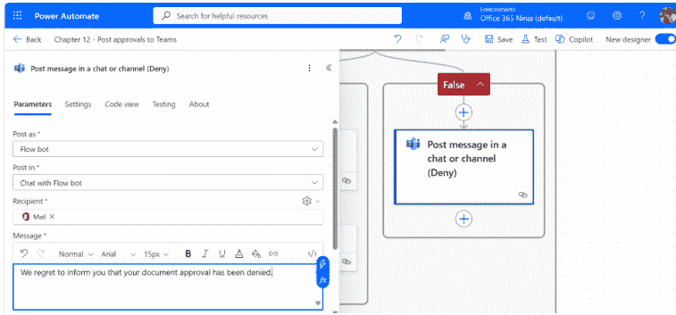

图 12.19 - 更新粘贴操作的属性

5. 在 **True** 条件分支中，选择 **Move file** 操作的卡片，然后选择 **Copy action**。
6. 在 **False** 条件分支中，右键点击 **Add an action** `+` 号并选择 **Paste after action**（在操作后粘贴）。
7. 在粘贴操作的浮窗中，更新操作标题以使其唯一且易读。
8. 对于 **Destination Folder**，选择默认文档库中的 **Rejected** 文件夹。
9. 最后，选择如果目标文件夹中存在同名文件时要的操作。在 **If another folder is already there** 下拉菜单下选择一个选项，例如 **Move with a new name** 操作。完成的分支应该类似于图 12.20：

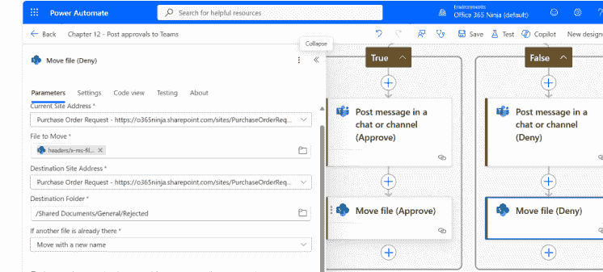

图 12.20 - 检查 If 分支的配置

10. 点击保存。

你已经配置好了一个审批工作流，它将启动、向 Teams 用户发送自适应卡片，并等待他们的响应。在下一节中，我们将评估响应并决定采取什么操作。

## 测试流

为了测试此流，你需要满足以下条件：

- 至少两个开启了 Exchange Online 和 Microsoft Teams 的用户
- 用户启用了 Power Automate（以前称为 Flow）
- 其中一个用户应配置为另一个用户的经理
- 至少两个浏览器会话，分别以审批者请求者的身份登录

使用 Microsoft365 管理中心 (https://admin.microsoft.com) 配置经理。导航到 `Users | Active users`，选择一个用户进行编辑，并点击 `manager` 链接进行配置：

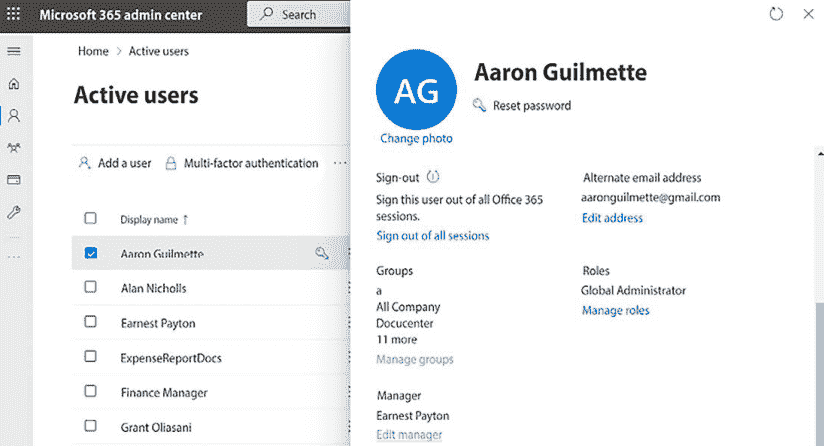

图 12.21 – 配置经理

如果你没有权限设置经理，你需要编辑流以使用特定的用户邮箱地址作为审批者，而不是 `Get manager (V2)` 操作的 `Mail` 令牌。

测试过程将涉及三个核心步骤：

- 请求审批
- 审批请求
- 检查响应

让我们开始测试吧！

### 请求审批

流程必须由请求者启动。请求者必须在 Entra 中填写经理字段。一旦满足此要求，请按照以下步骤操作：

1. 从流中，点击 **Test** 并选择 **Manually** 单选按钮。点击 **Test** 启动测试过程。
2. 使用一个浏览器会话，以请求者用户登录 Microsoft 365。
3. 浏览到流监控的 SharePoint 站点。
4. 向监控文件的 SharePoint 站点中的 `Submitted` 文件夹上传文件。

此活动将触发流。

### 审批请求

对于此过程，你必须拥有以审批者身份登录的独立浏览器会话：

1. 以审批者身份通过浏览器会话登录 Office 365 时，打开 Microsoft Teams (https://teams.microsoft.com/)。
2. 选择左侧栏的 **Chat** 并选择来自 Workflows 应用的消息。
3. 要批准或拒绝请求，点击自适应卡片上的 **Approve**（批准）或 **Reject**（拒绝）按钮：

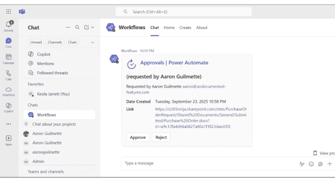

4. 可选，输入批准或拒绝意见。点击 **Submit**（提交）。

完成后，它将触发流的后续部分。

### 查看响应

在最后这一步骤中，请求者应该能够查看审批者的响应：

1. 以请求者的身份通过浏览器会话登录 Office 365，启动 Teams (https://teams.microsoft.com)。
2. 选择左侧边栏的“聊天”(Chat)，并选择来自 Power Automate 应用的消息。
3. 审核消息：

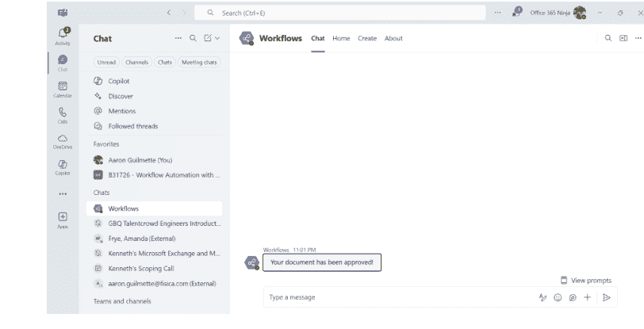

你也可以在 Teams 中通过选择左侧边栏的“审批”(Approvals) 应用，然后导航到“审批 | 已发送”(Approvals | Sent)，作为请求者查看请求状态：

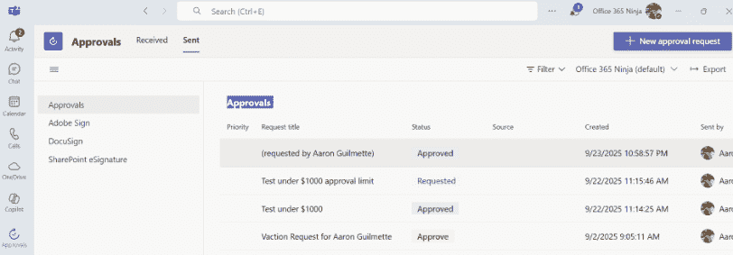

审批流程已完成。

你还可以使用额外的验证方法，例如查看流的运行历史并浏览 SharePoint 文档库以确认文件已移动：

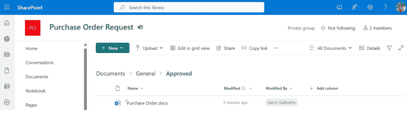

图 12.25 – 文件已移动到“已批准”文件夹

自适应卡片和流消息是可以自定义的：

> 你可以使用 Microsoft 自适应卡片设计器 (https://www.adaptivecards.io/designer/) 学习如何开发自己的自定义自适应卡片，并查看自适应卡片设计中心 (https://adaptivecards.microsoft.com/?topic=design-best-practices)。

随着你对动态内容标记、格式和表达式变得越来越熟悉和自信，你可以基于这些示例进行构建，使卡片和消息更加个性化和详细。

### 总结

在本章中，你利用了迄为止通过书中中学的知识，在 Microsoft Teams 中构建了审批功能的集成。你使用了熟悉的组件，例如 SharePoint 文件创建触发器和条件，并扩展到使用自适应卡片和用于 Microsoft Teams 的 Flow 机器人。

使用这种类型的设计可以防止审批者为了完成审批而在 Microsoft Teams 之外进行任务切换或应用程序切换，这将帮助你的组织提高生产力。它还帮助你为使用你的流的用户开发更具定制化的体验。

最后，你能够测试该流并分别从请求者和审批者的角度查看它。

在下一章中，你将学习如何将数据库整合到流中。这将为与业务应用程序交互提供许多机会，允许你创建复杂的、业务驱动的自动化流程。

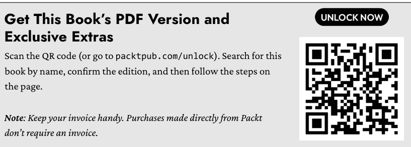
