# 11 使用审批

在第 10 章“审批入门”中，您学习了审批的机制。虽然顺序审批很常见，但在许多情况下，您需要并行审批或更复杂的审批流。在本章中，我们将涉及以下内容：

- 使用顺序审批
- 使用并行审批
- 使用高级场景
- 创建审批流

在本章结束时，您将理解如何使用这些技术。

## 使用顺序审批

顺序审批要求按顺序进行多个阶段的审批。图 11.1 显示了一个示例：

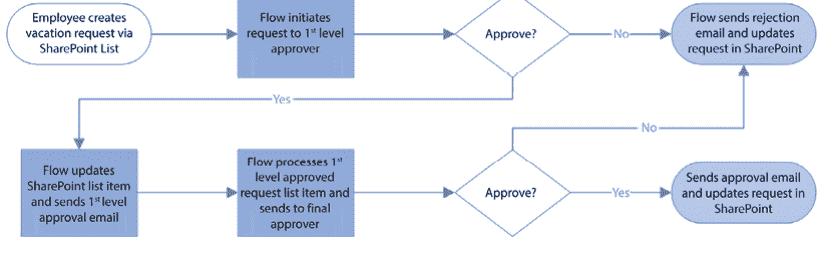

图 11.1 - 顺序审批

该图描绘了以下事件的顺序：

1. 用户向 SharePoint 列表添加一个项。
2. Power Automate 使用该列表作为触发器，向第一个审批者发起审批。
3. 第一个审批者对请求做出响应（“批准”或“拒绝”）。
4. Power Automate 处理审批。然而，与单一审批不同，它启动了下一个（最终）审批阶段。
5. 第二个审批者对请求做出响应（“批准”或“拒绝”）。

审批过程可以有任何数量的阶段，而不限于两个。

## 使用并行审批

顺序审批按单线程处理，而并行审批是独立发生的。休假请求也可以以并行审批的形式出现：您可能需要两个人来批准休假（例如您的直属经理以及一名 HR 代表员，或者直接经理和项目经理），但这些个人可能处于不同的管理和汇报结构中，他们的审批过程是相互独立的。

并行审批过程允许不同的审批分支独立进行。流末尾的逻辑（如条件）用于评估整个审批是否成功。

## 使用高级场景

创建更复杂的审批工作流时，可以使用一些配置选项。这些选项通常用于大型组织，一个或多个个人或组可以与审批交互。我们将简要介绍两种此类选项：混合审批类型和所有人批准。

对于非常复杂的场景，审批可能包含多个级别的顺序审批、并行与顺序审批的混合，甚至是分支中的顺序审批。这些类型的审批被称为混合审批。在评估结果和响应时，您需要确保选择了正确的动态值标记。

## 所有人批准

在创建审批工作流时，如果满足两个条件之一，做出最终决策可能是理想的：

- 包含在内的所有人都批准了
- 任何单个审批者拒绝了审批请求

这些类型的审批被称为所有人批准。为了演示这些技术，我们将创建一个使用系列（或顺序）审批的审批。

## 创建基础顺序审批

在本节中，我们将创建一个涉及第一阶段和第二阶段审批的基础顺序审批。这类审批常见于以下场景：个人申请一定数量的休假，或需要进行达到特定阈值的支出。在本示例中，我们将创建一个根据价格阈值对请求的采购订单进行评估的审批。如果金额超过了用户直属经理 1,000 美元的审批限额，将触发另一个审批序列。

与本书中的其他一些工作流一样，我们将使用 SharePoint 列表作为起点。你也可以从其他方法获取输入，例如从文件中读取内容、从另一个系统的 REST API-webhook 获取，甚至请求用户输入（你将在第 16 节“接受用户输入”中学习相关内容）。

此流需要一个包含多个不同列和数据类型的列表。这些列将用于在流程处理过程中存储信息。整个流程如下：

- 配置前提条件
- 创建工作流
- 测试工作流

流的设计规定：第一级审批者是请求者的经理，而第二级审批者是一个名为“财务经理（Finance Manager）”的用户。请求需要获得这两位用户的批准才能被标记为“已批准”。

接下来我们将配置前提条件。

## 配置前提条件

首先，你需要配置一个 SharePoint 列表，用于存储采购订单请求的数据。

按照以下步骤配置列表：

1. 导航到包含用于启动此工作流的列表的 SharePoint 站点。如果你没有合适的站点，可以创建一个。

图 11.2 – 创建新列表

2. 从导航菜单中选择“站点内容”，然后点击“新建”并选择“列表”。
3. 创建一个 SharePoint 列表。
4. 在列表中，选择“所有项目”下拉菜单并选择“添加或删除字段”。
5. 确保选择了 `Title`（标题）、`Created`（创建时间）、`Created by`（创建者）、`Modified`（修改）和 `Modified by`（修改者）列，并点击“应用”。
6. 使用“添加列”按钮，使用以下列和类型配置列表：

| 列名 | 列类型 |
| --- | --- |
| 采购金额 (Purchase Amount) | 货币 |
| 注释 (Comments) | 文本 |
| 需要预审批 (Pre-approval required) | 是/否（默认设置为否） |
| 已预审批 (Pre-approved) | 是/否（默认设置为否） |
| 已批准 (Approved) | 是/否（默认设置为否） |
| 创建者 (Created by) | 人或组（默认存在此列） |
| 修改者 (Modified by) | 人或组（默认存在此列） |

表 11.1 – 配置列表列

列创建完成后，就可以继续创建审批流了。请务必记住你正在使用的 SharePoint 站点 URL 和列表名称，因为你将在下一节中需要它们。

## 创建工作流

一旦创建了 SharePoint 列表，就可以开始处理流本身了。我们将分几个章节来创建此流：

- 创建触发器
- 创建第一阶段审批

### 创建触发器

让我们开始吧！

触发器将用于启动工作流。此流的触发器操作是用户在 SharePoint 列表中提交采购请求。

要创建此流，请按照以下步骤操作：

1. 导航到 Power Automate 制作 Web门户 (https://make.powerautomate.com)，登录并点击**创建**。
2. 选择**自动化云流**。
3. 为工作流输入一个名称（例如“采购订单请求两阶段审批”）。
4. 从触发器列表中，选择 SharePoint 触发器 **当项目创建时**，然后点击**创建**。

通过连接你已使用的应用程序从重复性工作中解放出来——自动化警报、报告和其他任务。

示例：

- 在业务解决方案中自动收集并存储数据
- 通过对 SQL 数据库的自定义查询生成报告

5. 点击触发器卡片以展开 **当项目创建时**。在**站点地址**字段中，选择存储列表的 SharePoint 站点的 URL。如果站点未出现在下拉菜单中，选择**输入自定义值**然后输入站点地址。
6. 在**列表名称**字段中，选择你在*配置前提条件*节中创建的列表名称。

图 11.4 – 配置触发器

7. **添加操作。**
8. 选择 **Office 365 Users - 获取经理 (V2)** 操作，在**当项目创建时**部分添加来自“**创建者电子邮件 (Created By Email)**”的动态内容标记。
9. 在 **获取经理 (V2)** 操作的**用户 (UPN)**字段中，添加来自“**当项目创建时**”部分的“**创建者电子邮件 (Created By Email)**”的动态内容标记。

图 11.5 – 配置获取经理 (V2)

10. **添加操作。**
11. **选择条件。**
12. 在条件的左侧，选择**采购金额 (Purchase Amount)**。
13. 选择操作类型为**大于**。
14. 在右侧输入 **1000**。

图 11.6 – 配置条件

15. 点击“保存”。

现在触发器和条件已创建完成，是时候继续创建第一阶段审批了。审批流将走两条路径：如果价格超过 1,000 美元，将需要财务经理进行第二阶段审批。如果小于 1,000 美元，则将由直属经理批准。

要继续处理审批，请按照以下步骤操作：

1. 在工作流中，展开否（False）分支。这是金额小于 1000 美元的分支。
2. 对于**审批类型**，选择**批准/拒绝 - 响应**。
3. 对于**标题**，包含来自“当项目创建时”部分的“标题”动态值标记，并带有其他描述性文本。
4. 对于**分配给**，选择来自“获取经理 (V2)”部分的“电子邮件”动态值标记。
5. 对于**项目链接**，选择来自“当项目创建时”部分的“链接”动态内容标记。
6. 展开高级参数并选择**请求者**。

图 11.7 – 创建审批操作

7. 在创建审批操作之后**添加操作**。
8. 选择**终止**控件。
9. 在**终止**控件的状态中，选择**成功**。这将停止后续步骤的执行。

图 11.8 – 配置终止操作

10. 点击“保存”保存工作流进度。
11. 展开是（True）分支。
12. **添加操作**并选择 SharePoint **更新项**操作。
13. 在**站点地址**字段中，选择包含此工作流所需列表的站点。如果站点未在下拉列表中显示，选择输入自定义值选项并粘贴 SharePoint 站点的 URL。
14. 在**列表名称**字段中，选择用于此工作流的列表。
15. 在**ID**字段中，选择来自“当项目创建时”部分的 **ID** 动态内容标记。
16. 将**标题**字段设置为来自“当项目创建时”部分的**标题**动态内容标记。
17. 将**采购金额**字段设置为来自“当项目创建时”部分的**采购金额**动态内容标记。
18. 确保**已预审批**下拉菜单设置为**否**。
19. 确保**已批准**下拉菜单设置为**否**。
20. 将**需要预审批**下拉菜单设置为**是**。

图 11.9 – 配置创建审批

21. 在更新项操作之后添加操作。
22. 选择**启动并等待审批**操作。
23. 对于**审批类型**，选择**批准/拒绝 - 响应**。
24. 对于**标题**，包含来自“当项目创建时”部分的“标题”动态值标记，并带有其他描述性文本。
25. 对于**分配给**，选择来自“获取经理 (V2)”部分的“电子邮件”动态值标记。
26. 对于**项目链接**，选择来自“当项目创建时”部分的“链接”动态内容标记。

图 11.10 – 完成更新项操作

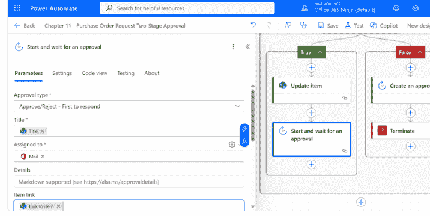

图 11.11 - 部分完成的条件控制配置

27. 点击保存。
28. 滚动到流程底部。
29. 添加操作。
30. 选择条件控制（Condition）。默认情况下，该操作将标记为 `Condition 2`。
31. 将操作名称更新为具描述性的名称，例如评估阶段批准条件（Evaluate Stage Approval Condition）。
32. 在条件控制中，选择左侧的选择值（Choose value）框，然后在“等待等待审批”（Start and wait for an approval）部分中选择结果（Outcome）动态内容令牌。

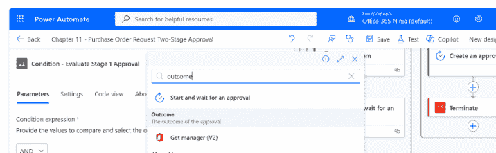

图 11.12 - 选择结果动态值内容令牌

33. 确保操作符值设置为“等于”（equal to）。
34. 在右侧的选择值框中，输入文本 `Approve`（批准）。
35. 在“评估阶段 1 批准条件”的假（False）分支中，点击添加操作并选择“发送电子邮件 (V2)” Office 365 Outlook 操作。
36. 在“项目创建时”（When item is created）部分下将创建者电子邮件（Created by Email）动态内容令牌添加到收件者（To）字段。
37. 在主题（Subject）字段中添加拒绝消息。您可能想要包含 `Title` 动态内容令牌。
38. 在正文（Body）字段中添加拒绝消息。您可能还需要使用 `Title` SharePoint 动态内容令牌，以及来自“获取经理 (V2)”操作的显示名称（Display Name）动态内容令牌：

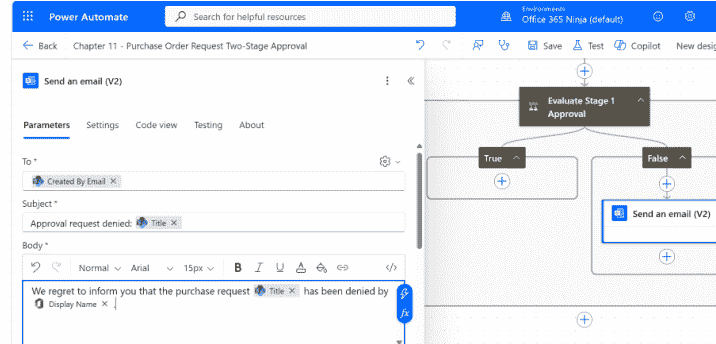

图 11.13 – 正在处理阶段 1 批准条件

39. 可选的是，您可能想扩展高级参数并添加发件人（发送为）[From (Send as)] 属性，并指定值如 `noreply@domain.com`（这样投诉就不会回到您的邮箱）。
40. 在假（False）分支中，点击添加操作并选择终端控制（Terminal）。
41. 状态（Status）选择“成功”（Succeeded）。
42. 点击保存。

此时，审批流程的第一阶段已完成。对于金额在 1,000 美元或以下的采购订单，直接经理可以批准或拒绝请求。对于金额超过 1,000 美元的采购订单，SharePoint 项目将更新为“待审批”状态，并启动一个新的审批流程。

作为审批流程的一部分，流程会向请求者的经理发送通知。如果被拒绝，审批将结束；流程的最后一步是向请求者发送电子邮件，指示审批已被拒绝。然而，如果结果是批准的，工作流将启动一个新分支以开始第二阶段。

## 重命名步骤

默认情况下，步骤使用操作的名称标记。然而，在包含多个操作、条件或分支的长步骤或复杂步骤中，重命名特定步骤可能有助于记录您处于流程的什么位置。每个步骤都使用操作名称（默认值），并为每个实例附加一个数字（因为每个步骤必须有唯一的名称值）。

要重命名步骤，点击操作卡片，并在弹出的飞出窗口中编辑步骤名称。虽然您可以随时时候重命名步骤，但您可能需要返回并双重检查，以确保您的动态内容令牌引用了正确的值。建议在创建操作时对其进行重命名，而不是事后回来更新。

现在，让我们继续创建审批的下一个阶段。

## 创建第二阶段审批

在审批流程的此部分，请求将发送给第二级或第二阶段审批者。第二阶段审批者也将具有批准或拒绝请求的能力。

要完成此流程，请按照以下步骤操作：

1. 在打开流程的情况下，选择第二个条件控制“评估阶段 1 批准”的真（True）分支，然后点击添加操作。
2. 选择“更新项目”（Update item）操作
3. 在站点地址（Site Address）字段中，选择包含此工作流 SharePoint 列表的站点。
4. 在列表名称（List Name）字段中，选择用于此工作流的列表。
5. 在 `Id` 字段中，选择“项目创建时”部分下的 `ID` 动态内容令牌。
6. 将标题（Title）字段设置为“项目创建时”部分下的 `Title` 动态内容令牌。
7. 将采购金额（Purchase Amount）字段设置为“项目创建时”部分中的 `Purchase Amount` 动态内容令牌。
8. 将预批准（Pre-approved）下拉菜单设置为“是”（Yes）。

## 9. 确保“已批准”（Approved）下拉菜单设置为“是”。见图 11.14。

## 10. 确保“需要预审”（Pre-approval required）下拉菜单设置为“是”。

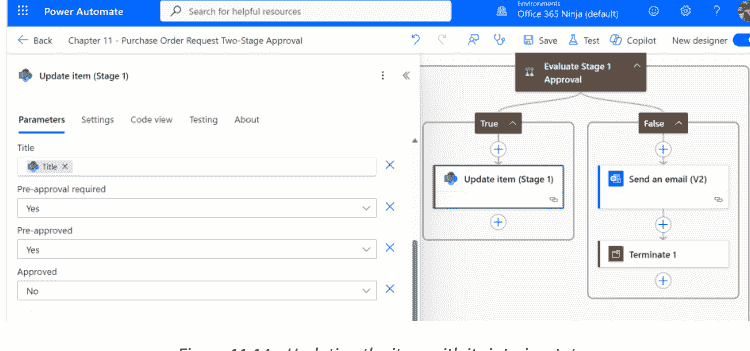

## 11. 点击添加操作。

## 12. 选择“等待审批”（Start and wait for approval）操作。

## 13. 将步骤重命名为有意义的名称。

## 14. 对于类型（Type）字段，选择结果（Outcome）动态内容。

## 15. 对于主题（Subject）字段，选择“项目创建时”部分中的 Title 动态内容。

## 16. 对于分配给（Assigned）字段，选择经理的电子邮件地址。

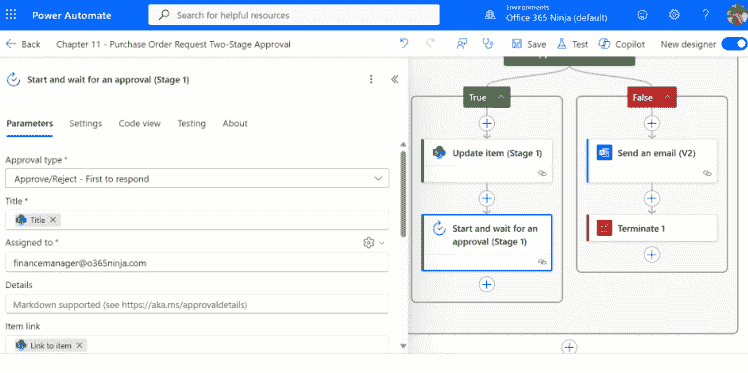

图 11.15 - 快速检查流程

## 17. 点击保存。

您现在已完成第二阶段审批。接下来，我们将开始完成流程。

### 完成流程

在流程创建的最后部分，我们将遵循一个与实施预审时类似的流程：使用条件检查结果（Outcome）的值，然后更新 SharePoint 项目。

要完成此流程，请按照以下步骤操作：

1. 在采购订单审批流程中，滚动到流程底部并点击新建步骤。
2. 添加条件控制。可选的是，将新步骤重命名为“评估 2”（Evaluate 2）。
3. 在条件控制左侧的选择值框中，选择“等待审批”部分的结果（Outcome）值。
4. 选择“等于”作为条件的评估方法。
5. 将条件控制右侧的选择值设置为“批准”（App）。
6. 在假（False）分支中，点击添加操作。
7. 选择“发送电子邮件 (V2)” Office 365 Outlook 操作。
8. 在收件者（To）字段中，添加“项目创建时”部分下的创建者电子邮件（Created by Email）动态内容。
9. 在主题（Subject）字段中，添加消息。可选的是，添加 Title 动态内容值。
10. 在正文（Body）字段中添加消息。此外，添加 Title 动态内容值以及其他值（例如审批者名称）。
11. 可选的是，您可能想扩展高级参数并添加发件人（发送为）属性，并指定值如 `noreply@domain.com`（这样投诉就不会回到您的邮箱）。
12. 点击操作并选择“项目创建时”部分下的更新项目动态内容值。
13. 使用“项目创建时”部分的动态内容令牌配置站点地址、列表名称、ID、标题和采购金额。
14. 将预批准（Pre-approved）分支设置为“否”（No）。
15. 将已批准（Approved）字段设置为“否”。
16. 将需要预审（Pre-approval required）设置为“是”。
17. 点击添加操作，然后选择终端控制（Terminal）。
18. 检查假（False）分支确保其结构与图 11.16 类似：

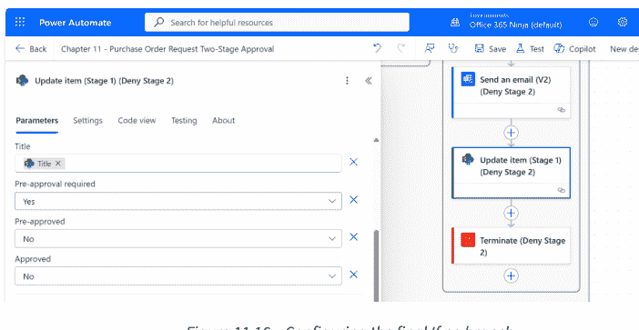

20. 选择最后的真（True）条件分支，然后添加操作。
21. 选择 SharePoint “更新项目”操作。
22. 使用“创建项时”部分中的动态内容标记，配置站点地址、列表名称、ID、标题和购买金额值。
23. 将“预批准（Pre-approved）”字段设置为“是”。
24. 将“批准（Approved）”字段设置为“是”。
25. 将“预批准要求（Pre-approval requirement）”字段设置为“是”。
26. 选择发送电子邮件 (V2) Office 365 Outlook 操作。
27. 在“致（To）”字段中，添加“创建项时”部分下的“创建者电子邮件（Created by Email）”动态内容值。
28. 在“主题（Subject）”字段中添加消息。可选添加“标题（Title）”动态内容值。
29. 在“正文（Body）”字段中添加消息主体。可选添加“标题（Title）”动态内容以及任何其他值（如审批人姓名）。
30. 点击“添加操作”并选择“终止（Terminate）”。
31. 将状态设置为“如果是成功（If Yes succeeds）”，以确保其结构与图 11.17 类似：

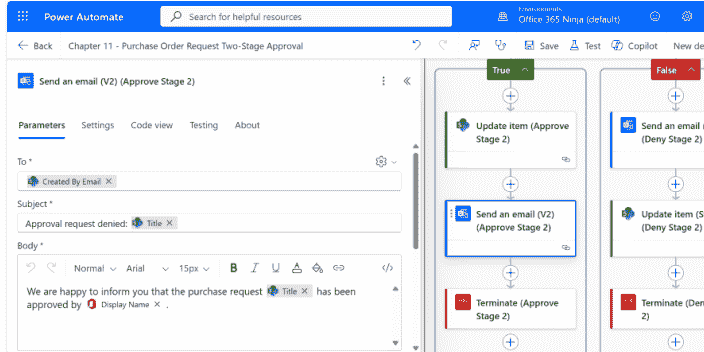

图 11.17 – 查看“如果是”分支

33. 点击“保存”。

审批已成功创建！由于这是一个非常长且复杂的流，你可能希望检查这些项并更新描述或名称，以便为其他可能查看该流的人（或者在你需要进行故障排除时为你自己）标记它们。

完成后，是时候测试了！

### 测试流

要测试此流，请导航到包含受监控的列表和值的 SharePoint 站点。为了验证它是否按设计运行工作，你可能需要运行多次测试，包括金额高于 `$1,000` 和低于 `$1,000` 的请求，然后在第一阶段或第二阶段批准或拒绝它们。

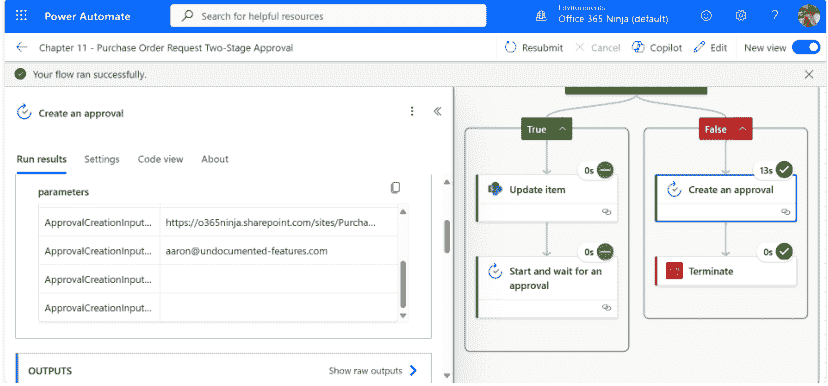

图 11.18 - 查看流的运行历史

如果任何步骤发生错误，请检查流步骤，以确保你使用的是适当的动态内容标记，并且评估语句是正确的。

当你对 Power Automate 概念变得熟悉且有信心时，你将发现自定义输出或步骤的新新方法，包括使用复杂表达式、额外的格式以及组合动态内容值以生成丰富的输出。

### 添加并行分支

对于运行时间较长或涉及多个用户或交互的审批过程，你可能希望向用户发送定期电子邮件提醒。实现此点的一种方法是在每个审批阶段填充变量，并使用并行审批分支检查它们是否已完成。你将通过五个组件完成此操作：

- 初始化变量（Initialize variable）操作将用于配置一个变量（例如 `FirstApprovalDone`），你将在整个审批过程中检查该变量。该变量将初始化为 `false`，只有在审批人批准请求后才会被设置为 `true`。

在某些编程语言中，你可以即时将操作或命令的结果保存到变量中。在 Power Automate 中，你必须在使用变量之前对其进行声明。

- **直直到（Do until）** 控件将用于创建一个循环，定期检查变量（示例中的 `FirstApprovalDone`）是否已从 `false` 变为 `true`。

- **延迟（Delay）** 操作允许你定义通过某段时间来发送电子邮件（以便让审批人在收到通知之前有机会做出响应）。

- **发送电子邮件 (V2)** 操作（你之前已使用过）将向审批人发送提醒性电子邮件。

- **设置变量（Set variable）** 操作将用于更新变量（`FirstApprovalDone`），以表示审批已完成。

你可以使用以下步骤添加提醒性电子邮件：

1. 使用 Power Automate 制作器网页门户界面 (`https://make.powerautomate.com`)，编辑两阶段审批。
2. 导航到 **获取经理 (Get manager (V2))** 步骤，然后在它与第一个批准控制控件之间**添加操作**：

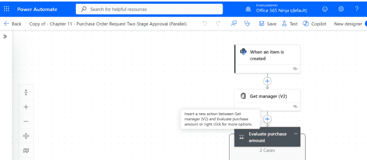

图 11.19 – 在步骤之间插入新操作

### 选择 初始变量（Initialize variable）操作：

3. 选择 初始化变量操作：

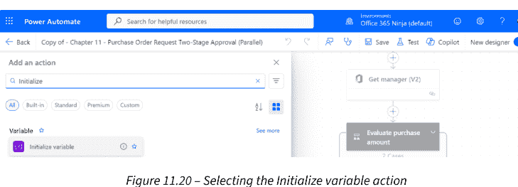

4. 将帮助你跟踪正在处理哪个审批的变量命名为 `FirstApprovalDone`。将类型设置为布尔（Boolean）并输入初始值 `false`。
5. 在这种情况下，你将使用此变量来跟踪第一个审批是否完成，将其命名为 `FirstApprovalDone`：

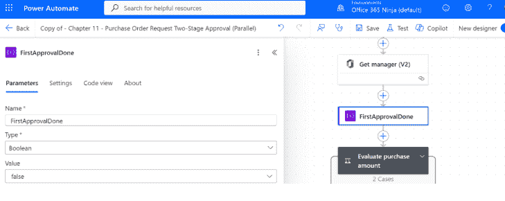

6. 接下来，展开创建第一个审批的条件（它应该是第二个条件控制步骤，如果你重命名了它，它应该名为 `Evaluate Stage 1 Approval`）。
7. 在“真（True）”分支中，右键点击“更新项（Update item）和“开始并等待审批”操作之间的 `+` 号，然后选择**添加并行分支**：

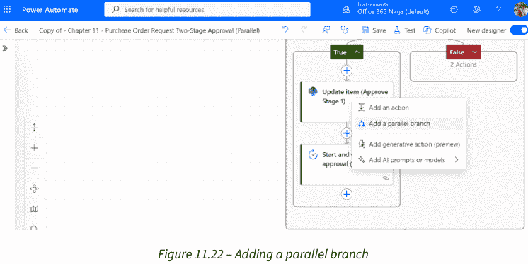

8. 在并行分支中，选择 延迟（Delay）操作，如图 11.23 所示：

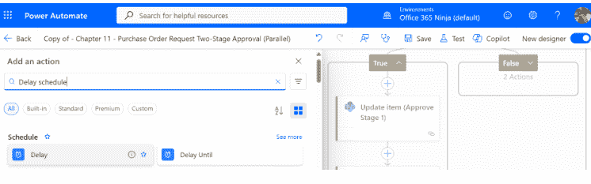

9. 为 **计数（Count）** 输入数字并选择 **单位（Unit）**，这将用于发送电子邮件。在示例中，为 **计数** 输入 `1` 并选择 **天（Day）** 意味着提醒电子邮件将在一天后后发送：

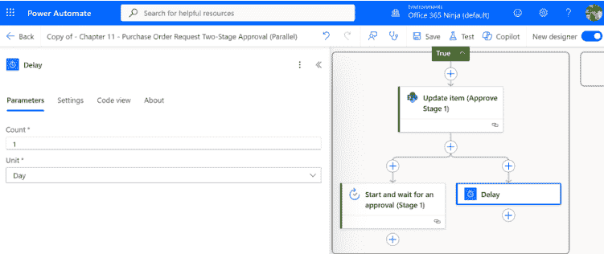

图 11.24 – 配置延迟

10. 在延迟操作之后，添加一个操作：
11. 在 直直到（Do until）左侧的“选择值”框中，选择 发送电子邮件 (V2) 操作，如图 11.25 所示：

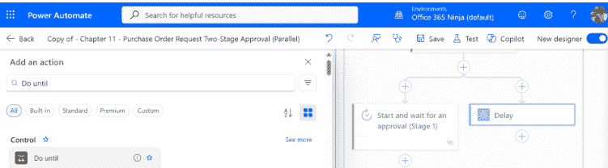

图 11.25 – 添加操作

12. 在 直直到（Do until）右侧的“选择值”框中，选择 `FirstApprovalDone` 的动态内容。
13. 在“选择值”框中，选择 `true` 的表达式——注意使用浏览器功能可能会选择器隐藏：

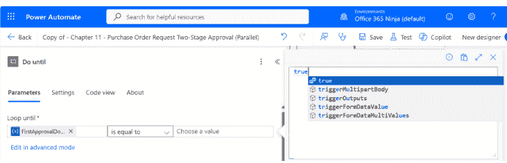

14. 选择 发送电子邮件 (V2) 操作。
15. 使用 获取经理 (Get Manager (V2)) 的动态内容填充邮件。输入主题和邮件正文：

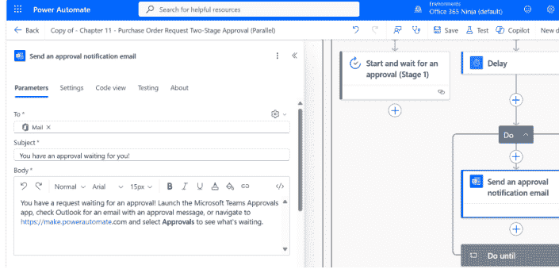

图 11.26 – 配置提醒电子邮件

16. 在发送电子邮件 (V2) 操作之后，添加一个操作：

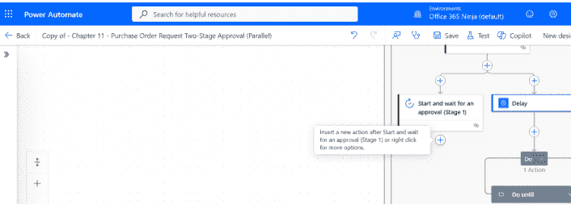

图 11.27 – 添加操作

17. 添加 **设置变量（Set variable）** 操作。
18. 从 **名称（Name）** 下拉列表中选择 **FirstApprovalDone** 变量，然后添加 **true** 表达式：

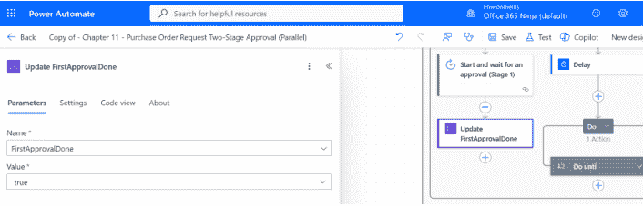

图 11.28 – 配置设置变量操作

19. 点击 **保存**。

根据你想创建多少提醒分支，你可以在流中的每个审批重复此过程。

### 总结

在本章中，你学习了如何开始需要多个阶段或审批才能成功的审批流。顺序审批要求按顺序完成一系列审批，而并行审批可能涉及多个独立运行的审批分支。

这类复杂的审批请求流经常用于中大型企业，并反映了现实场景。熟悉这些类型的审批将帮助你在未来创建更准确地满足组织需求的流。

除了多阶段审批，你还处理了并行分支，并使用延迟、循环和变量创建一个定期发送提醒电子邮件的框架。

在下一章中，我们将查看将审批过程与 Microsoft Teams 集成。

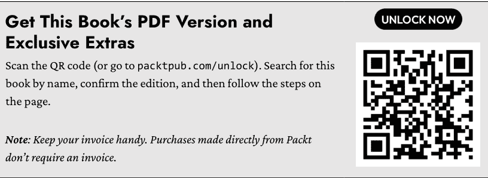

