# 第 15 章

## 265

传统的看板通过与工作阶段对齐的列来组织任务。任务卡从左到右跨列移动，代表了整个工作过程的进度。在 Microsoft Planner 中，任务被放置在称为“桶”（`buckets`）的组中，并可以在桶内进行排序或分类。

Microsoft Planner 有三个触发条件：当任务创建时、当任务分配给我时，以及当任务完成时。这些条件都非常通俗易懂。在本章中，我们将重点关注“当任务分配给我时”。输出是一个任务对象，具有多个参数，如计划 ID（指向任务所属计划的对象 ID）、任务标题（`Title`）、桶 ID（任务所属的桶）、分配人员（`assignments`，谁负责处理该任务）、优先级、完成百分比状态，以及创建、开始和完成的各种日期。

你可以在此处找到 Planner 连接器功能的完整列表：`https://learn.microsoft.com/en-us/connectors/planner`。

# Slack

在 Microsoft Teams 出现之前，有了 Slack。Slack 和 Teams 一样都是基于云的协作和消息平台，旨在帮助团队实时通信和工作。它将对话组织到频道（`channels`）中——即项目、主题或团队的专用空间。像 Teams 一样，它还支持一对一或小群聊的直接消息。用户可以共享文件、搜索过去的讨论，并与广泛的应用程序和服务集成，使其更新、警报和工作流的核心枢纽。

Slack 有自己的一套触发器，在本章中，我们将重点关注操作（`actions`）。Slack 可用的操作包括创建和加入频道，以及发布消息。

你可以在此处找到 Slack 连接器功能的完整列表：`https://learn.microsoft.com/en-us/connectors/slack`。

# 准备工作设置

在本节中，我们将关注环境和组件的设置。

为了运行此内容，你需要在 `https://slack.com/intl1/en-in` 注册一个免费的 Slack 账户。

一旦激活了账户，请登录。你将看到一个与图 15.1 截图类似的桌面：

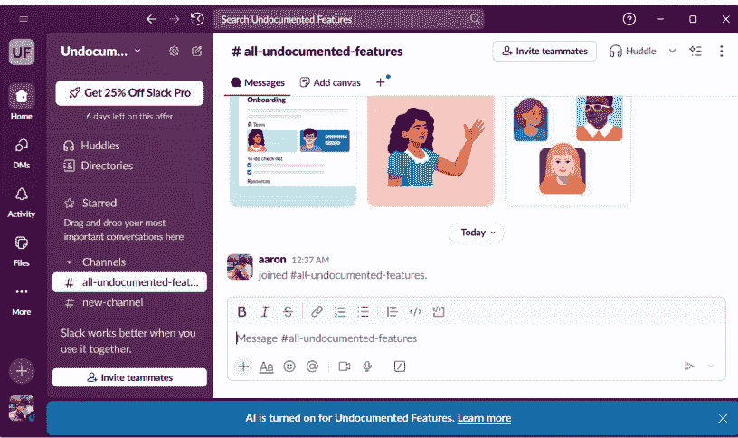

图 15.1 – Slack 界面

默认情况下，你应该有一个名为 `#all-<organization>` 的频道。我们将使用该频道发布通知，但你也可以使用任何需要的频道。

你还需要一个 Planner 计划。你可以作为团队的一部分进行设置，也可以直接使用独立计划。要设置独立计划，导航到 `https://planner.cloud.microsoft` 并点击“新建计划”（`New plan`）。选择空白计划或从模板中选择一个。

# 第 15 章

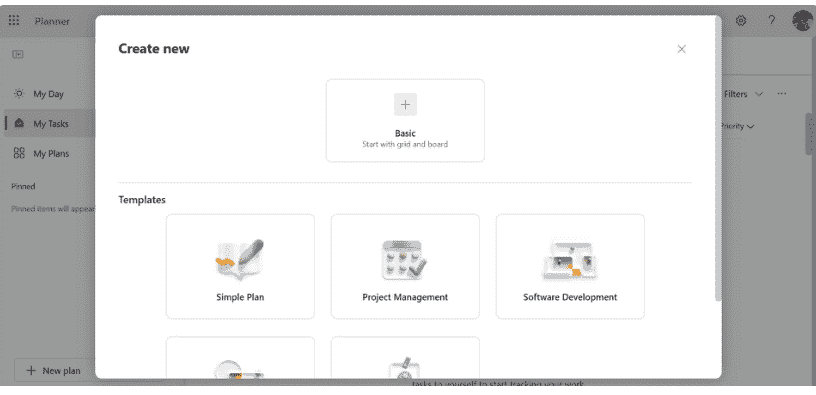

图 15.2 – 创建新计划

现在，是时候开始构建流了！

# 使用 Planner 触发流

设置好你的 Slack 工作空间和 Planner 后，让我们开始创建一个工作流吧。

和我们在书中目前为止处理过的许多流一样，我们将从一个自动化触发器开始。按照以下步骤启动它。

1. 导航到 Power Automate 制作网页门户（`https://make.powerautomate.com`）并登录。
2. 点击“创建”（`Create`）并选择“自动化的流”（`Automated flow`）。
3. 为你的流输入名称，然后选择“当任务分配给我时”（`When a task is assigned to me`）Planner 触发器操作。

就这些。此触发器没有主要的参数，因为它是在检测 Microsoft 365 生态系统中的 Planner 分配。见图 15.3。

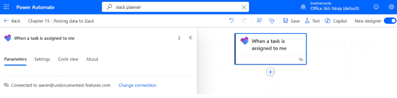

图 15.3 – 查看 Planner 参数

接下来，我们将添加与 Slack 的连接。

# 向 Slack 频道发布更新

在不同平台之间保持同步非常重要，这就是为什么我们要将这些任务分配发送到 Slack。

1. 在你的流处于打开状态下，点击“添加操作”（`Add an action`）。
2. 选择“发布消息 (V2)”（`Post message (V2)`）Slack 操作。

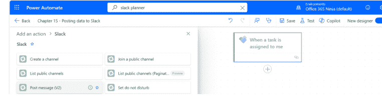

图 15.4 - 添加发布消息 (V2) 操作

3. 如果提示，请登录 Slack。
4. 在“发布消息 (V2)”飞出窗口中，选择“参数”（`Parameters`）选项卡。
5. 在“频道名称”（`Channel Name`）下拉菜单中，选择 `all-<organization>` 频道（或你选择的任何频道）。

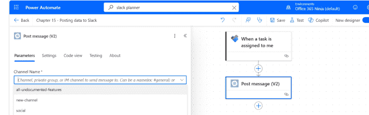

图 15.5 - 选择目标频道

### 配置发布消息
6. 在“消息文本”（`Message Text`）字段中添加通知文本。在示例中，我们添加了标题（`Title`，任务名称）、分配人员（`assignments Assigned To User Id`，任务分配给谁）以及分配者（`Assigned By User Id`，任务由谁分配给谁的）的动态内容值令牌。

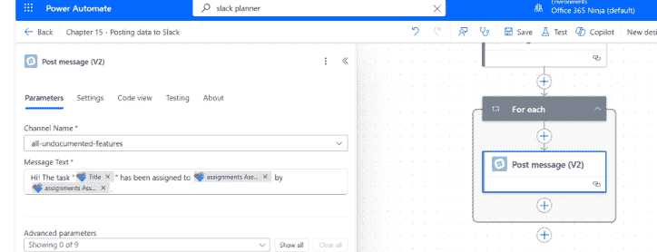

图 15.6 - 配置发布消息

由于`Assigned To User Id`是一个数组，我们将使用`Title`的动态内容值令牌。

7. 展开“高级参数”（`Advanced parameters`）。

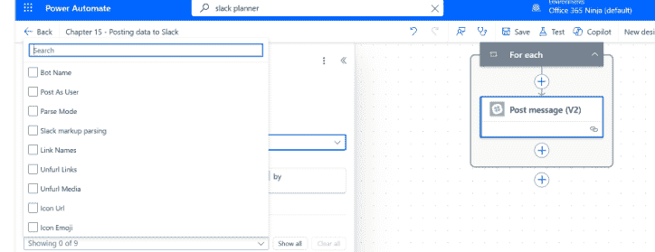

图 15.7 - 添加高级参数

8. 点击`ID`字段内部。

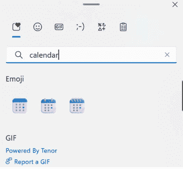

图 15.8 - 选择用户

9. 点击“保存”（`Save`）。

10. 保存流。

### 测试流
流保存好后，是时候触发它了。

1. 导航到你的计划。

2. 选择一个现有任务或创建一个新任务。

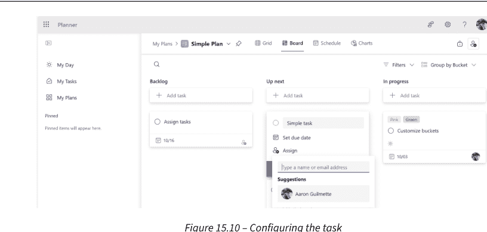

图 15.9 - 添加任务

3. 为你的流输入名称，然后点击“分配”（`Assign`）。

## 输出调试
如果你熟悉 Microsoft 365，可能会识别出显示的数字而不是名称。哦，不！看起来出问题了！让我们查看输出。

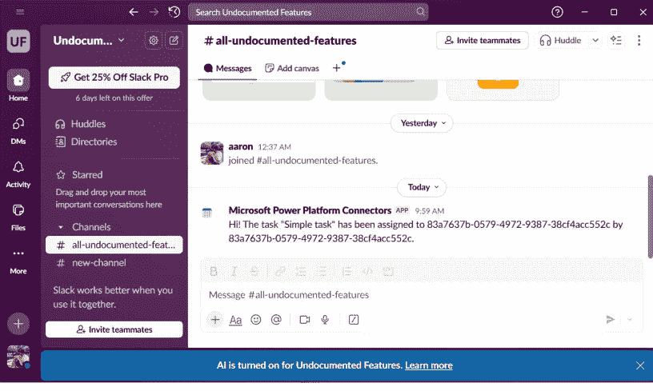

图 15.10 - 输出调试

在画布上，选择“当任务分配给我时”触发器操作的“运行结果”（`Run results`）。滚动到`OUTPUTS`部分并点击。

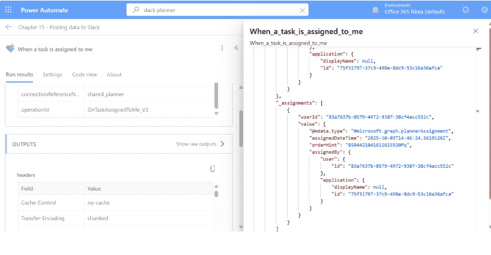

滚动到输出底部，你可以看到`assignments`数组。深入查看，你会发现`id`属性关联有一个数字——并不用户友好。这种格式被称为`GUID`（全局唯一标识符）——它是用户的不可变表示。幸运的是，我们有方法查询它！

- 回到流并展开“对于”（`For each`）循环。

- 在“发布消息 (V2)”操作上方点击“+”插入新步骤。

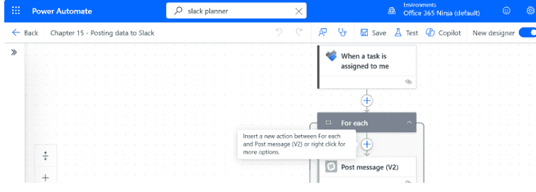

图 15.11 - 插入新操作

3. 添加“组合”（`Compose`）操作。

4. 将该操作名称更新为描述性名称，例如`Compose assignedTo`。

5. 选择“输入”（`Inputs`）字段。

6. 添加`assignments Assigned User Id`的动态内容值。

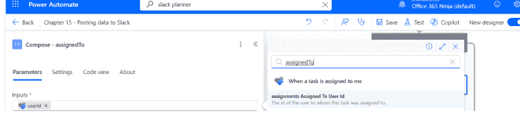

图 15.12 - 添加第一个 Compose 语句

7. 在`Compose-assignedTo`操作之后，添加另一个“组合”操作。

8. 将该操作名称更新为描述性名称，例如`Compose assignedBy`。

9. 选择“输入”（`Inputs`）字段。

10. 添加`assignments Assigned By User Id`的动态内容值。

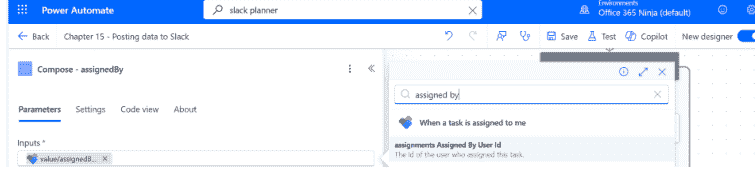

图 15.13 - 添加第二个 Compose 语句

11. 在第二个`Compose`动作和`Post message (V2)`动作之间插入一个动作。

12. 选择`Get user profile (V2)`动作。

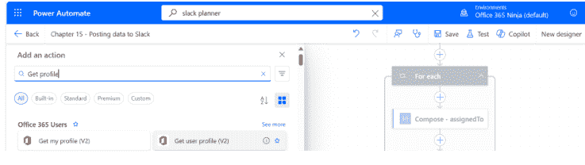

图 15.16 – 添加 Get user profile (V2) 动作

13. 将`Get user profile (V2)`动作的名称更新为具有描述性的名称，例如`Get user profile (V2) – assignedTo`。

14. 选择`User (UPN)`字段，并添加来自`Compose – assignedTo`的`Outputs`动态内容标记。

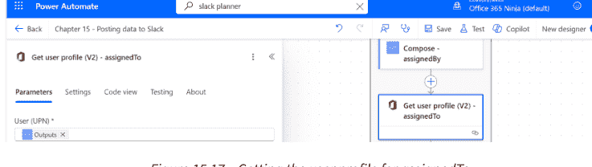

图 15.17 – 获取 assignedTo 的用户配置文件

15. 在`Get user profile (V2)`动作和`Post message (V2)`动作之间插入一个动作。

16. 选择`Get user profile (V2)`动作。

17. 将`Get user profile (V2)`动作的名称更新为具有描述性的名称，例如`Get user profile (V2) – assignedTo`。

18. 选择`User (UPN)`字段，并添加来自`Compose – assignedBy`动作的`Outputs`动态内容标记。

19. 选择`Post message (V2)`动作卡片。

20. 选择`Message Text`字段。

21. 将`userId`和`value/assignedBy`动态值标记替换为新的`Get user profile (V2)`动作值，如图 15.18 所示：

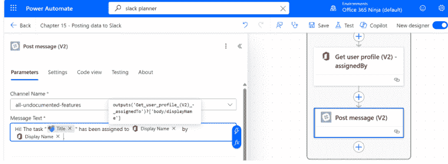

图 15.18 - 使用新的动态内容值更新流

22. 点击保存。

让我们再次尝试！

# 重新测试流
是时候看看我们成功了。

1. 回到你正在操作的计划。

2. 选择一个任务（或创建一个新任务）并为自己添加一个新的分配。

3. 等待任务执行。

4. 去检查 Slack！

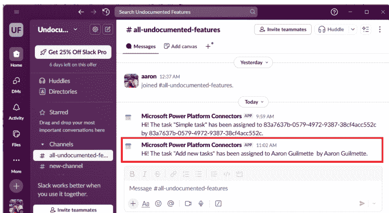

图 15.19 - 查看更新后流的输出

成功了！

处理流有时会很复杂，需要一些尝试才能得到你想要的结果。当你看到意外之外的值时，务必检查每个动作的输出。

### 进一步探索
“当任务分配给我（`When a task is assigned to me`）”触发器的缺点之一是它只适用于直接分配给你的任务。处理此流另一种方法可能是使用触发器，例如[创建新任务时（`When a new task is created`）](https://learn.microsoft.com/en-us/connectors/planner/#when-a-new-task-is-created)。仅凭该动作你无法获得分配详情，而且结果可能不如我们的预期，因此你需要利用`Get task details`来检索额外信息。

### 总结
本章介绍了新的应用、触发器和动作——让你有机会与 Microsoft Planner 和 Slack 进行协作。

虽然流最初看起来可能很简单，但输出并不符合我们的预期，导致我们必须排查故障并修改流以正确查找所需的数据。

在下一章中，我们将学习如何使用 Power Automate 接受用户输入以创建更具交互性的流。

获取本书的 PDF 版本和独家额外内容

立即锁定

扫描二维码（或访问 packpub.com/unlock）。按书名搜索此书，确认版本，然后按照页面上的步骤操作。

注意：请妥善保存发票。直接从 Packt 购买不需要发票。
