# 接受用户输入
许多类型的业务处理需要某种形式的用户输入。输入可以是用户输入的数据形式，可以是用户选择“是”或“否”的提示提示符，甚至是上传文件。Power Automate 提供了一个接口，让用户可以作为流的一部分提供信息。连接的应用程序（如 Power Apps）也可以用于向流提供信息。

在本章中，我们将重新回顾第 5 章“创建按钮流”中即时云流的概念。你将学习如何收集不同类型的用户输入，这些输入稍后可用在流中。具体而言，本章将涵盖以下主题：

- 理解用户输入选项

- 创建一个使用所有输入类型的流

- 验证流的执行

通过完成本章末尾的练习，你将熟悉不同类型的用户输入选项以及它们如何被用于创建交互式流。

继续前进！

### 理解用户输入选项
用户输入可以有许多形式。在创建手动触发流（也称为按钮流或即时流）时，Power Automate 允许流设计人员接受六种用户输入。要向手动触发的流添加输入功能，点击标记为“`Manually trigger a flow`”的标题。

当触发器对象展开时，点击“`Add an input`”，即可看到图 16.1 所示的输入选项：

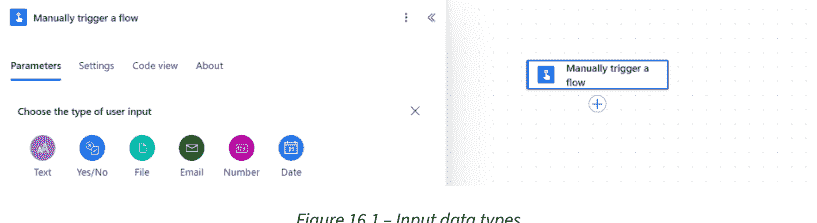

输入类型如下：

- **Text（文本）**：`Text`输入选项支持自由格式文本、单个下拉列表和多选列表。

- **Yes/No（是/否）**：`Yes/No`输入选项是一个开关。

- **File（文件）**：`File`选项提供了上传文件的功能。

- **Email（电子邮件）**：`Email`输入选项旨在接收电子邮件地址。

- **Number（数字）**：`Number`输入选项允许用户输入数字。

- **Date（日期）**：`Date`选项允许用户选择日期。

手动触发的流可以使用一个或多个输入选项。

此外，如果你的流正在捕敏感数据（如帐户凭据或其他值），你可以配置 **Secure inputs（安全输入）** 和 **Secure outputs（安全输出）**。选择 **Manually trigger a flow**，然后选择 **Settings（设置）** 查看选项：

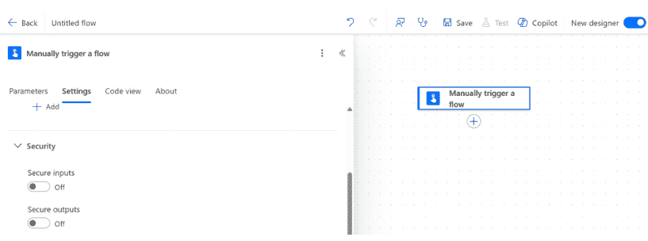

图 16.2 – 配置动作

安全选项会隐藏流历史中显示的详情（由于安全配置，不会显示用户提交的实际），如图 16.3 所示：

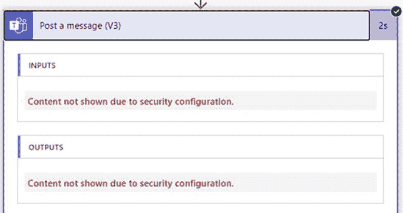

图 16.3 - 查看配置了安全输入输出的流历史

现在你已经对输入类型有了基本的了解，让我们创建一个流吧！

### 创建使用所有输入类型的流
在示例中，我们将配置一个使用所有输入类型的简单流，并使用这些数据填充 SharePoint 列表。你也可以尝试此示例将内容保存到数据库。

在开始配置流之前，你需要配置一些基本的先决条件，例如存储各种值的 SharePoint 列表。完成先决条件后，你就可以创建并测试流了。

### 配置先决条件
由于流的数据将存储在 SharePoint 列表中，如果你没有这些列表，你需要配置一个。在示例中，我们将在现有站点创建一个新列表，然后为我们的每个值添加一列。

要创建列表，请遵循以下步骤：

1. 导航到 SharePoint 站点，点击 `Site contents`（站点内容），点击 `New`（新建）。从下拉菜单中选择 `List`（列表），如图 16.4 所示：

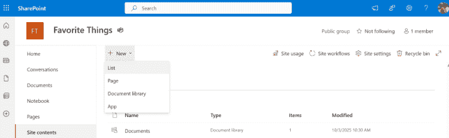

2. 从模板样式中选择 `Blank`（空白）。

3. 为列表输入名称并点击 `Create`（创建）。

4. 点击 `Edit in grid view`（在网格视图编辑）。

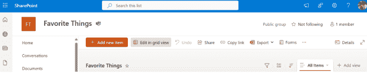

5. 点击 `Title` 单词，指向 `Column settings`（列设置），并选择 `Rename Column`（重命名列）。将列重命名为 `Name`。

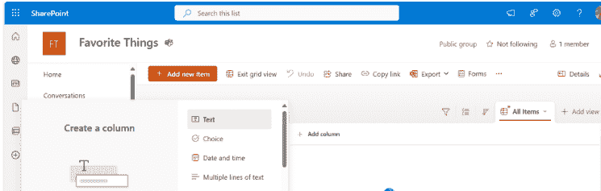

图 16.6 – 创建列并设置其类型

6. 在“创建列”飞出窗口中，将名称（`Name`）设置为 `Email1 Address`，并确保类型（`Type`）下拉菜单设置为“单行文本（`Single line of text`）”。点击保存。

7. 重复此过程添加列，使用以下列类型和值：

| 列类型 | 标识 (Name) |
| :--- | :--- |
| 文本 / 单行文本 | `Email Address` |
| 是/否 | `Eaten in the last week?`（上周内吃过吗？） |
| 数字 | 你每个月吃几次？ |
| 日期 | `Today’s Date`（今天的日期） |
| 图像 | 你最喜欢的食物的照片 |

表 16.1 – 列表值

完成后，它看起来应该像下图所示：

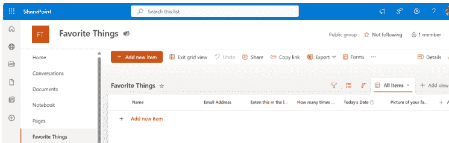

图 16.7 – 配置后的列表

8. 点击“退出网格视图（`Exit grid view`）”以保存更改。

稍等片刻，你配置的列表将被保存。你可以进行下一步了。

### 创建流
现在你已经有了保存数据的地方，可以开始创建流了。按照以下步骤创建一个手动触发并捕用户输入的流：

1. 转到 Power Automate Web 门户 (https://make.powerautomate.com) 并选择“创建”。

2. 选择“即时云流（`Instant cloud flow`）”。

3. 为流输入名称，选择“手动触发流（`Manually trigger a flow`）”触发器，并点击“创建”。

4. 点击触发器标题显示“添加输入选项（`Add an input`）”：

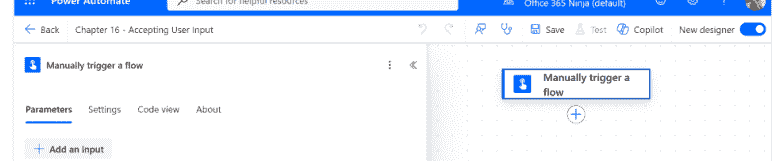

图 16.8 – 展开触发器选项

5. 点击“添加输入”并选择“文本（`Text`）”：

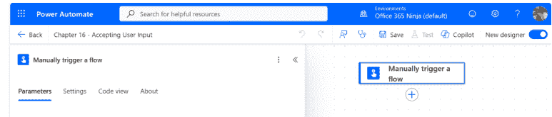

图 16.9 – 添加新的输入类型

6. 将标签更新为文本 `Name`，然后将提示（`prompt`）更新为“请输入您的姓名：”

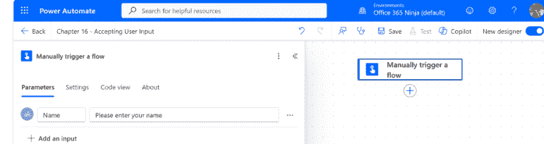

图 16.10 – 配置文本输入

7. 点击**添加输入（Add an input）**并选择**电子邮件（Email）**。将提示更新为“请输入您的电子邮件地址”。

8. 点击**添加输入（Add an input）**并选择**文件（File）**。将标签更新为“图片”。点击该项目旁的省略号 (...)，然后根据需要开启**必填字段（Make the field required）**选项：

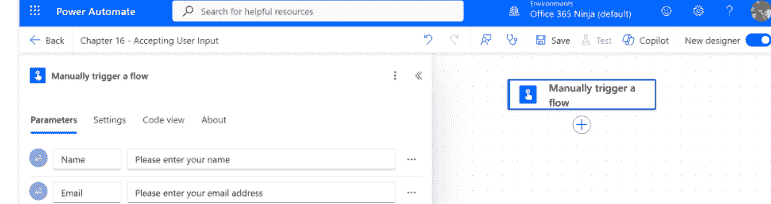

图 16.11 – 配置图片输入

9. 点击**添加输入（Add an input）**并选择**是/否（Yes/No）**。将标签更新为“你上周吃过这个吗？”

10. 点击**添加输入（Add an input）**并选择**数字（Number）**。将提示更新为“请输入你通常每个月吃几次”。

11. 点击**添加输入（Add an input）**并选择**日期（Date）**。将标签更新为“今天的日期”。将提示更新为“请输入今天的日期”。

12. **添加操作（Add an action）**。

13. 选择 SharePoint 操作**创建项（Create item）**。

14. 在**站点地址（Site Address）**框中选择包含你为练习创建的列表的站点。如果没有显示，点击**输入自定义值（Enter custom value）**并添加 SharePoint 站点的 URL。

15. 选择列表。稍等片刻，列表上的列名可能会出现：

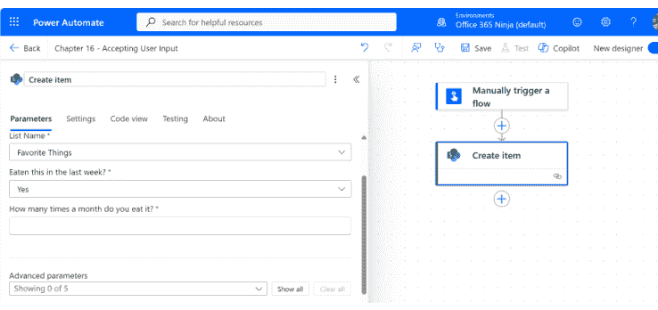

图 16.12 – 编辑“创建项”操作

标记为“必填（`Required`）”的列表项显示。你可以点击高级参数下的“显示所有（`Show all`）”按钮，自动将所有剩余列名添加到操作中。

16. 点击 `Name` 或 `Title` 字段（取决于你使用的哪种设计器画布视图），然后选择 `Name` 的动态值令牌。

17. 对“上周内吃过吗？是/否”字段、自定义值（`Custom value`）重复此过程，然后你就可以选择相应的动态内容令牌。完成后，它看起来应该像下面的截图：

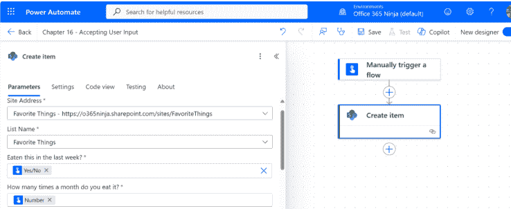

图 16.13 – 完成“创建项”操作

18. 添加操作。

19. 在搜索框中输入 `attachment`（附件）。选择 SharePoint **添加附件（Add attachment）**操作：

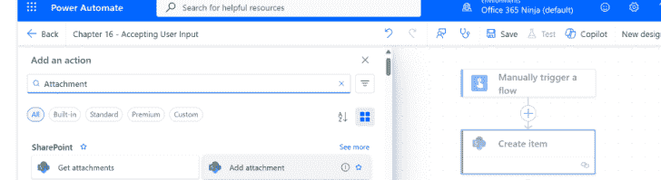

图 16.14 – 选择“添加附件”操作

20. 在站点地址（`Site Address`）框中，选择包含列表的站点。在列表名称（`List Name`）框中选择你之前使用的列表。

21. 在 `Id` 框中，选择“创建项”操作下的 `Id` 动态内容令牌。

22. 在文件名（`File Name`）框中，输入用于保存文件的文件，例如 `FavoriteThing.jpg`。你也可以使用表达式来动态命名项目。在本例中，我们使用了以下表达式：

```
concat(triggerBody()?['email'],_'FavoriteThing_',triggerBody()?['file']['name'])
```

23. 在文件内容（`File Content`）框中，从“手动触发流”部分选择 `PicturecontentBytes` 动态内容令牌：

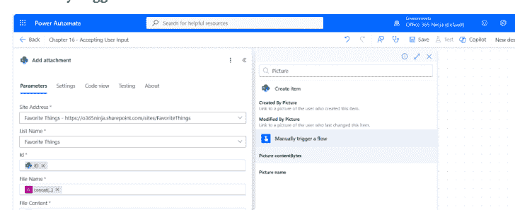

图 16.15 – 将图片添加到 SharePoint 列表项

24. **添加操作（Add an action）**。


## 25. 配置收件人并保存

- 25. 在**收者（To）**字段中，选择**电子邮件（Email）**动态内容令牌。
- 26. 在**主题（Subject）**字段中，输入“感谢告知”。
- 27. 在**正文（Body）**字段中，选择任何你想要的动态内容。
- 28. 点击**保存（Save）**。

此时，你已经配置了一个捕获示例输入的流，进行了测试并验证了数据已上传。你可能注意到图像是以附件形式显示的，而不是列表中的列。目前，`SharePoint`创建项或更新项的操作不支持默认图像列。然而，只要有创意，你可以编写`SharePoint HTTP`请求来直接上传数据。

> 注：原文末尾部分存在大量重复的乱码文本，译文已根据逻辑进行了清理和去重。

## 第 16 章

8. 选择`POST`作为方法。
9. 在`Uri`文本字段中输入`/api/web/lists/GetByTitle('Favorite%20Things')/items(@outputs('Create_item'))?['body/id']/ValidateUpdateListItem`，并将列表标题替换为您的列表名称。如果您的列表名称包含空格，您可能需要将空格字符替换为其`URL`编码值`%20`。

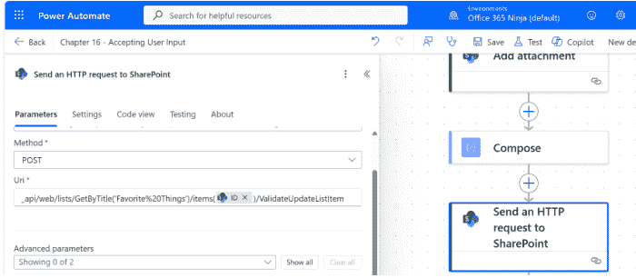

图 16.21– 配置 `HTTP` 请求

10. 点击高级参数区域下的“显示所有”。
11. 在`Headers`区域，配置一个`Content-Type`标头，值为`application/json; odata=verbose`。
12. 添加第二个`Accept`标头，值为`application/json; odata=notmetadata`。
13. 在`Body`区域，添加以下内容：

```json
{
  "formValues": [
    {
      "FieldName": "Picture",
      "FieldValue": "@{outputs('Compose')}"
    }
  ]
}
```

参见图 16.22 以向`SharePoint`发送完整`HTTP`请求的示例。

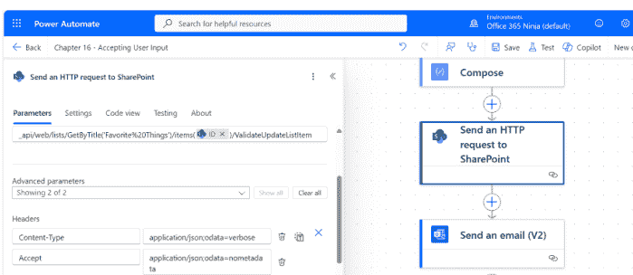

图 16.22 - 配置 `HTTP` 请求

### 14. 点击保存

这一次，当您测试流时，图像应该直接显示在列表中，如图 16.23 所示：

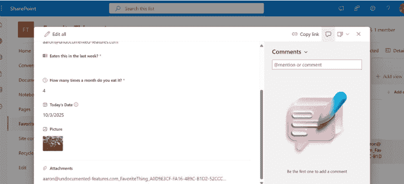

图 16.23 - 列表显示上传图像的缩图

您可以使用此变通方法提高基于列表的`Power Automate`流的质量。向`SharePoint`列表添加图像可能需要一些额外工作，但结果有助于他人通过更少的点击次数可视化更多数据。

### 总结

在本章中，您学习了`Power Automate`可以接受的不同类型的用户输入，包括文本、数字、是/否选择框、日期和二进制数据。您还配置了一个利用这些方法每种方法的流并将内容保存到`SharePoint`列表中。

请求输入是`Power Automate`的一个非常有用的功能，它为您的组织提供了许多自助和数据收集操作。通过这些输入能力，您可以启用依赖运行时提供的唯一数据的工作流场景，例如照片或其他在没有用户交互的情况下无法获取类型类型。

在下一章中，我们将开始查看`Power Automate`的高级操作场景，例如与`Entra ID`（原`Azure Active Directory`，简称`AD`或`AAD`）进行交互。

立即解锁本书的`PDF`版本和独家额外内容——扫描二维码码（或访问`packpub.com/unlock`）。按名称搜索此书，确认版本，然后按照页面上的步骤操作。

> **注意：** 请保留好您的发票。直接从`Packt`购买的物品不需要发票。
