# 13 使用数据库

数据库是关键的基础组件，用于编译有关任务、个人、服务、产品或任何需要跟踪的实体的信息。常见的数据库驱动应用程序包括客户关系管理 (CRM)平台、产品目录、企业资源计划 (ERP) 应用、会计软件包、电子医疗记录 (EMR) 应用、商店和库存管理工具。

在 Power Automate 世界中，你可能会使用数据库来存储对调查或表单响应的信息，或者用于管理计划作业。你可能会将其用作其他应用程序和用户执行的操作的日志库。在本章中，我们将查看连接 SQL 数据库以及使用流添加数据条目的的一些基础知识。

更具体地说，我们将涵盖以下主题：

- 理解数据库连接器、触发器和操作
- 连接到数据库
- 创建数据库连接
- 向数据库添加内容

到本章结束，你将能够理解如何使用 Power Automate 连接并向数据库发送数据的基础知识。

我们开始吧！

### 理解数据库连接器、触发器和操作

如果你不熟悉数据库，没关系！虽然设计可扩展的数据库系统可能复杂，但数据库的基本概念其实非常简单。

数据库通常由表、列和行组成。你可以将简单的关系型数据库想象成电子表格的集合，其中电子表格本身是表，表格中的行和列代表数据库中的行和列。这些工作表可以通过键（每个电子表格共同拥有的属性）链接在一起。主键确保每行都是唯一的，而外键则通过引用另一个表（或示例中的电子表格）中的主键来建立关系。

数据库通常不是孤立存在的——大多数人或系统通常通过应用程序与数据库交互。在从数据库读取或写入时，你通常需要提供一些详细信息来连接应用程序：

- 服务器名称或地址
- 数据库名称
- 身份验证凭据

这些信息存储在某种配置对象中（有时是纯文本文件、连接字符串、变量或其他管理系统），并告诉应用程序如何找到数据库。稍后在对数据库执行查询、插入或更新等操作时，你将指定额外的详细信息（如表名和过滤器），以记录应用程序将数据发送到何。

Power Automate 可以连接到许多数据库，例如 Microsoft SQL Server、Azure SQL Data Warehouse（现在称为 Azure Synapse Analytics）、PostgreSQL、MySQL、Db2、Oracle 和 Azure blob，以及我们在第 10 章中讨论过的 Dataverse。大多数数据库技术共享相似的机制，尽管过程可能不同。我们将重点关注可用的 SQL Server。该连接器同时拥有触发器和操作。

### 触发器

Microsoft SQL Server 连接器支持两个触发器：

- `当创建项时 (v2)`
- `当项被修改时 (v2)`

在处理这两个触发器工作时，你需要提供服务器名称、数据库名称和表名，以及可选的筛选查询。

### 操作

在操作数据库时，有许多可以执行的操作。你最常使用的操作列在下面的列表中：

- `获取表 (Get tables)` - 列出数据库中的表
- `获取行 (Get row(s))` - 从表中检索一行或多行
- `插入行 (Insert row)` - 向表中添加新行
- `更新行 (Update row)` - 修改现有行
- `删除行 (Delete row)` - 从表中删除某行
- `执行 SQL 查询 (Execute SQL query)` - 运行 SQL 查询
- `执行存储过程 (Execute stored procedure)` - 运行存储过程（预先准备的 SQL 语句或命令集合）

你最经常使用 Power Automate 内置操作来处理行和表。然而，如果你需要执行更复杂的事务或函数，可以使用`执行 SQL 查询`和`执行存储过程`。

现在你已经知道了可用哪些触发器和操作，让我们连接到数据库吧。

### 连接到数据库

在本节中，我们将查看如何创建一个向数据库添加数据行的简单流。要实现此，你需要一个数据库和一个表。在接下来的示例中，我们将创建一个 SQL 实例和数据库，用于我们的 Power Automate 配置。

### 创建服务器

虽然你可以使用 Power Automate 支持的任何数据库技术，我们将重点关注 SQL Server。如果你已经有了现有的 SQL 服务器，可以跳过此步骤。否则，可以在 Azure 中配置必要的组件以开始工作。

如果你没有服务器基础设施的访问权限，可以在 https://azure.microsoft.com/en-us/offers/ms-az-004p/ 注册免费体验，或通过导航到 https://portal.azure.com，使用你试用 Microsoft 365 租户的全局管理员凭据登录，然后完成 Azure 试用注册过程。

在 Azure 中创建 SQL 服务器，请遵循以下步骤：

1. 导航到 https://portal.azure.com 并使用具有管理权限的账户登录。
2. 在搜索栏中输入 SQL 并选择 SQL Server。
3. 在创建中创建：

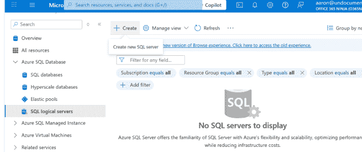

> 图 13.1 - 创建新的 SQL 服务器

4. 选择订阅和资源组。资源组仅仅是与项目、服务、应用程序或其他管理单元相关的组件的逻辑容器。如果你没有资源组，可以创建一个，如图 13.2 所示：


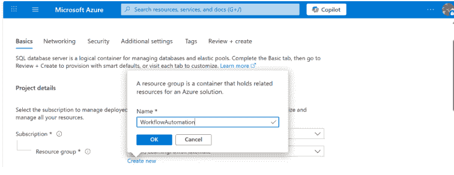

5. 输入唯一的服务器名称，在“位置”（Location）中选择您附近的数据中心，并输入管理凭据。为了示例起见，请使用 SQL 身份验证。

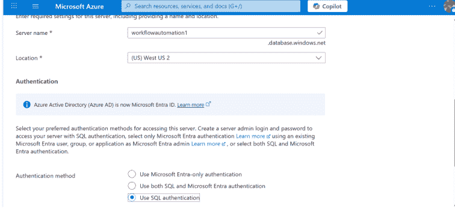

6. 选择一个服务器管理员登录 ID 并输入密码。
7. 完成后，点击“下一步”。
8. 在“网络”（Networking）选项卡中，将切换器设置为“是”，以配置防火墙允许访问 Azure 服务。
9. 点击“查看并创建”（Review + create）来创建您的服务器。

> 图 13.2 – 创建资源组
> 图 13.3 – 配置数据库服务器属性


10. 检查最终设置，然后点击“创建”。

等待 Azure 部署完成。

### 创建数据库

现在您已经配置好了一个 SQL Server 实例，需要一个数据库。如果您已经有一个可以使用的数据库，可以跳过此步骤。否则，您可以使用以下过程在上一节中配置的实例上创建一个新数据库：

1. 从 Azure 门户，点击搜索栏并开始输入 Azure。选择 Azure SQL 选项：

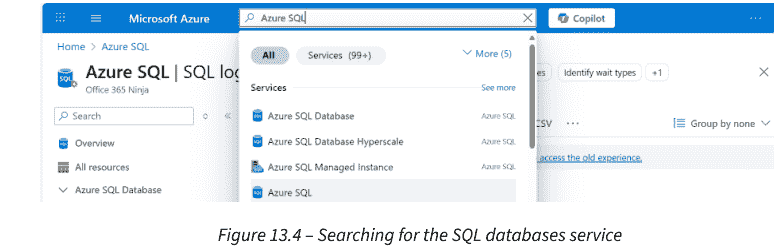

2. 在 Azure SQL 数据库下，选择“SQL 数据库”（SQL databases）。
3. 点击“创建”来创建一个新数据库。

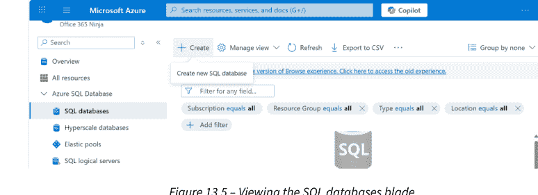

4. 在“项目详情”（Project details）下，选择订阅和资源组。为了简单起见，请使用与您之前创建的服务器相同的订阅和资源组。
5. 在“数据库详情”（Database details）下，为新数据库名称输入值，然后选择服务器。如果您在上一节中创建了服务器，请在此处选择该服务器。您可以让其他设置保持默认配置。点击**查看并创建**（Review + create）继续。

> 请务记下数据库的名称，因为您在配置 Power Automate 连接对象时会需要它。

6. 点击**创建**。

向导将完成过程并创建数据库。

### 创建数据库表

为了让您有地方添加内容，数据库需要一个数据库表。您可以使用查询编辑器（Query editor）并按照以下步骤创建数据库表：

1. 从 Azure 门户，点击搜索栏并开始输入 SQL databases。选择**SQL Server 数据库**（SQL Server databases）选项。
2. 选择您在上一个小节中创建的数据库以打开其属性页。
3. 选择**查询编辑器（预览）**（Query editor (preview)）。输入您的登录凭据以访问数据库，然后点击确定：

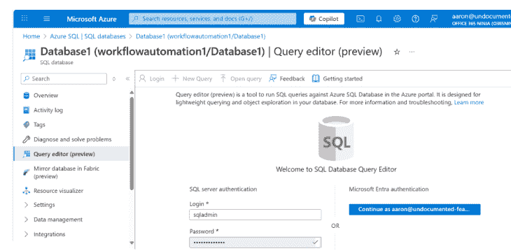

图 13.6 – 登录数据库

如果出现提示，您可能需要启用防火墙以允许您的本地计算机与服务器通信。点击错误消息中的“允许白列表 IP”（Allowlist IP）链接（如图 13.7 所示），以自动配置防火墙：

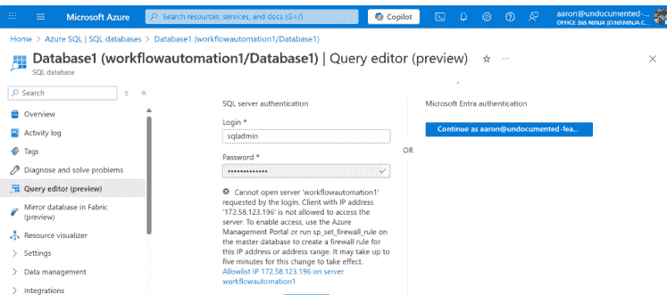

图 13.7 – 创建防火墙规则的提示

4. 防火墙规则更新后，登录。
5. 接下来，我们将创建一个名为 Customers 的数据库表并向其中插入单行数据。将以下代码复制并粘贴到查询编辑器中：

```sql
CREATE TABLE Customers
CustomerID BIGINT IDENTITY,
CompanyName VARCHAR(100),
FirstName VARCHAR(100),
LastName VARCHAR(100),
JobTitle VARCHAR(50),
Mail VARCHAR(75),
TelephoneNumber VARCHAR(10)
GO

INSERT INTO Customers VALUES('Contoso', 'John', 'Doe', 'Purchasing Manager', 'jdoe@contoso.com', '2485551234');
GO
```

6. 点击“运行”（Run），如图 13.8 所示：

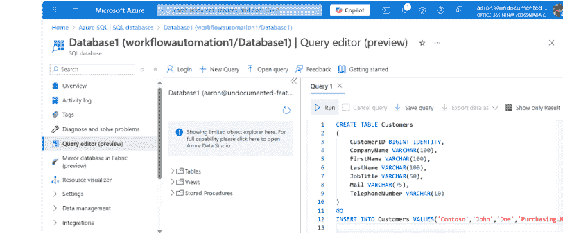

图 13.8 – 准备提交查询

7. 检查“消息”（Messages）以确保数据库表已创建。

到此时，您已经有了一个服务器、一个数据库和一个包含某些内容的表。此数据库表有七列（CustomerID、CompanyName、FirstName、LastName、JobTitle、Mail 和 Telephone）以及一行填充了这些列或字段的数据。

首先，您可以通过展开“表”（Tables）并查看 dbo.Customers 表来验证表和列。

要验证表是否包含数据，展开“表”，选择 dbo.Customers，并点击“选择前 100 行”（Select Top 100 Rows）操作，然后检查“结果”（Results）窗格中的数据，如图 13.9 所示。

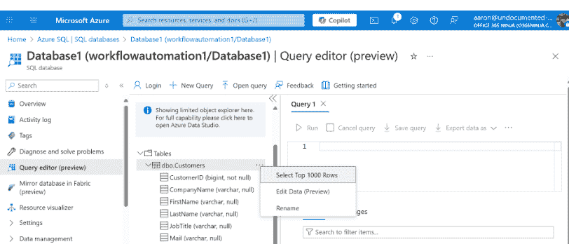

图 13.9 – 检查表数据

如果一切顺利，您将拥有一个配置好的示例数据库，并准备好作为 Power Automate 流的目标。

接下来，我们将在 Power Automate 中建立到数据库的连接。

### 创建数据库连接

正如您在在本章节早期学到的那样，在处理数据库时，您需要告诉应用程序如何连接到数据库。该数据存储在通常称为连接字符串的配置对象中。在 Power Automate 中，连接字符串被称为**连接**（connection）。

连接详情取决于您要连接的数据库类型。要在 Power Automate 中连接数据库，请按照以下步骤操作：

1. 导航到 Azure 门户 (https://make.azure.com)。选择“更多”（More）并点击“连接”（Connections）。
2. 选择**SQL Server**。


3. 点击**新建连接**（New connection）。

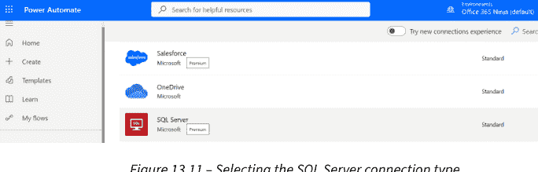

4. 在“项目详情”下，选择订阅和资源组。为了简单起见，请使用与您之前创建的服务器相同的订阅和资源组。
5. 在“数据库详情”下，为新数据库名称输入值，然后选择服务器。如果您在上一节中创建了服务器，请在此处选择该服务器。您可以让其他设置保持默认配置。点击**查看并创建**（Review + create）继续。

> 请务记下数据库的名称，因为您在配置 Power Automate 连接对象时会需要它。

6. 点击**创建**。

现在连接已经建立，您就可以创建一个简单的流了。

### 创建流

正如您在本章节早期学到的那样，在处理数据库时，您需要告诉应用程序如何连接到数据库……

要检查内容是否写入了流，请遵循以下步骤：

1. 从 Power Automate 门户 (https://make.powerautomate.com)，点击“创建”。
2. 选择**即时云流**（Instant cloud flow）。
3. 为流命名，并选择**手动触发流**（Manually trigger flow）作为触发器。
4. 点击“创建”。
5. 添加操作。
6. 在搜索框中输入 insert，选择**插入行 (V2)**（Insert row (V2)）操作：

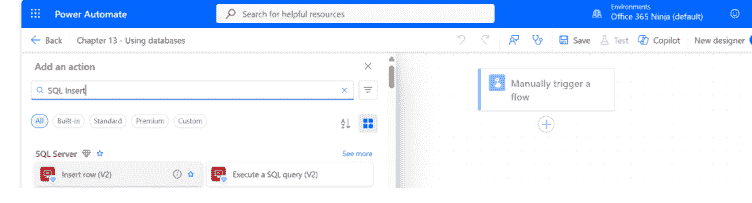

7. 选择您在数据库表节中创建的服务器名称、数据库名称和表名。

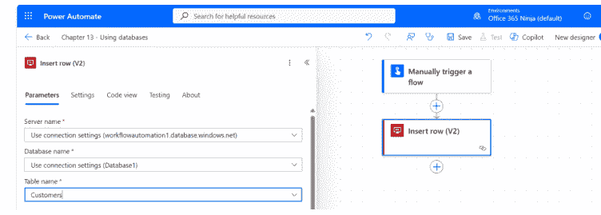

8. 一旦您选择了连接项，操作将更新“高级参数”（Advanced parameters）部分下的可用列。选择所有参数。

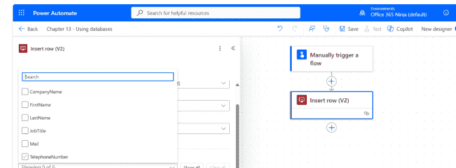

9. 在选择列名后，添加一些测试数据，如图 13.16 所示：

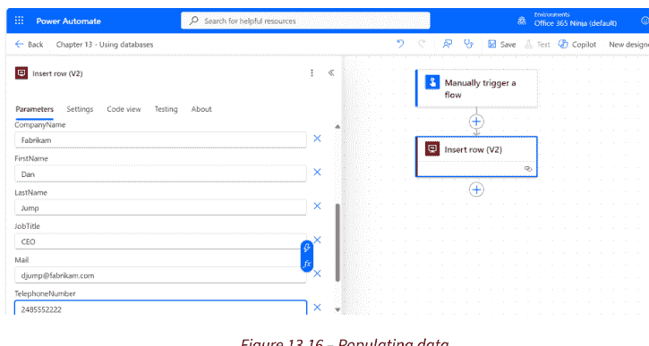

10. 点击“保存”。

### 执行流

使用您在第 5 章“创建按钮流”中学习的方法来执行该流。作为回顾，您可以遵循以下步骤：

1. 在生成器画布页面上，点击“测试”。
2. 选择“手动”单选按钮并点击“测试”。
3. 在“运行流”飞出面板中，点击“继续”。
4. 点击“运行流”。
5. 点击“完成”。

至此，流已成功执行。

### 验证流

您可以通过检查流的运行历史或在 SQL 中查询数据库表来检查内容是否已写入流。

### 检查运行历史

验证流是否执行成功最简单、最快的方法是检查其运行历史。流的运行历史将显示在流执行期间执行的步骤。我们可以通过以下流程查看流的运行历史：

1. 展开流旁边的省略号，然后选择“运行历史”（Run history）。
2. 选择运行日期和时间以显示历史。
3. 展开 SQL 操作以查看数据：

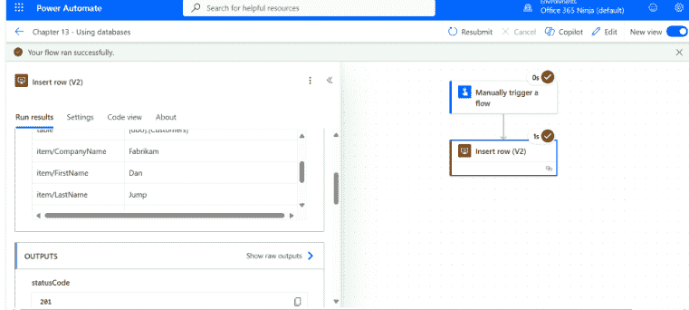

图 13.17 - 查看 SQL 插入行 (V2) 操作数据

展开的操作将显示已插入到表中的数据。

### 检查 SQL 数据

你也可以使用之前在“创建数据库表”节中使用的流程来验证数据。使用 SQL 查询编辑器，你还可以查看新添加的数据。要直接查看 SQL 数据，请遵循以下步骤：

1. 从 Azure 门户 (https://portal.azure.com)，导航到 Azure SQL | SQL 数据库，并选择该数据库。
2. 选择“查询编辑器（预览版）”（Query editor (preview)）。如有必要，输入登录凭据访问数据库，然后点击确定。
3. 在“查询编辑器（预览版）”面板中，展开“表”（Tables），选择 dbo.Customers，然后点击该表的省略号。点击“选择前 1000 行”。
4. 将结果窗格中的数据与你在“创建”节中输入的值进行比较。

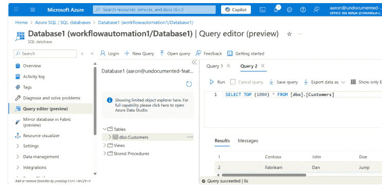

图 13.18 - 导航到 dbo.Customers 数据库表

无论你选择何种方式来验证流执行成功，都应该看到相同的数据。

### 总结


在本章中，你学习了 Power Automate 的一些数据库交互功能。通过遵循本章的步骤，你成功创建了 Azure SQL Server 实例、一个数据库和一个用于存储内容的数据库表。你能够连接到数据库、创建一个流，并插入了一行新数据。最后，你检查了流的运行历史，并学习了如何直接查询数据库。

下一章将在此知识的基础上，向你展示如何获取 Microsoft Forms 数据并使用 Power Automate 将其插入数据库中。

## 获取本书的 PDF 版本和独家额外奖励

扫描二维码（或访问 `packpub.com/unlock`）。按名称搜索此书，确认版本，然后按照页面上的步骤操作。

注意：请妥善保存发票。直接从 Packt 购买的不需要发票。


