# 14 使用 Microsoft Forms

收集和处理用户或客户的反馈是业务运营的重要部分。Microsoft Forms 是一种调查工具，可用于捕获此类信息，支持固定问题和自由格式文本输入选项。

在本章中，我们将基于之前学过的关于条件（第 8 章，使用条件）和向数据库中添加内容（第 13 章，使用数据库）的概念，创建基于 Microsoft Forms 输入的流，并将它们保存到数据库中。具体而言，我们将关注以下主题：

- 理解 Forms 触发器和操作
- 创建基本表单
- 使用 Power Automate 处理表单
- 测试流
- 验证结果

完成本章后，你将理解如何将 Forms 与 Power Automate 连接。让我们开始吧！

### 理解 Forms 触发器和操作

在开始编写涉及 Microsoft Forms 的流之前，了解 Forms 连接器提供哪些类型的触发器和操作是重要的。提醒一下，触发器（`triggers`）是能够启动流的活动，而操作（`actions`）是流可以执行的活动。如果你需要复习术语，可以回查到第 1 章“介绍 Power Automate”。

### 触发器

如引言所述，Microsoft Forms 是一种调查和信息收集工具。最终用户与 Forms 的交互在他们完成并提交表单时结束。因此，Forms 连接器目前有一个触发器：**提交回复时**（`When a response is submitted`）。当用户向服务提交表单时，该触发器会被激活。

### 操作

对于此流，我们将关注 Forms 的**获取详细信息**（`Get details`）操作。使用此操作，Power Automate 可以检索流中的数据。在我们用 Power Automate 处理表单之前，我们需要一个表单进行操作。在接下来的节中，我们将创建一个收集基本信息的表单。

### 创建基本表单

Forms 应用的使用非常直观。在本节中，我们将创建一个基本表单来收集用户信息。请按照以下步骤创建该表单：

1. 导航到 `https://forms.office.com` 并登录以启动 Forms 应用。
2. 如果你是首次登录 Forms，请点击启动页上的“新表单”（`New Form`）按钮。如果你之前登录过 Forms，可以点击仪表板上的“新表单”按钮，如图 14.1 所示。

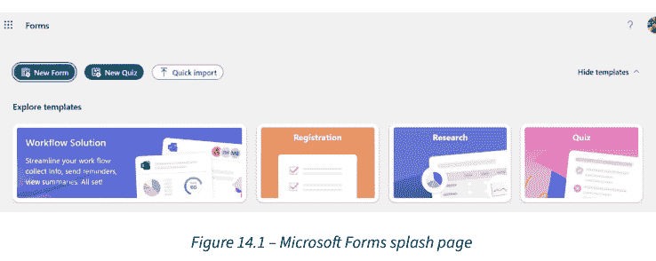

3. 点击标题区域（未标题的表单）文本框，并为表单输入名称，例如“客户数据采集”（`Customer Data Intake`），如图 14.2 所示：

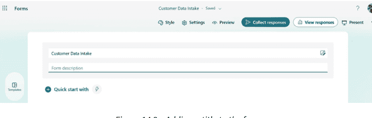

4. 点击 `+` 添加新项目。
5. 选择“文本”（`Text`）选项：

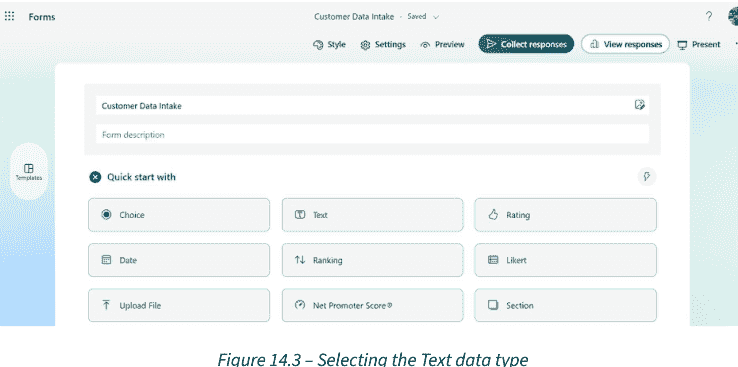

6. 输入 `CompanyName` 的值。如果需要，你可以输入更具描述性的内容，但为了本章示例，请确保它很容易识别为公司名称值。如果需要，可以将字段属性切换为“必填”（`Required`），并启用字段限制：

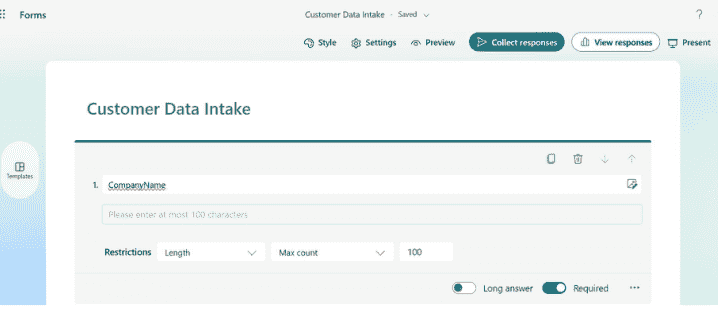

图 14.4 – 配置 `CompanyName` 数据字段

7. 重复步骤 4–6，为 `FirstName`（名）、`LastName`（姓）、`JobTitle`（职位）、`Mail`（邮箱）和 `TelephoneNumber`（电话）添加字段。你会注意到这些字段映射到你在上一章中创建的列名。

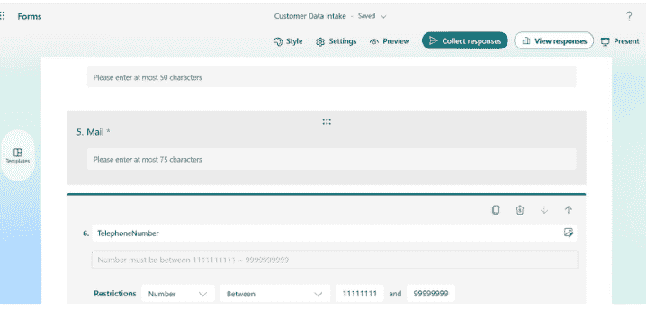

图 14.5 – 配置其余数据字段

8. 点击“收集回复”（`Collect responses`），然后点击“复制链接”按钮以复制表单的 URL。将其粘贴到临时位置（如记事本窗口）。
9. 选择并复制 `id=` 之后的值。该值看起来应该是一段长随机文本字符串，如下：

```
fHnoJLB9UauRqGcukAKHtjp4N5BXJJKk4cz0rMVSXuUqjGV1QzUTJQwhJUUVZKNZA3Q03MFFINS4u
```

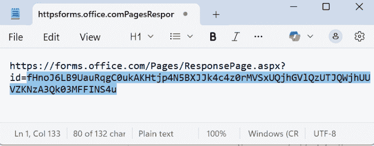

图 14.6 - 复制表单 ID

完成后，你应该拥有一个字段与第 13 章“使用数据库”中创建的数据库列名相似的表单以及复制的 ID 值。

接下来，我们将使用 Power Automate 将这些表单回复保存到数据库以便分析。

### 使用 Power Automate 处理表单

在练习中，我们将配置一个流来处理回复并保存到第 13 章“使用数据库”中创建的数据库中。该流将利用上一节保存的表单 ID、**当提交新回复时**（`When a new response is submitted`）触发器以及 Forms 连接器的**获取回复详细**（`Get response details`）操作。

遵循以下步骤配置流：

1. 登录 Power Automate 网页门户（`https://make.powerautomate.com`）并点击“创建”。
2. 在“从空白开始”部分，选择“自动化云流”。
3. 为流输入名称（例如“客户数据采集”），并选择“当提交新回复时”Forms 触发器。
4. 点击“创建”。

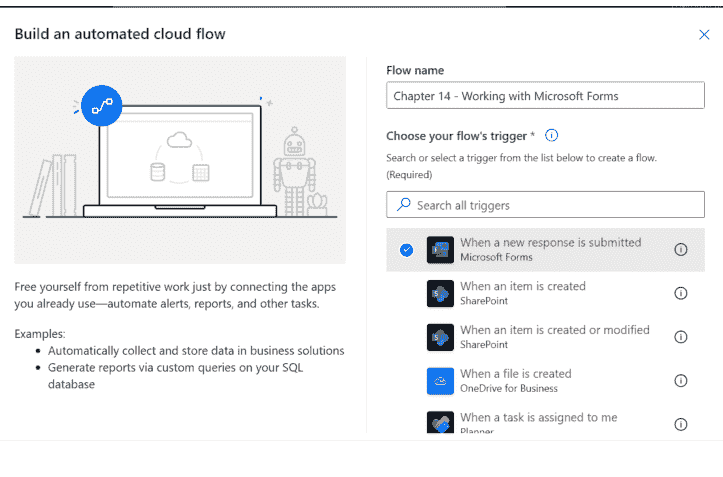

通过连接已使用的应用程序从重复性工作中解放——自动化报警、报告和其他任务。

示例：

- 在业务流中自动收集并存储数据
- 通过 SQL 数据库自定义查询生成报告

图 14.7 - 使用触发器创建新的自动化云流

5. 在触发器的详情中，如果显示了表单，请选择它。如果你创建的表单未显示，**添加自定义项**（`Add a custom item`）并粘贴上一节保存的表单 ID：

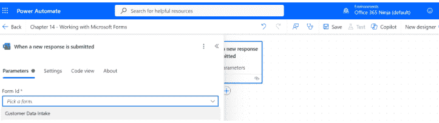

图 14.8 - 手动输入表单 ID 值

6. 添加步骤。
7. 在搜索栏中，输入 `Get response details` 并选择 Microsoft Forms 的操作，如图 14.9 所示：

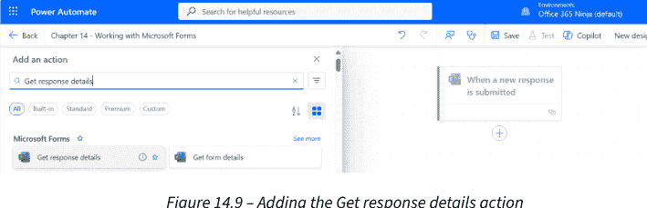

8. 在 `Get response details` 操作中，选择代表表单的表 ID（如果显示，则选择名称）。选择 `Response Id`，然后选择 `Response Id` 动态内容标记：

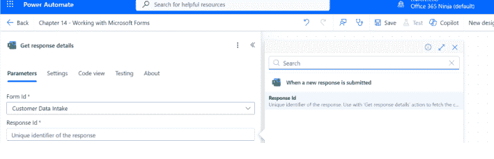

9. 添加步骤。
10. 从 SQL Server 的连接设置中选择服务器名称（`Server name`）、数据库名称（`Database name`）和表名称（`Table name`）值。
11. 从第 13 章“使用数据库”中创建的连接设置中选择服务器名称、数据库名称和表名称。片刻之后，高级参数（`Advanced parameters`）区域将变为可用。
12. 展开高级参数下拉菜单，并选择列值属性中的全选框。
13. 选择 `CompanyName` 字段，并从 `Get response details` 操作中选择 `CompanyName` 动态内容值，如图 14.11 所示：

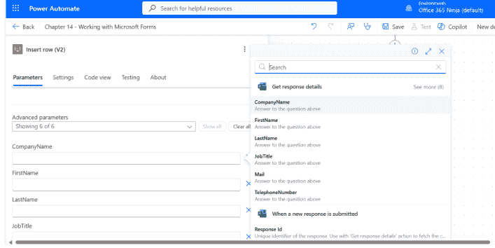

图 14.11 – 添加 `CompanyName` 动态内容值

14. 对剩余数据库列字段重复步骤 11，将它们与响应值匹配。完成后点击保存（`Save`）：

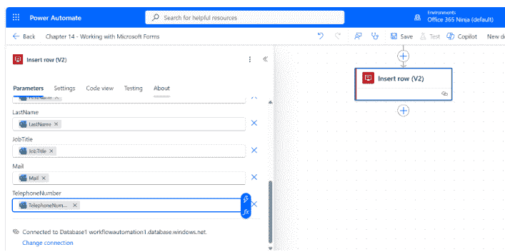

图 14.12 – 完成所有动态内容值的放置

流已创建。此流将在收到新表单响应时触发，并将表单数据直接保存到数据库中。接下来，我们将提交表单，然后在数据库中查找结果。

### 测试流

为了测试此流，你需要提交一个表单响应。要提交表单响应，请遵循以下步骤：

1. 导航到 Microsoft Forms 仪表板（`https://forms.office.com`）并在**我的表单**（`My forms`）下选择你的表单：

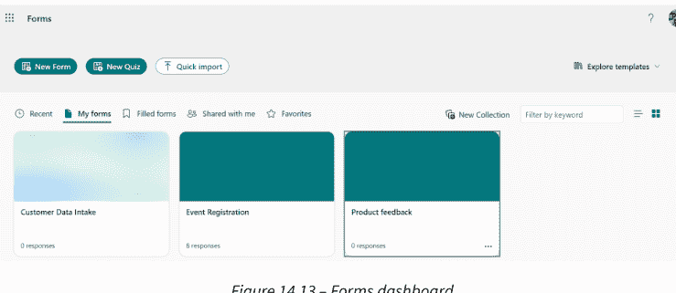

2. 选择**预览**（`Preview`）。
3. 填写表单并点击**提交**（`Submit`）：

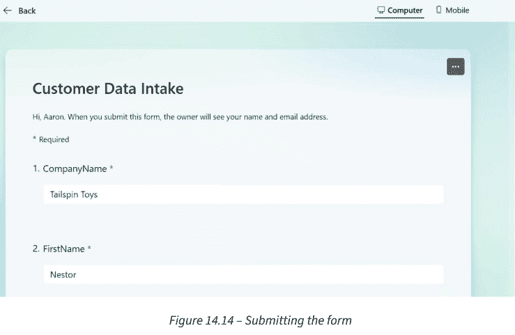

提交表单后，将收到一个确认页面，指示提交成功。

接下来，我们将验证流是否运行成功。

### 验证结果

最后，你希望确保流已按照预期完成。你可以通过检查流的运行历史或在 SQL 中查询数据库表，来检查流是否将 Forms 数据写入数据库。

### 检查运行历史

验证流是否成功最简单最快的方法是检查运行历史。运行历史将显示流执行期间执行的步骤。你可以按照以下流程查看流的运行历史：

1. 从 Power Automate 制作者 Web 门户（`https://make.powerautomate.com`），点击**我的流**（`My flows`），然后选择该自定义流。
2. 点击流的省略号，然后选择**运行历史**（`Run history`）。
3. 点击运行的日期：

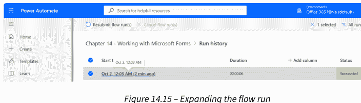

4. 展开**Insert row (V2)** 操作并查看数据：

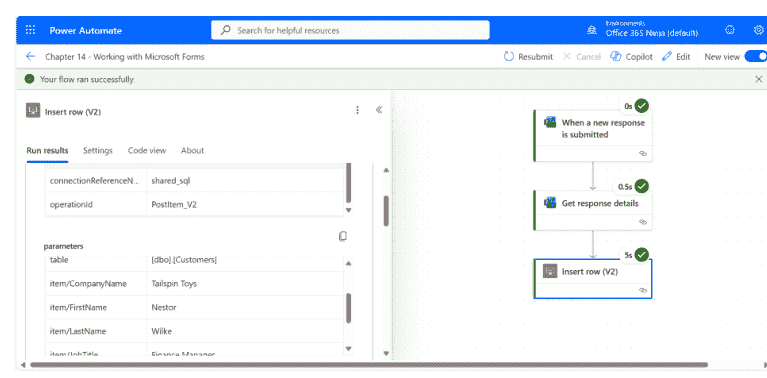

图 14.16 – 查看 `Insert Row (V2)` SQL 操作的运行详细信息

展开的操作将显示从表单处理并插入表中的数据。

### 检查 SQL 数据

你也可以使用 SQL 查询编辑器查看新添加的数据。如需直接查看 SQL 数据，请遵循以下步骤：

1. 从 Azure 门户（`https://portal.azure.com`），导航到 SQL 数据库，并选择你在第 13 章“使用数据库”中创建的数据库条目。
2. 选择查询编辑器（预览）（`Query editor preview`）。如果提示，输入凭据访问数据库并点击确定。
3. 将以下代码复制并粘贴到查询编辑器中：

```
SELECT * FROM [dbo].[Customers]
```

4. 如果需要，可以添加 `WHERE` 子句来查找你在表单上输入的名字。在示例中，我们使用了第一个名字 `Nestor`，因此你可以这样构建 `WHERE` 子句，将 `FirstName` 值替换为你在测试时使用的值：

```
WHERE FirstName='Nestor'
```

5. 点击运行（`Run`）。
6. 查看结果（`Results`）部分中的数据，如图 14.17 所示：

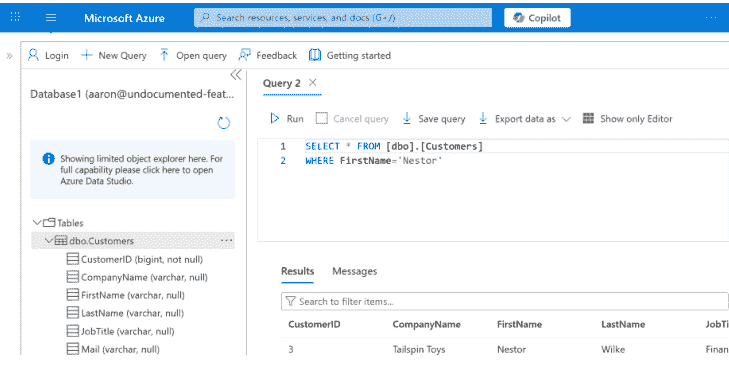

图 14.17 - 执行查询后查看结果

7. 将结果部分中的数据与你在“测试”部分中输入的值进行比较。

无论你选择哪种方式来验证流执行的结果，你都应该看到相同的数据。你可以验证表中的数据是否与表单中提交的数据匹配，以确认流正在正常工作。

### 总结

在本章中，你学习了如何使用 Microsoft Forms 创建基础表单。此外，你还能够在第 13 章“使用数据库”中学到的技能的基础上，将 Microsoft Forms 中的数据保存到 SQL 数据库中。

在现实场景中，你可以进一步扩展此流，向提交者生成确认电子邮件，或使用 Excel 或 Power BI 等工具对数据进行排序。根据表单中收集的数据类型，你甚至可以将这些数据发送到 Azure Cognitive Services（现为 Azure AI 服务）进行情感分析（你将在第 22 章中学习相关内容）。

