# 接受用户输入
许多类型的业务处理需要某种形式的用户输入。输入可以是用户输入的数据形式，可以是用户选择“是”或“否”的提示提示符，甚至是上传文件。Power Automate 提供了一个接口，让用户可以作为流的一部分提供信息。连接的应用程序（如 Power Apps）也可以用于向流提供信息。

在本章中，我们将重新回顾第 5 章“创建按钮流”中即时云流的概念。你将学习如何收集不同类型的用户输入，这些输入稍后可用在流中。具体而言，本章将涵盖以下主题：

- 理解用户输入选项

- 创建一个使用所有输入类型的流

- 验证流的执行

通过完成本章末尾的练习，你将熟悉不同类型的用户输入选项以及它们如何被用于创建交互式流。

继续前进！

### 理解用户输入选项
用户输入可以有许多形式。在创建手动触发流（也称为按钮流或即时流）时，Power Automate 允许流设计人员接受六种用户输入。要向手动触发的流添加输入功能，点击标记为“`Manually trigger a flow`”的标题。

当触发器对象展开时，点击“`Add an input`”，即可看到图 16.1 所示的输入选项：

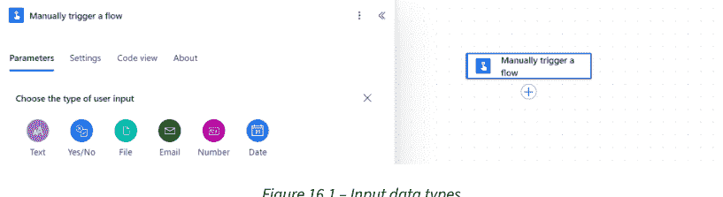

输入类型如下：

- **Text（文本）**：`Text`输入选项支持自由格式文本、单个下拉列表和多选列表。

- **Yes/No（是/否）**：`Yes/No`输入选项是一个开关。

- **File（文件）**：`File`选项提供了上传文件的功能。

- **Email（电子邮件）**：`Email`输入选项旨在接收电子邮件地址。

- **Number（数字）**：`Number`输入选项允许用户输入数字。

- **Date（日期）**：`Date`选项允许用户选择日期。

手动触发的流可以使用一个或多个输入选项。

此外，如果你的流正在捕敏感数据（如帐户凭据或其他值），你可以配置 **Secure inputs（安全输入）** 和 **Secure outputs（安全输出）**。选择 **Manually trigger a flow**，然后选择 **Settings（设置）** 查看选项：

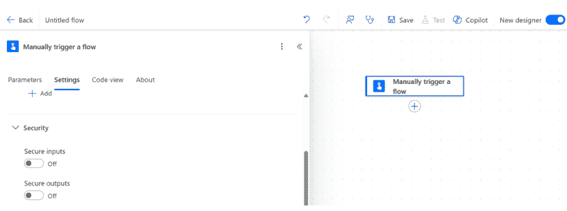

图 16.2 – 配置动作

安全选项会隐藏流历史中显示的详情（由于安全配置，不会显示用户提交的实际），如图 16.3 所示：

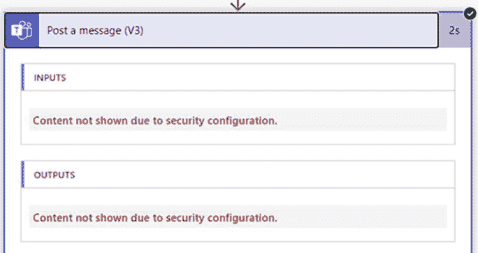

图 16.3 - 查看配置了安全输入输出的流历史

现在你已经对输入类型有了基本的了解，让我们创建一个流吧！

### 创建使用所有输入类型的流
在示例中，我们将配置一个使用所有输入类型的简单流，并使用这些数据填充 SharePoint 列表。你也可以尝试此示例将内容保存到数据库。

在开始配置流之前，你需要配置一些基本的先决条件，例如存储各种值的 SharePoint 列表。完成先决条件后，你就可以创建并测试流了。

### 配置先决条件
由于流的数据将存储在 SharePoint 列表中，如果你没有这些列表，你需要配置一个。在示例中，我们将在现有站点创建一个新列表，然后为我们的每个值添加一列。

要创建列表，请遵循以下步骤：

1. 导航到 SharePoint 站点，点击 `Site contents`（站点内容），点击 `New`（新建）。从下拉菜单中选择 `List`（列表），如图 16.4 所示：

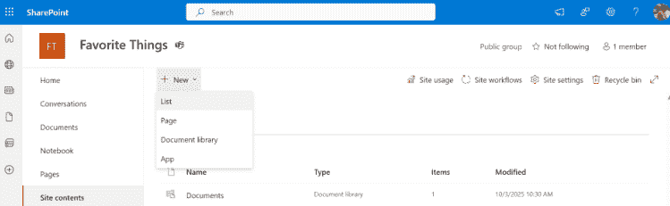

2. 从模板样式中选择 `Blank`（空白）。

3. 为列表输入名称并点击 `Create`（创建）。

4. 点击 `Edit in grid view`（在网格视图编辑）。

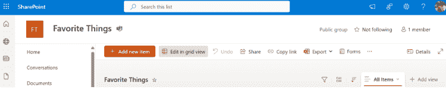

5. 点击 `Title` 单词，指向 `Column settings`（列设置），并选择 `Rename Column`（重命名列）。将列重命名为 `Name`。

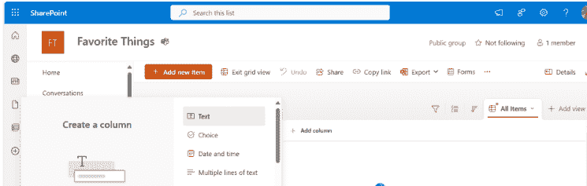

图 16.6 – 创建列并设置其类型

6. 在“创建列”飞出窗口中，将名称（`Name`）设置为 `Email1 Address`，并确保类型（`Type`）下拉菜单设置为“单行文本（`Single line of text`）”。点击保存。

7. 重复此过程添加列，使用以下列类型和值：

| 列类型 | 标识 (Name) |
| :--- | :--- |
| 文本 / 单行文本 | `Email Address` |
| 是/否 | `Eaten in the last week?`（上周内吃过吗？） |
| 数字 | 你每个月吃几次？ |
| 日期 | `Today’s Date`（今天的日期） |
| 图像 | 你最喜欢的食物的照片 |

表 16.1 – 列表值

完成后，它看起来应该像下图所示：

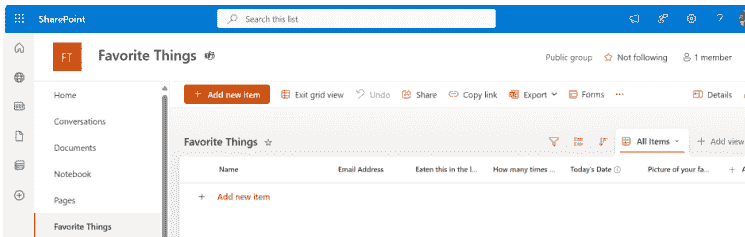

图 16.7 – 配置后的列表

8. 点击“退出网格视图（`Exit grid view`）”以保存更改。

稍等片刻，你配置的列表将被保存。你可以进行下一步了。

### 创建流
现在你已经有了保存数据的地方，可以开始创建流了。按照以下步骤创建一个手动触发并捕用户输入的流：

1. 转到 Power Automate Web 门户 (https://make.powerautomate.com) 并选择“创建”。

2. 选择“即时云流（`Instant cloud flow`）”。

3. 为流输入名称，选择“手动触发流（`Manually trigger a flow`）”触发器，并点击“创建”。

4. 点击触发器标题显示“添加输入选项（`Add an input`）”：

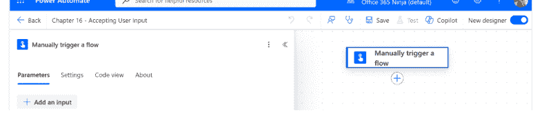

图 16.8 – 展开触发器选项

5. 点击“添加输入”并选择“文本（`Text`）”：

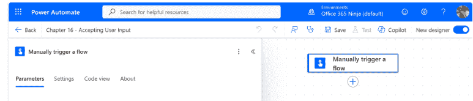

图 16.9 – 添加新的输入类型

6. 将标签更新为文本 `Name`，然后将提示（`prompt`）更新为“请输入您的姓名：”

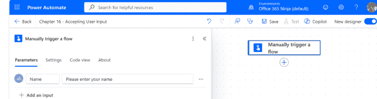

图 16.10 – 配置文本输入

7. 点击**添加输入（Add an input）**并选择**电子邮件（Email）**。将提示更新为“请输入您的电子邮件地址”。

8. 点击**添加输入（Add an input）**并选择**文件（File）**。将标签更新为“图片”。点击该项目旁的省略号 (...)，然后根据需要开启**必填字段（Make the field required）**选项：

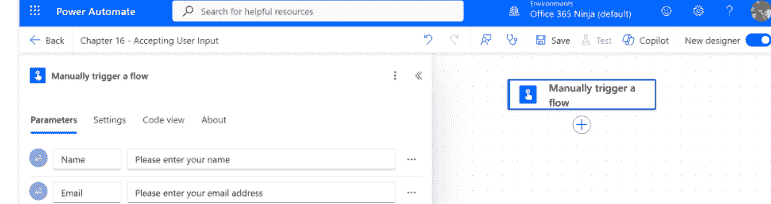

图 16.11 – 配置图片输入

9. 点击**添加输入（Add an input）**并选择**是/否（Yes/No）**。将标签更新为“你上周吃过这个吗？”

10. 点击**添加输入（Add an input）**并选择**数字（Number）**。将提示更新为“请输入你通常每个月吃几次”。

11. 点击**添加输入（Add an input）**并选择**日期（Date）**。将标签更新为“今天的日期”。将提示更新为“请输入今天的日期”。

12. **添加操作（Add an action）**。

13. 选择 SharePoint 操作**创建项（Create item）**。

14. 在**站点地址（Site Address）**框中选择包含你为练习创建的列表的站点。如果没有显示，点击**输入自定义值（Enter custom value）**并添加 SharePoint 站点的 URL。

15. 选择列表。稍等片刻，列表上的列名可能会出现：

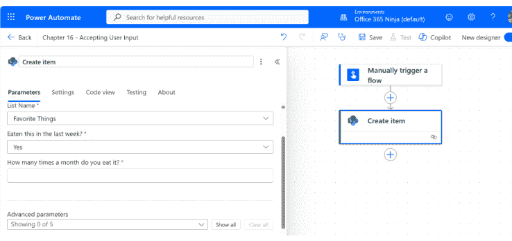

图 16.12 – 编辑“创建项”操作

标记为“必填（`Required`）”的列表项显示。你可以点击高级参数下的“显示所有（`Show all`）”按钮，自动将所有剩余列名添加到操作中。

16. 点击 `Name` 或 `Title` 字段（取决于你使用的哪种设计器画布视图），然后选择 `Name` 的动态值令牌。

17. 对“上周内吃过吗？是/否”字段、自定义值（`Custom value`）重复此过程，然后你就可以选择相应的动态内容令牌。完成后，它看起来应该像下面的截图：

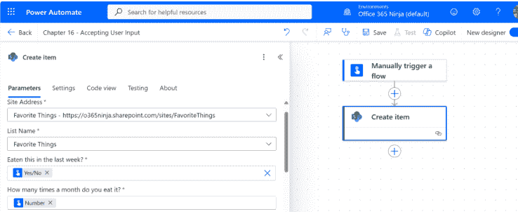

图 16.13 – 完成“创建项”操作

18. 添加操作。

19. 在搜索框中输入 `attachment`（附件）。选择 SharePoint **添加附件（Add attachment）**操作：

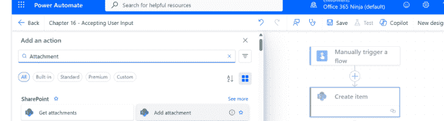

图 16.14 – 选择“添加附件”操作

20. 在站点地址（`Site Address`）框中，选择包含列表的站点。在列表名称（`List Name`）框中选择你之前使用的列表。

21. 在 `Id` 框中，选择“创建项”操作下的 `Id` 动态内容令牌。

22. 在文件名（`File Name`）框中，输入用于保存文件的文件，例如 `FavoriteThing.jpg`。你也可以使用表达式来动态命名项目。在本例中，我们使用了以下表达式：

```
concat(triggerBody()?['email'],_'FavoriteThing_',triggerBody()?['file']['name'])
```

23. 在文件内容（`File Content`）框中，从“手动触发流”部分选择 `PicturecontentBytes` 动态内容令牌：

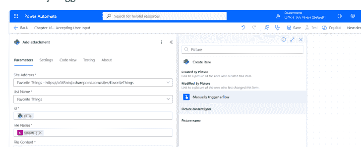

图 16.15 – 将图片添加到 SharePoint 列表项

24. **添加操作（Add an action）**。


## 25. 配置收件人并保存

- 25. 在**收者（To）**字段中，选择**电子邮件（Email）**动态内容令牌。
- 26. 在**主题（Subject）**字段中，输入“感谢告知”。
- 27. 在**正文（Body）**字段中，选择任何你想要的动态内容。
- 28. 点击**保存（Save）**。

此时，你已经配置了一个捕获示例输入的流，进行了测试并验证了数据已上传。你可能注意到图像是以附件形式显示的，而不是列表中的列。目前，`SharePoint`创建项或更新项的操作不支持默认图像列。然而，只要有创意，你可以编写`SharePoint HTTP`请求来直接上传数据。

> 注：原文末尾部分存在大量重复的乱码文本，译文已根据逻辑进行了清理和去重。

# 16 

8. 选择`POST`作为方法。
9. 在`Uri`文本字段中输入`/api/web/lists/GetByTitle('Favorite%20Things')/items(@outputs('Create_item'))?['body/id']/ValidateUpdateListItem`，并将列表标题替换为您的列表名称。如果您的列表名称包含空格，您可能需要将空格字符替换为其`URL`编码值`%20`。

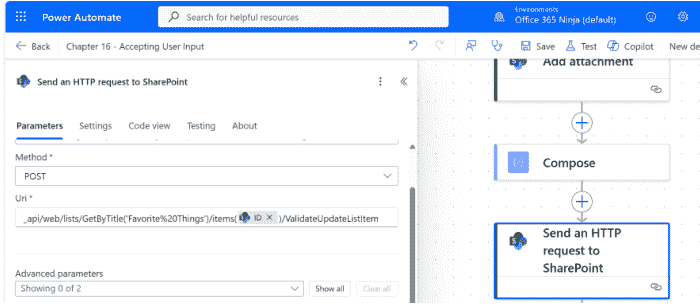

图 16.21– 配置 `HTTP` 请求

10. 点击高级参数区域下的“显示所有”。
11. 在`Headers`区域，配置一个`Content-Type`标头，值为`application/json; odata=verbose`。
12. 添加第二个`Accept`标头，值为`application/json; odata=notmetadata`。
13. 在`Body`区域，添加以下内容：

```json
{
  "formValues": [
    {
      "FieldName": "Picture",
      "FieldValue": "@{outputs('Compose')}"
    }
  ]
}
```

参见图 16.22 以向`SharePoint`发送完整`HTTP`请求的示例。

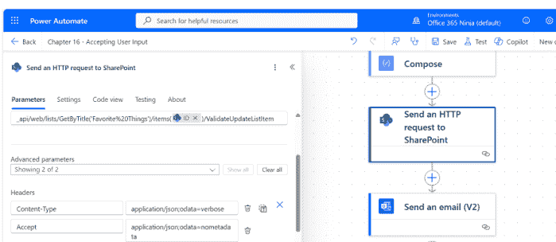

图 16.22 - 配置 `HTTP` 请求

### 14. 点击保存

这一次，当您测试流时，图像应该直接显示在列表中，如图 16.23 所示：

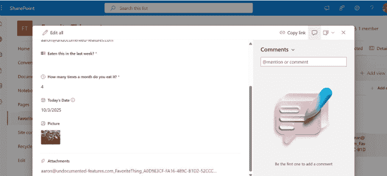

图 16.23 - 列表显示上传图像的缩图

您可以使用此变通方法提高基于列表的`Power Automate`流的质量。向`SharePoint`列表添加图像可能需要一些额外工作，但结果有助于他人通过更少的点击次数可视化更多数据。

### 总结

在本章中，您学习了`Power Automate`可以接受的不同类型的用户输入，包括文本、数字、是/否选择框、日期和二进制数据。您还配置了一个利用这些方法每种方法的流并将内容保存到`SharePoint`列表中。

请求输入是`Power Automate`的一个非常有用的功能，它为您的组织提供了许多自助和数据收集操作。通过这些输入能力，您可以启用依赖运行时提供的唯一数据的工作流场景，例如照片或其他在没有用户交互的情况下无法获取类型类型。

在下一章中，我们将开始查看`Power Automate`的高级操作场景，例如与`Entra ID`（原`Azure Active Directory`，简称`AD`或`AAD`）进行交互。

立即解锁本书的`PDF`版本和独家额外内容——扫描二维码码（或访问`packpub.com/unlock`）。按名称搜索此书，确认版本，然后按照页面上的步骤操作。

> **注意：** 请保留好您的发票。直接从`Packt`购买的物品不需要发票。


## 第 17 章：自动化 Entra ID

在此为止，我们一直关注于从用户的角度将`Power Automate`作为工作流引擎。我们专注于处理电子邮件、发布到`SharePoint`列表和文档库、连接到文件和文件夹，以及启动审批工作流。

在本章中，我们将重心离开业务应用程序自动化，转向查看`Power Automate`在直接处理`Entra ID`（原`Azure Active Directory`，`AD`或`AAD`）管理方面的能力。`Entra ID`是`Microsoft 365`生态系统中应用程序和服务使用的身份存储器。

有许多例行操作任务具有自动化潜力——特别是在涉及身份置备或注销、报告和组管理时。从管理的角度来看，这些都是重要的任务，但如果您需要不断在工单系统和一个或多个管理界面之间切换，可能会产生高昂的人力成本。

虽然`Entra ID`具有许多原生组管理和报告功能，但某些时候您可能需要根据普通`Entra ID`管理门户中不可用的属性来创建自动化。虽然数据存在，但从原生的自动化角度来看，它很容易被消费。

假设您向公司的安全团队定期提供报告，说明哪些用户尚未成功完成多因素身份验证（`MFA`）注册。数据存在`Entra ID`中，但需要切换任务来收集这些数据、处理它们，然后发送电子邮件。这类活动似乎属于“必须做，但不需要由你来做”的类别。

这就是本章大派用场的地方。

为了获取这些高级数据，我们必须使用一些高级技能，例如解析`JSON`和使用`HTTP`连接器。我们将涵盖以下主题：

- 学习连接器和操作
- 配置前提条件
- 创建`HTTP`流
- 测试和排排除流
- 验证流

在本章结束时，您应该理解使用`HTTP`连接器与`Entra ID`交互的基础知识。

让我们开始吧！

### 技术要求

由于我们将处理`Entra ID`…… [文本根据`OCR`流已截断]

### 学习连接器和操作

在本章中，我们将基于其他章节中学到的知识，例如处理条件、动态内容以及发送电子邮件。然后，我们将引入几个与`Entra ID`相关的新概念，包括`HTTP`、解析`JSON`和创建表操作。

### HTTP 操作

虽然处理`Entra ID`通常可以使用标准的`Entra ID`连接器（如`Entra ID`和`Office 365 Groups`连接器）来完成，但存储`MFA`信息的属性并未通过这些连接器暴露。

为了检索这些数据，我们需要查看另一个源：`Microsoft Graph API`（通常称为`Graph API`）。`Microsoft Graph API`是一种基于`REST`的`API`，允许您与存储在`Microsoft 365`生态中的数据进行交互。由于我们正在寻找的数据在`Entra ID`中，`Graph API`是自然的选择。

正如您可能从第 1 章《介绍 Power Automate》回想起的那样，使用`HTTP`发动词（有时称为操作、指令或方法）与基于`REST`的系统交互，例如`GET`（读）、`POST`（写）、`PUT`（更新）、`PATCH`（部分更新）和`DELETE`（删除）。

要成功使用`HTTP`操作，我们通常需要提供几个信息：

- **Method**：如前，我们将从`GET`、`POST`、`PUT`或`DELETE`之间进行选择。
- **URI**：调用`Graph API`服务的地址（也称为端点）。
- **Headers**：标头有时是可选的，是描述请求正在处理的内容类型的信息。标头通常以键/值对的形式构建，例如`Content-type: application/json`，其中`Content-type`是键，`application/json`是值。
- **Queries**：查询是您发送到服务或端点的参数。在`Entra ID`的上下文中，查询通常是某种过滤标准。
- **Body**：正文包含请求本身的详细信息。

虽然某些服务和`API`是开放的并允许对终端进行免费查询，但大多数服务都需要某种形式的身份验证，以确保只有授权的实体才能访问数据。在处理`Entra ID`时，我们将指定几条关于身份验证的信息。

> 你可以使用 `https://developer.microsoft.com/graph/graph-explorer` 使用`Microsoft Graph Explorer`尝试其他`Microsoft Graph API`操作。

与你为止所过的其他连接器和操作相比，你是在创建流时通过交互式地输入用户名和密码来提供身份验证。然而，在处理`HTTP`请求和`Entra ID`时，我们需要单独以租户 ID（`tenant ID`）、客户端 ID（`Client ID`）和客户端密钥（`Client Secret`）的形式来指定这些信息。

### 解析 JSON 操作

如第 1 节“介绍 Microsoft Power Automate”所述，连接器以`JavaScript`对象表示法（或`JSON`）存储信息。在处理基于`REST`的`API`时，处理的数据（无论发送还是接收）经常会被格式化为`JSON`。

为了提取创建报告所需的信息，我们需要使用“解析 JSON”（`Parse JSON`）操作，这将我们配置`Power Automate`以理解正在使用的架构（`schema`）。架构是一种用于描述数据结构的定义或图例。我们将利用它来帮助识别构建报告所需的字段或属性。

### 创建 CSV 表操作

在例示例中，我们将使用逗号分隔值（`CSV`）表来存储输出内容。“创建 CSV 表”（`Create CSV table`）操作将用于将信息汇成简单的电子表格风格报告，该报告可以附加在电子邮件中。

现在你已经对将要使用的操作有了进一步了解，让我们开始设置环境以支持该流。

### 配置先决条件

由于我们要配置的`HTTP`流没有办法输入传统的用户名和密码作为身份验证机制，我们将创建一个或注册一个具有适当权限的特殊应用程序。该应用程序将通过客户端 ID（本质上是应用程序的用户身份）进行标识。

此外，你还需要配置客户端密钥，它是应用程序相当于密码。不过，租户信息、应用程序信息和客户端密钥将用于提供执行流所需的身份验证。

### 配置 Entra ID 应用程序

为此流注册新的`Entra ID`应用程序，请遵循以下步骤：

1. 使用具有全局管理员权限的身份登录到`Entra ID`门户 (`https://entra.microsoft.com`)。
2. 展开`Entra ID`并选择“应用注册”（`App registrations`）。

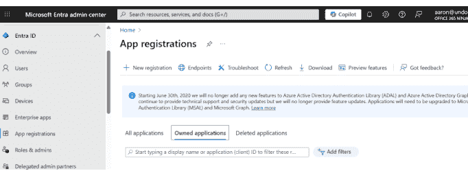

图 17.1 - 应用注册页面

3. 点击“注册”（`registration`）。
4. 为应用程序配置显示名称。
5. 在“支持的账户类型”下选择“仅此组织目录中的帐户[仅主帐户 - 单租户]”，然后在“重定向 URI”下输入 `https://auth`，如图 17.2 所示。完成后点击“注册”。

> **提示：** 最好为每个应用程序或用例创建一个单独的注册，不要重用应用注册。这允许你针对特定需求更紧密地界定权限。

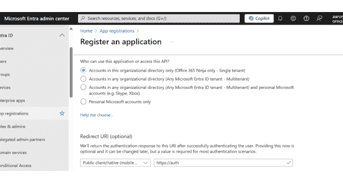

6. 在“管理”（`Manage`）下，选择“API 权限”（`API permissions`）。

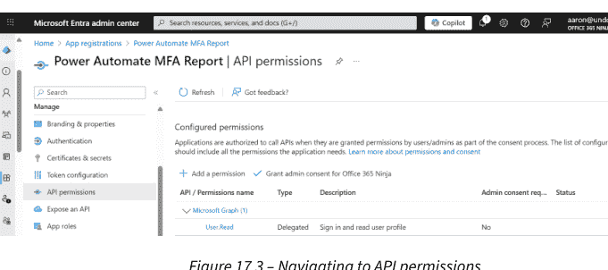

7. 点击“添加权限”（`Add a permission`）。
8. 在“请求 API 权限”浮窗中，选择`Microsoft Graph`。

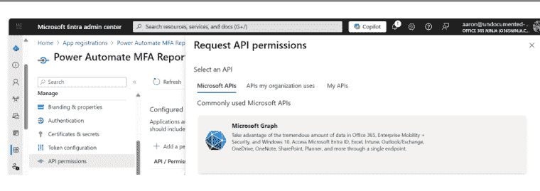

图 17.4 – 选择 API

9. **选择委派权限（`delegations`）。** 在“选择权限”区域，选择 **`Reports.Read`、`Directory.Read.All`、`UserAuthenticationMethod.Read.All` 以及 `AuditLog.Read.All`。** 点击“添加权限”。

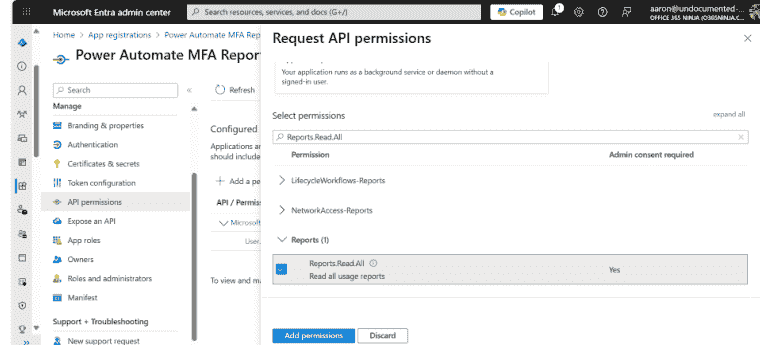

图 17.5 – 添加委派 API 权限

10. 点击“添加权限”。
11. 在“请求 API 权限”浮窗中，选择 **`Microsoft Graph`**。
12. 选择“应用程序权限”（`Application permissions`）。在“选择权限”区域，选择 **`Reports.Read.All`、`Directory.Read.All`、`UserAuthenticationMethod.Read.All` 以及 `AuditLog.Read.All`。**
13. 点击“添加权限”。

> **注意：** 对`AuditLog.Read.All`权限的需求目前被归类为 bug。虽然文档表明此权限并非必需，但未能配置此权限偶尔可能会导致以下错误：**错误详细信息：`应用程序缺少 MSGraph API 'Read all audit log data'`。** 添加`AuditLog.Read.All`权限将解决此问题。
>
> `Directory.Read.All`权限只有在租户许可证缓存未更新（通常每小时更新一次）时才是必要的。如果你在向租户添加高级版许可证后不久尝试运行流，可能需要临时添加此权限，以允许注册的应用程序具有从租户收集许可证数据的能力。


如果你的租户中未启用`Entra ID`订阅，可能会收到以下错误：**错误详细：`租户既不是 B2C 也没有高级许可证`。** 要解决此错误，你需要开始试用或购买一个`Entra ID P1`许可证。

4. 在 **API 权限页面**上，点击“授予管理员同意”（`Grant admin consent`），如**图 17.6** 所示。

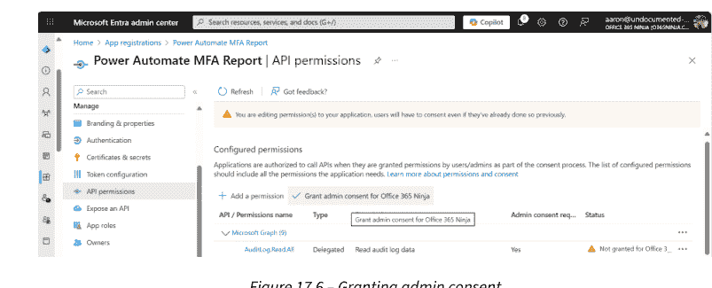

5. 点击“是”以批准管理员同意操作。

创建应用程序并授予权限后，让我们继续创建客户端密钥。

### 创建客户端密钥

在本节中，我们将创建一个与应用程序一起使用的客户端密钥。此信息将用于该流。

要创建客户端密钥，请遵循以下步骤：

1. 在应用注册打开的情况下，选择“管理”部分下的“证书和密钥”（`Certificates & secrets`）。

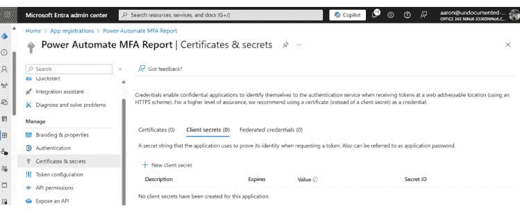

图 17.7 – 证书和密钥

2. 选择“新建客户端密钥”（`New client secret`）。
3. 在“添加客户端密钥”浮窗中输入描述并从下拉列表中选择过期时间。完成后点击“添加”。

> **提示：** 一旦配置了过期时间，设置一个日历事件提醒自己。

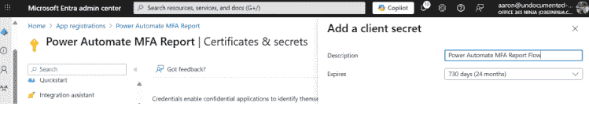

图 17.8 – 配置客户端密钥

4. 一旦你离开此页面，将无法检索该值。点击图标将值复制到剪贴板；将其粘贴到文本文档中保存。

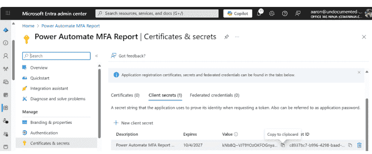

图 17.9 - 客户端密钥

5. 在导航窗中，选择“概述”（`Overview`）。
6. 采集应用程序（客户端）`ID`和租户（目录）`ID`值，并将它们保存到第 4 步创建的同一个文件中。

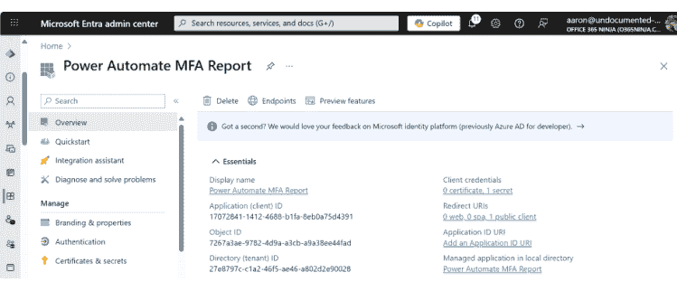

图 17.10 - 采集配置信息

### 创建 HTTP 流

搞定！

配置好必要的先决条件后，我们可以开始创建流本身。

### 获取数据

在本节中，我们将创建一个用于检索注册数据的流。让我们开始吧！

创建流的第一部分需要连接`Entra ID`以检索构建报告所需的数据。我们将使用`HTTP`操作查询`Entra ID`。

> 在本章中，我们关注`Microsoft Graph API`终端中的一个`REST`资源。你可以使用数百个不同的资源来检索和修改数据。有关`Graph`资源的完整列表，请参见：`https://learn.microsoft.com/en-us/graph/api/overview`。

按照以下步骤配置`HTTP`操作：

1. 导航到`Power Automate`制作者 `Web` 门户 (`https://make.powerautomate.com`) 并点击“创建”。
2. 点击“计划云流”（`Scheduled cloud flow`）。
3. 配置流名称。
4. 在“运行此流”（`Run this flow`）下配置计划设置以每周执行。完成后点击“创建”（`Create`）。

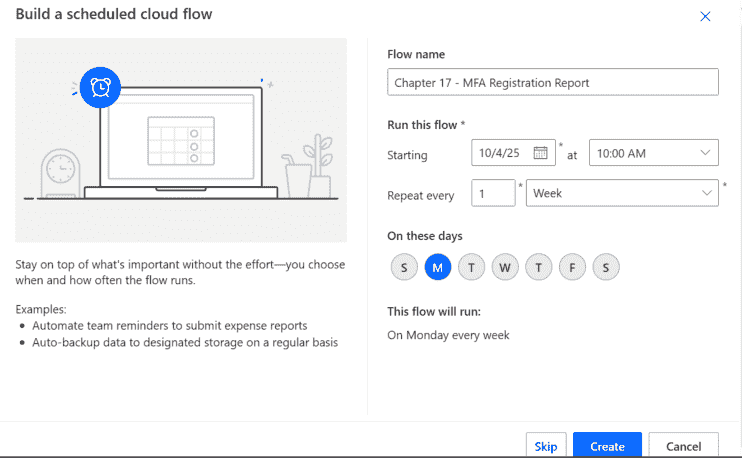

图 17.11 – 配置流计划设置

5. 添加操作。
6. 选择`HTTP`操作。

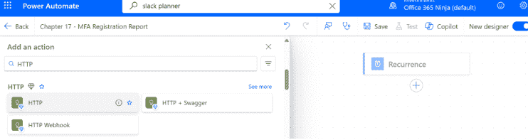

图 17.12 – 选择 HTTP 操作

7. 在`HTTP`操作中，在“方法”（`Method`）下选择`GET`。

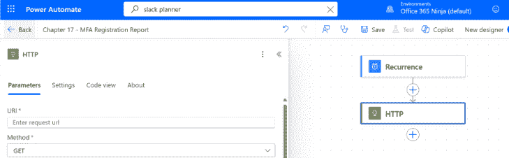

图 17.13 - 配置 HTTP 操作

8. **点击高级参数（`Advanced parameters`）下的“显示”（`Show`）** 以展开额外的参数字段。
9. 使用在本章之前**配置前提**（`Configuring prerequisites`）练习中保存的值，使用 *Tenant*（租户）、*Client ID* 和 *Secret*（密钥）字段中的值填写剩余的`HTTP`操作参数：

| 参数 | 值 |
| :--- | :--- |
| URI | `https://graph.microsoft.com/beta/reports/credentialRegistrationDetails` |
| Queries | Key: `$filter` Value: `isMfaRegistered eq false` |


# 配置 HTTP 操作参数

| Authentication | Active Directory OAuth |
| --- | --- |
| Tenant | `<Tenant ID value>` |
| Audience | `https://graph.microsoft.com` |
| Client ID | `<Application (client) ID value>` |
| Credential type | Secret |
| Secret | `<Client secret value>` |

表 17.1 - 配置 HTTP 操作参数

这里有趣（或重要）的值包括 URI，它是显示用户已注册身份验证方法的 Microsoft Graph 端点；以及筛选器查询，该查询选取了 `isMfaRegistered` 设置为 false 的用户。

10. 检查完成的操作，如图 17.14 所示：
    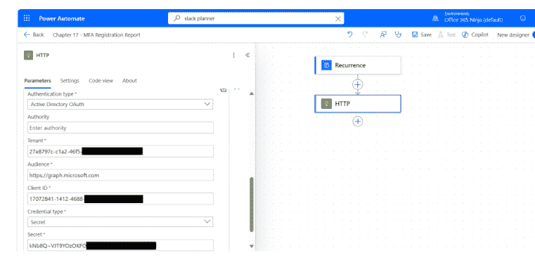

    图 17.14 – 检查完成的 HTTP 操作

11. 选择 HTTP 操作浮窗顶部的“设置”（Settings）选项卡。
12. 在“网络”（Networking）下，将“异步模式”（Asynchronous pattern）切换开关置为“开启”（On）。
13. 将“分页”（Pagination）切换开关置为“开启”，并将“阈”（Threshold）字段配置为 5000。
    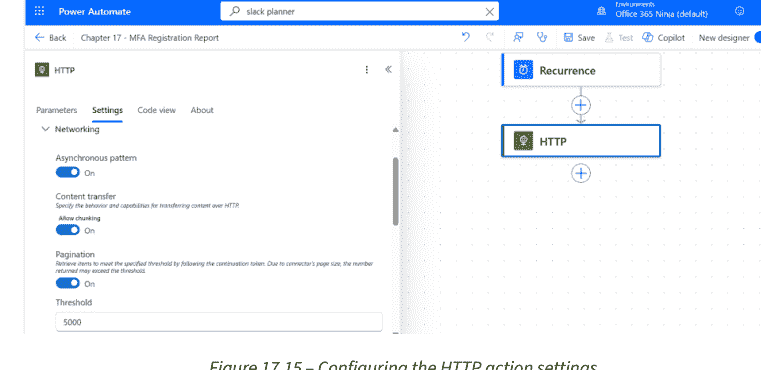

    图 17.15 – 配置 HTTP 操作设置

14. 点击“完成”（Done）。
15. 点击“保存”（Save）。
16. 点击“测试”（Test），然后在“测试流”（Test Flow）浮窗面板中，选择“手动”（Manually）单选框然后点击“测试”。
17. 点击“运行流”（Run flow）确认您的选择。
18. 点击“完成”（Done）。
19. 流运行后，点击步骤的标题栏展开 HTTP 操作步骤。
20. 滚动到运行历史的“输出”（Outputs）部分。点击“显示原始输出”（Show raw outputs）打开 HTTP 浮窗，以便您查看 JSON 结构。
21. 将 HTTP 浮窗文本框中的整个 Body 值复制到剪贴板。此数据将用于定义 JSON 架构（组织结构）。

> **注意**
>
> 您可能希望将数据粘贴到文本文档或 JSON 友好的编辑器中（例如 Notepad++ (`https://www.notepad-plus-plus.org`)），以验证您已捕获了所有数据，包括起始括号和结束括号。

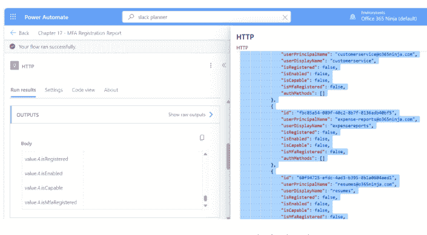

22. 关闭浮窗。
23. 点击“编辑”（Edit）返回编辑流。

此时，您已创建了一个成功连接到 Entra ID 的流。接下来，我们将查看如何使用“解析 JSON”（Parse JSON）操作来配置 Power Automate。

## 解析输出

在成功从 Entra ID 查询未配置 MFA 的用户列表后，您现在需要配置一个步骤来解码返回的数据。此过程被称为“解析”，它允许 Power Automate 识别单独记录以及这些记录内部的单独属性或参数。

按照以下步骤操作：

1. 滚动到当前流的底部并添加操作（Add an action）。
2. 选择“解析 JSON”（Parse JSON）数据操作。
   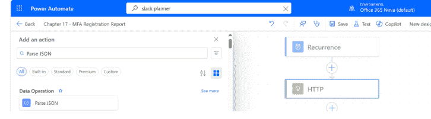

   图 17.17 - 添加解析 JSON 操作

3. 选择“内容”（Content）字段，然后添加 Body 动态内容值，如图 17.18 所示。
   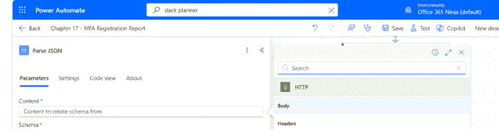

   图 17.18 - 配置解析 JSON 操作

4. 在解析 JSON 操作的底部，点击“使用示例负载生成架构”（Use sample payload to generate schema）。
5. 将上一节第 21 步中复制的 JSON 数据粘贴到“输入或粘贴示例 JSON 负载”对话框的主体中。点击“完成”。

当您粘贴 JSON 示例数据时，它可能包含多个条目。不用担心——Power Automate 将分析内容并仅选择一个条目，用于定义架构。

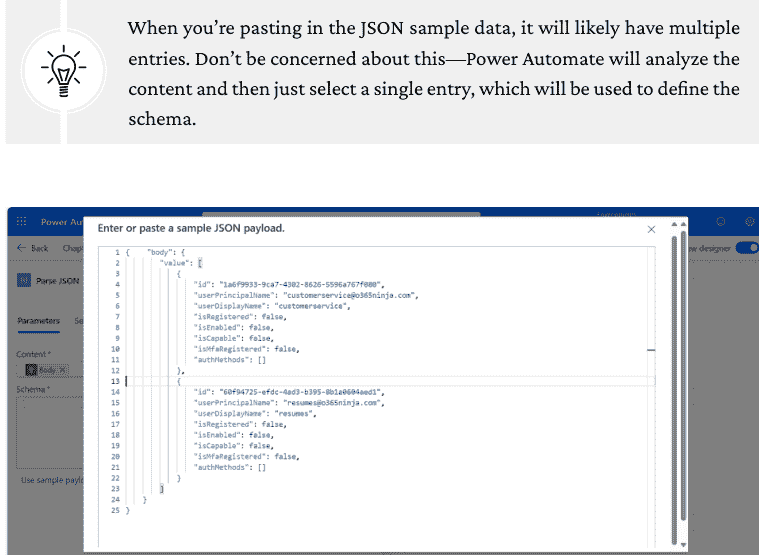

```
Enter or paste a sample JSON payload.
{
  "body": {
    "id": "1a6f09d3-a2c7-4b72-8026-559a67f8ff98",
    "userEmail": "customerservice@example.com",
    "userDisplayName": "customerservice",
    "isEnabled": false,
    "isActive": false,
    "authMethods": [
      {
        "id": "68f475f1-ed6c-4b72-8026-559a67f8ff98",
        "method": "windows",
        "info": "username",
        "isEnabled": false,
        "isActive": false,
        "isRegistered": false
      }
    ]
  }
}
```

图 17.19 – 使用 JSON

6. 检查架构以确保它包含闭合括号。点击“保存”。

Power Automate 现在有了从 Entra ID 获取的信息。接下来，我们将此输出构建报告。

## 创建报告

要完成此流，请遵循以下步骤：

1. 打开流后，滚动到底部并选择操作。
2. 选择“筛选数组”（Filter array）。
3. 在“源”（From）字段中，添加来自解析 JSON 的 Body 动态内容，如图 17.20 所示。
   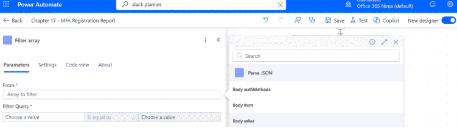

   图 17.20 – 筛选

4. 在第一个值框中，选择解析 JSON 的 Body 动态内容。
5. 在运算符下拉菜单中选择“不等于”（not equal to）。
6. 在第二个值框中，选择“表达式”（Expression），然后选择 `null`。
7. 添加。
   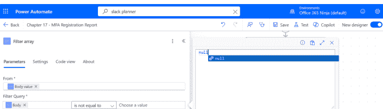

   图 17.21 – 配置筛选

> **注意**
>
> 检查此步骤中使用的输入值很重要。根据界面（新设计器与旧设计器），此值的显示方式可能不同。如果在测试流后收到提示输入需要数组的错误，请检查此操作。您可以悬停在 From 字段中粘贴的值上。您需要确保它*完全*那样粘贴在框中，注意 `null` 单词周围没有任何引号。错误的格式会导致 `null` 被视为字符串而非表达式。见图 17.22。

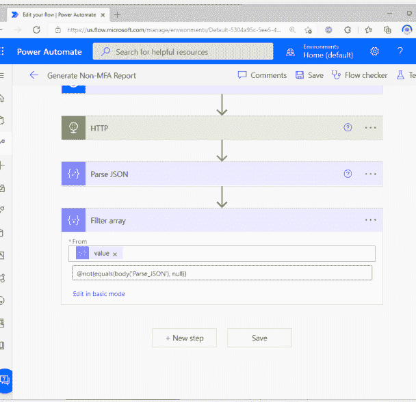

图 17.22 – 在高级模式下输入表达式

8. 添加操作。
9. 选择“创建 CSV 表”（Create CSV table）操作。
10. 在“源”（From）字段中，选择来自筛选操作的 Body 动态内容。
    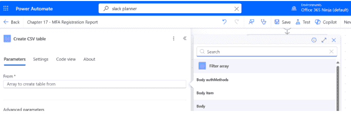

    图 17.24 – 配置 CSV 操作

11. 在“创建 CSV 表”操作浮窗中，选择高级参数下的“显示所有”（Show all）。
12. 在“列”（Columns）下拉菜单中，选择“自定义”（Custom）。我们将使用此设置来定义要添加到 CSV 表的列。
13. 在“Header”列中填充你想要包含的信息，并在“Value”列中填充来自“筛选数组”操作的相应动态值令牌。此示例将 `DisplayName` 头部映射到 `userDisplayName` 令牌，并将 `Address` 映射到 `userPrincipalName` 令牌。
    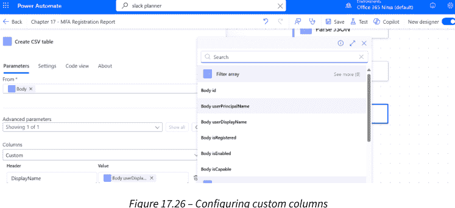

14. 添加一个操作。
15. 选择 Office 365 Outlook 的“发送电子邮件 (V2)”操作。
16. 在“致”框中输入电子邮件地址或从地址簿中选择收件人。

> **注意**
>
> 如果你没有配置 Office 365 Outlook 连接，系统将提示你输入启用邮箱的帐户的凭据才能继续。

17. 输入主题，例如“未启用 MFA 用户周报”。
18. 在“正文”部分输入描述性文本，例如“未完成 MFA 注册的用户周报”。
19. 选择“高级参数”下的下拉菜单并点击“附件”。
20. 在“附件”区域，点击“添加新项”。
21. 在“附件名称”字段中输入一个给 CSV 输出的文件。你可以使用表达式来创建自定义名称。

> **注意**
>
> 请确保在名称末尾添加 `.csv` 或 `.txt`，以便收件人能够轻松在电子表格或文本查看器中打开。

22. 在“附件内容”正文中，选择“创建 CSV 表”下的 `Output` 动态内容令牌，如图 17.27 所示。
    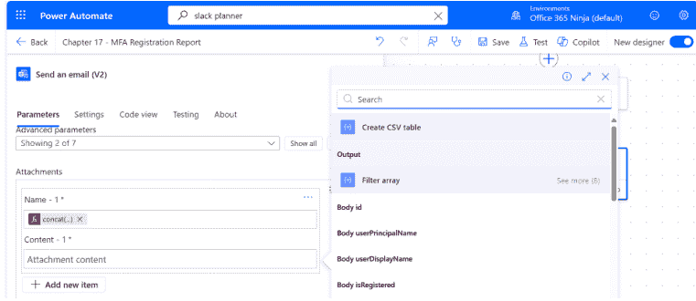

    图 17.27 – 配置附件名称和内容

23. 点击保存。

恭喜你！

你现在已经配置了一个针对未注册 MFA 用户的自动化 Entra 报告。

## 测试流

要测试此流，你可以点击 Power Automate 画布区域右上角的“测试”。

选择选项以手动启动测试流。启动测试后，你可以在 Power Automate 画布区域或流的“运行”下查看活动运行历史，如图 17.28 所示：

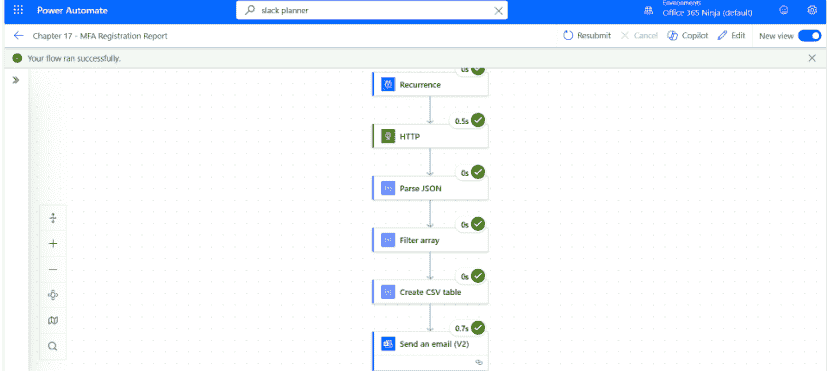

图 17.28 - 查看流的运行

如果任何操作或步骤返回错误，你可以展开该步骤并查看输出。

## 验证流

最后一步是检查发送的电子邮件。要执行此操作，请登录作为“发送电子邮件 (V2)”操作收件人的邮箱，并查找该消息：

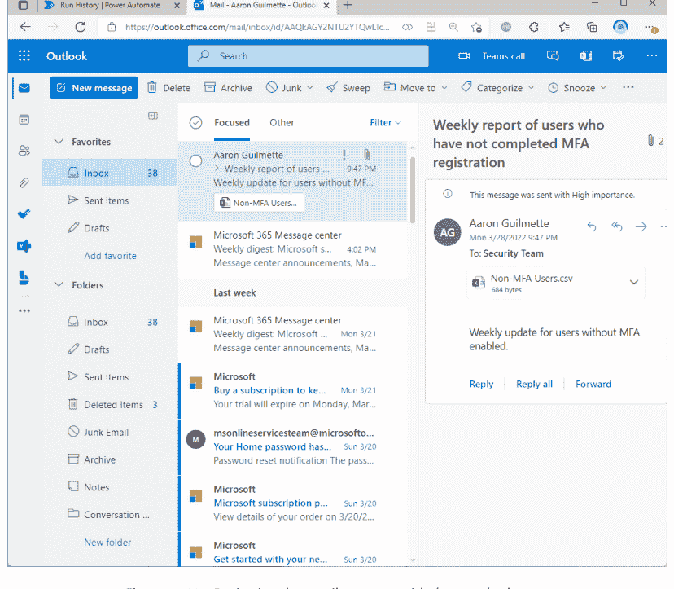

你可以打开附件并查看详情，如图 17.30 所示：

# 17 

319

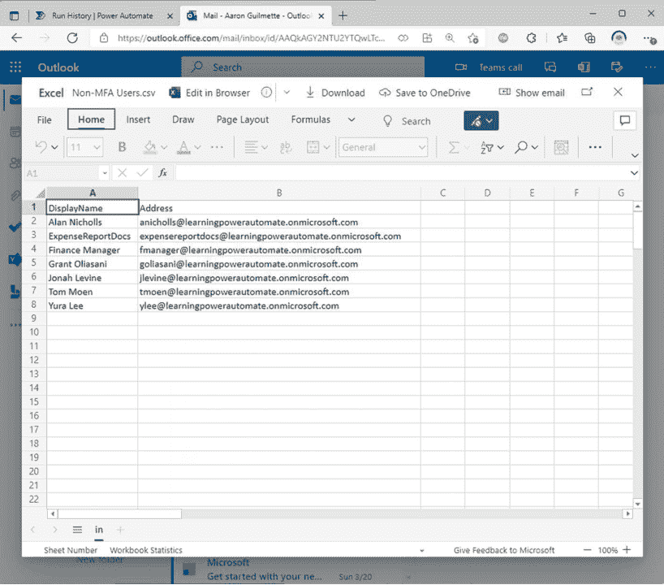

图 17.30 – 检查附件

如果一切运行正常，你应该得到一个报告，其中包含了 Microsoft 365 租户中所有启用的用户。

## 进一步扩展

除了创建 CSV 输出外，你还可以探索更丰富的数据方案。其中一种方案是创建一个 HTML 表格并直接包含在电子邮件中。

创建 HTML 表格数据操作的功能与“创建 CSV 表”操作相同，不同之处在于输出是基本 HTML 格式的数据而不是逗号分隔的数据。通过将 HTML 输出包含在邮件消息正文中，你可以潜在地提高电子邮件的可用性。

## 总结

能够处理 Entra ID 可以为许多管理和报告任务开启自动化模式。使用 Power Automate 帮助处理报告数据或其他管理任务，可能会释放出宝贵的时间来处理其他高价值任务。

在本章中，你学习了如何开始直接与 Entra ID 工作。你学习了如何与 Microsoft Graph API 交互以检索 MFA 数据、对其进行解析和过滤，然后将输出作为 CSV 附件添加到电子邮件中。你接触了几个新操作（包括 HTTP、解析 JSON 和创建 CSV 表），并使用它们来检索和格式化数据，以便人类轻松理解。

在下一章中，我们将开始学习机器人流程自动化。

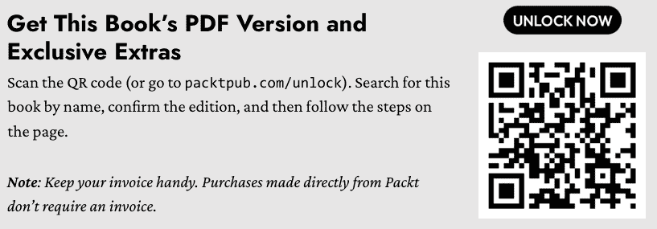

# 第 3 部分

## 机器人流程自动化、AI 模型、Copilot 及更多

在本部分，你将了解最新的自动化技术，包括用于遗留应用程序的机器人流程自动化、AI 和机器学习模型、Copilot 以及更高级的第三方应用程序。

本书包含以下章节：

* 第 18 章：介绍机器人流程自动化
* 第 19 章：使用 RPA 向 Access 数据库贡献数据
* 第 20 章：使用 RPA 自动化网页
* 第 21 章：介绍 AI 模型
* 第 22 章：创建情感分析
* 第 23 章：使用 Copilot 管理流
* 第 24 章：使用生成式 AI 总结文档
