# 第 19 章

## 使用 RPA 向 Access 数据库写入数据

在上一章中，我们涵盖了机器人流程自动化的一些功能——包括用例和一些通用最佳实践。

但还有什么比实际操作更能理解它的方式呢？

为了实现这一点，我们将从 `Microsoft Forms` 调查中获取输入。在第 14 章“使用 Microsoft Forms”中，您获取了用户提交的数据并将其插入 `SQL` 数据库。在本章中，我们将获取这些 `Forms` 数据并使用桌面流将其输入 `Microsoft Access` 数据库。

本章中将涵盖的主题如下：

- 配置先决条件
- 配置 RPA 流
- 测试流
- 验证流

在本章结束时，您应该对 `Power Automate Desktop` 环境的一些功能有所了解。

让我们开始吧！

### 技术要求

除了 `Power Automate` 许可外，本章将使用以下软件和应用程序：

- `Power Automate Desktop`
- `Microsoft Access`
- `Microsoft` 数据网关

在本章中，我们将使用 `Windows 11` 自带的 `Power Automate Desktop` 版本。`Power Automate Desktop` 也可以作为 `Windows 10` 的免费下载，我们在上一章中介绍过（您也可以点击此处下载：`https://go.microsoft.com/fwlink/?linkid=21373222`）。

`Microsoft Access` 可以作为独立应用程序或套件的一部分提供，例如 `Microsoft 365` 商业（以前称为 `Microsoft Office 365 ProPlus`）或 `Microsoft Office 2019` 和 `Microsoft Office 2024`。如果您有 `Microsoft 365` 租，可以从落地页下载 `Microsoft 365 Apps` 的评估版。

`Microsoft` 数据网关像 `Power Automate Desktop` 一样，可以在 `Power Automate Web` 门户内免费获取。上一章提供了安装的步骤说明，如果您错过了，请回翻几页。

提醒一下，您需要 `Power Automate` 每用户计划和**无人值 RPA 加项**。

### 配置先决条件

安装好桌面软件后，就可以开始处理本章特定的先决条件了。

### 配置 Power Automate 机器组

除了数据网关外，`Power Automate` 还可以使用**机器**和**机器组**。机器和机器组是将多台机器（或机器人）聚合在一起的方式，以便您的流运行得更可靠且扩展性更好。

机器组是注册到 `Power Automate` 的单个机器（物理计算机或虚拟机）的逻辑分组。分配给机器组的桌面流会进入队列，当组中的某台机器空闲时，它就会获取下一个作业。这种方法有助于分配负载、避免瓶颈并提高无人值自动化的吞吐量。

要设置基础机器，请遵循以下步骤：

图 19.1 – 创建机器

1. 导航到 `Power Automate Web` 门户 (`make.powerautomate.com`) 并选择“机器”。
2. 点击“新建”并选择“机器”。

图 19.2 – 创建机器

3. 如果您已经部署了 `Power Automate`（您应该已经有了），现在启动它。否则，请获取最新版本。
4. 如果提示，请启动 `Power Automate`。
5. 选择您想要注册的环境。

图 19.3 – 注册机器

6. 连接成功后，`Power Automate` 运行时将显示注册详细信息。

7. 关闭应用程序。

接下来，我们将配置要使用的数据库。

### 配置数据库

在本章中，我们将使用 `Microsoft` 包含的默认联系人模板。要配置数据库，请遵循以下步骤：

1. 启动 `Microsoft Access`。
2. 在“首页”选项卡上，展开“新建”并选择“联系人”。

图 19.4 – 创建数据库

3. 接受默认设置并点击“创建”。
4. 如果看到标记为“安全警告”的金色条，点击**启用内容**。

图 19.5 – 创建数据库

5. 观察并熟悉数据库。您会注意到数据库有几个关键区域，包括表（联系人）和设置，以及表单（详细信息、联系人列表和欢迎）。

6. 我们在本章中处理“联系人列表”表单。点击此页面上的“新建联系人”按钮将打开图 19.7 所示的详细信息表单，我们将在此插入之后获取的 `Microsoft Forms` 数据。
7. 点击 `X` 图标关闭详细信息表单。如果弹出图 19.8 所示的“打开数据库时显示欢迎”复选框，您需要关闭并重新打开数据库以清除它，因为它会干扰自动化。
8. 完成后，退出 `Microsoft Access` 应用程序。

核心前提准备完成后，让我们开始创建流！

### 配置流

为了简单起见，我们将重用在第 14 章“使用 Microsoft Forms”中创建的现有 `Microsoft Forms` 表单。如果需要，您可以创建一个新的，但您可能需要根据您的表单修改示例中的步骤。

由于这是一个更复杂且涉及较大的流，此过程将分解为若干较小的部分。

### 配置流触发器

在本节中，我们将配置一个新流来调用启动 `Power Automate Desktop` 的操作。我们还将设置变量。

要开始，请按照以下步骤操作：

1. 在配置了 `Microsoft Access` 和 `Power Automate Desktop` 的计算机上，确保已用 `Microsoft Access` 打开了“联系人”（`Contact`）数据库。
2. 点击“创建”，然后选择“自动化云流”。输入流名称，例如“将联系人 Access 数据库”。
3. 选择“提交新响应”`Microsoft Forms` 触发器，并点击“创建”。

图 19.9 - 添加新流

4. 在“提交新响应”触发器中，选择与第 14 章“使用 Microsoft Forms”中的“客户数据采集”（`Customer Data Intake`）表单对应的表单 ID。
5. 添加操作。
6. 选择“获取响应详情”`Microsoft Forms` 操作。
7. 选择你在“提交新响应”触发器中选择的表单（或表单 ID）。在“响应 ID”（`Response ID`）字段中，添加“响应 Id”动态内容值。

图 19.10 - 添加“获取响应详情”操作

添加操作，然后选择“运行使用 Power Automate Desktop 构建的流”操作，如图 19.11 所示：

填充操作的属性。在“连接名称”（`Connection name`）下，添加一个名称，例如“`Power Automate Desktop`”。

在“连接”（`Connection`）下，指定“使用用户名和密码连接”。或者，如果你将坐在桌面前并登录设备，可以指定“使用登录连接 - 交互式”（`Connect with sign in – Attended`）。

在“机器或机器组”（`Machine or machine group`）下，选择你的新机器。

最后，输入你登录机器的凭据（使用 `DOMAIN\username` 或 `MACHINE\username`）。完成后，点击“创建新的”。

在创建连接对象后，该操作将更新。在“桌面流”（`Desktop flow`）下，选择“创建新桌面”选项。流更新后，将“运行模式”（`Run mode`）更新为“非交互式”（`Unattended`，在未注销的机器上运行）。

15. 在“桌面流”下，选择“创建新桌面流”。

图 19.13 – 创建新的桌面流

16. 在“生成桌面流”弹出框中，输入新的流名称（例如“添加到联系人数据库（桌面端）”），并点击“启动应用”。
17. 如果出现提示，点击“打开”允许网站链接到本地应用程序。
18. 如果出现提示，提供凭据以允许 `Power Automate Desktop` 应用连接到你的环境。默认情况下，你将连接到 `Microsoft 365` 租户的默认环境。
19. 点击屏幕右侧的 `[x]` 图标打开“变量”面板。
20. 在“变量”面板中，在“输入/输出变量”下，点击 `+` 图标，然后选择“输入”以添加输入变量。

图 19.14 – 添加变量

21. 填写“新输入变量”。完成的示例请参阅图 19.15。

> 注意：“变量名称”（`Variable name`）和“外部名称”（`External name`）均指的是你给特定变量起的名称。“变量名称”是你在 `Power Automate Desktop` 中工作时使用的变量属性。“外部名称”属性将显示在 `Power Automate` 云端服务中。

- 变量类型：输入
- 变量名称：`varFormCompanyName`
- 数据类型：文本（以前为字符串）
- 默认值：`<空>`
- 外部名称：`varDesktopCompanyName`
- 描述：`<空>`
- 标记为敏感：`<否>`
- 标记为可选：`<否>`

图 19.15 - 填写变量参数

22. `Microsoft Forms` 应该有六个数据字段（`CompanyName`、`FirstName`、`LastName`、`JobTitle`、`Mail` 和 `TelephoneNumber`）。对剩余的每个变量重复步骤 13 和 14。

图 19.16 - 配置完成的变量

23. 点击“文件 | 保存”以保存你的进度。

接下来，我们将使用 `Power Automate` 运行输入数据的步骤。

### 配置打开一个应用程序

为了确保成功，建议从运行 `Microsoft Access` 应用程序的系统操作开始。按照以下步骤操作以配置该操作：

1. 在打开 `Power Automate` 设计器的情况下，在“操作”面板中搜索“运行”。
2. 选择“运行应用程序”并将其拖到“主主体”。

图 19.17 - 添加“运行”操作


3. 在**应用程序路径**（Application path）框中，点击文件图标浏览到 Microsoft Access 可执行文件的位置，例如 `C:\Program Files\Microsoft Office\root\16\MSACCESS.EXE`。

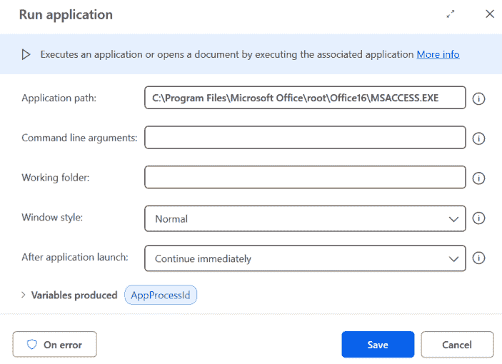

图 19.18 - 添加 Microsoft Access 路径

4. 在**命令行参数**（Command line arguments）框中，添加联系人数据库的路径。你可以使用**资源管理器**导航到文件夹，右键点击数据库文件，并选择**复制为路径**。

## 第 19 章

## 351

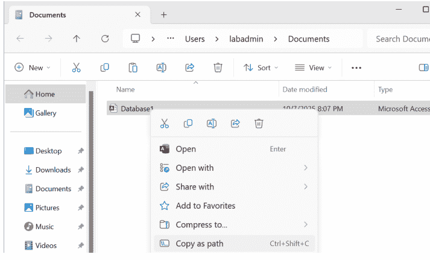

图 19.19 - 复制数据库的路径

5. 将该值粘贴到**命令行参数**框中，如图 19.20 所示：

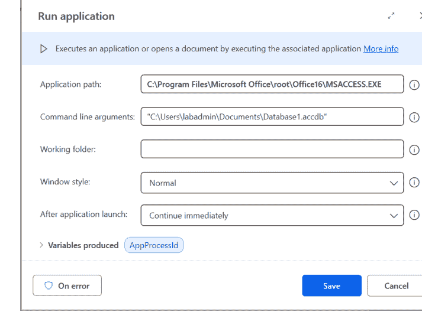

图 19.20 - 将数据库路径作为参数添加

6. 在“窗口样式”（Window style）下，选择“最大化”（Maximized）。

7. 点击“保存”保存该步骤。

此时，你已经配置了桌面流来启动 Microsoft Access 并打开正确的数据库文件。

### 运行 Power Automate 录制器

现在，我们准备好开始捕捉构成流的基本动作。让我们开始吧！

1. 确保桌面上没有显示不必要的桌面应用程序。你可以退出或最小化它们，以免它们干扰录制。

> 注意：不要关闭已打开 Power Automate 的浏览器窗口。我们稍后的步骤中会返回那里，所以我们要确保一切准备就绪。

2. 在 Power Automate 应用打开的情况下，点击菜单栏上的“录制”启动录制器。

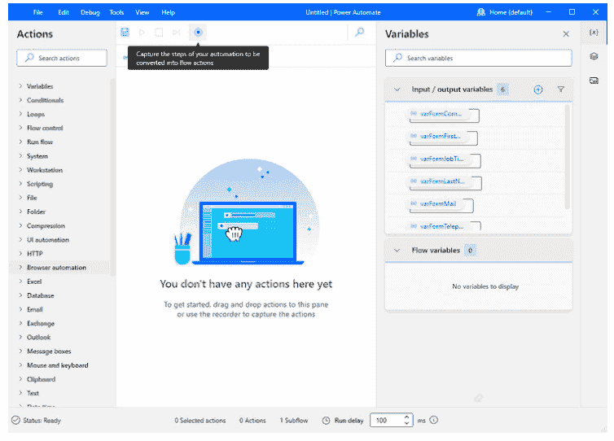

图 19.21 - 启动 Power Automate 录制器

3. 确保联系人数据库已最大化，并关闭所有其他窗口（浏览器和 Power Automate 应用），以防止弹出窗口占用焦点。

4. 点击应用中的录制按钮。从此时点起，Power Automate 录制器将捕捉你在桌面上执行的每项活动。

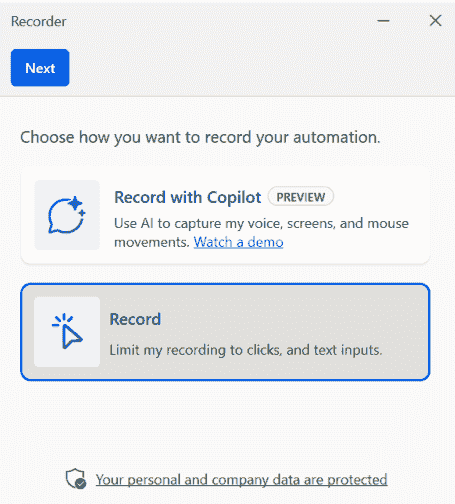

5. 点击“下一步”，然后点击“录制”开始录制。

6. 移动录制器以防遮挡。

7. 点击“新联系人”按钮。

8. 为名、姓、公司、职位、电子邮件和电话字段添加占位数据。点击选择每个字段。

> 注意：每次按键都会被录制，因此请谨慎输入。你只需要占位信息，因为我们将编辑步骤并将文本替换为变量。速度要慢一点，以便录制器捕捉你的点击操作。注意当你悬停并选择字段时周围的红色高亮。这是录制器捕捉的关键数据。

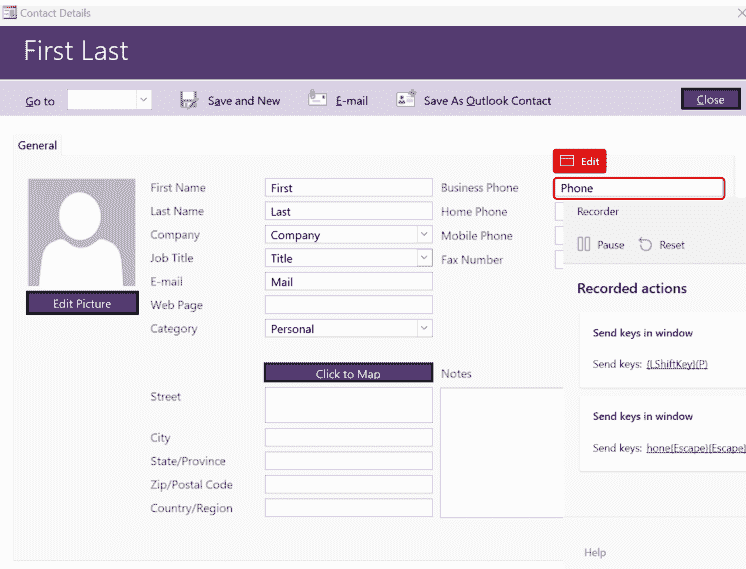

图 19.23 - 向联系人条目添加数据

9. 在联系人详情页面点击“关闭”。

10. 点击“关闭”退出 Microsoft Access。

11. 在 Power Automate 录制器上点击“完成”。

## 第 19 章

## 355

你应该返回到了 Power Automate Desktop 设计界面。主窗口显示了你在编辑表单时执行的所有操作。仔细检查列出的操作。如果你发现任何位置不当或以任何方式会干扰流自动化运行的操作（例如关闭另一个应用程序、移动窗口或点击无关字段），可以选择该操作并按键盘上的 `Delete` 键删除，或展开省略号并点击删除。

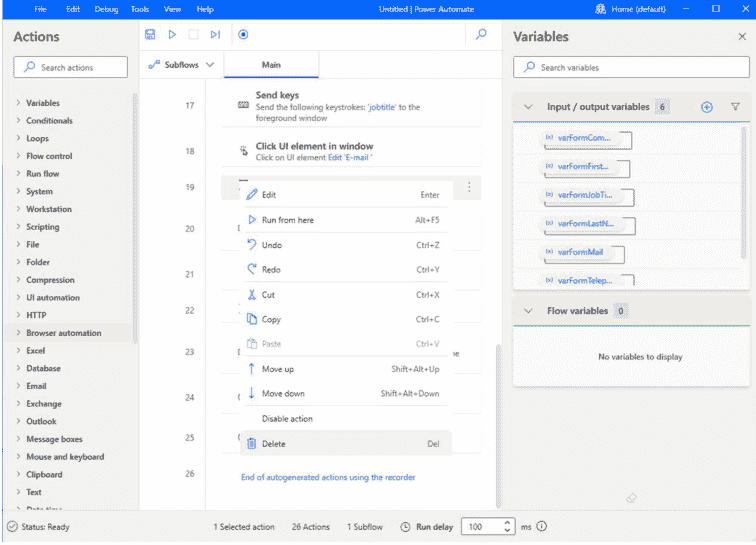

图 19.24 - 检查操作

12. 删除错误项后，梳理最终步骤集，以确保它们逻辑合理且所有步骤都已在内。如果不小心删除了或更改了步骤顺序，可以按 `Ctrl + Z` 撤销。你可以通过拖放来重新排序步骤，并复制粘贴步骤。

356

### 更新变量

当你检查这些步骤时，应该已经看到了你所选择并输入占位符文本的文本框（例如 `First Name`）。在本节中，我们将介绍将占位符文本替换为你在“配置流”部分创建的输入变量的过程：

1. 找到 `Send keys`（发送按键）操作的实例，它对应于录制过程中向“Contact Details”表单上的 `First Name` 字段输入占位符文本值。

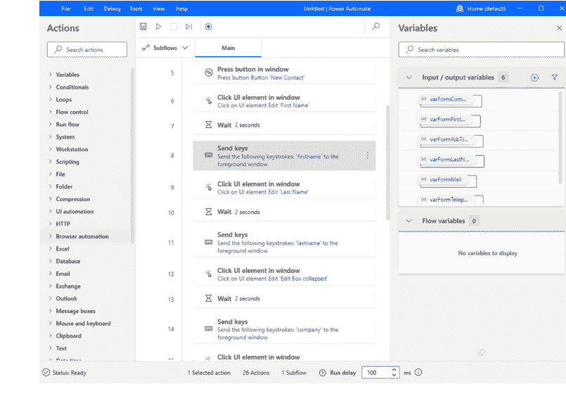

2. 双击该条目。

3. 在 `Send keys` 窗口中，选择占位符文本（在本例中值为 `firstname`）。

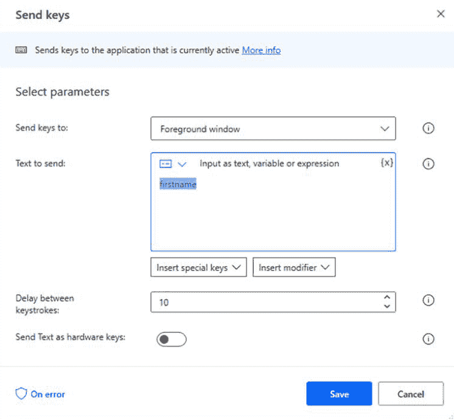

图 19.26 – 编辑 `Send keys` 数据

4. 在 `Text to send`（要发送的文本）文本框的右上角，选择变量图标，图标由 `{x}` 表示）。

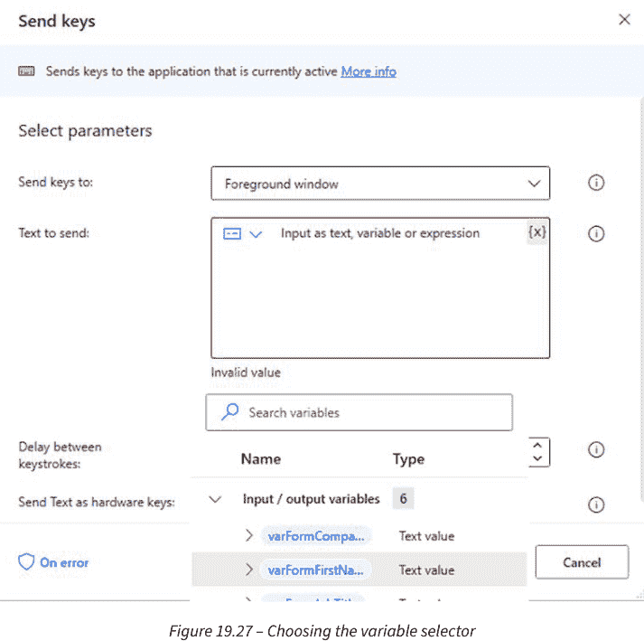

5. 从显示的输入变量列表中，选择代表 `First Name` 值的变量。在这种情况下，变量名为 `varFormFirstName`。双击变量或点击 `Select`（选择）以确认你的选择。

6. 验证 `Text to send` 框中的数据已更新为 `%varFormFirstName%`，如图 19.28 所示：

### Send keys

向当前激活的应用程序发送按键更多信息

### Select parameters

| 字段 (Field) | 值 (Value) |
| :--- | :--- |
| Send keys to: | |
| Text to send: | |
| Input as text, variable or expression (作为文本、变量或表达式输入) | `%varFormFirstName%` |
| Delay between keystrokes (按键之间的延迟): | |
| Send Text as hardware keys (作为硬件按键发送文本): | |
| On error (出错时) | |


7. 点击 `Save`（保存）。

8. 对对应姓、公司、职位、电子邮件地址和电话号码的其余变量重复此系列步骤。

9. 在 Power Automate 设计器中点击 `Save`。

10. 退出 Power Automate 设计器。

恭喜！你已经录制了一个流。现在，我们将返回 Power Automate Web 门户并完成该流。

### 完成流

现在你已经已经在桌面流中创建了所有的输入变量，现在是时候更新云流，将 Microsoft Forms 数据的动态内容令牌发送到相应的桌面流输入变量了。

360

使用 RPA 写入 Access 数据库

开始吧！

1. 在浏览器中打开 `Add Connect to Access Database` 流后，等待流更新。如果它没有自动更新，点击 `Save`。来自桌面流的变量应该会被填充。参见图 19.29。

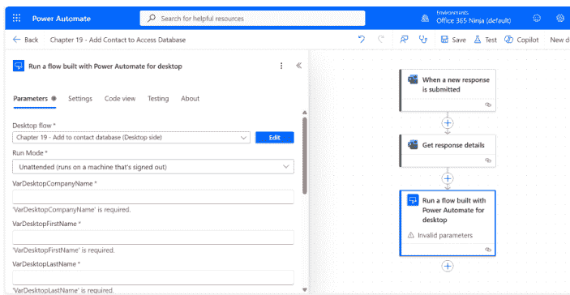

图 19.29 - 编辑流以更新变量

2. 从列出的第一个输入变量开始，点击文本框并选择来自 `Get response details` 操作中对应变量的动态内容。

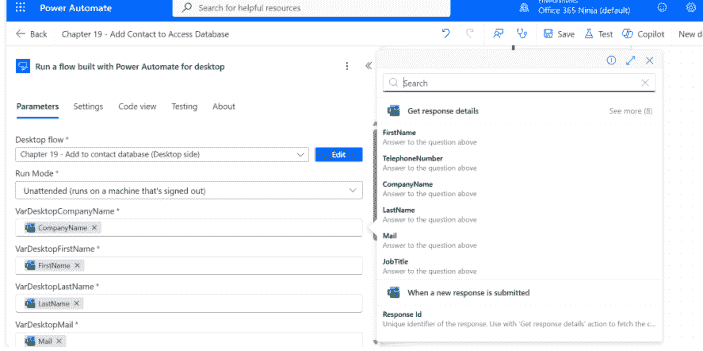

图 19.30 - 将动态内容链接到相应的桌面输入变量

3. 为每个变量重复此过程。

## 第 19 章

361

4. 完成后点击 `Save`。

5. 关闭浏览器窗口，并确保执行桌面流的机器上没有运行其他应用程序。

你已经完成了桌面流的配置。现在，来测试它。

### 测试流

正如在“配置前提条件”部分提到的，建议在独立于执行桌面流计算机的设备上启动此流。如果可能，你希望同时访问两台设备，这样你就可以在一台设备上启动流，并在另一台设备上观察桌面流的执行。这将帮助你收集故障排除所需的数据。

按照以下步骤测试流：

1. 在另一台计算机上，打开浏览器。

2. 导航到 Power Automate Maker Web 门户 (`https://make.powerautomate.com`)。

3. 点击 `My flows`（我的流），选择 `Add Contact to Access Database` 流并点击 `Edit`（编辑）。

4. 点击 `Test`（测试）打开测试面板。

5. 选择 `Manually`（手动）单击按钮，然后点击 `Save & Test`（保存并测试）。

6. 打开另一个浏览器标签页并导航到 Microsoft Forms 门户 (`https://forms.office.com`)。选择 Customer Data Intake 表单

7. 在菜单栏上选择 `Preview`（预览）。

8. 使用唯一且易于识别的测试数据填充表单，然后点击 `Submit`（提交）。

此时，你可以切换回 Power Automate 浏览器窗口并查看步骤的输出。

### 验证流

验证桌面流成功完成的最简单方法是实时观察桌面流的执行（取决于你选择了 `Attended`（受托管的）还是 `Unattended`（非托管的））。在执行过程中（如果你是受托管流），你应该能够看到以下操作发生：

- Microsoft Access 应用程序启动并打开 Contacts 数据库
- 点击 `New`（新建联系人）按钮
- 在每个字段中输入文本
- 点击 `Close`（关闭）按钮
- Microsoft Access 应用程序关闭

你也可以自己打开 Contact 数据库来验证流，确认数据与你在 Customer Data Intake 表单中输入的内容匹配：

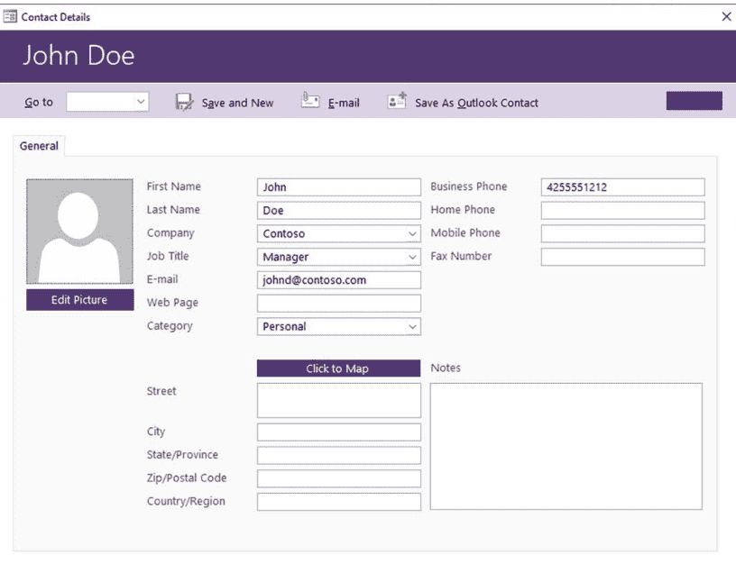

图 19.31 – 查看通过 Power Automate Desktop 流输入的联系人

如果你尝试观察非托管流，你可能会收到此错误：


图 19.32 – 非托管的错误

如果你尝试观察非托管流，你可能会收到此错误：


图 19.32 – 非托管的错误

如果你尝试观察非托管流，你可能会收到此错误：


图 19.32 – 非托管的错误

如果你尝试观察非托管流，你可能会收到此错误：


图 19.32 – 非托管的错误

如果你尝试观察非托管流，你可能会收到此错误：


图 19.32 – 非托管的错误

如果你尝试观察非托管流，你可能会收到此错误：


图 19.32 – 非托管的错误

如果你尝试观察非托管流，你可能会收到此错误：


图 19.32 – 非托管的错误

如果你尝试观察非托管流，你可能会收到此错误：


图 19.32 – 非托管的错误

如果你尝试观察非托管流，你可能会收到此错误：


图 19.32 – 非托管的错误

如果你尝试观察非托管流，你可能会收到此错误：


图 19.32 – 非托管的错误

如果你尝试观察非托管流，你可能会收到此错误：


图 19.32 – 非托管的错误

如果你尝试观察非托管流，你可能会收到此错误：


图 19.32 – 非托管的错误

如果你尝试观察非托管流，你可能会收到此错误：


图 19.32 – 非托管的错误

如果你尝试观察非托管流，你可能会收到此错误：


图 19.32 – 非托管的错误

如果你尝试观察非托管流，你可能会收到此错误：


图 19.32 – 非托管的错误

如果你尝试观察非托管流，你可能会收到此错误：


图 19.32 – 非托管的错误

如果你尝试观察非托管流，你可能会收到此错误：


391

## 第 19 章

## 20

## 使用 RPA 自动化网页页面

Power Automate 的浏览器自动化功能将机器人流程自动化（RPA）直接带入现代工作区。使用 Power Automate Desktop，你可以记录、编写并重放诸如点击、表单提交、导航和数据提取等浏览器操作。这使得执行基于网页的任务成为——从登录门户到收集报告或根据网站更改触发工作流。它是传统自动化与日益增长的网页交互需求之间的桥梁。

通过本章的示例，你学习了如何将云流与桌面集成，为应用程序记录步骤并在环境之间传递变量——这些对你的需求非常有用。


# 使用 RPA 写入 Access 数据库

1. 在浏览器中打开 `Add Connect to Access Database` 流后，等待流更新。如果它没有自动更新，点击 `Save`。来自桌面流的变量应该会被填充。参见图 19.29。


图 19.29 - 编辑流以更新变量

2. 从列出的第一个输入变量开始，点击文本框并选择来自 `Get response details` 操作中对应变量的动态内容。


图 19.30 - 将动态内容链接到相应的桌面输入变量

3. 为每个变量重复此过程。

4. 完成后点击 `Save`。

5. 关闭浏览器窗口，并确保执行桌面流的机器上没有运行其他应用程序。

你已经完成了桌面流的配置。现在，来测试它。

通过自动化这些浏览器任务，你可以节省时间、减少错误，并在现代和遗留环境中创建更具一致性的数字流程。

你还可以构建一种浏览器交互，从网站上收集数据（这一过程被称为网页爬取）。有许多演示网站可以供你练习网页爬取技术，例如：

- `web-scraping.dev`: https://web-scraping.dev
- `Web Scraper`: https://webservices.io/test-sites
- `ToScrape`: https://toscope.com
- `Scrape This Site`: https://www.scrapethissite.com

你甚至可以在 Amazon、MSN 或 Yahoo! 等热门网站上进行学习。

在本章中，我们将构建一个流，用于创建浏览器的交互，该流将处理几个常见任务：

- 导航网页
- 输入数据
- 爬取数据
- 截屏

让我们开始吧！

## 导航网页

在构建向网页发送数据或从网页检索数据的流程之前，你将需要学习如何让机器人流程自动化（RPA）与浏览器交互的基础知识。

我们将通过以下步骤涵盖导航网页的基本知识：

1. 启动 Power Automate Desktop 应用程序。
2. 点击“新建”，然后选择“流”。
3. 在“创建流”页面上，输入流名称并点击“创建”。
4. 流程加载后，在“操作”窗格中，展开“浏览器自动化”，然后选择“启动新的 Microsoft Edge”。将其拖到“主画布”区域。

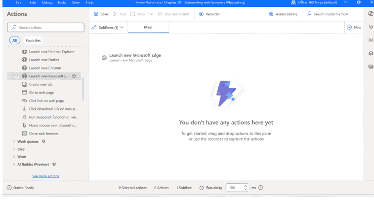

图 20.1 - 添加“启动 Microsoft Edge”操作

5. 在“启动新的 Microsoft Edge”屏幕上，点击“初始 URL”字段内部。输入一个网站网站地址，例如 https://www.yahoo.com。
6. 点击“保存”。
7. 点击“运行”按钮。

到此为止，一切顺利！你现在已经启动了一个浏览器会话！关闭浏览器窗口并返回 Power Automate Desktop 应用。

接下来，我们将查看如何从网页上爬取（收集）数据。

## 爬取数据

爬取数据是一项用于广泛目的常见活动——特别是当无法通过 API 轻松获取结构化数据时。一些常见用途包括：

- 市场和竞品研究，例如跟踪新产品、价格变化、促销活动和客户评论
- 为机器学习收集数据
- 跟踪突发新闻
- 监控品牌声誉
- 与多个平台和来源进行数据对比
- 构建聚合工具或网站，如 Zillow、Kayak 或 Apartments.com

### 爬取单页

在本节中，我们将使用 Edge 浏览器和录制器进行一些基础爬取操作。

要开始爬取，我们需要一些示例数据。对于这个练习，我们将从本章之前列出的示例网站之一提取数据。我们要关注的页面包含电子商务商店中以表格格式排列的项目列表，如图 20.2 所示。

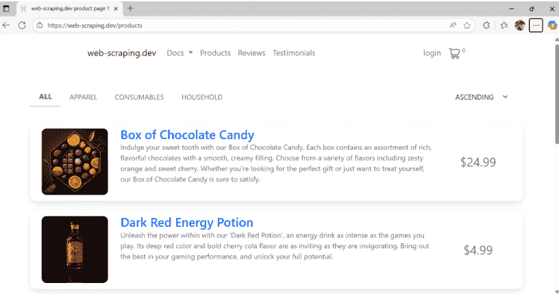

完成页面后，我们将数据保存到 Excel 文件中。让我们开始吧！

1. 启动一个新的 Microsoft Edge 浏览器会话并导航到 https://web-scraping.dev/products。
2. 返回 Power Automate Desktop，并打开上一个练习中的示例流。它应该有一个操作——`启动新的 Microsoft Edge`。
3. 双击 `启动新的 Microsoft Edge` 操作。将初始 URL 更新为 https://web-scraping.dev/products。
4. 将“窗口状态”设置为“最大化”。

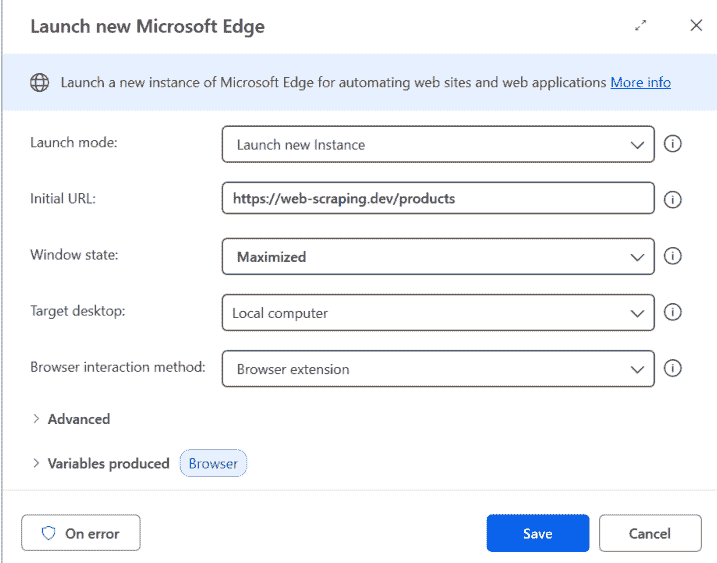

图 20.3 – 配置浏览器会话设置

5. 点击“保存”。
6. 在“操作”窗格中，选择“从网页上提取数据”并将其拖到画布上。
7. 接受默认值。
8. 在任务栏上，选择你已打开的 Edge 浏览器会话。你会注意到“实时网页助手”应用程序打开了并获取了焦点。该应用程序将在你移动页面上移动鼠标时，通过在每个元素周围放置红色边框，帮助你识别你想要爬取的字段。

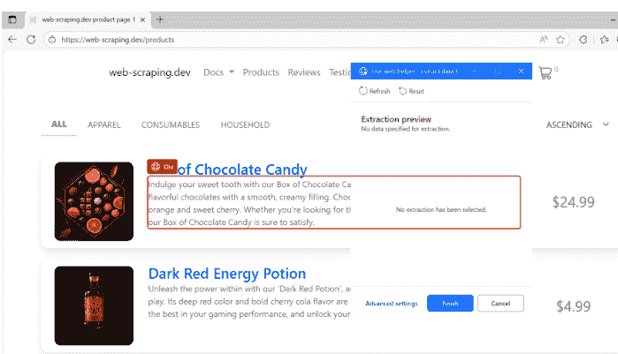

图 20.4 – 使用网页助手突出显示内容

9. 悬停在产品名称上，例如 `Box of Chocolate Candy`，然后右键点击它。指向“提取提取元素值”，然后选择下一个项目`文本`（'Box of Chocolate...'），并点击它。该项目名称将用绿色虚线框突出显示。

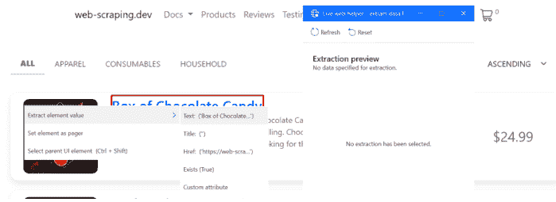

图 20.5 – 选择第一个元素

10. 重复该过程，选择该电子商务网站上的项目标题 `Dark Red Energy Potion`。注意其他相同类型的示例元素是如何被选中并显示在提取预览下的。网页助手应用程序已检测到模式，并将处理该数据。
11. 再次重复该过程，这次突出显示巧克力盒的价格。右键点击价格，指向“提取元素值”并选择`文本`（'$24.99'）。
12. 再次悬停在项目标题（Box of Chocolate Candy）上，右键点击它，指向“提取元素值”并选择 Href（'https://web-scra...'）。注意实时网页助手中的所有值都已填充。


图 20-6 - 添加项目的 URL

13. 点击“完成”。
14. 在“从网页上提取额外数据”操作中点击“保存”。
15. 点击流中的“运行”。一个浏览器窗口应该会启动。片刻后，返回 Power Automate Desktop 应用的“变量”窗格。
16. 在“变量”窗格中，你应该能在“流变量”下看到名为 `DataFromWebPage` 的新数据。双击它以查看返回到 Power Automate Desktop 的值。

恭喜！你已经爬取了你的第一个网页！

接下来，我们将学习一种处理多个页的方法。

### 使用默认分页器爬取多个页面

大多数网站会将内容分多个多个显示（通常每页有固定数量的项目）。这个过程被称为分页。在爬取数据时，你可能希望检索多个页的数据。你可以使用称为“分页器”的东西来实现此。

让我们看看它是如何工作的！

1. 在 Power Automate Desktop 打开的状态下，双击“从网页上提取数据”操作。
2. 返回你的网页。实时网页助手应该会重新打开。
3. 在实时网页助手上，点击“高级设置”按钮。

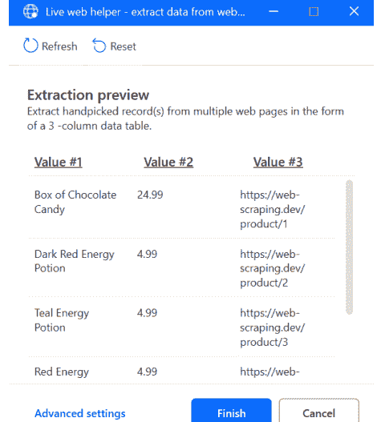

图 20.7 – 启动高级设置

4. 将“使用”切换置到“开启”。
5. 点击“确定”。
6. 在网页上，点击“下一页”按钮（在这个示例页面上，它是一个 `>` 符号）。右键点击它并选择“将元素作为分页器”。参见图 20.8。

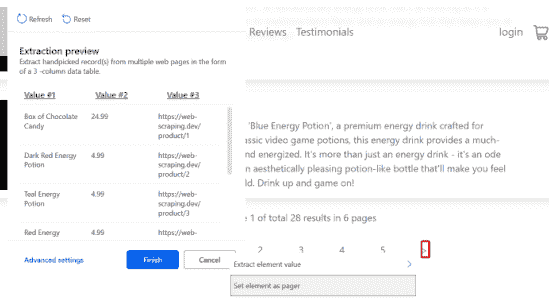

图 20.8 – 设置分页器

7. 点击“完成”返回流。
8. 在“从网页上提取数据”操作中，选择“提取数据从”下拉菜单并选择“可用”。
9. 将“物理点击下一页”切换置到“开启”。
10. 点击“保存”。
11. 将“关闭浏览器”操作拖到流的末尾。
12. 点击“运行”。

观察流的执行。它应该启动浏览器。滚动到页面底部，点击分页器，直到没有更多。你可以通过查看变量窗格来验证这一点。

### 使用 LoopIndex 爬取多个页面

然而，如果你遇到不规则的网页，或者页面元素没有按预期工作（例如，它从未到达末尾，或者示例页面上有错误），仍然有方法！

这种方法稍微复杂，涉及一个循环。让我们来看看！

1. 在打开你的爬取流时，选择“从网页上提取数据”操作并进行编辑。
2. 切换浏览器窗口以加载网页助手应用。
3. 点击高级设置并将“使用”切换置到“关闭”，以禁用 Power Automate 分页器。
4. 点击“完成”返回 Power Automate 应用。
5. 在“操作”窗格中，搜索“循环”操作。
6. 将其拖到步骤 1（启动新的 Microsoft Edge）和步骤 2（从网页上提取数据）之间。
7. 在“循环”操作页面上，将“从开始值”设置为 1，“结束值”设置为 1000000，然后将“增量值”设置为 1。参见图 20.10。

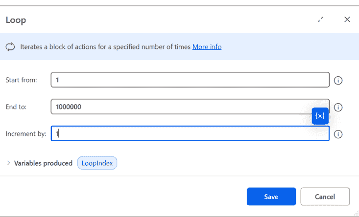

图 20.10 - 添加循环操作

8. 点击“保存”。

# 第 20 章

## 375

9. 将“从网页提取数据”操作移动到“循环开始”和“循环结束”步骤之间，如图 20.11 所示。

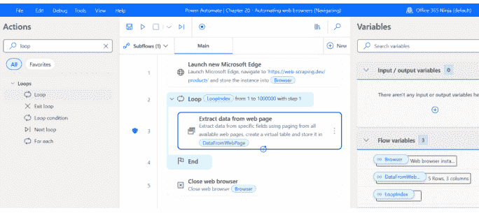

图 20.11 – 移动“从网页提取数据”操作

10. 在“从网页提取数据”操作之后和“循环结束”操作之前，添加“如果网页包含”操作。
11. 选择 UI 元素下拉列表。

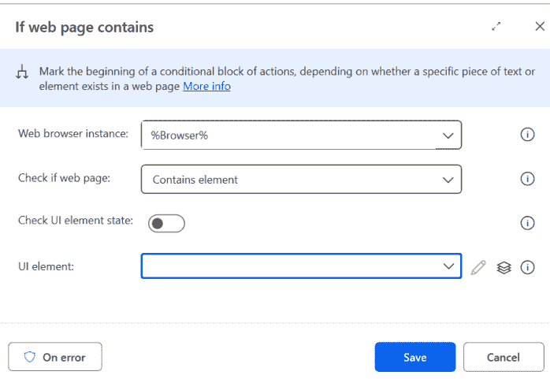

图 20.12 – 选择 UI 元素下拉列表

376 使用 RPA 实现网页自动化

12. 点击“添加 UI 元素”以启动 UI 元素拾取器。
13. 切换到带有示例页面的网页浏览器。
14. 按住键盘上的 Control 键，然后选择 `>` 符号（表示下一页）。这将被添加到“如果网页包含”操作的 UI 元素部分，如图 20.13 所示。

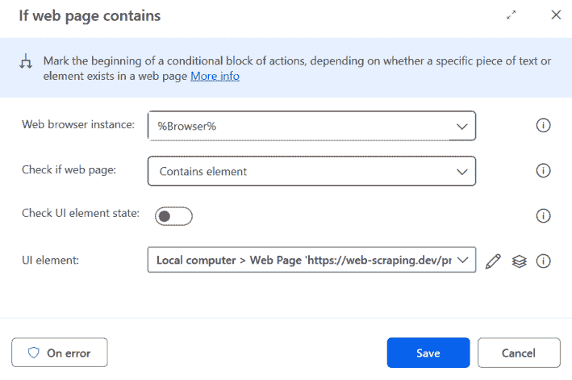

图 20.13 - 更新 UI 元素

15. 点击铅笔图标编辑 UI 元素。
16. 滚动到“锚点元素”并选择 Href 属性。

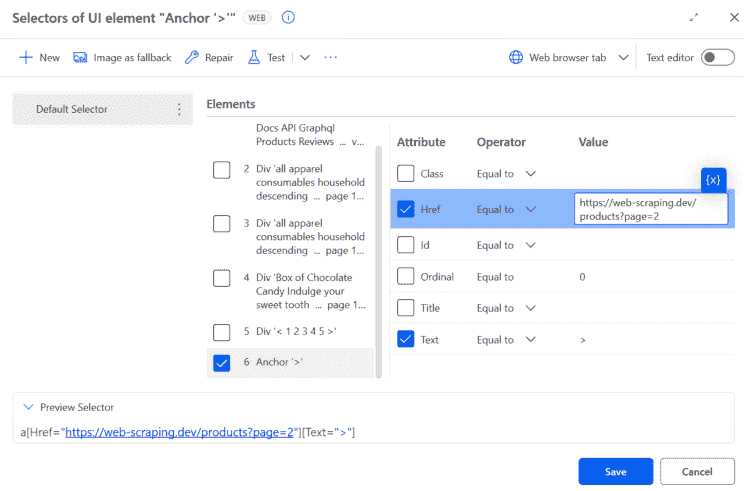

图 20.14 – 选择 Href 元素

17. 将 Href 运算符设置为“包含”（Contains）。
18. 将 Href 值更新为 `=`。点击保存。

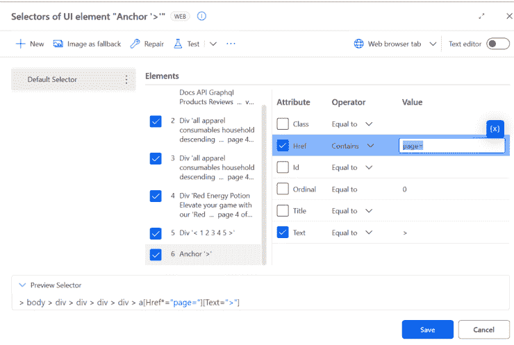

图 20.15 – 更新 HREF 元素

19. 点击保存以关闭“如果网页包含”操作。
20. 在“如果网页包含”操作之后立即添加“点击网页上的链接”操作。
21. 在“点击网页上的链接”操作中，在 UI 元素下选择锚点元素。
22. 点击保存。
23. 在“点击网页上的链接”操作之后立即插入“否则”（Else）操作。
24. 在“否则”操作之后立即插入“退出循环”操作。见图 20.16。

25. 将“启动 Excel”操作作为第 2 步，放在 Microsoft Edge 和“循环”操作之间。将“实例可见”设置为“关闭”（Off）。点击保存。

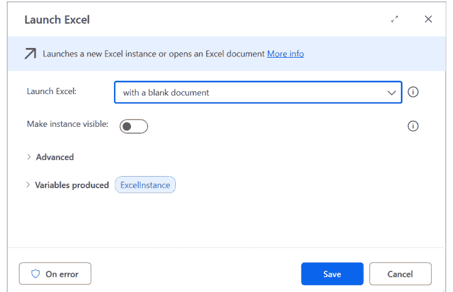

图 20.17 – 配置“启动 Excel”操作

26. 在“循环”操作内部，在“从网页提取数据”操作之前立即添加“从 Excel 中获取第一列/第一行”操作。接受变量 FirstColumn 和 FirstRow 的默认值。
27. 在“从网页提取数据”之后，添加“写入 Excel”操作。
28. 在“要写入的值”字段中，添加 `%DataFromWebPage%`。
29. 在“列”字段中，输入 `A`（代表第一列）。
30. 在“行”字段中，添加 `%FirstRow%` 变量。见图 20.18。

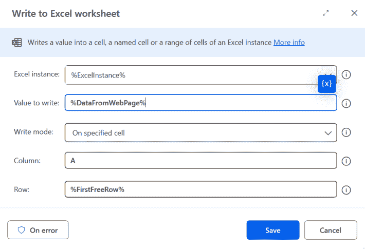

图 20.18 - 配置“写入 Excel”工作表

31. 将 Excel 操作拖到“关闭网页浏览器”操作之后。
32. 在“关闭 Excel 之前”字段中，选择“另存为”（Save as）。
33. 在“文档路径”中，输入工作站硬盘上的一个路径，例如 `C:\Temp\Demo.xlsx`。
34. 点击保存。
35. 最后，将“停止”操作拖到流程的最末端。
36. 点击保存图标保存浏览器自动化流。
37. 点击“运行”以执行流程。

流程运行后，检查你指定的保存文件位置的位置。用 Excel 打开文档并查看数据。

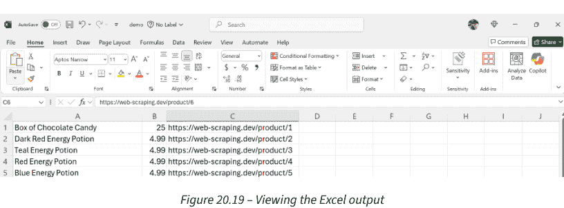

接下来，我们将向流程中添加数据输入。

### 输入数据

当你的浏览器打开示例网站 https://web-scraping.dev 时，点击“登录”链接查看该页面的凭据：

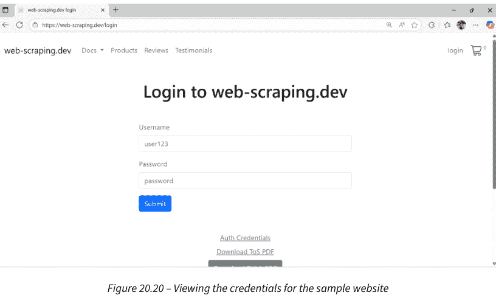

在此练习中，我们将把凭据存储在变量中，然后按照以下步骤登录网站：

1. 在打开 Power Automate 流程的情况下，将“设置变量”操作拖到流程中第一步之前。
2. 将变量名更新为 `username`，并将值更新为 `user123`。
3. 点击保存。
4. 在步骤 2 添加另一个“设置变量”操作，直接跟在第一个“设置变量”操作之后。
5. 将变量名更新为 `password`，并将值更新为 `password`。
6. 在“关闭网页浏览器”之前添加“转到网页”操作。
7. 在“转到网页”操作上，将 URL 字段设置为 https://web-scraping.dev/login。

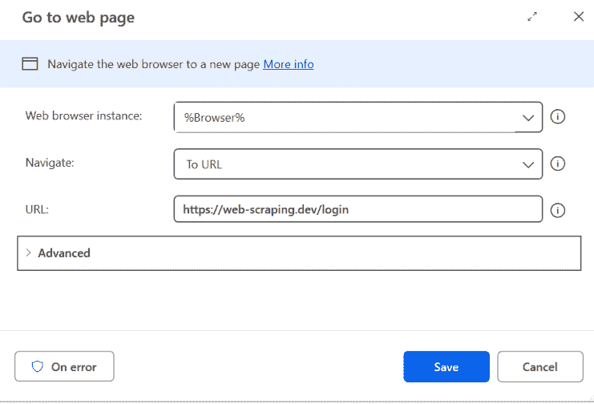

图 20.21 – 更新浏览器 URL

8. 点击保存。
9. 在“转到网页”和“关闭网页浏览器”操作之间，添加“在网页上填充文本字段”操作。
10. 点击 UI 元素下拉列表，然后选择“添加 UI 元素”。

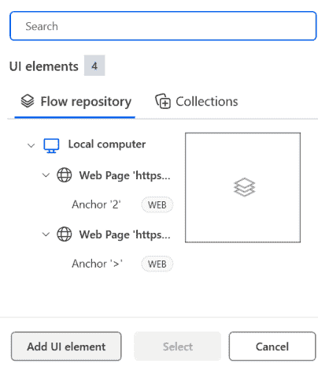

图 20.22 - 添加 UI 元素

11. 切换回带有登录页面的浏览器会话。
12. 打开 UI 元素拾取器的情况下，按住 Control 键并左键点击用户名字段。
13. 在“文本”字段中，添加 `%username%` 变量。
14. 在“关闭网页浏览器”之前添加“在网页上填充文本字段”操作。

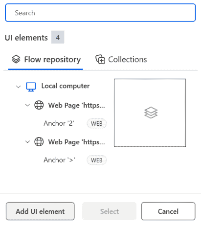

图 20.23 - 添加 UI 元素

15. 切换回浏览器会话。
16. 在 UI 元素拾取器打开的情况下，按住 Control 键并左点击密码字段。
17. 在“文本”字段中，添加 `%password%` 变量。
18. 在“关闭网页浏览器”之前添加“在网页上填充文本字段”操作。
19. 点击 UI 元素下拉列表并选择“添加 UI 元素”。
20. 按住 Control 键并左点击“提交”按钮。保存。

点击“运行”启动流程。

最后，让我们查看截图的操作。

### 截图

在 Power Automate Desktop 中，你可以针对浏览器会话或整个工作站显示进行截图。按照以下步骤配置截图操作，以日期生成的名称保存文件。

1. 在打开 Power Automate 流程的情况下，将“获取当前日期和时间”操作拖到“点击网页上的按钮”之后。点击保存。
2. 从操作面板中，将“日期转换为文本”操作拖到“获取当前日期和时间”和“关闭网页浏览器”之间。

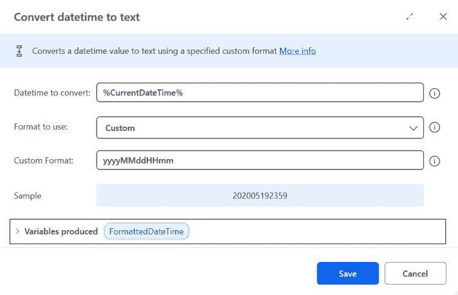

图 20.24 – 配置日期转换为文本操作

3. 在“要转换日期”字段中，添加 `%CurrentDateTime%` 变量。
4. 在“使用格式”字段中，选择“自定义”。
5. 在“自定义格式”区域输入 `yyyyMMddHHmm`，配置四位年份、两位月份、两位小时和分钟。点击保存。
6. 在“日期转换为文本”和“关闭网页浏览器”之间添加“设置变量”操作。
7. 将变量更新为 `filename`。
8. 将值更新为 `%FormattedDateTime_%screenshot.png` 并点击保存。

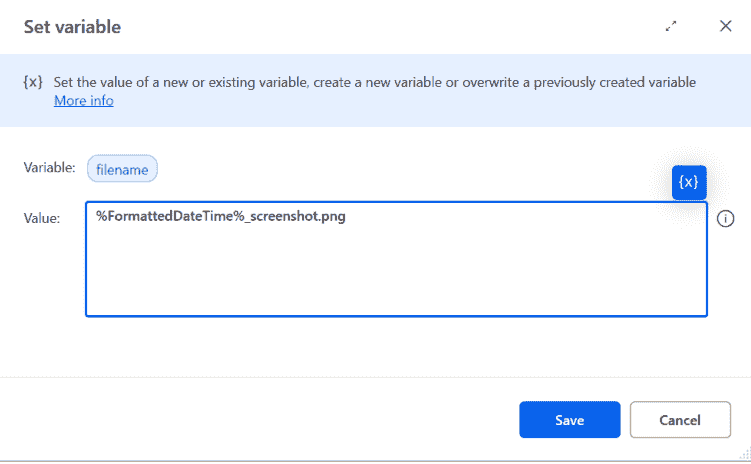

图 20.25 – 更新“设置变量”操作

9. 从操作面板中，将“工作站”部分的“截图”操作拖到“设置变量”和“关闭网页浏览器”所在的画布上。
10. 在“保存截图到”下拉列表中，选择“文件”。
11. 在“图像文件”字段中，添加 `C:\temp\%filename%` 变量。
12. 将“图像格式”下拉列表设置为 PNG。

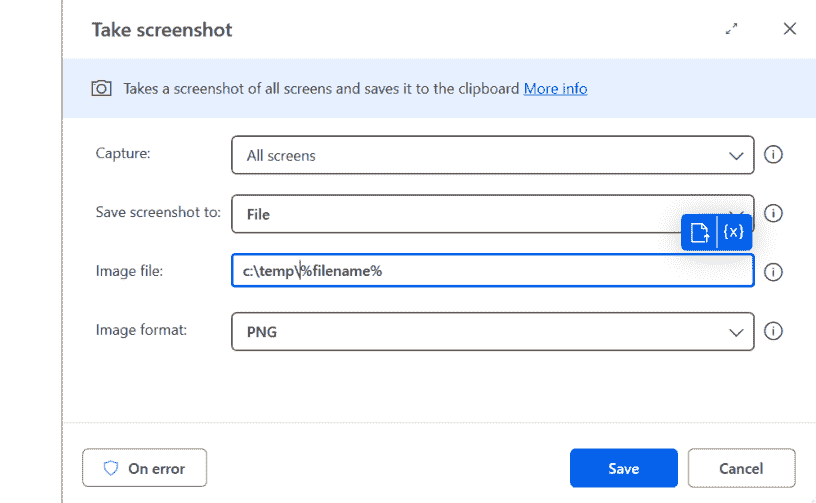

13. 点击保存。


流程运行后，你应该在指定的文件夹中同时拥有一个 Excel 文档和一个截图。

# 获取本书的 PDF 版本及专属额外内容

扫描二维码（或访问 `packptub.com/unlock`）。按名称搜索此书，确认版本，然后按照页面上的步骤操作。

注意：请妥善保存发票。直接从 Packt 购买不需要发票。


# 介绍 AI 模型和生成式 AI

在本书的示例中，你已经使用条件来确定执行流的哪个分支。你使用过如下条件：

- 购买请求金额是否大于 $1,000 美？
- 用户的 X/Twitter 粉丝数是否多于或少 100 人？
- 审批响应是否等于已批准（Approved）？

当你处理硬性数据（数字、布尔值或精确字符串匹配）时，这类评估非常有用。但当你尝试根据不那么直观的数据做出决策时，会发生什么呢？

这就是 AI 模型变得有用的地方。AI 模型利用人工智能对各种不同的内容和数据类型进行判断。例如，人类阅读名片并确定哪个值是个人姓名、哪个值是个人职位非常容易，无论它们位于名片的什么位置。然而，对于计算机来说，完成这项任务要困难得多。随着名片设计的不断变化，数据字段会移动，传统的自动化引擎更难识别和辨别它们。AI 模型帮助为数据带来上下文感知，使自动化执行得更像人类。

## 介绍 AI 模型和生成式 AI

Microsoft Power Automate 包含了多个预构建的 AI 模型，还具有训练和自定义多个额外模型的能力。预构建模型聚焦于已经通过特定数据集预训练以执行特定类型任务的 AI，而自定义模型则需要更多的配置以及使用你自己的数据集进行训练。Power Automate 允许你使用最新的生成式 AI 技术（如 ChatGPT、Azure OpenAI 和 Copilot）来增加创意，并帮助解释细微的内容。

在本章中，我们将重点学习 Power Platform 中 AI 的广阔能力，并准备你的环境以开始使用 AI。我们将涵盖的主题如下：

- 学习 AI 模型
- 学习生成式 AI
- 探索用于 Power Platform 的 Copilot
- 技术要求

让我们开始吧！

### 学习 AI 模型

Power Platform 中提供了许多类型的模型，涵盖了广泛的数据类型和场景。你可以使用模型来分析文本并扫描文档、图像、电子邮件或你可以提供给服务的任何其他类型的输入。

表 21.1 中的数据描述了模型设计工作的内容类型、模型名称、模型的构建类型（是预构建模型还是自定义模型）以及示例的业务用例。

| 模型名称 | 数据类型 | 构建类型 | 业务案例 |
|---|---|---|---|
| 名片读取器 | 文档 | 预构建 | 名片扫描 |
| 表单处理 | 文档 | 自定义 | 职位申请处理 |
| 文本识别 | 文档 | 预构建 | 识别犯罪现场照片中的文本 |
| 收据处理 | 文档 | 预构建 | 自动生成报销单 |
| 类别分类 | 文本 | 预构建或自定义 | 焦点小组反馈分类 |
| 实体提取 | 文本 | 预构建或自定义 | 从产品或服务评论中提取见解 |

| 模型名称 | 数据类型 | 构建类型 | 业务案例 |
|---|---|---|---|
| 关键短提取 | 文本 | 预构建 | 获取提及品牌的新闻或社交媒体帖的警报 |
| 语言检测 | 文本 | 预构建 | 识别提交文本的语言 |
| 情感分析 | 文本 | 预构建 | 分类正面和负面的客户反馈 |
| 文本翻译 | 文本 | 预构建 | 将电子邮件支持请求翻译为支持工程师的语言 |
| 预测 | 结构化数据 | 自定义 | 欺诈交易告警 |
| 图像分类 | 图像 | 自定义 | 识别客户上传图像中的不当内容 |
| 目标检测 | 图像 | 自定义 | 通过拍照快速识别车间地面机器的类型 |

表 21.1 – AI 模型类型

每个模型都有自己的优势。根据业务目标，你可能甚至需要使用多个 AI 模型来完成端到端的处理。

### 学习生成式 AI 模型

Power Automate 对生成式 AI 的集成——特别是通过 Copilot 和基于生成式预训练转换器 (GPT) 的模型——改变了自动化的设计、部署和维护方式。

如果你使用 ChatGPT 等生成式 AI 工具，你已经熟悉该技术的一些功能。就像 ChatGPT 一样，Power Platform 中的生成式 AI 操作是由提示（prompts）驱动的——即用户可以向模型调用创意的自然语言问题或指令。

生成式 AI 还增强了现有流的智能性。通过 GPT 集成，Power Automate 可以分析上下文数据、总结长内容、生成适应响应，甚至自动编写自然语言电子邮件或报告。例如，流可以从客户支持系统中提取信息，总结工单活动，并起草每周状态报告供评审。同样，AI 驱动的情感分析、文本分类和数据提取允许做出更明的决策——根据语气、紧急性或检测到的意图优先处理任务、路由请求并升级问题。这实现了从纯静态、基于规则的自动化向自适应、上下文感知自动化的转变。

你可以将 GPT 驱动的操作直接嵌入到流中，引入内容生成、翻译或总结等功能。结果是结合了传统的确定性过程自动化与高级推理及创意的工具——这允许组织超越重复性任务自动化，进入业务流程的智能编排。

### 探索用于 Power Platform 的 Microsoft Copilot

除了使用生成式 AI 为流生成内容外，你还可以使用 Microsoft Copilot AI 平台帮助加速自动化的开发。

与其手动配置每个条件、操作和连接器，Copilot 会智能地生成一个运行的流。例如，你可以输入“当发票共享邮箱箱收到来自客户的新邮件时，将附件保存到发票 SharePoint 站点并向 Teams 上的应付账组发送消息”，Power Automate 将逐步构建该自动化流程。

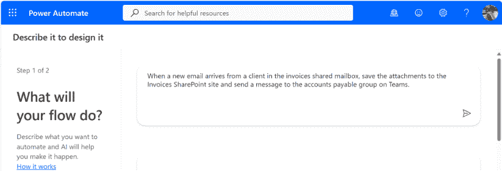

图 21.1 – 通过 Copilot 的“描述它 (Describe it)”功能创建流

几刻之后，Copilot 将返回一个建议，如图 21.2 所示：

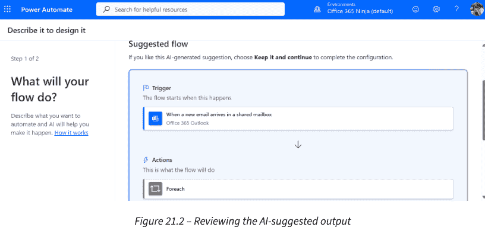

该过程可能会生成几个示例。如果你发现了一个想要开始的示例，可以选择“保留并继续”，你将被带到带有流的画布。

你只需要更新操作以指向正确的邮箱箱、站点或组。

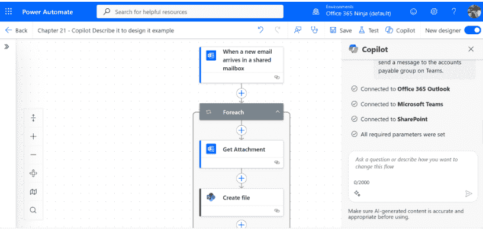

Copilot 甚至可以根据组织模式或过去的使用情况推荐优化、识别缺失的触发器并建议额外的集成。这种对话方法允许所有技术水平的用户在几分钟而不是几小时内实现复杂工作流的自动化。例如，你可以向 Copilot 实际关于流的问题。

在图 21.14 所示的示例中，我们要求 Copilot 提供动态重命名附件的方法，将发送者的电子邮件地址作为文件名：

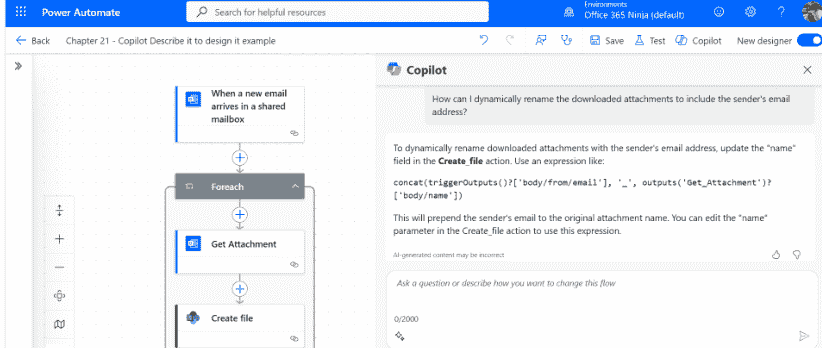

图 21.14 – 让 Copilot 提出建议

Power Automate 的生成式 AI 能力扩展到了流程理解和精炼。通过流程挖掘和任务挖掘的帮助，AI 可以分析工作在组织内部实际发生的方式——识别出用于自动化的重复性手动步骤。Copilot 通过生成建议的流流来协助简化这些流程，有效地将业务活动转化为可操作的蓝图。这不仅缩短了发现自动化机会所需的时间，还确保自动化反映了真实的用户行为，从而提高了效率和采用率。

接下来，我们将重点关注使用基于 AI 的解决方案的技术要求。

### 技术要求

AI 模型（通过 Power Platform 中的 `AI Builder` 管理）需要访问 Microsoft Dataverse。如果你在本书早之前的章节中完成过需要访问 Dataverse 的示例，那么你应该已经满足了这些要求。如果你尚未创建 Dataverse 数据库，可以使用以下流程：

1. 导航到 Power Automate 制作者网页门户 (https://make.powerautomate.com)。
2. 选择 AI hub（AI 中枢）。如果你的环境已过配置，你将看到图 21.5 所示的屏幕：

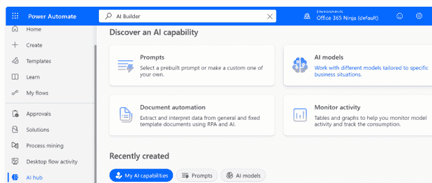

图 21.5：启动 AI Builder

3. 然而，如果 Dataverse 尚未配置，你将看到一个与图 21.6 所示类似的屏幕：

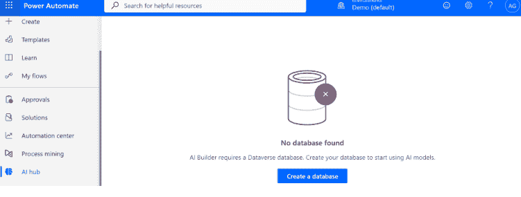

图 21.6 – 创建数据库

4. 如果显示此屏幕，点击 Create a database（创建数据库）。
5. 在提示时，选择一种货币和语言。
6. 点击 Create my database（创建我的数据库）：

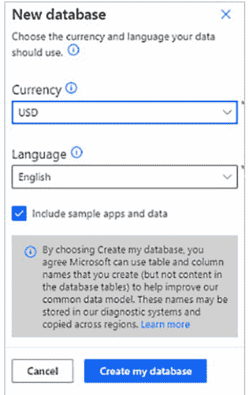

图 21.7 – 创建 Dataverse 数据库

7. 使用浏览器的刷新按钮更新 AI hub 落地页。
8. 在屏幕顶部，点击 Start free trial（开始免费试用）：

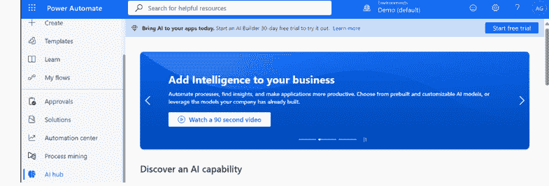

图 21.8 – AI Builder 试用

此试用将激活 AI Builder 并让你访问模型。一旦试用成功启动，你就可以开始使用 AI 模型。

除了 Dataverse 功能外，你还需要 AI Builder 额容量。AI Builder 容量是单独许可的，尽管高级版 Power Platform 计划中包含了一些容量。如果你已经订阅了试用许可证（例如带有 Attended RPA 计划的 Power Automate 每用户计划），你应该有足够的容量来开始学习 AI 模型。

有关许可和容量的更多信息，请参阅 https://learn.microsoft.com/en-us/ai-builder/administer-licensing。

### 总结

在本章中，你从内容操作和处理的角度，以及在帮助创建流和其他自动化任务的方面，学习了 Power Platform 内置的 AI 能力。你使用 Copilot 建议了新的自动化，并通过提示（prompting）对其进行了精炼。

接下来，我们将通过创建一个使用情感分析的流来深入研究 AI 模型！

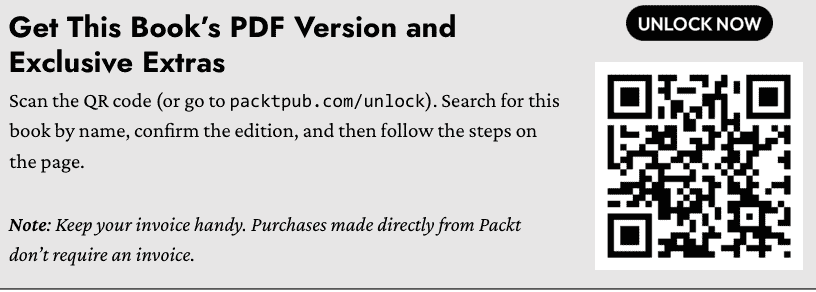

## 创建情感分析流

到目前为止，我们已经了解了 Power Platform 中的 AI（特别是微软的 Copilot 和 AI Builder）如何帮助我们创建和修改工具（如流和应用）。虽然它们可能很有帮助，但通常情况下，要让这类通用助手执行非常特定的以步骤为导向的任务，需要付出大量的额外努力。

正如第 21 章 **介绍 AI 模型和生成式 AI** 中提到的，Microsoft Power Platform 允许你利用人工智能对广泛的内容和数据类型进行判断，帮助以机器速度模拟人类评估。

例如，人类可以一眼看名片并识别出人的姓名和职位，无论使用何种字体、它们在名片上的位置、颜色或文本字段的方向如何。然而，对于传统的计算机逻辑来说，执行这项任务要困难得多。随着名片设计的演变，数据字段不断演变……（注：此处原文存在大量重复文本，已按要求处理）。

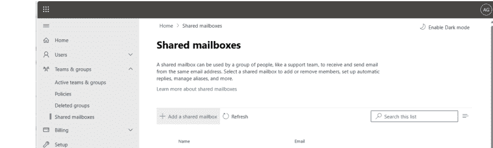

图 22.3 – 查看共享邮箱箱

在添加共享邮箱箱飞出窗中，输入名称并根据需要调整电子邮件地址。

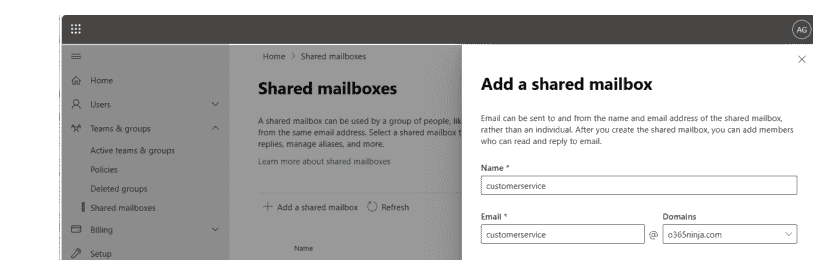

图 22.4 – 创建共享邮箱箱

点击向你的共享邮箱箱添加成员。

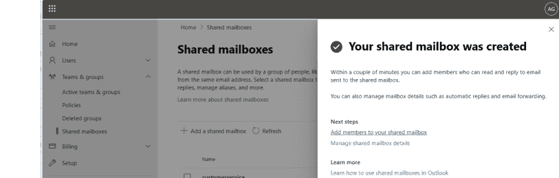

图 22.5 – 查看新创建的邮箱箱

5. 在共享成员飞出窗中，点击添加成员。您需要从组织中选择至少一个拥有邮箱箱许可证的用户（访问共享邮箱箱的必要条件），然后点击添加。

6. 关闭飞出窗。

在使用 Power Automate 时，您将需要使用第 5 步中授予权限的账户凭据。

接下来，您将创建一个团队。

### 创建 Microsoft Teams 团队

Microsoft 团队将用于接收来自 Power Automate 的通知。使用这些步骤从 Microsoft 365 管理中心创建团队。

1. 从 Microsoft 365 管理中心 (https://admin.microsoft.com)，展开 Teams 和组，然后选择活动团队和组。
2. 在 Teams 和 365 组选项卡上，点击添加团队。
3. 在添加团队向导的基本设置中，为团队提供名称并点击下一步。见图 22.6。

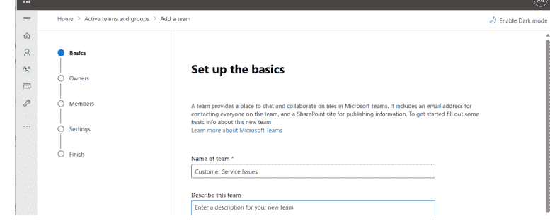

图 22.6 – 创建新团队

4. 在所有者页面上，添加至少一个所有者（例如管理共享邮箱箱的帐户）。点击下一步。
5. 在成员页面上，添加任何额外成员并点击下一步。
6. 在设置页面上，填写团队电子邮件地址。点击下一步。

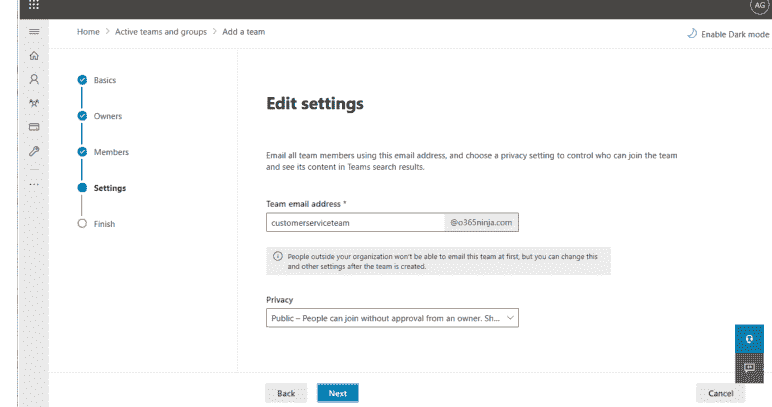

图 22.7 - 为团队配置电子邮件地址

7. 在完成页面上，检查设置并点击添加团队。

现在，进入有趣的部分了！

### 配置情感分析流

如您在本章较早部分所学到的，情感分析提供了一种评估内容语调并提供评估输出的机制。为了解决识别负面客户反馈的场景，您可以使用情感分析流来处理共享邮箱箱收到的消息。

1. 导航到 Power Automate 制作器网页网站 (https://make.powerautomate.com)。
2. 从导航菜单中选择创建。

### 3. 在从空白开始下，选择自动化云流。


图 22.8 – 开始新流

### 4. 在生成自动化云流向导中，填写名称并选择当共享邮箱箱有新邮件到达时 (V2)触发器。点击创建。


图 22.9 – 选择流的触发器

### 5. 在画布中，选择当共享邮箱箱有新邮件到达时 (V2)触发器。

### 6. 在飞出窗中，在原始邮箱地址字段中，添加客户服务共享邮箱箱。见图 22.10。


图 22.10 – 配置共享邮箱箱

8. 选择将用于身份邮箱箱的凭据。如果未列出凭据，点击添加新建并提供访问共享邮箱箱帐户的用户名和密码。


图 22.11 – 更新连接设置

9. 添加操作。
10. 在添加操作飞出窗中，在搜索框中输入 `Detect` 并选择检测语言操作，如图 22.12 所示。


图 22.12 – 选择检测语言操作

10. 在文本中使用的检测语言飞出窗中，点击文本字段。选择闪电图标展开动态选择器。
11. 选择正文。


12. 折叠飞出窗。您会注意到文本中使用的检测语言操作被封装在应用到每一个（或对于，取决于您的租户在循环控制中的中的位置）中。这是因为当共享邮箱箱有新邮件到达时 (V2)可能会触发多个消息到下一个操作（使其成为数组），因此需要循环控制来处理从触发器传递的每条消息。见图 22.14。


13. 点击应用到每一个循环内的 `+` 以添加操作。
14. 在添加操作飞出窗中，在搜索框中输入 `Sentiment analysis` 并选择分析文本中的正或负面情感。

15. 在分析文本中的正或负面情感飞出窗中，选择语言字段。添加来自文本中使用的检测语言的语言动态内容。


图 22.15 – 选择语言选择器

16. 点击文本字段。选择动态选择器。
17. 在共享邮箱箱有新邮件到达 (V2)下选择正文。
18. 折叠飞出窗。您会注意到分析文本中的正或负面情感被封装在应用到每一个中。
19. 检查该流。它应该类似于图 22.16。


图 22.16 – 检查流的状态

20. 在分析文本中的正或负面情感操作之后添加一个操作。
21. 在应用到每一个循环内部，在搜索框中输入 `Condition` 并选择条件操作。
22. 在条件飞出窗中，点击左侧字段并选择动态选择器。
23. 选择来自文本中使用的检测语言的整体情感动态内容。
24. 在运算符下拉菜单中，选择等于。
25. 在右侧字段中输入值 `negative`。


图 22.17 – 配置条件评估

- 26. 折叠飞出窗。
- 27. 在条件的“是”分支上，点击 `+` 添加操作。
- 28. 在“添加操作”搜索框中输入 `Post message` 并选择“在 Teams 中发布消息”操作。

---

第 22 章 411


图 22.18 – 添加消息操作

- 29. 在“在聊天或频道中发布消息”飞出窗中，点击登录以创建连接（必要）。提供将发布到 Teams 的帐户凭据。
- 30. 在“发布”下拉菜单中，选择“Flow bot”。
- 31. 在“发布”下拉菜单中，选择“频道”。
- 32. 在“团队”下拉菜单中，选择在先决部分创建的团队。
- 33. 在“频道”下拉菜单中，选择“General”。
- 34. 在“消息”文本框中，添加消息详情。可以使用动态令牌的富文本格式选项。图 22.20。
- 35. 折叠飞出窗。
- 36. 检查流的布局并检查是否有明显的错误。见图 22.21。


图 22.21 – 检查整体流

- 37. 在菜单栏上，点击“保存”以保存流。

检查流以确保步骤已配置好。完成后，是时候测试它了！

### 测试流

现在，是让一切按预期工作的时候了！

- 1. 从菜单栏选择“测试”。
- 2. 选择“手动”单选按钮并点击“测试”。
- 3. 通过向配置的共享邮箱箱发送电子邮件来测试您的流。确保您没有遇到反对。


图 22.22 – 撰写测试电子邮件

---

第 22 章 413

发送电子邮件后，流运行历史将开始在 Power Automate 制作器门户中更新。

- 4. 选择“分析文本中的正面或负面情感”以展开详细飞出窗口。
- 5. 在“运行结果”（Run results）选项卡下，向下滚动到“输出”（OUTPUTS）区域，然后搜索主体（body）部分。应该有一个 `responsev2.predictionOutput.result.documentScores` 字段。如果模型能够识别出你（推测）措辞强烈的邮件中的负面情感，它将把情感报告为负面。


图 22.23 - 流执行结果

- 6. 打开 Microsoft Teams（或访问 https://teams.microsoft.com）并验证频道帖子已发布。


图 22.24 - 验证频道帖子

此时，你已经拥有了一个可以检测愤怒邮件并开始通知支持人员采取行动的流——这让你在提高客户满意度的道路上迈了一大步！

### 进一步探索

根据你的需求和其他连接的系统，你可能能够扩展并增强此系统，包括执行以下操作的工作流：

- 连接到电子商务平台并为未来的购买生成折扣优惠码
- 通过电子邮件回复客户并启动退款
- 与送运代理商集成以生成邮寄标签

你的限制实际上只有你的创造力（以及帮助客户的预算）。

### 总结

AI Builder 模型开箱即用就具有许多功能。在本章中，你学习了如何利用人工智能和机器学习来处理客户服务邮箱中收到的电子邮件。通过情感分析模型，你能够检测邮件的整体基调是正面还是负面，然后触发附加操作，在团队频道对话中发布通知，以供客户服务团队后续审核。

在下一章中，我们将探索使用 Microsoft Copilot 与流进行交互。

> 获取本书的 PDF 版本和独家额外内容。扫描二维码代码（或访问 packpub.com/unlock）。按名称搜索此书，确认版本，然后按照页面上的步骤操作。

注意：请妥善发票。直接从 Packt 购买的不需要发票。


---

## 23

## 使用 Copilot 创建和管理流

在第 21 章“介绍 AI 模型和生成式 AI”中，我们开始探索如何将 Microsoft Copilot 与流结合。在本章中，我们将尝试稍微推向边界，看看它还能做什么。

云流中的 Copilot 让构建自动化变得像对话一样简单。你不需要在菜单中寻找或拖动操作卡片，只需自然语言告诉 Copilot 你想做什么。例如，你可能会说：*当有人提交表单时，给我发送一条 Teams 消息并将文件保存到 SharePoint 中*。Copilot 会逐步引导完成整个过程，将你的想法转化为可以运行的流，为你节省时间和精力。

### Copilot 拥有哪些能力？

- **理解你的意思：** 描述你的场景，Copilot 就会识别你的意图并围绕此构建流
- **自动设置连接：** 它会在后台链接你的帐户和服务，使你的自动化程序能够立刻运行
- **填写细节：** Copilot 会根据你的要求添加必要的参数和配置——无需手动猜测
- **即时更新：** 如果你想调整或替换操作，只需要求 Copilot 做出更改——它会立即为你处理好
- **回答你的问题：** 你可以问 Copilot 诸如***我的流是做什么的？** 等问题以获取快速摘要，甚至是产品类问题，如***我如何访问子流？** 或***许可证是如何工作的？***
- **帮助编写描述：** 当你编辑流时，Copilot 甚至可以建议一个清晰、完善的描述，以便日后更容易理解

简而言之，Copilot 将流的构建转变为一种自然的往返对话。你解释你想做什么，而它为你处理技术性步骤。

在本章中，我们将尝试完成以下任务：

- 使用 Copilot 创建流
- 编辑流
- 描述流

在本章结束时，你将更好地理解 Copilot 如何帮助你快速构建流。

### 使用 Copilot 创建流

编写一个好的提示词不仅仅是清晰或描述你希望结果的外观——还关乎为 Copilot 提供足够的上下文，让它准确理解你正在尝试做什么。Copilot 鼓励实验。你可以测试不同版本的提示词，看看哪一个获得最佳结果。如果你的第一次尝试没有达到预期，请调整措辞重试。需要注意的是，Copilot 是一个生成式 AI 工具——它是概率性的（与确定性的代码不同）。这意味着即使你我输入相同的提示词，也可能会得到略不同的结果——这是生成式 AI 的本质。

为了获得最佳结果，请遵循以下提示：

- **使用“当 X 发生时，执行 Y”的格式：** 这有助于 Copilot 清晰理解触发器和操作
- **具体化：** 不要说像“我想处理一封邮件”这样模糊的话，尝试：*当邮件到达时，将主题发布到“Contoso”Teams 通用频道*
- **尽可能提及应用程序或连接器：** 在提示词中提到 Outlook、SharePoint、OneDrive 或 Forms 等工具，以便 Copilot 确切知道要使用哪些服务
- **在过程中完善你的提示词：** 措辞上的微调就能对 Copilot 创建的自动化产生巨大影响

将提示词看作是与 Copilot 的快速对话——你对自己的要求的越清晰，它就越能构建出你设中的流。

---

第 23 章 417

首先，让我们看看如何使用 Copilot 创建新流。假设你的 Dropbox 站点是外勤人员上传手写表单的地方。你想创建一个流，连接 Dropbox 站点、导入文档、执行光学字符识别 (OCR)，然后将其保存为文本文档。

让我们看看它能做什么！

- 导航到 Power Automate 制作网页门户 (https://make.powerautomate.com)。在首页上，输入提示词并点击“生成”。在示例中，我们将使用以下初始提示词：

  *当 Dropbox 中创建文件时，将文件保存到 SharePoint 站点。*


- 看看 Copilot 生成了什么。


- 4. 如果 Copilot 回复没有流建议，请编辑提示词并重新提交。尝试以下提示词：

  *当 Dropbox 中创建文件时，使用 OCR 操作并将文件保存到 SharePoint。*


图 23.3 - 更新后的提示词

在查看建议后，你可能会发现 Copilot 的响应“足够好”，即使它不是你想要的。滚动到页面底部并点击“保留”，继续进入流创建的后续步骤。

- 5. 提供连接服务的凭据，然后点击“创建流”。


图 23.4 - 更新连接器的凭据

- 6. 流创建后，点击触发器以更新 Dropbox 连接器。
- 7. 选择一个文件夹以完成触发器的配置。


图 23.5 - 更新 Dropbox 连接器

- 8. 选择“创建”操作。
- 9. 在“站点地址”下，浏览到你想保存下载文件的站点。
- 10. 在“文件夹路径”下，选择一个文件夹。


图 23.6 - 更新 SharePoint 操作

- 11. 点击“保存”。

接下来，我们将看看如何使用 Copilot 修改流。

### 编辑流

你可以使用 Copilot 来插入操作并对你的工作流进行故障排除。

- 1. 在 Copilot 窗中，使用提示词（prompt）告诉 Copilot 在文件保存到 SharePoint 之前添加一个操作，对该文件执行 OCR。


图 23.7 – 通过 Copilot 添加 OCR 操作

- 2. 点击“执行 OCR”（Perform OCR）操作以展开该方法的弹出窗口。注意此时没有提供图像。添加一个提示词来更新“图像”（Image）参数。在示例中，你可以使用以下提示词：

使用来自 Dropbox 的文件作为执行 OCR 操作的图像文件。


图 23.8 – 更新 Copilot 提示词

- 3. 直接在提示词字段中输入“yes”（是）。
- 4. 如果 Copilot 无法代表你执行更改，你仍然可以采取指令并相应地修改工作流，如图 23.9 所示。


- 5. 选择 `triggerOutputs()['body/content']` 建议文本并复制到剪贴板。
- 6. 选择“执行 OCR”操作以展开弹出窗口。
- 7. 在“图像”（Image）参数中粘贴。


- 8. 点击保存。
- 9. 选择“测试”，选择“手动”（Manually）单选按钮，并点击“测试”。
- 10. 切换到 Dropbox 站点，向文件夹上传一个带有手写文本的图像文件，然后等待工作流进行处理。
- 11. 检查输出结果。如果生成了错误，你可以点击 Copilot 窗中的“协助我”（Assist me）图标。


- 12. 检查 Copilot 的故障排除步骤。在这种情况下，Copilot 报告执行 OCR 步骤没有收到正确格式（base64）的文件，并对编辑文件提出了建议，如图 23.12 所示。


- 13. 选择“执行 OCR”操作以显示布局。
- 14. 点击“图像”参数内部，注意 Copilot 生成的工作流添加的动态值（body/content）。根据故障排除器的建议，你需要将其替换为“文件内容”（File Content）动态值。


图 23.13 - 替换参数的值

- 15. 点击保存。
- 16. 点击“测试”，选择“自动”（Automatically），并选择失败的触发器。点击“测试”。


图 23.14 - 选择最近失败的触发器

- 17. 检查任何潜在错误。


图 23.15 - 检查额外错误

*注。*

- 18. 点击“编辑”返回工作流并查看“创建文件”（Create file）操作。
- 19. 检查参数。


在这种情况下，Copilot 生成的工作流使用了 Dropbox 的名称和内容动态内容值。这并不完全对应于错误，但这些值需要更新，以利用 Copilot 之前插入的 OCR 操作（尽管 Copilot 说它已经为我们更新了一切）。

- 20. 更新“文件名”（File Name）参数为类似 test.txt 的内容。
- 21. 更新“文件内容”（File Content）参数为“文档全文”（Full text of the document）动态值标记。


- 22. 点击保存并再次测试。

最后，工作流看起来成功了！


图 23.18 – 检查工作流输出

你也可以去检查 SharePoint 站点查看创建的文件。“详细信息”窗格显示工作流的预览。你也可以在浏览器中打开该文件。见图 23.19。


### 编辑流

你可以使用 Copilot 来插入操作并对你的工作流进行故障排除。

1. 在 Copilot 窗中，使用提示词告诉 Copilot 在文件保存到 SharePoint 之前添加一个操作，对该文件执行 OCR。
   
   
   
   图 23.7 – 通过 Copilot 添加 OCR 操作

2. 点击“执行 OCR”操作以展开该方法的弹出窗口。注意此时没有提供图像。添加一个提示词来更新“图像”参数。在示例中，你可以使用以下提示词：
   
   使用来自 Dropbox 的文件作为执行 OCR 操作的图像文件。
   
   
   
   图 23.8 – 更新 Copilot 提示词

3. 直接在提示词字段中输入 `yes`（是）。

4. 如果 Copilot 无法代表你执行更改，你仍然可以采取指令并相应地修改工作流，如图 23.9 所示。
   
   

5. 选择 `triggerOutputs()['body/content']` 建议文本并复制到剪贴板。

6. 选择“执行 OCR”操作以展开弹出窗口。

7. 在“图像”参数中粘贴。
   
   

8. 点击保存。

9. 选择“测试”，选择“手动”单选按钮，并点击“测试”。

10. 切换到 Dropbox 站点，向文件夹上传一个带有手写文本的图像文件，然后等待工作流进行处理。

11. 检查输出结果。如果生成了错误，你可以点击 Copilot 窗中的“协助我”图标。
    
    

12. 检查 Copilot 的故障排除步骤。在这种情况下，Copilot 报告执行 OCR 步骤没有收到正确格式（`base64`）的文件，并对编辑文件提出了建议，如图 23.12 所示。
    
    

13. 选择“执行 OCR”操作以显示布局。

14. 点击“图像”参数内部，注意 Copilot 生成的工作流添加的动态值（`body/content`）。根据故障排除器的建议，你需要将其替换为“文件内容”动态值。
    
    
    
    图 23.13 - 替换参数的值

15. 点击保存。

16. 点击“测试”，选择“自动”，并选择失败的触发器。点击“测试”。
    
    
    
    图 23.14 - 选择最近失败的触发器

17. 检查任何潜在错误。
    
    
    
    图 23.15 - 检查额外错误

*注。*

18. 点击“编辑”返回工作流并查看“创建文件”操作。

19. 检查参数。
    
    
    
    在这种情况下，Copilot 生成的工作流使用了 Dropbox 的名称和内容动态内容值。这并不完全对应于错误，但这些值需要更新，以利用 Copilot 之前插入的 OCR 操作（尽管 Copilot 说它已经为我们更新了一切）。

20. 更新“文件名”参数为类似 `test.txt` 的内容。

21. 更新“文件内容”参数为“文档全文”动态值标记。
    
    

22. 点击保存并再次测试。

最后，工作流看起来成功了！


图 23.18 – 检查工作流输出

你也可以去检查 SharePoint 站点查看创建的文件。“详细信息”窗格显示工作流的预览。你也可以在浏览器中打开该文件。见图 23.19。


### 编辑流

你可以使用 Copilot 来插入操作并对你的工作流进行故障排除。

1. 在 Copilot 窗中，使用提示词告诉 Copilot 在文件保存到 SharePoint 之前添加一个操作，对该文件执行 OCR。


图 23.7 – 通过 Copilot 添加 OCR 操作

2. 点击“执行 OCR”操作以展开该方法的弹出窗口。注意此时没有提供图像。添加一个提示词来更新“图像”参数。在示例中，你可以使用以下提示词：

使用来自 Dropbox 的文件作为执行 OCR 操作的图像文件。


图 23.8 – 更新 Copilot 提示词

3. 直接在提示词字段中输入 `yes`（是）。

4. 如果 Copilot 无法代表你执行更改，你仍然可以采取指令并相应地修改工作流，如图 23.9 所示。


5. 选择 `triggerOutputs()['body/content']` 建议文本并复制到剪贴板。

6. 选择“执行 OCR”操作以展开弹出窗口。

7. 在“图像”参数中粘贴。


8. 点击保存。

9. 选择“测试”，选择“手动”单选按钮，并点击“测试”。

10. 切换到 Dropbox 站点，向文件夹上传一个带有手写文本的图像文件，然后等待工作流进行处理。

11. 检查输出结果。如果生成了错误，你可以点击 Copilot 窗中的“协助我”图标。


12. 检查 Copilot 的故障排除步骤。在这种情况下，Copilot 报告执行 OCR 步骤没有收到正确格式（base64）的文件，并对编辑文件提出了建议，如图 23.12 所示。


13. 选择“执行 OCR”操作以显示布局。

14. 点击“图像”参数内部，注意 Copilot 生成的工作流添加的动态值（`body/content`）。根据故障排除器的建议，你需要将其替换为“文件内容”动态值。


图 23.13 - 替换参数的值

15. 点击保存。

16. 点击“测试”，选择“自动”，并选择失败的触发器。点击“测试”。


图 23.14 - 选择最近失败的触发器

17. 检查任何潜在错误。


图 23.15 - 检查额外错误

*注。*

18. 点击“编辑”返回工作流并查看“创建文件”操作。

19. 检查参数。


在这种情况下，Copilot 生成的工作流使用了 Dropbox 的名称和内容动态内容值。这并不完全对应于错误，但这些值需要更新，以利用 Copilot 之前插入的 OCR 操作（尽管 Copilot 说它已经为我们更新了一切）。

20. 更新“文件名”参数为类似 `test.txt` 的内容。

21. 更新“文件内容”参数为“文档全文”动态值标记。


22. 点击保存并再次测试。

最后，工作流看起来成功了！


图 23.18 – 检查工作流输出

你也可以去检查 SharePoint 站点查看创建的文件。“详细信息”窗格显示工作流的预览。你也可以在浏览器中打开该文件。见图 23.19。


6. 在“验证手机号码”页面上，输入一个能够接收短信的设备手机号码。点击“发送代码”。

7. 在“输入代码”页面上，输入从 OpenAI 验证服务收到的六位代码。如果您之前注册过，可能会收到一条关于升级到计划以开始使用 API 的消息。点击“继续”。

8. 如必要，在“欢迎来到 OpenAI 平台概述”页面上点击“升级”，如图 24.1 所示。


图 24.1 – OpenAI 平台概览页

9. 点击“开始付费计划”。

10. 在“什么最能描述您？”页面上，选择最能描述您的使用场景的分类（个人或公司）。

11. 在“设置支付方式”页面上，输入信用卡信息并点击“继续”。

12. 在“配置支付”页面上，为“初始点数购买”输入一个值。您可以选择 `$5` 到 `$50` 之间的任何金额。

13. 在“支付摘要”页面上，点击“确认支付”。您将被收取配置页面上指定并在摘要中显示的金额。

14. 导航至 `https://platform.openai.com/api-keys`。见图 24.2。


图 24.2 – 选择 API 密钥

15. 在 API 密钥页面上，选择“创建新的密钥密钥”。

16. 在“创建新的密钥密钥”弹出窗口中，为 API 密钥输入一个名称（例如 `OpenAI`），并点击“创建密钥”。

17. 将显示的值复制到安全的地方。当从其他应用和服务（如 Power Automate）连接到 OpenAI 服务时，您将需要此值。当您点击“完成”时，此值将被隐藏，您将无法再次检索它。


图 24.3 - 捕获 API 密钥

> 请保护好此 API 密钥。如果它被泄露或盗用，他人可以使用它对您的账户余额执行 API 调用和查询，您将需要返回此页面、生成新密钥，然后通过点击垃圾桶图标撤销旧密钥。

18. 点击“完成”。

当您配置与 ChatGPT 集成的服务时（无论是 Power Automate 还是其他服务），您将提供 API 密钥用于该服务的身份验证。建议为连接到 ChatGPT 的每个服务使用单独 API 密钥——这样您就可以跟踪支出并在需要时撤销密钥。

### 开始 Encodian 试用

Encodian 提供了一系列连接器，我们将使用它们来操作 Word 文档。Encodian 在 `https://www.encodian.com/product/flowr/` 提供了 Flowr 连接器的免费 30 天试用（包含 500 个积分点数）：


注册后，您将收到一个 API 密钥（示例如图 24.5 所示），该密钥将用于在 Power Automate 中配置 Encodian 连接器：


激活后，您将需要了解如何将标记或关键词插入文档（或文档模板）中，以便连接器知道在哪里插入摘要：

### 学习 Encodian Flowr 连接器

在真正开始工作此项目之前，您需要了解如何使用 Encodian Flowr 连接器和操作。在本节中，我们将查看使此流程运行的关键部分。要成功使用连接器和操作，您将需要理解以下概念、术语和操作：

- 输入格式

- 标记 (Tokens)

- 填充 Word 操作 (Populate Word action)

- 合并演示文操作 (Merge Presentations action)

让我们快速查看这些领域！

### 输入格式

Encodian 的许多内容操作操作都需要使用结构化数据。在这种情况下，结构化数据通常以 JavaScript 对象表示 (JSON) 语法提供：

```json
{
  "object1" : "value1",
  "object2" : "value2-electric boogaloo"
}
```

如您在那个简单示例所示（并希望在书中书中回顾过），JSON 文本被格式化为键/值对（类似于“术语定义”）。JSON 与许多编程结构一样，也有数组或集合的概念。数组或集合是一组相似的对象（例如字符串或数字）。

假设您想列出一个包含各种食物的集合，以及每种食物的数量。它看起来可能像这样，格式化为 JSON：

```json
{
  "foods": [
    "category": "fruit",
    "data": [
      {"type": "orange","count": 1},
      {"type": "strawberry","count": 7},
      {"type": "apple","count": 3}
    ]
  ]
}
```

```json
"category": "grain",
"data": [
  {"type": "sorghum","count": 1},
  {"type": "wheat","count": 3}
]
```

在 `foods` JSON 对象中，您可以看到指定数据值的几个示例。有标准的键/值对（如 `"category": "fruit"`）用于标识单个对象，以及数组（如 `"data": [{"type": "sorghum","count": 1}, {"type": "wheat","count": 3}]`）用于标识键/值对组。

JSON 对象可以包含多种数据类型，包括字符串（文本）、整数（数字）、数组（字符串或键/值对的集合）、布尔值（真或假）以及其他 JSON 对象。

> JSON 是一种处理结构化内容的极其灵活格式，既易于人类阅读，又独立平台和语言。有关处理 JSON 对象和语法的更多信息，请参阅 `https://www.w3schools.com/js/js_json_intro.asp`。您还可以使用 `https://jsonformatter.org/` 等工具来帮助确保 JSON 格式正确。

接下来，我们将查看标记是如何工作的（在 Encodian 连接器的上下文中）。

### 标记 (Tokens)

多个 Flowr 操作使用特殊格式的标签（或 Encodian 称为标记），连接器将这些标记与您提供的内容以查找并替换的方式。

例如，假设您让 Flowr 在文档中放置“The rain in Spain falls mainly on the plain”单词或短语。您可能决定将该短语分配给名为 `rhyme` 的标记。然后，插入文档或演示文稿模板时，通过输入由一系列方括号和尖括号包围的标记名称来指示希望此文本出现的位置：`<<[rhyme]>>`。

如果您曾经用过文本编辑器中的查找/替换功能，或者在指定占位符文本的合并应用程序，您将理解这个概念。


参见图 24.6 查看 PowerPoint 幻灯片内部标记的示例。


图 24.6 – 在 PowerPoint 幻灯片中查看 `<<[fox]>>` 标记

在任何您想要使用 Encodian 连接器修改或自定义的文档或演示文稿中，工作原理都是相同的。

### 注册 Cloudmersive 免费订阅

虽然有很多原生工具、连接器和操作可以帮助实现某些结果，但为什么不使用工具让您的工作更轻松呢？Cloudmersive 的连接器让内容转换变得异常简单！每月有 800 次免费 API 调用，非常划算。

要注册，请按照以下步骤操作：

1. 导航至 `https://portal.cloudmersive.com/signup`。

2. 填写表单并点击“立即注册”。

3. 在“选择计划”页面上，选择“免费层级”。

4. 在“选择角色以完成账户设置”页面上，选择一个代表您的职业类型的角色。

5. 在“您想从哪个 API 开始？”页面上，选择“文档和数据转换”。

6. 在“您希望使用的编程语言？”上选择 Microsoft Flow / Power Automate。

7. 在 API 密钥页面点击“创建密钥”。

8. 将免费层 API 密钥区域的值复制到可以方便访问的地方。API 密钥是一个 36 字符的代码，由字母 a 到 f 和数字 0 到 9 组成。

现在您已经准备好了软件和许可，是时候准备内容了！

### 准备文档模板

在这种情况下，准备文档模板意味着为 Flow 操作放置标记标记。本质上，您编辑一份文档（在本情况下，是包含工作说明书或其他需要摘要的 Word 文档），并插入一个指示您希望 Flow 将其放置的位置的标记 `<<`，如图 24.7 所示：


图 24.7 – 在文档中放置标记

在图 24.7 中，`<<[ExecutiveSummary]>>` 标记代表 Flow 将插入 ChatGPT 或 OpenAI 服务生成的摘要的位置。

### 设置云存储提供程序

在本章中，我们将使用带有 Office 365 或 Microsoft 365 订阅的 OneDrive for Business 服务。您可以使用其他解决方案（如 Dropbox 或 Google Drive），但您必须单独配置它们并使用相应的连接器。

### 创建流程

在完成所有的准备工作后，是时候开始处理一些自动化了！我们将从触发器开始。

### 配置触发器

此流程与手动触发器配合效果最佳，你将提供将作为执行摘要基础的文档。

如你所知，GPTs 利用提示词（prompts）来对要执行的任务类型提供说明。你可以选择在触发器中直接提供整个提示词内容，也可以稍后移动提示词的基础，并允许在触发器中进行自定义或微调。


# 创建执行摘要流程

## 配置触发器

在此流程中，我们将采用后一种方法。此触发器将使用四个输入变量：

- 一个你想要包含在摘要中的文档章节列表
- 一个你想要从摘要中排除的文档章节列表
- 一个可以让你输入额外指令以定制响应的地方
- 一个文件上传输入

要配置此流程，请按照以下步骤操作：

1. 导航到 Power Automate 制作门户（`https://make.powerautomate.com`）并选择“创建”。
2. 在“从空白开始”下，选择“即时云流”。
3. 在“构建自动化工作流”页面上，提供工作流名称（例如“生成执行摘要”），并选择“手动触发流”。点击“创建”。
4. 选择“手动触发流”。在设置中，选择“添加输入”。
5. 选择“文本”输入类型。图 24.8。


图 24.8 – 选择输入

6. 将“输入文本”（`Input text`）替换为“In”。这将是你描述包含在流程中的文档章节或组件的区域。在文本区域中，你可以将“请输入你的输入”替换为可能包含的重要章节的建议（例如工作范围和项目交付物），如图 24.9 所示。

## 第 24 章


图 24.9 – 自定义输入

> **注意**
>
> 需要注意的是，你用作建议的文本与默认文本（在未提供自定义时将自动包含的文本）是不相同的。Power Automate 目前不支持默认文本选项。你需要在流程运行期间填写此文本。

根据你的文档是如何构建的以及你典型的执行摘要是什么样子的，你可能希望进一步自定义：

1. 点击**添加输入**。
2. 将**输入文本**（`Input text`）替换为“排除项”（`Exclusions`）。这将是你描述从 ChatGPT 摘要中排除的文档章节或组件的文本区域。在文本区域中，你可以将**请输入你的输入**替换为可能重要或通常不包含在执行摘要中的章节建议（例如项目治理、项目管理、履行期间、资源规划、变更订单、客户资源承诺和定价）。
3. 点击**添加输入**。
4. 将**输入文本**（`Input text`）替换为“附加指令”（`Additional Instructions`）。这将是你提供任何其他指令的文本区域，例如哪些内容对特定客户可能重要。在文本区域中，你可以将**请输入你的输入**替换为建议内容：“关注积极成果和合作伙伴机会”。
5. 点击**添加输入**并选择**文件**。
6. 将**文件内容**（`File Content`）替换为“上传”（`Upload`）。这是你上传需要执行摘要的文档的地方（在查找/替换活动中的适当部分带有令牌）。

## 转换文档

配置触发器后，现在是处理流程中开始处理已上传文档的部分。

由于 GPT 只能处理文本形式的内容（无法处理 Word 文档的二进制格式），因此有对其进行转换。接下来的步骤将文档发送到 Cloudmersive 连接器并转换为纯文本：

1. 在触发器之后，**添加操作**。
2. 在**添加操作**拉出菜单中，输入 `Cloudmersive` 并滚动到 **Cloudmersive 文档连接器**，然后点击**查看更多**。


图 24.10 – 选择连接器

3. 选择 **Convert Word DOCX Document to Text (txt)** 操作，如图 **图 24.11** 所示：


图 24.11 – 选择转换操作

4. 出现“Convert Word DOCX Document to Text (txt)”拉出菜单。在“要执行操作的输入文件”中，添加来自“手动触发流”操作下的 `File Content contentBytes` 动态内容令牌。
5. 在“要执行操作的输入文件（文件名）”中，添加来自“手动触发流”操作下的 `File Content` 动态内容令牌。


图 24.12 – 添加 `File ContentBytes` 动态内容令牌

现在，我们将数据发送到 OpenAI 的 ChatGPT 进行处理：

## 将内容发送给 GPT

在此节中，我们将配置保存内容的必要步骤。我们将使用 OpenAI 的 ChatGPT 进行处理。在在此之前，让我们探索一下发送的 JSON：

```json
{
  "model": "gpt-4",
  "messages": [
    {
      "role": "system",
      "content": "You are a helpful assistant."
    },
    {
      "role": "user",
      "content": "Generate a summary of the following text..."
    }
  ],
  "temperature": 0.7,
  "n": 1,
  "stream": false
}
```

## 使用生成式 AI 总结文档

接下来，我们将进入精彩部分——实际操作 ChatGPT！

1. 在执行“将 DOCX 文档转换为文本 (txt)”操作之后，在 HTTP 连接器下添加“HTTP”操作。


图 24-15 – 添加 HTTP 操作

2. 在 HTTP 操作的弹出窗中，在参数（`Parameters`）选项卡下，在 URI 字段输入以下端点：`https://api.openai.com/v1/chat/completions`。

这是 OpenAI 用于聊天完成的服务端点。

3. 在方法（`Method`）下，选择 `POST`。
4. 在头部（`Headers`）下，在键（`Key`）字段中输入值 `Authorization`。
5. 接下来，你需要 OpenAI API key。在头部（`Headers`）下，在值（`Value`）字段输入 `Bearer <OpenAI AI key>`。例如，如果你的 OpenAI API key 为 `sk-qtnjnJ1cToXtXfXXIFYnT3Clb-kfJqOOBJ7gfc9nCERCKqqeYbV`，你将在值字段中输入值 `Bearer sk-qtnjnJ1cToXtXfXXIFYnT3Clb-3clkbkfJqOOBJ7gfc9nCERCKqqeYbV`。见图 24-15。


图 24-15 – 配置 HTTP 授权

不，那不是真实的密钥，请不要尝试使用它。它看起来像。

6. 正文（`Body`）字段是我们向 GPT 发送请求的地方。我们将发送的请求将化为 JSON 负载。你可以复制以下负载：

```json
{
  "model": "gpt-4",
  "messages": [
    {
      "role": "system",
      "content": "你是一个系统架构师，正在与客户经理合作为新客户编写工作说明书。"
    },
    {
      "role": "user",
      "content": "为包含的内容生成一份执行摘要。关注文档的几个区域：**包含项 (Inclusions)** 从执行摘要中排除以下章节：**排除项 (Exclusions)** 使用以下额外信息撰写一段有说服力的陈述：**额外说明 (Additional Instructions)** 完成后的执行摘要应在 225 到 350 个字之间。"
    }
  ],
  "max_tokens": 5000,
  "temperature": 0,
  "n": 1,
  "stream": false,
  "logprobs": null,
  "stop": null
}
```

7. 选择动态令牌 **Inclusions**，并将其替换为来自“手动触发流”操作的 **Inclusions** 动态内容令牌。
8. 选择文本 **Exclusions** 并将其替换为来自“手动触发流”操作的 **Exclusions** 动态内容令牌。
9. 选择文本 **Additional Instructions** 并将其替换为来自“手动触发流”操作的 **Additional Instructions** 动态内容。见**图 24.16**。


图 24.16 – 配置 HTTP 操作的正文

10. 在**HTTP 操作**之后，添加一个**解析 JSON**操作。
11. 在**内容（Content）**字段中，选择来自 HTTP 操作的**正文（Body）**动态内容令牌。
12. 在**架构（Schema）**区域字段中，粘贴以下内容：

```json
{
  "type": "object",
  "properties": {
    "id": {
      "type": "string"
    },
    "object": {
      "type": "string"
    },
    "created": {
      "type": "integer"
    },
    "model": {
      "type": "string"
    },
    "choices": {
      "type": "array",
      "items": {
        "type": "object"
      }
    }
  }
}
```

```json
"properties": {
  "index": {
    "type": "integer"
  },
  "message": {
    "type": "object",
    "properties": {
      "role": {
        "type": "string"
      },
      "content": {
        "type": "string"
      }
    }
  }
},
"logprobs": {},
"finish_reason": {
  "type": "string"
},
"required": [
  "index",
  "message",
  "logprobs",
  "finish_reason"
],
"usage": {
  "type": "object",
  "properties": {
    "prompt_tokens": {
      "type": "integer"
    },
    "completion_tokens": {
      "type": "integer"
    }
  }
}
```

```json
"total_tokens": {
    "type": "integer",
},
"system_fingerprint": {}
}
```

**schema** 定义了输出的格式。在 Power Automate 中，OpenAI API 直接返回针对端点执行 HTTP POST 请求的实际输出。你有几种方法可以自己实现这一点，例如使用 Postman（`https://www.postman.com`）运行基础查询，如**图 24.17**所示：


图 24.17 – 通过 Postman 生成架构源文件

生成输出后，你可以点击**使用示例负载**在解析 JSON 弹出窗中生成架构，然后从原始 ChatGPT 输出中复制/粘贴内容到其中，如**图 24.18**所示：


图 24.18 – 添加 JSON 负载以生成架构

14. 点击完成。
15. 此时，你可以点击保存以保留你的进度。

接下来，我们将此输出并插入到 Word 文档中。

## 填充文档并保存新文件

我们处于这个示例的最后阶段了！我们将按照以下步骤处理 Word 文档，并将输出发送到 OneDrive for Business：

1. 在“解析 JSON”操作之后，添加“填充 Word 文档”操作。
2. 在“填充 Word 文档”弹出窗中，在文件内容（`File Content`）字段中，添加来自“手动触发流”的文件 `Content contentBytes` 动态内容。
3. 在文档数据（`Document Data`）区域字段中，输入以下内容：

```json
{
  "ExecutiveSummary" : "**Body Content**"
}
```

将 **Body Content** 替换为来自“解析 JSON”操作的**Body content** 动态内容令牌，如**图 24.19**所示：


图 24.19 – 配置填充文档操作

4. 添加一个操作。
5. 添加“创建文件”OneDrive for Business 操作。
6. 在路径（`Path`）字段中，点击图标并选择根目录（`Root`）。
7. 在文件名（`File Name`）字段中，添加表达式：`concat(utcNow('yyyyMMdd'), '_', triggerBody()?['name'])`。
8. 在文件内容（`File Content`）字段中，添加来自“填充文档”操作的 `File Content` 动态内容。见**图 24.20**。


图 24.20 – 配置填充文档操作

9. 点击保存。

现在是见证时刻了！

## 测试流

为了测试此流，你需要一个像这样包含摘要令牌的 Word 文档。准备好后，让我们开始测试！

1. 从流设计器中，点击测试。
2. 选择手动单按钮，然后点击测试。
3. 填写包含项、排除项和额外说明区域。使用示例文本编写你自己的包含项和排除项。


图 24.21 – 测试流

4. 滚动到窗口底部。在文件内容下，点击导入并浏览工作说明书（或你正在使用的任何文档）。
5. 点击运行流。

检查输出步骤以确保一切运行正常。

转到 OneDrive for Business 根目录下查找新创建的文件。打开它并导航到你放置摘要令牌的文档部分。

检查插入的内容。根据需要进行任何编辑，以确保内容适用于你的情况。


图 24.22 – 查看更新后的 Word 文档

## 恭喜！你成功验证了流！

## 进一步探索

现在你已成功为工作说明书创建了执行摘要，可以通过以下想法扩展此流的方法：

- 将输出文件保存到 Teams 站点、Google Drive 或 Dropbox 存储位置。
- 使用模板流创建其他标准文档部分。
- 构建更具针对性的提示来完成摘要。
- 添加更多令牌以进一步根据特定客户或业务需求定制输出。
- 使用 AI Builder 自定义提示操作代替向 OpenAI 发送 HTTP 操作。
- 添加额外的连接将输出转换为 PDF。
- 在触发器中添加电子邮件地址文本字段，可以使用它来发送完成的文档。

可以根据你使用的提示以及如何调整此流自由发挥创意。

## 总结

在本章中，我们引入了第三方连接器来帮助操作和增强 Word 文档。与我们在几个章节前分析情感时使用的原生 AI 生成器组件不同，我们结合系统提示和用户提示，将内容直接发送到 OpenAI ChatGPT 端点。在检索处理后的内容后，我们使用连接器的“查找并替换”操作将内容插入回源 Word 文档，然后将其保存到 OneDrive for Business。

在下一章中，我们将视角转向从导入、导出和分发的角度来管理 Power Automate 流。


# 第 4 部分

# 管理

在本书的最后一部分中，你将学习 Power Platform 的某些管理和治理能力。这些概念包括导入和导出流以便在环境之间移动、对故障流进行故障排除，以及安全和治理理念。

本书包含以下章节：

- 第 25 节：流的导出、导入和分发
- 第 26 节：流的监控与故障排除
- 第 27 节：Power Platform 中的治理

# 第 25 节

## 流的导出、导入和分发

在某些时刻，可能有（或有用）对流进行备份复制以归档，或在环境之间移动它。这可能有几个原因，包括：

- 从开发或测试环境推广到生产环境
- 与其他团队或组织共享
- 归档或备份
- 发布到 Power Automate 社区

无论你的需求是什么，Power Automate 都能赋予你备份或导出、导入和共享流的能力。

在本章中，我们将探索以下概念：

- 导出流
- 导入流
- 分发流
- 使用解决方案（`Solutions`）

在本章结束时，你应当能够熟练掌握导出（或备份）、恢复（或导入）以及共享他人可以导入流的流程。

### 导出流

如果你想备份流或让流在另一个环境中可用，你就需要将其导出。导出流会使其具有可移植性，并让你具备移动它的能力。流可以导出为不同的格式：

- 程序包（`.zip`），用于导入 Power Automate
- Logic Apps 模板（`.json`），用于导入 Logic Apps
- 解决方案（流和连接的封装集合）


你选择的导出格式取决于目标环境是什么以及你构建流的时间。这些格式非常相似，因为 Power Automate 是与 Logic Apps 平台使用相同构建构建。在示例中，我们将查看用于在 Power Automate 中重用（相同或不同环境）的模板的步骤。

> 注意：2020 年 8 月之后创建的 Power Automate 流不支持“导出到 Logic Apps”功能，因为微软更改了用于创建流的协议为 OpenAPI 2.0 标准。Logic Apps 与此协议不兼容，因此所有 2020 年 8 月之后创建的流，“导出到 Logic Apps”功能已被禁用。

导出对话框还允许你检索对象 ID（称为流标识符），你可以将其用于其他调用方法，例如从 SharePoint 列中的按钮运行流。

### 以程序包导出流

要将流作为程序包导出，请遵循以下步骤：

1. 登录 Power Automate 制作网页门户 (`https://make.powerautomate.com`)。
2. 点击“我的流”(My flows)。
3. 点击要导出的流旁边的三个点，悬停在“导出”(Export)，然后选择“程序包 (.zip)”：


4. 在导出程序包页面上，为程序包输入名称。你可以添加有关环境的详细信息或导出流的描述。


5. 滚动到页面底部查看导出中包含的连接器和资源类型。你可以通过点击每个资源行中相应的气泡图标为每个资源类型添加注释。

流的导出、导入和分发

查看图 25.3：


图 25.3 – 添加注释

6. 在流资源类型的类型的设置设置面板中，点击“更新”(Update)一词，以设置程序包在导入到目标环境时的默认配置方式。选择“创建新建”(Create as new) 在新的目标环境中创建流，或选择“更新”(Update) 以更新目标环境中的现有流。


图 25.4 – 自定义导入行为

7. 点击每个资源的扳手图标，以自定义该资源的导入行为。
8. 点击“导出”(Export)。Power Automate 将生成一个 `.zip` 文件并触发开始下载。


图 25.5 – 导出流

在导出下载完成后，你可以根据需要分发它，或存储副本以备备份。

### 以解决方案导出流

如果你正在处理一个独立的云流，导出是一项相对简单的任务。然而，如果你正在处理 Power Automate 桌面流或 Power Apps，你需要使用解决方案（因为涉及多个部分）。解决方案允许你将多个依赖组件封装在单个导出文件中。

要导出解决方案，请遵循以下步骤：

1. 导航到 Power Automate 制作门户 (`https://make.powerautomate.com`)。
2. 点击“解决方案”(Solutions)。
3. 选择“新建解决方案”(New solution)。


图 25.6 – 创建新解决方案

4. 输入显示名称和名称。
5. 选择发布者。你可以从现有租户发布者中选择，或点击“新建发布者”创建一个。
6. 输入版本号（默认为 1.0.0.0）。
7. 点击“创建”(Create)。


8. 点击“添加现有”，指向“自动化”，然后选择“桌面流”。


9. 选择你想添加到解决方案的桌面流并点击“添加”(Add)。


10. 点击栏上的“发布所有自定义项”(Publish all customizations) 以确保所有内容都是新的。


11. 点击“返回解决方案”箭头（左侧导航栏菜单之间）返回解决方案页面。
12. 选择解决方案，然后点击“导出”(Export)。


13. 点击“下一步”(Next)。
14. 选择“托管”(Managed，解决方案不可修改）或“非托管”(Unmanaged，解决方案可以修改），然后点击“导出”(Export)。


图 25.12 – 导出解决方案

15. 点击下载按钮下载出的解决方案。

接下来，我们将查看如何在环境中导入流。

### 导入流

导入流允许你获取一个环境的导出内容并重用逻辑。该过程非常简单，允许你在环境之间移动流。

你需要确保要导入的流受你的环境支持。示例包括：

- 可能在不同主权云之间不可用的连接器（例如 Office 365 全球、政府社区云或 Azure 中国之间）
- 尚未部署到目标环境的自定义连接器


图 25.13 - 查看连接器类型

> 有标准和高级连接器的示例和信息，请参考链接：`https://make.powerautomate.com/en-us/connectors`。

### 导入流程序包

要导入流，请遵循以下步骤：

1. 登录 Power Automate 制作网页门户 (`https://make.powerautomate.com`)。
2. 点击“我的流”(My flows)。
3. 点击“导入”(Import)：


图 25.14 - 导入到我的流

4. 选择导入包（旧版版）。
5. 点击“上传”打开文件资源管理器窗口，并浏览到包含要导入流的 `.zip` 包文件：


图 25.15 – 上传包

6. 点击“操作”列下的扳手图标，以更新任何带有红色感叹号图标的项目（通常是凭据对象）。红色的项目表示在导入时按顺序需要配置或更新的内容。你也可以使用扳手图标更改在导出过程中设置的值的选项。


图 25.16 – 在导入前更新项目

7. 选择现有资源或点击“创建新建”以添加正确类型的新资源。然后，点击“保存”：
8. 完成后，点击**导入**。

流将在环境中创建。与任何模板导入或创建一样，请对其进行编辑，确保任何变量或选择列表已更新为正确的对象，以便流能够按预期运行。如果目标环境中当前没有服务或资源类型，需要在导入期间创建它。缺失的资源或服务项将配置为“新建”，你需要为它们指定凭据，如图 25.18 所示。对于目标环境中未配置配置的服务，你需要重复此过程。

### 导入解决方案

要导入解决方案，请按照以下步骤操作：

1. 登录 Power Automate 制作门户 (`https://make.powerautomate.com`)。
2. 点击**我的流**。


图 25.17 – 在导入前更新凭据对象

3. 点击“导入”：
4. 选择 Power Automate


图 25.18 – 导入到我的流

5. 选择解决方案 (Dataverse)。
6. 点击“导入解决方案”。
7. 选择从何处导入（“设备”或“流水”）。如果你之前按照步骤导出了解决方案包，请选择“设备”。


图 25.19 – 从设备导入解决方案

8. 点击“浏览”。
9. 找到文件并点击“打开”。
10. 点击“下一步”。
11. 点击“导入”。
12. 等待解决方案导入。

接下来我们将查看分发流。

### 分发流

如果你导出了一个流并想将其共享，可以通过多种方式：

- 通过电子邮件发送导出的 `.zip` 文件
- 将导出的 `.zip` 文件发布在 OneDrive 或 Dropbox 等文件托管或共享站点
- 通过 Power Automate 发送流

前两种相对简单，我们将关注最后一种方法的步骤：通过 Power Automate 发送流。正如你所看到的，这些方法都允许用户下载并安装自己的流副本。

当你通过 Power Automate 发送流时，你是允许接收者下载并创建流的副本。这与你在第 7 章“共享流”中学习的共享流或转换为共享流不同。对于共享流，所有用户访问同一个流实例。当你发送流时，每个接收者都会获得一个可以个性化的副本。

要通过 Power Automate 发送流，请按照以下步骤操作：

1. 登录 Power Automate 制作门户 (`https://make.powerautomate.com`)。点击“我的流”，然后选择要发送的流。
2. 选择流末尾的三点，然后选择“发送副本”：


图 25.20 – 为要发送的用户准备流副本，然后点击“发送”：

3. 输入要发送流的用户的电子邮件地址，


图 25.21 – 发送流副本

4. 接收者应该收到一封电子邮件，提示将流添加到其环境中。
5. 如果你是发送流的接收者，点击电子邮件正文中的“创建我的流”按钮开始导入和配置过程：


图 25.22 – 发送流的示例

6. 如必要，更新任何凭据并


图 25.23 – 发送流的示例

7. 更新任何凭据并点击“继续”。

### 总结

在本章，你学习了如何使用 Power Automate 导出、导入、发送和发布流。导出允许你为了目的保存流的副本。导入允许你将之前导出的流带到当前环境中。最后，你学习了如何将流分给他人。在下一章中，我们将查看一些监控和排除故障的方法。


## 26 监控和排除流的故障

尽管付出了巨大努力，有时流仍然失败。这可能是凭据错误等简单问题，也可能是第三方供应商使你的流程失效等挑战。在本章中，我们将回顾 Power Automate 的一些故障排除功能和能力。这些提示和技术将帮助你排除失败的故障。我们将涵盖：

- 监控流
- 查看错误报告
- 解决身份验证错误
- 使用检查器检查详细错误
- 理解错误代码
- 查找资源

在本章结束时，你将理解如何排除故障并知道哪里寻求帮助。

### 监控流

在书中，你已经看到了特定流的运行历史示例。在本节中，我们将查看出现错误的流的运行历史并进行排错。对于此示例，我们将使用之前创建的一个依赖检查管理器的审批流。要遇到此错误，你需要作为一个未分配经理值的用户提交流。

### 查看运行历史

运行历史将显示过去 28 天内流执行的所有次数。要查看运行历史，请按照以下步骤操作：

1. 使用一个浏览器会话登录 Office 365 (`https://portal.office.com`)，使用未分配经理的用户。如果你在使用试用租户完成此过程，可以创建一个新用户账户且不分配经理。
2. 导航到采购审批网站并提交请求。如果你还没有创建此工作流，请回顾第 11 章“处理多个审批”，并创建一个类似的工作流。
3. 使用第二个浏览器会话导航到 Power Automate 制作门户 (`https://make.powerautomate.com`)。
4. 选择“订单请求两阶段审批”工作流。运行历史将显示在页面底部：


## 第 26 章

## 475

5. 在 28 天运行历史记录的“开始”（Start）列下，点击日期链接。
6. 将显示流运行情况。选择带有红色感叹号的步骤或操作。错误将在页面左侧的飞出面板中显示。


图 26.2 – 检查步骤

7. 大多数错误都包含有关失败步骤出现问题的详细信息。你可以滚动到发生发生错误的流部分（输入区域或输出区域）。点击“显示原始输入”（Show raw inputs）或“显示原始输出”（Show raw outputs），在页面右侧的飞出窗口中显示详细信息。参见图 26.3：


图 26.3 – 检查详细错误信息

大多数错误用易于理解的语言提供细节，帮助你清晰地理解问题源。然而，某些第三方连接器可能使用更难理解的语言。你可以使用*理解错误代码*部分列出的错误代码来帮助缩小问题范围。

你还可以使用 Copilot 获取故障排除提示，如**图 26.4** 所示。


图 26.4 – 查看来自 Copilot 的建议

接下来，我们将查看如何处理已解决问题的流。

### 重新提交流

一旦你解决了错误（在本例中，是为提交流的用户分配一个*经理*值值），你就可以通过重新提交流来让 Power Automate 尝试处理该流。

要重新提交流，请按照以下步骤操作：

1. 从流的运行历史中打开失败的运行。
2. 点击**重新提交**（Resubmit）按钮：


图 26.5 – 重新提交流

3. 在对话框中点击确定以确认重新提交的操作。


图 26.6 – 确认重新提交操作

4. 确认流按预期运行。


图 26.7 – 监控流的活动

如果遇到进一步的错误，请检查运行历史并查看错误详情。

接下来，我们将查看流失败时生成的错误报告。

### 检查电子邮件错误报告

当你是流的创建者且它发生错误时，Power Automate 将生成一封电子邮件并发送给你。以下截图显示电子邮件错误报告示例：


图 26.8 – 流失败运行的电子邮件通知

消息将包含与上节所示运行历史错误详细面板中显示类似的信息。点击“修复我的流”（Fix My Flow）按钮将引导你进入“编辑你的流”页面。

### 解决身份验证错误

常见错误之一是由于身份验证失败。考虑以下错误报告：


图 26.9 – 流身份验证错误

当账户新启用多因素身份验证、你的凭据更改或连接中使用的用户帐户失效时，可能会发生此类错误。

常见的身份验证错误消息包括**未授权**（Unauthorized），或显示错误代码 **401** 或 **403**。这些错误代码通常表示用户名和密码组合错误，或存在或其他安全问题。如果用户名和密码正确，403 错误代码可能意味着你尝试访问访问的账户没有所需的权限。

480 监控和故障排除流

要解决身份验证错误，请登录 Power Automate，打开流，然后点击**连接**（Connections）卡片中的**编辑**（Edit）链接来更新连接设置。


图 26.10 — 更新凭据对象

在下一节中，我们将查看流检查器如何帮助识别问题。

### 使用流检查器检查详细错误

流检查器是 Power Automate 内置的验证和故障排除工具。它会持续评估流的性能、可靠性和问题。如果流检查器确定存在错误，将在以下位置旁边显示红色气泡：


图 26.11 — 在流中观察错误

要查看流检查器检测的错误、警告或问题，请点击指示器：


图 26.12 — 在流中检查错误

接下来，我们将查看流失败时生成的错误报告。

## 第 26 章

509

### 理解错误代码

如果你遇到错误，请检查运行历史并查看错误详情。接下来，我们将查看生成的错误报告。在与服务交互时，你可能会遇到其他错误代码。是一些示例代码：

| 错误代码 | 详情 |
| :--- | :--- |


# 错误代码参考

## 常见错误代码

| 错误代码 | 详情 |
| :--- | :--- |
| `401`, `403` | 未授权（Unauthorized）。通常是由于凭据错误，但也可能表示帐户缺少权限。 |
| `400` | 错误请求（Bad request）。这意味着提交的数据类型或格式不正确。 |
| `404` | 未找到（Not found）。此错误意味着找不到指定的资源或路径。 |
| `409` | 冲突（Conflict）。当两个进程尝试同时更新同一资源时，可能会发生。 |
| `423` | 文件锁定（File locked）。当你尝试访问被锁定或签出的资源时，可能会发生这种情况。 |

## 监控和故障排除流 (510)

| 错误代码 | 详情 | 建议 |
| :--- | :--- | :--- |
| `429` | 超过速率限制（Rate limit exceeded）。如果你遇到 API 请求限制（在短时间内请求过多），就会发生这种情况。 | 检查流的运行历史以查看执行了多少次。检查连接的服务是否有任何速率限制。减少流中的步骤或调用次数，或降低运行流的频率。 |
| `502` | 网关错误（Bad gateway）。当你指定 HTTP 而不是 HTTPS 作为 URL，或者尝试访问受响应错误的代理服务器保护的资源时，可能会发生。 | 验证指定的 URL 是否正确使用了 HTTP 协议。如果服务位于防火墙或代理服务器之后，请确保其配置正确。 |
| `503` | 服务不可用（Service unavailable）。此错误表示你尝试访问的服务无响应、部分离线或负载过高。 | 等待并重试。如果错误持续，请联系服务供应商查看服务是否可用。 |
| `504` | 网关超时（Gateway timeout）。这可能发生在受防火墙或代理保护的服务上，且连接超时或重置。此外，这可能表明服务受到入侵防御服务的中断。 | 验证保护资源的任何代理或防火墙服务配置正确且可用，并且没有入侵防御服务阻止请求。 |

**表 26.1 – Power Automate 错误代码**

如果你发现某些错误代码看起来很熟悉，是因为 `Power Automate` 基于标准的 Web 服务协议构建并访问 REST API 资源。检查你流中遇到的错误，以确定是否存在这些常见错误。

接下来，我们将查看一些额外的故障排除资源。

第 26 章 483

## 查找其他资源

有许多资源可以帮助排除和解决 `Power Automate` 问题：

| 资源 | URL |
| :--- | :--- |
| Power Automate 文档 | `https://learn.microsoft.com/en-us/power-automate/` |
| Power Automate 故障排除 | `https://learn.microsoft.com/en-us/troubleshoot-platform/power-automate/welcome-power-automate` |
| Power Automate 社区 | `https://powerusers.microsoft.com/t5/Microsoft-Power-Automate/ct-p/MPCommunity` |
| Power Automate 用户组 | `https://www.automateug.com/home` |

**表 26.2 - 额外的 Power Automate 资源**

如果你在流中使用了第三方应用程序作为一部分，你可能还想要查看它们提供的任何 REST API 文档。在排除服务提供程序的连接性和功能问题时，这是一份无价的资源。

## 总结

在本章中，你学习了如何使用 `Power Automate` 中的某些故障排除资源，包括运行历史和电子邮件错误报告。此外，你还学习了流检查器如何帮助识别流中的潜在问题。最后，你还了解了其他可以帮助扩展你的 `Power Automate` 知识和技能的资源。

---

# 第 27 章：Power Platform 中的治理

在当今的现代工作场所中，数据和应用程序移动非常快——往往快于旨在保护它们的策略。Microsoft `Power Platform` 拥有 `Power Apps`、`Power Automate`、`Power BI` 和 `Power Pages` 等低代码工具，赋予了用户进行创新的能力，而无需等待 IT 部门。这种自由伴随着责任（至少对于企业 IT 而言）——确保每个应用、流和数据集都符合组织的安全、合规性和一致性标准。这正是数据和应用治理介入的场域——在创建者的灵活性和管理者的控制力之间建立平衡。

在本章中，我们将探索数据和应用治理的概念，以及它们如何为企业提供某些护栏，同时又不扼杀大家的创造力。

我们将涵盖以下主题：

- 理解治理概念
- 与 `Power Platform` 卓越中心（Center of Excellence）协作
- 识别合规性控制

让我们开始吧！

## 理解治理概念

数据治理的思想专注于对组织数据进行管理、完整性和保护。它定义了谁可以访问什么数据、这些数据如何分类，以及它们应该如何存储或共享。强大的数据治理策略允许企业信任 `Power BI` 仪表板生成的见解以及 `Power Automate` 流所做出的自动化决策。

另一方面，应用治理专注于应用程序和工作流如何在生态系统中进行部署和维护。如果没有适当的监督、策略或控制，`Power Platform` 将变得像狂野西部一样。`Power Platform` 最大的优势是它将业务自动化和应用创建交给了大众。同样，`Power Platform` 最大的劣势也是它将业务自动化和应用创建交给了大众。

虽然优势为开发具有创新性和洞察力工具的潜力打开了大门，但更频繁发生的劣势可能是由意图良好的员工创建了数百个未监控的应用或自动化任务。应用治理为应用生命周期管理、环境配置、数据泄漏防护（DLP）和所有权跟踪建立了标准。它确保每个解决方案（无论是由 IT 还是业务用户构建）都符合公司的合规和安全要求。

为了使这种治理成为现实，Microsoft 在 `Power Platform` 中直接包含了强大的工具。通过 `Power Platform` 管理中心，管理员拥有工具来管理环境、容量并在整个租户中应用策略。数据泄漏防护策略指定了哪些连接器可以跨服务共享数据，确保敏感信息不会流到批准通道之外。

卓越中心（CoE）启动包通过预构建的分析、仪表板和工作流扩展了这些功能，用于跟踪应用使用情况、识别高风险制作者并自动化治理任务。`Power BI` 集成提供了丰富的报告，以视觉化跨环境的采用趋势和合规状态。CoE 是一套强大的工具和仪表板，可以用于跟踪整个组织内 `Power Platform` 组件的生命周期和使用情况。

总而言之，它们为组织提供了一份负责任创新的指南。`Power Platform` 内部治理并不是为了扼杀创造力；它是在赋予力量的同时保持业务及其数据的安全。通过理解数据治理和权限治理之间的相互作用——并利用必要的管理工具——组织让用户安全地构建，同时确保对数字环境的端到端控制。这赋予了公民开发者创新的能力，同时得到了自动化技术的补充，该技术允许通过符合 ISO 标准审计和日志进行更强大的监督。这种赋能与监督的结合，将零散的公民构建应用集合转变为安全的、企业级的变革平台。

除了 CoE 工具外，Microsoft 还建议建立一个内部治理机构（由人员组成）来协调 `Power Platform` 治理，并鼓励采用和负责的开发实践。

## 与 Power Platform 卓越中心协作

`Power Platform` 卓越中心（CoE）是管理、治理和扩展低代码创新的组织骨干。随着企业日益依赖 `Power Apps`、`Power Automate`、`Power BI` 和 `Power Pages` 等工具，CoE 为原本可能变成混乱的临时应用和断开工作流构成的格局提供了结构和策略。它不仅仅是一个工具箱或一组仪表板——它还是一个驱动整个企业 `Power Platform` 生态系统采用、确保质量并维护控制的框架。

CoE 的核心是促进创新与治理之间的平衡。它赋予制作者构建解决方案的能力，同时让管理员能够看到这些解决方案是如何被创建、共享和使用的。CoE 为环境管理、命名规范、安全策略和连接器使用建立了最佳实践。它识别出值得 IT 支持的高价值应用，并突出了可能需要退役的冗余或未使用应用。这种主动的监督将 `Power Platform` 从独立项目的集合转变为一个协调的、可持续的转型系统。

由 Microsoft 开发的 `Power Platform` CoE 启动包为启动此工作提供了现成的基础。它包含了应用、`Power BI` 报告、流和 `Dataverse` 表，有助于监控使用情况、执行策略并鼓励业务部门与 IT 之间的协作。通过其仪表板，管理员可以看到谁在构建、应用使用的频率以及数据流向何处。这种可见性对于维护合规性、保护数据以及优化跨环境许可和资源至关重要。

安装和配置卓越中心超出了本书的范围，需要大量的管理时间和精力。要了解更多关于部署卓越中心启动包的信息，请访问 `https://learn.microsoft.com/en-us/power-platform/guidance/coe/starter-kit`。

卓越中心启动包的组件分为六类：

- 核心组件
- 业务价值工具包
- 治理组件
- 培养组件
- 主题组件
- 创新待办组件

在本节中，我们将涵盖这些每一个功能。

### 核心组件

核心组件构成了整个租户治理和运营洞察的基础。这些组件提供了理解 `Power Apps`、`Power Automate` 流和其他 `Power Platform` 资产如何被创建、共享和使用所需的清单和分析。通过在 `Dataverse` 中收集和存储有关环境、应用、连接器、制作者和流的元数据，核心组件建立了一个全面的记录系统，从而实现数据驱动的治理和决策。

这些组件的核心是一组清单同步流——使用 `Power` 管理连接器定期爬取你的租户的 `Power Automate` 云流。这些流收集了包括所有权、共享权限、环境容量、连接器使用情况和流活动在内的详细信息。你收集的数据填充 `Dataverse` 表，可以使用内置的 `Power Apps` 仪表板或包含的 `Power BI` 报告进行分析。

**第 27 章**

需要注意的是，CoE 组件本身是流、应用和仪表板，它们会消耗配额（例如流运行）。

```

```

**图 27.1 - Power Platform 卓越中心（CoE）命令与设置中心**

核心组件还包括模型驱动的 `Power Apps`，它们作为库存信息评估、分类和监督的行政平台。这些应用程序使管理员和治理团队能够对环境进行分类、定位高价值解决方案并监控合规性。此外，它们促进了与治理和培养组件的集成；例如，风险应用可以启动治理工作流，而出色的开发者可以获得认可和支持。

### 业务价值工具包

虽然核心组件跟踪库存和使用情况，但业务价值工具包侧重于结果——展示了使用 `Power Apps`、`Power Automate` 和 `Power BI` 构建的低代码解决方案转化为真实的业务效益。

该工具包使组织能够量化投资回报率 (ROI)、跟踪生产力提升，并收集成功案例，以证明持续投资该平台的合理性。

| 价值计算 | Microsoft Power Platform |
| :--- | :--- |
| 价值计算是您提供有关应用更详细信息的地方。它有助于构建和交付价值。通过各种下拉控件和影响来审查每个战略目标并考虑其贡献。跟踪可能出现在仪表板中生成的关键元素 | 提供更安全、健康的工作环境 <br> 健康与安全局 <br> 减少 <br> 通过建立和维护安全健康的工作场所，优先考虑员工的福祉，减轻危害并确保每个人健康。 <br> 核心声明 <br> 转型安全检查以获得更安全的工作场所 <br> 价值计算 <br> 工作场所事故减少 <br> -33.57% <br> £480,000.00 <br> 价值计算行动目标 <br> ○ 目标区域 <br> 已减少 <br> ○ 工作场所事故 实施前 <br> 143 实施后 <br> 95 <br> 价值计算的可用衡量标准 <br> ○ 平均工作场所受伤 |

**图 27.2 – 业务价值工具包内部的价值计算**

该工具包的核心提供了为创作者和业务单元设计的应用程序、模板和 `Power BI` 仪表板，以便准确记录其应用程序所解决的问题，评估潜在的时间或成本减少，并将这些结果连接到可衡量的业务指标。例如，创作者可能会展示一份演示文稿，说明 `Power App` 如何每周减少 10 小时的人工数据输入，或替代了产生巨额年度开支的过时工具。随后，管理员可以汇总这些发现，以说明整个组织节省的总工时、避免的成本或效率的提高。

除了指标之外，业务价值工具包还支持故事讲述和利益相关者参与。它帮助组织突出具有影响力的用例，识别值得进一步开发的高价值解决方案，并在团队之间共享最佳实践。通过将定量数据与定性洞察相结合，该工具包更容易向领导层传达 `Power Platform` 的战略价值，不仅展示了平台被使用的范围，还展示了它是如何创造可衡量价值的。

### 治理组件

治理组件将核心组件提供的可见性和监控扩展到主动控制和合规性管理。它包括自动化流程、应用和仪表板，帮助管理员执行组织标准、管理风险并维持对 `Power Platform` 使用情况的监督。通过这些工具，管理员可以识别潜在风险的应用或流——例如广泛共享或使用未经批准的连接器的应用——并触发自动化工作流对其进行审查、批准或修复。

### 培养组件

培养组件旨在通过学习、协作和最佳实践来成长和维持一个健康的创作者社区。它们包括应用、模板和通信内容，帮助管理员通过入职指南、培训资源和认可计划与创作者互动。目标是将普通用户转变为充满信心的公民开发者，让他们构建符合组织标准的安全、高质量的解决方案。

除了培训之外，培养组件还通过展示成功的应用、突出开发者的成就以及提供重用模板或想法提交平台来鼓励创新文化。这些功能培养了跨业务单元的社区感和共同目标。它们共同帮助组织负责任地扩大采用规模，赋予创作者技能和动机来创造价值，同时保持其开发与企业治理保持一致。

### 主题组件

主题组件允许组织在应用程序和仪表板中应用一致的视觉识别和品牌标识。它们提供了可重用的设计元素——例如标志、调色板和布局标准——有助于工具与组织的企业品牌保持一致。

### 创新积压组件

创新积压的元素为组织提供了一种系统方法，用于收集、评估和排序对新应用程序、流程或解决方案的提案。该框架涵盖应用程序和工作流，允许员工提交想法，阐述他们寻求解决的业务问题，并按部门或潜在影响对这些想法进行分类。

```

```

**图 27.3 向创新积压提交想法**

接下来，我们将查看 `Power Platform` 管理中心可用的数据和隐私控制。

## 识别合规控制

`Power Platform` 管理中心提供了许多工具来保护和管理跨企业的数据流。以下章节描述了可用的一些数据保护和合规能力。

### 客户托管加密密钥

Microsoft `Power Platform` 中的客户托管密钥 (CMK) 功能允许组织使用自己的加密密钥来保护存储在平台底层服务（如 `Dataverse`）中的数据。默认情况下，Microsoft 使用微软托管密钥对静态数据进行加密。

通过激活客户托管密钥，您的组织保留对密钥所有权和生命周期控制。这允许您在需要进行轮换、撤销或禁用。

### 连接器和数据策略

连接器策略和数据策略（也称为数据泄露防护 DLP 策略）是 `Power Platform` 中的关键治理功能，旨在控制数据在系统之间的移动方式。它们允许管理员定义可以使用哪些连接器——例如 `SharePoint`、`Outlook`、`SQL Server` 或 `Salesforce`。见图 27.4。

```

```

**图 27.4 - 查看连接器类别**

例如，DLP 策略可能允许 `Power Apps` 和 `Power Automate` 流使用 `SharePoint`，但禁止连接 `Twitter` 或 `Dropbox`。

### 网络策略

Azure 虚拟网络 (VNet) 策略通过网络隔离和访问控制为平台环境和 Azure 资源之间提供安全、私有的连接。通过 VNet 集成，管理员可以确保来自 `Power Apps`、`Power Automate` 和 `Dataverse` 的数据流量留在信任网络中，而不是经过公共互联网。此功能允许组织使用私有端点安全地连接到本地系统或 Azure 服务。

您可以在此处了解更多关于 `Power Platform` 的 VNet 能力：`https://learn.microsoft.com/en-us/power-platform/admin/vnet-support-overview`。

### 防火墙策略

防火墙策略通过限制连接到 `Dataverse` 的 IP 地址或范围，允许组织管理和保护环境的网络访问。这些策略充当屏障，仅允许来自信任网络（如公司办公室、VPN 网关或指定的 Azure 区域）的流量。管理员可以在 `Power Platform` 管理中心设置防火墙规则。

### 租户隔离

租户隔离是一种治理和安全功能，控制数据在不同 Microsoft `Entra ID`（原 Azure AD）租户之间的移动方式，帮助组织防止跨边界的未经授权共享。它允许管理员定义并执行阻止或允许特定的 `Power Apps`、`Power Automate` 以及其他 `Power Platform` 服务连接。在配置租户隔离的情况下，创作者只能连接到已批准的租户或环境，确保敏感业务数据留在组织的信任域内。

### Cookie 管理

IP Cookie 绑定是一种安全功能，通过将用户的身份验证 Cookie 与发行时的 IP 地址绑定，防止会话劫持和未经授权的访问。启用后，此机制可确保如果会话 Cookie 被不同的 IP 地址拦截或重用，会话将失效，从而有效阻止潜在入侵者。

### Copilot 代理身份验证

`Copilot` 代理通过 Microsoft `Entra ID` (Azure AD) 进行身份验证，继承其运行的用户或环境的权限和访问控制。这意味着 `Copilot` 只能与经过验证的用户或应用程序有权访问的数据进行交互，从而符合组织的安全策略。

## 总结


在本章中，你学习了 Power Platform 和卓越中心启动套件（Center of Excellence Starter Kit）的数据治理、管理和安全功能。这些功能共同可以帮助你保护组织最关键的资产——数据。

恭喜你读完了这本书的最后部分！我们希望你在阅读后，对 Power Automate 如何帮助提高生产力有了更深入了解，并获得了一些如何将 Power Automate 纳入你的工具箱的真实案例。

## 解锁你的专属福利

你购买的这本书包含以下专属福利：

- 下一代 Packt Reader
- 无 DRM 限制的 PDF/ePub 下载

请按照下方指南解锁这些福利。该过程仅需分钟，只需完成一次。

### 通过 3 个简单步骤解锁本书的免费福利

#### 第 1 步

请为第 3 步准备好你的购买发票。如果你拥有纸质版，请使用手机扫描并将其保存为 PDF、JPG 或 PNG 格式。

如需更多关于查找发票的帮助，请访问 https://www.packtpub.com/unlock-benefits/help。

> 注意：如果你直接从 Packt 购买此书，则不需要发票。完成第 2 步后，你可以立即访问你的专属内容。

#### 第 2 步

扫描二维码或访问 `packpub.com/unlock`。

在打开的页面上（类似于桌面端的图 28.1），按名称搜索此书并选择正确的版本。

**发现并解锁你书籍的专属福利**

买了 Packt 的书吗？你的购买可能附带免费赠送福利，旨在最大化你的学习效果。在此发现并解锁这些福利

图 28.1：桌面端的 Packt 解锁落地页

#### 第 3 步

选择书籍后，登录你的 Packt 账户或免费创建一个账户。然后上传你的发票（PDF、PNG 或 JPG，大小不超过 10 MB）。按照屏幕上的指令完成流程。

### 需要帮助吗？

如果你遇到困难并需要帮助，请访问 https://www.packpub.com/unlock-benefits/help 查看有关如何查找发票等的详细常见问题解答。此二维码将带你进入帮助页面。

> 注意：如果你仍然遇到问题，请联系 `customercare@packt.com`。

### Packt

`packtpub.com`

订阅我们的在线数字图书馆，即可访问超过 7,000 本`书籍和视频`，以及行业领先的工具，帮助你规划个人发展并促进职业进步。更多信息，请访问我们的网站。

#### 为什么要订阅？

- 通过来自 4,000 多名行业专业人士的实用电子书和视频，减少学习时间，增加编码时间
- 通过专为你定制的技能计划（Skill Plans）提升学习效果
- 每月获得一本免费电子书或视频
- 全文搜索方便访问关键信息
- 内容支持复制粘贴、打印和书签

在 `www.packtpub.com`，你还可以阅读免费技术文章集，订阅一系列免费通讯邮件，并接收 Packt 书籍和电子书的专属折扣和优惠。

### 你可能喜欢的其他书籍

如果你喜欢这本书，你可能对 Packt 的其他书籍感兴趣：

#### 数字转型 Power Platform 指南（The Power Platform Playbook for Digital Transformation）

`Victor Dantas`, `Chris Huntingtonford`

ISBN: 978-1-80512-1-398

- 使用 Power Platform 的低代码能力设计并部署端到端业务解决方案
- 使用低代码/无代码自动化流程并消除效率
- 实现 Power Platform 治理、安全和合规的最佳实践以取得成功
- 将 Power Platform 与 Microsoft 365、Dynamics 365 以及第三方应用程序集成
- 利用真实案例制定数字化转型和变更管理策略
- 利用 AI 驱动的工具优化业务工作流并增强用户体验

#### Microsoft Power Apps 食谱（Microsoft Power Apps Cookbook）

`Matthew Weston`, `Elisa Mendoza`

ISBN: 978-1-83546-5-158

- 理解生态系统
- 开启画布应用（canvas apps）的第一步
- 探索新的连接器，如控件
- 在 Dataverse 中存储数据
- 优化你的应用性能
- 集成机器人流程自动化 (RPA) 云流
- 构建响应式应用
- 使用 AI 开发自定义应用

#### 学习 Power Apps（Learn Power Apps）

`Matthew Weston`, `Elisa Mendoza`

ISBN: 978-1-80107-0-645

- 利用 AI 驱动的 Copilot
- 构建模型驱动应用
- 使用 AI 开发自定义应用
- 发现以下技术：
- 使用 AI Builder 自动化流程
- 了解许可机制

### Packt 正在寻找作者

如果你有意成为 Packt 的作者，请访问 `packt.com` 并提交你的想法。我们曾与数千上万像你这样的开发者和技术专业人士合作，分享他们的见解。

### 分享你的想法

现在你已经完成了《使用 Power Automate 进行工作流自动化》（第三版），我们非常想听听你的想法！如果你是从亚马逊购买的此书，请点击此处直接进入评论页面。你的评论对我们非常重要，并帮助我们确保交付了高质量的内容。

---

# B

基础顺序审批流

- 创建 190, 191
- 第一阶段审批，创建 194-199
- 流程，完成 201-203
- 前置条件，配置 190, 191
- 第二阶段审批，创建 199-201
- 测试 204
- 触发器，创建 192-194

## 分支 16

- 桶 265
- 业务流程 8, 10
- 管理 8
- 运营 8
- 支持 8
- 按钮流 81, 82
- 配置，向经理发送电子邮件 83-88
- 执行 88, 89
- 验证 90-92

# C

- 画布 26
- 卓越中心 (CoE) 启动工具包 486
- ChatGPT 390
- 客户端 ID 299
- 客户端密钥 299
- 创建 303-305
- 云流
- 分享 109-112
- Cloudmersive 免费订阅
- 注册 436
- 云存储提供商
- 设置 437
- 集合 434
- 逗号分隔值 (CSV) 298
- 通用数据服务 (CDS) 13, 165
- 合规控制，管理员中心
- 连接器和数据策略 493
- Cookie 管理 494
- Copilot 身份验证 495
- 用户托管密钥 (CMK) 492
- 防火墙策略 494
- 识别 492
- 网络策略 494
- 租户隔离 494
- 条件操作符 128-130
- 对象，评估 130
- 条件 13, 127
- 置信度评分 400
- 连接 12, 242
- 创建，到数据库 242, 243
- 连接引用 12
- 连接字符串 234, 242
- 连接器 10, 11, 43
- 联系人数据库
- 配置 340-344
- 流程，创建 243-245
- 流程，执行 245
- 流运行历史，查看 245
- 流程，验证 245
- SQL 数据，查看 266
- Copilot 390, 415
- Copilot 流
- 创建 416-419
- 描述 426, 427
- 编辑 420-425
- CSV 表格操作
- 创建 298
- 客户关系管理 (CRM) 动态值 26

# D

- 数据库
- 连接到 235
- 连接，通过服务器 236, 237
- 连接，创建到 242, 243
- 内容，添加 243
- 创建 238
- 数据库表
- 创建 239-242
- 数据网关 15
- 配置 329-334
- 数据治理 486
- 数据泄漏防护 (DLP) 486
- 策略 493
- 数据爬取 367
- 数据，输入 381-384
- 多页面，使用默认作者 371-373
- 多页面，使用 LoopIndex 374-381
- 截图，捕捉 385-387
- 单页 368-371
- Dataverse 13, 14, 15, 166
- 标准表 166
- 日期和时间函数 345
- 星期，计算 150-154
- 操作 150
- 工作日，计算 154-159
- 桌面流
- 创建 113-118
- 仅运行权限，共享 119-121
- 分享 112, 118, 119
- Dropbox
- URL 76
- 动态内容 26, 325

# E

- 努力-影响矩阵 6
- 电子数据交换 (EDI) 66
- 电子健康记录 (EMR) 233
- 电子邮件
- 操作 44
- 连接器 44
- 流程，创建 46-48
- 流程，执行 49,50
- 读取 45
- 使用 45
- 电子邮件附件
- 流程，创建 51-56
- 流程，执行 60
- 流程，验证 60-62
- 处理 50, 51
- 回复邮件，添加 57-75
- 电子邮件错误报告
- 查看 478
- Encodian Flow 连接器 434
- 输入格式化 434, 435
- 令牌 435, 436
- Encodian 试用
- 开始 433
- 端点 297
- 企业资源计划 (ERP) 8, 233
- 实体 165
- Entra ID 295
- Entra ID 应用程序
- 配置 299-302
- 错误代码 481, 482
- 每个人必须审批类型 189

# 索引 F

- 高管创建流
- 内容，发送到 GPT 441-449
- 创建 437
- 文档，转换 440, 441
- 文档，填充 449, 450
- 测试 451, 452
- 触发器，配置 438, 439
- 高管创建，解决方案
- 云 免费订阅 436
- 云存储提供商，设置 437
- 配置 430
- 文档模板，准备 437
- Encodian 试用 433
- OpenAI 订阅，设置 430-432
- 表达式 27, 131, 143
- 文件复制，到 SharePoint
- 结果，手动验证 75, 76
- 流程，测试 74, 75
- 文件发布，到 Dropbox
- 流程，测试 78, 79
- 文件
- 操作 65-67
- 连接器 65-67
- 复制，到 SharePoint 68-74
- 发布，到 Dropbox 76-78
- 使用 67
- 流程
- 审批 10
- 自动化 10
- 业务流程 120
- 按钮 10
- 云 10
- 组件 28
- Compose 操作，添加 289, 290
- Compose 操作，配置 290
- 创建 28, 32-38, 282-286
- 分发 468-470
- 检查 39, 40
- 执行 286, 287
- 验证 288, 289
- 导出 458
- 导出为包 458-461
- 导出为解决方案 461-464
- HTTP 请求 291, 292
- 导入 464, 465
- 基于列表的 Power Automate 流，质量
- 改进 292
- Microsoft Teams 团队，创建 32
- 监控 474
- 包，导入 465-473
- 重新提交 476, 477
- 机器人流程自动化 10
- 运行历史 258, 259
- 计划的 10
- SQL 数据，查看 259, 260
- 测试 38, 39, 257, 258
- 验证 258
- Flow 应用 (Power Automate 应用) 226
- 流 检查器
- 详细错误 480, 481
- 流程标识符 458
- Flow 连接器
- 链接 10
- 外键 234
- 表单
- 创建 250-253
- 处理，使用 Power Automate 253-256
- Forms 连接器 250
- 操作 250
- 触发器 250
- 28, 143
- 集合 144
- 转换 145
- 日期和时间 144
- 逻辑 144
- 操作 146
- 引用 146
- 字符串 144
- URI 函数 146
- 工作流 146

# G

- 网关 14, 15
- 生成式 AI 模型 391, 392
- 基于预训练 Transformer 的模型 391
- 治理 3, 486

# H

- HTTP 操作 297
- HTTP 流程
- 创建 305
- 数据收集 305-309
- HTML 表格，创建 319
- 输出，解析 310, 311
- 配置 299
- 报告创建 311-316
- 测试 317
- 验证 318, 319

# I

- 初始化变量 163
- 即时云流 81
- 快速云流 81
- 物联网 (IoT) 设备 8

# J

- JavaScript 对象 (JSON) 39, 298
- JSON 语法 434

# K

- 看板 264

# L

- 许可详情和指南 17
- LoopIndex
- 多页面，扩展 374-381

# M

- 手动流 81
- 元数据 67
- Microsoft Copilot for Power Platform 392
- Microsoft Graph API 297
- Microsoft Graph Explorer
- 链接 298
- Microsoft Teams 连接器 214
- 混合审批类型 189
- 多因素身份验证 (MFA) 295
- 多阶段（复杂审批）流 187

# N

- 通知连接器 98
- 数字 26

# O

- OpenAI 订阅
- 设置 430-432

# P

- 包 15
- 分页 371
- 分页 371
- 并行审批
- 使用 189
- 并行分支
- 添加 204-211
- 解析 JSON 操作 298
- 解析 310
- Planner 264
- 触发系统 267
- 平台通知系统 (PNS) 96
- 概述 96
- Power Automate 4, 7
- 其它资源
- 管理员中心 16
- 合规控制 492
- 容量 15
- 快速云流 81
- 用户 27
- 移动应用 22
- 登录 27
- 主键 234
- 优先级矩阵 6
- 过程 8
- 提示 391
- 报价请求 (RFP) 76, 429
- 机器人流程自动化 (RPA) 3, 4, 10
- 机器人流程自动化 (RPA) 流 326
- 文件系统，交互 326
- 构建的流，使用 Power Automate
- 桌面应用程序 325
- 前置条件配置 338
- 脚本，运行 326, 327
- 测试 361
- 传递变量 325
- 验证 361-363
- Power Automate 应用 226
- 其它资源
- 管理员中心 16
- 合规控制 492
- 容量 15
- 快速云流 81
- 用户 27
- 移动应用 22
- 登录 27
- 主键 234
- 优先级矩阵 6
- 过程 8
- 提示 391
- 报价请求 (RFP) 76, 429
- Power Automate Desktop 325
- 其它资源
- 管理员中心 16
- 合规控制 492
- 容量 15
- 快速云流 81
- 用户 27
- 移动应用 22
- 登录 27
- 主键 234
- 优先级矩阵 6
- 过程 8
- 提示 391
- 报价请求 (RFP) 76, 429
- Power Automate 录制器，运行 352-355
- 其它资源
- 管理员中心 16
- 合规控制 492
- 容量 15
- 快速云流 81
- 用户 27
- 移动应用 22
- 登录 27
- 主键 234
- 优先级矩阵 6
- 过程 8
- 提示 391
- 报价请求 (RFP) 76, 429
- RPA 流程配置 344
- 其它资源
- 管理员中心 16
- 合规控制 492
- 容量 15
- 快速云流 81
- 用户 27
- 移动应用 22
- 登录 27
- 主键 234
- 优先级矩阵 6
- 过程 8
- 提示 391
- 报价请求 (RFP) 76, 429
- 带有 Copilot 功能的记录 324
- 表表表示状态转移 (REST) 9
- URL 9
- 请求者信息
- 审批，创建 219-222
- 获取 217-219
- 响应，返回 222-226
- 情感分析 400
- 情感分析流
- 配置 405-412
- Microsoft Teams 团队，创建 32
- 共享邮箱箱，创建 404, 405
- 解决方案前置条件 402
- 情感值
- 情感值 400
- 顺序审批
- 使用 188
- 共享流 108
- 管理 121-123
- 情感 400
- 顺序审批
- 使用 188
- 共享流 108
- 管理 121-123

# 索引 R

## solutions 12

## Visual Studio Code (VS Code) 40

## SQL 数据

# W

- 复习 259, 260
- 网页
- 导航 366, 367
- 使用 147-149
- 工作流 9
- 工作流定义语言 (WDL) 143
- 工作流管理器 4

# T

- 表格 165
- Teams
- 通过配置审批流使用, 216
- 模板 15
- 文本函数
- 使用 147
- 令牌 435, 436
- 触发器 12, 235
- 自动化的 12
- 即时的 12
- 定时的 12

# U

- 资源标识符 (URI) 9
- 通用命名规范 (UNC)
- 路径 326
- 用户输入
- 创建使用所有输入类型的流 279
- 选项 277-279
- 配置前提条件 280-282
- 用户界面 (UI) 流 10

# V

- 价值技能矩阵 6


### 变量 325

更新 356-359

### 动词 9
