# 19 使用 RPA 向 Access 数据库写入数据

在上一章中，我们涵盖了机器人流程自动化的一些功能——包括用例和一些通用最佳实践。

但还有什么比实际操作更能理解它的方式呢？

为了实现这一点，我们将从 `Microsoft Forms` 调查中获取输入。在第 14 章“使用 Microsoft Forms”中，您获取了用户提交的数据并将其插入 `SQL` 数据库。在本章中，我们将获取这些 `Forms` 数据并使用桌面流将其输入 `Microsoft Access` 数据库。

本章中将涵盖的主题如下：

- 配置先决条件
- 配置 RPA 流
- 测试流
- 验证流

在本章结束时，您应该对 `Power Automate Desktop` 环境的一些功能有所了解。

让我们开始吧！

### 技术要求

除了 `Power Automate` 许可外，本章将使用以下软件和应用程序：

- `Power Automate Desktop`
- `Microsoft Access`
- `Microsoft` 数据网关

在本章中，我们将使用 `Windows 11` 自带的 `Power Automate Desktop` 版本。`Power Automate Desktop` 也可以作为 `Windows 10` 的免费下载，我们在上一章中介绍过（您也可以点击此处下载：`https://go.microsoft.com/fwlink/?linkid=21373222`）。

`Microsoft Access` 可以作为独立应用程序或套件的一部分提供，例如 `Microsoft 365` 商业（以前称为 `Microsoft Office 365 ProPlus`）或 `Microsoft Office 2019` 和 `Microsoft Office 2024`。如果您有 `Microsoft 365` 租，可以从落地页下载 `Microsoft 365 Apps` 的评估版。

`Microsoft` 数据网关像 `Power Automate Desktop` 一样，可以在 `Power Automate Web` 门户内免费获取。上一章提供了安装的步骤说明，如果您错过了，请回翻几页。

提醒一下，您需要 `Power Automate` 每用户计划和**无人值 RPA 加项**。

### 配置先决条件

安装好桌面软件后，就可以开始处理本章特定的先决条件了。

### 配置 Power Automate 机器组

除了数据网关外，`Power Automate` 还可以使用**机器**和**机器组**。机器和机器组是将多台机器（或机器人）聚合在一起的方式，以便您的流运行得更可靠且扩展性更好。

机器组是注册到 `Power Automate` 的单个机器（物理计算机或虚拟机）的逻辑分组。分配给机器组的桌面流会进入队列，当组中的某台机器空闲时，它就会获取下一个作业。这种方法有助于分配负载、避免瓶颈并提高无人值自动化的吞吐量。

要设置基础机器，请遵循以下步骤：

图 19.1 – 创建机器

1. 导航到 `Power Automate Web` 门户 (`make.powerautomate.com`) 并选择“机器”。
2. 点击“新建”并选择“机器”。

图 19.2 – 创建机器

3. 如果您已经部署了 `Power Automate`（您应该已经有了），现在启动它。否则，请获取最新版本。
4. 如果提示，请启动 `Power Automate`。
5. 选择您想要注册的环境。

图 19.3 – 注册机器

6. 连接成功后，`Power Automate` 运行时将显示注册详细信息。

7. 关闭应用程序。

接下来，我们将配置要使用的数据库。

### 配置数据库

在本章中，我们将使用 `Microsoft` 包含的默认联系人模板。要配置数据库，请遵循以下步骤：

1. 启动 `Microsoft Access`。
2. 在“首页”选项卡上，展开“新建”并选择“联系人”。

图 19.4 – 创建数据库

3. 接受默认设置并点击“创建”。
4. 如果看到标记为“安全警告”的金色条，点击**启用内容**。

图 19.5 – 创建数据库

5. 观察并熟悉数据库。您会注意到数据库有几个关键区域，包括表（联系人）和设置，以及表单（详细信息、联系人列表和欢迎）。

6. 我们在本章中处理“联系人列表”表单。点击此页面上的“新建联系人”按钮将打开图 19.7 所示的详细信息表单，我们将在此插入之后获取的 `Microsoft Forms` 数据。
7. 点击 `X` 图标关闭详细信息表单。如果弹出图 19.8 所示的“打开数据库时显示欢迎”复选框，您需要关闭并重新打开数据库以清除它，因为它会干扰自动化。
8. 完成后，退出 `Microsoft Access` 应用程序。

核心前提准备完成后，让我们开始创建流！

### 配置流

为了简单起见，我们将重用在第 14 章“使用 Microsoft Forms”中创建的现有 `Microsoft Forms` 表单。如果需要，您可以创建一个新的，但您可能需要根据您的表单修改示例中的步骤。

由于这是一个更复杂且涉及较大的流，此过程将分解为若干较小的部分。

### 配置流触发器

在本节中，我们将配置一个新流来调用启动 `Power Automate Desktop` 的操作。我们还将设置变量。

要开始，请按照以下步骤操作：

1. 在配置了 `Microsoft Access` 和 `Power Automate Desktop` 的计算机上，确保已用 `Microsoft Access` 打开了“联系人”（`Contact`）数据库。
2. 点击“创建”，然后选择“自动化云流”。输入流名称，例如“将联系人 Access 数据库”。
3. 选择“提交新响应”`Microsoft Forms` 触发器，并点击“创建”。

图 19.9 - 添加新流

4. 在“提交新响应”触发器中，选择与第 14 章“使用 Microsoft Forms”中的“客户数据采集”（`Customer Data Intake`）表单对应的表单 ID。
5. 添加操作。
6. 选择“获取响应详情”`Microsoft Forms` 操作。
7. 选择你在“提交新响应”触发器中选择的表单（或表单 ID）。在“响应 ID”（`Response ID`）字段中，添加“响应 Id”动态内容值。

图 19.10 - 添加“获取响应详情”操作

添加操作，然后选择“运行使用 Power Automate Desktop 构建的流”操作，如图 19.11 所示：

填充操作的属性。在“连接名称”（`Connection name`）下，添加一个名称，例如“`Power Automate Desktop`”。

在“连接”（`Connection`）下，指定“使用用户名和密码连接”。或者，如果你将坐在桌面前并登录设备，可以指定“使用登录连接 - 交互式”（`Connect with sign in – Attended`）。

在“机器或机器组”（`Machine or machine group`）下，选择你的新机器。

最后，输入你登录机器的凭据（使用 `DOMAIN\username` 或 `MACHINE\username`）。完成后，点击“创建新的”。

在创建连接对象后，该操作将更新。在“桌面流”（`Desktop flow`）下，选择“创建新桌面”选项。流更新后，将“运行模式”（`Run mode`）更新为“非交互式”（`Unattended`，在未注销的机器上运行）。

15. 在“桌面流”下，选择“创建新桌面流”。

图 19.13 – 创建新的桌面流

16. 在“生成桌面流”弹出框中，输入新的流名称（例如“添加到联系人数据库（桌面端）”），并点击“启动应用”。
17. 如果出现提示，点击“打开”允许网站链接到本地应用程序。
18. 如果出现提示，提供凭据以允许 `Power Automate Desktop` 应用连接到你的环境。默认情况下，你将连接到 `Microsoft 365` 租户的默认环境。
19. 点击屏幕右侧的 `[x]` 图标打开“变量”面板。
20. 在“变量”面板中，在“输入/输出变量”下，点击 `+` 图标，然后选择“输入”以添加输入变量。

图 19.14 – 添加变量

21. 填写“新输入变量”。完成的示例请参阅图 19.15。

> 注意：“变量名称”（`Variable name`）和“外部名称”（`External name`）均指的是你给特定变量起的名称。“变量名称”是你在 `Power Automate Desktop` 中工作时使用的变量属性。“外部名称”属性将显示在 `Power Automate` 云端服务中。

- 变量类型：输入
- 变量名称：`varFormCompanyName`
- 数据类型：文本（以前为字符串）
- 默认值：`<空>`
- 外部名称：`varDesktopCompanyName`
- 描述：`<空>`
- 标记为敏感：`<否>`
- 标记为可选：`<否>`

图 19.15 - 填写变量参数

22. `Microsoft Forms` 应该有六个数据字段（`CompanyName`、`FirstName`、`LastName`、`JobTitle`、`Mail` 和 `TelephoneNumber`）。对剩余的每个变量重复步骤 13 和 14。

图 19.16 - 配置完成的变量

23. 点击“文件 | 保存”以保存你的进度。

接下来，我们将使用 `Power Automate` 运行输入数据的步骤。

### 配置打开一个应用程序

为了确保成功，建议从运行 `Microsoft Access` 应用程序的系统操作开始。按照以下步骤操作以配置该操作：

1. 在打开 `Power Automate` 设计器的情况下，在“操作”面板中搜索“运行”。
2. 选择“运行应用程序”并将其拖到“主主体”。

图 19.17 - 添加“运行”操作

3. 在**应用程序路径**（Application path）框中，点击文件图标浏览到 Microsoft Access 可执行文件的位置，例如 `C:\Program Files\Microsoft Office\root\16\MSACCESS.EXE`。

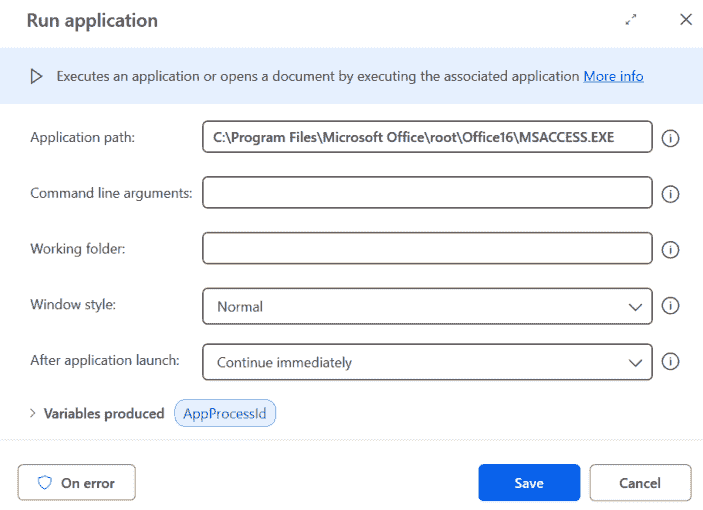

图 19.18 - 添加 Microsoft Access 路径

4. 在**命令行参数**（Command line arguments）框中，添加联系人数据库的路径。你可以使用**资源管理器**导航到文件夹，右键点击数据库文件，并选择**复制为路径**。

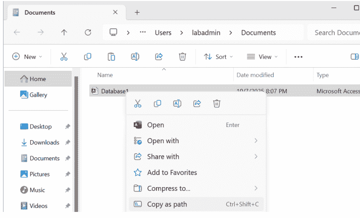

图 19.19 - 复制数据库的路径

5. 将该值粘贴到**命令行参数**框中，如图 19.20 所示：

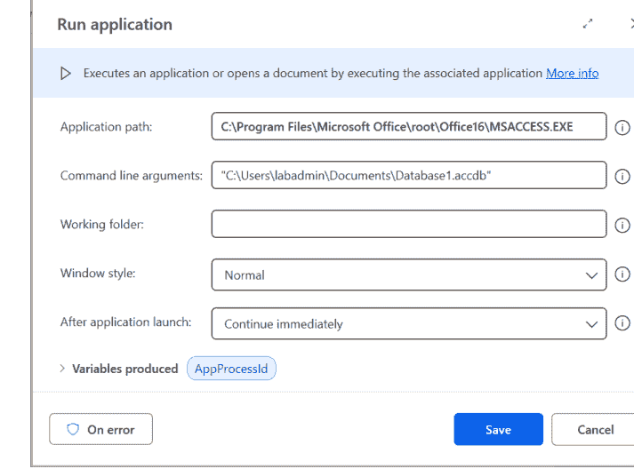

图 19.20 - 将数据库路径作为参数添加

6. 在“窗口样式”（Window style）下，选择“最大化”（Maximized）。

7. 点击“保存”保存该步骤。

此时，你已经配置了桌面流来启动 Microsoft Access 并打开正确的数据库文件。

### 运行 Power Automate 录制器

现在，我们准备好开始捕捉构成流的基本动作。让我们开始吧！

1. 确保桌面上没有显示不必要的桌面应用程序。你可以退出或最小化它们，以免它们干扰录制。

> 注意：不要关闭已打开 Power Automate 的浏览器窗口。我们稍后的步骤中会返回那里，所以我们要确保一切准备就绪。

2. 在 Power Automate 应用打开的情况下，点击菜单栏上的“录制”启动录制器。

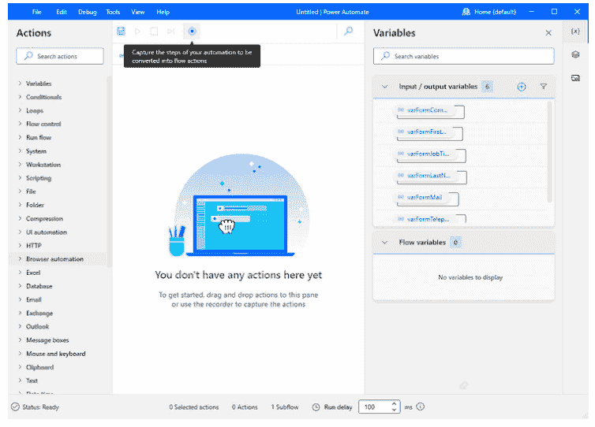

图 19.21 - 启动 Power Automate 录制器

3. 确保联系人数据库已最大化，并关闭所有其他窗口（浏览器和 Power Automate 应用），以防止弹出窗口占用焦点。

4. 点击应用中的录制按钮。从此时点起，Power Automate 录制器将捕捉你在桌面上执行的每项活动。

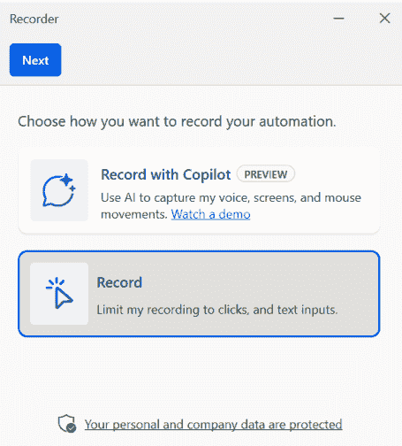

5. 点击“下一步”，然后点击“录制”开始录制。

6. 移动录制器以防遮挡。

7. 点击“新联系人”按钮。

8. 为名、姓、公司、职位、电子邮件和电话字段添加占位数据。点击选择每个字段。

> 注意：每次按键都会被录制，因此请谨慎输入。你只需要占位信息，因为我们将编辑步骤并将文本替换为变量。速度要慢一点，以便录制器捕捉你的点击操作。注意当你悬停并选择字段时周围的红色高亮。这是录制器捕捉的关键数据。

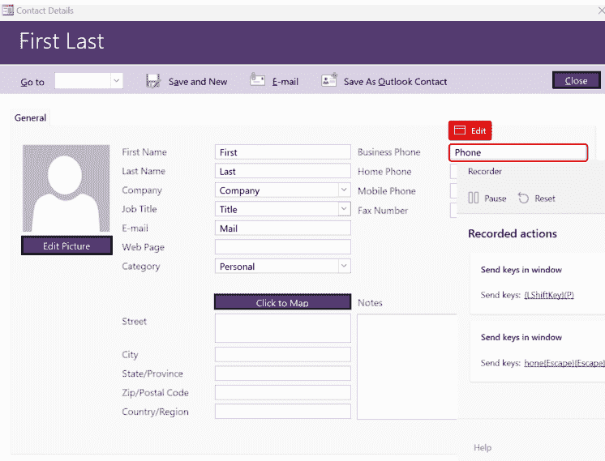

图 19.23 - 向联系人条目添加数据

9. 在联系人详情页面点击“关闭”。

10. 点击“关闭”退出 Microsoft Access。

11. 在 Power Automate 录制器上点击“完成”。

你应该返回到了 Power Automate Desktop 设计界面。主窗口显示了你在编辑表单时执行的所有操作。仔细检查列出的操作。如果你发现任何位置不当或以任何方式会干扰流自动化运行的操作（例如关闭另一个应用程序、移动窗口或点击无关字段），可以选择该操作并按键盘上的 `Delete` 键删除，或展开省略号并点击删除。

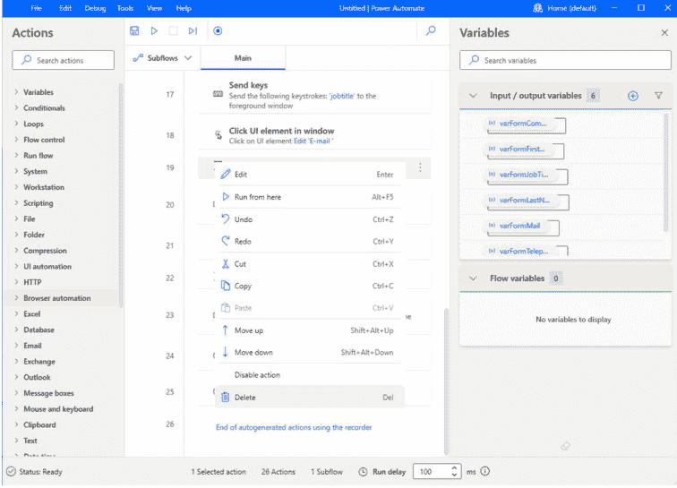

图 19.24 - 检查操作

12. 删除错误项后，梳理最终步骤集，以确保它们逻辑合理且所有步骤都已在内。如果不小心删除了或更改了步骤顺序，可以按 `Ctrl + Z` 撤销。你可以通过拖放来重新排序步骤，并复制粘贴步骤。

356

### 更新变量

当你检查这些步骤时，应该已经看到了你所选择并输入占位符文本的文本框（例如 `First Name`）。在本节中，我们将介绍将占位符文本替换为你在“配置流”部分创建的输入变量的过程：

1. 找到 `Send keys`（发送按键）操作的实例，它对应于录制过程中向“Contact Details”表单上的 `First Name` 字段输入占位符文本值。

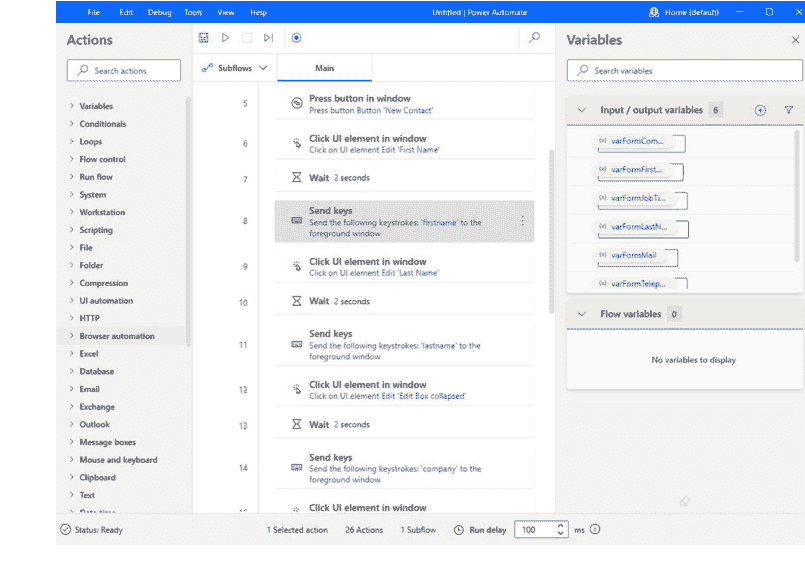

2. 双击该条目。

3. 在 `Send keys` 窗口中，选择占位符文本（在本例中值为 `firstname`）。

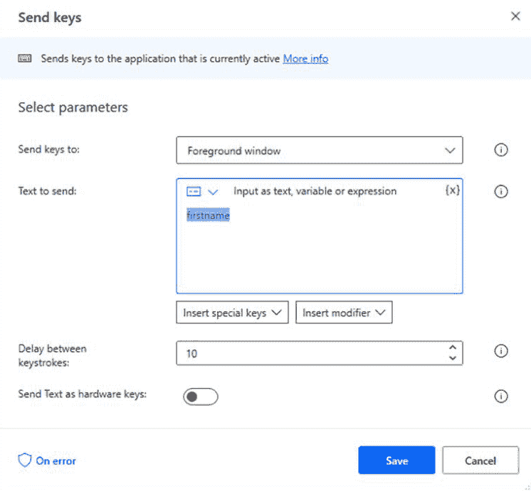

图 19.26 – 编辑 `Send keys` 数据

4. 在 `Text to send`（要发送的文本）文本框的右上角，选择变量图标，图标由 `{x}` 表示）。

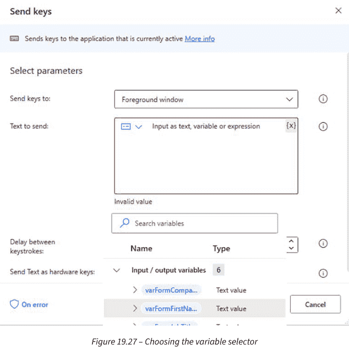

5. 从显示的输入变量列表中，选择代表 `First Name` 值的变量。在这种情况下，变量名为 `varFormFirstName`。双击变量或点击 `Select`（选择）以确认你的选择。

6. 验证 `Text to send` 框中的数据已更新为 `%varFormFirstName%`，如图 19.28 所示：

### Send keys

向当前激活的应用程序发送按键更多信息

### Select parameters

| 字段 (Field) | 值 (Value) |
| :--- | :--- |
| Send keys to: | |
| Text to send: | |
| Input as text, variable or expression (作为文本、变量或表达式输入) | `%varFormFirstName%` |
| Delay between keystrokes (按键之间的延迟): | |
| Send Text as hardware keys (作为硬件按键发送文本): | |
| On error (出错时) | |

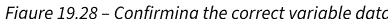

7. 点击 `Save`（保存）。

8. 对对应姓、公司、职位、电子邮件地址和电话号码的其余变量重复此系列步骤。

9. 在 Power Automate 设计器中点击 `Save`。

10. 退出 Power Automate 设计器。

恭喜！你已经录制了一个流。现在，我们将返回 Power Automate Web 门户并完成该流。

### 完成流

现在你已经已经在桌面流中创建了所有的输入变量，现在是时候更新云流，将 Microsoft Forms 数据的动态内容令牌发送到相应的桌面流输入变量了。

360

使用 RPA 写入 Access 数据库

开始吧！

1. 在浏览器中打开 `Add Connect to Access Database` 流后，等待流更新。如果它没有自动更新，点击 `Save`。来自桌面流的变量应该会被填充。参见图 19.29。

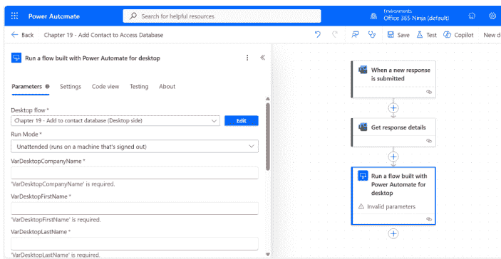

图 19.29 - 编辑流以更新变量

2. 从列出的第一个输入变量开始，点击文本框并选择来自 `Get response details` 操作中对应变量的动态内容。

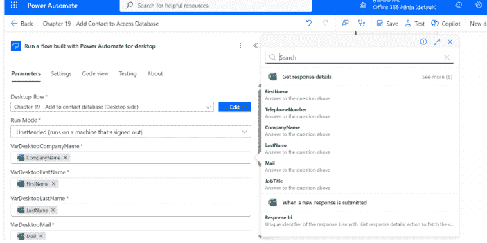

图 19.30 - 将动态内容链接到相应的桌面输入变量

3. 为每个变量重复此过程。

# 19 

361

4. 完成后点击 `Save`。

5. 关闭浏览器窗口，并确保执行桌面流的机器上没有运行其他应用程序。

你已经完成了桌面流的配置。现在，来测试它。

### 测试流

正如在“配置前提条件”部分提到的，建议在独立于执行桌面流计算机的设备上启动此流。如果可能，你希望同时访问两台设备，这样你就可以在一台设备上启动流，并在另一台设备上观察桌面流的执行。这将帮助你收集故障排除所需的数据。

按照以下步骤测试流：

1. 在另一台计算机上，打开浏览器。

2. 导航到 Power Automate Maker Web 门户 (`https://make.powerautomate.com`)。

3. 点击 `My flows`（我的流），选择 `Add Contact to Access Database` 流并点击 `Edit`（编辑）。

4. 点击 `Test`（测试）打开测试面板。

5. 选择 `Manually`（手动）单击按钮，然后点击 `Save & Test`（保存并测试）。

6. 打开另一个浏览器标签页并导航到 Microsoft Forms 门户 (`https://forms.office.com`)。选择 Customer Data Intake 表单

7. 在菜单栏上选择 `Preview`（预览）。

8. 使用唯一且易于识别的测试数据填充表单，然后点击 `Submit`（提交）。

此时，你可以切换回 Power Automate 浏览器窗口并查看步骤的输出。

### 验证流

验证桌面流成功完成的最简单方法是实时观察桌面流的执行（取决于你选择了 `Attended`（受托管的）还是 `Unattended`（非托管的））。在执行过程中（如果你是受托管流），你应该能够看到以下操作发生：

- Microsoft Access 应用程序启动并打开 Contacts 数据库
- 点击 `New`（新建联系人）按钮
- 在每个字段中输入文本
- 点击 `Close`（关闭）按钮
- Microsoft Access 应用程序关闭

你也可以自己打开 Contact 数据库来验证流，确认数据与你在 Customer Data Intake 表单中输入的内容匹配：

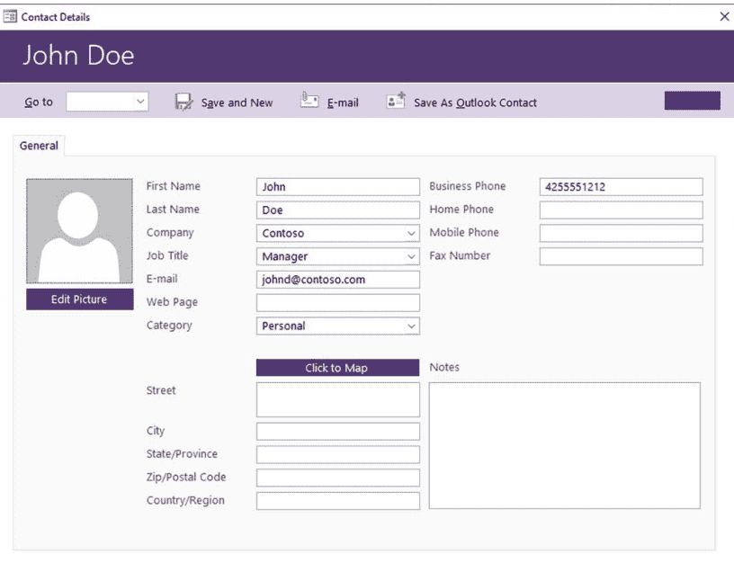

图 19.31 – 查看通过 Power Automate Desktop 流输入的联系人

如果你尝试观察非托管流，你可能会收到此错误：

图 19.32 – 非托管的错误

如果你尝试观察非托管流，你可能会收到此错误：

图 19.32 – 非托管的错误

如果你尝试观察非托管流，你可能会收到此错误：

图 19.32 – 非托管的错误

如果你尝试观察非托管流，你可能会收到此错误：

图 19.32 – 非托管的错误

如果你尝试观察非托管流，你可能会收到此错误：

图 19.32 – 非托管的错误

如果你尝试观察非托管流，你可能会收到此错误：

图 19.32 – 非托管的错误

如果你尝试观察非托管流，你可能会收到此错误：

图 19.32 – 非托管的错误

如果你尝试观察非托管流，你可能会收到此错误：

图 19.32 – 非托管的错误

如果你尝试观察非托管流，你可能会收到此错误：

图 19.32 – 非托管的错误

如果你尝试观察非托管流，你可能会收到此错误：

图 19.32 – 非托管的错误

如果你尝试观察非托管流，你可能会收到此错误：

图 19.32 – 非托管的错误

如果你尝试观察非托管流，你可能会收到此错误：

图 19.32 – 非托管的错误

如果你尝试观察非托管流，你可能会收到此错误：

图 19.32 – 非托管的错误

如果你尝试观察非托管流，你可能会收到此错误：

图 19.32 – 非托管的错误

如果你尝试观察非托管流，你可能会收到此错误：

图 19.32 – 非托管的错误

如果你尝试观察非托管流，你可能会收到此错误：

图 19.32 – 非托管的错误

如果你尝试观察非托管流，你可能会收到此错误：

391
