# 20 使用 RPA 自动化网页页面

Power Automate 的浏览器自动化功能将机器人流程自动化（RPA）直接带入现代工作区。使用 Power Automate Desktop，你可以记录、编写并重放诸如点击、表单提交、导航和数据提取等浏览器操作。这使得执行基于网页的任务成为——从登录门户到收集报告或根据网站更改触发工作流。它是传统自动化与日益增长的网页交互需求之间的桥梁。

通过本章的示例，你学习了如何将云流与桌面集成，为应用程序记录步骤并在环境之间传递变量——这些对你的需求非常有用。

# 使用 RPA 写入 Access 数据库

1. 在浏览器中打开 `Add Connect to Access Database` 流后，等待流更新。如果它没有自动更新，点击 `Save`。来自桌面流的变量应该会被填充。参见图 19.29。

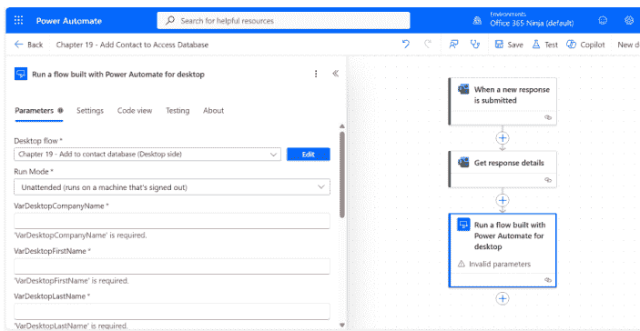

图 19.29 - 编辑流以更新变量

2. 从列出的第一个输入变量开始，点击文本框并选择来自 `Get response details` 操作中对应变量的动态内容。

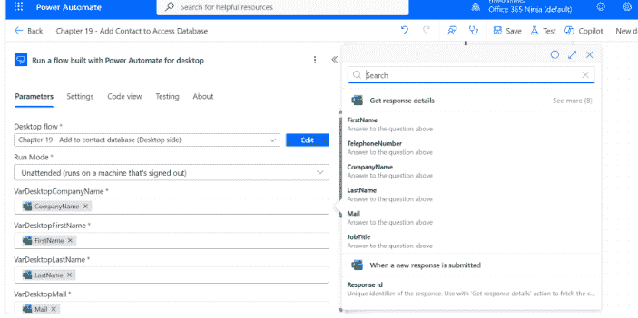

图 19.30 - 将动态内容链接到相应的桌面输入变量

3. 为每个变量重复此过程。

4. 完成后点击 `Save`。

5. 关闭浏览器窗口，并确保执行桌面流的机器上没有运行其他应用程序。

你已经完成了桌面流的配置。现在，来测试它。

通过自动化这些浏览器任务，你可以节省时间、减少错误，并在现代和遗留环境中创建更具一致性的数字流程。

你还可以构建一种浏览器交互，从网站上收集数据（这一过程被称为网页爬取）。有许多演示网站可以供你练习网页爬取技术，例如：

- `web-scraping.dev`: https://web-scraping.dev
- `Web Scraper`: https://webservices.io/test-sites
- `ToScrape`: https://toscope.com
- `Scrape This Site`: https://www.scrapethissite.com

你甚至可以在 Amazon、MSN 或 Yahoo! 等热门网站上进行学习。

在本章中，我们将构建一个流，用于创建浏览器的交互，该流将处理几个常见任务：

- 导航网页
- 输入数据
- 爬取数据
- 截屏

让我们开始吧！

## 导航网页

在构建向网页发送数据或从网页检索数据的流程之前，你将需要学习如何让机器人流程自动化（RPA）与浏览器交互的基础知识。

我们将通过以下步骤涵盖导航网页的基本知识：

1. 启动 Power Automate Desktop 应用程序。
2. 点击“新建”，然后选择“流”。
3. 在“创建流”页面上，输入流名称并点击“创建”。
4. 流程加载后，在“操作”窗格中，展开“浏览器自动化”，然后选择“启动新的 Microsoft Edge”。将其拖到“主画布”区域。

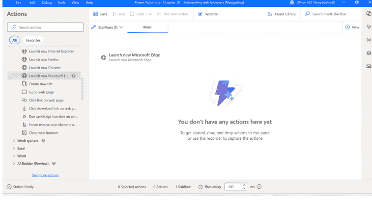

图 20.1 - 添加“启动 Microsoft Edge”操作

5. 在“启动新的 Microsoft Edge”屏幕上，点击“初始 URL”字段内部。输入一个网站网站地址，例如 https://www.yahoo.com。
6. 点击“保存”。
7. 点击“运行”按钮。

到此为止，一切顺利！你现在已经启动了一个浏览器会话！关闭浏览器窗口并返回 Power Automate Desktop 应用。

接下来，我们将查看如何从网页上爬取（收集）数据。

## 爬取数据

爬取数据是一项用于广泛目的常见活动——特别是当无法通过 API 轻松获取结构化数据时。一些常见用途包括：

- 市场和竞品研究，例如跟踪新产品、价格变化、促销活动和客户评论
- 为机器学习收集数据
- 跟踪突发新闻
- 监控品牌声誉
- 与多个平台和来源进行数据对比
- 构建聚合工具或网站，如 Zillow、Kayak 或 Apartments.com

### 爬取单页

在本节中，我们将使用 Edge 浏览器和录制器进行一些基础爬取操作。

要开始爬取，我们需要一些示例数据。对于这个练习，我们将从本章之前列出的示例网站之一提取数据。我们要关注的页面包含电子商务商店中以表格格式排列的项目列表，如图 20.2 所示。

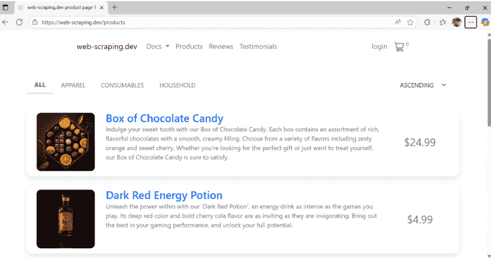

完成页面后，我们将数据保存到 Excel 文件中。让我们开始吧！

1. 启动一个新的 Microsoft Edge 浏览器会话并导航到 https://web-scraping.dev/products。
2. 返回 Power Automate Desktop，并打开上一个练习中的示例流。它应该有一个操作——`启动新的 Microsoft Edge`。
3. 双击 `启动新的 Microsoft Edge` 操作。将初始 URL 更新为 https://web-scraping.dev/products。
4. 将“窗口状态”设置为“最大化”。

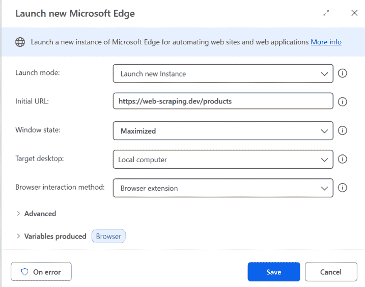

图 20.3 – 配置浏览器会话设置

5. 点击“保存”。
6. 在“操作”窗格中，选择“从网页上提取数据”并将其拖到画布上。
7. 接受默认值。
8. 在任务栏上，选择你已打开的 Edge 浏览器会话。你会注意到“实时网页助手”应用程序打开了并获取了焦点。该应用程序将在你移动页面上移动鼠标时，通过在每个元素周围放置红色边框，帮助你识别你想要爬取的字段。

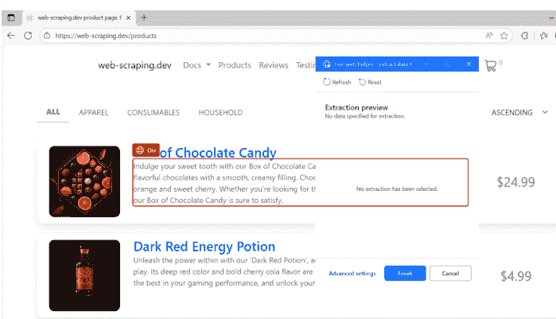

图 20.4 – 使用网页助手突出显示内容

9. 悬停在产品名称上，例如 `Box of Chocolate Candy`，然后右键点击它。指向“提取提取元素值”，然后选择下一个项目`文本`（'Box of Chocolate...'），并点击它。该项目名称将用绿色虚线框突出显示。

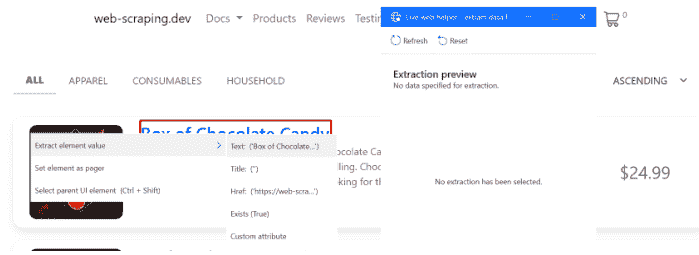

图 20.5 – 选择第一个元素

10. 重复该过程，选择该电子商务网站上的项目标题 `Dark Red Energy Potion`。注意其他相同类型的示例元素是如何被选中并显示在提取预览下的。网页助手应用程序已检测到模式，并将处理该数据。
11. 再次重复该过程，这次突出显示巧克力盒的价格。右键点击价格，指向“提取元素值”并选择`文本`（'$24.99'）。
12. 再次悬停在项目标题（Box of Chocolate Candy）上，右键点击它，指向“提取元素值”并选择 Href（'https://web-scra...'）。注意实时网页助手中的所有值都已填充。

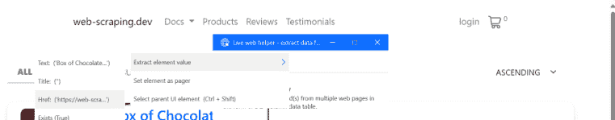

图 20-6 - 添加项目的 URL

13. 点击“完成”。
14. 在“从网页上提取额外数据”操作中点击“保存”。
15. 点击流中的“运行”。一个浏览器窗口应该会启动。片刻后，返回 Power Automate Desktop 应用的“变量”窗格。
16. 在“变量”窗格中，你应该能在“流变量”下看到名为 `DataFromWebPage` 的新数据。双击它以查看返回到 Power Automate Desktop 的值。

恭喜！你已经爬取了你的第一个网页！

接下来，我们将学习一种处理多个页的方法。

### 使用默认分页器爬取多个页面

大多数网站会将内容分多个多个显示（通常每页有固定数量的项目）。这个过程被称为分页。在爬取数据时，你可能希望检索多个页的数据。你可以使用称为“分页器”的东西来实现此。

让我们看看它是如何工作的！

1. 在 Power Automate Desktop 打开的状态下，双击“从网页上提取数据”操作。
2. 返回你的网页。实时网页助手应该会重新打开。
3. 在实时网页助手上，点击“高级设置”按钮。

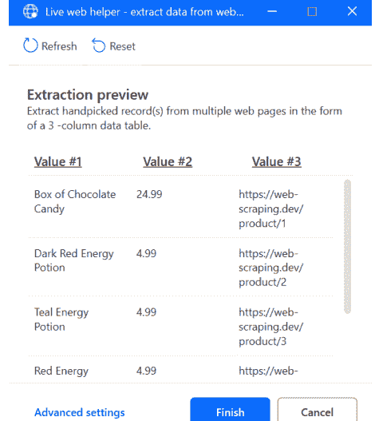

图 20.7 – 启动高级设置

4. 将“使用”切换置到“开启”。
5. 点击“确定”。
6. 在网页上，点击“下一页”按钮（在这个示例页面上，它是一个 `>` 符号）。右键点击它并选择“将元素作为分页器”。参见图 20.8。

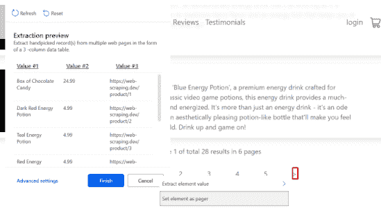

图 20.8 – 设置分页器

7. 点击“完成”返回流。
8. 在“从网页上提取数据”操作中，选择“提取数据从”下拉菜单并选择“可用”。
9. 将“物理点击下一页”切换置到“开启”。
10. 点击“保存”。
11. 将“关闭浏览器”操作拖到流的末尾。
12. 点击“运行”。

观察流的执行。它应该启动浏览器。滚动到页面底部，点击分页器，直到没有更多。你可以通过查看变量窗格来验证这一点。

### 使用 LoopIndex 爬取多个页面

然而，如果你遇到不规则的网页，或者页面元素没有按预期工作（例如，它从未到达末尾，或者示例页面上有错误），仍然有方法！

这种方法稍微复杂，涉及一个循环。让我们来看看！

1. 在打开你的爬取流时，选择“从网页上提取数据”操作并进行编辑。
2. 切换浏览器窗口以加载网页助手应用。
3. 点击高级设置并将“使用”切换置到“关闭”，以禁用 Power Automate 分页器。
4. 点击“完成”返回 Power Automate 应用。
5. 在“操作”窗格中，搜索“循环”操作。
6. 将其拖到步骤 1（启动新的 Microsoft Edge）和步骤 2（从网页上提取数据）之间。
7. 在“循环”操作页面上，将“从开始值”设置为 1，“结束值”设置为 1000000，然后将“增量值”设置为 1。参见图 20.10。

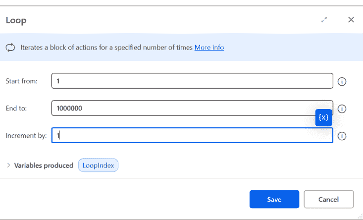

图 20.10 - 添加循环操作

8. 点击“保存”。

9. 将“从网页提取数据”操作移动到“循环开始”和“循环结束”步骤之间，如图 20.11 所示。

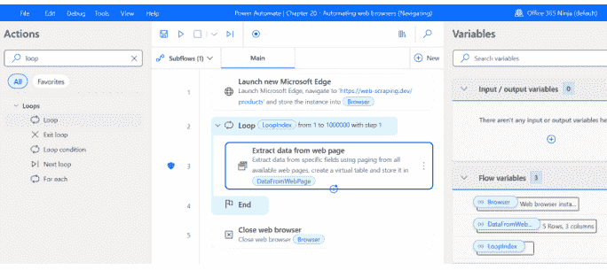

图 20.11 – 移动“从网页提取数据”操作

10. 在“从网页提取数据”操作之后和“循环结束”操作之前，添加“如果网页包含”操作。
11. 选择 UI 元素下拉列表。

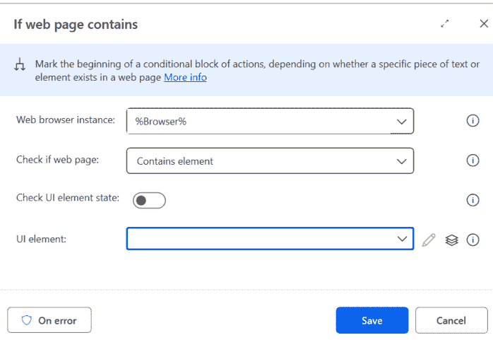

图 20.12 – 选择 UI 元素下拉列表

376 使用 RPA 实现网页自动化

12. 点击“添加 UI 元素”以启动 UI 元素拾取器。
13. 切换到带有示例页面的网页浏览器。
14. 按住键盘上的 Control 键，然后选择 `>` 符号（表示下一页）。这将被添加到“如果网页包含”操作的 UI 元素部分，如图 20.13 所示。

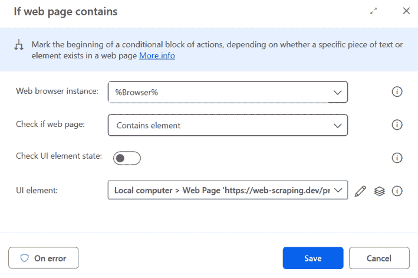

图 20.13 - 更新 UI 元素

15. 点击铅笔图标编辑 UI 元素。
16. 滚动到“锚点元素”并选择 Href 属性。

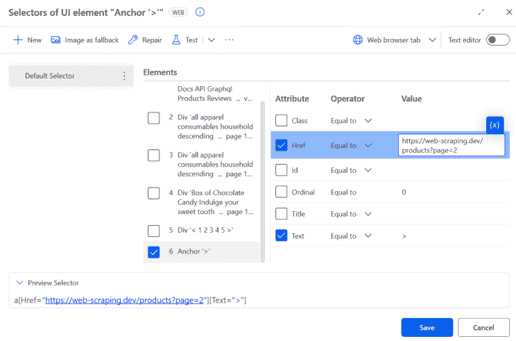

图 20.14 – 选择 Href 元素

17. 将 Href 运算符设置为“包含”（Contains）。
18. 将 Href 值更新为 `=`。点击保存。

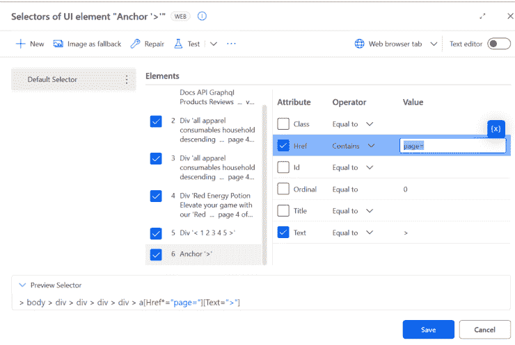

图 20.15 – 更新 HREF 元素

19. 点击保存以关闭“如果网页包含”操作。
20. 在“如果网页包含”操作之后立即添加“点击网页上的链接”操作。
21. 在“点击网页上的链接”操作中，在 UI 元素下选择锚点元素。
22. 点击保存。
23. 在“点击网页上的链接”操作之后立即插入“否则”（Else）操作。
24. 在“否则”操作之后立即插入“退出循环”操作。见图 20.16。

25. 将“启动 Excel”操作作为第 2 步，放在 Microsoft Edge 和“循环”操作之间。将“实例可见”设置为“关闭”（Off）。点击保存。

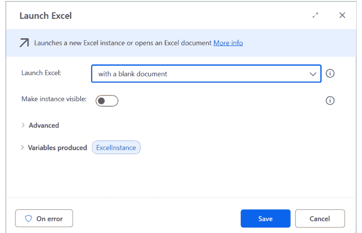

图 20.17 – 配置“启动 Excel”操作

26. 在“循环”操作内部，在“从网页提取数据”操作之前立即添加“从 Excel 中获取第一列/第一行”操作。接受变量 FirstColumn 和 FirstRow 的默认值。
27. 在“从网页提取数据”之后，添加“写入 Excel”操作。
28. 在“要写入的值”字段中，添加 `%DataFromWebPage%`。
29. 在“列”字段中，输入 `A`（代表第一列）。
30. 在“行”字段中，添加 `%FirstRow%` 变量。见图 20.18。

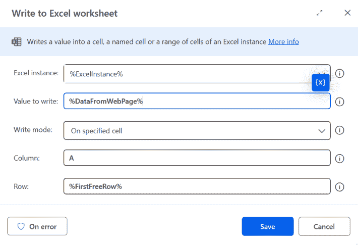

图 20.18 - 配置“写入 Excel”工作表

31. 将 Excel 操作拖到“关闭网页浏览器”操作之后。
32. 在“关闭 Excel 之前”字段中，选择“另存为”（Save as）。
33. 在“文档路径”中，输入工作站硬盘上的一个路径，例如 `C:\Temp\Demo.xlsx`。
34. 点击保存。
35. 最后，将“停止”操作拖到流程的最末端。
36. 点击保存图标保存浏览器自动化流。
37. 点击“运行”以执行流程。

流程运行后，检查你指定的保存文件位置的位置。用 Excel 打开文档并查看数据。

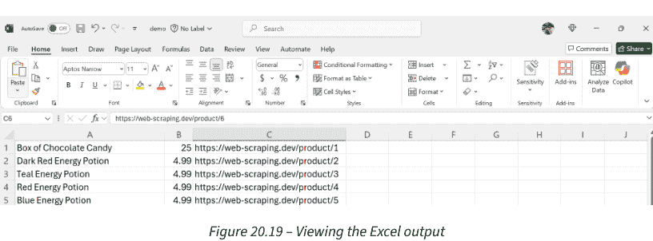

接下来，我们将向流程中添加数据输入。

### 输入数据

当你的浏览器打开示例网站 https://web-scraping.dev 时，点击“登录”链接查看该页面的凭据：

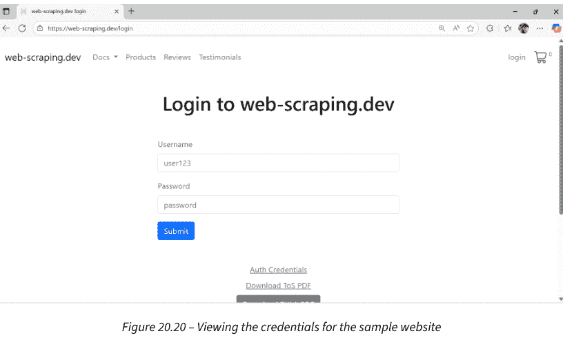

在此练习中，我们将把凭据存储在变量中，然后按照以下步骤登录网站：

1. 在打开 Power Automate 流程的情况下，将“设置变量”操作拖到流程中第一步之前。
2. 将变量名更新为 `username`，并将值更新为 `user123`。
3. 点击保存。
4. 在步骤 2 添加另一个“设置变量”操作，直接跟在第一个“设置变量”操作之后。
5. 将变量名更新为 `password`，并将值更新为 `password`。
6. 在“关闭网页浏览器”之前添加“转到网页”操作。
7. 在“转到网页”操作上，将 URL 字段设置为 https://web-scraping.dev/login。

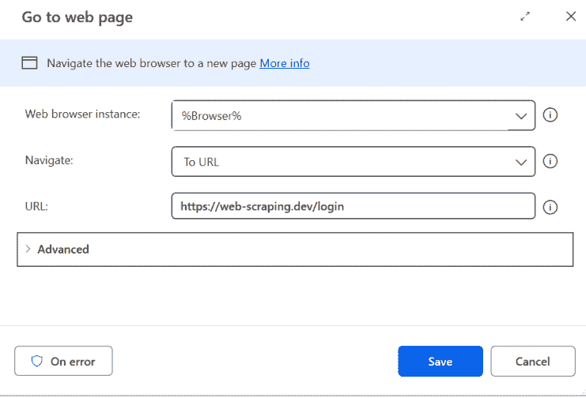

图 20.21 – 更新浏览器 URL

8. 点击保存。
9. 在“转到网页”和“关闭网页浏览器”操作之间，添加“在网页上填充文本字段”操作。
10. 点击 UI 元素下拉列表，然后选择“添加 UI 元素”。

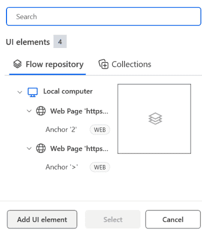

图 20.22 - 添加 UI 元素

11. 切换回带有登录页面的浏览器会话。
12. 打开 UI 元素拾取器的情况下，按住 Control 键并左键点击用户名字段。
13. 在“文本”字段中，添加 `%username%` 变量。
14. 在“关闭网页浏览器”之前添加“在网页上填充文本字段”操作。

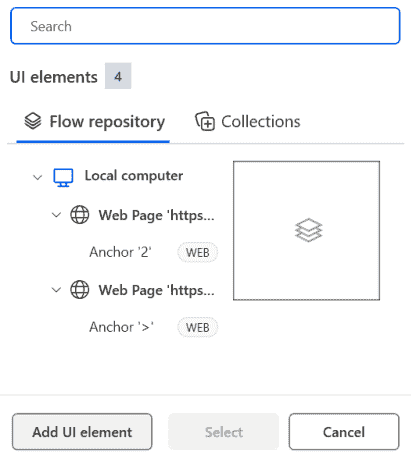

图 20.23 - 添加 UI 元素

15. 切换回浏览器会话。
16. 在 UI 元素拾取器打开的情况下，按住 Control 键并左点击密码字段。
17. 在“文本”字段中，添加 `%password%` 变量。
18. 在“关闭网页浏览器”之前添加“在网页上填充文本字段”操作。
19. 点击 UI 元素下拉列表并选择“添加 UI 元素”。
20. 按住 Control 键并左点击“提交”按钮。保存。

点击“运行”启动流程。

最后，让我们查看截图的操作。

### 截图

在 Power Automate Desktop 中，你可以针对浏览器会话或整个工作站显示进行截图。按照以下步骤配置截图操作，以日期生成的名称保存文件。

1. 在打开 Power Automate 流程的情况下，将“获取当前日期和时间”操作拖到“点击网页上的按钮”之后。点击保存。
2. 从操作面板中，将“日期转换为文本”操作拖到“获取当前日期和时间”和“关闭网页浏览器”之间。

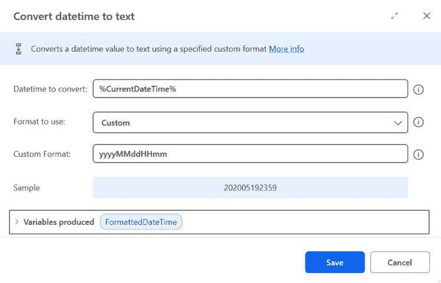

图 20.24 – 配置日期转换为文本操作

3. 在“要转换日期”字段中，添加 `%CurrentDateTime%` 变量。
4. 在“使用格式”字段中，选择“自定义”。
5. 在“自定义格式”区域输入 `yyyyMMddHHmm`，配置四位年份、两位月份、两位小时和分钟。点击保存。
6. 在“日期转换为文本”和“关闭网页浏览器”之间添加“设置变量”操作。
7. 将变量更新为 `filename`。
8. 将值更新为 `%FormattedDateTime_%screenshot.png` 并点击保存。

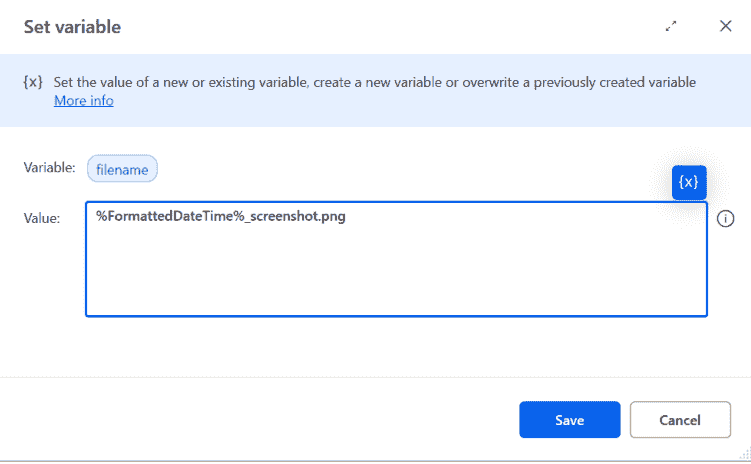

图 20.25 – 更新“设置变量”操作

9. 从操作面板中，将“工作站”部分的“截图”操作拖到“设置变量”和“关闭网页浏览器”所在的画布上。
10. 在“保存截图到”下拉列表中，选择“文件”。
11. 在“图像文件”字段中，添加 `C:\temp\%filename%` 变量。
12. 将“图像格式”下拉列表设置为 PNG。

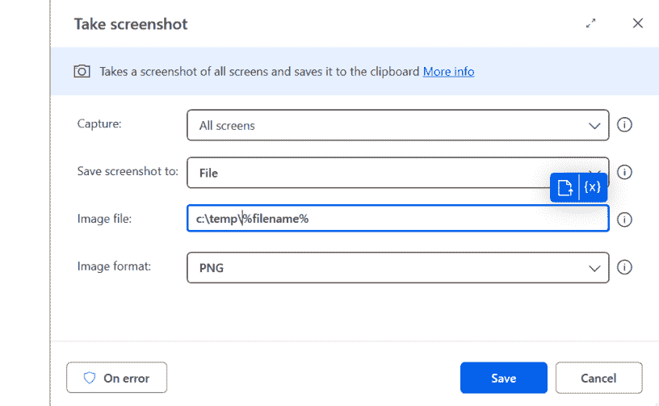

13. 点击保存。

流程运行后，你应该在指定的文件夹中同时拥有一个 Excel 文档和一个截图。

# 获取本书的 PDF 版本及专属额外内容

扫描二维码（或访问 `packptub.com/unlock`）。按名称搜索此书，确认版本，然后按照页面上的步骤操作。

注意：请妥善保存发票。直接从 Packt 购买不需要发票。

