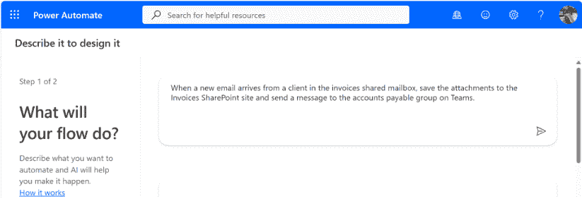
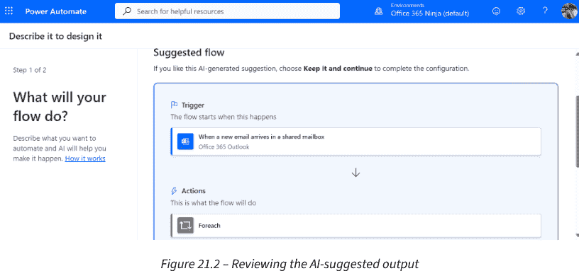
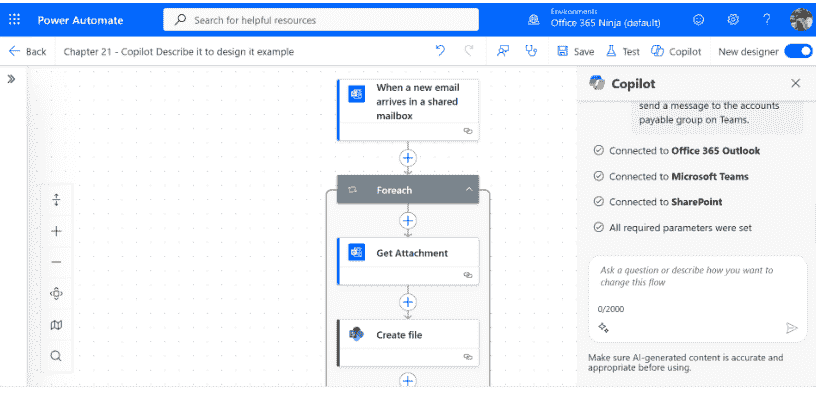
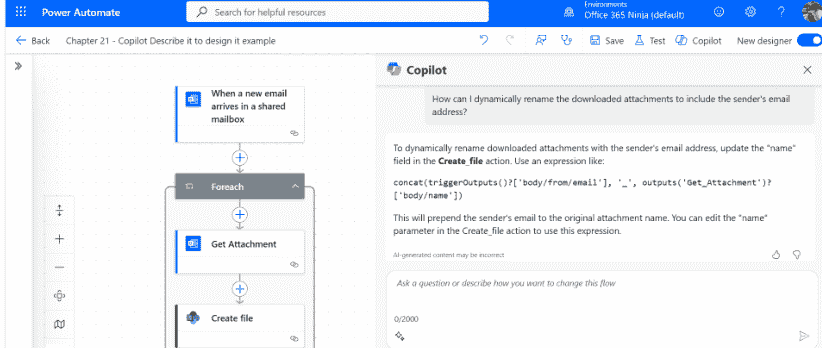
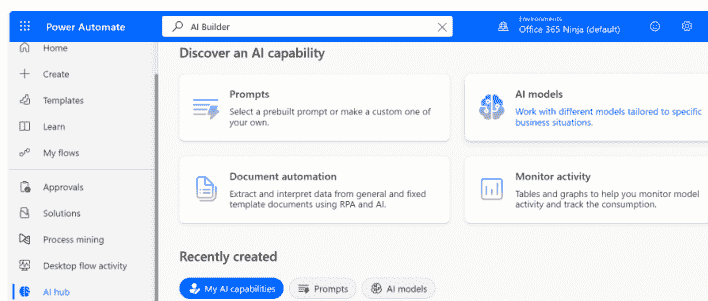
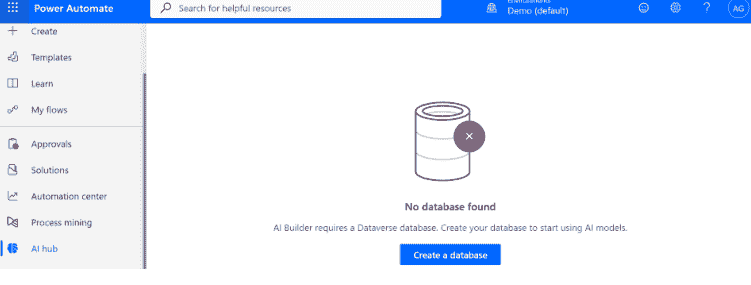
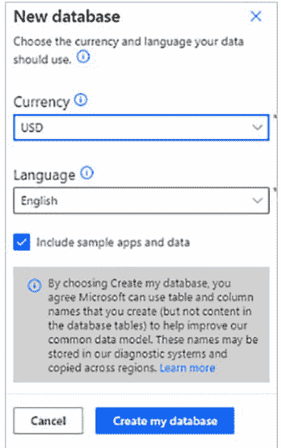
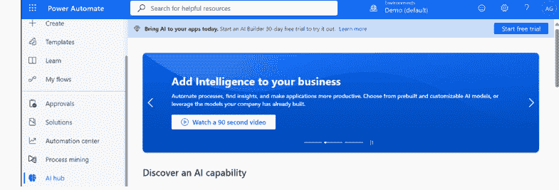
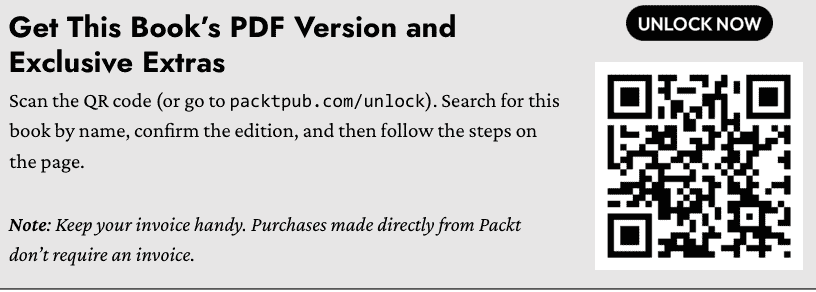

# 介绍 AI 模型和生成式 AI

在本书的示例中，你已经使用条件来确定执行流的哪个分支。你使用过如下条件：

- 购买请求金额是否大于 $1,000 美？
- 用户的 X/Twitter 粉丝数是否多于或少 100 人？
- 审批响应是否等于已批准（Approved）？

当你处理硬性数据（数字、布尔值或精确字符串匹配）时，这类评估非常有用。但当你尝试根据不那么直观的数据做出决策时，会发生什么呢？

这就是 AI 模型变得有用的地方。AI 模型利用人工智能对各种不同的内容和数据类型进行判断。例如，人类阅读名片并确定哪个值是个人姓名、哪个值是个人职位非常容易，无论它们位于名片的什么位置。然而，对于计算机来说，完成这项任务要困难得多。随着名片设计的不断变化，数据字段会移动，传统的自动化引擎更难识别和辨别它们。AI 模型帮助为数据带来上下文感知，使自动化执行得更像人类。

## 介绍 AI 模型和生成式 AI

Microsoft Power Automate 包含了多个预构建的 AI 模型，还具有训练和自定义多个额外模型的能力。预构建模型聚焦于已经通过特定数据集预训练以执行特定类型任务的 AI，而自定义模型则需要更多的配置以及使用你自己的数据集进行训练。Power Automate 允许你使用最新的生成式 AI 技术（如 ChatGPT、Azure OpenAI 和 Copilot）来增加创意，并帮助解释细微的内容。

在本章中，我们将重点学习 Power Platform 中 AI 的广阔能力，并准备你的环境以开始使用 AI。我们将涵盖的主题如下：

- 学习 AI 模型
- 学习生成式 AI
- 探索用于 Power Platform 的 Copilot
- 技术要求

让我们开始吧！

### 学习 AI 模型

Power Platform 中提供了许多类型的模型，涵盖了广泛的数据类型和场景。你可以使用模型来分析文本并扫描文档、图像、电子邮件或你可以提供给服务的任何其他类型的输入。

表 21.1 中的数据描述了模型设计工作的内容类型、模型名称、模型的构建类型（是预构建模型还是自定义模型）以及示例的业务用例。

| 模型名称 | 数据类型 | 构建类型 | 业务案例 |
|---|---|---|---|
| 名片读取器 | 文档 | 预构建 | 名片扫描 |
| 表单处理 | 文档 | 自定义 | 职位申请处理 |
| 文本识别 | 文档 | 预构建 | 识别犯罪现场照片中的文本 |
| 收据处理 | 文档 | 预构建 | 自动生成报销单 |
| 类别分类 | 文本 | 预构建或自定义 | 焦点小组反馈分类 |
| 实体提取 | 文本 | 预构建或自定义 | 从产品或服务评论中提取见解 |

| 模型名称 | 数据类型 | 构建类型 | 业务案例 |
|---|---|---|---|
| 关键短提取 | 文本 | 预构建 | 获取提及品牌的新闻或社交媒体帖的警报 |
| 语言检测 | 文本 | 预构建 | 识别提交文本的语言 |
| 情感分析 | 文本 | 预构建 | 分类正面和负面的客户反馈 |
| 文本翻译 | 文本 | 预构建 | 将电子邮件支持请求翻译为支持工程师的语言 |
| 预测 | 结构化数据 | 自定义 | 欺诈交易告警 |
| 图像分类 | 图像 | 自定义 | 识别客户上传图像中的不当内容 |
| 目标检测 | 图像 | 自定义 | 通过拍照快速识别车间地面机器的类型 |

表 21.1 – AI 模型类型

每个模型都有自己的优势。根据业务目标，你可能甚至需要使用多个 AI 模型来完成端到端的处理。

### 学习生成式 AI 模型

Power Automate 对生成式 AI 的集成——特别是通过 Copilot 和基于生成式预训练转换器 (GPT) 的模型——改变了自动化的设计、部署和维护方式。

如果你使用 ChatGPT 等生成式 AI 工具，你已经熟悉该技术的一些功能。就像 ChatGPT 一样，Power Platform 中的生成式 AI 操作是由提示（prompts）驱动的——即用户可以向模型调用创意的自然语言问题或指令。

生成式 AI 还增强了现有流的智能性。通过 GPT 集成，Power Automate 可以分析上下文数据、总结长内容、生成适应响应，甚至自动编写自然语言电子邮件或报告。例如，流可以从客户支持系统中提取信息，总结工单活动，并起草每周状态报告供评审。同样，AI 驱动的情感分析、文本分类和数据提取允许做出更明的决策——根据语气、紧急性或检测到的意图优先处理任务、路由请求并升级问题。这实现了从纯静态、基于规则的自动化向自适应、上下文感知自动化的转变。

你可以将 GPT 驱动的操作直接嵌入到流中，引入内容生成、翻译或总结等功能。结果是结合了传统的确定性过程自动化与高级推理及创意的工具——这允许组织超越重复性任务自动化，进入业务流程的智能编排。

### 探索用于 Power Platform 的 Microsoft Copilot

除了使用生成式 AI 为流生成内容外，你还可以使用 Microsoft Copilot AI 平台帮助加速自动化的开发。

与其手动配置每个条件、操作和连接器，Copilot 会智能地生成一个运行的流。例如，你可以输入“当发票共享邮箱箱收到来自客户的新邮件时，将附件保存到发票 SharePoint 站点并向 Teams 上的应付账组发送消息”，Power Automate 将逐步构建该自动化流程。

图 21.1 – 通过 Copilot 的“描述它 (Describe it)”功能创建流

几刻之后，Copilot 将返回一个建议，如图 21.2 所示：

该过程可能会生成几个示例。如果你发现了一个想要开始的示例，可以选择“保留并继续”，你将被带到带有流的画布。

你只需要更新操作以指向正确的邮箱箱、站点或组。

Copilot 甚至可以根据组织模式或过去的使用情况推荐优化、识别缺失的触发器并建议额外的集成。这种对话方法允许所有技术水平的用户在几分钟而不是几小时内实现复杂工作流的自动化。例如，你可以向 Copilot 实际关于流的问题。

在图 21.14 所示的示例中，我们要求 Copilot 提供动态重命名附件的方法，将发送者的电子邮件地址作为文件名：

图 21.14 – 让 Copilot 提出建议

Power Automate 的生成式 AI 能力扩展到了流程理解和精炼。通过流程挖掘和任务挖掘的帮助，AI 可以分析工作在组织内部实际发生的方式——识别出用于自动化的重复性手动步骤。Copilot 通过生成建议的流流来协助简化这些流程，有效地将业务活动转化为可操作的蓝图。这不仅缩短了发现自动化机会所需的时间，还确保自动化反映了真实的用户行为，从而提高了效率和采用率。

接下来，我们将重点关注使用基于 AI 的解决方案的技术要求。

### 技术要求

AI 模型（通过 Power Platform 中的 `AI Builder` 管理）需要访问 Microsoft Dataverse。如果你在本书早之前的章节中完成过需要访问 Dataverse 的示例，那么你应该已经满足了这些要求。如果你尚未创建 Dataverse 数据库，可以使用以下流程：

1. 导航到 Power Automate 制作者网页门户 (https://make.powerautomate.com)。
2. 选择 AI hub（AI 中枢）。如果你的环境已过配置，你将看到图 21.5 所示的屏幕：

图 21.5：启动 AI Builder

3. 然而，如果 Dataverse 尚未配置，你将看到一个与图 21.6 所示类似的屏幕：

图 21.6 – 创建数据库

4. 如果显示此屏幕，点击 Create a database（创建数据库）。
5. 在提示时，选择一种货币和语言。
6. 点击 Create my database（创建我的数据库）：

图 21.7 – 创建 Dataverse 数据库

7. 使用浏览器的刷新按钮更新 AI hub 落地页。
8. 在屏幕顶部，点击 Start free trial（开始免费试用）：

图 21.8 – AI Builder 试用

此试用将激活 AI Builder 并让你访问模型。一旦试用成功启动，你就可以开始使用 AI 模型。

除了 Dataverse 功能外，你还需要 AI Builder 额容量。AI Builder 容量是单独许可的，尽管高级版 Power Platform 计划中包含了一些容量。如果你已经订阅了试用许可证（例如带有 Attended RPA 计划的 Power Automate 每用户计划），你应该有足够的容量来开始学习 AI 模型。

有关许可和容量的更多信息，请参阅 https://learn.microsoft.com/en-us/ai-builder/administer-licensing。

### 总结

在本章中，你从内容操作和处理的角度，以及在帮助创建流和其他自动化任务的方面，学习了 Power Platform 内置的 AI 能力。你使用 Copilot 建议了新的自动化，并通过提示（prompting）对其进行了精炼。

接下来，我们将通过创建一个使用情感分析的流来深入研究 AI 模型！

