## 创建情感分析流

到目前为止，我们已经了解了 Power Platform 中的 AI（特别是微软的 Copilot 和 AI Builder）如何帮助我们创建和修改工具（如流和应用）。虽然它们可能很有帮助，但通常情况下，要让这类通用助手执行非常特定的以步骤为导向的任务，需要付出大量的额外努力。

正如第 21 章 **介绍 AI 模型和生成式 AI** 中提到的，Microsoft Power Platform 允许你利用人工智能对广泛的内容和数据类型进行判断，帮助以机器速度模拟人类评估。

例如，人类可以一眼看名片并识别出人的姓名和职位，无论使用何种字体、它们在名片上的位置、颜色或文本字段的方向如何。然而，对于传统的计算机逻辑来说，执行这项任务要困难得多。随着名片设计的演变，数据字段不断演变……（注：此处原文存在大量重复文本，已按要求处理）。

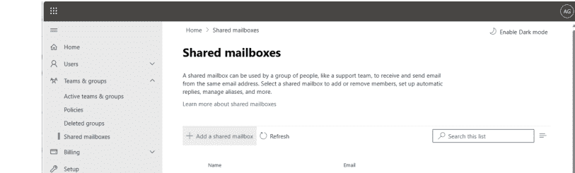

图 22.3 – 查看共享邮箱箱

在添加共享邮箱箱飞出窗中，输入名称并根据需要调整电子邮件地址。

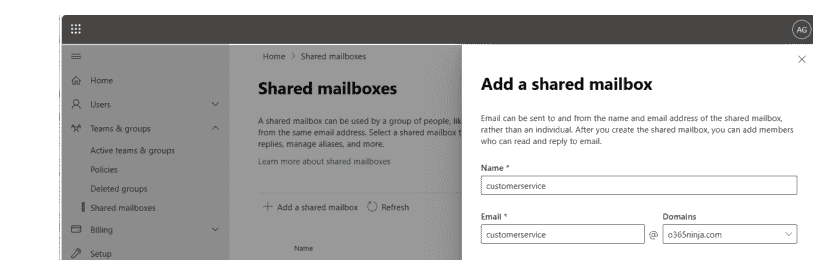

图 22.4 – 创建共享邮箱箱

点击向你的共享邮箱箱添加成员。

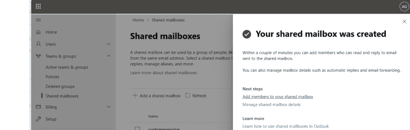

图 22.5 – 查看新创建的邮箱箱

5. 在共享成员飞出窗中，点击添加成员。您需要从组织中选择至少一个拥有邮箱箱许可证的用户（访问共享邮箱箱的必要条件），然后点击添加。

6. 关闭飞出窗。

在使用 Power Automate 时，您将需要使用第 5 步中授予权限的账户凭据。

接下来，您将创建一个团队。

### 创建 Microsoft Teams 团队

Microsoft 团队将用于接收来自 Power Automate 的通知。使用这些步骤从 Microsoft 365 管理中心创建团队。

1. 从 Microsoft 365 管理中心 (https://admin.microsoft.com)，展开 Teams 和组，然后选择活动团队和组。
2. 在 Teams 和 365 组选项卡上，点击添加团队。
3. 在添加团队向导的基本设置中，为团队提供名称并点击下一步。见图 22.6。

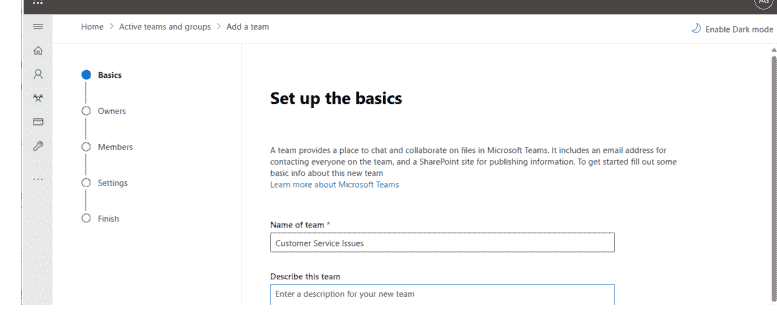

图 22.6 – 创建新团队

4. 在所有者页面上，添加至少一个所有者（例如管理共享邮箱箱的帐户）。点击下一步。
5. 在成员页面上，添加任何额外成员并点击下一步。
6. 在设置页面上，填写团队电子邮件地址。点击下一步。

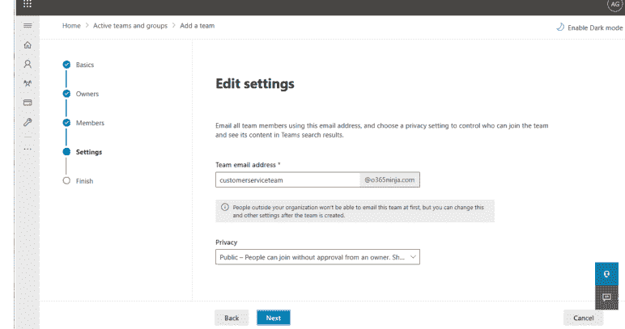

图 22.7 - 为团队配置电子邮件地址

7. 在完成页面上，检查设置并点击添加团队。

现在，进入有趣的部分了！

### 配置情感分析流

如您在本章较早部分所学到的，情感分析提供了一种评估内容语调并提供评估输出的机制。为了解决识别负面客户反馈的场景，您可以使用情感分析流来处理共享邮箱箱收到的消息。

1. 导航到 Power Automate 制作器网页网站 (https://make.powerautomate.com)。
2. 从导航菜单中选择创建。

### 3. 在从空白开始下，选择自动化云流。

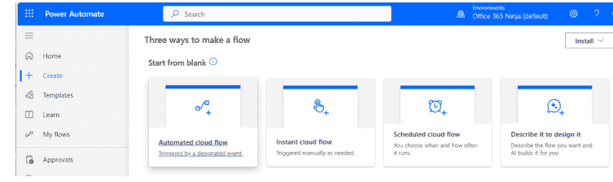

图 22.8 – 开始新流

### 4. 在生成自动化云流向导中，填写名称并选择当共享邮箱箱有新邮件到达时 (V2)触发器。点击创建。

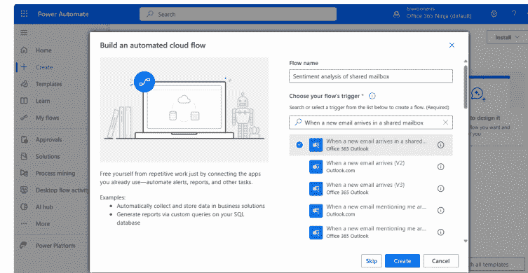

图 22.9 – 选择流的触发器

### 5. 在画布中，选择当共享邮箱箱有新邮件到达时 (V2)触发器。

### 6. 在飞出窗中，在原始邮箱地址字段中，添加客户服务共享邮箱箱。见图 22.10。

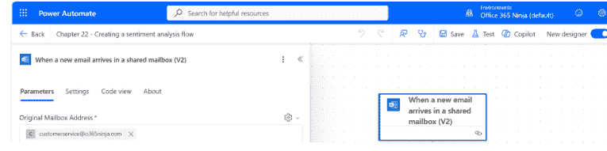

图 22.10 – 配置共享邮箱箱

8. 选择将用于身份邮箱箱的凭据。如果未列出凭据，点击添加新建并提供访问共享邮箱箱帐户的用户名和密码。

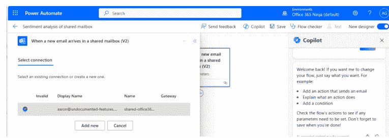

图 22.11 – 更新连接设置

9. 添加操作。
10. 在添加操作飞出窗中，在搜索框中输入 `Detect` 并选择检测语言操作，如图 22.12 所示。

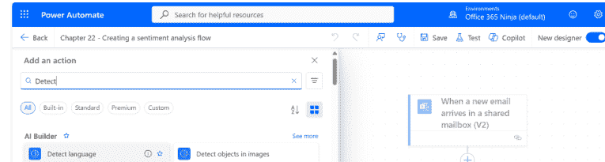

图 22.12 – 选择检测语言操作

10. 在文本中使用的检测语言飞出窗中，点击文本字段。选择闪电图标展开动态选择器。
11. 选择正文。

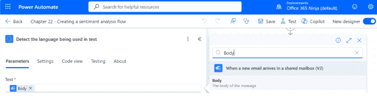

12. 折叠飞出窗。您会注意到文本中使用的检测语言操作被封装在应用到每一个（或对于，取决于您的租户在循环控制中的中的位置）中。这是因为当共享邮箱箱有新邮件到达时 (V2)可能会触发多个消息到下一个操作（使其成为数组），因此需要循环控制来处理从触发器传递的每条消息。见图 22.14。

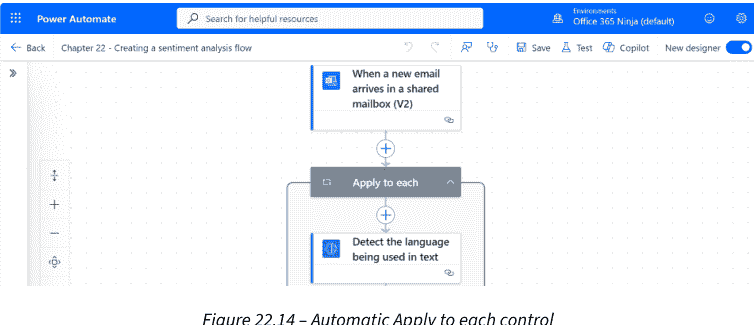

13. 点击应用到每一个循环内的 `+` 以添加操作。
14. 在添加操作飞出窗中，在搜索框中输入 `Sentiment analysis` 并选择分析文本中的正或负面情感。

15. 在分析文本中的正或负面情感飞出窗中，选择语言字段。添加来自文本中使用的检测语言的语言动态内容。

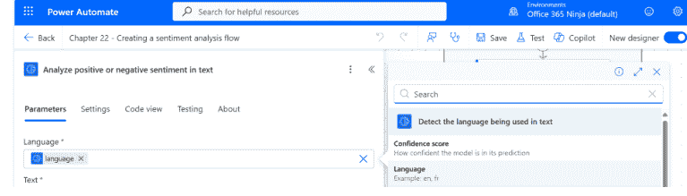

图 22.15 – 选择语言选择器

16. 点击文本字段。选择动态选择器。
17. 在共享邮箱箱有新邮件到达 (V2)下选择正文。
18. 折叠飞出窗。您会注意到分析文本中的正或负面情感被封装在应用到每一个中。
19. 检查该流。它应该类似于图 22.16。

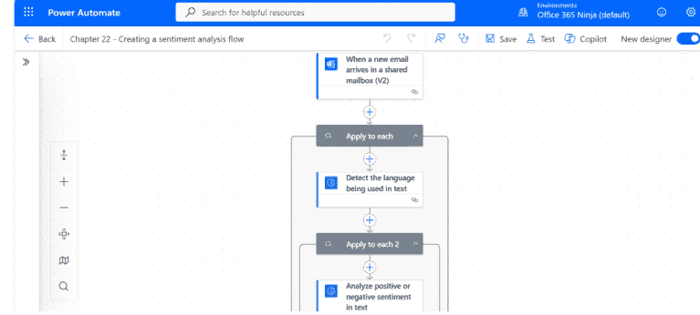

图 22.16 – 检查流的状态

20. 在分析文本中的正或负面情感操作之后添加一个操作。
21. 在应用到每一个循环内部，在搜索框中输入 `Condition` 并选择条件操作。
22. 在条件飞出窗中，点击左侧字段并选择动态选择器。
23. 选择来自文本中使用的检测语言的整体情感动态内容。
24. 在运算符下拉菜单中，选择等于。
25. 在右侧字段中输入值 `negative`。

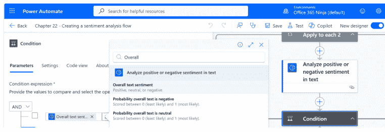

图 22.17 – 配置条件评估

- 26. 折叠飞出窗。
- 27. 在条件的“是”分支上，点击 `+` 添加操作。
- 28. 在“添加操作”搜索框中输入 `Post message` 并选择“在 Teams 中发布消息”操作。

---

第 22 章 411

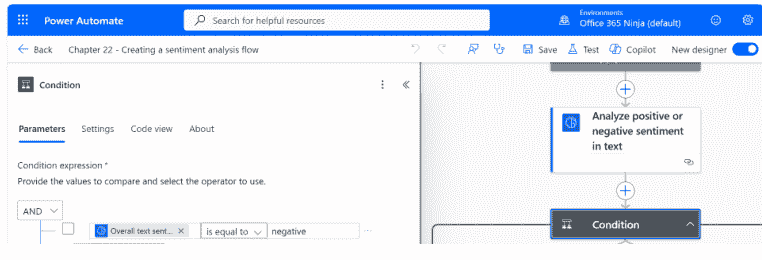

图 22.18 – 添加消息操作

- 29. 在“在聊天或频道中发布消息”飞出窗中，点击登录以创建连接（必要）。提供将发布到 Teams 的帐户凭据。
- 30. 在“发布”下拉菜单中，选择“Flow bot”。
- 31. 在“发布”下拉菜单中，选择“频道”。
- 32. 在“团队”下拉菜单中，选择在先决部分创建的团队。
- 33. 在“频道”下拉菜单中，选择“General”。
- 34. 在“消息”文本框中，添加消息详情。可以使用动态令牌的富文本格式选项。图 22.20。
- 35. 折叠飞出窗。
- 36. 检查流的布局并检查是否有明显的错误。见图 22.21。

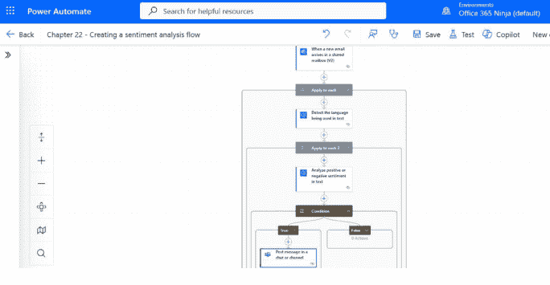

图 22.21 – 检查整体流

- 37. 在菜单栏上，点击“保存”以保存流。

检查流以确保步骤已配置好。完成后，是时候测试它了！

### 测试流

现在，是让一切按预期工作的时候了！

- 1. 从菜单栏选择“测试”。
- 2. 选择“手动”单选按钮并点击“测试”。
- 3. 通过向配置的共享邮箱箱发送电子邮件来测试您的流。确保您没有遇到反对。

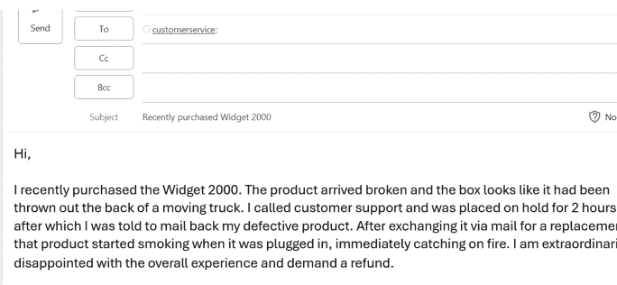

图 22.22 – 撰写测试电子邮件

---

第 22 章 413

发送电子邮件后，流运行历史将开始在 Power Automate 制作器门户中更新。

- 4. 选择“分析文本中的正面或负面情感”以展开详细飞出窗口。
- 5. 在“运行结果”（Run results）选项卡下，向下滚动到“输出”（OUTPUTS）区域，然后搜索主体（body）部分。应该有一个 `responsev2.predictionOutput.result.documentScores` 字段。如果模型能够识别出你（推测）措辞强烈的邮件中的负面情感，它将把情感报告为负面。

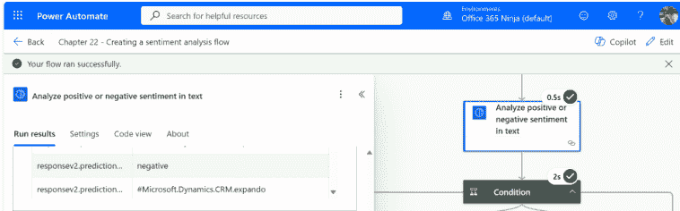

图 22.23 - 流执行结果

- 6. 打开 Microsoft Teams（或访问 https://teams.microsoft.com）并验证频道帖子已发布。

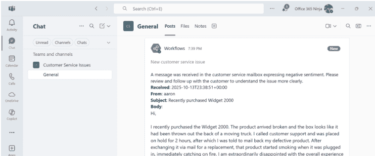

图 22.24 - 验证频道帖子

此时，你已经拥有了一个可以检测愤怒邮件并开始通知支持人员采取行动的流——这让你在提高客户满意度的道路上迈了一大步！

### 进一步探索

根据你的需求和其他连接的系统，你可能能够扩展并增强此系统，包括执行以下操作的工作流：

- 连接到电子商务平台并为未来的购买生成折扣优惠码
- 通过电子邮件回复客户并启动退款
- 与送运代理商集成以生成邮寄标签

你的限制实际上只有你的创造力（以及帮助客户的预算）。

### 总结

AI Builder 模型开箱即用就具有许多功能。在本章中，你学习了如何利用人工智能和机器学习来处理客户服务邮箱中收到的电子邮件。通过情感分析模型，你能够检测邮件的整体基调是正面还是负面，然后触发附加操作，在团队频道对话中发布通知，以供客户服务团队后续审核。

在下一章中，我们将探索使用 Microsoft Copilot 与流进行交互。

> 获取本书的 PDF 版本和独家额外内容。扫描二维码代码（或访问 packpub.com/unlock）。按名称搜索此书，确认版本，然后按照页面上的步骤操作。

注意：请妥善发票。直接从 Packt 购买的不需要发票。

---
