# 23 使用 Copilot 创建和管理流

在第 21 章“介绍 AI 模型和生成式 AI”中，我们开始探索如何将 Microsoft Copilot 与流结合。在本章中，我们将尝试稍微推向边界，看看它还能做什么。

云流中的 Copilot 让构建自动化变得像对话一样简单。你不需要在菜单中寻找或拖动操作卡片，只需自然语言告诉 Copilot 你想做什么。例如，你可能会说：*当有人提交表单时，给我发送一条 Teams 消息并将文件保存到 SharePoint 中*。Copilot 会逐步引导完成整个过程，将你的想法转化为可以运行的流，为你节省时间和精力。

### Copilot 拥有哪些能力？

- **理解你的意思：** 描述你的场景，Copilot 就会识别你的意图并围绕此构建流
- **自动设置连接：** 它会在后台链接你的帐户和服务，使你的自动化程序能够立刻运行
- **填写细节：** Copilot 会根据你的要求添加必要的参数和配置——无需手动猜测
- **即时更新：** 如果你想调整或替换操作，只需要求 Copilot 做出更改——它会立即为你处理好
- **回答你的问题：** 你可以问 Copilot 诸如***我的流是做什么的？** 等问题以获取快速摘要，甚至是产品类问题，如***我如何访问子流？** 或***许可证是如何工作的？***
- **帮助编写描述：** 当你编辑流时，Copilot 甚至可以建议一个清晰、完善的描述，以便日后更容易理解

简而言之，Copilot 将流的构建转变为一种自然的往返对话。你解释你想做什么，而它为你处理技术性步骤。

在本章中，我们将尝试完成以下任务：

- 使用 Copilot 创建流
- 编辑流
- 描述流

在本章结束时，你将更好地理解 Copilot 如何帮助你快速构建流。

### 使用 Copilot 创建流

编写一个好的提示词不仅仅是清晰或描述你希望结果的外观——还关乎为 Copilot 提供足够的上下文，让它准确理解你正在尝试做什么。Copilot 鼓励实验。你可以测试不同版本的提示词，看看哪一个获得最佳结果。如果你的第一次尝试没有达到预期，请调整措辞重试。需要注意的是，Copilot 是一个生成式 AI 工具——它是概率性的（与确定性的代码不同）。这意味着即使你我输入相同的提示词，也可能会得到略不同的结果——这是生成式 AI 的本质。

为了获得最佳结果，请遵循以下提示：

- **使用“当 X 发生时，执行 Y”的格式：** 这有助于 Copilot 清晰理解触发器和操作
- **具体化：** 不要说像“我想处理一封邮件”这样模糊的话，尝试：*当邮件到达时，将主题发布到“Contoso”Teams 通用频道*
- **尽可能提及应用程序或连接器：** 在提示词中提到 Outlook、SharePoint、OneDrive 或 Forms 等工具，以便 Copilot 确切知道要使用哪些服务
- **在过程中完善你的提示词：** 措辞上的微调就能对 Copilot 创建的自动化产生巨大影响

将提示词看作是与 Copilot 的快速对话——你对自己的要求的越清晰，它就越能构建出你设中的流。

---

第 23 章 417

首先，让我们看看如何使用 Copilot 创建新流。假设你的 Dropbox 站点是外勤人员上传手写表单的地方。你想创建一个流，连接 Dropbox 站点、导入文档、执行光学字符识别 (OCR)，然后将其保存为文本文档。

让我们看看它能做什么！

- 导航到 Power Automate 制作网页门户 (https://make.powerautomate.com)。在首页上，输入提示词并点击“生成”。在示例中，我们将使用以下初始提示词：

  *当 Dropbox 中创建文件时，将文件保存到 SharePoint 站点。*

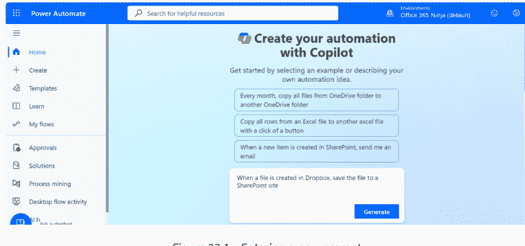

- 看看 Copilot 生成了什么。

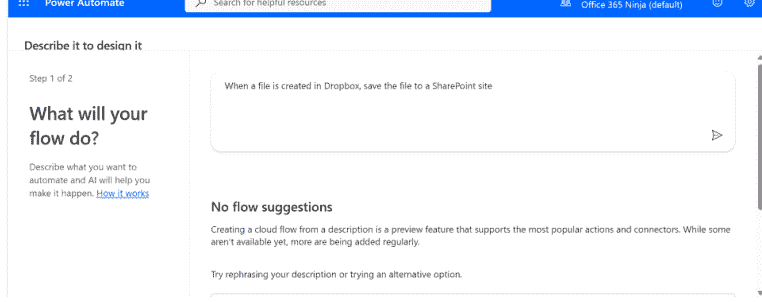

- 4. 如果 Copilot 回复没有流建议，请编辑提示词并重新提交。尝试以下提示词：

  *当 Dropbox 中创建文件时，使用 OCR 操作并将文件保存到 SharePoint。*

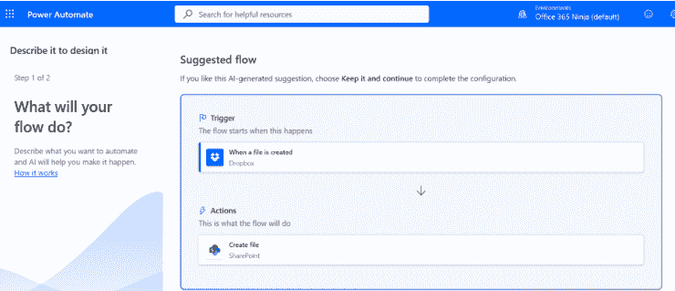

图 23.3 - 更新后的提示词

在查看建议后，你可能会发现 Copilot 的响应“足够好”，即使它不是你想要的。滚动到页面底部并点击“保留”，继续进入流创建的后续步骤。

- 5. 提供连接服务的凭据，然后点击“创建流”。

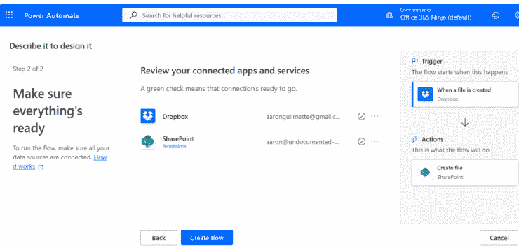

图 23.4 - 更新连接器的凭据

- 6. 流创建后，点击触发器以更新 Dropbox 连接器。
- 7. 选择一个文件夹以完成触发器的配置。

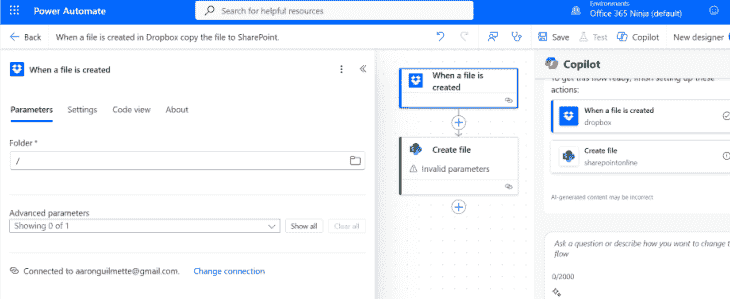

图 23.5 - 更新 Dropbox 连接器

- 8. 选择“创建”操作。
- 9. 在“站点地址”下，浏览到你想保存下载文件的站点。
- 10. 在“文件夹路径”下，选择一个文件夹。

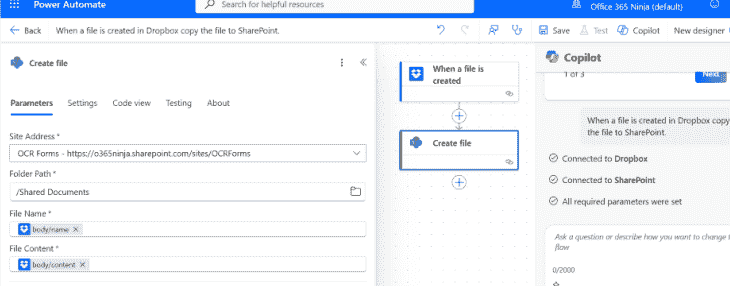

图 23.6 - 更新 SharePoint 操作

- 11. 点击“保存”。

接下来，我们将看看如何使用 Copilot 修改流。

### 编辑流

你可以使用 Copilot 来插入操作并对你的工作流进行故障排除。

- 1. 在 Copilot 窗中，使用提示词（prompt）告诉 Copilot 在文件保存到 SharePoint 之前添加一个操作，对该文件执行 OCR。

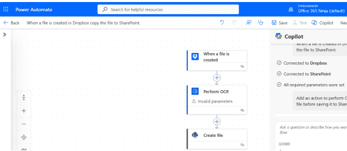

图 23.7 – 通过 Copilot 添加 OCR 操作

- 2. 点击“执行 OCR”（Perform OCR）操作以展开该方法的弹出窗口。注意此时没有提供图像。添加一个提示词来更新“图像”（Image）参数。在示例中，你可以使用以下提示词：

使用来自 Dropbox 的文件作为执行 OCR 操作的图像文件。

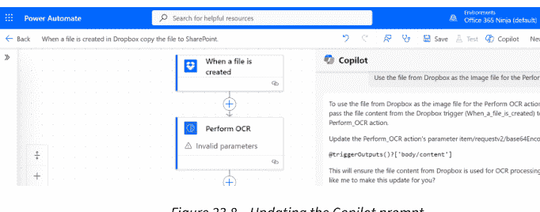

图 23.8 – 更新 Copilot 提示词

- 3. 直接在提示词字段中输入“yes”（是）。
- 4. 如果 Copilot 无法代表你执行更改，你仍然可以采取指令并相应地修改工作流，如图 23.9 所示。

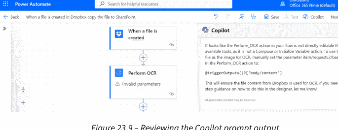

- 5. 选择 `triggerOutputs()['body/content']` 建议文本并复制到剪贴板。
- 6. 选择“执行 OCR”操作以展开弹出窗口。
- 7. 在“图像”（Image）参数中粘贴。

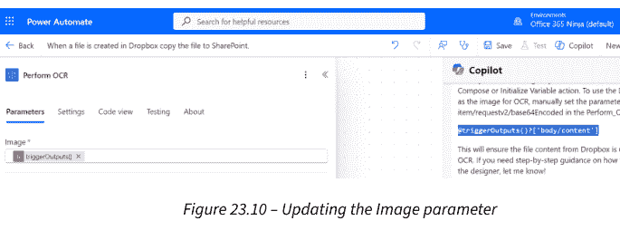

- 8. 点击保存。
- 9. 选择“测试”，选择“手动”（Manually）单选按钮，并点击“测试”。
- 10. 切换到 Dropbox 站点，向文件夹上传一个带有手写文本的图像文件，然后等待工作流进行处理。
- 11. 检查输出结果。如果生成了错误，你可以点击 Copilot 窗中的“协助我”（Assist me）图标。

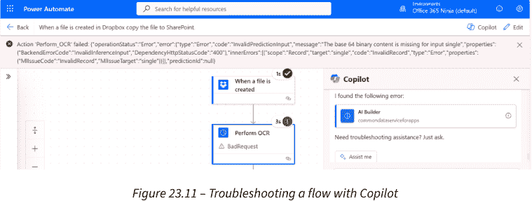

- 12. 检查 Copilot 的故障排除步骤。在这种情况下，Copilot 报告执行 OCR 步骤没有收到正确格式（base64）的文件，并对编辑文件提出了建议，如图 23.12 所示。

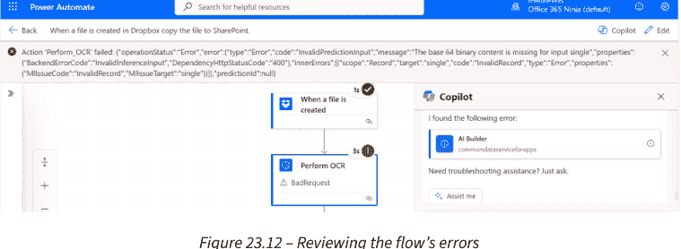

- 13. 选择“执行 OCR”操作以显示布局。
- 14. 点击“图像”参数内部，注意 Copilot 生成的工作流添加的动态值（body/content）。根据故障排除器的建议，你需要将其替换为“文件内容”（File Content）动态值。

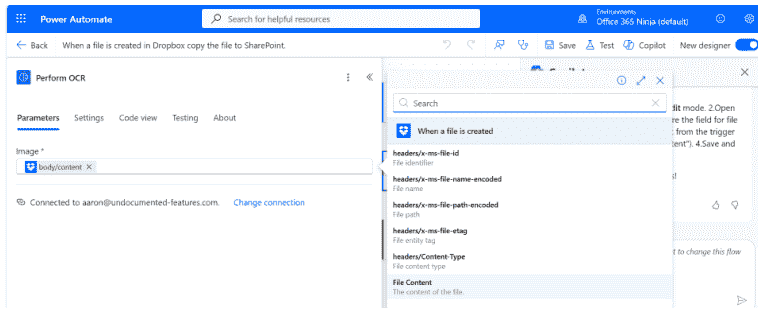

图 23.13 - 替换参数的值

- 15. 点击保存。
- 16. 点击“测试”，选择“自动”（Automatically），并选择失败的触发器。点击“测试”。

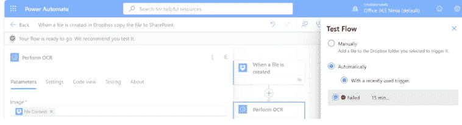

图 23.14 - 选择最近失败的触发器

- 17. 检查任何潜在错误。

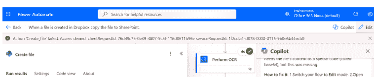

图 23.15 - 检查额外错误

*注。*

- 18. 点击“编辑”返回工作流并查看“创建文件”（Create file）操作。
- 19. 检查参数。

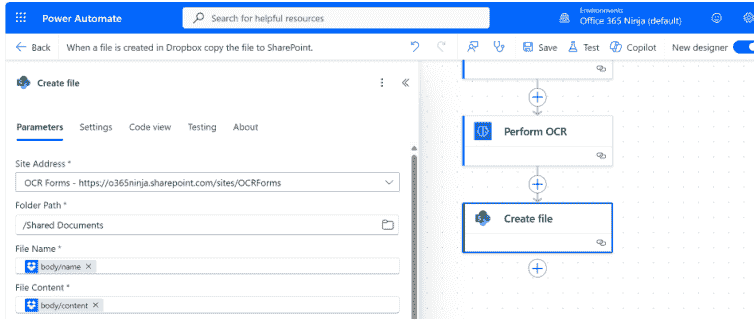

在这种情况下，Copilot 生成的工作流使用了 Dropbox 的名称和内容动态内容值。这并不完全对应于错误，但这些值需要更新，以利用 Copilot 之前插入的 OCR 操作（尽管 Copilot 说它已经为我们更新了一切）。

- 20. 更新“文件名”（File Name）参数为类似 test.txt 的内容。
- 21. 更新“文件内容”（File Content）参数为“文档全文”（Full text of the document）动态值标记。

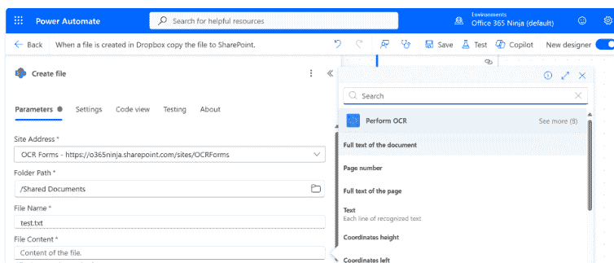

- 22. 点击保存并再次测试。

最后，工作流看起来成功了！

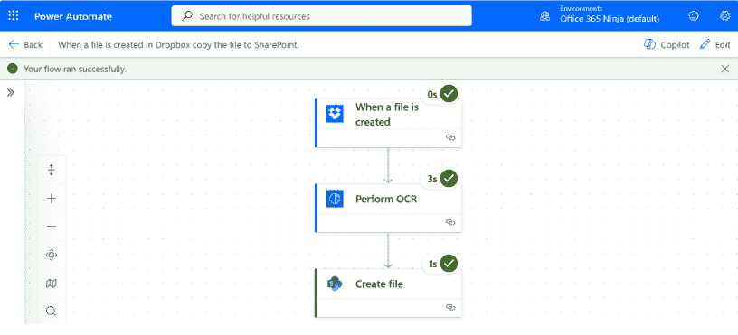

图 23.18 – 检查工作流输出

你也可以去检查 SharePoint 站点查看创建的文件。“详细信息”窗格显示工作流的预览。你也可以在浏览器中打开该文件。见图 23.19。

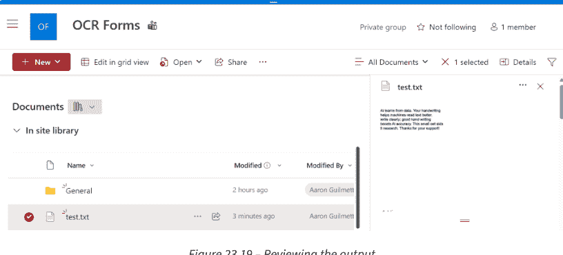


### 编辑流

你可以使用 Copilot 来插入操作并对你的工作流进行故障排除。

1. 在 Copilot 窗中，使用提示词告诉 Copilot 在文件保存到 SharePoint 之前添加一个操作，对该文件执行 OCR。
   
   
   
   图 23.7 – 通过 Copilot 添加 OCR 操作

2. 点击“执行 OCR”操作以展开该方法的弹出窗口。注意此时没有提供图像。添加一个提示词来更新“图像”参数。在示例中，你可以使用以下提示词：
   
   使用来自 Dropbox 的文件作为执行 OCR 操作的图像文件。
   
   
   
   图 23.8 – 更新 Copilot 提示词

3. 直接在提示词字段中输入 `yes`（是）。

4. 如果 Copilot 无法代表你执行更改，你仍然可以采取指令并相应地修改工作流，如图 23.9 所示。
   
   

5. 选择 `triggerOutputs()['body/content']` 建议文本并复制到剪贴板。

6. 选择“执行 OCR”操作以展开弹出窗口。

7. 在“图像”参数中粘贴。
   
   

8. 点击保存。

9. 选择“测试”，选择“手动”单选按钮，并点击“测试”。

10. 切换到 Dropbox 站点，向文件夹上传一个带有手写文本的图像文件，然后等待工作流进行处理。

11. 检查输出结果。如果生成了错误，你可以点击 Copilot 窗中的“协助我”图标。
    
    

12. 检查 Copilot 的故障排除步骤。在这种情况下，Copilot 报告执行 OCR 步骤没有收到正确格式（`base64`）的文件，并对编辑文件提出了建议，如图 23.12 所示。
    
    

13. 选择“执行 OCR”操作以显示布局。

14. 点击“图像”参数内部，注意 Copilot 生成的工作流添加的动态值（`body/content`）。根据故障排除器的建议，你需要将其替换为“文件内容”动态值。
    
    
    
    图 23.13 - 替换参数的值

15. 点击保存。

16. 点击“测试”，选择“自动”，并选择失败的触发器。点击“测试”。
    
    
    
    图 23.14 - 选择最近失败的触发器

17. 检查任何潜在错误。
    
    
    
    图 23.15 - 检查额外错误

*注。*

18. 点击“编辑”返回工作流并查看“创建文件”操作。

19. 检查参数。
    
    
    
    在这种情况下，Copilot 生成的工作流使用了 Dropbox 的名称和内容动态内容值。这并不完全对应于错误，但这些值需要更新，以利用 Copilot 之前插入的 OCR 操作（尽管 Copilot 说它已经为我们更新了一切）。

20. 更新“文件名”参数为类似 `test.txt` 的内容。

21. 更新“文件内容”参数为“文档全文”动态值标记。
    
    

22. 点击保存并再次测试。

最后，工作流看起来成功了！


图 23.18 – 检查工作流输出

你也可以去检查 SharePoint 站点查看创建的文件。“详细信息”窗格显示工作流的预览。你也可以在浏览器中打开该文件。见图 23.19。


### 编辑流

你可以使用 Copilot 来插入操作并对你的工作流进行故障排除。

1. 在 Copilot 窗中，使用提示词告诉 Copilot 在文件保存到 SharePoint 之前添加一个操作，对该文件执行 OCR。


图 23.7 – 通过 Copilot 添加 OCR 操作

2. 点击“执行 OCR”操作以展开该方法的弹出窗口。注意此时没有提供图像。添加一个提示词来更新“图像”参数。在示例中，你可以使用以下提示词：

使用来自 Dropbox 的文件作为执行 OCR 操作的图像文件。


图 23.8 – 更新 Copilot 提示词

3. 直接在提示词字段中输入 `yes`（是）。

4. 如果 Copilot 无法代表你执行更改，你仍然可以采取指令并相应地修改工作流，如图 23.9 所示。


5. 选择 `triggerOutputs()['body/content']` 建议文本并复制到剪贴板。

6. 选择“执行 OCR”操作以展开弹出窗口。

7. 在“图像”参数中粘贴。


8. 点击保存。

9. 选择“测试”，选择“手动”单选按钮，并点击“测试”。

10. 切换到 Dropbox 站点，向文件夹上传一个带有手写文本的图像文件，然后等待工作流进行处理。

11. 检查输出结果。如果生成了错误，你可以点击 Copilot 窗中的“协助我”图标。


12. 检查 Copilot 的故障排除步骤。在这种情况下，Copilot 报告执行 OCR 步骤没有收到正确格式（base64）的文件，并对编辑文件提出了建议，如图 23.12 所示。


13. 选择“执行 OCR”操作以显示布局。

14. 点击“图像”参数内部，注意 Copilot 生成的工作流添加的动态值（`body/content`）。根据故障排除器的建议，你需要将其替换为“文件内容”动态值。


图 23.13 - 替换参数的值

15. 点击保存。

16. 点击“测试”，选择“自动”，并选择失败的触发器。点击“测试”。


图 23.14 - 选择最近失败的触发器

17. 检查任何潜在错误。


图 23.15 - 检查额外错误

*注。*

18. 点击“编辑”返回工作流并查看“创建文件”操作。

19. 检查参数。


在这种情况下，Copilot 生成的工作流使用了 Dropbox 的名称和内容动态内容值。这并不完全对应于错误，但这些值需要更新，以利用 Copilot 之前插入的 OCR 操作（尽管 Copilot 说它已经为我们更新了一切）。

20. 更新“文件名”参数为类似 `test.txt` 的内容。

21. 更新“文件内容”参数为“文档全文”动态值标记。


22. 点击保存并再次测试。

最后，工作流看起来成功了！


图 23.18 – 检查工作流输出

你也可以去检查 SharePoint 站点查看创建的文件。“详细信息”窗格显示工作流的预览。你也可以在浏览器中打开该文件。见图 23.19。


6. 在“验证手机号码”页面上，输入一个能够接收短信的设备手机号码。点击“发送代码”。

7. 在“输入代码”页面上，输入从 OpenAI 验证服务收到的六位代码。如果您之前注册过，可能会收到一条关于升级到计划以开始使用 API 的消息。点击“继续”。

8. 如必要，在“欢迎来到 OpenAI 平台概述”页面上点击“升级”，如图 24.1 所示。

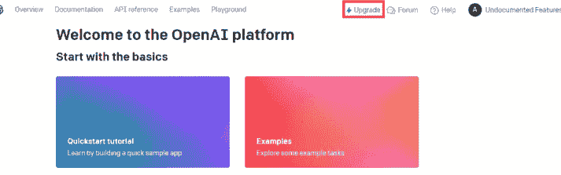

图 24.1 – OpenAI 平台概览页

9. 点击“开始付费计划”。

10. 在“什么最能描述您？”页面上，选择最能描述您的使用场景的分类（个人或公司）。

11. 在“设置支付方式”页面上，输入信用卡信息并点击“继续”。

12. 在“配置支付”页面上，为“初始点数购买”输入一个值。您可以选择 `$5` 到 `$50` 之间的任何金额。

13. 在“支付摘要”页面上，点击“确认支付”。您将被收取配置页面上指定并在摘要中显示的金额。

14. 导航至 `https://platform.openai.com/api-keys`。见图 24.2。

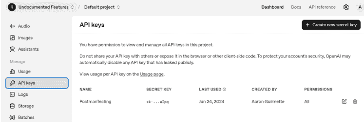

图 24.2 – 选择 API 密钥

15. 在 API 密钥页面上，选择“创建新的密钥密钥”。

16. 在“创建新的密钥密钥”弹出窗口中，为 API 密钥输入一个名称（例如 `OpenAI`），并点击“创建密钥”。

17. 将显示的值复制到安全的地方。当从其他应用和服务（如 Power Automate）连接到 OpenAI 服务时，您将需要此值。当您点击“完成”时，此值将被隐藏，您将无法再次检索它。

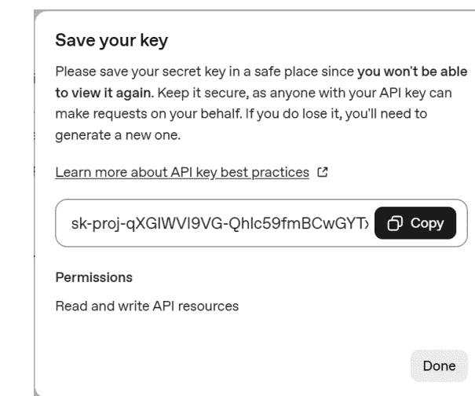

图 24.3 - 捕获 API 密钥

> 请保护好此 API 密钥。如果它被泄露或盗用，他人可以使用它对您的账户余额执行 API 调用和查询，您将需要返回此页面、生成新密钥，然后通过点击垃圾桶图标撤销旧密钥。

18. 点击“完成”。

当您配置与 ChatGPT 集成的服务时（无论是 Power Automate 还是其他服务），您将提供 API 密钥用于该服务的身份验证。建议为连接到 ChatGPT 的每个服务使用单独 API 密钥——这样您就可以跟踪支出并在需要时撤销密钥。

### 开始 Encodian 试用

Encodian 提供了一系列连接器，我们将使用它们来操作 Word 文档。Encodian 在 `https://www.encodian.com/product/flowr/` 提供了 Flowr 连接器的免费 30 天试用（包含 500 个积分点数）：

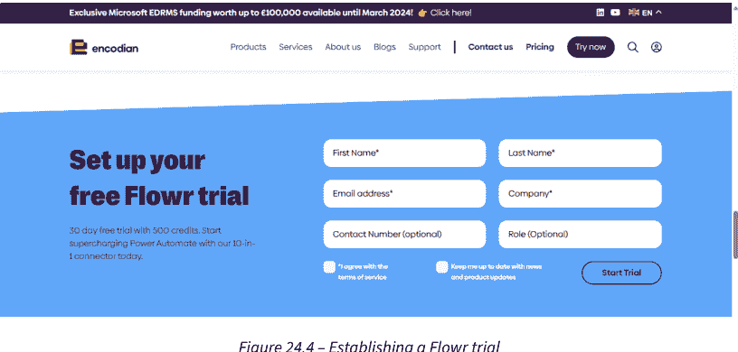

注册后，您将收到一个 API 密钥（示例如图 24.5 所示），该密钥将用于在 Power Automate 中配置 Encodian 连接器：


激活后，您将需要了解如何将标记或关键词插入文档（或文档模板）中，以便连接器知道在哪里插入摘要：

### 学习 Encodian Flowr 连接器

在真正开始工作此项目之前，您需要了解如何使用 Encodian Flowr 连接器和操作。在本节中，我们将查看使此流程运行的关键部分。要成功使用连接器和操作，您将需要理解以下概念、术语和操作：

- 输入格式

- 标记 (Tokens)

- 填充 Word 操作 (Populate Word action)

- 合并演示文操作 (Merge Presentations action)

让我们快速查看这些领域！

### 输入格式

Encodian 的许多内容操作操作都需要使用结构化数据。在这种情况下，结构化数据通常以 JavaScript 对象表示 (JSON) 语法提供：

```json
{
  "object1" : "value1",
  "object2" : "value2-electric boogaloo"
}
```

如您在那个简单示例所示（并希望在书中书中回顾过），JSON 文本被格式化为键/值对（类似于“术语定义”）。JSON 与许多编程结构一样，也有数组或集合的概念。数组或集合是一组相似的对象（例如字符串或数字）。

假设您想列出一个包含各种食物的集合，以及每种食物的数量。它看起来可能像这样，格式化为 JSON：

```json
{
  "foods": [
    "category": "fruit",
    "data": [
      {"type": "orange","count": 1},
      {"type": "strawberry","count": 7},
      {"type": "apple","count": 3}
    ]
  ]
}
```

```json
"category": "grain",
"data": [
  {"type": "sorghum","count": 1},
  {"type": "wheat","count": 3}
]
```

在 `foods` JSON 对象中，您可以看到指定数据值的几个示例。有标准的键/值对（如 `"category": "fruit"`）用于标识单个对象，以及数组（如 `"data": [{"type": "sorghum","count": 1}, {"type": "wheat","count": 3}]`）用于标识键/值对组。

JSON 对象可以包含多种数据类型，包括字符串（文本）、整数（数字）、数组（字符串或键/值对的集合）、布尔值（真或假）以及其他 JSON 对象。

> JSON 是一种处理结构化内容的极其灵活格式，既易于人类阅读，又独立平台和语言。有关处理 JSON 对象和语法的更多信息，请参阅 `https://www.w3schools.com/js/js_json_intro.asp`。您还可以使用 `https://jsonformatter.org/` 等工具来帮助确保 JSON 格式正确。

接下来，我们将查看标记是如何工作的（在 Encodian 连接器的上下文中）。

### 标记 (Tokens)

多个 Flowr 操作使用特殊格式的标签（或 Encodian 称为标记），连接器将这些标记与您提供的内容以查找并替换的方式。

例如，假设您让 Flowr 在文档中放置“The rain in Spain falls mainly on the plain”单词或短语。您可能决定将该短语分配给名为 `rhyme` 的标记。然后，插入文档或演示文稿模板时，通过输入由一系列方括号和尖括号包围的标记名称来指示希望此文本出现的位置：`<<[rhyme]>>`。

如果您曾经用过文本编辑器中的查找/替换功能，或者在指定占位符文本的合并应用程序，您将理解这个概念。


参见图 24.6 查看 PowerPoint 幻灯片内部标记的示例。


图 24.6 – 在 PowerPoint 幻灯片中查看 `<<[fox]>>` 标记

在任何您想要使用 Encodian 连接器修改或自定义的文档或演示文稿中，工作原理都是相同的。

### 注册 Cloudmersive 免费订阅

虽然有很多原生工具、连接器和操作可以帮助实现某些结果，但为什么不使用工具让您的工作更轻松呢？Cloudmersive 的连接器让内容转换变得异常简单！每月有 800 次免费 API 调用，非常划算。

要注册，请按照以下步骤操作：

1. 导航至 `https://portal.cloudmersive.com/signup`。

2. 填写表单并点击“立即注册”。

3. 在“选择计划”页面上，选择“免费层级”。

4. 在“选择角色以完成账户设置”页面上，选择一个代表您的职业类型的角色。

5. 在“您想从哪个 API 开始？”页面上，选择“文档和数据转换”。

6. 在“您希望使用的编程语言？”上选择 Microsoft Flow / Power Automate。

7. 在 API 密钥页面点击“创建密钥”。

8. 将免费层 API 密钥区域的值复制到可以方便访问的地方。API 密钥是一个 36 字符的代码，由字母 a 到 f 和数字 0 到 9 组成。

现在您已经准备好了软件和许可，是时候准备内容了！

### 准备文档模板

在这种情况下，准备文档模板意味着为 Flow 操作放置标记标记。本质上，您编辑一份文档（在本情况下，是包含工作说明书或其他需要摘要的 Word 文档），并插入一个指示您希望 Flow 将其放置的位置的标记 `<<`，如图 24.7 所示：

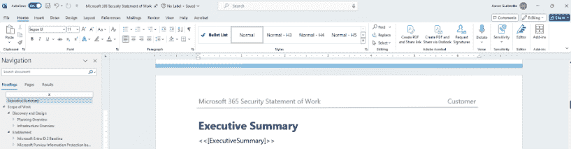

图 24.7 – 在文档中放置标记

在图 24.7 中，`<<[ExecutiveSummary]>>` 标记代表 Flow 将插入 ChatGPT 或 OpenAI 服务生成的摘要的位置。

### 设置云存储提供程序

在本章中，我们将使用带有 Office 365 或 Microsoft 365 订阅的 OneDrive for Business 服务。您可以使用其他解决方案（如 Dropbox 或 Google Drive），但您必须单独配置它们并使用相应的连接器。

### 创建流程

在完成所有的准备工作后，是时候开始处理一些自动化了！我们将从触发器开始。

### 配置触发器

此流程与手动触发器配合效果最佳，你将提供将作为执行摘要基础的文档。

如你所知，GPTs 利用提示词（prompts）来对要执行的任务类型提供说明。你可以选择在触发器中直接提供整个提示词内容，也可以稍后移动提示词的基础，并允许在触发器中进行自定义或微调。


# 创建执行摘要流程

## 配置触发器

在此流程中，我们将采用后一种方法。此触发器将使用四个输入变量：

- 一个你想要包含在摘要中的文档章节列表
- 一个你想要从摘要中排除的文档章节列表
- 一个可以让你输入额外指令以定制响应的地方
- 一个文件上传输入

要配置此流程，请按照以下步骤操作：

1. 导航到 Power Automate 制作门户（`https://make.powerautomate.com`）并选择“创建”。
2. 在“从空白开始”下，选择“即时云流”。
3. 在“构建自动化工作流”页面上，提供工作流名称（例如“生成执行摘要”），并选择“手动触发流”。点击“创建”。
4. 选择“手动触发流”。在设置中，选择“添加输入”。
5. 选择“文本”输入类型。图 24.8。

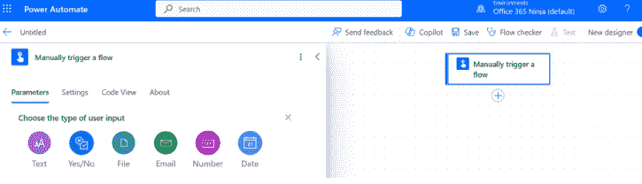

图 24.8 – 选择输入

6. 将“输入文本”（`Input text`）替换为“In”。这将是你描述包含在流程中的文档章节或组件的区域。在文本区域中，你可以将“请输入你的输入”替换为可能包含的重要章节的建议（例如工作范围和项目交付物），如图 24.9 所示。

# 24 

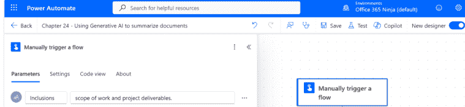

图 24.9 – 自定义输入

> **注意**
>
> 需要注意的是，你用作建议的文本与默认文本（在未提供自定义时将自动包含的文本）是不相同的。Power Automate 目前不支持默认文本选项。你需要在流程运行期间填写此文本。

根据你的文档是如何构建的以及你典型的执行摘要是什么样子的，你可能希望进一步自定义：

1. 点击**添加输入**。
2. 将**输入文本**（`Input text`）替换为“排除项”（`Exclusions`）。这将是你描述从 ChatGPT 摘要中排除的文档章节或组件的文本区域。在文本区域中，你可以将**请输入你的输入**替换为可能重要或通常不包含在执行摘要中的章节建议（例如项目治理、项目管理、履行期间、资源规划、变更订单、客户资源承诺和定价）。
3. 点击**添加输入**。
4. 将**输入文本**（`Input text`）替换为“附加指令”（`Additional Instructions`）。这将是你提供任何其他指令的文本区域，例如哪些内容对特定客户可能重要。在文本区域中，你可以将**请输入你的输入**替换为建议内容：“关注积极成果和合作伙伴机会”。
5. 点击**添加输入**并选择**文件**。
6. 将**文件内容**（`File Content`）替换为“上传”（`Upload`）。这是你上传需要执行摘要的文档的地方（在查找/替换活动中的适当部分带有令牌）。

## 转换文档

配置触发器后，现在是处理流程中开始处理已上传文档的部分。

由于 GPT 只能处理文本形式的内容（无法处理 Word 文档的二进制格式），因此有对其进行转换。接下来的步骤将文档发送到 Cloudmersive 连接器并转换为纯文本：

1. 在触发器之后，**添加操作**。
2. 在**添加操作**拉出菜单中，输入 `Cloudmersive` 并滚动到 **Cloudmersive 文档连接器**，然后点击**查看更多**。

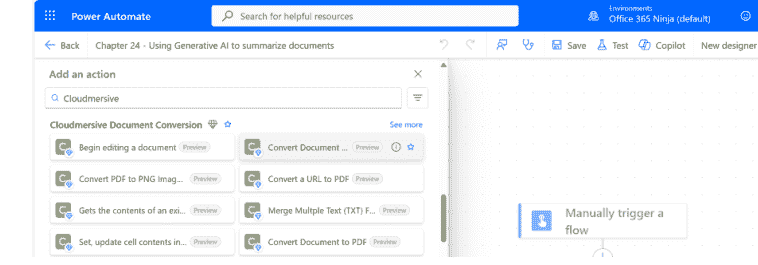

图 24.10 – 选择连接器

3. 选择 **Convert Word DOCX Document to Text (txt)** 操作，如图 **图 24.11** 所示：

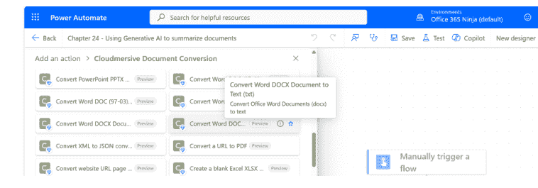

图 24.11 – 选择转换操作

4. 出现“Convert Word DOCX Document to Text (txt)”拉出菜单。在“要执行操作的输入文件”中，添加来自“手动触发流”操作下的 `File Content contentBytes` 动态内容令牌。
5. 在“要执行操作的输入文件（文件名）”中，添加来自“手动触发流”操作下的 `File Content` 动态内容令牌。

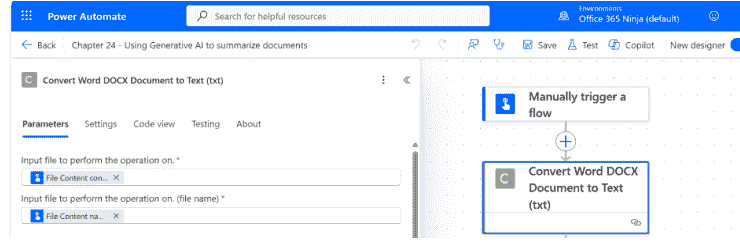

图 24.12 – 添加 `File ContentBytes` 动态内容令牌

现在，我们将数据发送到 OpenAI 的 ChatGPT 进行处理：

## 将内容发送给 GPT

在此节中，我们将配置保存内容的必要步骤。我们将使用 OpenAI 的 ChatGPT 进行处理。在在此之前，让我们探索一下发送的 JSON：

```json
{
  "model": "gpt-4",
  "messages": [
    {
      "role": "system",
      "content": "You are a helpful assistant."
    },
    {
      "role": "user",
      "content": "Generate a summary of the following text..."
    }
  ],
  "temperature": 0.7,
  "n": 1,
  "stream": false
}
```

## 使用生成式 AI 总结文档

接下来，我们将进入精彩部分——实际操作 ChatGPT！

1. 在执行“将 DOCX 文档转换为文本 (txt)”操作之后，在 HTTP 连接器下添加“HTTP”操作。

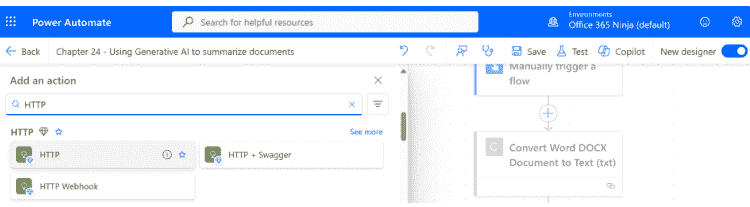

图 24-15 – 添加 HTTP 操作

2. 在 HTTP 操作的弹出窗中，在参数（`Parameters`）选项卡下，在 URI 字段输入以下端点：`https://api.openai.com/v1/chat/completions`。

这是 OpenAI 用于聊天完成的服务端点。

3. 在方法（`Method`）下，选择 `POST`。
4. 在头部（`Headers`）下，在键（`Key`）字段中输入值 `Authorization`。
5. 接下来，你需要 OpenAI API key。在头部（`Headers`）下，在值（`Value`）字段输入 `Bearer <OpenAI AI key>`。例如，如果你的 OpenAI API key 为 `sk-qtnjnJ1cToXtXfXXIFYnT3Clb-kfJqOOBJ7gfc9nCERCKqqeYbV`，你将在值字段中输入值 `Bearer sk-qtnjnJ1cToXtXfXXIFYnT3Clb-3clkbkfJqOOBJ7gfc9nCERCKqqeYbV`。见图 24-15。

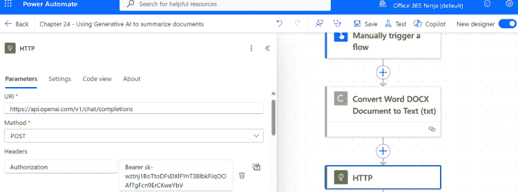

图 24-15 – 配置 HTTP 授权

不，那不是真实的密钥，请不要尝试使用它。它看起来像。

6. 正文（`Body`）字段是我们向 GPT 发送请求的地方。我们将发送的请求将化为 JSON 负载。你可以复制以下负载：

```json
{
  "model": "gpt-4",
  "messages": [
    {
      "role": "system",
      "content": "你是一个系统架构师，正在与客户经理合作为新客户编写工作说明书。"
    },
    {
      "role": "user",
      "content": "为包含的内容生成一份执行摘要。关注文档的几个区域：**包含项 (Inclusions)** 从执行摘要中排除以下章节：**排除项 (Exclusions)** 使用以下额外信息撰写一段有说服力的陈述：**额外说明 (Additional Instructions)** 完成后的执行摘要应在 225 到 350 个字之间。"
    }
  ],
  "max_tokens": 5000,
  "temperature": 0,
  "n": 1,
  "stream": false,
  "logprobs": null,
  "stop": null
}
```

7. 选择动态令牌 **Inclusions**，并将其替换为来自“手动触发流”操作的 **Inclusions** 动态内容令牌。
8. 选择文本 **Exclusions** 并将其替换为来自“手动触发流”操作的 **Exclusions** 动态内容令牌。
9. 选择文本 **Additional Instructions** 并将其替换为来自“手动触发流”操作的 **Additional Instructions** 动态内容。见**图 24.16**。

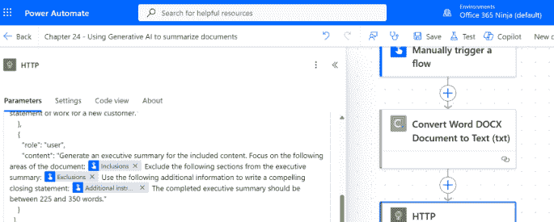

图 24.16 – 配置 HTTP 操作的正文

10. 在**HTTP 操作**之后，添加一个**解析 JSON**操作。
11. 在**内容（Content）**字段中，选择来自 HTTP 操作的**正文（Body）**动态内容令牌。
12. 在**架构（Schema）**区域字段中，粘贴以下内容：

```json
{
  "type": "object",
  "properties": {
    "id": {
      "type": "string"
    },
    "object": {
      "type": "string"
    },
    "created": {
      "type": "integer"
    },
    "model": {
      "type": "string"
    },
    "choices": {
      "type": "array",
      "items": {
        "type": "object"
      }
    }
  }
}
```

```json
"properties": {
  "index": {
    "type": "integer"
  },
  "message": {
    "type": "object",
    "properties": {
      "role": {
        "type": "string"
      },
      "content": {
        "type": "string"
      }
    }
  }
},
"logprobs": {},
"finish_reason": {
  "type": "string"
},
"required": [
  "index",
  "message",
  "logprobs",
  "finish_reason"
],
"usage": {
  "type": "object",
  "properties": {
    "prompt_tokens": {
      "type": "integer"
    },
    "completion_tokens": {
      "type": "integer"
    }
  }
}
```

```json
"total_tokens": {
    "type": "integer",
},
"system_fingerprint": {}
}
```

**schema** 定义了输出的格式。在 Power Automate 中，OpenAI API 直接返回针对端点执行 HTTP POST 请求的实际输出。你有几种方法可以自己实现这一点，例如使用 Postman（`https://www.postman.com`）运行基础查询，如**图 24.17**所示：

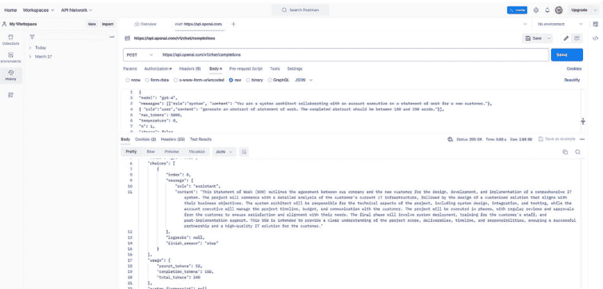

图 24.17 – 通过 Postman 生成架构源文件

生成输出后，你可以点击**使用示例负载**在解析 JSON 弹出窗中生成架构，然后从原始 ChatGPT 输出中复制/粘贴内容到其中，如**图 24.18**所示：

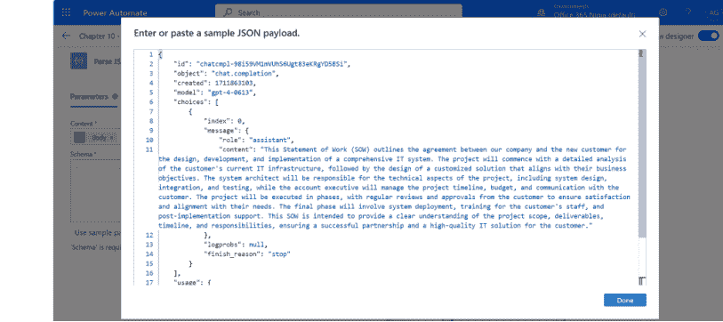

图 24.18 – 添加 JSON 负载以生成架构

14. 点击完成。
15. 此时，你可以点击保存以保留你的进度。

接下来，我们将此输出并插入到 Word 文档中。

## 填充文档并保存新文件

我们处于这个示例的最后阶段了！我们将按照以下步骤处理 Word 文档，并将输出发送到 OneDrive for Business：

1. 在“解析 JSON”操作之后，添加“填充 Word 文档”操作。
2. 在“填充 Word 文档”弹出窗中，在文件内容（`File Content`）字段中，添加来自“手动触发流”的文件 `Content contentBytes` 动态内容。
3. 在文档数据（`Document Data`）区域字段中，输入以下内容：

```json
{
  "ExecutiveSummary" : "**Body Content**"
}
```

将 **Body Content** 替换为来自“解析 JSON”操作的**Body content** 动态内容令牌，如**图 24.19**所示：

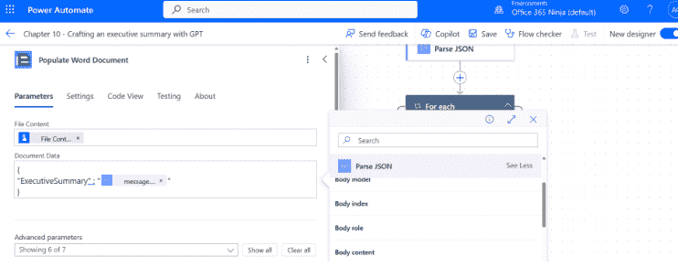

图 24.19 – 配置填充文档操作

4. 添加一个操作。
5. 添加“创建文件”OneDrive for Business 操作。
6. 在路径（`Path`）字段中，点击图标并选择根目录（`Root`）。
7. 在文件名（`File Name`）字段中，添加表达式：`concat(utcNow('yyyyMMdd'), '_', triggerBody()?['name'])`。
8. 在文件内容（`File Content`）字段中，添加来自“填充文档”操作的 `File Content` 动态内容。见**图 24.20**。


图 24.20 – 配置填充文档操作

9. 点击保存。

现在是见证时刻了！

## 测试流

为了测试此流，你需要一个像这样包含摘要令牌的 Word 文档。准备好后，让我们开始测试！

1. 从流设计器中，点击测试。
2. 选择手动单按钮，然后点击测试。
3. 填写包含项、排除项和额外说明区域。使用示例文本编写你自己的包含项和排除项。

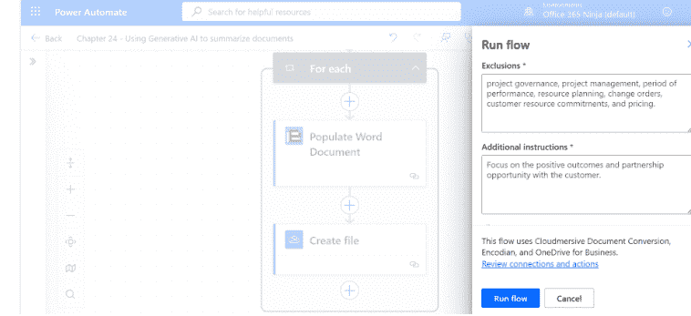

图 24.21 – 测试流

4. 滚动到窗口底部。在文件内容下，点击导入并浏览工作说明书（或你正在使用的任何文档）。
5. 点击运行流。

检查输出步骤以确保一切运行正常。

转到 OneDrive for Business 根目录下查找新创建的文件。打开它并导航到你放置摘要令牌的文档部分。

检查插入的内容。根据需要进行任何编辑，以确保内容适用于你的情况。

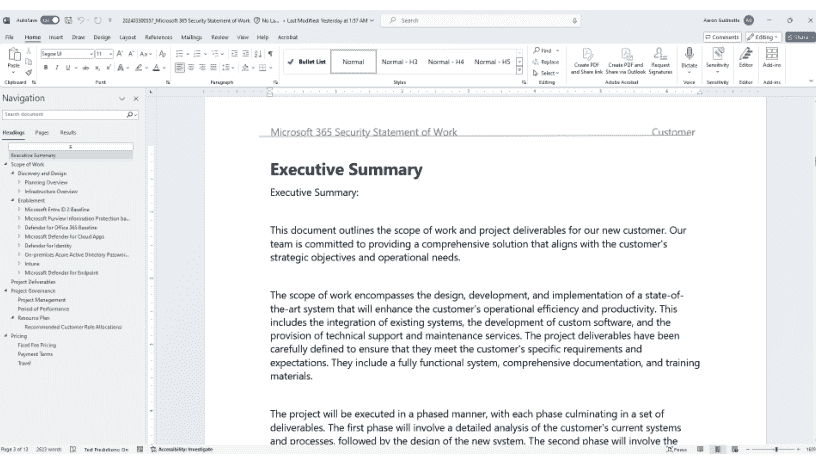

图 24.22 – 查看更新后的 Word 文档

## 恭喜！你成功验证了流！

## 进一步探索

现在你已成功为工作说明书创建了执行摘要，可以通过以下想法扩展此流的方法：

- 将输出文件保存到 Teams 站点、Google Drive 或 Dropbox 存储位置。
- 使用模板流创建其他标准文档部分。
- 构建更具针对性的提示来完成摘要。
- 添加更多令牌以进一步根据特定客户或业务需求定制输出。
- 使用 AI Builder 自定义提示操作代替向 OpenAI 发送 HTTP 操作。
- 添加额外的连接将输出转换为 PDF。
- 在触发器中添加电子邮件地址文本字段，可以使用它来发送完成的文档。

可以根据你使用的提示以及如何调整此流自由发挥创意。

## 总结

在本章中，我们引入了第三方连接器来帮助操作和增强 Word 文档。与我们在几个章节前分析情感时使用的原生 AI 生成器组件不同，我们结合系统提示和用户提示，将内容直接发送到 OpenAI ChatGPT 端点。在检索处理后的内容后，我们使用连接器的“查找并替换”操作将内容插入回源 Word 文档，然后将其保存到 OneDrive for Business。

在下一章中，我们将视角转向从导入、导出和分发的角度来管理 Power Automate 流。

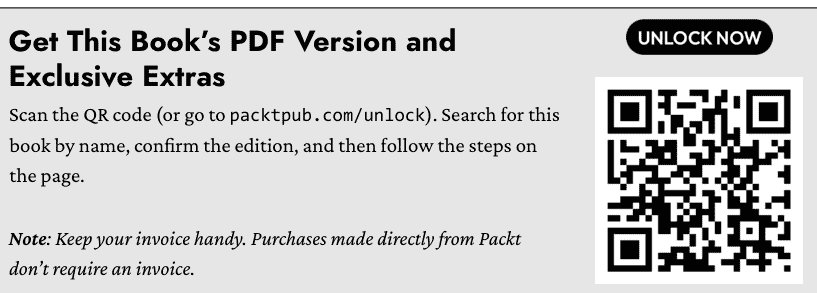
