#  25 流的导出、导入和分发

在某些时刻，可能有（或有用）对流进行备份复制以归档，或在环境之间移动它。这可能有几个原因，包括：

- 从开发或测试环境推广到生产环境
- 与其他团队或组织共享
- 归档或备份
- 发布到 Power Automate 社区

无论你的需求是什么，Power Automate 都能赋予你备份或导出、导入和共享流的能力。

在本章中，我们将探索以下概念：

- 导出流
- 导入流
- 分发流
- 使用解决方案（`Solutions`）

在本章结束时，你应当能够熟练掌握导出（或备份）、恢复（或导入）以及共享他人可以导入流的流程。

### 导出流

如果你想备份流或让流在另一个环境中可用，你就需要将其导出。导出流会使其具有可移植性，并让你具备移动它的能力。流可以导出为不同的格式：

- 程序包（`.zip`），用于导入 Power Automate
- Logic Apps 模板（`.json`），用于导入 Logic Apps
- 解决方案（流和连接的封装集合）

你选择的导出格式取决于目标环境是什么以及你构建流的时间。这些格式非常相似，因为 Power Automate 是与 Logic Apps 平台使用相同构建构建。在示例中，我们将查看用于在 Power Automate 中重用（相同或不同环境）的模板的步骤。

> 注意：2020 年 8 月之后创建的 Power Automate 流不支持“导出到 Logic Apps”功能，因为微软更改了用于创建流的协议为 OpenAPI 2.0 标准。Logic Apps 与此协议不兼容，因此所有 2020 年 8 月之后创建的流，“导出到 Logic Apps”功能已被禁用。

导出对话框还允许你检索对象 ID（称为流标识符），你可以将其用于其他调用方法，例如从 SharePoint 列中的按钮运行流。

### 以程序包导出流

要将流作为程序包导出，请遵循以下步骤：

1. 登录 Power Automate 制作网页门户 (`https://make.powerautomate.com`)。
2. 点击“我的流”(My flows)。
3. 点击要导出的流旁边的三个点，悬停在“导出”(Export)，然后选择“程序包 (.zip)”：

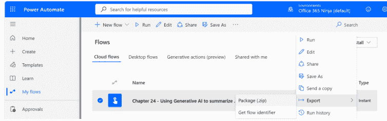

4. 在导出程序包页面上，为程序包输入名称。你可以添加有关环境的详细信息或导出流的描述。

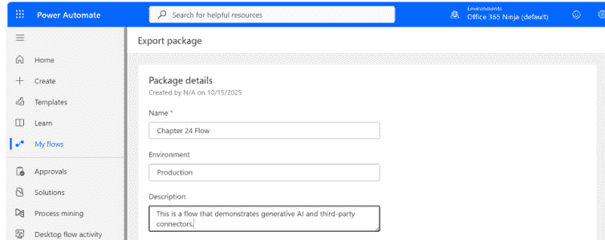

5. 滚动到页面底部查看导出中包含的连接器和资源类型。你可以通过点击每个资源行中相应的气泡图标为每个资源类型添加注释。

流的导出、导入和分发

查看图 25.3：

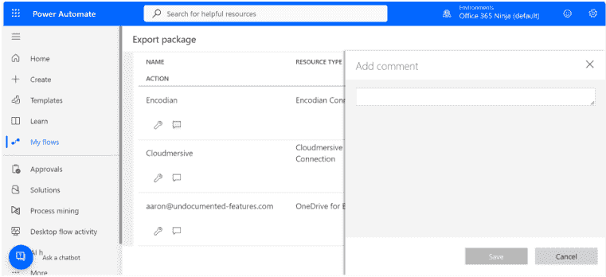

图 25.3 – 添加注释

6. 在流资源类型的类型的设置设置面板中，点击“更新”(Update)一词，以设置程序包在导入到目标环境时的默认配置方式。选择“创建新建”(Create as new) 在新的目标环境中创建流，或选择“更新”(Update) 以更新目标环境中的现有流。

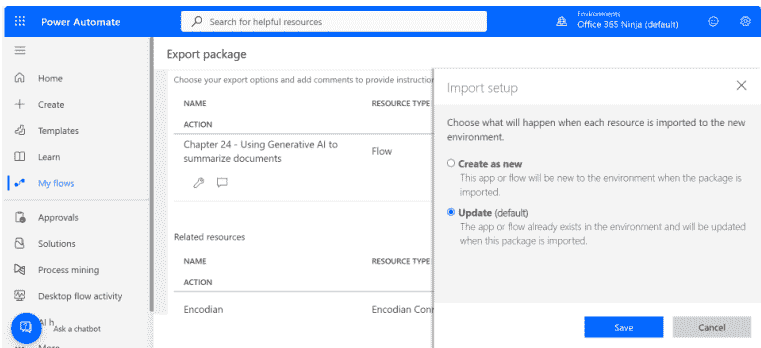

图 25.4 – 自定义导入行为

7. 点击每个资源的扳手图标，以自定义该资源的导入行为。
8. 点击“导出”(Export)。Power Automate 将生成一个 `.zip` 文件并触发开始下载。

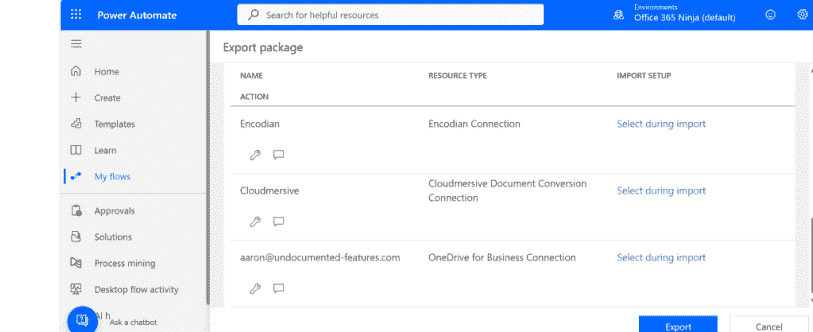

图 25.5 – 导出流

在导出下载完成后，你可以根据需要分发它，或存储副本以备备份。

### 以解决方案导出流

如果你正在处理一个独立的云流，导出是一项相对简单的任务。然而，如果你正在处理 Power Automate 桌面流或 Power Apps，你需要使用解决方案（因为涉及多个部分）。解决方案允许你将多个依赖组件封装在单个导出文件中。

要导出解决方案，请遵循以下步骤：

1. 导航到 Power Automate 制作门户 (`https://make.powerautomate.com`)。
2. 点击“解决方案”(Solutions)。
3. 选择“新建解决方案”(New solution)。

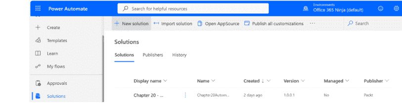

图 25.6 – 创建新解决方案

4. 输入显示名称和名称。
5. 选择发布者。你可以从现有租户发布者中选择，或点击“新建发布者”创建一个。
6. 输入版本号（默认为 1.0.0.0）。
7. 点击“创建”(Create)。

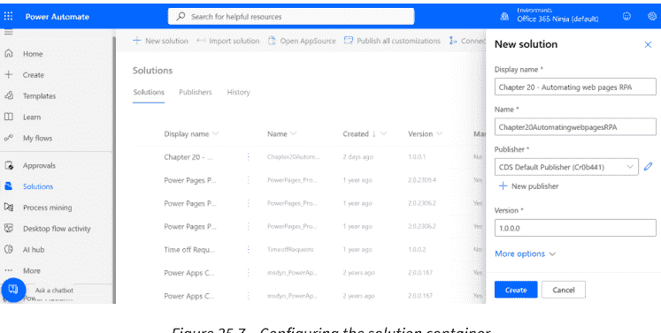

8. 点击“添加现有”，指向“自动化”，然后选择“桌面流”。

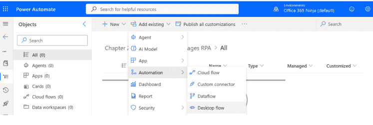

9. 选择你想添加到解决方案的桌面流并点击“添加”(Add)。

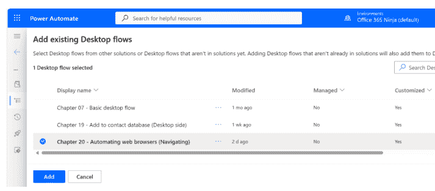

10. 点击栏上的“发布所有自定义项”(Publish all customizations) 以确保所有内容都是新的。

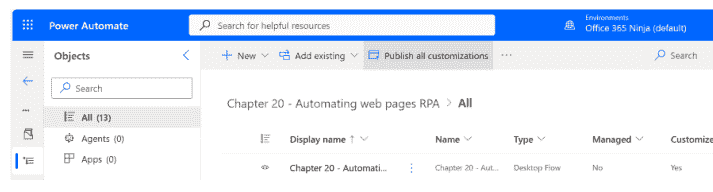

11. 点击“返回解决方案”箭头（左侧导航栏菜单之间）返回解决方案页面。
12. 选择解决方案，然后点击“导出”(Export)。

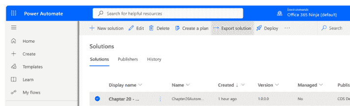

13. 点击“下一步”(Next)。
14. 选择“托管”(Managed，解决方案不可修改）或“非托管”(Unmanaged，解决方案可以修改），然后点击“导出”(Export)。

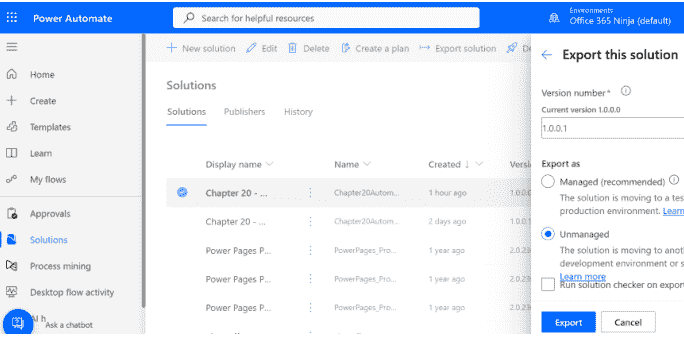

图 25.12 – 导出解决方案

15. 点击下载按钮下载出的解决方案。

接下来，我们将查看如何在环境中导入流。

### 导入流

导入流允许你获取一个环境的导出内容并重用逻辑。该过程非常简单，允许你在环境之间移动流。

你需要确保要导入的流受你的环境支持。示例包括：

- 可能在不同主权云之间不可用的连接器（例如 Office 365 全球、政府社区云或 Azure 中国之间）
- 尚未部署到目标环境的自定义连接器

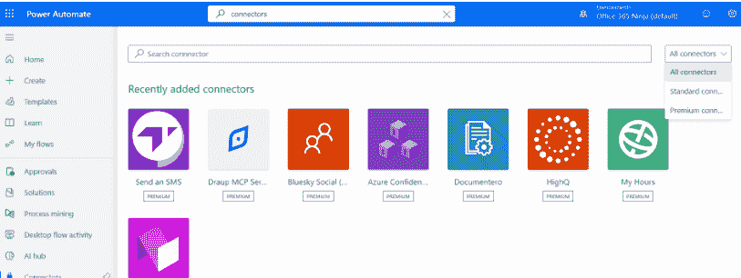

图 25.13 - 查看连接器类型

> 有标准和高级连接器的示例和信息，请参考链接：`https://make.powerautomate.com/en-us/connectors`。

### 导入流程序包

要导入流，请遵循以下步骤：

1. 登录 Power Automate 制作网页门户 (`https://make.powerautomate.com`)。
2. 点击“我的流”(My flows)。
3. 点击“导入”(Import)：

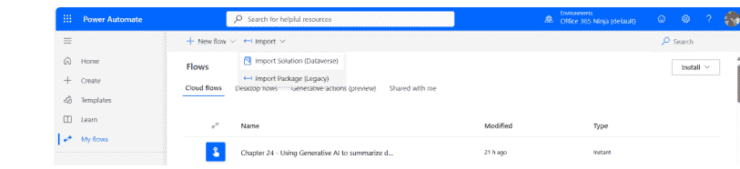

图 25.14 - 导入到我的流

4. 选择导入包（旧版版）。
5. 点击“上传”打开文件资源管理器窗口，并浏览到包含要导入流的 `.zip` 包文件：

图 25.15 – 上传包

6. 点击“操作”列下的扳手图标，以更新任何带有红色感叹号图标的项目（通常是凭据对象）。红色的项目表示在导入时按顺序需要配置或更新的内容。你也可以使用扳手图标更改在导出过程中设置的值的选项。

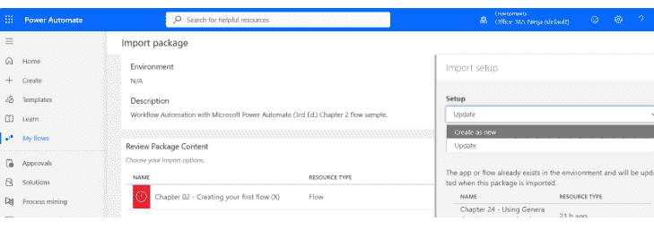

图 25.16 – 在导入前更新项目

7. 选择现有资源或点击“创建新建”以添加正确类型的新资源。然后，点击“保存”：
8. 完成后，点击**导入**。

流将在环境中创建。与任何模板导入或创建一样，请对其进行编辑，确保任何变量或选择列表已更新为正确的对象，以便流能够按预期运行。如果目标环境中当前没有服务或资源类型，需要在导入期间创建它。缺失的资源或服务项将配置为“新建”，你需要为它们指定凭据，如图 25.18 所示。对于目标环境中未配置配置的服务，你需要重复此过程。

### 导入解决方案

要导入解决方案，请按照以下步骤操作：

1. 登录 Power Automate 制作门户 (`https://make.powerautomate.com`)。
2. 点击**我的流**。

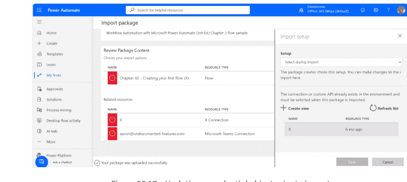

图 25.17 – 在导入前更新凭据对象

3. 点击“导入”：
4. 选择 Power Automate

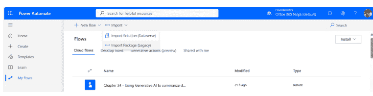

图 25.18 – 导入到我的流

5. 选择解决方案 (Dataverse)。
6. 点击“导入解决方案”。
7. 选择从何处导入（“设备”或“流水”）。如果你之前按照步骤导出了解决方案包，请选择“设备”。

图 25.19 – 从设备导入解决方案

8. 点击“浏览”。
9. 找到文件并点击“打开”。
10. 点击“下一步”。
11. 点击“导入”。
12. 等待解决方案导入。

接下来我们将查看分发流。

### 分发流

如果你导出了一个流并想将其共享，可以通过多种方式：

- 通过电子邮件发送导出的 `.zip` 文件
- 将导出的 `.zip` 文件发布在 OneDrive 或 Dropbox 等文件托管或共享站点
- 通过 Power Automate 发送流

前两种相对简单，我们将关注最后一种方法的步骤：通过 Power Automate 发送流。正如你所看到的，这些方法都允许用户下载并安装自己的流副本。

当你通过 Power Automate 发送流时，你是允许接收者下载并创建流的副本。这与你在第 7 章“共享流”中学习的共享流或转换为共享流不同。对于共享流，所有用户访问同一个流实例。当你发送流时，每个接收者都会获得一个可以个性化的副本。

要通过 Power Automate 发送流，请按照以下步骤操作：

1. 登录 Power Automate 制作门户 (`https://make.powerautomate.com`)。点击“我的流”，然后选择要发送的流。
2. 选择流末尾的三点，然后选择“发送副本”：

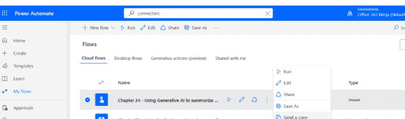

图 25.20 – 为要发送的用户准备流副本，然后点击“发送”：

3. 输入要发送流的用户的电子邮件地址，

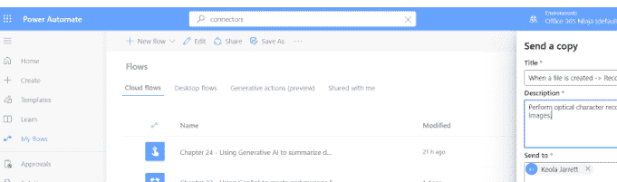

图 25.21 – 发送流副本

4. 接收者应该收到一封电子邮件，提示将流添加到其环境中。
5. 如果你是发送流的接收者，点击电子邮件正文中的“创建我的流”按钮开始导入和配置过程：

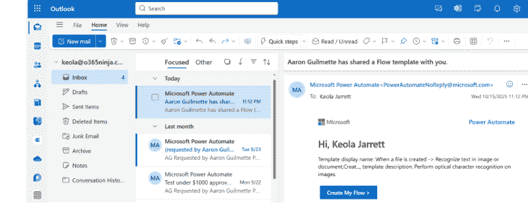

图 25.22 – 发送流的示例

6. 如必要，更新任何凭据并

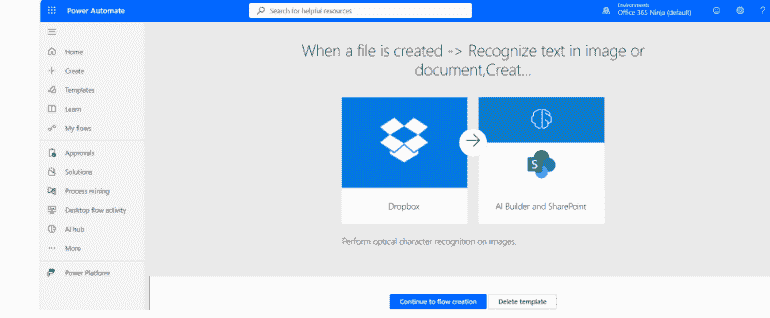

图 25.23 – 发送流的示例

7. 更新任何凭据并点击“继续”。

### 总结

在本章，你学习了如何使用 Power Automate 导出、导入、发送和发布流。导出允许你为了目的保存流的副本。导入允许你将之前导出的流带到当前环境中。最后，你学习了如何将流分给他人。在下一章中，我们将查看一些监控和排除故障的方法。

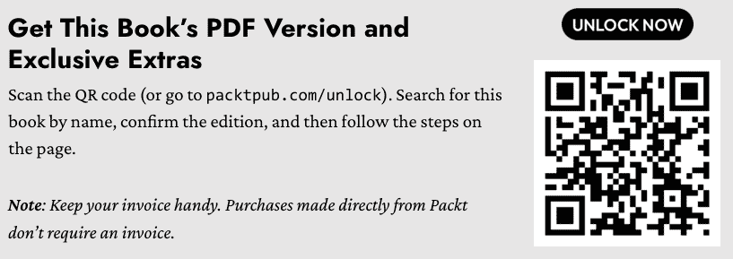
