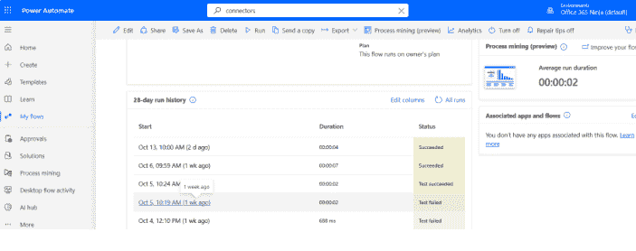
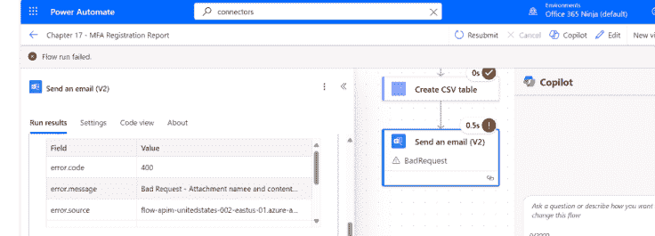
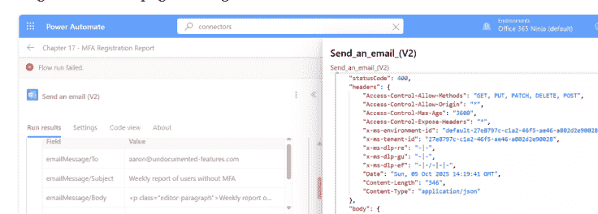
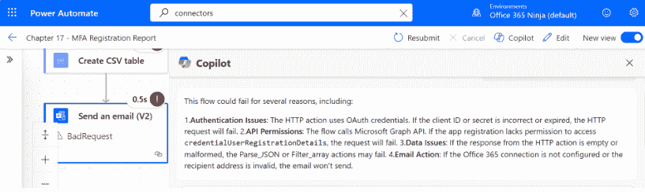
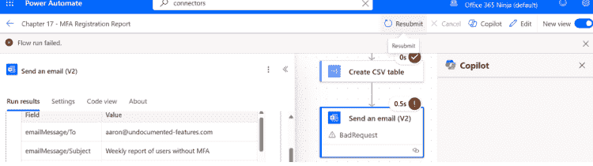
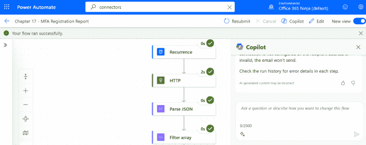
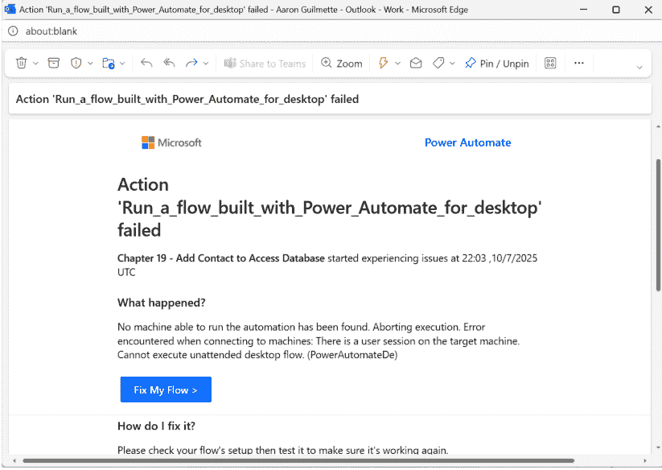
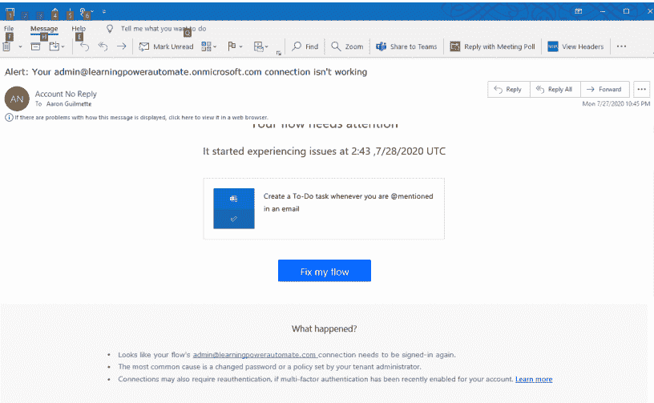
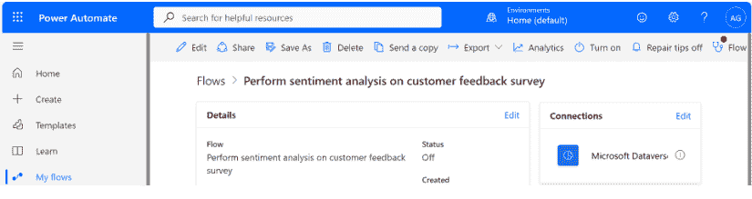
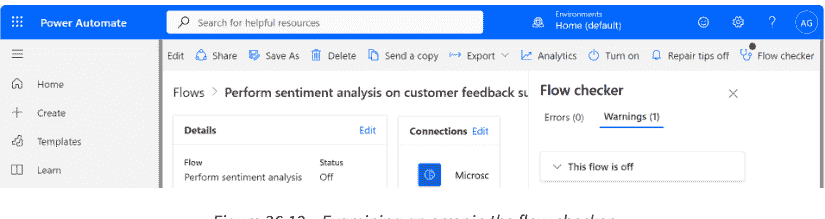

## 26 监控和排除流的故障

尽管付出了巨大努力，有时流仍然失败。这可能是凭据错误等简单问题，也可能是第三方供应商使你的流程失效等挑战。在本章中，我们将回顾 Power Automate 的一些故障排除功能和能力。这些提示和技术将帮助你排除失败的故障。我们将涵盖：

- 监控流
- 查看错误报告
- 解决身份验证错误
- 使用检查器检查详细错误
- 理解错误代码
- 查找资源

在本章结束时，你将理解如何排除故障并知道哪里寻求帮助。

### 监控流

在书中，你已经看到了特定流的运行历史示例。在本节中，我们将查看出现错误的流的运行历史并进行排错。对于此示例，我们将使用之前创建的一个依赖检查管理器的审批流。要遇到此错误，你需要作为一个未分配经理值的用户提交流。

### 查看运行历史

运行历史将显示过去 28 天内流执行的所有次数。要查看运行历史，请按照以下步骤操作：

1. 使用一个浏览器会话登录 Office 365 (`https://portal.office.com`)，使用未分配经理的用户。如果你在使用试用租户完成此过程，可以创建一个新用户账户且不分配经理。
2. 导航到采购审批网站并提交请求。如果你还没有创建此工作流，请回顾第 11 章“处理多个审批”，并创建一个类似的工作流。
3. 使用第二个浏览器会话导航到 Power Automate 制作门户 (`https://make.powerautomate.com`)。
4. 选择“订单请求两阶段审批”工作流。运行历史将显示在页面底部：

5. 在 28 天运行历史记录的“开始”（Start）列下，点击日期链接。
6. 将显示流运行情况。选择带有红色感叹号的步骤或操作。错误将在页面左侧的飞出面板中显示。

图 26.2 – 检查步骤

7. 大多数错误都包含有关失败步骤出现问题的详细信息。你可以滚动到发生发生错误的流部分（输入区域或输出区域）。点击“显示原始输入”（Show raw inputs）或“显示原始输出”（Show raw outputs），在页面右侧的飞出窗口中显示详细信息。参见图 26.3：

图 26.3 – 检查详细错误信息

大多数错误用易于理解的语言提供细节，帮助你清晰地理解问题源。然而，某些第三方连接器可能使用更难理解的语言。你可以使用*理解错误代码*部分列出的错误代码来帮助缩小问题范围。

你还可以使用 Copilot 获取故障排除提示，如**图 26.4** 所示。

图 26.4 – 查看来自 Copilot 的建议

接下来，我们将查看如何处理已解决问题的流。

### 重新提交流

一旦你解决了错误（在本例中，是为提交流的用户分配一个*经理*值值），你就可以通过重新提交流来让 Power Automate 尝试处理该流。

要重新提交流，请按照以下步骤操作：

1. 从流的运行历史中打开失败的运行。
2. 点击**重新提交**（Resubmit）按钮：

图 26.5 – 重新提交流

3. 在对话框中点击确定以确认重新提交的操作。

图 26.6 – 确认重新提交操作

4. 确认流按预期运行。

图 26.7 – 监控流的活动

如果遇到进一步的错误，请检查运行历史并查看错误详情。

接下来，我们将查看流失败时生成的错误报告。

### 检查电子邮件错误报告

当你是流的创建者且它发生错误时，Power Automate 将生成一封电子邮件并发送给你。以下截图显示电子邮件错误报告示例：

图 26.8 – 流失败运行的电子邮件通知

消息将包含与上节所示运行历史错误详细面板中显示类似的信息。点击“修复我的流”（Fix My Flow）按钮将引导你进入“编辑你的流”页面。

### 解决身份验证错误

常见错误之一是由于身份验证失败。考虑以下错误报告：

图 26.9 – 流身份验证错误

当账户新启用多因素身份验证、你的凭据更改或连接中使用的用户帐户失效时，可能会发生此类错误。

常见的身份验证错误消息包括**未授权**（Unauthorized），或显示错误代码 **401** 或 **403**。这些错误代码通常表示用户名和密码组合错误，或存在或其他安全问题。如果用户名和密码正确，403 错误代码可能意味着你尝试访问访问的账户没有所需的权限。

480 监控和故障排除流

要解决身份验证错误，请登录 Power Automate，打开流，然后点击**连接**（Connections）卡片中的**编辑**（Edit）链接来更新连接设置。

图 26.10 — 更新凭据对象

在下一节中，我们将查看流检查器如何帮助识别问题。

### 使用流检查器检查详细错误

流检查器是 Power Automate 内置的验证和故障排除工具。它会持续评估流的性能、可靠性和问题。如果流检查器确定存在错误，将在以下位置旁边显示红色气泡：

图 26.11 — 在流中观察错误

要查看流检查器检测的错误、警告或问题，请点击指示器：

图 26.12 — 在流中检查错误

接下来，我们将查看流失败时生成的错误报告。

# 26 

509

### 理解错误代码

如果你遇到错误，请检查运行历史并查看错误详情。接下来，我们将查看生成的错误报告。在与服务交互时，你可能会遇到其他错误代码。是一些示例代码：

| 错误代码 | 详情 |
| :--- | :--- |

# 错误代码参考

## 常见错误代码

| 错误代码 | 详情 |
| :--- | :--- |
| `401`, `403` | 未授权（Unauthorized）。通常是由于凭据错误，但也可能表示帐户缺少权限。 |
| `400` | 错误请求（Bad request）。这意味着提交的数据类型或格式不正确。 |
| `404` | 未找到（Not found）。此错误意味着找不到指定的资源或路径。 |
| `409` | 冲突（Conflict）。当两个进程尝试同时更新同一资源时，可能会发生。 |
| `423` | 文件锁定（File locked）。当你尝试访问被锁定或签出的资源时，可能会发生这种情况。 |

## 监控和故障排除流 (510)

| 错误代码 | 详情 | 建议 |
| :--- | :--- | :--- |
| `429` | 超过速率限制（Rate limit exceeded）。如果你遇到 API 请求限制（在短时间内请求过多），就会发生这种情况。 | 检查流的运行历史以查看执行了多少次。检查连接的服务是否有任何速率限制。减少流中的步骤或调用次数，或降低运行流的频率。 |
| `502` | 网关错误（Bad gateway）。当你指定 HTTP 而不是 HTTPS 作为 URL，或者尝试访问受响应错误的代理服务器保护的资源时，可能会发生。 | 验证指定的 URL 是否正确使用了 HTTP 协议。如果服务位于防火墙或代理服务器之后，请确保其配置正确。 |
| `503` | 服务不可用（Service unavailable）。此错误表示你尝试访问的服务无响应、部分离线或负载过高。 | 等待并重试。如果错误持续，请联系服务供应商查看服务是否可用。 |
| `504` | 网关超时（Gateway timeout）。这可能发生在受防火墙或代理保护的服务上，且连接超时或重置。此外，这可能表明服务受到入侵防御服务的中断。 | 验证保护资源的任何代理或防火墙服务配置正确且可用，并且没有入侵防御服务阻止请求。 |

**表 26.1 – Power Automate 错误代码**

如果你发现某些错误代码看起来很熟悉，是因为 `Power Automate` 基于标准的 Web 服务协议构建并访问 REST API 资源。检查你流中遇到的错误，以确定是否存在这些常见错误。

接下来，我们将查看一些额外的故障排除资源。

第 26 章 483

## 查找其他资源

有许多资源可以帮助排除和解决 `Power Automate` 问题：

| 资源 | URL |
| :--- | :--- |
| Power Automate 文档 | `https://learn.microsoft.com/en-us/power-automate/` |
| Power Automate 故障排除 | `https://learn.microsoft.com/en-us/troubleshoot-platform/power-automate/welcome-power-automate` |
| Power Automate 社区 | `https://powerusers.microsoft.com/t5/Microsoft-Power-Automate/ct-p/MPCommunity` |
| Power Automate 用户组 | `https://www.automateug.com/home` |

**表 26.2 - 额外的 Power Automate 资源**

如果你在流中使用了第三方应用程序作为一部分，你可能还想要查看它们提供的任何 REST API 文档。在排除服务提供程序的连接性和功能问题时，这是一份无价的资源。

## 总结

在本章中，你学习了如何使用 `Power Automate` 中的某些故障排除资源，包括运行历史和电子邮件错误报告。此外，你还学习了流检查器如何帮助识别流中的潜在问题。最后，你还了解了其他可以帮助扩展你的 `Power Automate` 知识和技能的资源。

---
