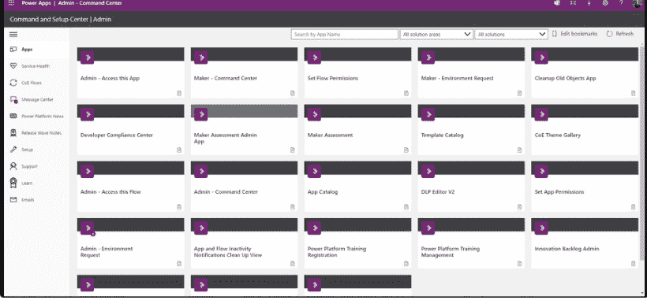
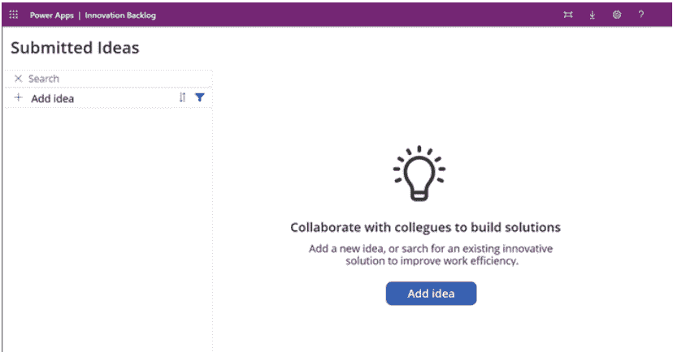
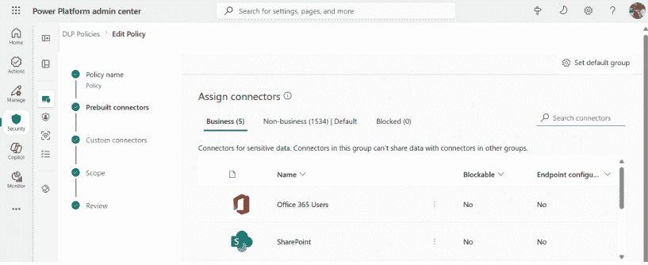

# 27 Power Platform 中的治理

在当今的现代工作场所中，数据和应用程序移动非常快——往往快于旨在保护它们的策略。Microsoft `Power Platform` 拥有 `Power Apps`、`Power Automate`、`Power BI` 和 `Power Pages` 等低代码工具，赋予了用户进行创新的能力，而无需等待 IT 部门。这种自由伴随着责任（至少对于企业 IT 而言）——确保每个应用、流和数据集都符合组织的安全、合规性和一致性标准。这正是数据和应用治理介入的场域——在创建者的灵活性和管理者的控制力之间建立平衡。

在本章中，我们将探索数据和应用治理的概念，以及它们如何为企业提供某些护栏，同时又不扼杀大家的创造力。

我们将涵盖以下主题：

- 理解治理概念
- 与 `Power Platform` 卓越中心（Center of Excellence）协作
- 识别合规性控制

让我们开始吧！

## 理解治理概念

数据治理的思想专注于对组织数据进行管理、完整性和保护。它定义了谁可以访问什么数据、这些数据如何分类，以及它们应该如何存储或共享。强大的数据治理策略允许企业信任 `Power BI` 仪表板生成的见解以及 `Power Automate` 流所做出的自动化决策。

另一方面，应用治理专注于应用程序和工作流如何在生态系统中进行部署和维护。如果没有适当的监督、策略或控制，`Power Platform` 将变得像狂野西部一样。`Power Platform` 最大的优势是它将业务自动化和应用创建交给了大众。同样，`Power Platform` 最大的劣势也是它将业务自动化和应用创建交给了大众。

虽然优势为开发具有创新性和洞察力工具的潜力打开了大门，但更频繁发生的劣势可能是由意图良好的员工创建了数百个未监控的应用或自动化任务。应用治理为应用生命周期管理、环境配置、数据泄漏防护（DLP）和所有权跟踪建立了标准。它确保每个解决方案（无论是由 IT 还是业务用户构建）都符合公司的合规和安全要求。

为了使这种治理成为现实，Microsoft 在 `Power Platform` 中直接包含了强大的工具。通过 `Power Platform` 管理中心，管理员拥有工具来管理环境、容量并在整个租户中应用策略。数据泄漏防护策略指定了哪些连接器可以跨服务共享数据，确保敏感信息不会流到批准通道之外。

卓越中心（CoE）启动包通过预构建的分析、仪表板和工作流扩展了这些功能，用于跟踪应用使用情况、识别高风险制作者并自动化治理任务。`Power BI` 集成提供了丰富的报告，以视觉化跨环境的采用趋势和合规状态。CoE 是一套强大的工具和仪表板，可以用于跟踪整个组织内 `Power Platform` 组件的生命周期和使用情况。

总而言之，它们为组织提供了一份负责任创新的指南。`Power Platform` 内部治理并不是为了扼杀创造力；它是在赋予力量的同时保持业务及其数据的安全。通过理解数据治理和权限治理之间的相互作用——并利用必要的管理工具——组织让用户安全地构建，同时确保对数字环境的端到端控制。这赋予了公民开发者创新的能力，同时得到了自动化技术的补充，该技术允许通过符合 ISO 标准审计和日志进行更强大的监督。这种赋能与监督的结合，将零散的公民构建应用集合转变为安全的、企业级的变革平台。

除了 CoE 工具外，Microsoft 还建议建立一个内部治理机构（由人员组成）来协调 `Power Platform` 治理，并鼓励采用和负责的开发实践。

## 与 Power Platform 卓越中心协作

`Power Platform` 卓越中心（CoE）是管理、治理和扩展低代码创新的组织骨干。随着企业日益依赖 `Power Apps`、`Power Automate`、`Power BI` 和 `Power Pages` 等工具，CoE 为原本可能变成混乱的临时应用和断开工作流构成的格局提供了结构和策略。它不仅仅是一个工具箱或一组仪表板——它还是一个驱动整个企业 `Power Platform` 生态系统采用、确保质量并维护控制的框架。

CoE 的核心是促进创新与治理之间的平衡。它赋予制作者构建解决方案的能力，同时让管理员能够看到这些解决方案是如何被创建、共享和使用的。CoE 为环境管理、命名规范、安全策略和连接器使用建立了最佳实践。它识别出值得 IT 支持的高价值应用，并突出了可能需要退役的冗余或未使用应用。这种主动的监督将 `Power Platform` 从独立项目的集合转变为一个协调的、可持续的转型系统。

由 Microsoft 开发的 `Power Platform` CoE 启动包为启动此工作提供了现成的基础。它包含了应用、`Power BI` 报告、流和 `Dataverse` 表，有助于监控使用情况、执行策略并鼓励业务部门与 IT 之间的协作。通过其仪表板，管理员可以看到谁在构建、应用使用的频率以及数据流向何处。这种可见性对于维护合规性、保护数据以及优化跨环境许可和资源至关重要。

安装和配置卓越中心超出了本书的范围，需要大量的管理时间和精力。要了解更多关于部署卓越中心启动包的信息，请访问 `https://learn.microsoft.com/en-us/power-platform/guidance/coe/starter-kit`。

卓越中心启动包的组件分为六类：

- 核心组件
- 业务价值工具包
- 治理组件
- 培养组件
- 主题组件
- 创新待办组件

在本节中，我们将涵盖这些每一个功能。

### 核心组件

核心组件构成了整个租户治理和运营洞察的基础。这些组件提供了理解 `Power Apps`、`Power Automate` 流和其他 `Power Platform` 资产如何被创建、共享和使用所需的清单和分析。通过在 `Dataverse` 中收集和存储有关环境、应用、连接器、制作者和流的元数据，核心组件建立了一个全面的记录系统，从而实现数据驱动的治理和决策。

这些组件的核心是一组清单同步流——使用 `Power` 管理连接器定期爬取你的租户的 `Power Automate` 云流。这些流收集了包括所有权、共享权限、环境容量、连接器使用情况和流活动在内的详细信息。你收集的数据填充 `Dataverse` 表，可以使用内置的 `Power Apps` 仪表板或包含的 `Power BI` 报告进行分析。

**第 27 章**

需要注意的是，CoE 组件本身是流、应用和仪表板，它们会消耗配额（例如流运行）。

```

```

**图 27.1 - Power Platform 卓越中心（CoE）命令与设置中心**

核心组件还包括模型驱动的 `Power Apps`，它们作为库存信息评估、分类和监督的行政平台。这些应用程序使管理员和治理团队能够对环境进行分类、定位高价值解决方案并监控合规性。此外，它们促进了与治理和培养组件的集成；例如，风险应用可以启动治理工作流，而出色的开发者可以获得认可和支持。

### 业务价值工具包

虽然核心组件跟踪库存和使用情况，但业务价值工具包侧重于结果——展示了使用 `Power Apps`、`Power Automate` 和 `Power BI` 构建的低代码解决方案转化为真实的业务效益。

该工具包使组织能够量化投资回报率 (ROI)、跟踪生产力提升，并收集成功案例，以证明持续投资该平台的合理性。

| 价值计算 | Microsoft Power Platform |
| :--- | :--- |
| 价值计算是您提供有关应用更详细信息的地方。它有助于构建和交付价值。通过各种下拉控件和影响来审查每个战略目标并考虑其贡献。跟踪可能出现在仪表板中生成的关键元素 | 提供更安全、健康的工作环境 <br> 健康与安全局 <br> 减少 <br> 通过建立和维护安全健康的工作场所，优先考虑员工的福祉，减轻危害并确保每个人健康。 <br> 核心声明 <br> 转型安全检查以获得更安全的工作场所 <br> 价值计算 <br> 工作场所事故减少 <br> -33.57% <br> £480,000.00 <br> 价值计算行动目标 <br> ○ 目标区域 <br> 已减少 <br> ○ 工作场所事故 实施前 <br> 143 实施后 <br> 95 <br> 价值计算的可用衡量标准 <br> ○ 平均工作场所受伤 |

**图 27.2 – 业务价值工具包内部的价值计算**

该工具包的核心提供了为创作者和业务单元设计的应用程序、模板和 `Power BI` 仪表板，以便准确记录其应用程序所解决的问题，评估潜在的时间或成本减少，并将这些结果连接到可衡量的业务指标。例如，创作者可能会展示一份演示文稿，说明 `Power App` 如何每周减少 10 小时的人工数据输入，或替代了产生巨额年度开支的过时工具。随后，管理员可以汇总这些发现，以说明整个组织节省的总工时、避免的成本或效率的提高。

除了指标之外，业务价值工具包还支持故事讲述和利益相关者参与。它帮助组织突出具有影响力的用例，识别值得进一步开发的高价值解决方案，并在团队之间共享最佳实践。通过将定量数据与定性洞察相结合，该工具包更容易向领导层传达 `Power Platform` 的战略价值，不仅展示了平台被使用的范围，还展示了它是如何创造可衡量价值的。

### 治理组件

治理组件将核心组件提供的可见性和监控扩展到主动控制和合规性管理。它包括自动化流程、应用和仪表板，帮助管理员执行组织标准、管理风险并维持对 `Power Platform` 使用情况的监督。通过这些工具，管理员可以识别潜在风险的应用或流——例如广泛共享或使用未经批准的连接器的应用——并触发自动化工作流对其进行审查、批准或修复。

### 培养组件

培养组件旨在通过学习、协作和最佳实践来成长和维持一个健康的创作者社区。它们包括应用、模板和通信内容，帮助管理员通过入职指南、培训资源和认可计划与创作者互动。目标是将普通用户转变为充满信心的公民开发者，让他们构建符合组织标准的安全、高质量的解决方案。

除了培训之外，培养组件还通过展示成功的应用、突出开发者的成就以及提供重用模板或想法提交平台来鼓励创新文化。这些功能培养了跨业务单元的社区感和共同目标。它们共同帮助组织负责任地扩大采用规模，赋予创作者技能和动机来创造价值，同时保持其开发与企业治理保持一致。

### 主题组件

主题组件允许组织在应用程序和仪表板中应用一致的视觉识别和品牌标识。它们提供了可重用的设计元素——例如标志、调色板和布局标准——有助于工具与组织的企业品牌保持一致。

### 创新积压组件

创新积压的元素为组织提供了一种系统方法，用于收集、评估和排序对新应用程序、流程或解决方案的提案。该框架涵盖应用程序和工作流，允许员工提交想法，阐述他们寻求解决的业务问题，并按部门或潜在影响对这些想法进行分类。

```

```

**图 27.3 向创新积压提交想法**

接下来，我们将查看 `Power Platform` 管理中心可用的数据和隐私控制。

## 识别合规控制

`Power Platform` 管理中心提供了许多工具来保护和管理跨企业的数据流。以下章节描述了可用的一些数据保护和合规能力。

### 客户托管加密密钥

Microsoft `Power Platform` 中的客户托管密钥 (CMK) 功能允许组织使用自己的加密密钥来保护存储在平台底层服务（如 `Dataverse`）中的数据。默认情况下，Microsoft 使用微软托管密钥对静态数据进行加密。

通过激活客户托管密钥，您的组织保留对密钥所有权和生命周期控制。这允许您在需要进行轮换、撤销或禁用。

### 连接器和数据策略

连接器策略和数据策略（也称为数据泄露防护 DLP 策略）是 `Power Platform` 中的关键治理功能，旨在控制数据在系统之间的移动方式。它们允许管理员定义可以使用哪些连接器——例如 `SharePoint`、`Outlook`、`SQL Server` 或 `Salesforce`。见图 27.4。

```

```

**图 27.4 - 查看连接器类别**

例如，DLP 策略可能允许 `Power Apps` 和 `Power Automate` 流使用 `SharePoint`，但禁止连接 `Twitter` 或 `Dropbox`。

### 网络策略

Azure 虚拟网络 (VNet) 策略通过网络隔离和访问控制为平台环境和 Azure 资源之间提供安全、私有的连接。通过 VNet 集成，管理员可以确保来自 `Power Apps`、`Power Automate` 和 `Dataverse` 的数据流量留在信任网络中，而不是经过公共互联网。此功能允许组织使用私有端点安全地连接到本地系统或 Azure 服务。

您可以在此处了解更多关于 `Power Platform` 的 VNet 能力：`https://learn.microsoft.com/en-us/power-platform/admin/vnet-support-overview`。

### 防火墙策略

防火墙策略通过限制连接到 `Dataverse` 的 IP 地址或范围，允许组织管理和保护环境的网络访问。这些策略充当屏障，仅允许来自信任网络（如公司办公室、VPN 网关或指定的 Azure 区域）的流量。管理员可以在 `Power Platform` 管理中心设置防火墙规则。

### 租户隔离

租户隔离是一种治理和安全功能，控制数据在不同 Microsoft `Entra ID`（原 Azure AD）租户之间的移动方式，帮助组织防止跨边界的未经授权共享。它允许管理员定义并执行阻止或允许特定的 `Power Apps`、`Power Automate` 以及其他 `Power Platform` 服务连接。在配置租户隔离的情况下，创作者只能连接到已批准的租户或环境，确保敏感业务数据留在组织的信任域内。

### Cookie 管理

IP Cookie 绑定是一种安全功能，通过将用户的身份验证 Cookie 与发行时的 IP 地址绑定，防止会话劫持和未经授权的访问。启用后，此机制可确保如果会话 Cookie 被不同的 IP 地址拦截或重用，会话将失效，从而有效阻止潜在入侵者。

### Copilot 代理身份验证

`Copilot` 代理通过 Microsoft `Entra ID` (Azure AD) 进行身份验证，继承其运行的用户或环境的权限和访问控制。这意味着 `Copilot` 只能与经过验证的用户或应用程序有权访问的数据进行交互，从而符合组织的安全策略。

## 总结


在本章中，你学习了 Power Platform 和卓越中心启动套件（Center of Excellence Starter Kit）的数据治理、管理和安全功能。这些功能共同可以帮助你保护组织最关键的资产——数据。

恭喜你读完了这本书的最后部分！我们希望你在阅读后，对 Power Automate 如何帮助提高生产力有了更深入了解，并获得了一些如何将 Power Automate 纳入你的工具箱的真实案例。

## 解锁你的专属福利

你购买的这本书包含以下专属福利：

- 下一代 Packt Reader
- 无 DRM 限制的 PDF/ePub 下载

请按照下方指南解锁这些福利。该过程仅需分钟，只需完成一次。

### 通过 3 个简单步骤解锁本书的免费福利

#### 第 1 步

请为第 3 步准备好你的购买发票。如果你拥有纸质版，请使用手机扫描并将其保存为 PDF、JPG 或 PNG 格式。

如需更多关于查找发票的帮助，请访问 https://www.packtpub.com/unlock-benefits/help。

> 注意：如果你直接从 Packt 购买此书，则不需要发票。完成第 2 步后，你可以立即访问你的专属内容。

#### 第 2 步

扫描二维码或访问 `packpub.com/unlock`。

在打开的页面上（类似于桌面端的图 28.1），按名称搜索此书并选择正确的版本。

**发现并解锁你书籍的专属福利**

买了 Packt 的书吗？你的购买可能附带免费赠送福利，旨在最大化你的学习效果。在此发现并解锁这些福利

图 28.1：桌面端的 Packt 解锁落地页

#### 第 3 步

选择书籍后，登录你的 Packt 账户或免费创建一个账户。然后上传你的发票（PDF、PNG 或 JPG，大小不超过 10 MB）。按照屏幕上的指令完成流程。

### 需要帮助吗？

如果你遇到困难并需要帮助，请访问 https://www.packpub.com/unlock-benefits/help 查看有关如何查找发票等的详细常见问题解答。此二维码将带你进入帮助页面。

> 注意：如果你仍然遇到问题，请联系 `customercare@packt.com`。

### Packt

`packtpub.com`

订阅我们的在线数字图书馆，即可访问超过 7,000 本`书籍和视频`，以及行业领先的工具，帮助你规划个人发展并促进职业进步。更多信息，请访问我们的网站。

#### 为什么要订阅？

- 通过来自 4,000 多名行业专业人士的实用电子书和视频，减少学习时间，增加编码时间
- 通过专为你定制的技能计划（Skill Plans）提升学习效果
- 每月获得一本免费电子书或视频
- 全文搜索方便访问关键信息
- 内容支持复制粘贴、打印和书签

在 `www.packtpub.com`，你还可以阅读免费技术文章集，订阅一系列免费通讯邮件，并接收 Packt 书籍和电子书的专属折扣和优惠。

### 你可能喜欢的其他书籍

如果你喜欢这本书，你可能对 Packt 的其他书籍感兴趣：

#### 数字转型 Power Platform 指南（The Power Platform Playbook for Digital Transformation）

`Victor Dantas`, `Chris Huntingtonford`

ISBN: 978-1-80512-1-398

- 使用 Power Platform 的低代码能力设计并部署端到端业务解决方案
- 使用低代码/无代码自动化流程并消除效率
- 实现 Power Platform 治理、安全和合规的最佳实践以取得成功
- 将 Power Platform 与 Microsoft 365、Dynamics 365 以及第三方应用程序集成
- 利用真实案例制定数字化转型和变更管理策略
- 利用 AI 驱动的工具优化业务工作流并增强用户体验

#### Microsoft Power Apps 食谱（Microsoft Power Apps Cookbook）

`Matthew Weston`, `Elisa Mendoza`

ISBN: 978-1-83546-5-158

- 理解生态系统
- 开启画布应用（canvas apps）的第一步
- 探索新的连接器，如控件
- 在 Dataverse 中存储数据
- 优化你的应用性能
- 集成机器人流程自动化 (RPA) 云流
- 构建响应式应用
- 使用 AI 开发自定义应用

#### 学习 Power Apps（Learn Power Apps）

`Matthew Weston`, `Elisa Mendoza`

ISBN: 978-1-80107-0-645

- 利用 AI 驱动的 Copilot
- 构建模型驱动应用
- 使用 AI 开发自定义应用
- 发现以下技术：
- 使用 AI Builder 自动化流程
- 了解许可机制

### Packt 正在寻找作者

如果你有意成为 Packt 的作者，请访问 `packt.com` 并提交你的想法。我们曾与数千上万像你这样的开发者和技术专业人士合作，分享他们的见解。

### 分享你的想法

现在你已经完成了《使用 Power Automate 进行工作流自动化》（第三版），我们非常想听听你的想法！如果你是从亚马逊购买的此书，请点击此处直接进入评论页面。你的评论对我们非常重要，并帮助我们确保交付了高质量的内容。

---
